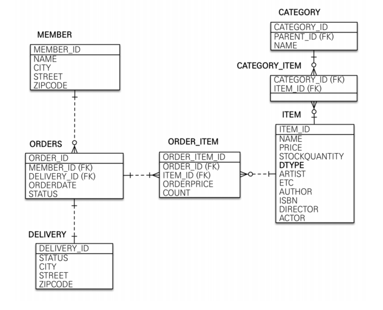

# *요구사항 분석* 

### *기능 정리*

- ***회원 기능***
- *회원 등록* 
  - *회원 조회*
- ***상품 기능***
- *상품 등록* 
  - *상품 수정*
  - *상품 조회*
- ***주문 기능***
- *상품 주문*
  - *주문 내역 취소*
  - *주문 취소*
- ***기타 요구사항***
- *상품은 재고 관리가 필요*
  - *상품의 종류는 도서, 음반, 영화가 존재*
  - *상품을 카테고리로 구분할 수 있다*
  - *상품 주문시 배송 정보를 입력할 수 있다*

# ***도메인과 테이블 설계***


### ***엔티티 분석*** 


### ***테이블 분석***



# ***엔티티 클래스 작성***

```java
public enum DeliveryStatus {
    READY, COMP
}

public enum OrderStatus {
    ORDER, CANCEL
}

@Entity
@Getter @Setter
@NoArgsConstructor(access = AccessLevel.PUBLIC)
public class Member {

    @Id @GeneratedValue(strategy = GenerationType.IDENTITY)
    @Column(name = "member_id")
    private Long id;

    private String username;

    @Embedded
    private Address address;

    @OneToMany(mappedBy = "member")
    private List<Order> orders = new ArrayList<>();
}

@Entity
@Table(name = "orders")
@Getter @Setter
@NoArgsConstructor(access = AccessLevel.PUBLIC)
public class Order {
    @Id
    @GeneratedValue(strategy = GenerationType.IDENTITY)
    @Column(name = "order_id")
    private Long id;

    @ManyToOne(fetch = FetchType.LAZY)
    @JoinColumn(name = "member_id")
    private Member member;

    @OneToMany(mappedBy = "order")
    private List<OrderItem> orderItems = new ArrayList<>();

    @OneToOne(fetch = FetchType.LAZY)
    @JoinColumn(name = "delivery_id")
    private Delivery delivery;

    private LocalDateTime orderDate;

    @Enumerated(EnumType.STRING)
    private OrderStatus status;
}

@Entity
@Getter @Setter
@NoArgsConstructor(access = AccessLevel.PUBLIC)
public class Delivery {

    @Id @GeneratedValue(strategy = GenerationType.IDENTITY)
    @Column(name = "delivery_id")
    private Long id;

    @OneToOne(fetch = FetchType.LAZY, mappedBy = "delivery")
    private Order order;

    @Embedded
    private Address address;

    @Enumerated(EnumType.STRING)
    private DeliveryStatus status;
}

@Entity
@Getter @Setter
@NoArgsConstructor(access = AccessLevel.PUBLIC)
public class OrderItem {
    @Id @GeneratedValue(strategy = GenerationType.IDENTITY)
    private Long id;

    @ManyToOne(fetch = FetchType.LAZY)
    @JoinColumn(name = "order_id")
    private Order order;

    @ManyToOne(fetch = FetchType.LAZY)
    @JoinColumn(name = "item_id")
    private Item item;

    private int orderPrice;
    private int count;
}

@Entity
@Getter @Setter
@NoArgsConstructor(access = AccessLevel.PUBLIC)
@Inheritance(strategy = InheritanceType.SINGLE_TABLE)
@DiscriminatorColumn(name = "type")
public abstract class Item {

    @Id @GeneratedValue(strategy = GenerationType.IDENTITY)
    @Column(name = "item_id")
    private Long id;

    private String name;

    private int price;

    private int stockQuantity;

    @ManyToMany(mappedBy = "items")
    private List<Category> categories = new ArrayList<>();
}

@Entity
@Getter
public class Movie extends Item {
    private String director;
    private String actor;
}

@Entity
@Getter
public class Album extends Item {
    private String artist;
    private String etc;
}

@Entity
@Getter
public class Book extends Item {
    private String author;
    private String isbn;
}


@Entity
@Getter @Setter
@NoArgsConstructor(access = AccessLevel.PUBLIC)
public class Category {
    @Id
    @GeneratedValue(strategy = GenerationType.IDENTITY)
    @Column(name = "category_id")
    private Long id;

    private String name;

    @ManyToOne(fetch = FetchType.LAZY)
    @JoinColumn(name = "parent_id")
    private Category parent;

    @OneToMany(mappedBy = "parent")
    private List<Category> child = new ArrayList<>();

    @ManyToMany
    @JoinTable(name = "category_item",
        joinColumns = @JoinColumn(name = "category_id"),
        inverseJoinColumns = @JoinColumn(name = "item_id")
    )
    private List<Item> items = new ArrayList<>();
}

```

- ***Categoty Entity***
- *Category ↔ Item @ManyToMany 사용(실무에서는 사용 금지)*
  - *Category parent, child self Mapping*
- ***Item Entity***
- *상속 관계 - abstract class, single table 전략 사용*
- ***Address***
- *값 타입, immutable 객채로 설계*
- ***Order*** 
- *Order ↔ Delivery @OneToOne Order에서 외래키 관리*
- ***나머지는 설명 생략***

# ***엔티티 설계시 주의점***

***엔티티에 Setter를 사용하지 말자***

***모든 연관관계를 지연로딩으로 설정하자***

- *즉시로딩은 예측이 어렵고, 특히 JPQL 사용할 때 N+1 문제가 자주 발생한다.*
- *연관된 엔티티를 함께 DB에서 조회해야 하면, fetch join 또는 엔티티 그래프 기능을 사용한다.*
- *OneToOne, ManyToOne 관계는 default가 즉시로딩이므로 직접 지연로딩으로 설정해야 한다.*

***컬렉션은 필드에서 초기화 하자***

- *null pointer exception 문제에  안전하다.*
- *하이버네이트는 엔티티를 영속화 할 때, 컬랙션을 감싸서 하이버네이트가 제공하는 내장 컬렉션으로 변경한다.* 
*만약 임의의 메소드에서 컬렉션을 잘못 생성하면 하이버네이트 내부 메커니즘에 문제가 발생할 수 있다.*
- *필드레벨에서 생성하는 것이 가장 안전하고 코드도 간결하다*

***테이블, 컬럼명 생성 전략***

- *엔티티(필드) → 테이블(컬럼)*
- *카멜케이스 → 언더스코어*
- *memberPoint → member_point*

