### 개요 

MySQL 서버로 요청된 쿼리는 결과는 동일하지만 내부적으로 그 결과를 만들어내는 방법은 매우 다양하다.

이런 다양한 방법 중에서 어떤 방법이 최적이고 최소의 비용이 소모될지 결정해야 한다.

MySQL에서는 쿼리를 최적으로 실행하기 위해 각 테이블의 데이터가 어떤 분포로 저장돼 있는지 통계 정보를 참조한다. 또한 그런 기본 데이터를 비교해 최적의 실행 계획을 수립하기 위한 작업이 필요하다.

거의 대부분의 DMBS에서 옵티마이저가 이 기능을 담당한다.

MySQL에서는 EXPLAIN 명령어로 쿼리의 실행 계획을 확인할 수 있다.

많은 정보가 출력되는데 제대로 이해하려면 옵티마이저가 실행하는 최적화에 대해 지식을 갖추고 있어야 한다.

MySQL 서버가 사용자의 요청을 처리하기 위해 데이터를 가공하는 절차와 수행하는 최적화에 대해 학습하자.

---

옵티마이저가 만들어 내는 실행 계획을 이해하는 것은 상당히 어려운 부분이다.

하지만 실행 계획을 이해할 수 있어야만 실행 계획의 불합리한 부분을 찾아내고, 더 최적화된 방법으로 실행 계획을 수립하도록 유도할 수 있다. 

---

# 9.1.1 쿼리 실행 절차

**MySQL 서버에서 쿼리가 실행되는 과정 3단계** 

  1. 사용자가 요청한 SQL 문장을 잘게 쪼개서 MySQL 서버가 이해할 수 있는 수준으로 분리(파스 트리)한다.
  1. SQL의 파싱 정보(파스 트리)를 확인하면서 어떤 테이블을 읽고 어떤 인덱스를 이용해 테이블을 읽을지 선택
  1. 두 번째 단계에서 결정된 테이블의 읽기 순서나 선택된 인덱스를 이용해 스토리지 엔진으로부터 데이터를 가져온다.

첫 번째 단계를 **SQL 파싱(Parsing)**이라고 하며, **SQL 파서(쿼리 파서)**를 통해 처리한다.

SQL 문장이 문법적으로 오류가 있으면 이 단계에서 걸러진다.

이 단계에서 **“SQL 파스 트리”**가 만들어진다.

→ MySQL 서버는 SQL 문장 그 자체가 아니라 SQL 파스 트리를 이용해 쿼리를 실행한다.

첫 번째 단계와 두 번째 단계 중간에서 **전처리기**가 만들어진 파스 트리를 분석하여 구조적인 문제점을 확인한다.

테이블 이름이나, 내장 함수 같은 객체를 매핑해 해당 객체의 존재 여부 및 접근 권한을 확인한다.

두 번째 단계에서는 **옵티마이저**가 만들어진 SQL 파스 트리를 참조하면서 다음과 같은 내용을 처리한다.

  - 불필요한 조건 제거 및 복잡한 연산의 단순화
  - 여러 테이블의 조인이 있는 경우 어떤 순서로 테이블을 읽을지 결정
  - 각 테이블에 사용된 조건과 인덱스 통계 정보를 이용해 사용할 인덱스를 결정
  - 가져온 레코드들을 임시 테이블에 넣고 다시 한번 가공해야 하는지 결정

해당 단계는 **“최적화 및 실행 수립”** 단계이며 옵티마이저가 처리한다. 

이 단계가 완료되면 **“실행 계획”**이 만들어진다.

세 번째 단계에서는 수립된 실행 계획대로 스토리지 엔진에 레코드를 읽어오도록 요청하고, MySQL 엔진에서는 스토리지 엔진으로부터 받은 레코드를 조인하거나 정렬하는 작업을 수행한다.

첫 번째 단계와 두 번째 단계는 거의 MySQL 엔진에서 처리하며, 세 번째 단계는 MySQL 엔진과 스토리지 엔진이 동시에 참여한다.

---

# 9.1.2 옵티마이저의 종류

옵티마이저는 데이터베이스 서버의 두뇌와 같은 역할을 담당한다. 

옵티마이저는 **비용 기반 최적화(Cost-based-optimizer, CBO)** 방법과 **규칙 기반 최적화 방법(Rule-based optimizer, RBO)**으로 크게 나눌 수 있다.

### 규칙 기반 최적화

대상 테이블의 레코드 건수나 선택도 등을 고려하지 않고 내장된 우선순위에 따라 실행 계획을 수립하는 방식을 의미한다. 이 방식에서는 통계 정보(레코드 건수, 칼럼값의 분포도)를 조사하지 않고 실행 계획이 수립되기 때문에 같은 쿼리에서는 거의 항상 같은 실행 방법을 만들어 낸다.

하지만 사용자의 데이터는 다양하기 때문에 **규칙 기반의 최적화는 오래전부터 많은 DBMS에서 사용되지 않는다.** 

### 비용 기반 최적화

쿼리를 처리하기 위한 여러 가지 방법을 만들고, **각 단위 작업의 비용(부하)정보와 대상 테이블의 예측된 통계 정보를 이용해 실행 계획별 비용을 산출**한다. 산출된 여러 방법중에 비용이 최소로 소요되는 방식을 선택해 쿼리를 실행한다.

현재 대부분의 RDBMS가 비용 기반의 옵티마이저를 채택하고 있으며, MySQL 역시 마찬가지다.

---

모든 RDBMS는 데이터를 정렬하거나 그루핑하는 등의 기본 데이터 가공 기능을 가지고 있다.

결과물은 동일하더라도 RDBMS 별로 그 결과를 만들어 내는 과정은 천차만별이다.

기본적인 가공을 위해 MySQL 서버가 어떤 알고리즘을 사용하는지 알아보자.

---

# 9.2.1 풀 테이블 스캔과 풀 인덱스 스캔

풀 테이블 스캔은 인덱스를 사용하지 않고 테이블의 데이터를 처음부터 끝까지 읽어서 요청된 작업을 처리하는 작업을 의미한다. 

MySQL 옵티마이저가 풀 테이블 스캔하는 경우

  - 테이블의 레코드 건수가 너무 작아서 인덱스를 통해 읽는 것보다 풀 테이블 스캔을 하는 편이 더 빠른 경우(일반적으로 테이블이 페이지 1개로 구성된 경우)
  - WHERE 절이나 ON 절에 인덱스를 이용할 수 있는 적절한 조건이 없는 경우
  - 인덱스 레인지 스캔을 사용할 수 있는 쿼리라고 하더라도 옵티마이저가 판단한 조건 일치 레코드 건수가 너무 많은 경우(인덱스의 B-Tree 샘플링해서 조사한 통계 정보 기준)

일반적으로 테이블의 전체 크기는 인덱스보다 훨씬 크기 때문에 테이블을 처음부터 끝까지 읽는 작업은 상당히 많은 디스크 읽기가 필요하다. 그래서 대부분 DBMS는 **풀 테이블 스캔을 실행할 때 한꺼번에 여러 개의 페이지를 읽어오는 기능을 내장**하고 있다. 

MySQL에서는 풀 테이블 스캔을 실행할 때 한꺼번에 몇 개씩 페이지를 읽어올지 설정하는 시스템 변수가 없다. MyISAM 스토리지 엔진에서는 디스크에서 페이지를 가져올 때 1개의 페이지씩 가져오지만 InnoDB 스토리지 엔진은 특정 테이블의 **연속된 데이터 페이지가 읽히면 백그라운드 쓰레드에 의해 리드 어헤드(Read ahead) 작업이 자동으로 시작된다.**

**리드 어헤드란** 어떤 영역의 데이터가 앞으로 필요해지라는 것을 예측해서 요청이 오기 전에 미리 디스크에서 읽어 InnoDB 버퍼 풀에 가져다 두는 것을 의미한다. 즉, 공간 지역성의 원리를 따른다. 

풀 테이블 스캔이 실행되면 처음 몇 개의 데이터 페이지는 포그라운드 쓰레드가 페이지 읽기를 실행하지만 특정 시점부터는 읽기 작업을 백그라운드 스레드로 넘긴다.

백그라운드 쓰레드가 읽기를 넘겨받는 시점부터는 한 번에 4개 또는 8개씩 페이지를 읽으면서 계속 그 수를 증가시킨다. 이때 한 번에 최대 64개의 페이지를 읽어서 버퍼 풀에 저장해 둔다.

포그라운드 쓰레드는 미리 버퍼 풀에 준비된 데이터를 가져다 사용하기만 하면 되므로 처리가 상당히 빨리 처리되는 것이다.

MySQL 서버에서는 `innodb_read_ahead_threshold`  시스템 변수를 이용해 언제 리드 어헤드를 실행할 지 임계값을 설정할 수 있다.

리드 어헤드 작업은 풀 테이블 스캔에서만 사용되는 것이 아니라 풀 인덱스 스캔에서도 동일하게 사용된다.

```sql
SELECT COUNT(*) FROM employees;
```

이 쿼리는 아무런 조건 없이 레코드 건수를 조회하고 있다. 

이 쿼리의 실행 계획은 풀 테이블 스캔보다는 풀 인덱스 스캔을 하게 될 가능성이 높다.

단순히 레코드의 건수만 필요로 하는 쿼리라면 용량이 작은 (칼럼 개수 2~3)인덱스를 선택하는 것이 디스크 읽기 횟수를 줄일 수 있기 때문이다.

 

```sql
SELECT * FROM employees;
```

이 쿼리는 레코드에만 있는 칼럼이 필요하니 풀 테이블 스캔을 한다.

---

## 9.2.2 병렬 처리

MySQL8.0 버전부터 제한적으로 쿼리의 병렬 처리가 가능해졌다.

여기서 말하는 병렬 처리는 하나의 쿼리를 여러 스레드가 작업을 나누어서 동시에 처리한다는 것을 의미한다.

`innodb_parallel_read_threads` 시스템 변수를 이용해 하나의 쿼리를 최대 몇 개의 쓰레드를 이용해서 처리할지를 변경할 수 있다. 

아직 여러 개의 쓰레드를 이용해 병렬로 처리하게 하는 힌트나 옵션은 없다.

다음 예제와 같이 아무런 WHERE 조건 없이 단순 테이블의 전체 건수를 가져오는 쿼리만 병렬로 처리할 수 있다.

```sql
// default 4 
SHOW variables LIKE 'innodb_parallel_read_threads';

SET SESSION innodb_parallel_read_threads=1;
SELECT COUNT(*) FROM salaries;
+----------+
| COUNT(*) |
+----------+
|  2844047 |
+----------+
1 row in set (0.84 sec)

SET SESSION innodb_parallel_read_threads=2;
SELECT COUNT(*) FROM salaries;
+----------+
| COUNT(*) |
+----------+
|  2844047 |
+----------+
1 row in set (0.87 sec)


SET SESSION innodb_parallel_read_threads=4;
SELECT COUNT(*) FROM salaries;
+----------+
| COUNT(*) |
+----------+
|  2844047 |
+----------+
1 row in set (0.93 sec)

SET SESSION innodb_parallel_read_threads=8;
SELECT COUNT(*) FROM salaries;
+----------+
| COUNT(*) |
+----------+
|  2844047 |
+----------+
1 row in set (0.89 sec)
```

결과 상태가..? 

병렬 처리용 스레드 개수를 아무리 늘리더라도 서버에 장착된 CPU 코어 개수를 넘어서는 경우에는 오히려 성능이 떨어질 수도 있으니 주의하자.

---

# 9.2.3 ORDER BY 처리(Using filesort)

레코드 1~2건을 가져오는 쿼리를 제외하면 대부분의 SELECT 쿼리에서 정렬은 필수적으로 사용된다.

정렬을 처리하는 방법은 **인덱스를 이용하는 방법**과 쿼리가 실행될 때 **“Filesort”라는 별도의 처리**를 이용하는 방법으로 나눌 수 있다.

|  | 장점 | 단점 |
| --- | --- | --- |
| 인덱스 이용  | INSERT, UPDATE, DELETE 쿼리가 실행될 때 이미 인덱스가 정렬돼 있어서 순서대로 읽기만 하면 되므로 매우빠르다.<br><br> | INSERT, UPDATE, DELETE 작업 시 부가적인 인덱스 추가/삭제 작업이 필요하므로 느리다.<br>인덱스 때문에 디스크 공간이 더 많이 필요하다.<br>인덱스의 개수가 늘어날수록 InnoDB 버퍼 풀을 위한 메모리가 많이 필요하다. |
| Filesort 이용 | 인덱스를 생성하지 않아도 되므로 인덱스를 이용할 때의 단점이 장점으로 바뀐다.<br>정렬해야 할 레코드가 많지 않으면 메모리에서 Filesort가 처리되므로 충분히 빠르다. | 정렬 작업이 쿼리 샐행 시 처리되므로 레코드 대상 건수가 많아질수록 쿼리의 응답 속도가 느리다. |

이미 인덱스를 이용한 정렬은 8.6.3 B-Tree 인덱스의 정렬 및 스캔 방향에서 살펴봤다.

하지만 **모든 정렬을 인덱스를 이용하도록 튜닝하기란 거의 불가능하다.**

  - 정렬 기준이 너무 많아서 요건별로 모두 인덱스를 생성하는 것이 불가능한 경우
  - GROUP BY 결과 또는 DISTINCT 같은 처리의 결과를 정렬해야 하는 경우
  - UNION의 결과와 같이 임시 테이블의 결과를 다시 정렬해야 하는 경우
  - 랜덤하게 결과 레코드를 가져와야 하는 경우

MySQL 서버에서 인덱스를 사용하지 않고 별도의 정렬 처리를 수행했는지는 **실행 계획의 Extra 칼럼에 “Using filesort” 메시지가 표시되는지 여부로 판단할 수 있다.**

**MySQL 정렬 특성을 이해하면 어떻게 쿼리를 튜닝할 때 어떻게 하면 조금이라도 더 빠른 쿼리가 될지 쉽게 판단할 수 있을 것이다.**

---

## 9.2.3.1 소트 버퍼

### 소트 버퍼

MySQL은 정렬을 수행하기 위해서 별도의 메모리 공간을 할당받는다, 이 공간을 **소트 버퍼(Sort buffer)**라고 한다. 소트 버퍼는 정렬이 필요한 경우에만 할당받는다. 버퍼의 크기는 정렬해야 할 레코드의 크기에 따라 가변적으로 증가하지만 최대 사용 가능한 소트 버퍼의 공간은 `sort_buffer_size` 시스템 변수로 설정할 수 있다.

소트 버퍼를 위한 메모리 공간은 쿼리가 종료되면 즉시 시스템으로 반납된다.

```sql
SHOW variables LIKE 'sort_buffer_size'

-> 262144
```

### 멀터 머지

지금부터 정렬이 왜 문제가 되는지 살펴보자. 

정렬해야 할 레코드가 아주 소량이어서 메모리에 할당된 소트 버퍼만으로 정렬할 수 있다면 아주 빠르게 정렬이 처리될 것이다. **하지만 정렬해야 할 레코드의 건수가 소트 버퍼로 할당된 공간보다 크다면?**

이때 MySQL은 정렬해야 할 레코드를 여러 조각으로 나눠서 처리하는데, 이 과정에서 임시 저장을 위해 디스크를 사용한다.

메모리의 소트 버퍼에서 정렬을 수행하고, 그 결과를 임시로 디스크에 기록한다. 그리고 다음 레코드를 가져와서 다시 정렬해서 반복적으로 디스크에 임시 저장한다. 각 버퍼 크기만큼 정렬된 레코드를 다시 병합하면서 정렬을 수행해야 한다. 이 병합 작업을 **멀티 머지(Multi-merge)**라고 표현한다.

수행된 멀티 머지 횟수는 `Sort-merge_passes` 시스템 변수에 누적해서 집계된다.

```sql
SHOW STATUS LIKE 'Sort_merge_passes';
```

이 작업들이 모두 디스크의 쓰기와 읽기를 유발하며, 레코드 건수가 많을수록 이 반복 작업의 횟수가 많아진다.

### 소트 버퍼 크기를 키우면 빨라질까? 

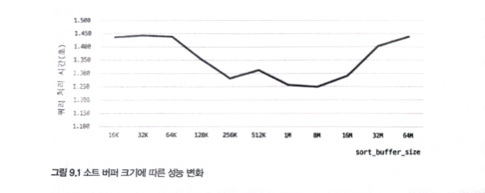

그림 9.1은 소트 버퍼의 크기를 확장해가면서 아래 쿼리의 소요되는 시간을 측정한 것이다.

```sql
SELECT * FROM salaries
ORDER By to_date
LIMIT 2844046, 1;
```

해당 쿼리는 salaries 테이블의 2,844,047건 레코드를 모두 읽어서 정렬하는데, to_date 칼럼에 인덱스가 없기 때문에 쿼리 처리 시에 정렬 작업이 필요한 쿼리다.

`sort_buffer_size` 시스템 변수의 설정값이 무조건 크면 메모리에서 모두 처리되니 빨라질 것으로 예상하지만 실제 결과는 그렇지 않다.

그리고 리눅스 계열의 운영체제에서는 너무 큰 소트 버퍼 사이즈를 사용하는 경우, 큰 메모리 공간 할당 때문에 성능이 훨씬 떨어질 수도 있다.

**해당 예제에서 인덱스가 있는 칼럼으로 정렬해도 여전히 파일 소트로 진행된다.** 

```sql
mysql> SHOW indexes from salaries;
+----------+------------+-----------+--------------+-------------+-----------+-------------+----------+--------+------+------------+---------+---------------+---------+------------+
| Table    | Non_unique | Key_name  | Seq_in_index | Column_name | Collation | Cardinality | Sub_part | Packed | Null | Index_type | Comment | Index_comment | Visible | Expression |
+----------+------------+-----------+--------------+-------------+-----------+-------------+----------+--------+------+------------+---------+---------------+---------+------------+
| salaries |          0 | PRIMARY   |            1 | emp_no      | A         |      297214 |     NULL |   NULL |      | BTREE      |         |               | YES     | NULL       |
| salaries |          0 | PRIMARY   |            2 | from_date   | A         |     2838426 |     NULL |   NULL |      | BTREE      |         |               | YES     | NULL       |
| salaries |          1 | ix_salary |            1 | salary      | A         |       74151 |     NULL |   NULL |      | BTREE      |         |               | YES     | NULL       |
+----------+------------+-----------+--------------+-------------+-----------+-------------+----------+--------+------+------------+---------+---------------+---------+------------+

mysql> EXPLAIN
    -> SELECT * FROM salaries
    -> ORDER By salary
    -> LIMIT 2844046, 1;
+----+-------------+----------+------------+------+---------------+------+---------+------+---------+----------+----------------+
| id | select_type | table    | partitions | type | possible_keys | key  | key_len | ref  | rows    | filtered | Extra          |
+----+-------------+----------+------------+------+---------------+------+---------+------+---------+----------+----------------+
|  1 | SIMPLE      | salaries | NULL       | ALL  | NULL          | NULL | NULL    | NULL | 2838426 |   100.00 | Using filesort |
+----+-------------+----------+------------+------+---------------+------+---------+------+---------+----------+----------------+
```

그 이유는 옵티마이저가 정렬된 세컨더리 인덱스(인덱스 풀 스캔) → 클러스터링 인덱스 가져오는 비용보다 바로 풀 테이블 스캔을 하여 메모리로 데이터 페이지를 가져와서 정렬(파일 소트)하는 방식이 더 빠르다고 판단했기 때문이다.

정렬을 위해 할당되는 **소트 버퍼는 세션 메모라 영역 즉, 여러 클라이언트가 공유해서 사용할 수 있는 영역이 아닌 각 클라이언트 스레드가 사용하는 공간**이다. 결과적으로 커넥션이 많으면 많을수록, 정렬 작업이 많으면 많을수록 소트 버퍼로 소비되는 메모리 공간이 커짐을 의미한다. 

책에서는 소트 버퍼의 크기를 56KB ~ 1MB 사이로 추천한다.

만약 소트 버퍼의 크기를 10MB 이상으로 설정하면 운영체제는 메모리 부족 현상을 겪을 수도 있다.

더는 여유 메모리 공간이 없는 경우 운영체제의 OOM-Killer가 프로세스를 강제로 종료할 것이다.

이때 OOM-Killer는 가장 많이 메모리를 사용하는 프로세스를 강제 종료하기 떄문에 일반적으로 MySQL 서버가 1순위가 된다.

---

## 9.2.3.2 정렬 알고리즘

레코드를 정렬할 때 **레코드 전체를 소트 버퍼에 담을지** 또는 **정렬 기준 칼럼만 소트 버퍼에 담을지**에 따라

**“싱글 패스”와 “투 패스” 2가지 정렬 모드**로 나눌 수 있다.

정렬을 수행하는 쿼리가 어떤 정렬 모드를 사용하는지는 옵티마이저 트레이스 기능으로 확인할 수 있다.

옵티마이저 트레이스 기능 활성화는 책 291쪽을 참고하자.

### MySQL 서버의 정렬 방식 3가지 (sort_mode)

  - **<sort_key, rowid>: 정렬 키와 레코드의 로우 아이디만 가져와서 정렬하는 방식**
  - **<sort_key, additional_fields>: 정렬 키와 레코드 전체를 가져와서 정렬하는 방식, 레코드의 칼럼들은 고정 사이즈로 메모리 저장**
  - **<sort_key, packed_additional_fields>: 정렬 키와 레코드 전체를 가져와서 정렬하는 방식, 레코드의 칼럼들은 가변 사이즈로 메모리 저장**

첫 번째 방식 = “투 패스”, 두 번째와 세 번째 방식 = “싱글 패스”

---

## 9.2.3.2.1 싱글 패스 정렬 방식

소트 버퍼에 정렬 기준 칼럼을 포함해 **SELECT 대상이 되는 칼럼 전부를 담아서 정렬**을 수행하는 방식

```sql
SELECT emp_no, first_name, last_name 
FROM employees
ORDER BY first_name;
```

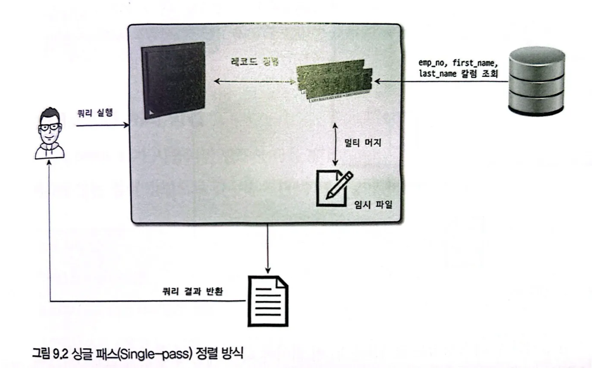

처음 employees 테이블을 읽을 때 정렬에 필요하지 않은 last_name 칼럼까지 전부 읽어서 소트 버퍼에 담고 정렬을 수행한다.

---

## 9.2.3.2.2 투 패스 정렬 방식

**정렬 대상 칼럼과 프라이머리 키 값만 소트 버퍼에 담아서 정렬을 수행**하고, **정렬된 순서대로 다시 프라이머리 키로 테이블을 읽어서 SELECT할 칼럼을 가져오는 정렬 방식**

싱글 패스 적용 이전부터 사용되던 방식. 여전히 MySQL 8.0에서도 특정 조건에는 투 패스 정렬 방식을 사용

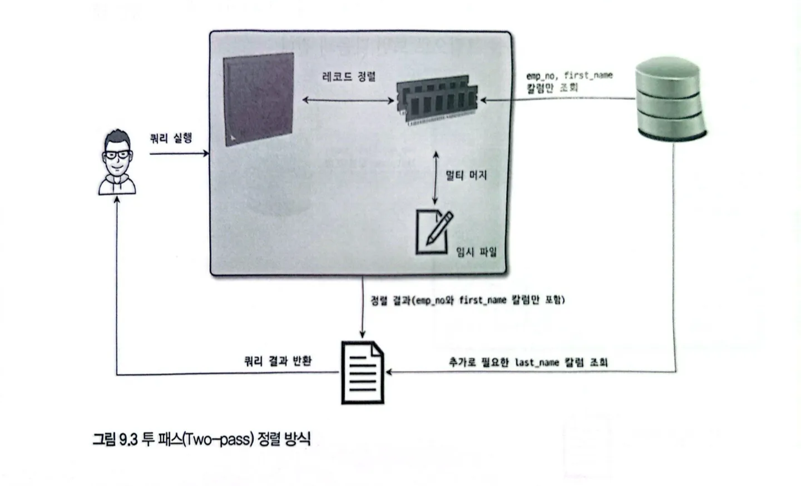

처음 정렬에 필요한 first_name 칼럼과 프라이머리 키인 emp_no만 읽어서 정렬을 수행한다. 

정렬이 완료되면 다시 테이블을 읽어서 last_name을 가져온다.

### 투 패스 VS 싱글 패스

투 패스 방식은 테이블을 두 번 읽어야 하고 싱글 패스는 테이블을 한 번 읽는다.

하지만 싱글 패스 방식은 더 많은 소트 버퍼 공간이 필요하다. 

최신 버전에서는 일반적으로 싱글 패스 정렬 방식을 주로 사용하지만 항상은 아니다.

다음의 경우, 서버는 싱글 정렬 방식을 사용하지 못하고 투 패스 정렬 방식을 사용한다.

  - 레코드의 크기가 `max_length_for_sort_data` 시스템 변수에 설정된 값보다 클 때
  - BLOB이나 TEXT 타입의 칼럼이 SELECT 대상에 포함될 때

싱글 패스 방식은 정렬 대상 레코드의 크기나 건수가 작은 경우에 빠른 성능을 보이며, 투 패스 방식은 정렬 대상 레코드의 크기나 건수가 상당히 많은 경우 효율적이라고 볼 수 있다.

**주의 (필요한 칼럼만 조회하라)**

```
SELECT 쿼리에서는 꼭 필요한 칼럼만 조회하도록 쿼리를 작성하는 것이 좋다고 권장한다.

특히 정렬이 필요한 SELECT는 불필요한 칼럼을 조회하지 않도록 하는 이유가 투 패스, 싱글 패스 차이다.
싱글 패스로 정렬되는 쿼리는 더욱 빠르다.

정렬 버퍼에만 영향을 미치는게 아니라 임시 테이블이 필요한 쿼리에서도 영향을 미친다.
```

---

## 9.2.3.3 정렬 처리 방법

### **드라이빙 테이블?**

```sql
SELECT e.name, d.name
FROM employees e
JOIN departments d ON e.dept_id = d.id
WHERE d.name = 'Engineering';
```

  - 이 경우, `departments` 테이블이 조건을 가지고 있으므로, 보통 옵티마이저는 `departments`를 먼저 읽고(드라이빙 테이블), 해당 부서 ID만 추출한 후 `employees`와 조인하는 방식으로 실행한다.
  - 반대로 `employees`가 드라이빙 테이블이면, 모든 직원 데이터를 읽은 다음 필터링해야 하므로 비효율적

**네스티드 루프 조인**은 드라이빙 테이블을 기준으로 **행마다 다른 테이블을 반복적으로 탐색**하는 방식

### **정렬 처리 방법**

쿼리에 ORDER BY가 적용되면 반드시 아래 3가지 처리 방법 중 하나로 정렬이 처리된다.

일반적으로 아래쪽에 있는 정렬 방법으로 갈수록 처리 속도는 떨어진다.

| **정렬 처리 방법**  | **실행 계획의 Extra 칼럼 내용**  |
| --- | --- |
| 인덱스를 사용한 방법  | 별도 표기 없음 |
| 조인에서 드라이빙 테이블만 정렬  | “Using filesort”  |
| 조인에서 조인 결과를 임시 테이블로 저장 후 정렬  | “Using temporary; Using filesort” |

먼저 옵티바이저는 정렬에 인덱스를 이용할 수 있다면 별도의 “Filesort” 과정 없이 순서대로 읽어서 반환한다.

하지만 인덱스를 사용할 수 없다면 WHERE 조건에 맞는 레코드를 검색해 정렬 버퍼에 저장하면서 정렬을 처리한다. 이때 옵티마이저는 정렬 대상을 최소화하기 위해 2가지 방법 중 하나를 선택한다.

  - **조인의 드라이빙 테이블만 정렬한 다음 조인을 수행**
  - **조인이 끝나고 일치하는 레코드를 모두 가져온 후 정렬을 수행**

일반적으로 조인이 수행되면서 레코드 건수와 레코드의 크기는 배수로 불어나기 때문에 가능하다면 드라이빙 테이블만 정렬한 다음 조인을 수행하는 방법이 효율적이다.

---

## 9.2.3.3.1 인덱스를 이용한 정렬

인덱스를 이용한 정렬을 위해서는 반드시 ORDER BY에 명시된 칼럼이 제일 먼저 읽는 테이블(조인 시 드라이빙 테이블)에 속하고, ORDER BY의 순서대로 생성된 인덱스가 있어야 한다.

또한 WHERE 절에 첫 번째로 읽는 테이블의 칼럼에 대한 조건이 있다면 그 조건과 ORDER BY는 같은 인덱스를 사용할 수 있어야 한다.

B-Tree 계열의 인덱스가 아니라면 사용할 수 없고, 여러 테이블이 조인되는 경우에 네스티드-루프 방식의 조인에서만 이 방식을 사용할 수 있다.

```sql
SELECT *
FROM employees e, salaries s
WHERE s.emp_no = e.emp_no
AND e.emp_no BETWEEN 100002 AND 100020
ORDER BY e.emp_no;
```

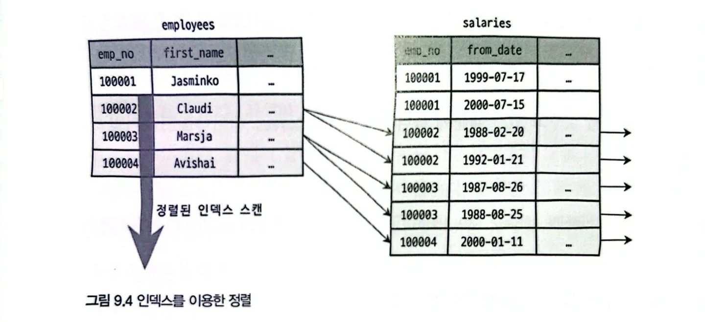

인덱스를 이용해 정렬이 처리되는 경우에는 실제 인덱스의 값이 정렬돼 있기 때문에 인덱스의 순서대로 읽기만 하면된다. 

또한 조인이 네스티드-루프 방식으로 실행되기 때문에 조인 때문에 드라이빙 테이블의 인덱스 읽기 순서가 흐트러지지 않는다.

---

## 9.2.3.3.2 조인의 드라이빙 테이블만 정렬

일반적으로 조인이 수행되면 결과 레코드 건수가 몇 배로 불어나고, 레코드 하나하나의 크기도 늘어난다.

**조인을 수행하기 전에 첫 번째(드라이빙 테이블)의 레코드를 먼저 정렬한 후 조인을 실행**하는 것이 정렬의 차선책이 될 것이다.

이 방법으로 처리되려면 **드라이빙 테이블의 칼럼만으로 ORDER BY 절을 작성**해야 한다.

```sql
SELECT * 
FROM employees e, salaries s
WHERE s.emp_no = e.emp_no
AND e.emp_no BETWEEN 100002 AND 100020
ORDER BY e.last_name;
```

WHERE 절이 다음 2가지 조건을 갖추고 있기 때문에 옵티마이저는 employees 테이블을 **드라이빙 테이블**로 선택할 것이다.

  - “e.emp_no BETWEEN 100002 AND 100020” employees 테이블의 프라이머리 키를 이용해 검색하면 작업량을 줄일 수 있다. (인덱스 레인지 스캔)
  - **드리븐 테이블**(salaries)의 조인 칼럼인 emp_no 칼럼에 인덱스가 있다.

검색은 인덱스 레인지 스캔으로 처리할 수 있지만 ORDER BY 절에 명시된 칼럼은 employees 테이블의 프라이머리 키와 관련이 없으므로 인덱스를 이용한 정렬이 불가능하다.

하지만 ORDER BY 절의 정렬 기준 칼럼이 employees 테이블 즉, 드라이빙 테이블이다.

옵티마이저는 드라이빙 테이블만 검색해서 정렬을 먼저 수행하고, 그 결과를 salaries 테이블을 조인한 것이다.

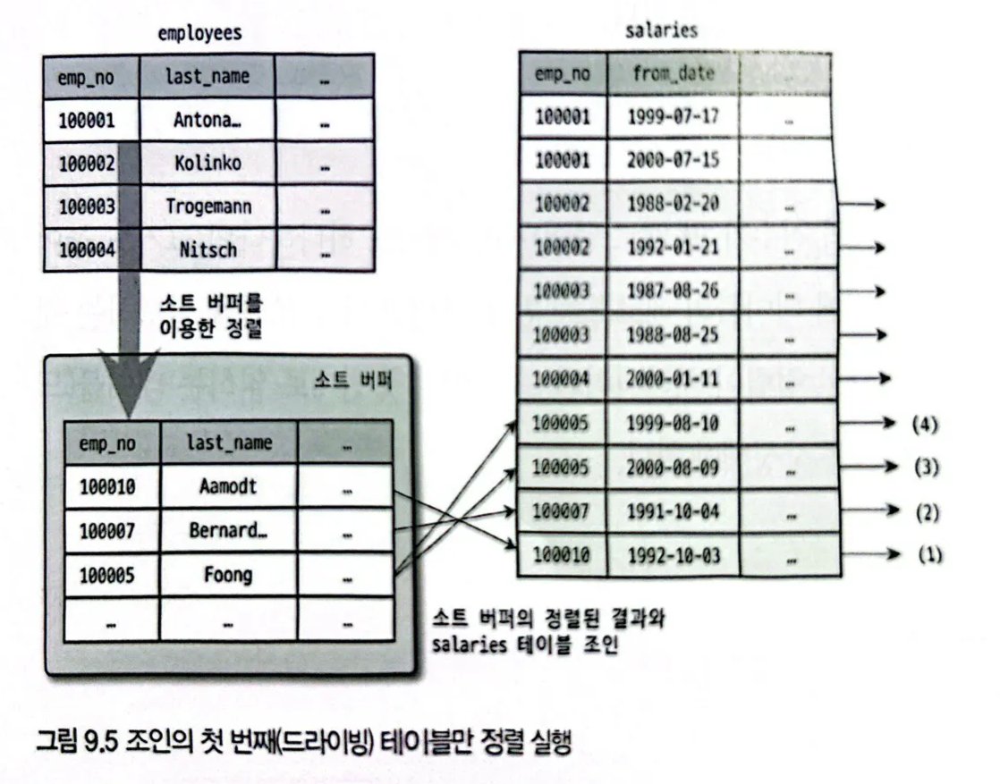

  1. 인덱스(프라이머리 키)를 이용해 인덱스 레인지 스캔
  1. 검색 결과를 last_name 칼럼으로 정렬(Filesort)을 수행
  1. 정렬된 결과를 순서대로 읽으면서 salaries 테이블과 조인을 수행해 최종 결과를 가져온다.

---

## 9.2.3.3.3 임시 테이블을 이용한 정렬

쿼리가 여러 테이블을 조인하지 않고, 하나의 테이블로부터 SELECT해서 정렬하는 경우라면 임시 테이블이 필요하지 않다. 하지만 **2개 이상의 테이블을 조인해서 그 결과를 정렬해야 한다면 임시 테이블이 필요할 수 있다.**

조인의 드라이빙 테이블만 정렬은 2개 이상의 테이블이 조인되면서 정렬이 실행되지만 드라이빙 테이블에만 정렬 기준이 있기 때문에 임시 테이블을 사용하지 않는다.

하지만 그 외 패턴의 쿼리에서는 항상 **조인 결과를 임시 테이블에 저장하고, 그 결과를 다시 정렬하는 과정을 거친다.** 이 방법은 정렬해야 할 레코드 건수가 가장 많기 때문에 가장 느린 정렬 방법이다.

```sql
SELECT * 
FROM employees e, salaries s
WHERE s.emp_no = e.emp_no
AND e.emp_no BETWEEN 100002 AND 100020
ORDER BY s.salary;
```

이 쿼리도 employees 테이블이 드라이빙 테이블로 사용되며, salaries 테이블이 드리븐 테이블로 사용된다.

이 쿼리에서는 정렬 기준이 드라이빙 칼럼이 아니라 드리븐 테이블에 있는 칼럼이다.

즉, 정렬이 수행되기 전에 salaries 테이블을 읽어야 하므로 조인된 데이터를 가지고 정렬할 수 밖에 없다.

**실행 계획 분석하기** 

```sql
+----+-------------+-------+------------+-------+---------------+---------+---------+--------------------+------+----------+----------------------------------------------+
| id | select_type | table | partitions | type  | possible_keys | key     | key_len | ref                | rows | filtered | Extra                                        |
+----+-------------+-------+------------+-------+---------------+---------+---------+--------------------+------+----------+----------------------------------------------+
|  1 | SIMPLE      | e     | NULL       | range | PRIMARY       | PRIMARY | 4       | NULL               |   19 |   100.00 | Using where; Using temporary; Using filesort |
|  1 | SIMPLE      | s     | NULL       | ref   | PRIMARY       | PRIMARY | 4       | employees.e.emp_no |    9 |   100.00 | NULL                                         |
+----+-------------+-------+------------+-------+---------------+---------+---------+--------------------+------+----------+----------------------------------------------+
```

Extra 칼럼을 보면 “Using temporary; Using filesort”라는 코멘트가 표시된다.

이는 조인 결과를 임시 테이블에 저장하고, 그 결과를 다시 정렬 처리했음을 의미한다.

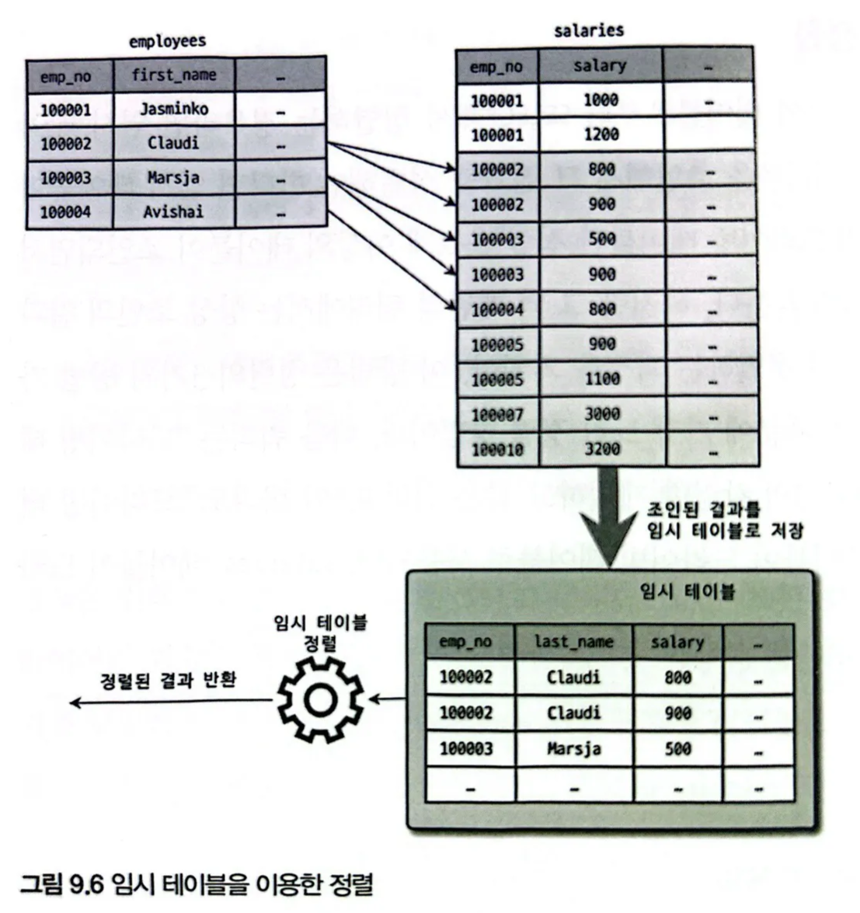

**정렬 처리 방법 3가지 정리** 

  1. 인덱스를 사용해서 처리 가장 빠르다.
  1. 인덱스가 없는 경우 정렬 조건이 드라이빙 테이블에만 있는 경우 드라이빙 테이블을 먼저 파일소트하고 이후에 조인을 진행한다.
  1. 1, 2번 모두 불가능한 경우에는 조인을 먼저 진행하고 정렬 조건으로 정렬해서 반환한다. 가장 느리다.

---

## 9.2.3.3.4 정렬 처리 방법의 성능 비교 

주로 웹 서비스용 쿼리에서는 ORDER BY + LIMIT 조합이 거의 필수로 사용되는 경향이 있다. 

일반적으로 LIMIT은 테이블이나 처리 결과의 일부만 가져오기 때문에 서버가 처리해야 할 작업량을 줄이는 역할을 한다. 하지만 ORDER BY, GROUP BY 같은 작업은 LIMIT 건수만큼만 가져와서는 처리할 수 없다.

**우선 조건을 만족하는 모든 레코드를 가져와서 정렬을 수행하거나 그루핑 작업을 실행해야만 비로소 LIMIT 건수를 제한할 수 있다.**

즉, WHERE 조건이 아무리 인덱스를 잘 활용하도록 튜닝해도 잘못된 ORDER BY나 GROUP BY 때문에 쿼리가 느려지는 경우가 자주 발생한다.

쿼리에서 인덱스를 사용하지 못하는 정렬이나 그루핑 작업이 왜 느리게 작동할 수 밖에 없는지 살펴보자.

이를 위해 쿼리가 처리되는 방법을 **“스트리밍 처리”**, **“버퍼링 처리”** 2가지 방식으로 구분해 보자.

---

## 9.2.3.3.4.1 스트리밍 방식


서버 쪽에서 처리할 데이터가 얼마인지에 관계없이 조건에 일치하는 레코드가 검색될때마다 바로바로 클라이언트에게 전달해주는 방식을 스트리밍 방식이라고 한다.

이 방식으로 처리할 경우 클라이언트는 쿼리를 요청하고 곧바로 첫 번째 레코드를 전달받는다.

가장 마지막 레코드는 언제 받을지 알 수 없지만, 이는 중요하지 않다.

그림 9.7처럼 쿼리가 스트리밍 방식으로 처리될 수 있다면 클라이언트는 MySQL 서버가 일치하는 레코드를 찾는 즉시 전달받기 때문에 동시에 데이터의 가공 작업을 시작할 수 있다.

스트리밍 방식으로 처리되는 쿼리는 조회하는 레코드 수와 관계없이 빠른 응답 시간을 보장해준다. 

또한 스트리밍 처리 방식의 쿼리에서 LIMIT 처럼 결과 건수를 제한하는 조건들은 쿼리의 전체 실행 시간을 상당히 줄여 줄 수 있다.

매우 큰 테이블을 아무런 조건 없이 SELECT만 해보면 첫 번째 레코드는 아주 빨리 가져온다는 사실을 알 수 있다.

물론 서버에서 아직 쿼리가 실행되고 있는 도중이라도 말이다.

풀 테이블 스캔의 결과는 아무런 버퍼링 처리나 필터링 과정 없이 바로 클라이언트로 스트리밍되기 때문이다.

이때 LIMIT 조건을 추가하면 마지막 레코드를 가져오기까지의 시간을 상당히 줄일 수 있다.

---

## 9.2.3.3.4.2 버퍼링 방식

ORDER BY, GROUP BY 같은 처리는 쿼리의 결과가 스트리밍되는 것을 불가능하게 한다.

우선 WHERE 조건에 일치하는 모든 레코드를 가져온 후, 정렬하거나 그루핑해서 차례대로 보내야 하기 때문이다.

MySQL 서버에서 이런 작업을 하는 동안 클라이언트는 아무것도 하지 않고 기다려야 하기 때문에 응답 속도가 느려진다. 그렇기 때문에 이 방식을 스트리밍의 반대 표현인 버퍼링이라고 표현한다.

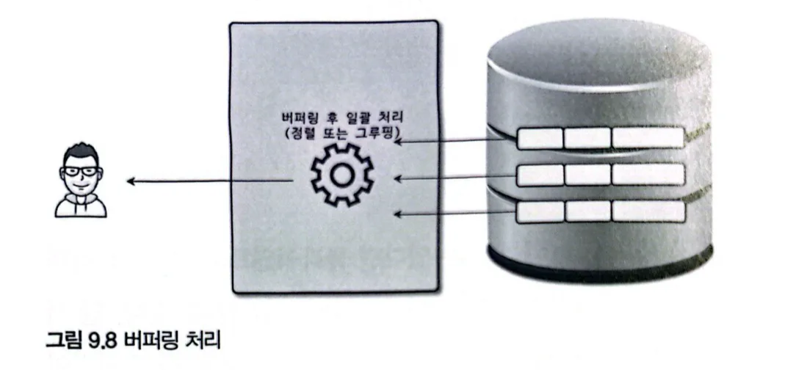

그림 9.8처럼 버퍼링 방식으로 처리되는 쿼리는 먼저 결과를 모아서 MySQL 엔진에서 일괄 가공해야 하므로 모든 결과를 스토리지 엔진으로부터 가져올 때까지 기다려야 한다.

그래서 버퍼링 방식으로 처리되는 쿼리는 LIMIT처럼 결과 건수를 제한하는 조건이 있어도 성능 향상에 별로 도움이 되지 않는다.

**참고** 

```sql
스트리밍 처리는 클라이언트 도구나 API에 따라 그 방식의 차이가 존재한다.
JDBC 라이브러리의 기본 동작 방식은 MySQL 서버가 스트리밍 처리를 한다고 해도
내부 버퍼에 모두 담아서 모든 결과를 전달받으면 그때서야 비로소 반환한다.
즉, MySQL 서버는 스트리밍 방식으로 처리하지만 클라이언트인 JDBC 라이브러리가 버퍼링하는 것이다.
```

지금까지 설명한 정렬 처리 방법에서 인덱스를 사용한 정렬 방식만 스트리밍 방식이고 나머지는 모두 버퍼링된 후에 응답된다. 즉, 인덱스를 사용한 방식만 LIMIT 적용에 큰 성능 변화가 있다.

### 조인과 함께 ORDER BY 절, LIMIT 절 자세히

```sql
SELECT * 
FROM tb_test1 t1, tb_test2 t2 
WHERE t1.col1 = t2.col1
ORDER BY 생략
LIMIT 10;
```

  - tb_test1 테이블 레코드 100건
  - tb_test2 테이블 레코드 1,000건(tb_test1 레코드 1건이 tb_test2 레코드가 10건씩 존재)
  - 두 테이블의 조인 결과는 전체 1000건

**tb_test1 드라이빙 테이블**

| 정렬 방법 | 읽어야 할 건수 | 조인 횟수 | 정렬해야 할 대상 건수  |
| --- | --- | --- | --- |
| 인덱스 사용  | tb_test1: 1건<br>tb_test2: 10건  | 1번  | 0건  |
| 조인의 드라이빙 테이블만 정렬  | tb_test1: 100건<br>tb_test2: 10건  | 1번  | 100건 (tb_test1) |
| 임시 테이블 사용 후 정렬  | tb_test1: 100건<br>tb_test2: 1000건  | 100건  | 1,000건  |

**tb_test2 드라이빙 테이블**

| 정렬 방법 | 읽어야 할 건수 | 조인 횟수 | 정렬해야 할 대상 건수 |
| --- | --- | --- | --- |
| 인덱스 사용 | tb_test1: 10건<br>tb_test2: 10건  | 10번  | 0건  |
| 조인의 드라이빙 테이블만 정렬 | tb_test1: 10건<br>tb_test2: 1000건 | 10번 | 1000건 (tb_test2) |
| 임시 테이블 사용 후 정렬 | tb_test1: 100건<br>tb_test2: 1000건 | 1,000건 | 1,000건 |

어느 테이블이 먼저 드라이빙되어 조인하는지도 중요하지만 어떤 정렬 방식으로 처리되는지는 더 큰 성능차이를 만든다.

가능하다면 인덱스를 사용한 정렬로 유도하고, 그렇지 못하다면 최소한 드라이빙 테이블만 정렬해도 되는 수준으로 유도하는 것도 좋은 튜닝 방법이라고 할 수 있다.

**참고** 

```
인덱스를 사용하지 못하고 별도의 file sort 작업이 필요한 경우 쿼리에서 LIMIT 조건이 
아무런 도움이 되지 못하는 것은 아니다. 

정렬할 대상 레코드 1,000건에 LIMIT 10이라는 조건이 있으면 서버는 필요한 순서대로 정렬해서
상위 10건만 정렬이 채워지면 정렬을 멈추고 결과를 반환한다.

하지만 MySQL 서버는 퀵 소트 또는 힙 소트 알고리즘을 사용한다.
이는 상위 10건을 정렬하기 위해 더 많은 작업이 필요할 수도 있음을 의미한다.

결론적으로, 인덱스를 사용하지 못하는 쿼리를 페이징 처리에 사용하는 경우 LIMIT 5~10건만 조회한다고
하더라도 쿼리가 기대만큼 아주 빨라지지는 않는다.
```

---

## 9.2.3.4 정렬 관련 상태 변수 

책 페이지 304~305 참고하자 

---

# 9.2.4 GROUP BY 처리 

GROUP BY 또한 ORDER BY 같이 쿼리가 스트리밍된 처리를 할 수 없다. **즉, 버퍼링 방식이다.**

GROUP BY 절에는 HAVING 절을 GROUP BY 결과에 대한 필터링 조건으로 사용할 수 있다.

**하지만 HAVING 절은 인덱스를 사용해서 처리할 수 없다.**

GROUP BY 도 인덱스를 사용하는 경우와 못한 그렇지 못한 경우로 나눠 볼 수 있다.

인덱스를 이용할 때는 인덱스 레인지 스캔과 인덱스 루스 스캔을 사용한다.

인덱스를 사용하지 못하는 쿼리는 임시 테이블을 사용한다.

---

## 9.2.4.1 인덱스 스캔을 이용하는 GROUP BY (타이트 인덱스 스캔)

조인의 드라이빙 테이블에 속한 칼럼만 이용해 그루핑할 때 GROUP BY 칼럼으로 인덱스가 이미 있다면 그 인덱스를 차례대로 읽으면서 그루핑 작업을 수행하고 그 결과로 조인을 처리한다.

GROUP BY가 인덱스를 사용해서 처리된다고 하더라도 **그룹 함수(Aggregation function)** 등의 그룹값을 처리해야 해서 임시 테이블이 필요할 때도 있다.

GROUP BY가 인덱스를 통해서 처리되는 경우 실행 계획에서는 Extra 칼럼에 별도로 GROUP BY 관련 코멘트

(”Using index for group-by”)나 임시 테이블 사용 또는 정렬 관련 코멘트(”Using temporary, Using filesort”)가 표시되지 않는다.

---

## 9.2.4.2 루스 인덱스 스캔을 이용하는 GROUP BY

옵티마이저가 루스 인덱스 스캔을 사용할 때는 실행 계획의 Extra 칼럼에 (”Using index for group-by”) 코멘트가 표시된다.

```sql
SHOW INDEXES FROM salaries;
+----------+------------+-----------+--------------+-------------+-----------+-------------+----------+--------+------+------------+---------+---------------+---------+------------+
| Table    | Non_unique | Key_name  | Seq_in_index | Column_name | Collation | Cardinality | Sub_part | Packed | Null | Index_type | Comment | Index_comment | Visible | Expression |
+----------+------------+-----------+--------------+-------------+-----------+-------------+----------+--------+------+------------+---------+---------------+---------+------------+
| salaries |          0 | PRIMARY   |            1 | emp_no      | A         |      297214 |     NULL |   NULL |      | BTREE      |         |               | YES     | NULL       |
| salaries |          0 | PRIMARY   |            2 | from_date   | A         |     2838426 |     NULL |   NULL |      | BTREE      |         |               | YES     | NULL       |
| salaries |          1 | ix_salary |            1 | salary      | A         |       74151 |     NULL |   NULL |      | BTREE      |         |               | YES     | NULL       |
+----------+------------+-----------+--------------+-------------+-----------+-------------+----------+--------+------+------------+---------+---------------+---------+------------+

EXPLAIN
SELECT emp_no
FROM salaries
WHERE from_date='1985-03-01'
GROUP BY emp_no;
+----+-------------+----------+------------+-------+-------------------+---------+---------+------+--------+----------+---------------------------------------+
| id | select_type | table    | partitions | type  | possible_keys     | key     | key_len | ref  | rows   | filtered | Extra                                 |
+----+-------------+----------+------------+-------+-------------------+---------+---------+------+--------+----------+---------------------------------------+
|  1 | SIMPLE      | salaries | NULL       | range | PRIMARY,ix_salary | PRIMARY | 7       | NULL | 297215 |   100.00 | Using where; Using index for group-by |
+----+-------------+----------+------------+-------+-------------------+---------+---------+------+--------+----------+---------------------------------------+
```

인덱스가 (emp_no, from_date)로 생성돼 있으므로 해당 해당 쿼리에서는 WHERE 조건은 인덱스 레인지 스캔 접근 방식으로 불가능하다.

하지만 실행 계획을 보면 인덱스 레인지 스캔(range 타입)을 이용했으며, Extra 칼럼을 보면 GROUP BY 처리까지 인덱스를 사용했다는 것을 알 수 있다.

**MySQL 서버의 쿼리 처리 방식**

```
SELECT emp_no
FROM salaries
WHERE from_date='1985-03-01'
GROUP BY emp_no;

1. (emp_no, from_date)인덱스를 차례대로 스캔하면서 emp_no 첫번째 유일한 값(그룹 키)를 찾아낸다.
ex: emp_no = '10001'

2. (emp_no, from_date)인덱스에서 emp_no = '10001' 인 것 중에서 from_date 값이 
'1985-03-01'인 레코드만 가져온다.
마치 "emp_no=10001 AND from_date='1985-03-01'" 조건으로 인덱스를 검색하는 것과 흡사하다.

3. (emp_no, from_date)인덱스에서 emp_no 그 다음 유니크한(그룹 키)값을 가져온다.

4. 3번 단계에서 결과가 더 없으면 종료하고, 결과가 있으면 2번 과정으로 돌아가서 반복한다.
```

MySQL **루스 인덱스 스캔 방식은 단일 테이블 대상으로 수행되는 GROUP BY 처리에만 사용**할 수 있으며,

별도의 임시 테이블이 필요하지 않는다. 또한 프리픽스 인덱스는 루스 인덱스 스캔을 사용할 수 없다.

인덱스 레인지 스캔에서는 유니크 한 값의 개수가 많을수록 성능이 향상되는 반면 루스 인덱스 스캔에서는 유니크한 인덱스 값의 수가 적을수록 성능이 향샹된다. **즉, 분포도가 좋지 않은 인덱스일수록 더 빠른 결과를 만들어낸다.**

루스 인덱스 스캔 사용 여부 판단은 매우 어렵다.

책 페이지 307, 308에서 예제 쿼리를 보고 연습하자.

(col1, col2, col3) 아래 쿼리는 루스 인덱스 스캔을 사용할 수 없는 쿼리 패턴이다.

```sql
// MIN(), MAX() 이외의 집합 함수가 사용됐기 때문에 루스 인덱스 스캔은 사용 불가
SELECT col1, SUM(col2) FROM tb_test GROUP BY col1;

// GROUP BY에 사용된 칼럼이 인덱스 구성 칼럼의 왼쪽부터 일치하지 않기 때문에 사용 불가
SELECT col1, col2 FROM tb_test GROUP BY col2, col3;

// SELECT 절의 사용된 칼럼이 GROUP BY와 일치하지 않기 때문에 사용 불가
// SQL 에러 
SELECT col1, col3 FROM tb_test GROUP BY col1, col2;
```

---

## 9.2.4.3 임시 테이블을 사용하는 GROUP BY 

인덱스를 전혀 사용하지 못할 때 이 방식으로 처리된다.

```sql
EXPLAIN
SELECT e.last_name, AVG(s.salary)
FROM employees e, salaries s
WHERE s.emp_no=e.emp_no
GROUP BY e.last_name; 

+----+-------------+-------+------------+------+---------------+---------+---------+--------------------+--------+----------+-----------------+
| id | select_type | table | partitions | type | possible_keys | key     | key_len | ref                | rows   | filtered | Extra           |
+----+-------------+-------+------------+------+---------------+---------+---------+--------------------+--------+----------+-----------------+
|  1 | SIMPLE      | e     | NULL       | ALL  | PRIMARY       | NULL    | NULL    | NULL               | 300584 |   100.00 | Using temporary |
|  1 | SIMPLE      | s     | NULL       | ref  | PRIMARY       | PRIMARY | 4       | employees.e.emp_no |      9 |   100.00 | NULL            |
+----+-------------+-------+------------+------+---------------+---------+---------+--------------------+--------+----------+-----------------+
```

이 쿼리의 실행 계획에서 Extra 칼럼에 “Using temporary” 메시지가 표시됐다.

임시 테이블이 사용된 것은 인덱스를 전혀 사용할 수 없는 GROUP BY이기 때문이다.

MySQL 8.0 이전 버전까지는 GROUP BY가 사용된 쿼리는 그루핑되는 칼럼을 기준으로 묵시적인 정렬까지 함께 수행했다. 하지만 **MySQL 8.0 버전부터는 묵시적인 정렬은 더 이상 실행되지 않게 바뀌었다.**

즉, “Using filesort” 메시지는 표시되지 않는다.

```
그래서 MySQL 8.0 이전 버전에서 GROUP BY에 정렬이 필요하지 않다면 약간의 성능 향상을 위해서
ORDER BY NULL을 사용하였다.
```

하지만 **MySQL 8.0에서도 GROUP BY가 ORDER BY가 같이 사용되면 명시적으로 정렬 작업을 실행한다**.

```sql

EXPLAIN
SELECT e.last_name, AVG(s.salary)
FROM employees e, salaries s
WHERE s.emp_no=e.emp_no
GROUP BY e.last_name 
ORDER BY e.last_name;

+----+-------------+-------+------------+------+---------------+---------+---------+--------------------+--------+----------+---------------------------------+
| id | select_type | table | partitions | type | possible_keys | key     | key_len | ref                | rows   | filtered | Extra                           |
+----+-------------+-------+------------+------+---------------+---------+---------+--------------------+--------+----------+---------------------------------+
|  1 | SIMPLE      | e     | NULL       | ALL  | PRIMARY       | NULL    | NULL    | NULL               | 300584 |   100.00 | Using temporary; Using filesort |
|  1 | SIMPLE      | s     | NULL       | ref  | PRIMARY       | PRIMARY | 4       | employees.e.emp_no |      9 |   100.00 | NULL                            |
+----+-------------+-------+------------+------+---------------+---------+---------+--------------------+--------+----------+---------------------------------+
```

**“Using temporary” + “Using filesort”**

MySQL 8.0 에서는 GROUP BY가 필요한 경우 내부적으로 GROUP BY 칼럼들로 구성된 유니크 인덱스를 임시 테이블을 만들어 중복 제거와 집합 함수 연산을 수행한다.

즉, 다음과 같은 임시 테이블을 생성한다.

```sql
EXPLAIN
SELECT e.last_name, AVG(s.salary)
FROM employees e, salaries s
WHERE s.emp_no=e.emp_no
GROUP BY e.last_name; 

CREATE TEMPORARY TABLE ... (
	last_name VARCHAR(16),
	salary INT,
  UNIQUE INDEX ux_lastname (last_name)
);
```

그리고 조인의 결과를 한 건씩 가져와 임시 테이블에 중복 체크를 하면서 INSERT 또는 UPDATE를 실행한다.

---

# 9.2.5 DISTINCT 처리

특정 칼럼의 유니크한 값만 조회하려면 SELECT + DISTINCT를 사용한다.

DISTINCT는 MIN, MAX, COUNT 같은 집합 함수와 함께 사용되는 경우와 아닌 경우로 2가지로 구분한다.

미치는 영향 범위가 달라지기 때문이다.

**집합 함수와 같이 DISTINCT가 사용되는 쿼리에서 인덱스를 사용하지 못할 때는 항상 임시 테이블이 필요**하다.

하지만 실행 계획의 Extra 칼럼에는 “Using temporary” 메시지가 표시되지 않는다.

---

## 9.2.5.1 SELECT DISTINCT …

집함 함수 없이 단순히 유니크한 레코드만 가져오도록 DISTINCT를 사용하면 GROUP BY와 동일하게 동작한다.

```sql
SELECT DISTINCT emp_no FROM salaries;
SELECT emp_no FROM salaries GROUP BY emp_no;
```

2개의 쿼리는 내부적으로 같은 작업을 수행한다.

### **많은 사람들의 DISTINCT 실수 포인트**

DISTINCT는 SELECT 하는 레코드(튜플)을 유니크하게 조회하는 것이지, 특정 칼럼만 유니크하게 조회하는 기능이 아니다.

```sql
SELECT DISTINCT first_name, last_name FROM employees;
```

즉, 해당 쿼리에서는 (first_name, last_name) 조합 전체가 유니크한 레코드를 가져오는 것이다.

```sql
SELECT DISTINCT (first_name), last_name FROM employees;
```

해당 쿼리는 얼핏 보면 first_name만 유니크하게 조회하고 last_name은 DISTINCT가 없을 때와 동일하게 조회하는 쿼리처럼 보인다. 또한 아무런 에러 없이 실행된다.

하지만 서버는 DISTINCT 뒤의 괄호를 아무 의미 없이 사용된 괄호로 해석하고 제거해 버린다.

DISTINCT는 함수가 아니기 때문에 뒤의 괄호는 의미가 없는 것이다.

---

## 9.2.5.2 집합 합수와 함께 사용된 DISTINCT

COUNT(), MIN(), MAX() 같은 집합함수가 DISTINCT 키워드와 함께 사용될 수 있다.

집합 함수가 없는 조회에서 DISTINCT는 모든 칼럼의 조합이 유니크한 것들만 가져온다.

하지만 **집합 함수 내에서 사용된 DISTINCT는 그 집합 함수의 인자가 전달된 칼럼값이 유니크한 것들을 가져온다**.

```sql
EXPLAIN SELECT COUNT(DISTINCT s.salary)
FROM employees e, salaries s
WHERE e.emp_no=s.emp_no AND 
e.emp_no BETWEEN 100001 AND 100100;

+----+-------------+-------+------------+-------+---------------+---------+---------+--------------------+------+----------+--------------------------+
| id | select_type | table | partitions | type  | possible_keys | key     | key_len | ref                | rows | filtered | Extra                    |
+----+-------------+-------+------------+-------+---------------+---------+---------+--------------------+------+----------+--------------------------+
|  1 | SIMPLE      | e     | NULL       | range | PRIMARY       | PRIMARY | 4       | NULL               |  100 |   100.00 | Using where; Using index |
|  1 | SIMPLE      | s     | NULL       | ref   | PRIMARY       | PRIMARY | 4       | employees.e.emp_no |    9 |   100.00 | NULL                     |
+----+-------------+-------+------------+-------+---------------+---------+---------+--------------------+------+----------+--------------------------+
```

이 쿼리는 내부적으로는 “COUNT(DISTINCT s.salary)”를 처리하기 위해서 임시 테이블을 사용한다.

하지만 실행 계획에서는 임시 테이블을 사용한다는 메시지인 “Using temporary”를 표시하지 않고 있다.

```sql
CREATE TABLE 임시테이블 (
	 salary INT,
	 UNIQUE INDEX ux_salary (salary)
);
```

이 임시 테이블의 salary 칼럼에는 유니크 인덱스가 생성되기 때문에 레코드 건수가 많아지면 상당히 느려질 수 있는 형태의 쿼리이다.

```sql
EXPLAIN 
SELECT COUNT(DISTINCT s.salary),
			 COUNT(DISTINCT e.last_name)
FROM employees e, salaries s
WHERE e.emp_no=s.emp_no AND 
e.emp_no BETWEEN 100001 AND 100100;

+----+-------------+-------+------------+-------+---------------+---------+---------+--------------------+------+----------+-------------+
| id | select_type | table | partitions | type  | possible_keys | key     | key_len | ref                | rows | filtered | Extra       |
+----+-------------+-------+------------+-------+---------------+---------+---------+--------------------+------+----------+-------------+
|  1 | SIMPLE      | e     | NULL       | range | PRIMARY       | PRIMARY | 4       | NULL               |  100 |   100.00 | Using where |
|  1 | SIMPLE      | s     | NULL       | ref   | PRIMARY       | PRIMARY | 4       | employees.e.emp_no |    9 |   100.00 | NULL        |
+----+-------------+-------+------------+-------+---------------+---------+---------+--------------------+------+----------+-------------+
```

해당 쿼리는 s.salary 칼럼의 값과, e.last_name 칼럼의 값을 저장하는 임시 테이블 2개가 필요하다.

```sql
EXPLAIN SELECT COUNT(DISTINCT emp_no) FROM employees;
+----+-------------+-----------+------------+-------+------------------------------------------------------+-------------+---------+------+--------+----------+-------------+
| id | select_type | table     | partitions | type  | possible_keys                                        | key         | key_len | ref  | rows   | filtered | Extra       |
+----+-------------+-----------+------------+-------+------------------------------------------------------+-------------+---------+------+--------+----------+-------------+
|  1 | SIMPLE      | employees | NULL       | index | PRIMARY,ix_hiredate,ix_gender_birthdate,ix_firstname | ix_hiredate | 3       | NULL | 300584 |   100.00 | Using index |
+----+-------------+-----------+------------+-------+------------------------------------------------------+-------------+---------+------+--------+----------+-------------+

EXPLAIN SELECT COUNT(DISTINCT emp_no) FROM dept_emp GROUP BY dept_no;
+----+-------------+----------+------------+-------+---------------------------------------+---------+---------+------+--------+----------+-------------+
| id | select_type | table    | partitions | type  | possible_keys                         | key     | key_len | ref  | rows   | filtered | Extra       |
+----+-------------+----------+------------+-------+---------------------------------------+---------+---------+------+--------+----------+-------------+
|  1 | SIMPLE      | dept_emp | NULL       | index | PRIMARY,ix_fromdate,ix_empno_fromdate | PRIMARY | 20      | NULL | 331143 |   100.00 | Using index |
+----+-------------+----------+------------+-------+---------------------------------------+---------+---------+------+--------+----------+-------------+

```

해당 쿼리들은 인덱스된 칼럼에 대해 DISTINCT 처리를 수행하기 때문에 별도의 임시 테이블없이 수행할 수 있다.

❌❌❌ **나의 테스트** ❌❌❌

```sql
SHOW STATUS LIKE 'Created_tmp_tables';

COUNT(DISTINCT ...)
```

**모든 쿼리가 임시 테이블을 사용한다. 즉, 잘못된 설명이다.**

**인덱스를 탄다고해도 임시 테이블이 생성된다.**

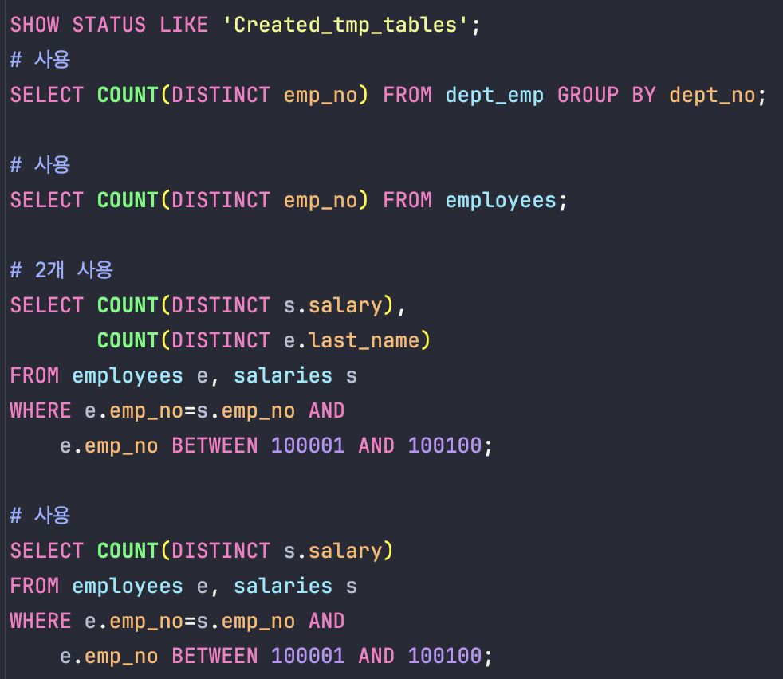

---

# 9.2.6 내부 임시 테이블 활용

MySQL 엔진이 스토리지 엔진으로부터 받아온 레코드를 정렬하거나 그루핑할 때는 내부적인 임시 테이블을 사용한다. 일반적으로 임시 테이블은 처음에는 메모리에 생성됐다가 테이블의 크기가 커지면 디스크로 옮겨진다.

특정 예외 케이스의 경우 메모리를 거치지 않고 바로 디스크에 임시 테이블이 만들어지기도 한다.

MySQL 엔진이 내부적인 가공을 위해 생성하는 임시 테이블은 다른 세션이나 다른 쿼리에서는 볼 수 없으며 사용도 불가능하다.

사용자가 생성한 임시 테이블(CREATE TEMPORARY TABLE)과 다르게 내부적인 임시 테이블은 쿼리의 처리가 완료되면 자동으로 삭제된다.

---

## 9.2.6.1 메모리 임시 테이블과 디스크 임시 테이블

원본 스토리지 엔진과 상관없이 MySQL 8.0 버전부터는 **메모리는 TempTable 이라는 스토리지 엔진**을 사용하고, **디스크에 저장되는 임시 테이블은 InnoDB 스토리지 엔진**을 사용하도록 개선됐다.

기존 MEMORY 스토리지 엔진은 VARCHAR 같은 가변 길이 타입을 지원하지 못하기 때문에 임시 테이블이 메모리에 만들어지면 최대 길이만큼 메모리를 할당해서 사용했다. 이는 메모리 낭비가 심해지는 문제점이 있다.

또한 디스크에 임시 테이블이 만들어질 때 사용되는 MyISAM 스토리지 엔진은 트랜잭션을 지원하지 않는다. 

그래서 가변 길이 타입을 지원하는 TempTable 스토리지 엔진을 메모리에서 사용하고, InnoDB 스토리지 엔진이 디스크에서 사용되도록 개선된 것이다.

MySQL 8.0 버전부터는 `internal_tem_mem_storage_engine`  시스템 변수를 이용해 메모리용 임시 테이블을 MEMORY, TempTable 중에서 선택할 수 있게 하고 있는데, default 설정은 TempTable 이다.

또한 TempTable이 최대 사용 가능한 메모리는 `temptable_max_ram` 시스템 변수로 제어할 수 있고, default 1GB이다. 

그렇다면 임시 테이블이 `temptable_max_ram` 크기 보다 커지는 경우는 어떻게할까?

2가지 디스크 저장 방식이 존재한다.

  - MMAP 파일로 디스크에 기록
  - InnoDB 테이블로 기록

더 자세한 내용은 책 314 ~ 315 참고 

---

## 9.2.6.2 임시 테이블이 필요한 쿼리

  1. ORDER BY와 GROUP BY 명시된 칼럼이 다른 쿼리
  1. ORDER BY와 GROUP BY 명시된 칼럼이 조인의 순서상 드라이빙 테이블이 아닌 쿼리
  1. DISTINCT, ORDER BY가 동시에 쿼리에 존재하는 경우 또는 DISTINCT가 인덱스로 처리되지 못하는 쿼리
- 집합 함수 + DISTINCT
  1. UNION, UNION DISTINCT가 사용된 쿼리(select_type이 UNION RESULT인 경우)
- 8.0 버전에서 UNION ALL → 임시 테이블 사용하지 않는다.
    - UNION == UNION DISTINCT → UNION은 그냥 DISTINCT 생략한 것으로 판단
  1. 쿼리의 실행 계획에서 select_type이 DERIVED인 쿼리

어떤 쿼리의 실행 계획에서 임시 테이블을 사용하는지는 `Extra` 칼럼에 `“Using temporary”` 메세지가 표시되는지 확인하면 된다. 하지만 `“Using temporary”` 가 표시되지 않을 때도 임시 테이블을 사용할 수 있다.

  - 3, 4, 5

첫 번째 부터 네 번째까지의 쿼리 패턴은 유니크 인덱스를 가지는 내부 임시 테이블이 만들어지고, 마지막 쿼리 패턴은 유니크 인덱스가 없는 내부 임시 테이블이 생성된다.

일반적으로 **유니크 인덱스가 있는 내부 임시 테이블은 그렇지 않은 쿼리보다 처리 성능이 상당히 느리다.**

더 자세한 내용은 책 페이지 316 참고

---

## 9.2.6.3 임시 테이블이 디스크에 생성되는 경우 

내부 임시 테이블은 기본적으로는 메모리상에 만들어지지만 다음 조건을 만족하면 디스크 기반의 임시 테이블을 사용한다.

  - UNION, UNION ALL에서 SELECT 칼럼 중에서 길이가 512바이트 이상인 크기의 칼럼이 있는 경우
  - GROUP BY 또는 DISTINCT 칼럼에서 512바이트 이상인 크기의 칼럼이 있는 경우
  - 메모리 임시 테이블 크기가 임시 테이블 최대 크기 시스템 변수 설정 값보다 큰 경우

---

## 9.2.6.4 임시 테이블 관련 상태 변수

임시 테이블 사용 여부를 확인하려면 `Extra` 칼럼을 `“Using temporary”` 확인하면 된다.

하지만 사용된 임시 테이블의 개수와 메모리에서 처리됐는지 디스크에서 처리됐는지 알 수 없으며, 내부 임시 테이블 같은 경우  `“Using temporary”` 메시지도 표시되지 않는다.

임시 테이블이 디스크에 생성됐는지 메모리에 생성됐는지 확인하려면 아래 쿼리를 사용하자.

```sql
# 현재 세션의 상태 값을 초기화 
FLUSH STATUS;

SELECT first_name, last_name
FROM employees
GROUP BY first_name, last_name;

# 상태 조회 
SHOW SESSION STATUS LIKE 'Created_tmp%';

+-------------------------+-------+
| Variable_name           | Value |
+-------------------------+-------+
| Created_tmp_disk_tables | 1     |
| Created_tmp_files       | 0     |
| Created_tmp_tables      | 1     |
+-------------------------+-------+
3 rows in set (0.00 sec)
```

`Created_tmp_tables` : 쿼리의 처리를 위해 만들어진 내부 임시 테이블의 개수를 누적하는 상태 값이다. 

이 값은 임시 테이블이 메모리에 만들어졌는지 디스크에 만들어졌는지 구분하지 않고 누적한다.

`Created_tmp_disk_tables` : 디스크에 내부 임시 테이블이 만들어진 개수만 누적해서 가지고 있는 상태 값

### 그런데 왜 해당 쿼리에서 임시 테이블이 필요할까?

```sql
EXPLAIN SELECT first_name, last_name
FROM employees
GROUP BY first_name, last_name;

+----+-------------+-----------+------------+------+---------------+------+---------+------+--------+----------+-----------------+
| id | select_type | table     | partitions | type | possible_keys | key  | key_len | ref  | rows   | filtered | Extra           |
+----+-------------+-----------+------------+------+---------------+------+---------+------+--------+----------+-----------------+
|  1 | SIMPLE      | employees | NULL       | ALL  | NULL          | NULL | NULL    | NULL | 300584 |   100.00 | Using temporary |
+----+-------------+-----------+------------+------+---------------+------+---------+------+--------+----------+-----------------+
1 row in set, 1 warning (0.00 sec)
```

ALL → 테이블 풀 스캔 

Extra → Using temporary

**테이블 풀 스캔 이유** 

first_name만 세컨더리 인덱스가 존재한다. last_name 칼럼은 클러스터 인덱스(레코드)에 존재

데이터가 많아서 세컨더리 인덱스 → 클러스터 인덱스 접근 비용보다 테이블 풀 스캔이 더 빠르다고 옵티마이저가 판단하였기 때문

**그렇다면 임시 테이블은 왜 필요할까?**

테이블 풀 스캔을 한다는 의미는 모든 데이터 페이지를 처음부터 끝까지 읽는다는 의미

즉, first_name 상관없이 전체를 읽는다.

읽어온 전체 테이블을 그루핑하기 위해서 임시 테이블을 디스크에 생성하고 그루핑한다.

**그럼 이때 생성되는 임시 테이블은 유니크 인덱스를 가지는가? (first_name, last_nam)으로?**

yes 

---

---

MySQL 서버의 옵티마이저는 **통계 정보 + 옵티마이저 옵션**을 결합해서 최적의 계획을 수립하게 된다.

옵티마이저 옵션은 **조인 관련된 옵션**과 **옵티마이저 스위치**로 구분할 수 있다.

---

# 9.3.1 옵티마이저 스위치 옵션

옵티마이저 스위치 옵션은 `optimizer_switch`  시스템 변수를 통해서 제어한다.

보통 `optimizer_switch` 시스템 변수에는 여러 개의 옵션을 세트로 묶어서 설정하는 방식으로 사용한다.

여러가지 스위치 옵션은 p318 ~ p319를 확인하자.

**옵션 상태 3가지** 

각각의 스위치 옵션은 “default”, “on”, “off” 3가지 중에서 하나를 설정할 수 있는데 “default” 옵션은 기본값을 의미하며 “on” 또는 “off”이다.

**스위치 옵션 적용 방법 3가지**

```sql
// MySQL 서버 전체적으로 옵티마이저 스위치 설정
SET GLOBAL optimizer_switch='~~~~';

// 현재 커넥션(세션)의 옵티마이저 스위치만 설정
SET SESSION optimizer_switch='~~~~';

// 옵티마이저 힌트를 통한 현재 쿼리에만 옵티마이저 스위치 설정
SELECT /*+ SET_VAR(optimizer_switch='~~~~') */
...
FROM ...
```

---

## 9.3.1.1 MRR과 배치 키 엑세스(mrr & batched_key_access)

**MySQL 서버에서 지금까지 지원하던 조인 방식**

```
드라이빙 테이블(조인에서 제일 먼저 읽는 테이블)의 레코드를 한 건 읽어서 
드리븐 테이블(조인되는 테이블)의 일치하는 레코드를 찾아서 수행
이를 네스티드 루프 조인(Nested Loop Join)이라고 부른다.

MySQL 서버에서 조인 처리는 MySQL 엔진이 처리, 레코드를 검색하고 읽는 부분은
스토리지 엔진이 담당한다. 

이때 드라이빙 테이블의 레코드 건별로 드라이븐 테이블의 레코드를 찾으면 레코드를 찾고 
읽는 스토리지 엔진에서는 아무런 최적화를 수행할 수가 없다.
```

**조인 버퍼 버퍼링** 

이런 단점을 보완하기 위해 MySQL 서버는 조인 대상 테이블 중 하나로부터 레코드를 읽어 조인 버퍼에 버퍼링한다. 즉, **드라이빙 테이블의 레코드를 읽어서 드리븐 테이블과의 조인을 즉시 실행하지 않고 조인 대상을 버퍼링**하는 것이다. **조인 버퍼에 레코드가 가득 차면 버퍼링 된 레코드를 스토리지 엔진에 한 번에 요청**한다.

→ 반복적인 랜덤 엑세스를 줄이고, I/O 효율을 높일 수 있다.

→ 물론 데이터 페이지가 메모리(InnoDB 버퍼 풀)에 있다고 하더라도 버퍼 풀의 접근을 최소화할 수 있다.

**MMR & BKA**

이러한 읽기 방식을 **MRR(Multi-Range Read)**이라고 하며, MRR을 응용해서 실행되는 조인 방식을 **BKA(Batched Key Access)** 조인이라고 한다.

BKA 조인은 기본적으로 비활성화돼 있다. BKA 조인을 사용할 때 추가적인 정렬 작업이 필요하고, 이로 인해 오히려 성능이 나빠질 수 있는 상황이 있기 때문이다.

MMR 및 BKA는 조인 칼럼에 인덱스가 존재하지 않으면 사용을 안한다. → **네스티드 루프 조인 최적화 기법**
BKA 성능이 MRR 보다 나빠지는 경우는 조인 칼럼에 대한 인덱스 키 없이 바로 조회하는 비용보다 인덱스 키를 모아서 정렬하고 조회하는 비용이 더 큰 경우에 발생한다.

---

## 9.3.1.2 블록 네스티드 루프 조인(block_nested_loop)

MySQL 서버에서 사용되는 대부분의 조인은 **네스티드 루프 조인(Nested Loop Join)**인데, 조인의 연결 조건이 되는 칼럼에 모두 인덱스가 있는 경우 사용되는 조인 방식이다.

```sql
EXPLAIN 
SELECT *
FROM employees e
INNER JOIN salaries s ON s.emp_no=e.emp_no
AND s.from_date <= NOW() 
AND s.to_date >= NOW()
WHERE e.first_name='Amor';

+----+-------------+-------+------------+------+----------------------+--------------+---------+--------------------+------+----------+-------------+
| id | select_type | table | partitions | type | possible_keys        | key          | key_len | ref                | rows | filtered | Extra       |
+----+-------------+-------+------------+------+----------------------+--------------+---------+--------------------+------+----------+-------------+
|  1 | SIMPLE      | e     | NULL       | ref  | PRIMARY,ix_firstname | ix_firstname | 58      | const              |    1 |   100.00 | NULL        |
|  1 | SIMPLE      | s     | NULL       | ref  | PRIMARY              | PRIMARY      | 4       | employees.e.emp_no |    9 |    11.11 | Using where |
+----+-------------+-------+------------+------+----------------------+--------------+---------+--------------------+------+----------+-------------+
```

예시 쿼리 같은 형태의 조인을 마치 중첩된 반복 명령을 사용하는 것처럼 작동한다고 해서 네스티드 루프 조인이라고 한다. 

```java
for(row1 IN employees){
	 for(row2 IN salaries){
		 if(condition_matched) return (row1, row2);
	 }
}
```

네스티드 루프 조인과 **블록 네스티드 루프 조인(Block Nested Loop Join)**의 가장 큰 차이는 **조인 버퍼**가 사용되는지 여부와 조인에서 드라이빙 테이블과 드리븐 테이블이 어떤 순서로 조인되느냐다.

조인 알고리즘에서 “Block” 단어가 사용되면 조인용으로 별도의 버퍼가 사용됐다는 것을 의미하고, 조인 쿼리의 실행 계획에서 Extra 칼럼에 “Using Join Buffer” 문구가 표시되면 그 실행 계획은 조인 버퍼를 사용한다는 것을 의미한다.

조인은 드라이빙 테이블에서 일치하는 레코드의 건수만큼 드리븐 테이블을 검색하면서 처리된다.

즉 드라이빙 테이블은 한 번에 쭉 읽지만, 드리븐 테이블은 여러 번 읽는다는 것을 의미한다.

예를 들어, 드라이빙 테이블에서 일치하는 레코드가 1,000건이라면 드리븐 테이블의 조인 조건이 인덱스를 이용할 수 없었다면 드리븐 테이블에 1,000번의 풀 테이블 스캔을 해야 한다.

**그래서 옵티마이저는 최대한 드리븐 테이블의 검색이 인덱스를 사용할 수 있게 실행 계획을 수립한다.**

만약 어떤 방식으로도 드리븐 테이블의 풀 테이블 스캔이나 인덱스 풀 스캔을 피할 수 없다면 옵티마이저는 드라이빙 테이블에서 읽은 레코드를 메모리에 캐시한 후 드리븐 테이블과 이 메모리 캐시를 조인하는 형태로 처리한다.

이때 사용되는 메모리의 캐시를 **조인 버퍼(Join Buffer)**라고 한다. 

조인 버퍼는 `join_buffer_size`  시스템 변수로 크기를 제한할 수 있으며, 조인이 끝나면 바로 해제된다.

### 일반 네스티드 루프 조인 VS 네스티드 루프 조인 최적화(MRR, BKA) VS 블록 네스티드 루프 조인

```
# 일반 네스티드 루프 조인

일반 네스티드 루프 조인은 조인 버퍼 없이, 드라이빙 테이블의 레코드를 한 건씩 읽고 바로 
드리븐 테이블을 조회해 결과를 내보낸다.

# 네스티드 루프 조인 최적화 기법(MMR, BKA)

드라이빙 테이블의 모든 레코드를 메모리 캐시 즉, 조인 버퍼에 저장하고 조인을 진행
일반 네스티드 루프 조인은 매번 레코드 마다 읽기 작업이 발생하지만 (버퍼 풀 또는 디스크)
최적화 기법인 MMR, BKA는 한 번에 드리븐 테이블 조회가 가능하다. 
조인 칼럼의 연결 조건이 모두 인덱스가 있어야 사용된다.

# 블록 네스티드 루프

드리븐 테이블을 검색할 때 어떤 방식으로도 드리븐 테이블의 테이블 풀 스캔 또는 인덱스 풀 스캔을
피할 수 없다면 네스티드 루프 조인 최적화 기법처럼 조인 버퍼에 드라이빙 테이블 레코드를 모두 캐시하고
조인을 수행한다.

MMR, BKA 와 차이점은 드리븐 테이블의 조회 방식의 차이다.

인덱스 조인(MRR, BKA 등)
→ 드라이빙 테이블의 키를 모아 한 번에 인덱스 레인지 스캔
→ 드리븐 테이블 접근이 1회(혹은 소수회)로 끝남
→ 대량 랜덤 I/O가 순차 I/O로 바뀌어 성능이 매우 좋아짐

블록 네스티드 루프 조인(인덱스 없음)
→ 드라이빙 테이블 레코드 수만큼 드리븐 테이블 풀스캔 반복
→ 예: 드라이빙 테이블 1,000건 → 드리븐 테이블 1,000번 전체 스캔
→ I/O 비용이 기하급수적으로 증가
```

```sql
SELECT *
FROM dept_emp de, employees e
WHERE de.from_date > '1995-01-01' AND e.emp_no < 109004;
```

해당 쿼리는 각 테이블에 대한 조건은 존재하지만, 두 테이블 간의 연결 고리 역할을 하는 조인 조건은 없다.

그래서 카테시안 조인을 수행한다. 조인 버퍼를 이용해 블록 네스티드 루프 조인을 Extra 칼럼을 통해서 알 수 있다. “Using join buffer (block nested loop)”

아래 그림을 보면 조인 버퍼가 어떻게 사용되는지 보여준다.

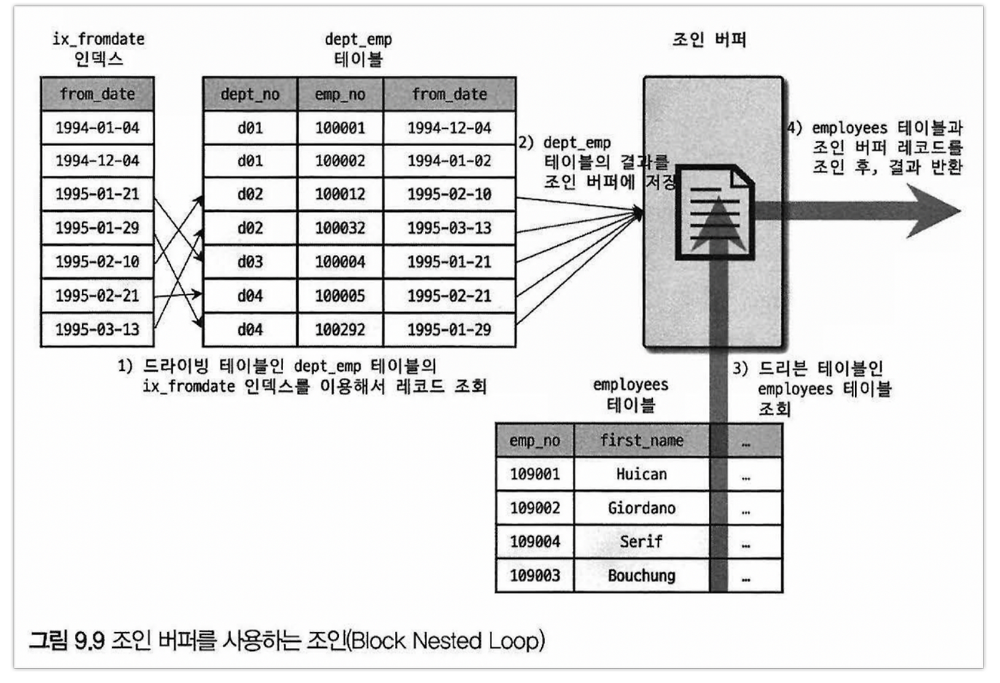

**주의점** 

조인 버퍼를 사용하는 조인에서는 결과 정렬 순서가 보장되지 않을 수 있으므로,반드시 정렬이 필요하다면 ORDER BY 절을 명시적으로 사용해야 한다.

**MySQL 8.0.18 해시 조인 도입**

```sql
EXPLAIN
SELECT *
FROM dept_emp de, employees e
WHERE de.from_date > '1995-01-01' AND e.emp_no < 109004;

+----+-------------+-------+------------+-------+---------------+---------+---------+------+--------+----------+--------------------------------------------+
| id | select_type | table | partitions | type  | possible_keys | key     | key_len | ref  | rows   | filtered | Extra                                      |
+----+-------------+-------+------------+-------+---------------+---------+---------+------+--------+----------+--------------------------------------------+
|  1 | SIMPLE      | e     | NULL       | range | PRIMARY       | PRIMARY | 4       | NULL | 149960 |   100.00 | Using where                                |
|  1 | SIMPLE      | de    | NULL       | ALL   | ix_fromdate   | NULL    | NULL    | NULL | 331143 |    50.00 | Using where; Using join buffer (hash join) |
+----+-------------+-------+------------+-------+---------------+---------+---------+------+--------+----------+--------------------------------------------+
```

MySQL 8.0.20 버전부터는 **블록 네스티드 루프 조인은 더이상 사용되지 않고 해시 조인 알고리즘이 대체**되어 사용된다.

---

## 9.3.1.3 인덱스 컨디션 푸시다운(index_condition_pushdown)

**테스트 설정**

```sql
ALTER TABLE employees ADD INDEX ix_lastname_firstname (last_name, first_name);

SET optimizer_switch='index_condition_pushdown=off';

SHOW VARIABLES LIKE 'optimizer_switch';
+------------------+-----------------------------------------------------------------------------------------------------------------------------------------------------------------------------------------------------------------------------------------------------------------------------------------------------------------------------------------------------------------------------------------------------------------------------------------------------------------------------------------------------------------------------------------------------------------------------------------------------+
| Variable_name    | Value                                                                                                                                                                                                                                                                                                                                                                                                                                                                                                                                                                                               |
+------------------+-----------------------------------------------------------------------------------------------------------------------------------------------------------------------------------------------------------------------------------------------------------------------------------------------------------------------------------------------------------------------------------------------------------------------------------------------------------------------------------------------------------------------------------------------------------------------------------------------------+
| optimizer_switch | index_merge=on,index_merge_union=on,index_merge_sort_union=on,index_merge_intersection=on,engine_condition_pushdown=off,index_condition_pushdown=on,mrr=on,mrr_cost_based=on,block_nested_loop=on,batched_key_access=off,materialization=on,semijoin=on,loosescan=on,firstmatch=on,duplicateweedout=on,subquery_materialization_cost_based=on,use_index_extensions=on,condition_fanout_filter=on,derived_merge=on,use_invisible_indexes=off,skip_scan=on,hash_join=on,subquery_to_derived=off,prefer_ordering_index=on,hypergraph_optimizer=off,derived_condition_pushdown=on,hash_set_operations=on |
+------------------+-----------------------------------------------------------------------------------------------------------------------------------------------------------------------------------------------------------------------------------------------------------------------------------------------------------------------------------------------------------------------------------------------------------------------------------------------------------------------------------------------------------------------------------------------------------------------------------------------------+
```

```sql
EXPLAIN
SELECT * FROM employees
WHERE last_name='Acton' AND first_name LIKE '%sal';

+----+-------------+-----------+------------+------+-----------------------+-----------------------+---------+-------+------+----------+-------------+
| id | select_type | table     | partitions | type | possible_keys         | key                   | key_len | ref   | rows | filtered | Extra       |
+----+-------------+-----------+------------+------+-----------------------+-----------------------+---------+-------+------+----------+-------------+
|  1 | SIMPLE      | employees | NULL       | ref  | ix_lastname_firstname | ix_lastname_firstname | 66      | const |  189 |    11.11 | Using where |
+----+-------------+-----------+------------+------+-----------------------+-----------------------+---------+-------+------+----------+-------------+
```

해당 쿼리는 (last_name, first_name) 인덱스를 last_name은 **인덱스 레인지 스캔**으로 사용할 수 있다.

하지만 first_name LIKE ‘%sal’ 조건은 테이블 데이터를 모두 읽은 후 사용자가 원하는 결과인지 **하나씩 비교해보는 조건(체크 조건 또는 필터링 조건)**으로만 사용된다.

실행 계획의 Extra 칼럼을 보면 “Using Where”가 표시된 것을 확인할 수 있다.

**“Using Where”는 인덱스를 사용할 수 없는 WHERE 조건에 일치하는지 검사하는 과정을 의미한다.** 

first_name LIKE ‘%sal’ 이 검사 과정에 사용된 조건이다.

즉, WHERE 조건 검사를 위해 테이블 읽기를 한다.

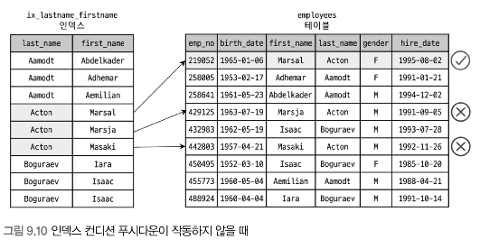

그림 9.10은 last_name=’Acton’ 조건으로 인덱스 레인지 스캔 이후 테이블의 레코드를 읽은 후, first_name LIKE ‘%sal’ 조건에 부합하는지 여부를 비교하는 과정이다.

만약 last_name=’Acton’ 조건에 일치하는 레코드가 10만 건이나 되는데, 단 1건만 모든 조건에 부합한다면 

이 경우에는 99,999건의 레코드 읽기가 불필요한 작업이 되어버린다.

그런데 왜 ix_lastname_firstname 세컨더리 인덱스에 존재하는 first_name에서 검사하지 않고 테이블의 first_name 칼럼을 이용했을까?

**first_name LIKE ‘%sal’ 조건을 누가 처리하느냐에 따라 인덱스에 포함된 first_name 칼럼을 이용할지 또는 테이블의 first_name 칼럼을 이용할지가 결정된다.**

그림 9.1에서 인덱스를 비교하는 작업은 InnoDB 스토리지 엔진이 수행하지만 테이블의 레코드에서 first_name 조건을 비교하는 작업은 MySQL 엔진이 수행하는 작업이다.

그런데 **MySQL 5.5 버전까지는 인덱스를 범위 제한 조건으로 사용하지 못하는 first_name 조건은 MySQL 엔진이 스토리지 엔진으로 아예 전달해주지 않았다.** 

그래서 스토리지 엔진에서는 불필요한 2건의 테이블 읽기를 수행할 수밖에 없었던 것이다.

MySQL 5.6 버전부터는 이렇게 인덱스를 범위 제한 조건으로 사용하지 못한다고 하더라도 인덱스에 포함된 칼럼의 조건이 있다면 모두 같이 모아서 스토리지 엔진으로 전달할 수 있게 핸들러 API가 개선됐다. 

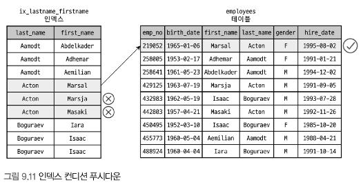

그래서 MySQL 5.6 버전부터는 그림 9.11과 같이 인덱스를 이용해 최대한 필터링까지 완료해서 꼭 필요한 레코드 1건에 대해서만 테이블 읽기를 수행할 수 있게 됐다.

```sql
SET optimizer_switch='index_condition_pushdown=on';

EXPLAIN
SELECT * FROM employees
WHERE last_name='Acton' AND first_name LIKE '%sal';

+----+-------------+-----------+------------+------+-----------------------+-----------------------+---------+-------+------+----------+-----------------------+
| id | select_type | table     | partitions | type | possible_keys         | key                   | key_len | ref   | rows | filtered | Extra                 |
+----+-------------+-----------+------------+------+-----------------------+-----------------------+---------+-------+------+----------+-----------------------+
|  1 | SIMPLE      | employees | NULL       | ref  | ix_lastname_firstname | ix_lastname_firstname | 66      | const |  189 |    11.11 | Using index condition |
+----+-------------+-----------+------------+------+-----------------------+-----------------------+---------+-------+------+----------+-----------------------+

```

이제 “Using Where”가 없어지고 “Using index condition”이 출력되는 것을 확인할 수 있다.

| **MySQL 버전** | **인덱스 범위 제한 불가 조건(예: LIKE '%sal') 처리 방식** | **스토리지 엔진에 WHERE 조건 전달** | **Extra 칼럼 표시** | **비고** |
| --- | --- | --- | --- | --- |
| 5.5 이하 | 인덱스 범위 제한 조건만 스토리지 엔진에 전달 | X (전달 안 됨) | Using where | 스토리지 엔진이 불필요한 테이블 읽기 수행 |
| 5.6 이상 | 인덱스 범위 제한 조건 + 인덱스 칼럼 조건 모두 전달 | O (전달됨) | Using index condition | 스토리지 엔진이 조건까지 검사 |

---

## 9.3.1.4 인덱스 확장(use_index_extensions)

`use_index_extensions` 옵티마이저 옵션은 InnoDB 스토리지 엔진을 사용하는 테이블에서 
세컨더리 인덱스에 자동으로 추가된 프라이머리 키를 활용할 수 있게 할지를 결정하는 옵션이다.

InnoDB 스토리지 엔진은 프라이머리 키를 클러스터링 키로 생성한다. 그래서 모든 세컨더리 인덱스는 리프 노드에 프라이머리 키 값을 가진다.

```sql
CREATE TABLE dept_emp (
    emp_no INT NOT NULL,
    dept_no CHAR(4) NOT NULL,
    from_date DATE NOT NULL,
    to_date DATE NOT NULL,
    PRIMARY KEY (dept_no, emp_no),
    KEY ix_fromdate (from_date)
) ENGINE=InnoDB;
```

프라이머리 키: (dept_no, emp_no), 세컨더리 인덱스: (from_date)

세컨더리 인덱스는 데이터 레코드를 찾아가기 위해 프라이머리 키인 dept_no, emp_no 칼럼을 순서대로(프라이머리 키에 명시된 순서) 포함한다.

최종적으로 ix_fromdate 인덱스는 (from_date, dept_no, emp_no) 조합으로 인덱스를 생성한 것과 흡사하게 작동할 수 있게 된다.

예전 MySQL 버전에서는 자동으로 추가되는 프라이머리 키를 제대로 활용하지 못했다.

하지만 업그레이드되면서 **옵티마이저는 세컨더리 인덱스에 프라이머리 키 칼럼이 숨어있다는 것을 인지하고 실행 계획을 수립**하도록 개선했다.

```sql
EXPLAIN SELECT COUNT(*)
FROM dept_emp
WHERE from_date='1987-07-25' AND dept_no='d001';

+----+-------------+----------+------------+------+---------------------------------------+-------------+---------+-------------+------+----------+-------------+
| id | select_type | table    | partitions | type | possible_keys                         | key         | key_len | ref         | rows | filtered | Extra       |
+----+-------------+----------+------------+------+---------------------------------------+-------------+---------+-------------+------+----------+-------------+
|  1 | SIMPLE      | dept_emp | NULL       | ref  | PRIMARY,ix_fromdate,ix_empno_fromdate | ix_fromdate | 19      | const,const |    6 |   100.00 | Using index |
+----+-------------+----------+------------+------+---------------------------------------+-------------+---------+-------------+------+----------+-------------+
```

실행 계획의 key_len 칼럼은 이 쿼리가 인덱스를 구성하는 칼럼 중에서 어느 부분까지 사용했는지를 바이트 수로 보여주는데, 19바이트로 표시된 것을 보면 from_date(3바이트) + dept_no(16바이트)까지 사용했다는 것을 알 수 있다.

```sql
EXPLAIN SELECT COUNT(*)
FROM dept_emp
WHERE from_date='1987-07-25t';
+----+-------------+----------+------------+------+-------------------------------+-------------+---------+-------+------+----------+-------------+
| id | select_type | table    | partitions | type | possible_keys                 | key         | key_len | ref   | rows | filtered | Extra       |
+----+-------------+----------+------------+------+-------------------------------+-------------+---------+-------+------+----------+-------------+
|  1 | SIMPLE      | dept_emp | NULL       | ref  | ix_fromdate,ix_empno_fromdate | ix_fromdate | 3       | const |   64 |   100.00 | Using index |
+----+-------------+----------+------------+------+-------------------------------+-------------+---------+-------+------+----------+-------------+
```

dept_no 칼럼을 사용하지 않았더니, from_date 칼럼을 위한 3바이트만 표시된 것을 확인할 수 있다.

InnoDB 프라이머리 키가 세컨더리 인덱스에 포함돼 있으므로 다음과 같은 정렬 작업도 인덱스를 활용해서 처리되는 장점도 있다. 

```sql
EXPLAIN SELECT *
FROM dept_emp
WHERE from_date='1987-07-25'
ORDER BY dept_no;
+----+-------------+----------+------------+------+---------------+-------------+---------+-------+------+----------+-------+
| id | select_type | table    | partitions | type | possible_keys | key         | key_len | ref   | rows | filtered | Extra |
+----+-------------+----------+------------+------+---------------+-------------+---------+-------+------+----------+-------+
|  1 | SIMPLE      | dept_emp | NULL       | ref  | ix_fromdate   | ix_fromdate | 3       | const |   64 |   100.00 | NULL  |
+----+-------------+----------+------------+------+---------------+-------------+---------+-------+------+----------+-------+
```

실행 계획을 보면 “Using Filesort”가 표시되지 않았다는 것은 별도의 정렬 작업 없이 인덱스 순서대로 레코드를 읽기만 함으로써 “ORDER BY dept_no”를 만족했다는 것을 의미한다.

---

## 9.3.1.5 인덱스 머지(index_merge)

인덱스를 이용해 쿼리를 실행하는 경우 대부분 옵티마이저는 테이블별로 하나의 인덱스만 사용하도록 실행 계획을 수립한다. 하지만 **인덱스 머지 실행 계획을 사용하면 하나의 테이블에 대해 2개 이상의 인덱스를 이용**해 쿼리를 처리한다. 

쿼리에서 한 테이블에 대한 WHERE 조건이 여러 개 있더라도 하나의 인덱스에 포함된 칼럼에 대한 조건만으로 인덱스를 검색하고 나머지 조건은 읽어온 레코드에 대해서 체크하는 형태로만 사용되는 것이 일반적이다.

하나의 인덱스만 사용해서 작업 범위를 충분히 줄일 수 있는 경우라면 테이블별로 하나의 인덱스만 활용하는 것이 효율적이다. 하지만 **각각의 조건이 서로 다른 인덱스를 사용할 수 있고, 그 조건을 만족하는 레코드 건수가 많은 것으로 예상될 때 MySQL 서버는 인덱스 머지 실행 계획을 선택**한다.

인덱스 머지 실행 계획은 병합 방식에 따라 3가지로 구분된다.

  - **index_merge_intersection**
  - **index_merge_soft_union**
  - **index_merge_union**

---

## 9.3.1.6 인덱스 머지 - 교집합(index_merge_intersection)

```sql
EXPLAIN SELECT *
FROM employees
WHERE first_name='Georgi' AND emp_no BETWEEN 10000 AND 20000;
+----+-------------+-----------+------------+-------------+----------------------+----------------------+---------+------+------+----------+----------------------------------------------------+
| id | select_type | table     | partitions | type        | possible_keys        | key                  | key_len | ref  | rows | filtered | Extra                                              |
+----+-------------+-----------+------------+-------------+----------------------+----------------------+---------+------+------+----------+----------------------------------------------------+
|  1 | SIMPLE      | employees | NULL       | index_merge | PRIMARY,ix_firstname | ix_firstname,PRIMARY | 62,4    | NULL |    1 |   100.00 | Using intersect(ix_firstname,PRIMARY); Using where |
+----+-------------+-----------+------------+-------------+----------------------+----------------------+---------+------+------+----------+----------------------------------------------------+
```

employees 테이블의 first_name 칼럼과 emp_no 칼럼은 모두 각각의 인덱스(ix_firstname, PRIMARY)를 가지고 있다. 그에 따라 옵티마이저는 ix_firstname, PRIMARY 키를 모두 사용해서 쿼리를 처리하기로 결정한다.

실행 계획의 Extra 칼럼에 “Using intersect”라고 표시된 것은 이 쿼리가 여러 개의 인덱스를 각각 검색해서 그 결과의 교집합만 반환했다는 것을 의미한다.

만약 두 칼럼의 조건 중 하나라도 충분히 효율적으로 쿼리를 처리할 수 있었다면 2개의 인덱스를 모두 사용하는 실행 계획을 사용하지 않았을 것이다.

즉, 옵티마이저는 각각의 조건에 일치하는 레코드 건수를 예측해 본 결과, 두 조건 모두 상대적으로 많은 레코드를 가져와야 한다는 것을 알게 된 것이다.

**각 조건 레코드 카운트 확인** 

```sql
SELECT COUNT(*)
FROM employees
WHERE first_name='Georgi'; 
+----------+
| COUNT(*) |
+----------+
|      253 |
+----------+

SELECT COUNT(*)
FROM employees
WHERE emp_no BETWEEN 10000 AND 20000;
+----------+
| COUNT(*) |
+----------+
|    10000 |
+----------+
```

 

**인덱스 머지 실행 계획이 없었다면?**

```
1번 
first_name='Georgi' 조건만 인덱스를 사용했다면 레코드 253건을 검색한 다음 
데이터 페이지에서 레코드를 찾고 emp_no 칼럼의 조건에 일치하는 레코드들만 반환하는 형태로 처리돼야 한다.

2번
emp_no BETWEEN 10000 AND 20000 조건만 인덱스를 사용했다면 프라이머리 키를 이용해 10,000건을 
읽어와서 first_name='Georgi' 조건에 일치하는 레코드만 반환하는 형태로 처리돼야 한다.
```

**하지만 1번 2번 모두 괜찮은 방식 같은데 왜 두 인덱스의 교집합만 가져오는 실행 계획을 세웠을까?**

```sql
SELECT COUNT(*)
FROM employees
WHERE first_name='Georgi' AND emp_no BETWEEN 10000 AND 20000;

+----------+
| COUNT(*) |
+----------+
|       14 |
+----------+
```

만약 1번 방식을 사용했다면 253번의 데이터 페이지 읽기를 하지만 실제 그중에서 겨우 14번만 의미 있는 작업이고 2번 방식의 경우 10,000건을 읽어서 9,986건은 버리고 겨우 14건만 반환하는 작업이 됐을 것이다.

두 작업 모두 비효율이 매우 큰 상황이어서 옵티마이저는 각 인덱스를 검색해 두 결과의 교집합만 찾아서 반환한 것이다.

**인덱스 확장 측면**

그런데 ix_firstname 세컨더리 인덱스는 리프 노드에 프라이머리 키인 emp_no 칼럼을 자동으로 포함하고 있기 때문에 그냥 ix_firstname 인덱스만 사용하는 것이 더 성능이 좋은 것으로 생각할 수 있다.

그렇다면  `index_merge_intersection` 최적화를 서버 레벨, 세션 레벨, 쿼리 레벨로 비활성화하면 된다.

```sql
EXPLAIN
SELECT /*+ SET_VAR(optimizer_switch='index_merge_intersection=off') */ *
FROM employees
WHERE first_name='Georgi' AND emp_no BETWEEN 10000 AND 20000;
+----+-------------+-----------+------------+-------+----------------------+--------------+---------+------+------+----------+-----------------------+
| id | select_type | table     | partitions | type  | possible_keys        | key          | key_len | ref  | rows | filtered | Extra                 |
+----+-------------+-----------+------------+-------+----------------------+--------------+---------+------+------+----------+-----------------------+
|  1 | SIMPLE      | employees | NULL       | range | PRIMARY,ix_firstname | ix_firstname | 62      | NULL |   14 |   100.00 | Using index condition |
+----+-------------+-----------+------------+-------+----------------------+--------------+---------+------+------+----------+-----------------------+
```

---

## 9.3.1.7 인덱스 머지 - 합집합(index_merge_union)

인덱스 머지의 **“Using union”은 WHERE 절에 사용된 2개 이상의 조건이 각각의 인덱스를 사용하되 OR 연산자로 연결된 경우에 사용**되는 최적화다.

```sql
EXPLAIN SELECT *
FROM employees
WHERE first_name='Matt' OR hire_date='1987-03-31';

+----+-------------+-----------+------------+-------------+--------------------------+--------------------------+---------+------+------+----------+----------------------------------------------------+
| id | select_type | table     | partitions | type        | possible_keys            | key                      | key_len | ref  | rows | filtered | Extra                                              |
+----+-------------+-----------+------------+-------------+--------------------------+--------------------------+---------+------+------+----------+----------------------------------------------------+
|  1 | SIMPLE      | employees | NULL       | index_merge | ix_hiredate,ix_firstname | ix_firstname,ix_hiredate | 58,3    | NULL |  344 |   100.00 | Using union(ix_firstname,ix_hiredate); Using where |
+----+-------------+-----------+------------+-------------+--------------------------+--------------------------+---------+------+------+----------+----------------------------------------------------+
```

employees 테이블에는 first_name 칼럼에 해당하는 인덱스와 hire_date 칼럼에 해당하는 인덱스가 각각 존재한다. 또한 각 조건 OR 연산자로 연결되었기 때문에 “Using union” 즉, 인덱스 머지 최적화를 사용한다.

Extra 칼럼을 보면 “Using union(ix_firstname,ix_hiredate)” 메시지가 보인다.

그런데 두 조건을 모두 만족하는 사원이 있었다면 사원의 정보가 두 번 출력이 되었어야 하는데 그렇지 않다. 

즉, MySQL 서버가 두 결과 집합의 중복 레코드를 제거했다는 것인데, 두 결과 집합에서 중복을 제거하기 위한 정렬 작업이 필요했을 것이다. 하지만 실행 계획에는 정렬했다는 표시는 없다.

MySQL 서버는 이 같은 중복 제거를 위해 내부적으로 어떤 작업을 수행

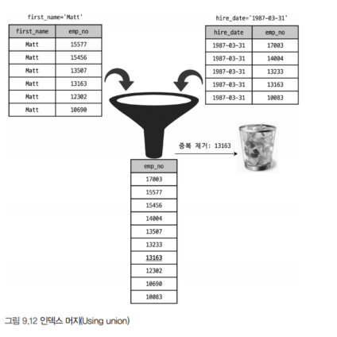

그림 9.12는 인덱스 머지 최적화의 Union 알고리즘의 작동 방식이다.

사원 번호(emp_no)가 “13163”인 사원은 first_name 검색 결과와 hire_date 검색 결과에서 모두 포함돼 있어서 반드시 하나를 제거해야 한다. 

MySQL 서버는 first_name 조건을 검색한 결과와 hire_date 조건을 검색한 결과가 프라이머리 키로 정렬돼 있다는 것을 알고 있다.

```sql
SELECT *
FROM employees
WHERE first_name='Matt';

+--------+------------+------------+-----------------+--------+------------+
| emp_no | birth_date | first_name | last_name       | gender | hire_date  |
+--------+------------+------------+-----------------+--------+------------+
|  10690 | 1962-09-06 | Matt       | Jumpertz        | F      | 1989-08-22 |
|  12302 | 1962-02-14 | Matt       | Plessier        | M      | 1987-01-28 |
|  13163 | 1963-12-11 | Matt       | Heping          | F      | 1987-03-31 |
|  13507 | 1959-09-05 | Matt       | Wallrath        | M      | 1985-06-28 |
|  15456 | 1957-09-27 | Matt       | Granlund        | M      | 1987-08-17 |
|  15577 | 1961-02-15 | Matt       | Menhardt        | M      | 1985-10-26 |
|  15696 | 1959-05-06 | Matt       | Zhang           | F      | 1987-08-21 |
|  16572 | 1956-11-26 | Matt       | Aamodt          | M      | 1987-06-16 |
|  17791 | 1952-09-22 | Matt       | Stifter         | F      | 1988-01-30 |
|  18258 | 1964-02-28 | Matt       | Hiroyama        | M      | 1986-04-03 |
|  19127 | 1963-11-30 | Matt       | Munawer         | M      | 1987-07-12 |
|  20351 | 1962-07-03 | Matt       | Vanwelkenhuysen | M      | 1994-04-12 |
|  20730 | 1959-02-08 | Matt       | Yemenis         | F      | 1990-06-11 |
|  21667 | 1963-10-28 | Matt       | Maquelin        | F      | 1995-08-23 |

// 생략 ....

SELECT *
FROM employees
WHERE hire_date='1987-03-31';

// 생략 ... 
```

그래서 MySQL **서버는 두 집합에서 하나씩 가져와서 서로 프라이머리 키를 기준으로 비교하면서 값이 중복된 레코드들을 별도의 정렬 없이 걸러낼 수 있다.**

---

## 9.3.1.8 인덱스 머지 - 정렬 후 합집합(index_merge_sort_union)

인덱스 머지 작업을 하는 도중에 결과의 정렬이 필요한 경우 MySQL 서버는 인덱스 머지 최적화의 “Sort union” 알고리즘을 사용한다.

```sql
EXPLAIN
SELECT * FROM employees
WHERE (first_name='Matt') OR (hire_date BETWEEN '1987-03-01' AND '1987-03-31');
+----+-------------+-----------+------------+-------------+--------------------------+--------------------------+---------+------+------+----------+---------------------------------------------------------+
| id | select_type | table     | partitions | type        | possible_keys            | key                      | key_len | ref  | rows | filtered | Extra                                                   |
+----+-------------+-----------+------------+-------------+--------------------------+--------------------------+---------+------+------+----------+---------------------------------------------------------+
|  1 | SIMPLE      | employees | NULL       | index_merge | ix_hiredate,ix_firstname | ix_firstname,ix_hiredate | 58,3    | NULL | 3197 |   100.00 | Using sort_union(ix_firstname,ix_hiredate); Using where |
+----+-------------+-----------+------------+-------------+--------------------------+--------------------------+---------+------+------+----------+---------------------------------------------------------+
```

2개의 쿼리로 분리해서 생각해 보자.

```sql
SELECT * FROM employees WHERE first_name='Matt';
SELECT * FROM employees WHERE hire_date BETWEEN '1987-03-01' AND '1987-03-31'
```

첫 번째 쿼리는 프라이머리 키(emp_no)를 기준으로 결과가 정렬되어 출력된다.

두 번째 쿼리는 hire_date를 기준으로 결과가 정렬되어 출력된다.

즉, 위 예제의 결과에서는 중복을 제거하기 위해 우선순위 큐를 사용하는 것이 불가능하다.

그래서 MySQL 서버는 두 집합의 결과에서 중복을 제거하기 위해 각 집합을 emp_no 칼럼으로 정렬한 다음 중복 제거를 수행한다.

인덱스 머지 최적화에서 중복 제거를 위해 강제로 정렬을 수행해야 하는 경우에는 실행 계획의 Extra 칼럼에 “Using sort_union” 문구가 표시된다.

---

## 9.3.1.9 세미 조인(semijoin)

다른 테이블과 실제 조인을 수행하지 않고, 단지 다른 테이블과 조건에 일치하는 레코드가 있는지 없는지만 

체크하는 형태의 쿼리를 **세미 조인(Semi-Join)**이라고 한다.

**MySQL 8.0 버전에서 세미 조인 쿼리의 예전 처리 방식 확인하기**

```sql
SET SESSION optimizer_switch='semijoin=off';

EXPLAIN
SELECT *
FROM employees e
WHERE e.emp_no IN
(SELECT de.emp_no FROM dept_emp de WHERE de.from_date='1995-01-01');

+----+-------------+-------+------------+------+-------------------------------+-------------+---------+-------+--------+----------+-------------+
| id | select_type | table | partitions | type | possible_keys                 | key         | key_len | ref   | rows   | filtered | Extra       |
+----+-------------+-------+------------+------+-------------------------------+-------------+---------+-------+--------+----------+-------------+
|  1 | PRIMARY     | e     | NULL       | ALL  | NULL                          | NULL        | NULL    | NULL  | 300363 |   100.00 | Using where |
|  2 | SUBQUERY    | de    | NULL       | ref  | ix_fromdate,ix_empno_fromdate | ix_fromdate | 3       | const |     57 |   100.00 | Using index |
+----+-------------+-------+------------+------+-------------------------------+-------------+---------+-------+--------+----------+-------------+
```

세미 조인 최적화 기능이 없었을 때 세미 조인 쿼리의 실행 계획은 employees 테이블을 풀 스캔(type=ALL)하면서 한 건 한 건 서브쿼리의 조건에 일치하는지 비교했다.

실행 계획만 봐도 대략 57건만 읽으면 될 쿼리를 30만 건 넘게 읽어서 처리된다는 것을 알 수 있다.

일반적으로 사용자가 기대하는 실행 방식은 서브 쿼리 먼저 실행, employees 테이블에서 일치하는 레코드만 검색

**MySQL 8.0 버전에서 세미 조인 쿼리의 최적화된 방식 확인하기**

```sql
SET SESSION optimizer_switch='semijoin=on';

EXPLAIN
SELECT *
FROM employees e
WHERE e.emp_no IN
(SELECT de.emp_no FROM dept_emp de WHERE de.from_date='1995-01-01');

+----+-------------+-------+------------+--------+-------------------------------+-------------+---------+---------------------+------+----------+------------------------------+
| id | select_type | table | partitions | type   | possible_keys                 | key         | key_len | ref                 | rows | filtered | Extra                        |
+----+-------------+-------+------------+--------+-------------------------------+-------------+---------+---------------------+------+----------+------------------------------+
|  1 | SIMPLE      | de    | NULL       | ref    | ix_fromdate,ix_empno_fromdate | ix_fromdate | 3       | const               |   57 |   100.00 | Using index; Start temporary |
|  1 | SIMPLE      | e     | NULL       | eq_ref | PRIMARY                       | PRIMARY     | 4       | employees.de.emp_no |    1 |   100.00 | End temporary                |
+----+-------------+-------+------------+--------+-------------------------------+-------------+---------+---------------------+------+----------+------------------------------+
```

먼저 서브 쿼리를 실행하여 57건을 읽고 employees 테이블의 PK emp_no를 통해서 1건만 읽는다.

세미 조인(Semi-join) 형태의 쿼리와 안티 세미 조인(Anti Semi-join) 형태의 쿼리는 최적화 방법에 차이가 존재한다.

| 최적화 기법 | 설명 |
| --- | --- |
| **세미 조인 최적화** | IN/EXISTS 서브쿼리를 내부적으로 조인으로 변환하여 효율적으로 처리. <br>Hash Semi Join, Index Semi Join 등 |
| **IN-to-EXISTS 최적화** | IN (subquery) → EXISTS로 변환하여 조건이 만족되면 즉시 반환 가능하도록 최적화 |
| **Materialization** | 서브쿼리 결과를 임시 테이블로 미리 계산하여 캐싱함으로써 반복 평가 방지 |

“= (subquery)”, “IN (subquery)” 형태의 세미 조인 쿼리에 대해 다음과 같은 최적화 방법을 사용 

  - 세미 조인 최적화
  - In-to-EXISTS 최적화
  - MATERIZATION 최적화

“<> (subquery)”, “NOT IN (subquery)” 형태의 안티 세미 조인 쿼리에 대해 다음과 같은 최적화 방법을 사용

  - In-to-EXISTS 최적화 
  - MATERIZATION 최적화

MySQL 서버 메뉴얼은 아래 최적화 전략들을 모아서 **전부 세미 조인 최적화라고 부른다.**

  - Table Pull-out
  - Duplicate Weed-out
  - First Match
  - Loose Scan
  - Materialization 

---

## 9.3.1.10 테이블 풀-아웃(Table Pull-out)

Table pullout 최적화는 **세미 조인의 서브쿼리에 사용된 테이블을 아우터 쿼리로 끄집어낸 후에 쿼리를 조인 쿼리로 재작성하는 형태**의 최적화다.

이는 서브쿼리 최적화가 도입되기 이전에 수동으로 쿼리를 튜닝하던 대표적인 방법이었다.

```sql
EXPLAIN
SELECT *
FROM employees e
WHERE e.emp_no IN (SELECT de.emp_no FROM dept_emp de WHERE de.dept_no='d009');

+----+-------------+-------+------------+--------+---------------------------+---------+---------+---------------------+-------+----------+-------------+
| id | select_type | table | partitions | type   | possible_keys             | key     | key_len | ref                 | rows  | filtered | Extra       |
+----+-------------+-------+------------+--------+---------------------------+---------+---------+---------------------+-------+----------+-------------+
|  1 | SIMPLE      | de    | NULL       | ref    | PRIMARY,ix_empno_fromdate | PRIMARY | 16      | const               | 46012 |   100.00 | Using index |
|  1 | SIMPLE      | e     | NULL       | eq_ref | PRIMARY                   | PRIMARY | 4       | employees.de.emp_no |     1 |   100.00 | NULL        |
+----+-------------+-------+------------+--------+---------------------------+---------+---------+---------------------+-------+----------+-------------+
```

실행 계획을 보면 id 칼럼이 전부 1이다.

**이 값이 동일한 값을 가진다는 것은 두 테이블이 서브쿼리 형태가 아니라 조인으로 처리됐음을 의미한다.**

IN (subquery) 형태의 세미 조인이 가장 빈번하게 사용되는 형태의 쿼리이다.

**Table pullout 최적화 간단한 확인 방법**

별도로 실행 계획의 Extra 칼럼에 “Using table pullout” 같은 문구가 출력되지 않는다.

그래서 Table pullout 최적화가 사용됐는지는 실행 계획에서 해당 테이블들의 id 칼럼값이 같은지 다른지를 비교 + Extra 칼럼에 아무것도 출력되지 않는 경우가 가장 간단한 확인 방법이다.

**Table pullout 최적화 정확한 확인 방법**

EXPLAIN 명령을 실행한 직후 SHOW WARNIGNS 명령으로 옵티마이저가 재작성한 쿼리를 살펴보기

```sql


SHOW WARNINGS;
+-------+------+------------------------------------------------------------------------------------------------------------------------------------------------------------------------------------------------------------------------------------------------------------------------------------------------------------------------------------------------------------------------------------------------------------------------------------------------------------+
| Level | Code | Message                                                                                                                                                                                                                                                                                                                                                                                                                                                    |
+-------+------+------------------------------------------------------------------------------------------------------------------------------------------------------------------------------------------------------------------------------------------------------------------------------------------------------------------------------------------------------------------------------------------------------------------------------------------------------------+
| Note  | 1003 | /* select#1 */ select `employees`.`e`.`emp_no` AS `emp_no`,`employees`.`e`.`birth_date` AS `birth_date`,`employees`.`e`.`first_name` AS `first_name`,`employees`.`e`.`last_name` AS `last_name`,`employees`.`e`.`gender` AS `gender`,`employees`.`e`.`hire_date` AS `hire_date` from `employees`.`dept_emp` `de` join `employees`.`employees` `e` where ((`employees`.`e`.`emp_no` = `employees`.`de`.`emp_no`) and (`employees`.`de`.`dept_no` = 'd009')) |
+-------+------+------------------------------------------------------------------------------------------------------------------------------------------------------------------------------------------------------------------------------------------------------------------------------------------------------------------------------------------------------------------------------------------------------------------------------------------------------------+
```

**EXPLAIN FORMAT=JSON 활용 확인**

```sql
EXPLAIN FORMAT=JSON
SELECT *
FROM employees e
WHERE e.emp_no IN (SELECT de.emp_no FROM dept_emp de WHERE de.dept_no='d009');

{
  "query_block": {
    "select_id": 1,
    "cost_info": {
      "query_cost": "35806.43"
    },
    "nested_loop": [
      {
        "table": {
          "table_name": "de",
          "access_type": "ref",
          "possible_keys": [
            "PRIMARY",
            "ix_empno_fromdate"
          ],
          "key": "PRIMARY",
          "used_key_parts": [
            "dept_no"
          ],
          "key_length": "16",
          "ref": [
            "const"
          ],
          "rows_examined_per_scan": 46012,
          "rows_produced_per_join": 46012,
          "filtered": "100.00",
          "using_index": true,
          "cost_info": {
            "read_cost": "222.44",
            "eval_cost": "4601.20",
            "prefix_cost": "4823.64",
            "data_read_per_join": "1M"
          },
          "used_columns": [
            "emp_no",
            "dept_no"
          ]
        }
      },
      {
        "table": {
          "table_name": "e",
          "access_type": "eq_ref",
          "possible_keys": [
            "PRIMARY"
          ],
          "key": "PRIMARY",
          "used_key_parts": [
            "emp_no"
          ],
          "key_length": "4",
          "ref": [
            "employees.de.emp_no"
          ],
          "rows_examined_per_scan": 1,
          "rows_produced_per_join": 46012,
          "filtered": "100.00",
          "cost_info": {
            "read_cost": "26381.60",
            "eval_cost": "4601.20",
            "prefix_cost": "35806.44",
            "data_read_per_join": "5M"
          },
          "used_columns": [
            "emp_no",
            "birth_date",
            "first_name",
            "last_name",
            "gender",
            "hire_date"
          ]
        }
      }
    ]
  }
}
```

쿼리가 IN (subquery)에서 2개의 테이블이 조인으로 동작한다.

**Table pullout 최적화 제한 사항과 특징**

  - 세미 조인 서브쿼리에서만 사용 가능하다.
- IN/EXISTS 같은 쿼리
  - **서브쿼리 부분이 UNIQUE 인덱스나 프라이머리 키 룩업으로 결과가 1건인 경우에만 사용 가능하다.**
  - 만약 모든 서브쿼리의 모든 테이블이 아우터 쿼리로 끄집어 낼 수 있다면 서브쿼리 자체는 없어진다.
  - MySQL에서는 **“최대한 서브쿼리를 풀어서 사용해라”라는 튜닝 가이드가 많은데, Table pullout 최적화는 이 가이드를 그대로 실행하는 것**이다. → 서브쿼리를 직접 조인으로 풀어서 사용할 필요가 없다.

---

## 9.3.1.11 퍼스트 매치(first match)

First Match 최적화 전략은 IN (subquery) 형태의 세미 조인을 EXISTS (subquery) 형태로 튜닝한 것과 비슷한 방법으로 실행된다.

```sql
EXPLAIN SELECT *
FROM employees e
WHERE e.first_name='Matt' AND e.emp_no IN
( SELECT t.emp_no FROM titles t
  WHERE t.from_date BETWEEN '1995-01-01' AND '1995-01-30');
  
+----+-------------+-------+------------+------+----------------------+--------------+---------+--------------------+------+----------+-----------------------------------------+
| id | select_type | table | partitions | type | possible_keys        | key          | key_len | ref                | rows | filtered | Extra                                   |
+----+-------------+-------+------------+------+----------------------+--------------+---------+--------------------+------+----------+-----------------------------------------+
|  1 | SIMPLE      | e     | NULL       | ref  | PRIMARY,ix_firstname | ix_firstname | 58      | const              |  233 |   100.00 | NULL                                    |
|  1 | SIMPLE      | t     | NULL       | ref  | PRIMARY              | PRIMARY      | 4       | employees.e.emp_no |    1 |    11.11 | Using where; Using index; FirstMatch(e) |
+----+-------------+-------+------------+------+----------------------+--------------+---------+--------------------+------+----------+-----------------------------------------+  
```

실행 계획을 보면 id 칼럼의 값이 모두 1로 표시됐다. Extra 칼럼에는 “FirstMatch(e)”라는 문구가 출력됐다.

즉, titles 테이블이 서브 쿼리 패턴이 아닌, 조인으로 처리됐다는 것을 알 수 있다.

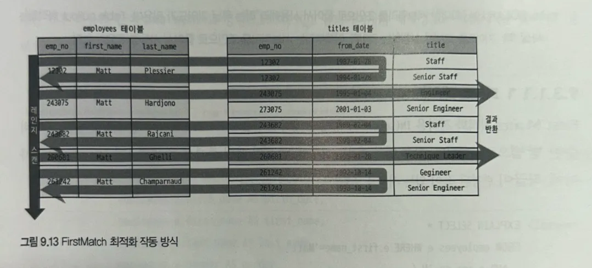

“FirstMatch(e)” 문구는 employees 테이블의 레코드에 대해 titles 테이블에 일치하는 레코드 1건만 찾으면 더이상의 titles 테이블 검색을 하지 않는다는 것을 의미한다.

즉, EXISTS(subquery)와 동일하게 처리된 것이다. 하지만 FirstMatch는 서브쿼리가 아니라 조인으로 풀어서 실행하면서 일치하는 첫 번째 레코드만 검색하는 최적화를 실행한 것이다.

**e 테이블을 드라이빙 테이블로 잡고 t 테이블과의 네스티드 루프 조인 & first match**

**그렇다면 IN-to-EXISTS 변환에 비해 FirstMatch 최적화 전략은 어떤 장점이 있을까?**

```
여러 테이블이 조인되는 형태의 쿼리에서는 없던 동등 조건을 옵티마이저가 자동으로 추가하는 형태의
최적화가 실행되기도 한다. 
기존 IN-to-EXISTS 최적화에서는 이러한 동등 조건 전파가 서브쿼리 내에서만 가능했지만
FirstMatch에서는 조인 형태로 처리되기 때문에 서브쿼리뿐만 아니라 
아우터 쿼리의 테이블까지 전파될 수 있다.
즉, FirstMatch 같은 경우 더 많은 조건이 주어지는 것이므로 더 나은 실행 계획을 수립할 수 있다.


In-to-EXISTS 최적화는 아무런 조건 없이 변환이 가능한 경우 무조건 그 최적화를 수행했다.
반면에 FirstMatch 최적화는 서브쿼리의 모든 테이블에 대해 FirstMatch 최적화를 수행할지 
일부 테이블에서만 수행할지 선택할 수 있다는 것이 장점이다.


요약하면 아우터 쿼리에도 동등 조건 전파, 테이블 최적화 일부 또는 전체 적용 선택 가능이다.
```

**FirstMatch 최적화 특징** 

  - 서브쿼리에서 하나의 레코드만 검색되면 더이상의 검색을 멈추는 단축 실행 경로이기 때문에 서브쿼리는 그 서브쿼리가 참조하는 모든 아우터 테이블이 먼저 조회된 이후에 실행된다.
  - 최적화가 사용되면 Extra 칼럼에는 “FirstMatch(table-N)” 문구가 표시된다.
  - 최적화는 상관 서브쿼리(Correlated subquery)에서도 사용될 수 있다.
  - GROUP BY나 집합 함수가 사용된 서브쿼리의 최적화에는 사용될 수 없다.

---

## 9.3.1.12 루스 스캔(loose scan)

세미 조인 서브쿼리 최적화의 LooseScan은 인덱스를 사용하는 GROUP BY 최적화 방법에서 살펴본 

“Using index for group-by”의 루스 인덱스 스캔과 비슷한 읽기 방식을 사용한다.

```sql
select count(*) from departments;
+----------+
| count(*) |
+----------+
|        9 |
+----------+

select count(*) from dept_emp;
+----------+
| count(*) |
+----------+
|   331603 |
+----------+

SHOW INDEXES FROM dept_emp;
+----------+------------+-------------------+--------------+-------------+-----------+-------------+----------+--------+------+------------+---------+---------------+---------+------------+
| Table    | Non_unique | Key_name          | Seq_in_index | Column_name | Collation | Cardinality | Sub_part | Packed | Null | Index_type | Comment | Index_comment | Visible | Expression |
+----------+------------+-------------------+--------------+-------------+-----------+-------------+----------+--------+------+------------+---------+---------------+---------+------------+
| dept_emp |          0 | PRIMARY           |            1 | dept_no     | A         |           8 |     NULL |   NULL |      | BTREE      |         |               | YES     | NULL       |
| dept_emp |          0 | PRIMARY           |            2 | emp_no      | A         |      331143 |     NULL |   NULL |      | BTREE      |         |               | YES     | NULL       |
| dept_emp |          1 | ix_fromdate       |            1 | from_date   | A         |        6908 |     NULL |   NULL |      | BTREE      |         |               | YES     | NULL       |
| dept_emp |          1 | ix_empno_fromdate |            1 | emp_no      | A         |      298489 |     NULL |   NULL |      | BTREE      |         |               | YES     | NULL       |
| dept_emp |          1 | ix_empno_fromdate |            2 | from_date   | A         |      331143 |     NULL |   NULL |      | BTREE      |         |               | YES     | NULL       |
+----------+------------+-------------------+--------------+-------------+-----------+-------------+----------+--------+------+------------+---------+---------------+---------+------------+
```

departments 테이블의 레코드 건수는 9건, dept_emp 테이블 레코드 건수는 33만건 가까이 저장돼 있다.

그런데 dept_emp 테이블에는 (dept_no + emp_no) 칼럼의 조합으로 프라이머리 키 인덱스가 만들어져 있다

하지만 이 프라이머리 키는 dept_no 만으로 그루핑해서 보면 9건밖에 없다는 것을 알 수 있다.

즉, dept_emp 테이블의 프라이머리 키를 루스 인덱스 스캔으로 유니크한 dept_no만 읽으면 아주 효율적으로 서브쿼리 부분을 실행할 수 있다.

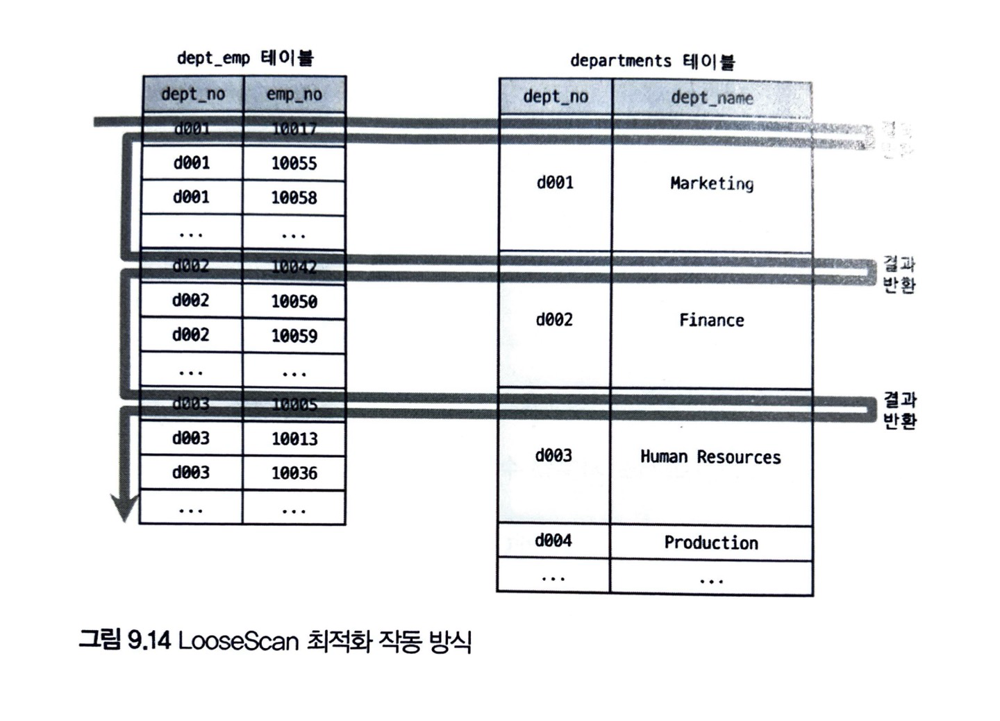

**옵티마이저 스위치 off 이후 실행 결과**

```sql
SET optimizer_switch='materialization=off';
SET optimizer_switch='firstmatch=off';
SET optimizer_switch='duplicateweedout=off';

EXPLAIN 
SELECT * 
FROM departments d 
WHERE d.dept_no IN (SELECT de.dept_no FROM dept_emp de);
+----+-------------+-------+------------+--------+---------------+---------+---------+----------------------+--------+----------+------------------------+
| id | select_type | table | partitions | type   | possible_keys | key     | key_len | ref                  | rows   | filtered | Extra                  |
+----+-------------+-------+------------+--------+---------------+---------+---------+----------------------+--------+----------+------------------------+
|  1 | SIMPLE      | de    | NULL       | index  | PRIMARY       | PRIMARY | 20      | NULL                 | 331143 |     0.00 | Using index; LooseScan |
|  1 | SIMPLE      | d     | NULL       | eq_ref | PRIMARY       | PRIMARY | 16      | employees.de.dept_no |      1 |   100.00 | NULL                   |
+----+-------------+-------+------------+--------+---------------+---------+---------+----------------------+--------+----------+------------------------+
```

Extra 칼럼에 LooseScan 문구가 표시된다. 또한 id 값이 동일하니 내부적으로 조인으로 처리됐다.

**옵티마이저 default 설정 실행 결과**

```sql
EXPLAIN
SELECT *
FROM departments d
WHERE d.dept_no IN (SELECT de.dept_no FROM dept_emp de);

+----+-------------+-------+------------+------+---------------+---------+---------+---------------------+-------+----------+----------------------------+
| id | select_type | table | partitions | type | possible_keys | key     | key_len | ref                 | rows  | filtered | Extra                      |
+----+-------------+-------+------------+------+---------------+---------+---------+---------------------+-------+----------+----------------------------+
|  1 | SIMPLE      | d     | NULL       | ALL  | PRIMARY       | NULL    | NULL    | NULL                |     9 |   100.00 | NULL                       |
|  1 | SIMPLE      | de    | NULL       | ref  | PRIMARY       | PRIMARY | 16      | employees.d.dept_no | 41392 |   100.00 | Using index; FirstMatch(d) |
+----+-------------+-------+------------+------+---------------+---------+---------+---------------------+-------+----------+----------------------------+
```

FirstMatch가 실행된다.

### Query 

```sql
EXPLAIN FORMAT=JSON
SELECT *
FROM departments d
WHERE d.dept_no IN (SELECT de.dept_no FROM dept_emp de);
```

---

### LooseScan

```sql
SET optimizer_switch='materialization=off';
SET optimizer_switch='firstmatch=off';
SET optimizer_switch='duplicateweedout=off';
```

```sql
{
  "query_block": {
    "select_id": 1,
    "cost_info": {
      "query_cost": "83191.43"
    },
    "nested_loop": [
      {
        "table": {
          "table_name": "de",
          "access_type": "index",
          "possible_keys": [
            "PRIMARY"
          ],
          "key": "PRIMARY",
          "used_key_parts": [
            "dept_no",
            "emp_no"
          ],
          "key_length": "20",
          "rows_examined_per_scan": 331143,
          "rows_produced_per_join": 8,
          "filtered": "0.00",
          "using_index": true,
          "loosescan": true,
          "cost_info": {
            "read_cost": "404.08",
            "eval_cost": "0.80",
            "prefix_cost": "404.88",
            "data_read_per_join": "256"
          },
          "used_columns": [
            "dept_no"
          ]
        }
      },
      {
        "table": {
          "table_name": "d",
          "access_type": "eq_ref",
          "possible_keys": [
            "PRIMARY"
          ],
          "key": "PRIMARY",
          "used_key_parts": [
            "dept_no"
          ],
          "key_length": "16",
          "ref": [
            "employees.de.dept_no"
          ],
          "rows_examined_per_scan": 1,
          "rows_produced_per_join": 1,
          "filtered": "100.00",
          "cost_info": {
            "read_cost": "82785.75",
            "eval_cost": "0.10",
            "prefix_cost": "83191.43",
            "data_read_per_join": "184"
          },
          "used_columns": [
            "dept_no",
            "dept_name",
            "emp_count"
          ]
        }
      }
    ]
  }
}
```

---

### default: FirstMatch

```sql
{
  "query_block": {
    "select_id": 1,
    "cost_info": {
      "query_cost": "37711.29"
    },
    "nested_loop": [
      {
        "table": {
          "table_name": "d",
          "access_type": "ALL",
          "possible_keys": [
            "PRIMARY"
          ],
          "rows_examined_per_scan": 9,
          "rows_produced_per_join": 9,
          "filtered": "100.00",
          "cost_info": {
            "read_cost": "0.25",
            "eval_cost": "0.90",
            "prefix_cost": "1.15",
            "data_read_per_join": "1K"
          },
          "used_columns": [
            "dept_no",
            "dept_name",
            "emp_count"
          ]
        }
      },
      {
        "table": {
          "table_name": "de",
          "access_type": "ref",
          "possible_keys": [
            "PRIMARY"
          ],
          "key": "PRIMARY",
          "used_key_parts": [
            "dept_no"
          ],
          "key_length": "16",
          "ref": [
            "employees.d.dept_no"
          ],
          "rows_examined_per_scan": 41392,
          "rows_produced_per_join": 9,
          "filtered": "100.00",
          "using_index": true,
          "first_match": "d",
          "cost_info": {
            "read_cost": "456.55",
            "eval_cost": "0.90",
            "prefix_cost": "37711.29",
            "data_read_per_join": "288"
          },
          "used_columns": [
            "dept_no"
          ]
        }
      }
    ]
  }
}
```

---

### 분석 

| 항목 | `loosescan` (서브쿼리 먼저) | `firstmatch` (departments 먼저) |
| --- | --- | --- |
| 드라이빙 테이블 | `dept_emp` (331,143 rows) | `departments` (9 rows) |
| 드리븐 테이블 | `departments` | `dept_emp` |
| `query_cost` | `83191.43` | `37711.29` |
| 옵티마이저 전략 | `loose index scan` | `firstmatch` (de-duplication) |

### 드라이빙 테이블이 dept_emp인 경우 (루스 인덱스 스캔 / Loose Index Scan)

    - dept_no가 비유니크하지만 인덱스가 있기 때문에 루스 인덱스 스캔으로 중복 건너뛰기가 가능하다.
    - 하지만 루스 스캔이더라도 MySQL은 dept_no가 바뀌는 순간까지 인덱스를 차례대로 순회하며 체크한다.
    - 따라서 결국 331,143건의 인덱스를 모두 읽으며 중복을 스킵하는 구조이다.
    - 이로 인해 I/O는 줄어들 수 있어도, CPU 연산량은 여전히 크다.

---

### 드라이빙 테이블이 departments인 경우 (FirstMatch)

    - 드라이빙 테이블이 9건이기 때문에, 먼저 departments 9건을 단순 스캔한다.
    - 각 dept_no에 대해 dept_emp 테이블에서 매칭되는 첫 번째 레코드만 찾으면 끝이다.
    - 중복 제거(distinct 등)를 따로 하지 않아도 되고, join 이후 더 이상 쓸모없는 row는 보지 않는다.
    - firstmatch는 각 드라이빙 레코드별 최초 일치만 찾고 그 뒤는 스킵하므로 매우 효율적이다.

**LooseScan 최적화의 특성** 

  - LooseScan 최적화는 루스 인덱스 스캔으로 서브쿼리 테이블을 읽고,  그다음으로 아우터 테이블을 드리븐으로 사용해서 조인을 수행한다. 그래서 서브쿼리 부분이 루스 인덱스 스캔을 사용할 수 있는 조건이 갖춰져야 사용할 수 있는 최적화다.

**사용 가능한 예시 쿼리** 

```sql
SELECT ... FROM ... WHERE expr IN (SELECT keypart1 FROM tab WHERE ...)
SELECT ... FROM ... WHERE expr IN (SELECT keypart2 FROM tab WHERE keypart1='상수' ...)
```

---

## 9.3.1.13 구체화(Materialization)

Materialization 최적화란 세미 조인에서 사용된 **서브쿼리를 통째로 구체화 즉, 내부 임시 테이블을 생성하여 쿼리를 최적화** 한다는 의미이다.

```sql
EXPLAIN 
SELECT *
FROM employees e 
WHERE e.emp_no IN (
    SELECT de.emp_no FROM dept_emp de
    WHERE de.from_date='1995-01-01'
);

+----+--------------+-------------+------------+--------+-------------------------------+-------------+---------+--------------------+------+----------+-------------+
| id | select_type  | table       | partitions | type   | possible_keys                 | key         | key_len | ref                | rows | filtered | Extra       |
+----+--------------+-------------+------------+--------+-------------------------------+-------------+---------+--------------------+------+----------+-------------+
|  1 | SIMPLE       | <subquery2> | NULL       | ALL    | NULL                          | NULL        | NULL    | NULL               | NULL |   100.00 | NULL        |
|  1 | SIMPLE       | e           | NULL       | eq_ref | PRIMARY                       | PRIMARY     | 4       | <subquery2>.emp_no |    1 |   100.00 | NULL        |
|  2 | MATERIALIZED | de          | NULL       | ref    | ix_fromdate,ix_empno_fromdate | ix_fromdate | 3       | const              |   57 |   100.00 | Using index |
+----+--------------+-------------+------------+--------+-------------------------------+-------------+---------+--------------------+------+----------+-------------+
```

해당 쿼리는 1995년 1월1일에 조직이 변경된 사원들의 목록을 조회하는 IN(subquery) 세미 조인을 사용한다.

**if FirstMatch 최적화?** 

만약 FirstMatch 최적화를 사용하면 employees 테이블에 대한 조건이 서브쿼리 이외에는 아무것도 없기 때문에 테이블을 풀 스캔해야 할 것이다.

왜냐하면 FirstMatch 같은 경우 먼저 서브 쿼리 테이블과 조인을 하고 exists 형태로 탐색을 진행하면서 조건이 맞으면 종료한다. 이때 현재 쿼리는 employees 테이블에 대한 조건이 없기 때문에 employees 테이블 전체를 풀 스캔하고 조인하는 방식으로 진행하기 때문이다.

**서브쿼리 구체화 최적화**

MySQL 옵티마이저는 이런 형태의 쿼리를 위해 서브쿼리 구체화 최적화를 도입했다.

실행 계획의 마지막 라인의 select_type 칼럼을 보면 “MATERIAILIZED” 메시지가 출력됐다. 

해당 쿼리에서 사용하는 테이블은 2개인데 실행 계획은 3개 라인이 출력된 것을 봐도 임시 테이블이 생성됐다는 것을 짐작할 수 있다.

**실행 순서 분석**

먼저 dept_emp 테이블을 읽는 서브 쿼리가 실행되고 그 결과로 임시 테이블 <subquery2>이 만들어진다.

최종적으로 서브쿼리가 구체화된 임시 테이블 <subquery2>과 employees 테이블을 조인해서 결과를 반환한다.

```sql
EXPLAIN
SELECT *
FROM employees e
WHERE e.emp_no IN (
    SELECT de.emp_no FROM dept_emp de
    WHERE de.from_date='1995-01-01'
    GROUP BY de.dept_no
);
```

구체화 최적화는 다른 서브쿼리 최적화와 다르게, 서브 쿼리 내에 Group By 절이 있어도 이 최적화 전략을 사용할 수 있다.

**Materialization 제한 사항과 특성**

  - IN(Subquery)에서 서브쿼리는 상관 서브쿼리가 아니어야 한다.
  - 서브쿼리는 Group By 또는 집합 함수들이 사용돼도 구체화를 사용할 수 있다.
  - 구체화가 사용된 경우에는 내부 임시 테이블이 사용된다.

**MySQL 8.0 버전**

구체화 최적화는 `semijoin` 옵션과 `materialization` 옵션이 모두 ON으로 활성화된 경우에만 사용된다.

8.0 버전에서는 기본적으로 두 옵션은 활성화돼 있다.

---

## 9.3.1.14 중복 제거(Duplicated Weed-out)

Duplicated Weedout은  **세미 조인 서브쿼리를 일반적인 INNER JOIN 쿼리로 바꿔서 실행하고 마지막에 중복된 레코드를 제거**하는 방법으로 처리되는 최적화 알고리즘이다.

```sql
EXPLAIN
SELECT * FROM employees e
WHERE e.emp_no IN (
    SELECT s.emp_no FROM salaries s
    WHERE s.salary > 150000
);

+----+--------------+-------------+------------+--------+-------------------+-----------+---------+--------------------+------+----------+--------------------------+
| id | select_type  | table       | partitions | type   | possible_keys     | key       | key_len | ref                | rows | filtered | Extra                    |
+----+--------------+-------------+------------+--------+-------------------+-----------+---------+--------------------+------+----------+--------------------------+
|  1 | SIMPLE       | <subquery2> | NULL       | ALL    | NULL              | NULL      | NULL    | NULL               | NULL |   100.00 | NULL                     |
|  1 | SIMPLE       | e           | NULL       | eq_ref | PRIMARY           | PRIMARY   | 4       | <subquery2>.emp_no |    1 |   100.00 | NULL                     |
|  2 | MATERIALIZED | s           | NULL       | range  | PRIMARY,ix_salary | ix_salary | 4       | NULL               |   36 |   100.00 | Using where; Using index |
+----+--------------+-------------+------------+--------+-------------------+-----------+---------+--------------------+------+----------+--------------------------+


SHOW INDEXES FROM salaries;
+----------+------------+-----------+--------------+-------------+-----------+-------------+----------+--------+------+------------+---------+---------------+---------+------------+
| Table    | Non_unique | Key_name  | Seq_in_index | Column_name | Collation | Cardinality | Sub_part | Packed | Null | Index_type | Comment | Index_comment | Visible | Expression |
+----------+------------+-----------+--------------+-------------+-----------+-------------+----------+--------+------+------------+---------+---------------+---------+------------+
| salaries |          0 | PRIMARY   |            1 | emp_no      | A         |      297214 |     NULL |   NULL |      | BTREE      |         |               | YES     | NULL       |
| salaries |          0 | PRIMARY   |            2 | from_date   | A         |     2838426 |     NULL |   NULL |      | BTREE      |         |               | YES     | NULL       |
| salaries |          1 | ix_salary |            1 | salary      | A         |       74151 |     NULL |   NULL |      | BTREE      |         |               | YES     | NULL       |
+----------+------------+-----------+--------------+-------------+-----------+-------------+----------+--------+------+------------+---------+---------------+---------+------------+
```

해당 쿼리는 급여가 150000 이상인 사원들의 정보를 조회하는 쿼리다.

salaries 테이블의 PK(emp_no + from_date)이므로 salary가 150000 이상인 레코드를 salaries 테이블에서 조회하면 그 결과에는 중복된 emp_no가 발생할 수 있다.

```sql
SELECT *
FROM salaries
WHERE salary > 150000;
+--------+--------+------------+------------+
| emp_no | salary | from_date  | to_date    |
+--------+--------+------------+------------+
|  66793 | 150052 | 2002-06-16 | 9999-01-01 |
             .....
|  43624 | 157821 | 2001-03-22 | 2002-03-22 |
|  43624 | 158220 | 2002-03-22 | 9999-01-01 |
+--------+--------+------------+------------+
36 rows in set (0.00 sec)
```

그래서 이 쿼리를 다음과 같이 재작성해서 GROUP BY 절을 넣어 주면 위의 세미 조인 서브쿼리와 동일한 결과를 얻을 수 있다. Duplicate weedout 최적화를 진행하면 아래와 같은 쿼리로 바뀐다.

```sql
 SELECT e.* 
 FROM employees e, salaries s 
 WHERE e.emp_no=s.emp_no AND s.salary > 150000 
 GROUP BY e.emp_no;
```

테스트를 진행하니까 책과 다른 결과가 나와서 그림으로 해당 최적화에 대한 이해만 해보려고 한다.

물론, 옵티마이저 스위치 설정까지 똑같이 진행하였다.

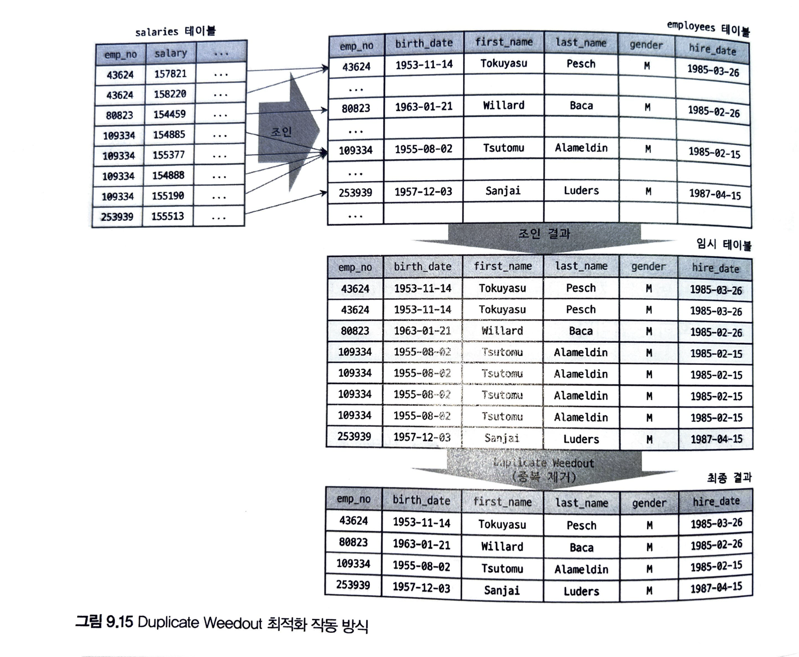

  1. salaries 테이블의 ix_salary 인덱스를 스캔해서 salary가 150000보다 큰 사원을 검색해 employees 테이블 조인을 실행
  1. 조인된 결과를 임시 테이블에 저장
  1. 임시 테이블에 저장된 결과를 emp_no 기준으로 중복 제거
  1. 중복을 제거하고 남은 레코드를 최종적으로 반환

Duplicate Weedout 최적화는 다음과 같은 장점과 제약사항이 있다.

  - 서브쿼리가 상관 서브쿼리라고 하더라도 사용할 수 있는 최적화다.
  - 서브쿼리가 GROUP BY나 집합 함수가 사용된 경우에는 사용될 수 없다.
  - Duplicate Weedout은 서브쿼리의 테이블을 조인으로 처리하기 때문에 최적화할 수 있는 방법이 많다.

---

## 9.3.1.15 컨디션 팬아웃(condition_fantout_filter)

조인을 실행할 때 테이블의 순서는 쿼리의 성능에 매우 큰 영향을 미친다.

예를 들어 A, B 테이블이 존재하는데 조인 조건에 일치하는 레코드 건수가 A가 1만건 B가 10건이라고 할 때

A 테이블을 드라이빙 테이블로 결정하면 B 테이블을 1만번 읽어야 한다.

그래서 옵티마이저는 **여러 테이블이 조인되는 경우 가능하다면 일치하는 레코드 건수가 적은 순서대로 조인을 실행**한다.

**컨디션 팬아웃 이해를 위한 예제 쿼리**

```sql
SELECT *
FROM employees e INNER JOIN salaries s
ON s.emp_no=e.emp_no
WHERE e.first_name='Matt' AND
(e.hire_date BETWEEN '1985-11-21' AND '1986-11-21');
```

**condition_fanout_filter 옵티마이저 옵션 off  실행 계획**

```sql
SET optimizer_switch = 'condition_fanout_filter=off';

+--+-----------+-----+----------+----+--------------------------------+------------+-------+------------------+----+--------+-----------+
|id|select_type|table|partitions|type|possible_keys                   |key         |key_len|ref               |rows|filtered|Extra      |
+--+-----------+-----+----------+----+--------------------------------+------------+-------+------------------+----+--------+-----------+
|1 |SIMPLE     |e    |null      |ref |PRIMARY,ix_hiredate,ix_firstname|ix_firstname|58     |const             |233 |100     |Using where|
|1 |SIMPLE     |s    |null      |ref |PRIMARY                         |PRIMARY     |4      |employees.e.emp_no|9   |100     |null       |
+--+-----------+-----+----------+----+--------------------------------+------------+-------+------------------+----+--------+-----------+
```

  1. employees 테이블에서 ix_firstname 인덱스를 이용해 first_name=’Matt’ 조건에 일치하는 233건의 레코드를 검색한다.
  1. 검색된 233건의 레코드 중에서 hire_date 조건에 맞는 레코드만 걸러낸다. 이 실행계획에서는 **filtered 칼럼의 값이 100인 것은 옵티마이저가 233건 모두 hire_date 칼럼의 조건을 만족할 것으로 예측**했다는 것을 의미한다.
  1. employees 테이블을 읽은 결과 233건에 대해 salaries 테이블의 프라이머리 키를 이용해 salaries 레코드를 읽는다. 이때 옵티마이저는 employees 테이블의 레코드 한 건당 salaries 테이블의 레코드 9건이 일치할 것으로 예상했다.

여기서 핵심은 employees 테이블의 rows 칼럼의 값이 233이고, filtered 칼럼의 값이 100%라는 것이다.

**condition_fanout_filter 옵티마이저 옵션 on**

```sql
SET optimizer_switch = 'condition_fanout_filter=on';

+--+-----------+-----+----------+----+--------------------------------+------------+-------+------------------+----+--------+-----------+
|id|select_type|table|partitions|type|possible_keys                   |key         |key_len|ref               |rows|filtered|Extra      |
+--+-----------+-----+----------+----+--------------------------------+------------+-------+------------------+----+--------+-----------+
|1 |SIMPLE     |e    |null      |ref |PRIMARY,ix_hiredate,ix_firstname|ix_firstname|58     |const             |233 |26.08   |Using where|
|1 |SIMPLE     |s    |null      |ref |PRIMARY                         |PRIMARY     |4      |employees.e.emp_no|9   |100     |null       |
+--+-----------+-----+----------+----+--------------------------------+------------+-------+------------------+----+--------+-----------+
```

condition_fanout_filter 최적화를 활성한 후 조회한 실행 계획에서도 row 칼럼의 값은 233으로 동일하다.

하지만 filtered 칼럼의 값이 100%가 아니라 23.2%로 변경됐다.

컨디션 팬아웃 최적화가 활성화되면서 옵티마이저는 인덱스를 사용할 수 있는 first_name 칼럼 조건 이외의 나머지 조건(hire_date)에 대해서도 얼마나 조건을 충족할지를 고려했다는 뜻이다.

즉, 비활성화 한 경우에는 233건으로 예측한 반면, 활성화 한 경우에는 54(233 * 0.232)만 조건을 충족할 것이라고 예측했다. 옵티마이저가 조건을 만족하는 레코드 건수를 예측할 수 있다면 더 빠른 실행 계획을 만들어 낼 수 있다는 것이다. 더 빠른 실행 계획이란 조인 시 조인에 일치하는 레코드 건수가 더 작은 테이블을 드라이빙 테이블로 잡는것을 말한다.

**condition_fanout_filter 최적화는 어떻게 filtered 칼럼의 값을 예측할까?** 

MySQL 8.0 버전에서는 컨디션 팬아웃 최적화가 활성화되면 다음과 같은 조건을 만족하는 칼럼의 조건들에 대해 조건을 만족하는 레코드의 비율을 계산할 수 있다.

  - WHERE 조건절에 사용된 칼럼에 대해 인덱스가 있는 경우
  - WHERE 조건절에 사용된 칼럼에 대해 히스토그램이 존재하는 경우

예제로 살펴본 쿼리의 경우 first_name=’Matt’ 조건을 위한 ix_firstname 인덱스만 사용한다.

하지만 실행 계획을 수립하는 경우에는 first_name 칼럼의 인덱스를 이용해 조건에 일치하는 레코드 건수가 대략 233건 정도라는 것을 알아내고, hire_date 칼럼의 인덱스가 없었다면 hire_date 칼럼값의 분포도를 살펴보고 filtered 칼럼의 값을 예측한다.

**즉, 정리하면 컨디션 팬아웃 최적화는 인덱스가 있으면 인덱스를 통해 건수를 예상하고
인덱스가 없으면 히스토그램을 통해 filtered 값을 예측하며, 검색되는 레코드 건수를 근사치로 알아내고 어떤 테이블을 드라이빙 테이블로 할지 결정한다.**

1. 레인지 옵티마이저를 이용한 예측
    1. 히스토그램을 통한 예측 
    1. 인덱스 통계를 이용한 예측
    1. 추측에 기반한 예측

레인지 옵티마이저 같은 경우 실제 인덱스의 데이터를 살펴보고 레코드 건수를 예측하는 방식인데, 

당연히 인덱스를 이용해 쿼리가 실행될 수 있을 때만 사용된다.

실제 쿼리가 실행되기도 전에 미리 인덱스를 이용해 소량의 데이터를 읽어본다.

레인지 옵티마이저의 예측은 다른 예측보다 우선순위가 높기 때문에 실행 계획에 표시되는 레코드 건수가 실제 테이블이나 인덱스의 통계, 히스토그램 정보와 다른 값이 표시될 수 있다.

컨디션 팬아웃 필터 최적화 기능을 활성화하면 옵티마이저는 더 정교한 계산을 거쳐서 실행 계획을 수립한다.

그에 때라 더 많은 시간과 컴퓨팅 자원을 사용하게 된다. 쿼리가 간단하거나 쿼리 실행 계획이 잘못된 선택을 한 적이 없다면, 오히려 컨디션 팬아웃 필터는 성능 향상에 크게 도움이 되지 않을 수 있다.

---

## 9.3.1.16 파생 테이블 머지(derived_merge)

예전 버전의 MySQL 서버에서는 다음과 같이 FROM 절에 사용된 서브쿼리는 먼저 실행해서 그 결과를 임시 테이블로 만든 다음 외부 쿼리 부분을 처리했다.

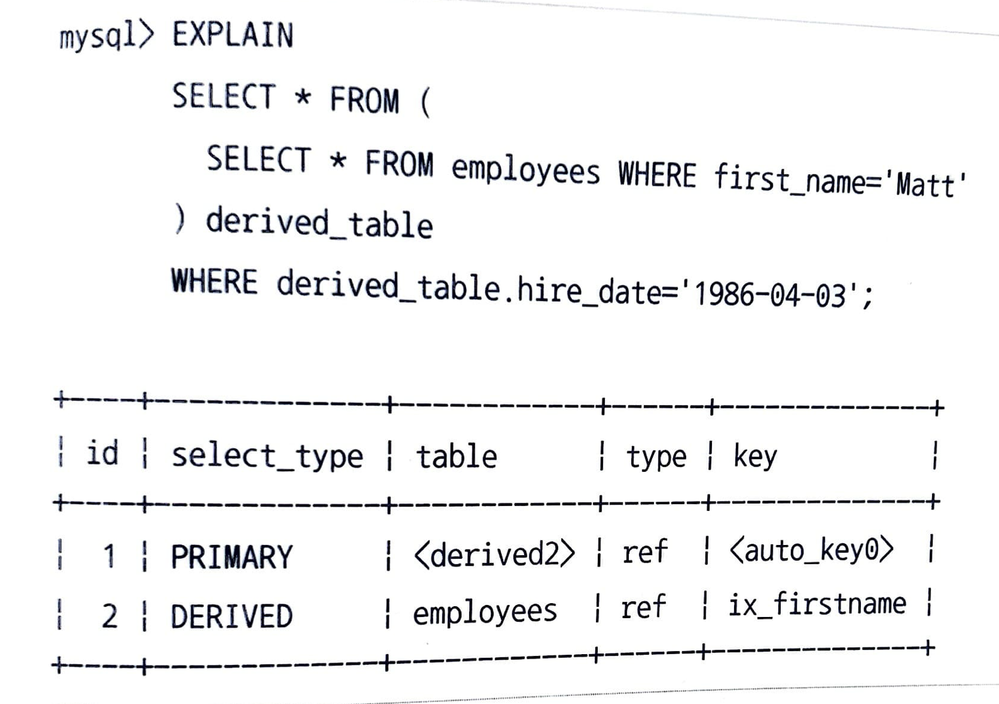

실행 계획을 보면 employees 테이블을 읽는 라인의 select_type 칼럼이 DERIVED라고 표시돼 있다.

이는 employees 테이블에서 first_name 칼럼의 값이 ‘Matt’인 레코드들만 읽어서 임시 테이블을 생성하고, 이 임시 테이블을 다시 읽어서 hire_date 칼럼의 값이 ‘1986-04-03’인 레코드만 걸러내어 반환한 것이다.

이렇게 FROM 절에 사용된 서브쿼리를  파생 테이블 (Derived Table)이라고 부른다.

이 실행 계획의 경우 MySQL 서버는 내부적으로 임시 테이블을 생성하고 first_name=’Matt’인 레코드를 employees 테이블에서 읽어서 임시 테이블로 INSERT 한다. 그리고 다시 임시 테이블을 읽으므로 레코드를 복사하고 읽는 오버헤드가 추가된다. 내부적으로 생성되는 임시 테이블은 처음에 메모리에 생성되지만, 건수가 많아지면 결국 디스크로 다시 기록돼야 한다. 메모리에 상주할 만큼 임시 테이블의 크기가 작다면 성능에 큰 영향을 미치지 않겠지만 레코드가 많아지면 오버헤드로 인해 쿼리의 성능은 많이 느려질 것이다.

### 참고 

참고로 예전 버전의 MySQL은 메모리의 임시 테이블을 MEMORY 스토리지 엔진을 이용하고 디스크에 생성되는 임시 테이블은 MyISAM 스토리지 엔진을 사용했다. 하지만 MEMORY 스토리지 엔진은 가변 길이 칼럼을 지원하지 않고 MyISAM 스토리지 엔진은 트랜잭션을 지원하지 않는 문제점이 존재하여 8.0 버전 부터는 메모리에 생성되는 임시 테이블을 위해 TempTable이라는 스토리지 엔진이 도입됐고 디스크 임시 테이블에 대해서는 InnoDB 스토리지 엔진을 사용하도록 개선했다. 메모리에 만들어지는 테이블은 가변 길이 칼럼을 지원하고, 디스크 임시 테이블도 트랜잭션을 지원할뿐만 아니라 MyISAM 스토리지 엔진보다 더 나은 성능으로 처리할 수 있게 됐다.

5.7 버전 부터 파생 테이블로 만들어지는 서브쿼리를 외부 쿼리와 병합해서 서브쿼리 부분을 제거하는 최적화가 도입됐다. `derived_merge` 최적화 옵션은 이러한 임시 테이블 최적화를 활성화할지 여부를 결정한다.

```sql
EXPLAIN
SELECT * FROM (
    SELECT * FROM employees WHERE first_name='Matt'
    ) derived_table
WHERE derived_table.hire_date='1986-04-03';

+--+-----------+---------+----------+-----------+------------------------+------------------------+-------+----+----+--------+------------------------------------------------------+
|id|select_type|table    |partitions|type       |possible_keys           |key                     |key_len|ref |rows|filtered|Extra                                                 |
+--+-----------+---------+----------+-----------+------------------------+------------------------+-------+----+----+--------+------------------------------------------------------+
|1 |SIMPLE     |employees|null      |index_merge|ix_hiredate,ix_firstname|ix_hiredate,ix_firstname|3,58   |null|1   |100     |Using intersect(ix_hiredate,ix_firstname); Using where|
+--+-----------+---------+----------+-----------+------------------------+------------------------+-------+----+----+--------+------------------------------------------------------+
```

해당 실행 계획은 쿼리에서의 임시 테이블이 외부 쿼리로 병합된 경우의 실행 계획을 보여준다.

이제 서브쿼리 없이 employees 테이블을 조회하는 형태의 단순 실행 계획으로 바뀌었다.

SHOW WARNIGNS 명령으로 옵티마이저가 새로 작성한 쿼리를 살펴보면 어떻게 외부 쿼리로 병합했는지 확인할 수 있다.

DataGrip은 SHOW WARNINGS 사용 불가 → 터미널에서 확인

```sql
EXPLAIN
SELECT * FROM (
    SELECT * FROM employees WHERE first_name='Matt'
 ) derived_table
WHERE derived_table.hire_date='1986-04-03';
+----+-------------+-----------+------------+-------------+--------------------------+--------------------------+---------+------+------+----------+--------------------------------------------------------+
| id | select_type | table     | partitions | type        | possible_keys            | key                      | key_len | ref  | rows | filtered | Extra                                                  |
+----+-------------+-----------+------------+-------------+--------------------------+--------------------------+---------+------+------+----------+--------------------------------------------------------+
|  1 | SIMPLE      | employees | NULL       | index_merge | ix_hiredate,ix_firstname | ix_hiredate,ix_firstname | 3,58    | NULL |    1 |   100.00 | Using intersect(ix_hiredate,ix_firstname); Using where |
+----+-------------+-----------+------------+-------------+--------------------------+--------------------------+---------+------+------+----------+--------------------------------------------------------+

SHOW WARNINGS;
+-------+------+-----------------------------------------------------------------------------------------------------------------------------------------------------------------------------------------------------------------------------------------------------------------------------------------------------------------------------------------------------------------------------------------------------------------------------------------------------------------------------------+
| Level | Code | Message                                                                                                                                                                                                                                                                                                                                                                                                                                                                           |
+-------+------+-----------------------------------------------------------------------------------------------------------------------------------------------------------------------------------------------------------------------------------------------------------------------------------------------------------------------------------------------------------------------------------------------------------------------------------------------------------------------------------+
| Note  | 1003 | /* select#1 */ select `employees`.`employees`.`emp_no` AS `emp_no`,`employees`.`employees`.`birth_date` AS `birth_date`,`employees`.`employees`.`first_name` AS `first_name`,`employees`.`employees`.`last_name` AS `last_name`,`employees`.`employees`.`gender` AS `gender`,`employees`.`employees`.`hire_date` AS `hire_date` from `employees`.`employees` where ((`employees`.`employees`.`hire_date` = DATE'1986-04-03') and (`employees`.`employees`.`first_name` = 'Matt')) |
+-------+------+-----------------------------------------------------------------------------------------------------------------------------------------------------------------------------------------------------------------------------------------------------------------------------------------------------------------------------------------------------------------------------------------------------------------------------------------------------------------------------------+
```

**모든 쿼리에 대해 옵티마이저가 서브쿼리를 병합할 수 있는 것은 아니다.**

다음과 같은 조건에서는 자동으로 옵티마이저가 외부 쿼리로 병합할 수 없다.

그러므로 다음의 경우 가능하다면 서브쿼리는 외부 쿼리로 수동으로 병합해서 작성하는 것이 쿼리의 성능 향상에 도움이 된다.

  - SUM(), MIN() 같은 집계 함수와 윈도우 함수가 사용
  - DISTINCT 사용
  - LIMIT 사용
  - GROUP BY, HAVING 사용
  - UNION, UNION ALL 포함 
  - SELECT 절에 사용된 서브쿼리
  - 값이 변경되는 사용자 변수가 사용된 서브쿼리

---

## 9.3.1.17 인비저블 인덱스(use_invisible_indexes)

MySQL 8.0 버전부터는 인덱스의 가용 상태를 제어할 수 있는 기능이 추가됐다.

MySQL 8.0 이전 버전까지는 인덱스가 존재하면 항상 옵티마이저가 실행 계획을 수립할 때 해당 인덱스를 검토하고 사용했다. 하지만 8.0 이후 버전부터는 인덱스를 삭제하지 않고, 해당 인덱스를 사용하지 못하게 제어하는 기능을 제공한다.

```sql
ALTER TABLE employees ALTER INDEX ix_hiredate INVISIBLE;

ALTER TABLE employees ALTER INDEX ix_hiredate VISIBLE;
```

더 자세한 기능은 책 354를 참고하자

---

## 9.3.1.18 스킵 스캔(skip_scan)

인덱스의 핵심은 값이 정렬돼 있다는 것이다. 이로 인해 인덱스를 구성하는 칼럼의 순서가 매우 중요하다.

예를 들어 (A, B, C) 인덱스가 존재할 때 쿼리의 WHERE 절에 A와 B의 칼럼에 대한 조건이 있다면 이 쿼리는 A 칼럼과 B 칼럼까지만 인덱스를 활용할 수 있고, WHERE 절에 A 칼럼에 대한 조건만 가진다면 A 칼럼까지만 인덱스를 활용할 수 있다.

그런데 WHERE 절에 B, C 칼럼에 대한 조건을 가지고 있다면 이 쿼리는 인덱스를 활용할 수 없다.

**인덱스 스킵 스캔은 제한적이긴 하지만 인덱스의 이런 제약 사항을 뛰어넘을 수 있는 최적화 기법**이다.

```sql
ALTER TABLE employees
ADD INDEX ix_gender_birthdate (gender, birth_date);

# ix_gender_birthdate 인덱스 사용 불가 쿼리
SELECT * FROM employees WHERE birth_date >= '1965-02-01';

# ix_gender_birthdate 인덱스 사용 가능 쿼리
SELECT * FROM employees WHERE gender = 'M' AND birth_date >= '1965-02-01';
```

MySQL 8.0 이전 버전에서는 인덱스 사용 불가 쿼리의 경우 인덱스를 사용하려면 birth_date 칼럼부터 시작하는 인덱스를 새로 생성해야만 했다.

하지만 **MySQL 8.0 버전부터는 인덱스 스킵 스캔 최적화가 도입됐으며, 이 기능은 인덱스의 선행 칼럼이 조건절에 사용되지 않더라도 후행 칼럼의 조건만으로도 인덱스를 이용한 쿼리 성능 개선이 가능**하다.

내가 상상하는 인덱스 스킵 스캔 내부 동작 방식

```sql
# ix_gender_birthdate 인덱스 사용 불가 쿼리
SELECT * FROM employees WHERE birth_date >= '1965-02-01';

# 인덱스 스킵 스캔
SELECT * FROM employees WHERE gender = IN ('M', 'F') AND 
birth_date >= '1965-02-01';
```

인덱스 스킵 스캔에 대한 자세한 내용은 8.3.4.4 인덱스 스킵 스캔을 참조하자.

책 페이지 355를 보면 여러가지 옵티마이저 인덱스 스킵 스캔 최적화 기능 제어 방법을 알려준다.

---

## 9.3.1.19 해시 조인(hash_join)

MySQL 8.0.18 버전부터는 해시 조인이 추가로 지원되기 시작했다.

많은 사용자가 해시 조인 성능을 기대하는 이유가 기존의 네스티드 루프 조인(Nested Loop Join)보다 해시 조인이 빠르다고 생각하기 때문이다. 하지만 이는 항상 옳은 내용은 아니다.

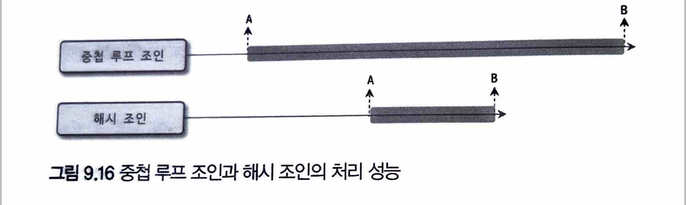

네스티드 루프 조인과 해시 조인은 똑같은 시점에 시작했지만 해시 조인이 먼저 끝난 것을 확인할 수 있다.

A 지점은 쿼리가 실행되면서 서버가 첫 번째 레코드를 찾아낸 지점이고, B 지점은 서버가 마지막 레코드를 찾아낸 시점을 의미한다.

해시 조인은 첫 번째 레코드를 찾는 데는 시간이 많이 걸리지만 최종 레코드를 찾는 데까지는 시간이 많이 걸리지 않음을 알 수 있다.

네스티드 루프 조인은 마지막 레코드를 찾는 데까지는 시간이 많이 걸리지만 첫 번째 레코드를 찾는 것은 상대적으로 훨씬 빠르다는 것을 알 수 있다.

즉, 해시 조인 쿼리는 **최고 스루풋(Best Throughput) 전략**에 적합하며, 네스티드 루프 조인은 **최고 응답 속도(Best Response-time)전략**에 적합하다는 것을 알 수 있다.

일반적인 웹 서비스는 온라인 트랜잭션(OLTP)서비스 이기 때문에 스루풋도 중요하지만 응답 속도가 더 중요하다.

그리고 분석과 같은 서비스는 사용자의 응답 시간보다는 전체적으로 처리 소요 시간이 중요하기 때문에 응답 속도보다는 전체 스루풋이 중요하다.

MySQL 서버는 범용 RDBMS 즉, 온라인 트랜잭션 처리를 위한 데이터베이스 서버를 지칭한다.

아마도 대용량 데이터 분석을 위해서 MySQL 서버를 사용하지 않을 것이다.

이 관점으로 본다면 MySQL 서버가 응답 속도와 스루풋 중 어디에 집중해서 최적화할 것인지 명확해진다.

이런 이유로 MySQL 서버는 주로 조인 조건의 칼럼이 인덱스가 없다거나 조인 대상 테이블 중 일부의 레코드 건수가 매우 적은 경우 등에 대해서만 해시 조인 알고리즘을 사용하도록 설계돼 있다.

즉, **네스티드 루프 조인이 사용되기에 적합하지 않은 경우를 위한 차선책 같은 기능**으로 생각하는 것이 좋다.

ex) MySQL 8.0.20: 블록 네스티드 루프 조인 → 해시 조인

나는 네스티드 루프 조인이 온라인 트랜잭션 처리에 왜 더 좋은지 아직 모르겠다 ㅠㅠ

**인덱스 확인** 

```sql
SHOW INDEXES FROM employees;
+---------+----------+---------------------+------------+-----------+---------+-----------+--------+------+----+----------+-------+-------------+-------+----------+
|Table    |Non_unique|Key_name             |Seq_in_index|Column_name|Collation|Cardinality|Sub_part|Packed|Null|Index_type|Comment|Index_comment|Visible|Expression|
+---------+----------+---------------------+------------+-----------+---------+-----------+--------+------+----+----------+-------+-------------+-------+----------+
|employees|0         |PRIMARY              |1           |emp_no     |A        |300252     |null    |null  |    |BTREE     |       |             |YES    |null      |
|employees|1         |ix_hiredate          |1           |hire_date  |A        |4744       |null    |null  |    |BTREE     |       |             |YES    |null      |
|employees|1         |ix_gender_birthdate  |1           |gender     |A        |5          |null    |null  |    |BTREE     |       |             |YES    |null      |
|employees|1         |ix_gender_birthdate  |2           |birth_date |A        |8308       |null    |null  |    |BTREE     |       |             |YES    |null      |
|employees|1         |ix_firstname         |1           |first_name |A        |999        |null    |null  |    |BTREE     |       |             |YES    |null      |
|employees|1         |ix_lastname_firstname|1           |last_name  |A        |1558       |null    |null  |    |BTREE     |       |             |YES    |null      |
|employees|1         |ix_lastname_firstname|2           |first_name |A        |272383     |null    |null  |    |BTREE     |       |             |YES    |null      |
+---------+----------+---------------------+------------+-----------+---------+-----------+--------+------+----+----------+-------+-------------+-------+----------+

SHOW INDEXES FROM dept_emp;
+--------+----------+-----------------+------------+-----------+---------+-----------+--------+------+----+----------+-------+-------------+-------+----------+
|Table   |Non_unique|Key_name         |Seq_in_index|Column_name|Collation|Cardinality|Sub_part|Packed|Null|Index_type|Comment|Index_comment|Visible|Expression|
+--------+----------+-----------------+------------+-----------+---------+-----------+--------+------+----+----------+-------+-------------+-------+----------+
|dept_emp|0         |PRIMARY          |1           |dept_no    |A        |8          |null    |null  |    |BTREE     |       |             |YES    |null      |
|dept_emp|0         |PRIMARY          |2           |emp_no     |A        |331143     |null    |null  |    |BTREE     |       |             |YES    |null      |
|dept_emp|1         |ix_fromdate      |1           |from_date  |A        |6908       |null    |null  |    |BTREE     |       |             |YES    |null      |
|dept_emp|1         |ix_empno_fromdate|1           |emp_no     |A        |298489     |null    |null  |    |BTREE     |       |             |YES    |null      |
|dept_emp|1         |ix_empno_fromdate|2           |from_date  |A        |331143     |null    |null  |    |BTREE     |       |             |YES    |null      |
+--------+----------+-----------------+------------+-----------+---------+-----------+--------+------+----+----------+-------+-------------+-------+----------+
```

**예제 쿼리**

```sql
EXPLAIN
SELECT *
FROM employees e IGNORE INDEX (PRIMARY, ix_hiredate)
INNER JOIN dept_emp de IGNORE INDEX (ix_empno_fromdate, ix_fromdate)
ON de.emp_no=e.emp_no AND de.from_date=e.hire_date;

+--+-----------+-----+----------+----+-------------+----+-------+----+------+--------+------------------------------------------+
|id|select_type|table|partitions|type|possible_keys|key |key_len|ref |rows  |filtered|Extra                                     |
+--+-----------+-----+----------+----+-------------+----+-------+----+------+--------+------------------------------------------+
|1 |SIMPLE     |de   |null      |ALL |null         |null|null   |null|331143|100     |null                                      |
|1 |SIMPLE     |e    |null      |ALL |null         |null|null   |null|300252|0       |Using where; Using join buffer (hash join)|
+--+-----------+-----+----------+----+-------------+----+-------+----+------+--------+------------------------------------------+
```

IGNORE INDEX 힌트는 네스티드 루프 조인이 사용되지 못하게 하기 위해 사용됐으며, 결과적으로 옵티마이저는 적절한 인덱스가 없어서 해시 조인을 사용했다.

보면 Extra 칼럼에 “hash join” 키워드를 확인할 수 있다.

해시 조인은 **빌드 단계(Build-phase), 프로브 단계(Probe-phase)**로 나누어 처리된다.

**빌드 단계**에서는 조인 대상 테이블 중에서 레코드 건수가 적어서 해시 테이블로 만들기에 용이한 테이블을 골라서 메모리에 해시 테이블을 생성(빌드)하는 작업을 수행한다.
**프로프 단계**에서는 나머지 테이블 나머지 테이블의 레코드를 읽어서 해시 테이블의 일치 레코드를 찾는 과정을 의미한다. 이때 나머지 테이블을 프로프 테이블이라고도 한다.

위의 실행 계획에서는 어느 테이블이 빌드 테이블이고 어느 테이블이 프로브 테이블인지 식별하기 어렵다.

이러한 경우에는 `EXPLAIN FORMAT=TREE` 명령어 또는 `EXPLAIN ANALYZE` 명령어를 사용하면 더 쉽게 구분할 수 있다.

**DataGrip 실행 결과**

```sql
EXPLAIN FORMAT=TREE
SELECT *
FROM employees e IGNORE INDEX (PRIMARY, ix_hiredate)
INNER JOIN dept_emp de IGNORE INDEX (ix_empno_fromdate, ix_fromdate)
ON de.emp_no=e.emp_no AND de.from_date=e.hire_date;

[42000][1064] You have an error in your SQL syntax; check the manual that corresponds to your MySQL server version for the right syntax to use near '' at line 1

EXPLAIN ANALYZE
SELECT *
FROM employees e IGNORE INDEX (PRIMARY, ix_hiredate)
INNER JOIN dept_emp de IGNORE INDEX (ix_empno_fromdate, ix_fromdate)
ON de.emp_no=e.emp_no AND de.from_date=e.hire_date;

-> Inner hash join (e.hire_date = de.from_date), (e.emp_no = de.emp_no)  (cost=9.94e+9 rows=331143) (actual time=138..387 rows=150301 loops=1)
    -> Table scan on e  (cost=0.0504 rows=300252) (actual time=0.817..97.5 rows=300024 loops=1)
    -> Hash
        -> Table scan on de  (cost=33851 rows=331143) (actual time=5.62..84.8 rows=331603 loops=1)
```

→ DataGrip 에서는 FORMAT=TREE 지원 X

**터미널에서 실행 결과**

```sql
EXPLAIN FORMAT=TREE
SELECT *
FROM employees e IGNORE INDEX (PRIMARY, ix_hiredate)
INNER JOIN dept_emp de IGNORE INDEX (ix_empno_fromdate, ix_fromdate)
ON de.emp_no=e.emp_no AND de.from_date=e.hire_date;
+--------------------------------------------------------------------------------------------------------------------------------------------------------------------------------------------------------------------------+
| EXPLAIN                                                                                                                                                                                                                  |
+--------------------------------------------------------------------------------------------------------------------------------------------------------------------------------------------------------------------------+
| -> Inner hash join (e.hire_date = de.from_date), (e.emp_no = de.emp_no)  (cost=9.94e+9 rows=331143)
    -> Table scan on e  (cost=0.0237 rows=300252)
    -> Hash
        -> Table scan on de  (cost=33299 rows=331143)
 |
+--------------------------------------------------------------------------------------------------------------------------------------------------------------------------------------------------------------------------+
```

실행 결과를 보면 옵티마이저는 dept_emp 테이블을 빌드 테이블로 선정되었고 employees 테이블을 프로브 테이블로 선택했다. 근데 왜 dept_emp 테이블 레코드 컨수가 더 많은데 빌드 테이블이지..?

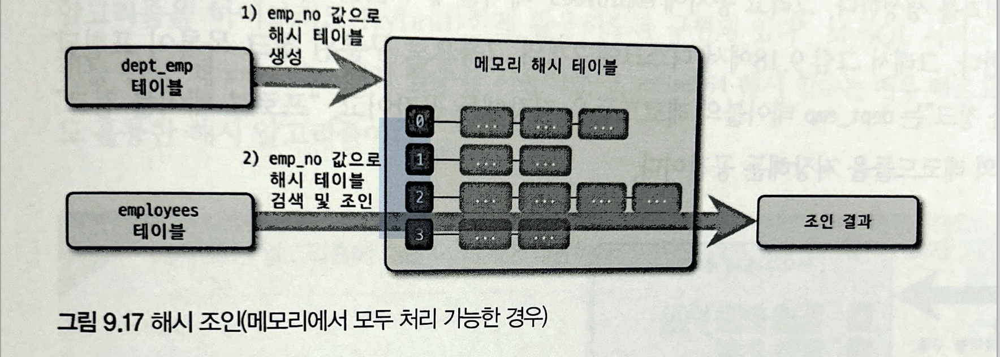

옵티마이저는 해시 조인을 위해서 dept_emp 테이블의 레코드를 읽어서 메모리에 해시 테이블을 생성하고

employees 테이블을 스캔하면서 메모리에 생성된 해시 테이블에서 레코드를 찾아서 결과를 사용자에게 반환한다.

해시 테이블을 메모리에 저장할 때 MySQL 서버는 `join_buffer_size`  시스템 변수로 크기를 제어할 수 있는 조인 버퍼를 사용한다. 만약 해시 테이블의 레코드 건수가 많아서 조인 버퍼의 공간이 부족할 수도 있다.

이러한 경우 서버는 빌드 테이블과 프로프 테이블을 적당한 크기(조인 버퍼보다 작도록)의 청크로 분리한 다음 해시 조인을 처리한다.

### 해시 조인에서 빌드 테이블이 조인 버퍼 크기를 초과할 때의 처리 과정

해시 조인은 일반적으로 빌드 테이블 전체를 메모리(조인 버퍼)에 올려 해시 테이블을 만든 뒤, 프로브 테이블을 순차적으로 읽으며 해시 테이블과 매칭한다.

하지만, 빌드 테이블이 조인 버퍼보다 클 경우, 해시 테이블을 한 번에 메모리에 올릴 수 없어 **디스크 기반의 분할(파티셔닝) 해시 조인**이 수행된다.

**1. 파티셔닝 단계 (Partition Phase)**

  - 조인에 참여하는 양쪽 테이블(특히 빌드 테이블)의 조인 컬럼에 해시 함수를 적용한다.
  - 해시 값에 따라 데이터를 여러 청크(파티션)로 분할한다.
  - 각 파티션은 메모리에 올릴 수 있을 만큼 작게 나누어, **디스크(Temp 테이블스페이스 등)에 임시 파일로 저장한다.**

**2. 조인 단계 (Join Phase)**

  - 각 파티션 쌍(빌드 파티션, 프로브 파티션)을 하나씩 메모리로 읽어와 조인을 수행한다.
  - 이때, 빌드 파티션을 메모리에 올려 해시 테이블을 만들고, 해당 프로브 파티션을 순차적으로 읽으며 해시 테이블과 매칭한다.
  - 모든 파티션 쌍에 대해 이 과정을 반복한다.

**3. 반복(Recursive Partitioning)**

  - 만약 파티션 크기가 여전히 조인 버퍼를 초과한다면, **재귀적으로 더 작은 파티션으로 나누는 과정**을 반복한다.
  - 이 과정을 "Recursive Hash Join" 또는 "Grace Hash Join"이라고 부른다.

요약하면 파티셔닝 → 조인 → 필요하면 반복(재귀적)

이 방식은 메모리의 한계를 넘어서 대용량 데이터를 조인하도록 하지만 디스크 I/O가 증가해 인메모리 해시 조인보다 성능이 크게 저하된다.

그래서 대용량 데이터라면 조인에 사용되는 적절한 인덱스를 추가하고 최대한 인덱스 기반의 네스티드 루프 조인(+MRR, BKA)으로 동작하도록 유도해야 한다.

**해시 조인에 대해서 더 자세한 내용은 책 페이지 359 ~ 362를 참고하자**

---

## 9.3.1.20 인덱스 정렬 선호(prefer_ordering_index)

MySQL 옵티마이저는 ORDER BY 또는 GROUP BY를 인덱스를 활용해 처리 가능한 경우 쿼리의 실행 계획에서 해당 인덱스의 가중치를 높게 설정해서 실행한다.

```sql
EXPLAIN
SELECT *
FROM employees 
WHERE hire_date BETWEEN '1985-01-01' AND '1985-02-01'
ORDER BY emp_no;

+--+-----------+-----+----------+-----+-------------+-----------+-------+----+----+--------+-------------------------------------+
|id|select_type|table|partitions|type |possible_keys|key        |key_len|ref |rows|filtered|Extra                                |
+--+-----------+-----+----------+-----+-------------+-----------+-------+----+----+--------+-------------------------------------+
|1 |SIMPLE     |e    |null      |range|ix_hiredate  |ix_hiredate|3      |null|25  |100     |Using index condition; Using filesort|
+--+-----------+-----+----------+-----+-------------+-----------+-------+----+----+--------+-------------------------------------+
```

이 쿼리는 대표적으로 다음 2가지 실행 계획을 선택할 수 있다.

  1. ix_hiredate 인덱스를 이용해 where 조건에 일치하는 레코드를 찾은 다음, emp_no로 정렬해서 결과를 반환
  1. employees 테이블의 프라이머리 키가 emp_no이므로 프라이머리 키를 정순으로 읽으면서 hire_date 칼럼의 조건에 일치하는지 비교 후 결과를 반환

상황에 따라 1번이 효율적일 수도 있고 2번이 효율적일 수도 있다.

일반적으로는 hire_date 칼럼의 조건에 부합되는 레코드 건수가 많지 않다면 1번이 효율적일 것이다.

이런 경우가 빈번하지는 않지만 옵티마이저는 2번 실행 계획을 선택할 수 있다.

실행 계획에서 PK를 풀 스캔하면서 hire_date 칼럼 조건에 맞는지 필터링하도록 쿼리를 처리하는 방식이다.

이런 실수는 `prefer_ordering_index`  옵션 때문에 정렬에 대한 인덱스 가중치가 높아져서 발생하는 일이다.

옵티마이저가 이런 실수를 자주 한다면 책 364를 보고 설정하면 된다!

```sql
+----------------+---------------------------------------------------------------------------------------------------------------------------------------------------------------------------------------------------------------------------------------------------------------------------------------------------------------------------------------------------------------------------------------------------------------------------------------------------------------------------------------------------------------------------------------------------------------------------------------------------+
|Variable_name   |Value                                                                                                                                                                                                                                                                                                                                                                                                                                                                                                                                                                                              |
+----------------+---------------------------------------------------------------------------------------------------------------------------------------------------------------------------------------------------------------------------------------------------------------------------------------------------------------------------------------------------------------------------------------------------------------------------------------------------------------------------------------------------------------------------------------------------------------------------------------------------+
|optimizer_switch|index_merge=on,index_merge_union=on,index_merge_sort_union=on,index_merge_intersection=on,engine_condition_pushdown=on,index_condition_pushdown=on,mrr=on,mrr_cost_based=on,block_nested_loop=on,batched_key_access=off,materialization=on,semijoin=on,loosescan=on,firstmatch=on,duplicateweedout=on,subquery_materialization_cost_based=on,use_index_extensions=on,condition_fanout_filter=on,derived_merge=on,use_invisible_indexes=off,skip_scan=on,hash_join=on,subquery_to_derived=off,prefer_ordering_index=on,hypergraph_optimizer=off,derived_condition_pushdown=on,hash_set_operations=on|
+----------------+---------------------------------------------------------------------------------------------------------------------------------------------------------------------------------------------------------------------------------------------------------------------------------------------------------------------------------------------------------------------------------------------------------------------------------------------------------------------------------------------------------------------------------------------------------------------------------------------------+
```

prefer_ordering_index 옵션이 on 활성화 상태일 때 책에서는 2번 방식으로 풀 스캔을 하지만 나는 1번 방식으로 조회한다. 책이 나온 이후로 버전업이 되면서 최적화한 게 아닐까 싶다.

---

# 9.3.2 조인 최적화 알고리즘

MySQL에는 조인 쿼리의 실행 계획 최적화를 위한 알고리즘이 2개 있다.

MySQL의 조인 최적화는 나름 많이 개선됐다고 이야기한다. 하지만 테이블의 개수가 많아지면 최적화된 실행 계획을 찾는 것이 상당히 어려워지고, 실행 계획 수립에 소요되는 시간만 몇 시간이나 며칠로 늘어날 수도 있다.

왜 그런 현상이 생기고, 어떻게 그런 현상을 피할 수 있는지 알아보자.

**예제 쿼리**

```sql
SELECT *
FROM t1, t2, t3, t4
WHERE ...
```

---

## 9.3.2.1 Exhaustive 검색 알고리즘

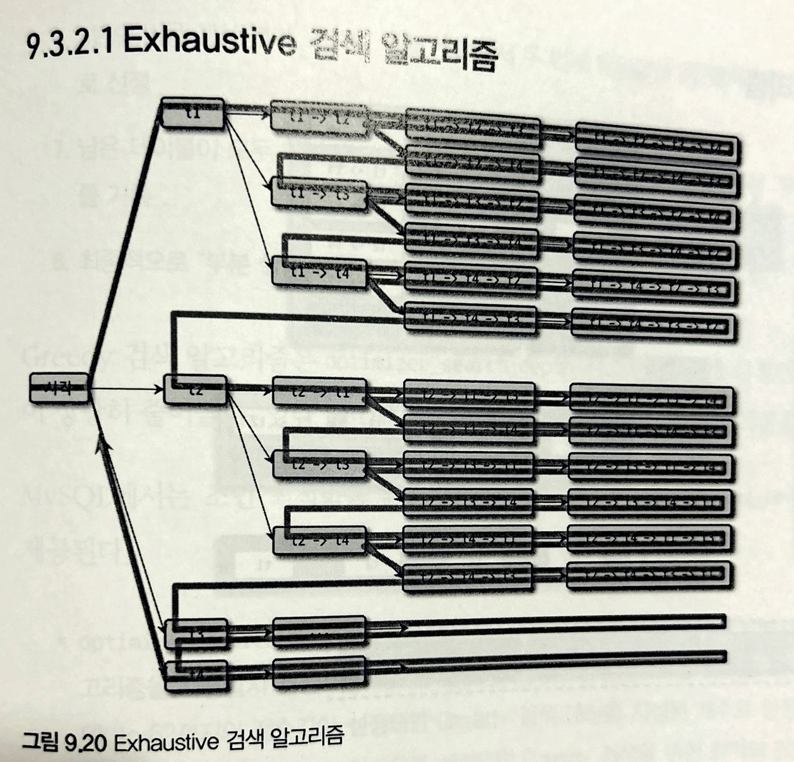

Exhaustive 알고리즘은 MySQL 5.0 버전 이하에서 사용되던 조인 최적화 기법으로, FROM 절에 명시된 모든 테이블 조합에 대해 실행 계획의 비용을 계산해서 최적의 조합 1개를 찾는 방법이다.

그림 9.20은 4개의 테이블(t1~t4)이 Exhaustive 검색 알고리즘으로 처리될 때 최적의 조인 순서를 찾는 방법을 표현하는 것이다. 테이블이 20개라면 이 방법으로 처리했을 때 가능한 조합은 무려 20!이다.

즉, 해당 알고리즘은 테이블이 10개만 넘어도 실행 계획을 수립하는데 몇 분이 걸리며 테이블이 10개에서 1개만 더 늘어나도 11배의 시간이 걸린다.

---

## 9.3.2.2 Greedy 검색 알고리즘

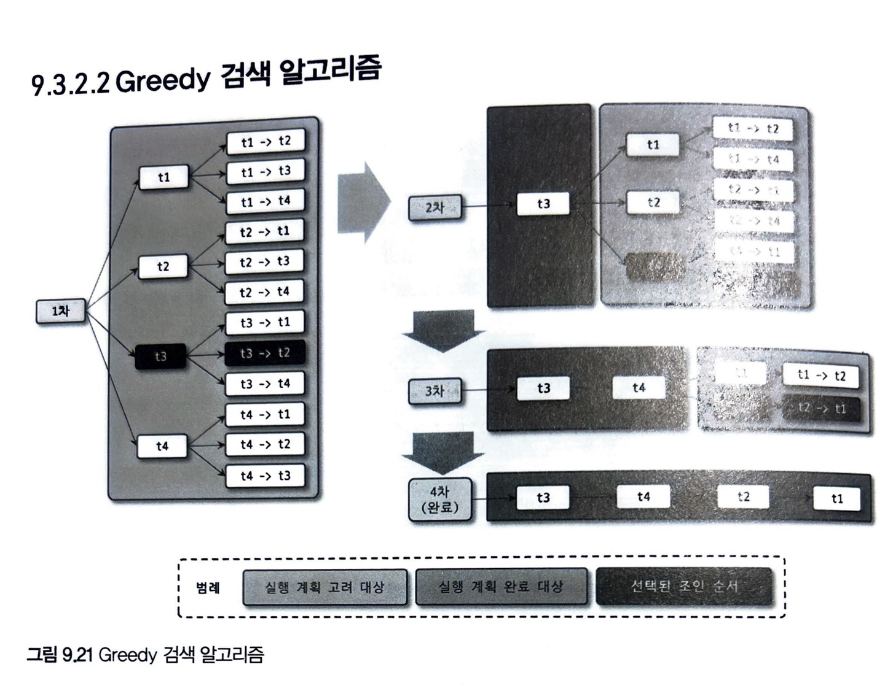

Greedy 검색 알고리즘은 Exhaustive 검색 알고리즘의 시간 소모적인 문제점을 해결하기 위해 도입된 조인 최적화 기법이다. 그림 9.21은 4개의 테이블(t1~t4)이 Greedy 검색 알고리즘으로 처리될 때(optimizer_search_depth 시스템 변수의 값 2로 가정)최적의 조인 순서를 검색하는 방법을 보여준다.

즉, Greedy 알고리즘은 전체 조합을 모두 계산하지 않고, **각 단계에서 가장 비용이 낮은(최적의) 부분 실행 계획**만을 선택해 점진적으로 전체 실행 계획을 완성한다.

**구체적 절차**

  1. 가능한 조인 조합 중에서, optimizer_search_depth 시스템 변수에 지정된 개수만큼의 테이블로 부분 실행 계획을 만든다.
  1. 각 부분 실행 계획의 비용을 계산하여, 그 중 **가장 비용이 낮은 계획**을 선택한다.
  1. 선택된 부분 실행 계획에 남은 테이블 중 하나를 추가해 새로운 부분 실행 계획을 만든다.
  1. 이 과정을 모든 테이블이 포함될 때까지 반복한다.
  1. 최종적으로 완성된 실행 계획을 실제 실행에 사용한다.

이때, optimizer_search_depth 값이 작을수록 Greedy 특성이 강해지고, 값이 클수록 Exhaustive에 가까워진다. 

**더 자세한 내용은 367 ~ 369 내용을 참고하자.**

---

통계 정보나 옵티마이저의 최적화 방법들이 더 다양해지면서 쿼리의 실행 계획 최적화가 많이 성숙하고 있다.

하지만 여전히 **MySQL 서버는 우리가 서비스하는 비즈니스를 100% 이해하지는 못한다.**

**그래서 옵티마이저는 개발자 보다 부족한 실행 계획을 수립할 때가 있을 수 있다.**

이런 경우 옵티마이저에게 쿼리의 실행 계획을 어떻게 수립해야 할지 알려줄 방법이 필요하고 MySQL에서는 다양한 옵티마이저 힌트를 제공한다.

MySQL 서버에서 사용 가능한 쿼리 힌트는 다음 2가지로 구분할 수 있다.

  - 인덱스 힌트
  - 옵티마이저 힌트

---

# 9.4.1 인덱스 힌트

“STRAIGHT_JOIN”과 “USE INDEX” 등을 포함한 인덱스 힌트들은 모두 MySQL 서버에 옵티마이저 힌트가 도입되기 전에 사용되던 기능들이다.

이들은 모두 **SQL 문법에 맞게 사용해야 하기 때문에 사용하면 ANSI-SQL 표준 문법을 준수하지 못하게 된다**는 단점이 있다.

반면 옵티마이저 힌트들은 MySQL 서버를 제외한 다른 RDBMS에서는 주석으로 해석하기 때문에 ANSI-SQL 표준을 준수한다고 볼 수 있다.

그래서 가능하면 인덱스 힌트보다 옵티마이저 힌트를 사용할 것을 추천한다.

또한 **인덱스 힌트는 SELECT, UPDATE 명령에서만 사용할 수 있다.**

---

## 9.4.1.1 STRAIGHT_JOIN

STRAIGHT_JOIN은 옵티마이저 힌트인 동시에 조인 키워드이기도 하다.

STRAIGHT_JOIN은 SELECT, UPDATE, DELETE 쿼리에서 **여러 개의 테이블이 조인되는 경우 조인 순서를 고정하는 역할을 한다.**

다음 쿼리는 3개의 테이블을 조인하지만 옵티마이저가 그때그때 각 테이블의 통계 정보와 쿼리의 조건을 기반으로 

최적이라고 판단되는 순서로 조회한다.

```sql
EXPLAIN
SELECT *
FROM employees e, dept_emp de, departments d
WHERE e.emp_no=de.emp_no AND d.dept_no=de.dept_no;

+--+-----------+-----+----------+------+-------------------------+-------+-------+-------------------+-----+--------+-----+
|id|select_type|table|partitions|type  |possible_keys            |key    |key_len|ref                |rows |filtered|Extra|
+--+-----------+-----+----------+------+-------------------------+-------+-------+-------------------+-----+--------+-----+
|1 |SIMPLE     |d    |null      |ALL   |PRIMARY                  |null   |null   |null               |9    |100     |null |
|1 |SIMPLE     |de   |null      |ref   |PRIMARY,ix_empno_fromdate|PRIMARY|16     |employees.d.dept_no|41392|100     |null |
|1 |SIMPLE     |e    |null      |eq_ref|PRIMARY                  |PRIMARY|4      |employees.de.emp_no|1    |100     |null |
+--+-----------+-----+----------+------+-------------------------+-------+-------+-------------------+-----+--------+-----+
```

해당 쿼리의 실행 계획을 보면 departments 테이블을 드라이빙 테이블로 선택했고, 조인을 dept_emp, employees 순서로 하였다. 

일반적으로 조인을 하기 위한 칼럼들의 인덱스 여부로 조인의 순서가 결정되며, 조인 칼럼의 인덱스에 아무런 문제가 없는 경우에는 레코드가 적은 테이블을 드라이빙 테이블로 선택한다.

이 쿼리의 경우 departments 테이블이 레코드 건수가 가장 작아서 드라이빙으로 선택됐을 것으로 보인다.

| **구분** | **특징 및 동작** |
| --- | --- |
| **`/*+ STRAIGHT_JOIN */`** 옵티마이저 힌트 | 일부 힌트로 작동, 완전 강제 아님, 옵티마이저가 무시 가능 |
| **`STRAIGHT_JOIN`** 키워드 (FROM 절) | 조인 순서 완전 강제, 실행 계획에 확실히 반영됨 |

이 쿼리의 조인 순서를 변경하려는 경우에 아래와 같이 STRAIGHT_JOIN 힌트를 사용할 수 있다.

```sql
EXPLAIN
SELECT /*+ STRAIGHT_JOIN */ *
FROM employees e, dept_emp de, departments d
WHERE e.emp_no=de.emp_no AND d.dept_no=de.dept_no;

+--+-----------+-----+----------+------+-------------------------+-------+-------+-------------------+-----+--------+-----+
|id|select_type|table|partitions|type  |possible_keys            |key    |key_len|ref                |rows |filtered|Extra|
+--+-----------+-----+----------+------+-------------------------+-------+-------+-------------------+-----+--------+-----+
|1 |SIMPLE     |d    |null      |ALL   |PRIMARY                  |null   |null   |null               |9    |100     |null |
|1 |SIMPLE     |de   |null      |ref   |PRIMARY,ix_empno_fromdate|PRIMARY|16     |employees.d.dept_no|41392|100     |null |
|1 |SIMPLE     |e    |null      |eq_ref|PRIMARY                  |PRIMARY|4      |employees.de.emp_no|1    |100     |null |
+--+-----------+-----+----------+------+-------------------------+-------+-------+-------------------+-----+--------+-----+

EXPLAIN
SELECT STRAIGHT_JOIN *
FROM employees e, dept_emp de, departments d
WHERE e.emp_no=de.emp_no AND d.dept_no=de.dept_no;

+--+-----------+-----+----------+------+-------------------------+-----------------+-------+--------------------+------+--------+-----+
|id|select_type|table|partitions|type  |possible_keys            |key              |key_len|ref                 |rows  |filtered|Extra|
+--+-----------+-----+----------+------+-------------------------+-----------------+-------+--------------------+------+--------+-----+
|1 |SIMPLE     |e    |null      |ALL   |PRIMARY                  |null             |null   |null                |300363|100     |null |
|1 |SIMPLE     |de   |null      |ref   |PRIMARY,ix_empno_fromdate|ix_empno_fromdate|4      |employees.e.emp_no  |1     |100     |null |
|1 |SIMPLE     |d    |null      |eq_ref|PRIMARY                  |PRIMARY          |16     |employees.de.dept_no|1     |100     |null |
+--+-----------+-----+----------+------+-------------------------+-----------------+-------+--------------------+------+--------+-----+
```

**첫 번째 결과는 힌트를 줬지만 옵티마이저가 본인의 실행 계획이 더 비용이 적다고 생각해서 옵티마이저의 실행 계획 실행, 두 번째 결과는 강제로 조인 순서 지정**

**언제 STRAIGHT_JOIN 힌트로 조인 순서를 조정하는 것이 좋을까?**

**옵티마이저가 비효율적인 실행 계획을 사용할 때**

ex) *"부서 테이블(9건)과 부서사원_매핑 테이블(30만건)을 조인할 때, 옵티마이저는 작은 부서 테이블을 드라이빙 테이블로 선택했지만, WHERE 조건상 매핑 테이블을 먼저 필터링하는 것이 훨씬 빠르기 때문에 STRAIGHT_JOIN을 사용해 조인 순서를 강제해 성능을 대폭 개선했다."*

**어떻게 STRAIGHT_JOIN 힌트로 조인 순서를 조정하는 것이 좋을까?**

  1. 임시 테이블끼리 조인: 임시 테이블(서브쿼리로 파생된 테이블)은 항상 인덱스가 없기 때문에 어느 테이블로 먼저 드라이빙으로 읽어도 무관하므로 크기가 작은 테이블을 드라이빙으로 선택해주는 것이 좋다.
  1. 일반 테이블끼리 조인: 조인 칼럼에 양쪽 모두 인덱스가 있거나 없는 경우 레코드 건수를 기준으로 드라이빙 테이블을 결정하고 한쪽만 인덱스가 없는 경우 인덱스가 없는 테이블을 드라이빙으로 선택하는 것이 좋다.
  1. 임시 테이블(인라인 뷰 또는 파생된 테이블)과 일반 테이블의 조인: 일반적으로 임시 테이블이 인덱스가 없기 때문에 드라이빙 테이블로 선정하는 것이 좋다. 하지만 일반 테이블의 조인 칼럼에 인덱스가 없는 경우는 레코드 건수가 작은 쪽으로 먼저 읽도록 드라이빙으로 선택하는 것이 좋다.

요약하면 인덱스가 없는 테이블(대부분 파생 테이블)을 드라이빙으로 잡고 인덱스가 모두 있거나 없다면 레코드 건수를 기준으로 드라이빙 테이블을 잡아라

**레코드 건수의 기준**

테이블 전체의 레코드 건수가 아닌 인덱스를 사용할 수 있는 WHERE 조건까지 포함해서 그 조건을 만족하는 레코드 건수를 의미한다.

```sql
# 1
SELECT COUNT(*)
FROM employees e
WHERE e.emp_no=10001;

# 9
SELECT COUNT(*)
FROM departments d;

# 9 
SELECT de.dept_no, COUNT(*)
FROM dept_emp de
GROUP BY de.dept_no;

# 331603
SELECT COUNT(*)
FROM dept_emp de;

EXPLAIN
SELECT *
FROM employees e, departments d, dept_emp de
WHERE e.emp_no=de.emp_no
AND d.dept_no=de.dept_no
AND e.emp_no=10001;

+--+-----------+-----+----------+------+-------------------------+-----------------+-------+--------------------+----+--------+-----+
|id|select_type|table|partitions|type  |possible_keys            |key              |key_len|ref                 |rows|filtered|Extra|
+--+-----------+-----+----------+------+-------------------------+-----------------+-------+--------------------+----+--------+-----+
|1 |SIMPLE     |e    |null      |const |PRIMARY                  |PRIMARY          |4      |const               |1   |100     |null |
|1 |SIMPLE     |de   |null      |ref   |PRIMARY,ix_empno_fromdate|ix_empno_fromdate|4      |const               |1   |100     |null |
|1 |SIMPLE     |d    |null      |eq_ref|PRIMARY                  |PRIMARY          |16     |employees.de.dept_no|1   |100     |null |
+--+-----------+-----+----------+------+-------------------------+-----------------+-------+--------------------+----+--------+-----+
```

해당 쿼리는 employees 테이블을 드라이빙 테이블로 선택했다.

employees 테이블의 레코드 건수는 훨씬 많지만, 조건을 만족하는 employees 테이블의 레코드는 건수가 훨씬 적은 경우다. 만약 옵티마이저가 employees 테이블을 드라이빙 테이블로 잡지 않는다면 힌트를 사용하자.

**STRAIGHT_JOIN 힌트와 비슷한 역할을 하는 옵티마이저 힌트는 책 페이지 373을 참고하자**

---

## 9.4.1.2 USE INDEX / FORCE INDEX / IGNORE INDEX

대체로 MySQL 옵티마이저는 어떤 인덱스를 사용해야 할지를 무난하게 잘 선택하는 편이다.

하지만 3~4개 이상의 칼럼을 포함하는 비슷한 인덱스가 여러 개 존재하는 경우에는 가끔 옵티마이저가 실수를 한다. 이런 경우에는 강제로 특정 인덱스를 사용하도록 힌트를 추가한다.

인덱스 힌트는 모두 키워드 뒤에 사용할 인덱스의 이름을 괄호로 묶어서 사용한다.

ex) `SELECT * FROM employees FORCE INDEX(primary) WHERE emp_no=10001;` 

괄호 안에 아무것도 없거나 존재하지 않는 인덱스 이름을 사용할 경우에는 쿼리의 문법 오류로 처리된다.

또한 별도로 사용자가 부여한 이름이 없는 프라이머리 키는 “PRIMARY”라고 명시하면 된다.

인덱스 힌트는 크게 다음과 같이 3종류가 있다.

**USE INDEX**

가장 많이 사용되는 인덱스 힌트로, MySQL 옵티마이저에게 특정 테이블의 **인덱스를 사용하도록 권장**하는 힌트이다. 항상 해당 인덱스를 사용하는 것은 아니다.

**FORCE INDEX**

USE INDEX와 비교해서 다른 점은 없으며, USE INDEX 보다 옵티마이저에게 미치는 영향이 더 강한 힌트이다.

하지만 차이점이 거의 없으며, USE INDEX 힌트를 부여했는데도 그 인덱스를 사용하지 않는 경우라면 FORCE INDEX 힌트를 사용해도 그 인덱스를 사용하지 않는다. (저자의 경험)

**IGNORE INDEX**

특정 인덱스를 사용하지 못하게 하는 용도로 사용하는 힌트다.

때때로 옵티마이저가 풀 테이블 스캔을 사용하도록 유도하기 위해 해당 힌트를 사용할 수 있다.

3종류의 인덱스 힌트 모두 용도를 명시해 줄 수 있다. 용도는 선택 사항이며, 특별히 인덱스 힌트에 용도가 명시되지 않으면 사용이 가능한 경우 주어진 인덱스를 3가지 용도로 사용한다.

**USE INDEX FOR JOIN** 

여기서 JOIN 키워드는 테이블 간의 조인뿐만 아니라 레코드를 검색하는 용도까지 포함하는 용어다.

MySQL 서버에서는 하나의 테이블로부터 데이터를 검색하는 작업도 JOIN이라고 표현하기 떄문에 FOR JOIN 이라는 이름미 붙었다.

**USE INDEX FOR ORDER BY** 

명시된 인덱스를 ORDER BY 용도로만 사용할 수 있게 제한한다.

**USE INDEX FOR GROUP BY** 

명시된 인덱스를 GROUP BY 용도로만 사용할 수 있게 제한한다.

용도는 보통 옵티마이저가 대부분 최적으로 선택하기 때문에 인덱스의 용도까지는 크게 고려하지 않아도 된다.

```sql
# 인덱스 레인지? 스캔
EXPLAIN SELECT * FROM employees WHERE emp_no=10001;
EXPLAIN SELECT * FROM employees USE INDEX(`PRIMARY`) WHERE emp_no=10001;
EXPLAIN SELECT * FROM employees FORCE INDEX(`PRIMARY`) WHERE emp_no=10001;
+--+-----------+---------+----------+-----+-------------+-------+-------+-----+----+--------+-----+
|id|select_type|table    |partitions|type |possible_keys|key    |key_len|ref  |rows|filtered|Extra|
+--+-----------+---------+----------+-----+-------------+-------+-------+-----+----+--------+-----+
|1 |SIMPLE     |employees|null      |const|PRIMARY      |PRIMARY|4      |const|1   |100     |null |
+--+-----------+---------+----------+-----+-------------+-------+-------+-----+----+--------+-----+


# 테이블 풀 스캔
EXPLAIN SELECT * FROM employees IGNORE INDEX(`PRIMARY`) WHERE emp_no=10001;
EXPLAIN SELECT * FROM employees FORCE INDEX(ix_hiredate) WHERE emp_no=10001;
+--+-----------+---------+----------+----+-------------+----+-------+----+------+--------+-----------+
|id|select_type|table    |partitions|type|possible_keys|key |key_len|ref |rows  |filtered|Extra      |
+--+-----------+---------+----------+----+-------------+----+-------+----+------+--------+-----------+
|1 |SIMPLE     |employees|null      |ALL |null         |null|null   |null|300030|0       |Using where|
+--+-----------+---------+----------+----+-------------+----+-------+----+------+--------+-----------+

```

employees 테이블의 프라이머리 키는 emp_no이다.

1,2,3번 쿼리는 모두 프라이머리 키 인덱스를 사용하여 1개의 row를 읽지만

4,5번 쿼리는 프라이머리 키를 사용하지 않아 적당한 인덱스가 없어서 테이블 풀 스캔을 진행한다.

더 자세한 내용은 책 페이지 375를 참고하자

---

## 9.4.1.3 SQL_CALC_FOUND_ROWS

MySQL의 LIMIT을 사용하는 경우, 조건을 만족하는 레코드 LIMIT에 명시된 수보다 더 많다고 하더라도 LIMIT에 명시된 수만큼 만족하는 레코드를 찾으면 즉시 검색 작업을 멈춘다. 하지만 **SQL_CALC_FOUND_ROWS** 힌트가 포함된 쿼리의 경우에는 끝까지 검색을 수행한다.

최종적으로 사용자에게 LIMIT에 제한된 수만큼의 결과 레코드만 반환됨에도 불구하고 말이다.

**SQL_CALC_FOUND_ROWS** 힌트가 사용된 쿼리가 실행된 경우에는 **FOUND_ROWS()**라는 함수를 이용해 LIMIT을 제외한 조건을 만족하는 레코드가 전체 몇 건이었는지를 알아낼 수 있다.

**DataGrip에서 사용 불가능**

```sql
mysql> SELECT SQL_CALC_FOUND_ROWS * FROM employees LIMIT 5;
+--------+------------+------------+-----------+--------+------------+
| emp_no | birth_date | first_name | last_name | gender | hire_date  |
+--------+------------+------------+-----------+--------+------------+
|  10001 | 1953-09-02 | Georgi     | Facello   | M      | 1986-06-26 |
|  10002 | 1964-06-02 | Bezalel    | Simmel    | F      | 1985-11-21 |
|  10003 | 1959-12-03 | Parto      | Bamford   | M      | 1986-08-28 |
|  10004 | 1954-05-01 | Chirstian  | Koblick   | M      | 1986-12-01 |
|  10005 | 1955-01-21 | Kyoichi    | Maliniak  | M      | 1989-09-12 |
+--------+------------+------------+-----------+--------+------------+
5 rows in set, 1 warning (0.09 sec)

mysql> SELECT FOUND_ROWS() AS total_record_count;
+--------------------+
| total_record_count |
+--------------------+
|             300024 |
+--------------------+
1 row in set, 1 warning (0.00 sec)
```

**SQL_CALC_FOUND_ROWS** 힌트를 사용하여 페이징 기능에 사용하면 안된다!!!

아래 예시를 비교해 보자.

**SQL_CALC_FOUND_ROWS 사용**

```sql
mysql> SELECT SQL_CALC_FOUND_ROWS * FROM employees
    -> WHERE first_name='Georgi' LIMIT 0, 20;
+--------+------------+------------+---------------+--------+------------+
| emp_no | birth_date | first_name | last_name     | gender | hire_date  |
+--------+------------+------------+---------------+--------+------------+
|  10001 | 1953-09-02 | Georgi     | Facello       | M      | 1986-06-26 |
|  10909 | 1954-11-11 | Georgi     | Atchley       | M      | 1985-04-21 |
|  11029 | 1962-07-12 | Georgi     | Itzfeldt      | M      | 1992-12-27 |
|  11430 | 1957-01-23 | Georgi     | Klassen       | M      | 2025-05-07 |
|  12157 | 1960-03-30 | Georgi     | Barinka       | M      | 1985-06-04 |
|  15220 | 1957-08-03 | Georgi     | Panienski     | F      | 1995-07-23 |
|  15660 | 1956-01-13 | Georgi     | Hartvigsen    | M      | 1994-10-13 |
|  15689 | 1962-09-14 | Georgi     | Capobianchi   | M      | 1995-03-11 |
|  15843 | 1958-07-15 | Georgi     | Varley        | M      | 1987-04-14 |
|  16672 | 1955-04-25 | Georgi     | Peris         | M      | 1986-03-13 |
|  16939 | 1956-02-10 | Georgi     | Ranon         | F      | 1988-05-31 |
|  18453 | 1959-01-10 | Georgi     | Maksimenko    | M      | 1990-02-21 |
|  19579 | 1953-02-09 | Georgi     | Impagliazzo   | F      | 1993-01-17 |
|  19903 | 1960-10-11 | Georgi     | Delgrossi     | M      | 1987-08-13 |
|  20095 | 1962-11-30 | Georgi     | Highland      | M      | 1988-09-11 |
|  20822 | 1955-10-10 | Georgi     | Rullman       | F      | 1990-01-23 |
|  21369 | 1962-09-08 | Georgi     | Kadhim        | M      | 1988-08-10 |
|  22787 | 1953-02-10 | Georgi     | Hebert        | F      | 1993-05-13 |
|  29258 | 1964-01-23 | Georgi     | Radhakrishnan | F      | 1987-11-10 |
|  29833 | 1952-06-24 | Georgi     | Kawashima     | M      | 1994-03-05 |
+--------+------------+------------+---------------+--------+------------+
20 rows in set, 1 warning (0.00 sec)

mysql> SELECT FOUND_ROWS() AS total_record_count;
+--------------------+
| total_record_count |
+--------------------+
|                253 |
+--------------------+
1 row in set, 1 warning (0.00 sec)
```

이 경우에는 한 번의 쿼리 실행으로 정보 2가지를 모두 가져오는 것처럼 보이지만 FOUND_ROWS() 함수의 실행을 위해 또 한 번의 쿼리가 필요하기 떄문에 쿼리를 2번 실행해야 한다.

이 쿼리의 경우 first_name 칼럼 인덱스를 통해 인덱스 레인지 스캔을 수행하는데 만족하는 전체 레코드는 253건이다. LIMIT 조건이 처음 20건만 가져오도록 했지만 SQL_CALC_FOUND_ROWS 힌트 때문에 조건을 만족하는 레코드 전부를 읽어 봐야 한다. 그래서 인덱스를 통해 실제 데이터 레코드를 찾아가는 작업을 253번 실행해야 하며, 랜덤 I/O가 252번 발생한다. (세컨더리 인덱스 리프 노드 → 프라이머리 키 b-tree)

**기존 2개의 쿼리로 쪼개어 실행하는 방법**

```sql
SELECT COUNT(*) FROM employees
WHERE first_name='Georgi';

SELECT * FROM employees
WHERE first_name='Georgi' LIMIT 0, 20;
```

이 방식 또한 쿼리는 2번 실행해야 한다. 우선 전체 조건을 만족하는 건수를 조회하기 위한 첫 번째 쿼리를 분석하자. WHERE 조건에 first_name 칼럼이 있기 떄문에 똑같이 인덱스 레인지 스캔을 하는데 이 쿼리에서는 실제의 레코드 데이터가 필요한 것이 아니라 건수만 가져오면 되기 때문에 커버링 인덱스(Covering index)로 동작한다.

이제 실제 데이터를 가져오는 쿼리를 분석하자. 힌트를 사용했던 방식과 동일하게 인덱스 레인지 스캔을 하고 실제 데이터 레코드를 읽으러 가야 하기 때문에 랜덤 I/O가 발생한다.

하지만 LIMIT 제한이 있기 때문에 랜덤 I/O는 20번만 발생한다.

**정리** 

**SQL_CALC_FOUND_ROWS** 힌트는 개발자의 편의를 위한 힌트이지 성능 향상을 위한 힌트가 아니다.

물론 예외적인 케이스로 인덱스가 준비되지 않은 경우에는 해당 힌트를 사용하는 것이 더 빠른 경우도 있다.

하지만 **일반적인 관점에서는 레코드 카운터용 쿼리와 데이터를 조회하는 쿼리는 분리하는 것이 더 효율적일 것이다.**

---

# 9.4.2 옵티마이저 힌트

MySQL 8.0 버전에서 사용 가능한 힌트는 종류가 매우 다양하며, 옵티마이저 힌트가 미치는 영향 범위도 매우 다양하다.

## 9.4.2.1 옵티마이저 힌트 종류

옵티마이저 힌트는 영향 범위에 따라 4개 그룹으로 나누어 볼 수 있다.

  - **인덱스:** 특정 인덱스의 이름을 사용할 수 있는 옵티마이저 힌트
  - **테이블:** 특정 테이블의 이름을 사용할 수 있는 옵티마이저 힌트
  - **쿼리 블록:** 특정 쿼리 블록에 사용할 수 있는 옵티마이저 힌트, 특정 쿼리 블록의 이름을 명시하는 것이 아니라 힌트가 명시된 쿼리 블록에 대해서만 영향을 미친다.
  - **글로벌(쿼리 전체):** 전체 쿼리에 대해서 영향을 미치는 힌트

**옵티마이저 힌트 종류는 책 페이지 379 ~ 380 참고하자**

### **주의** 

모든 인덱스 수준의 옵티마이저 힌트는 반드시 테이블명이 선행돼야 한다.

```sql
EXPLAIN
SELECT /*+ INDEX(employees ix_firstname) */ *
FROM employees
WHERE first_name='Matt';

EXPLAIN
SELECT /*+ NO_INDEX(employees ix_firstname) */ *
FROM employees
WHERE first_name='Matt';
```

만약 옵티마이저 힌트가 문법에 맞지 않게 잘못 사용된 경우에는 다음과 같이 경고 메시지가 표시된다.

**DataGrip SHOW WARNINGS 사용 불가능**

```sql
EXPLAIN
SELECT /*+ NO_INDEX(ix_firstname) */ *
FROM employees
WHERE first_name='Matt';
+----+-------------+-----------+------------+------+---------------+--------------+---------+-------+------+----------+-------+
| id | select_type | table     | partitions | type | possible_keys | key          | key_len | ref   | rows | filtered | Extra |
+----+-------------+-----------+------------+------+---------------+--------------+---------+-------+------+----------+-------+
|  1 | SIMPLE      | employees | NULL       | ref  | ix_firstname  | ix_firstname | 58      | const |  233 |   100.00 | NULL  |
+----+-------------+-----------+------------+------+---------------+--------------+---------+-------+------+----------+-------+
1 row in set, 2 warnings (0.00 sec)

SHOW WARNINGS;
+---------+------+--------------------------------------------------------------------------------------------------------------------------------------------------------------------------------------------------------------------------------------------------------------------------------------------------------------------------------------------------------------------------------------------------------------------+
| Level   | Code | Message                                                                                                                                                                                                                                                                                                                                                                                                            |
+---------+------+--------------------------------------------------------------------------------------------------------------------------------------------------------------------------------------------------------------------------------------------------------------------------------------------------------------------------------------------------------------------------------------------------------------------+
| Warning | 3128 | Unresolved name `ix_firstname`@`select#1` for NO_INDEX hint                                                                                                                                                                                                                                                                                                                                                        |
| Note    | 1003 | /* select#1 */ select `employees`.`employees`.`emp_no` AS `emp_no`,`employees`.`employees`.`birth_date` AS `birth_date`,`employees`.`employees`.`first_name` AS `first_name`,`employees`.`employees`.`last_name` AS `last_name`,`employees`.`employees`.`gender` AS `gender`,`employees`.`employees`.`hire_date` AS `hire_date` from `employees`.`employees` where (`employees`.`employees`.`first_name` = 'Matt') |
+---------+------+--------------------------------------------------------------------------------------------------------------------------------------------------------------------------------------------------------------------------------------------------------------------------------------------------------------------------------------------------------------------------------------------------------------------+
2 rows in set (0.00 sec)
```

실행 계획을 보면 ix_first_name 인덱스를 사용하지 않는 잘못된 힌트를 무시하고 인덱스를 사용하여 조회 한다.

또한 SHOW WARNINGS 통해서 잘못된 힌트에 대한 경고 메시지를 확인할 수 있었다.

### 쿼리 블록

하나의 SQL 문장에서 SELECT 키워드는 여러 번 사용될 수 있다.

각 SELECT 키워드로 시작하는 서브쿼리 영역을 쿼리 블록이라고 한다.

특정 쿼리 블록에 영향을 미치는 옵티마이저 힌트는 그 쿼리 블록 내에서 사용될 수도 있지만 외부 쿼리 블록에서 사용할 수도 있다.

특정 쿼리 블록을 외부 쿼리 블록에서 사용하려면 **QB_NAME()** 힌트를 이용해 해당 쿼리 블록에 이름을 부여해야 한다.

```sql
EXPLAIN
SELECT /*+ JOIN_ORDER(e, s@subq1) */ COUNT(*)
FROM employees e
WHERE e.first_name='Matt' AND
e.emp_no IN (SELECT /*+ QB_NAME(sub1) */ s.emp_no
             FROM salaries s
             WHERE s.salary BETWEEN 50000 AND 50500);
             
+--+-----------+-----+----------+----+--------------------+------------+-------+------------------+----+--------+--------------------------+
|id|select_type|table|partitions|type|possible_keys       |key         |key_len|ref               |rows|filtered|Extra                     |
+--+-----------+-----+----------+----+--------------------+------------+-------+------------------+----+--------+--------------------------+
|1 |SIMPLE     |e    |null      |ref |PRIMARY,ix_firstname|ix_firstname|58     |const             |233 |100     |Using index               |
|1 |SIMPLE     |s    |null      |ref |PRIMARY,ix_salary   |PRIMARY     |4      |employees.e.emp_no|9   |2.12    |Using where; FirstMatch(e)|
+--+-----------+-----+----------+----+--------------------+------------+-------+------------------+----+--------+--------------------------+      
```

해당 예제의 쿼리는 서브쿼리에 사용된 salaries 테이블이 세미 조인 최적화를 통해 조인으로 처리될 것을 예상하고 **JOIN_ORDER** 힌트를 사용한 것이다.

조인의 순서로 외부 쿼리 블록의 employees 테이블과 서브 쿼리 블록의 salaries 테이블을 순서대로 조인하게 힌트를 사용한 것이다.

---

## 9.4.2.2 MAX_EXECUTION_TIME

옵티마이저 힌트 중에서 유일하게 쿼리의 실행 계획에 영향을 미치지 않는 힌트이다.

단순히 쿼리의 최대 실행 시간을 설정하는 힌트이다.

**MAX_EXECUTION_TIME** 힌트에는 밀리초 단위의 시간을 설정하고, 지정된 시간을 초과하면 다음과 같이 쿼리는 실패하게 된다.

```sql
SELECT /*+ MAX_EXECUTION_TIME(1) */ * 
FROM employees 
ORDER BY last_name 
LIMIT 100000, 100002;

ERROR 3024 (HY000): Query execution was interrupted, maximum statement execution time exceeded
```

---

## 9.4.2.3 SET_VAR

MySQL 서버의 시스템 변수들은 쿼리의 실행 계획에 상당한 영향을 미친다.

대표적으로 조인 버퍼 크기를 설정하는 `join_buffer_size`  시스템 변수나 옵티마이저 힌트로 부족한 경우 `optimizer_switch`  시스템 변수를 제어해야 할 수도 있다. 이런 경우 **SET_VAR** 힌트를 이용하면 된다.

```sql
EXPLAIN
SELECT /*+ SET_VAR(optimizer_switch='index_merge_intersection=off') */ *
FROM employees
WHERE first_name='Georgi' AND emp_no BETWEEN 10000 AND 20000;
```

---

## 9.4.2.4 SEMIJOIN & NO_SEMIJOIN

SEMIJOIN 힌트는 어떤 세미 조인 세부 전략을 사용할지를 제어하는 데 사용할 수 있다.

| 최적화 전략  | 힌트 |
| --- | --- |
| Duplicate Weed-out | SEMIJOIN(DUPSWEEDOUT) |
| First Match | SEMIJOIN(FIRSTMATCH) |
| Loose Scan | SEMIJOIN(LOOSESCAN) |
| Materialization | SEMIJOIN(MATERIALIZATION) |
| Table Pull-out | 없음 |

다음 예제 쿼리는 FirstMatch 최적화 전략을 사용하는 실행 계획을 가진다.

세미 조인 힌트를 통해서 다른 최적화 전략을 사용하도록 연습하자.

```sql
EXPLAIN
SELECT *
FROM departments d
WHERE d.dept_no IN (SELECT de.dept_no
                    FROM dept_emp de);
                    
+--+-----------+-----+----------+----+-------------+-------+-------+-------------------+-----+--------+--------------------------+
|id|select_type|table|partitions|type|possible_keys|key    |key_len|ref                |rows |filtered|Extra                     |
+--+-----------+-----+----------+----+-------------+-------+-------+-------------------+-----+--------+--------------------------+
|1 |SIMPLE     |d    |null      |ALL |PRIMARY      |null   |null   |null               |9    |100     |null                      |
|1 |SIMPLE     |de   |null      |ref |PRIMARY      |PRIMARY|16     |employees.d.dept_no|41392|100     |Using index; FirstMatch(d)|
+--+-----------+-----+----------+----+-------------+-------+-------+-------------------+-----+--------+--------------------------+                    
```

```sql
EXPLAIN
SELECT *
FROM departments d
WHERE d.dept_no IN (SELECT /*+ SEMIJOIN(MATERIALIZATION) */ de.dept_no
                    FROM dept_emp de);
                    
+--+------------+-----------+----------+------+-------------------+-------------------+-------+-------------------+------+--------+-----------+
|id|select_type |table      |partitions|type  |possible_keys      |key                |key_len|ref                |rows  |filtered|Extra      |
+--+------------+-----------+----------+------+-------------------+-------------------+-------+-------------------+------+--------+-----------+
|1 |SIMPLE      |d          |null      |ALL   |PRIMARY            |null               |null   |null               |9     |100     |null       |
|1 |SIMPLE      |<subquery2>|null      |eq_ref|<auto_distinct_key>|<auto_distinct_key>|16     |employees.d.dept_no|1     |100     |null       |
|2 |MATERIALIZED|de         |null      |index |PRIMARY            |ix_fromdate        |3      |null               |331143|100     |Using index|
+--+------------+-----------+----------+------+-------------------+-------------------+-------+-------------------+------+--------+-----------+                    
```

특정 세미 조인 최적화 전략을 사용하지 않도록 **NO_SEMIJOIN** 힌트 명시하기

```sql
EXPLAIN
SELECT *
FROM departments d
WHERE d.dept_no IN (SELECT /*+ NO_SEMIJOIN(FIRSTMATCH) */ de.dept_no
                    FROM dept_emp de);
```

---

## 9.4.2.5 SUBQUERY

서브쿼리 최적화는 세미 조인 최적화가 사용되지 못할 때 사용하는 최적화 방법으로, 서브쿼리는 다음 2가지 형태로 최적화할 수 있다.

| 최적화 방법 | 힌트 |
| --- | --- |
| IN-to-EXISTS | SUBQUERY(INTOEXISTS) |
| Materialization | SUBQUERY(MATERIALIZATION) |

세미 조인 최적화는 주로 IN(subquery) 형태의 쿼리에 사용될 수 있지만 안티 세미 조인 (Anti Semi-Join)의 최적화에는 사용될 수 없다. 그래서 주로 안티 세미 조인 최적화에는 위의 2가지 최적화가 사용된다.

---

## 9.4.2.6 BNL & NO_BNL & HASHJOIN & NO_HASHJOIN

MySQL 8.0.20 버전부터는 블록 네스티드 루프 조인(BNL)은 더 이상 사용되지 않는다.

하지만 **BNL, NO_BNL** 힌트는 여전히 사용 가능하다. 해당 힌트들은 해시 조인을 사용하도록 유도하는 힌트로 용도가 변경됐다. 대신 **HASHJOIN, NO_HASHJOIN** 힌트는 MySQL 8.0.18 버전에서만 유효하며, 그 이후 버전에서는 효력이 없다.

그래서 MySQL 8.0.20 버전과 그 이후 버전에서 해시 조인을 유도하거나 해시 조인을 사용하지 않게 하고자 한다면 다음 예제 쿼리와 같이 **BNL, NO_BNL**를 사용해야 한다.

```sql
EXPLAIN
SELECT /*+ BNL(e, de) */ *
FROM employees e
JOIN dept_emp de ON de.emp_no=e.emp_no;

+--+-----------+-----+----------+------+-----------------+-------+-------+-------------------+------+--------+-----+
|id|select_type|table|partitions|type  |possible_keys    |key    |key_len|ref                |rows  |filtered|Extra|
+--+-----------+-----+----------+------+-----------------+-------+-------+-------------------+------+--------+-----+
|1 |SIMPLE     |de   |null      |ALL   |ix_empno_fromdate|null   |null   |null               |331143|100     |null |
|1 |SIMPLE     |e    |null      |eq_ref|PRIMARY          |PRIMARY|4      |employees.de.emp_no|1     |100     |null |
+--+-----------+-----+----------+------+-----------------+-------+-------+-------------------+------+--------+-----+
```

실행 계획을 보면 해시 조인을 사용하지 않고 네스티드 루프 조인을 실행한다.

그 이유는 MySQL 서버에서는 조인 조건이 되는 칼럼의 인덱스가 적절히 준비돼 있다면 해시 조인은 거의 사용되지 않는다. 그래서 해시 조인 힌트를 사용했지만 사용하지 않는다.

해시 조인 알고리즘이 사용하게 되려면 조인 조건이 되는 emp_no 칼럼의 인덱스를 employees 테이블과 dept_emp 테이블에서 제거하거나 사용하지 못하게 해야 한다.

---

## 9.4.2.7 JOIN_FIXED_ORDER & JOIN_ORDER & JOIN_PREFIX & JOIN_SUFFIX

MySQL 서버에서는 조인의 순서를 결정하기 위해 **STRAIGHT_JOIN** 힌트를 사용해왔다.

하지만 **STRAIGHT_JOIN** 힌트는 쿼리의 FROM 절에 사용된 테이블의 순서를 조인 순서에 맞게 변경해야 한다는 번거로움이 있었다. 또한 **STRAIGHT_JOIN** 은 한 번 사용되면 FROM 절에 명시된 모든 테이블의 조인 순서가 결정되기 때문에 일부는 조인 순서를 강제하고 나머지는 옵티마이저에게 맡기는 것이 불가능했다.

이런 단점을 보완하기 위해서 옵티마이저 힌트에서는 **STRAIGHT_JOIN**과 동일한 힌트까지 포함해서 다음과 같은 4가지 힌트를 제공한다.

  - **JOIN_FIXED_ORDER:** **STRAIGHT_JOIN** 힌트와 동일하게 동작
  - **JOIN_ORDER:** FROM 절에 사용된 테이블의 순서가 아니라 힌트에 명시된 테이블의 순서대로 조인을 실행하는 힌트
  - **JOIN_PREFIX:** 조인에서 드라이빙 테이블만 강제하는 힌트
  - **JOIN_SUFFIX:** 조인에서 드리븐 테이블(가장 마지막에 조인돼야 할 테이블)만 강제하는 힌트

```sql
# FROM 절에 나열된 테이블 순서대로 조인 실행

EXPLAIN
SELECT /*+ JOIN_FIXED_ORDER() */ *
FROM employees e 
JOIN dept_emp de ON e.emp_no = de.emp_no
JOIN departments d ON de.dept_no = d.dept_no;

+--+-----------+-----+----------+------+-------------------------+-----------------+-------+--------------------+------+--------+-----+
|id|select_type|table|partitions|type  |possible_keys            |key              |key_len|ref                 |rows  |filtered|Extra|
+--+-----------+-----+----------+------+-------------------------+-----------------+-------+--------------------+------+--------+-----+
|1 |SIMPLE     |e    |null      |ALL   |PRIMARY                  |null             |null   |null                |300030|100     |null |
|1 |SIMPLE     |de   |null      |ref   |PRIMARY,ix_empno_fromdate|ix_empno_fromdate|4      |employees.e.emp_no  |1     |100     |null |
|1 |SIMPLE     |d    |null      |eq_ref|PRIMARY                  |PRIMARY          |16     |employees.de.dept_no|1     |100     |null |
+--+-----------+-----+----------+------+-------------------------+-----------------+-------+--------------------+------+--------+-----+

# 일부 테이블에 대해서만 조인 순서를 나열
EXPLAIN
SELECT /*+ JOIN_ORDER(d, de) */ *
FROM employees e
JOIN dept_emp de ON e.emp_no = de.emp_no
JOIN departments d ON de.dept_no = d.dept_no;

+--+-----------+-----+----------+------+-------------------------+-------+-------+-------------------+-----+--------+-----+
|id|select_type|table|partitions|type  |possible_keys            |key    |key_len|ref                |rows |filtered|Extra|
+--+-----------+-----+----------+------+-------------------------+-------+-------+-------------------+-----+--------+-----+
|1 |SIMPLE     |d    |null      |ALL   |PRIMARY                  |null   |null   |null               |9    |100     |null |
|1 |SIMPLE     |de   |null      |ref   |PRIMARY,ix_empno_fromdate|PRIMARY|16     |employees.d.dept_no|41392|100     |null |
|1 |SIMPLE     |e    |null      |eq_ref|PRIMARY                  |PRIMARY|4      |employees.de.emp_no|1    |100     |null |
+--+-----------+-----+----------+------+-------------------------+-------+-------+-------------------+-----+--------+-----+
```

---

## 9.4.2.8 MERGE & NO_MERGE

예전 버전의 MySQL 서버에서는 FROM 절에 사용된 서브쿼리를 항상 내부 임시 테이블로 생성했다.

이렇게 생성된 **내부 임시 테이블을 파생 테이블(Derived Table)**이라고 하는데, 이는 불필요한 자원 소모를 유발한다. 그래서 최근 버전에서는 가능하면 임시 테이블을 사용하지 않게 FROM 절의 서브쿼리를 외부 쿼리와 병합하는 최적화를 도입했다. 때로는 옵티마이저가 내부 쿼리를 외부 쿼리와 병합하는 것이 나을 수도 있고, 때로는 파생 테이블을 생성하는 것이 더 나은 선택일 수 있다.

가끔 옵티마이저가 잘못된 선택을 할 수도 있는데 이때 사용하는 힌트가 **MERGE, NO_MERGE**이다. 

```sql
EXPLAIN
SELECT /*+ MERGE(sub)* */ *
FROM (SELECT * FROM  employees
      WHERE first_name='Matt') sub LIMIT 10;
      
+--+-----------+---------+----------+----+-------------+------------+-------+-----+----+--------+-----+
|id|select_type|table    |partitions|type|possible_keys|key         |key_len|ref  |rows|filtered|Extra|
+--+-----------+---------+----------+----+-------------+------------+-------+-----+----+--------+-----+
|1 |SIMPLE     |employees|null      |ref |ix_firstname |ix_firstname|58     |const|233 |100     |null |
+--+-----------+---------+----------+----+-------------+------------+-------+-----+----+--------+-----+

EXPLAIN
SELECT /*+ NO_MERGE(sub)* */ *
FROM (SELECT * FROM  employees
      WHERE first_name='Matt') sub LIMIT 10;

+--+-----------+----------+----------+----+-------------+------------+-------+-----+----+--------+-----+
|id|select_type|table     |partitions|type|possible_keys|key         |key_len|ref  |rows|filtered|Extra|
+--+-----------+----------+----------+----+-------------+------------+-------+-----+----+--------+-----+
|1 |PRIMARY    |<derived2>|null      |ALL |null         |null        |null   |null |233 |100     |null |
|2 |DERIVED    |employees |null      |ref |ix_firstname |ix_firstname|58     |const|233 |100     |null |
+--+-----------+----------+----------+----+-------------+------------+-------+-----+----+--------+-----+
```

NO_MERGE 힌트를 사용한 쿼리의 실행 계획을 보면 employees 테이블을 먼저 ix_firstname 인덱스를 통해 검색하고 임시 테이블을 만들어서 전부 INSERT 한다.

그런 다음 다시 임시 테이블을 검색하는데 이때 임시 테이블은 인덱스가 존재하지도 않아 테이블 풀 스캔이 발생한다. 

---

## 9.4.2.9 INDEX_MERGE & NO_INDEX_MERGE

MySQL 서버는 가능하다면 테이블당 하나의 인덱스만을 이용해 쿼리를 처리하려고 한다.

하지만 하나의 인덱스만으로 검색 대상 범위를 충분히 좁힐 수 없다면 MySQL 옵티마이저는 사용 가능한 다른 인덱스를 이용하기도 한다. 여러 인덱스를 통해 검색된 레코드로부터 교집합 또는 합집합만을 구해서 그 결과를 반환한다. 이처럼 하나의 테이블에 대해 여러 개의 인덱스를 동시에 사용하는 것을 **인덱스 머지(Index Merge)라고 한다.** 때때로 성능 향상에 도움이 되지만 그렇지 않을 수도 있다. 사용 여부를 제어하고자 할 때 **INDEX_MERGE, NO_INDEX_MERGE** 옵티마이저 힌트를 통해 제어하면 된다.

```sql
# ix_firstname, primary 인덱스 교집합 
EXPLAIN SELECT *
FROM employees
WHERE first_name='Georgi' AND emp_no BETWEEN 10000 AND 20000;

+--+-----------+---------+----------+-----------+--------------------+--------------------+-------+----+----+--------+--------------------------------------------------+
|id|select_type|table    |partitions|type       |possible_keys       |key                 |key_len|ref |rows|filtered|Extra                                             |
+--+-----------+---------+----------+-----------+--------------------+--------------------+-------+----+----+--------+--------------------------------------------------+
|1 |SIMPLE     |employees|null      |index_merge|PRIMARY,ix_firstname|ix_firstname,PRIMARY|62,4   |null|1   |100     |Using intersect(ix_firstname,PRIMARY); Using where|
+--+-----------+---------+----------+-----------+--------------------+--------------------+-------+----+----+--------+--------------------------------------------------+


# ix_firstname 인덱스로 인덱스 컨디션 푸시다운 사용
EXPLAIN
SELECT /*+ NO_INDEX_MERGE(employees PRIMARY) */ *
FROM employees
WHERE first_name='Georgi' AND emp_no BETWEEN 10000 AND 20000;

+--+-----------+---------+----------+-----+--------------------+------------+-------+----+----+--------+---------------------+
|id|select_type|table    |partitions|type |possible_keys       |key         |key_len|ref |rows|filtered|Extra                |
+--+-----------+---------+----------+-----+--------------------+------------+-------+----+----+--------+---------------------+
|1 |SIMPLE     |employees|null      |range|PRIMARY,ix_firstname|ix_firstname|62     |null|14  |100     |Using index condition|
+--+-----------+---------+----------+-----+--------------------+------------+-------+----+----+--------+---------------------+

# ix_firstname, primary 인덱스 교집합 
EXPLAIN
SELECT /*+ INDEX_MERGE(employees PRIMARY) */ *
FROM employees
WHERE first_name='Georgi' AND emp_no BETWEEN 10000 AND 20000;

+--+-----------+---------+----------+-----------+--------------------+--------------------+-------+----+----+--------+--------------------------------------------------+
|id|select_type|table    |partitions|type       |possible_keys       |key                 |key_len|ref |rows|filtered|Extra                                             |
+--+-----------+---------+----------+-----------+--------------------+--------------------+-------+----+----+--------+--------------------------------------------------+
|1 |SIMPLE     |employees|null      |index_merge|PRIMARY,ix_firstname|ix_firstname,PRIMARY|62,4   |null|1   |100     |Using intersect(ix_firstname,PRIMARY); Using where|
+--+-----------+---------+----------+-----------+--------------------+--------------------+-------+----+----+--------+--------------------------------------------------+
```

---

## 9.4.2.10 NO_ICP

인덱스 컨디션 푸시다운(ICP, Index Condition Pushdown)최적화는 사용 가능하다면 항상 성능 향상에 도움이 되므로 MySQL 옵티마이저는 최대한 인덱스 컨디션 푸시다운 기능을 사용하는 방향으로 실행 계획을 수립한다.

그래서 MySQL 옵티마이저에서는 ICP 힌트는 제공되지 않는다.

그런데 인덱스 컨디션 푸시다운으로 인해 여러 실행 계획의 비용 계산이 잘못된다면 결과적으로 잘못된 실행 계획을 수립하게 될 수도 있다.

예를 들어, A 인덱스와 B 인덱스 중에서 하나를 선택해야 하는 상황에서 A 인덱스는 인덱스 컨디션 푸시다운이 가능해서 A 인덱스를 사용하는 것이 비용이 낮게 예측됐다고 가정해보자.

그렇다면 옵티마이저는 A 인덱스를 사용하는 실행 계획을 선택할 것이다. 하지만 실제 서비스에서는 B 인덱스를 선택하는 것이 더 효율적일 수 있다.

이런 경우 A 인덱스를 사용하지 못하게 하거나(IGNORE INDEX, NO_INDEX) B 인덱스를 선호하게 하는 것은 좋지 않은 선택일 수 있다. 테이블의 데이터 분포는 항상 균등한 것이 아니기 때문에 범위에 따라 A 인덱스 또는 B 인덱스가 효율적일 수 있기 때문이다.

이럴 때 인덱스 컨디션 푸시다운 최적화만 비활성화해서 조금 더 유연하고 정확하게 실행 계획을 선택하게 할 수 있다.

```sql
EXPLAIN
SELECT *
FROM employees
WHERE last_name='Action' AND first_name LIKE '%sal';

+--+-----------+---------+----------+----+---------------------+---------------------+-------+-----+----+--------+---------------------+
|id|select_type|table    |partitions|type|possible_keys        |key                  |key_len|ref  |rows|filtered|Extra                |
+--+-----------+---------+----------+----+---------------------+---------------------+-------+-----+----+--------+---------------------+
|1 |SIMPLE     |employees|null      |ref |ix_lastname_firstname|ix_lastname_firstname|66     |const|1   |11.11   |Using index condition|
+--+-----------+---------+----------+----+---------------------+---------------------+-------+-----+----+--------+---------------------+
```

Extra 칼럼의 “Using index Condition” 문구를 보면 기본적으로  MySQL 옵티마이저는 인덱스 컨디션 푸시다운 최적화를 선택한 것을 알 수 있다.

```sql
EXPLAIN
SELECT /*+ NO_ICP(employees ix_lastname_firstname) */ *
FROM employees
WHERE last_name='Action' AND first_name LIKE '%sal';

+--+-----------+---------+----------+----+---------------------+---------------------+-------+-----+----+--------+-----------+
|id|select_type|table    |partitions|type|possible_keys        |key                  |key_len|ref  |rows|filtered|Extra      |
+--+-----------+---------+----------+----+---------------------+---------------------+-------+-----+----+--------+-----------+
|1 |SIMPLE     |employees|null      |ref |ix_lastname_firstname|ix_lastname_firstname|66     |const|1   |11.11   |Using where|
+--+-----------+---------+----------+----+---------------------+---------------------+-------+-----+----+--------+-----------+
```

Extra 칼럼의 “Using Where” 문구를 보면 옵티마이저는 인덱스 컨디션 푸시다운 최적화를 사용하지 않은 것을 알 수 있다.

---

## 9.4.2.11 SKIP_SCAN & NO_SKIP_SCAN

인덱스 스킵 스캔은 인덱스의 선행 칼럼에 대한 조건 없이도 옵티마이저가 해당 인덱스를 사용할 수 있게 해주는 매우 훌륭한 최적화 기능이다.

하지만 조건이 누락된 선행 칼럼이 가지는 유니크한 값의 개수가 많아진다면 인덱스 스킵 스캔의 성능은 오히려 떨어진다. 옵티마이저의 실수로 비효율적인 인덱스 스킵 스캔을 선택하면 **NO_SKIP_SCAN** 옵티마이저 힌트를 이용해 인덱스 스킵 스캔을 사용하지 않게 할 수 있다.

```sql
EXPLAIN
SELECT /*+ NO_SKIP_SCAN(employees ix_gender_birthdate) */ gender, birth_date
FROM employees
WHERE birth_date>='1965-02-01';
+--+-----------+---------+----------+-----+-------------+-------------------+-------+----+------+--------+------------------------+
|id|select_type|table    |partitions|type |possible_keys|key                |key_len|ref |rows  |filtered|Extra                   |
+--+-----------+---------+----------+-----+-------------+-------------------+-------+----+------+--------+------------------------+
|1 |SIMPLE     |employees|null      |index|null         |ix_gender_birthdate|4      |null|300030|33.33   |Using where; Using index|
+--+-----------+---------+----------+-----+-------------+-------------------+-------+----+------+--------+------------------------+


EXPLAIN
SELECT gender, birth_date
FROM employees
WHERE birth_date>='1965-02-01';

+--+-----------+---------+----------+-----+-------------------+-------------------+-------+----+------+--------+--------------------------------------+
|id|select_type|table    |partitions|type |possible_keys      |key                |key_len|ref |rows  |filtered|Extra                                 |
+--+-----------+---------+----------+-----+-------------------+-------------------+-------+----+------+--------+--------------------------------------+
|1 |SIMPLE     |employees|null      |range|ix_gender_birthdate|ix_gender_birthdate|4      |null|100000|100     |Using where; Using index for skip scan|
+--+-----------+---------+----------+-----+-------------------+-------------------+-------+----+------+--------+--------------------------------------+
```

---

## 9.4.2.12 INDEX & NO_INDEX

**INDEX**와 **NO_INDEX** 옵티마이저 힌트는 예전 MySQL 서버에서 사용되던 인덱스 힌트를 대체하는 용도로 제공된다.

| 인덱스 힌트 | 옵티마이저 힌트 |
| --- | --- |
| USE INDEX | INDEX |
| USE INDEX FOR GROUP BY  | GROUP_INDEX |
| USE INDEX FOR ORDER BY | ORDER_INDEX |
| IGNORE INDEX | NO_INDEX |
| IGNORE INDEX FOR GROUP BY  | NO_GROUP_INDEX |
| IGNORE INDEX FOR ORDER BY | NO_ORDER_INDEX |

인덱스 힌트는 특정 테이블 뒤에 사용했기 때문에 별도로 힌트 내에 테이블 명 없이 인덱스 이름만 나열했지만

**옵티마이저 힌트에서는 테이블명과 인덱스 이름을 함께 명시해야 한다.**

```sql
# 인덱스 힌트 사용
EXPLAIN
SELECT *
FROM employees USE INDEX(ix_firstname)
WHERE first_name='Matt';

# 옵티마이저 힌트 사용
EXPLAIN
SELECT /*+ INDEX(employees if_firstname) */ *
FROM employees
WHERE first_name='Matt';
```

---

---

**옵티마이저 스위치 기본으로 변경**

```sql
SET optimizer_switch='default';
```

---

## 온라인 트랜잭션 처리(OLTP)란?

OLTP(Online Transaction Processing)는 온라인 환경에서 발생하는 다수의 트랜잭션을 실시간으로 빠르고 정확하게 처리하는 데이터베이스 시스템 또는 그 처리 방식을 말한다.

### 주요 특징

- **실시간 처리**: 고객의 주문, 계좌 이체, ATM 거래, 온라인 쇼핑 등 다양한 트랜잭션을 즉시 처리한다.
- **다수의 동시 사용자**: 여러 사용자가 동시에 데이터베이스에 접근해 데이터를 삽입, 수정, 삭제, 조회할 수 있다.
- **짧고 단순한 트랜잭션**: 각 트랜잭션은 일반적으로 짧은 시간 안에 완료되며, 소수의 레코드만을 다룬다.
- **데이터의 정합성, 신뢰성**: 트랜잭션의 원자성(Atomicity), 일관성(Consistency), 고립성(Isolation), 지속성(Durability) 등 ACID 특성을 중시한다.
- **높은 가용성**: 장애 발생 시에도 신속하게 복구되어야 하며, 항상 서비스를 제공해야 한다.
- **관계형 데이터베이스 활용**: 대부분의 OLTP 시스템은 관계형 데이터베이스(MySQL)를 사용한다.

### 활용 사례

- 은행의 계좌 이체, ATM 출금 등 금융 거래
- 온라인 쇼핑몰의 상품 주문 및 결제
- 항공권/호텔 예약 시스템
- 회원 가입, 비밀번호 변경 등 웹 서비스의 기본 기능

### OLTP와 OLAP의 차이

- OLTP는 실시간 거래, 데이터의 입력과 갱신 등 "무엇(What)"에 초점을 둔 단순·반복적 작업에 특화되어 있다.
- 반면, OLAP(Online Analytical Processing)은 대량의 데이터를 분석·집계하는 "왜(Why)"에 초점을 둔다.

