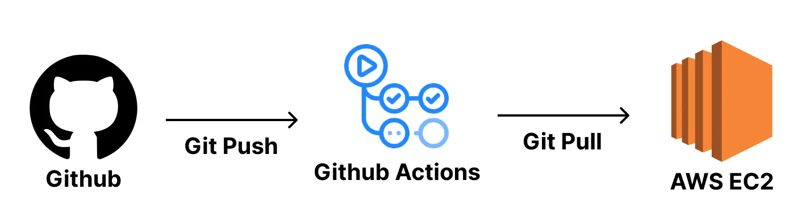

# **Github에 Secret값 넣어주기**

EC2_HOST: public IP(탄력적 IP)

EC2_USERNAME: ubuntu

EC2_PRIVATE_KEY: .pem key

- **주의!! 맨 마지막 % 제외하기** 

# **Actions 작성** 

**.github/workflows [경로]**

```yaml
name: Deploy to EC2

on:
  push:
    branches:
      - main

jobs:
  deploy:
    runs-on: ubuntu-latest
    steps:
      - name: SSH 사용하여 EC2 접속 및 배포
        uses: appleboy/ssh-action@v1.0.3
        with:
          host: ${{ secrets.EC2_HOST }} # EC2의 주소
          username: ${{ secrets.EC2_USERNAME }} # EC2 접속 username
          key: ${{ secrets.EC2_PRIVATE_KEY }} # EC2의 Key 파일
          script_stop: true # 실패하면 전체 실패 처리
          script: |
            
            cd /home/ubuntu/CI-CD-study
            
            # 최신 코드 가져오기
            git pull origin main 
            
            # 프로젝트 빌드
            ./gradlew clean build 
            
            # 실행 중인 애플리케이션 종료 (서버가 실행 중이 아니어도 에러 없이 통과)
            sudo fuser -k -n tcp 8080 || true
            
            # 종료 대기 (3초)
            sleep 3
            
            # *SNAPSHOT.jar 끝나는 빌드 파일로 애플리케이션 실행 output.log 로그 기록 
            nohup java -jar build/libs/*SNAPSHOT.jar > ./output.log 2>&1 &
            
            # 배포 완료

```
