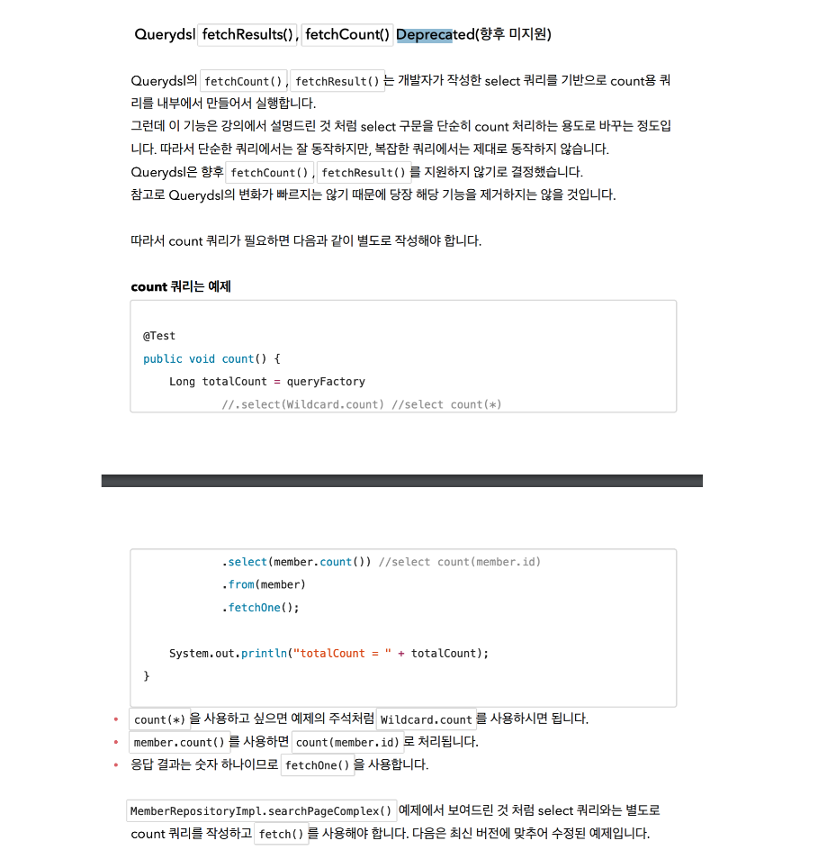

- *fetch(): 리스트 조회, 데이터 없으면 빈 리스트 반환*
- *fetchOne(): 단 건 조회* 
- *결과가 없으면: null* 
  - *결과가 둘 이상이면: com.querydsl.core.NonUniqueResultException*
- *fetchFirtst(): limit(1).fetchOne()*
- *fetchResults(): 페이징 정보 포함, total count 쿼리 추가 실행* 
- *fetchCount(): count 쿼리로 변경해서 count 수 조회* 

```java
**@Test**
public void resultFetch(){
    // List
    List<Member> fetch = queryFactory
            .selectFrom(member)
            .fetch();

    // 단 건
    Member fetchOne = queryFactory
            .selectFrom(member)
            .where(member.username.eq("member6"))
            .fetchOne();

    // limit(1) + fetchOne
    Member fetchFirst = queryFactory
            .selectFrom(member)
            .fetchFirst();

    // 페이징 쿼리
    QueryResults<Member> results = queryFactory
            .selectFrom(member)
            .fetchResults();

    long count = results.getTotal();
    List<Member> content = results.getResults();

    // count 쿼리로 변경
    long cnt = queryFactory
            .selectFrom(member)
            .fetchCount();
}
```

*fetchResults(), fetchCount() → Deprecated* 



