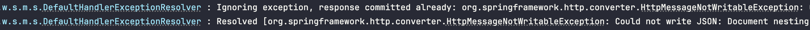

### *개요* 

*주문 + 배송정보 + 회원을 조회하는 API를 만들자* 

*v1 ~ v3 까지 발생하는 성능 문제와 엔티티 ↔ 표현 계층 스펙 문제를 단계적으로 해결하자* 

*Order ↔ Delivery (1:1 관계)*

*Order ↔ Member (N:1 관계)*

***이번 챕터는 xToOne 관계 최적화에 대한 내용이다.***

# ***간단한 주문 조회*** *V1:* ***엔티티를 직접 노출***

```java
@RestController
@RequiredArgsConstructor
public class OrderSimpleApiController {
    private final OrderRepository orderRepository;

    @GetMapping("/api/v1/simple-orders")
    public List<Order> ordersV1() {
        return orderRepository.findAllByString(new OrderSearch());
    }
}
```

- *엔티티를 직접 노출하는 것은 좋지 않다. (앞장에서 설명)*
- order → member, order → delivery 지연 로딩 

### ***테스트*** 

*order ↔ member, order ↔ delivery 서로 양방향 관계여서 무한 루프에 빠진다.* 

*그래서 양방향 관계에서 한쪽은 @JsonIgnore를 적용해야 한다.*


- *무한루프에 빠져서 예외가 발생하는데 최신 스프링에서는 해당 예외를 잡아서 처리하고 로그를 남긴다.*



### ***@JsonIgnore 적용*** 

*Order를 기준으로 Order에 대한 참조를 가지는 양방향 관계에 전부 @JsonIgnore를 적용*

*당연하지만 이렇게 엔티티가 현재 개발하는 api 스펙에 의존하게된다.*

*더 큰 문제는 이렇게 @JsonIgnore를 적용해도 jackson 라이브러리는 지연로딩된 프록시 객체를 어떻게 json으로 어떻게 생성해야 하는지 모른다 → 예외가 발생한다.* 

*Hibernate 모듈을 통해서 지연 로딩된 프록시 객체에 대한 문제의 해결이 가능하다.* 

*하지만 엔티티 직접 노출하는 방식은 여전히 다른 문제들은 해결 불가능하다.*

# ***간단한 주문 조회*** *V2:* ***엔티티를*** *DTO****로 변환***

```java
@GetMapping("/api/v2/simple-orders")
public List<SimpleOrderDto> ordersV2(){
    return orderRepository.findAllByString(new OrderSearch())
            .stream()
            .map(SimpleOrderDto::new)
            .collect(Collectors.toList());
}

@Data
static class SimpleOrderDto {
    private Long orderId;
    private String name;
    private LocalDateTime orderDate;
    private OrderStatus orderStatus;
    private Address address;
    public SimpleOrderDto(Order o){
        this.orderId = o.getId();
        this.name = o.getMember().getName();      // 지연 초기화
        this.orderDate = o.getOrderDate();
        this.orderStatus = o.getStatus();
        this.address = o.getDelivery().getAddress();   // 지연 초기화 
    }
}
```

***응답 결과*** 


***실행된 쿼리 개수 → 5개*** 

```java
Hibernate: 
    select
        o1_0.order_id,
        o1_0.delivery_id,
        o1_0.member_id,
        o1_0.order_date,
        o1_0.status 
    from
        orders o1_0 
    join
        member m1_0 
            on m1_0.member_id=o1_0.member_id 
    fetch
        first ? rows only
        
Hibernate: 
    select
        m1_0.member_id,
        m1_0.city,
        m1_0.street,
        m1_0.zipcode,
        m1_0.name 
    from
        member m1_0 
    where
        m1_0.member_id=?   
             
Hibernate: 
    select
        d1_0.delivery_id,
        d1_0.city,
        d1_0.street,
        d1_0.zipcode,
        d1_0.status 
    from
        delivery d1_0 
    where
        d1_0.delivery_id=?     

Hibernate: 
    select
        m1_0.member_id,
        m1_0.city,
        m1_0.street,
        m1_0.zipcode,
        m1_0.name 
    from
        member m1_0 
    where
      m1_0.member_id=?    
      
Hibernate: 
select
    d1_0.delivery_id,
    d1_0.city,
    d1_0.street,
    d1_0.zipcode,
    d1_0.status 
from
    delivery d1_0 
where
    d1_0.delivery_id=?            
```

*처음 쿼리 → 조회된 Order 개수 2개 

Delivery, Member 지연 초기화 시점* 

- *this.name = o.getMember().getName();*
- *this.address = o.getDelivery().getAddress();*

### *정리*

- *쿼리가 1 + N + N번 실행된다.*
- *order → member N번*
  - *order → delivery N번*
- *엔티티를 직접 노출하는 문제는 Dto로 변환해서 반환하여 해결했지만 쿼리가 너무 많이 날아가서 성능이 떨어진다.*

# ***주문 조회*** *V3:* ***엔티티를*** *DTO****로 변환*** *-* ***페치 조인 최적화***

```java
public List<Order> findAllWithMemberDelivery(){
    return em.createQuery("select o " +
                    "from Order o " +
                    "join fetch o.member m " +
                    "join fetch o.delivery d", Order.class)
            .setMaxResults(1000)
            .getResultList();
}


@GetMapping("/api/v3/simple-orders")
public List<SimpleOrderDto> ordersV3() {
    return orderRepository.findAllWithMemberDelivery()
            .stream()
            .map(SimpleOrderDto::new)
            .collect(Collectors.toList());
}

@Data
static class SimpleOrderDto {
    private Long orderId;
    private String name;
    private LocalDateTime orderDate;
    private OrderStatus orderStatus;
    private Address address;
    public SimpleOrderDto(Order o){
        this.orderId = o.getId();
        this.name = o.getMember().getName();
        this.orderDate = o.getOrderDate();
        this.orderStatus = o.getStatus();
        address = o.getDelivery().getAddress();
    }
}
```

- ***fetch join 적용*** 
- *결과도 v2와 동일* 

*만약 fetch join 없이 직접 조인 했으면 필요한 select 프로젝션에 맞는 클래스를 직접 생성해서 가져와야 한다.*

*하지만 Lazy 로딩 + fetch join 조합으로 간단하게 로직 작성이 가능하고 추가로 성능도 좋다*

***실행된 쿼리 개수 → 1개***

```java
  select
      o1_0.order_id,
      d1_0.delivery_id,
      d1_0.city,
      d1_0.street,
      d1_0.zipcode,
      d1_0.status,
      m1_0.member_id,
      m1_0.city,
      m1_0.street,
      m1_0.zipcode,
      m1_0.name,
      o1_0.order_date,
      o1_0.status 
  from
      orders o1_0 
  join
      member m1_0 
          on m1_0.member_id=o1_0.member_id 
  join
      delivery d1_0 
          on d1_0.delivery_id=o1_0.delivery_id 
  fetch
      first ? rows only

```

# ***간단한 주문 조회*** *V4: JPA****에서*** *DTO****로 바로 조회***


***OrderSimpleQueryDto***

```java
@Data
public class OrderSimpleQueryDto {
    private Long orderId;
    private String name;
    private LocalDateTime orderDate;
    private OrderStatus orderStatus;
    private Address address;

    public OrderSimpleQueryDto(Long orderId,
                               String name,
                               LocalDateTime orderDate,
                               OrderStatus orderStatus,
                               Address address) {
        this.orderId = orderId;
        this.name = name;
        this.orderDate = orderDate;
        this.orderStatus = orderStatus;
        this.address = address;
    }
}
```

- *기존에 사용하던 Dto는 컨트롤러 내부에 있던 클래스였다. 서비스에서 컨트롤러 내부 클래스를 의존하게 되면 의존관계가 꼬인다.*
- *컨트롤러 → 서비스, 서비스 → 컨트롤러(dto)*
- *그래서 서비스에서 의존하는 리포지토리 패키지에 dto를 만들었다.*
- *서비스 → 리포지토리 , 서비스 → 리포지토리(dto)*

***OrderService - findOrderDto()*** 

```java
public List<OrderSimpleQueryDto> findOrderDto() {
    return em.createQuery("select new jpabook.jpashop.repository.OrderSimpleQueryDto(o.id, m.name, " +
                    "o.orderDate, o.status, d.address)" +
            " from Order o" +
            " join o.member m" +
            " join o.delivery d", OrderSimpleQueryDto.class)
            .getResultList();
}
```

- *직접 조인 쿼리 작성 (fetch x)*
- *DTO로 바로 조회를 하려면 FQCN이 필요하다.*
- *일반적인 SQL을 사용할 때 처럼 원하는 값을 선택해서 조회*
- *new 명령어를 사용해서 JPQL의 결과를 DTO로 즉시 변환* 

***실행된 쿼리*** 

```java
  
  // v4 쿼리 
  select
      o1_0.order_id,
      m1_0.name,
      o1_0.order_date,
      o1_0.status,
      d1_0.city,
      d1_0.street,
      d1_0.zipcode 
  from
      orders o1_0 
  join
      member m1_0 
          on m1_0.member_id=o1_0.member_id 
  join
      delivery d1_0 
          on d1_0.delivery_id=o1_0.delivery_id
          
          
  // v3 쿼리 - fetch join      
	
  select
    o1_0.order_id,
    d1_0.delivery_id,
    d1_0.city,
    d1_0.street,
    d1_0.zipcode,
    d1_0.status,
    m1_0.member_id,
    m1_0.city,
    m1_0.street,
    m1_0.zipcode,
    m1_0.name,
    o1_0.order_date,
    o1_0.status 
from
    orders o1_0 
join
    member m1_0 
        on m1_0.member_id=o1_0.member_id 
join
    delivery d1_0 
        on d1_0.delivery_id=o1_0.delivery_id 
fetch

```

- *v3, v4 비교를 하면 실행되는 쿼리의 개수는 동일하지만 가져오는 프로젝션의 개수가 적기 때문에 네트워크 비용이 v4가 더 적다는 걸 확인할 수 있었다.*

### *그렇다면 무조건 v4가 v3보다 좋을까?*

*아니다. v3는 엔티티를 조회하고 v4는 dto를 조회한다.* 

*즉, v3는 여러 api에서 재사용성이 높지만 v4는 특정 api 종속되어서 사용만 가능하다.*

*그리고 애플리케이션 네트워크 용량 최적화는 특수한 케이스가 아닌 이상 생각보다 미비하다.*

*또한 v3는 개발이 단순해진다.*

***그럼 어떻게 해야할까? (권장 방식 순서)*** 

1. *먼저 엔티티를 dto로 변환하는 방법을 선택한다. → v2*
1. *필요하면(N+1 problem) 페치 조인을 통해 성능을 최적화 한다. → v3* 
1. *DTO로 직접 조회 → v4*
1. *JPA 제공 네이티브 쿼리나 스프링 JDBC Template를 사용해서 직접 SQL을 사용한다.*

