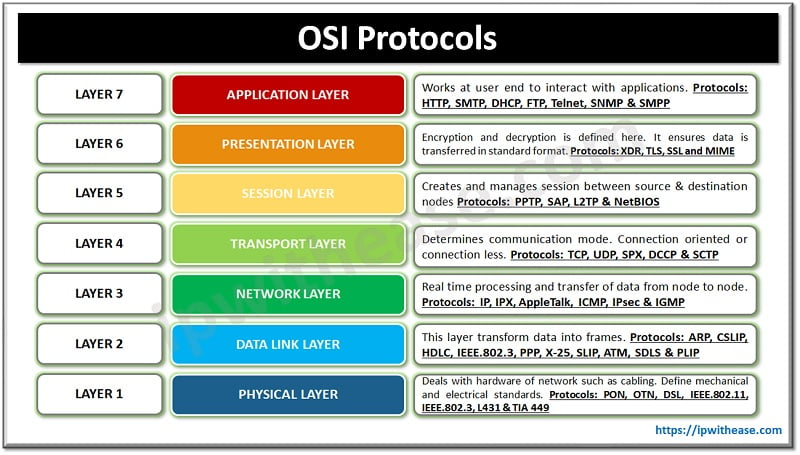

**네트워크 프로토콜(network protocol)**

- 네트워크 통신을 하기 위해서는 통신에 참여하는 주체들이 따라야 하는 형식, 절차, 규약
- 각 레이어에 맞게 프로토콜이 세분화돼서 구현
- 각 레이어의 프로토콜은 하위 레이어의 프로토콜이 제공하는 기능을 사용하여 동작

**OSI 7 layer**

- application layer
- 애플리케이션 목적에 맞는 통신 방법 제공
  - HTTP, DNS, SMTP, FTP
- presentation layer
- 애플리케이션 간의 통신에서 메시지 포맷 관리
  - 인코딩 ↔ 디코딩
  - 암호화 ↔ 복호화
  - 압축 ↔ 압축 풀기
- session layer
- 애플리케이션 간의 통신에서 세션을 관리
  - RPC(remote procedure call)
- transport layer
- 애플리케이션 간의 통신 담당 
  - 목적지 애플리케이션으로 데이터 전송(port)
  - 안정적이고 신뢰할 수 있는 데이터 전송 보장(TCP)
  - 필수 기능만 제공(UDP)
- network layer
- 호스트 간의 통신 담당(IP)
  - 목적지 호스트로 데이터 전송
  - 네트워크 간의 최적의 경로 결정
- data link layer
- 직접 연결된 노드 간의 통신 담당
  - MAC 주소 기반 통신 (ARP)
- physical layer
- bits 단위로 데이터 전송

**encapsulation & decapsulation** 

---

[https://www.youtube.com/watch?v=6l7xP7AnB64&list=PLcXyemr8ZeoSGlzhlw4gmpNGicIL4kMcX&index=2](https://www.youtube.com/watch?v=6l7xP7AnB64&list=PLcXyemr8ZeoSGlzhlw4gmpNGicIL4kMcX&index=2)

