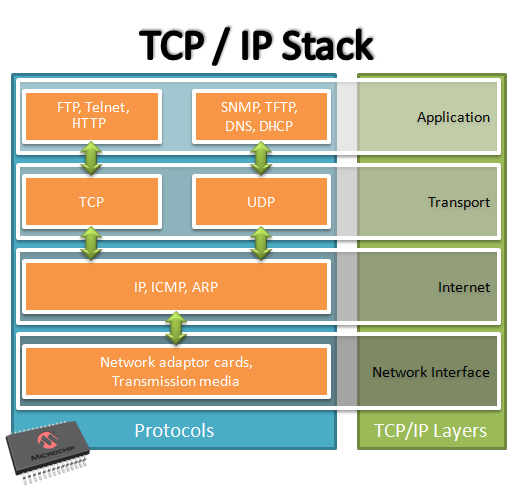
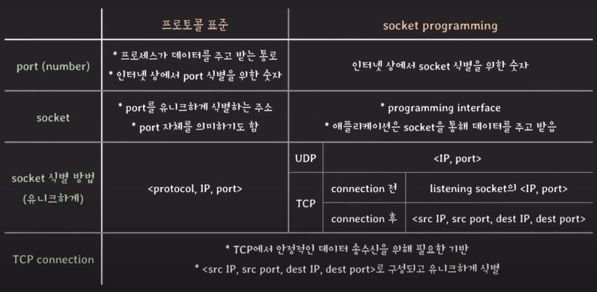



### 개요 

Application Layer / System Layer(Transport, Internet, Network Interface) 이렇게 2계층으로 구분할 수 있다. 

Application Layer는 시스템이 제공하는 네트워크 기능을 사용하고, System Layer는 애플리케이션이 사용할 수 있도록 네트워크 기능을 지원한다.

애플리케이션이 시스템의 기능을 함부로 쓸 순 없다

대신 시스템은 애플리케이션이 네트워크 기능을 사용할 수 있도록 프로그래밍 인터페이스를 제공한다.

애플리케이션은 socket을 통해 데이터를 주고 받는다.

개발자는 socket 프로그래밍을 통해 네트워크 상의 다른 프로세스와 데이터를 주고 받을 수 있도록 구현한다

**즉, 네트워크에서 socket은 <protocol, internet address, port number> 개념과 동시에 애플리케이션과 시스템의 네트워크 인터페이스이기도 하다.**

대부분의 시스템(운영체제)은 socket 형태로 시스템의 네트워크 기능을 제공한다.

보통 socket을 직접 조작해서 통신 기능을 구현할 일은 적다. application layer의 프로토콜은 보통 라이브러리나 모듈 형태로 해당 기능이 제공되는데, 이때 내부를 열어보면 소켓을 활용해서 프로토콜을 구현했음을 알 수 있다.

프로토콜 표준과 다르게 TCP socket은 <TCP(protocol), IP address, port number>로 유니크하게 식별되지 않는다. 하지만 UDP socket 같은 경우 <UDP(protocol), IP address, port number> 유니크하게 식별된다.

### TCP socket 동작 방식

listening socket 대기, 클라이언트에서 connection 연결 요청이 오면 서버의 listening socket 은 3-way handshake 이후 새로운 소켓을 만든다. 근데 이때 만들어진 소켓들은 모두 동일한 <IP, port>를 가진다.

그렇다면 어떻게 socket을 식별할까?

connection이 성립된 이후의 요청은 <src IP, src port, des IP, src port>통해서 socket을 식별한다.

---

[https://www.youtube.com/watch?v=WwseO8l8rZc&list=PLcXyemr8ZeoSGlzhlw4gmpNGicIL4kMcX&index=5](https://www.youtube.com/watch?v=WwseO8l8rZc&list=PLcXyemr8ZeoSGlzhlw4gmpNGicIL4kMcX&index=5)

