MySQL 동시성에 영향을 미치는 잠금(Lock)과 트랜잭션, 트랜잭션의 격리 수준을 공부한다.

트랜잭션은 작업의 완전성을 보장해 주는 것

즉, 논리적인 작업 셋(집합)을 모두 완벽하게 처리하거나 처리하지 못할 경우에는 원 상태로 복구해서 작업의 일부만 적용되는 현상을 방지한다. → All Or Nothing 

잠금은 동시성을 제어하기 위한 기능 트랜잭션은 데이터의 정합성을 보장하기 위한 기능이다.

예를 들어 하나의 회원 정보 레코드를 여러 커넥션에서 동시에 변경하는데 잠금이 없다면 하나의 데이터를 여러 커넥션에서 변경이 가능하고 결과적으로 레코드의 값은 예측할 수 없는 상태가 된다.

잠금은 여러 커넥션에서 동시에 동일한 자원(레코드/테이블)을 요청할 경우 순서대로 한 시점에는 하나의 커넥션만 변경할 수 있게 해주는 역할을 한다.

격리 수준은 하나의 트랜잭션 내에서 또는 여러 트랜잭션 간의 작업 내용을 어떻게 공유하고 차단할 것인지를 결정하는 레벨이다.

트랜잭션을 지원하지 않는 MyISAM과 트랜잭션을 지원하는 InnoDB의 처리 방식 차이를 공부하고

트랜잭션을 사용할 경우 주의할 사항도 함께 살펴보자.

---

# 5.1.1 MySQL에서의 트랜잭션

트랜잭션은 꼭 여러 개의 변경 작업을 수행하는 쿼리가 조합됐을 때만 의미있는 개념이 아니다.

쿼리의 개수와 상관없이 논리적인 작업 셋 자체가 100% 적용(COMMIT)되거나 아무것도 적용되지 않아야함(트랜잭션 ROLLBACK, 서버 비정상 종료)을 보장해 주는 것이다.

### 트랜잭션 관점에서 InnoDB VS MyISAM 차이점 비교

**테이블 생성, 레코드 1건 저장** 

```sql
CREATE TABLE tab_myisam (
   fdpk INT NOT NULL,
   PRIMARY KEY (fdpk)
) ENGINE=MyISAM;

CREATE TABLE tab_innodb (
  fdpk INT NOT NULL,
  PRIMARY KEY (fdpk)
) ENGINE=INNODB;

INSERT INTO tab_myisam VALUE(3);
INSERT INTO tab_innodb VALUE(3);
```

**테스트 쿼리** 

```sql
SET autocommit=ON;

INSERT INTO tab_myisam VALUES (1), (2), (3);
INSERT INTO tab_innodb VALUES (1), (2), (3);
```

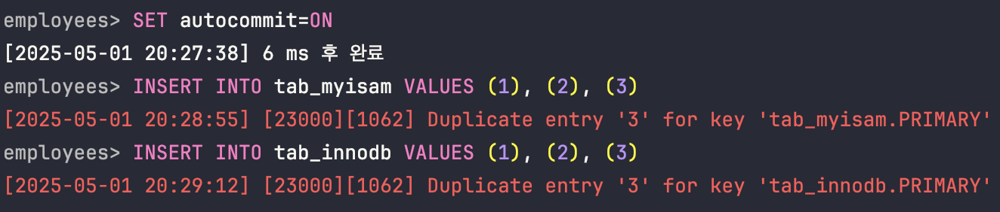

두 개의 스토리지 엔진에서 결과가 어떻게 다를까? 

```sql
SELECT * FROM tab_myisam;
SELECT * FROM tab_innodb;
```

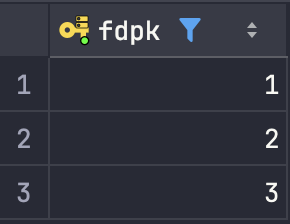


MyISAM 스토리지 엔진은 3개의 레코드, InnoDB 스토리지 엔진은 하나의 레코드만 존재한다.

두 INSERT 문장 모두 프라이머리 키 중복 오류로 쿼리 실패했다.

하지만 MyISAM 테이블에는 오류가 발생했어도 ‘1’, ‘2’는 INSERT된 상태로 남아있다.

즉, MyISAM 테이블에 INSERT 문장이 실행되면서 차례대로 ‘1’, ‘2’를 저장하고, 그다음 ‘3’을 저장하려는 순간

중복 키 오류가 발생한 갓이다.

하지만 MyISAM 테이블은 이미 실행된 ‘1’과 ‘2’를 그대로 두고 쿼리 실행을 종료해 버린다.

하지만 InnoDB 테이블은 쿼리 중 일부라도 오류가 발생하면 전체를 원 상태로 만든다는 트랜잭션 원리대로 문장을 실행하기 전 상태로 그대로 복구했다.

MyISAM 테이블에서 발생하는 이러한 현상을 **부분 업데이트(Partial Update)**라고 표현한다.

---

# 5.1.2 주의사항

트랜잭션 또한 DBMS 커넥션과 동일하게 꼭 필요한 최소의 코드에만 적용하는 것이 좋다.

**예시**

사용자가 게시판에 게시물을 작성한 후 저장 버튼 클릭했을 때 서버에서 처리하는 내용 

```sql
1) 처리 시작
-> 데이터베이스 커넥션 생성 
-> 트랜잭션 시작
2) 사용자의 로그인 여부 확인 
3) 사용자의 글쓰기 내용의 오류 여부 확인
4) 첨부로 업로드된 파일 확인 및 저장 
5) 사용자의 입력 내용을 DBMS에 저장 
6) 첨부 파일 정보를 DBMS에 저장
7) 저장된 내용 또는 기타 정보를 DBMS에서 조회
8) 게시물 등록에 대한 알림 메밀 전송 
9) 알림 메일 발송 이력을 DBMS에 저장 
-> 트랜잭션 종료(COMMIT)
-> 데이터베이스 커넥션 반납
10) 처리 완료 
```

해당 처리 절차에서 DBMS 트랜잭션 처리에 좋지 않은 영향을 미치는 부분을 나눠서 살펴보자 

**실제로 DBMS에 데이터를 저장하는 작업(트랜잭션)은 5번부터 시작된다는 것을 알 수 있다.**

2번,3번,4번 절차가 아무리 빨리 처리된다고 하더라도 DBMS의 트랜잭션에 포함시킬 필요는 없다.

데이터베이스 커넥션 개수는 제한적이어서 각 단위 프로그램이 커넥션을 소유하는 시간이 길어질수록 사용 가능한 여유 커넥션의 개수는 줄어들 것이다. 

**8번 작업 같이 메일 전송이나 FTP 파일 전송 작업 또는 네트워크를 통해 원격 서버와 통신하는 작업은 어떻게 해서든 DBMS 트랜잭션 내에서 제거하는 것이 좋다.** 
프로그램 실행되는 동안 메일 서버와 통신할 수 없는 상황이면 웹 서버뿐 아니라 DBMS 서버까지 위험해지는 상황이 발생할 것이다.

**DBMS 작업이 4개가 있다.  5번, 6번, 7번, 9번**

사용자가 입력한 정보를 저장하는 5번, 6번 작업은 하나의 트랜잭션으로 묶어야 한다. 

7번은 저장된 데이터의 단순 확인 및 조회이므로 트랜잭션에 포함될 필요는 없다.

알림 전송 저장 같은 9번은 비즈니스 목적이 아예 다른 성격의 작업이다. 
별도의 트랜잭션으로 분리하는 것이 좋다.

**재설계**

```sql
1) 처리 시작
2) 사용자의 로그인 여부 확인
3) 사용자의 글쓰기 내용의 오류 발생 여부 확인
4) 첨부된 업로드된 파일 확인 및 저장
-> DB 커넥션 생성(커넥션 풀에서 가져오기)
-> 트랜잭션 시작
5) 사용자의 입력 DBMS에 저장 
6) 첨부 파일 정보 DBMS에 저장 
-> 트랜잭션 종료(COMMIT/ROLLBACK)
7) 저장된 내용 / 기타 정보 DBMS에서 조회
8) 게시글 등록에 대한 알림 메일 전송 
-> 트랜잭션 시작
9) 알림 메일 발송 이력을 DBMS에 저장 
-> 트랜잭션 종료(COMMIT/ROLLBACK)
-> DB 커넥션 종료(커넥션 풀에 반납)
10) 처리 완료 
```

**프로그램 내에서 실행되는 데이터베이스 커넥션의 범위와 트랜잭션 범위를 최소화하자!**

MySQL 서버의 잠금은 스토리지 엔진 레벨과 MySQL 엔진 레벨로 나눌 수 있다.

MySQL 엔진 레벨의 잠금은 모든 스토리지 엔진에 영향을 미치지만, 스토리지 엔진 레벨의 잠금은 스토리지 엔진 간 상호 영향을 미치지 않는다.

MySQL 엔진에서는 테이블 데이터 동기화를 위한 테이블 락 이외에도 테이블 구조를 잠그는 메타데이터 락 그리고 사용자의 필요에 맞게 사용할 수 있는 네임드 락 기능을 제공한다.

---

# 5.2.1 글로벌 락 

**글로벌 락(GLOBAL LOCK)**은 `FLUSH TABLES WITH READ LOCK` 명령으로 획득할 수 있으며, 제공하는 잠금 가운데 가장 범위가 크다. (데이터 베이스, 테이블 상관 X → 전체)

한 세션에서 글로벌 락을 획득하면 다른 세션은 SELECT를 제외한 모든 DDL, DML은 글로벌 락이 해제될 때까지 대기 상태로 남는다.

**글로벌 락 동작 방식** 

```
글로벌 락 획득 시도보다 먼저 활성화된 모든 트랜잭션을 기다린다. 
즉, 커밋/롤백까지 기다린다.
버퍼링된 데이터 페이지를 디스크로 플러시한다.
이 모든 조건을 만족하면 글로벌 락 획득

장시간 실행되는 쿼리와 FLUSH TABLES WITH READ LOCK 명령이 최악의 케이스로 실행되면 
MySQL 서버 모든 테이블에 대한 DML 쿼리가 오랜 시간 동안 기다릴 수도 있다.

글로벌 락은 웹 서비스용 MySQL 서버에서 사용금지 

mysqldump 같은 백업 프로그램
-> 옵션에 따라서 어떤 잠금을 사용하는지 확인하자
```

### 백업 락 

InnoDB 스토리지 엔진은 트랜잭션을 지원하기 때문에 일관된 데이터 상태를 위해 모든 데이터 변경 작업을 

멈출 필요는 없다.

MySQL 8.0 부터는 InnoDB 스토리지 엔진이 기본 스토리지 엔진으로 채택되면서 조금 더 가벼운 글로벌 락 필요성이 생겼다. → 백업 락

```sql
LOCK INSTANCE FOR BACKUP;
// 백업 실행 
UNLOCK INSTANCE;
```

**백업 락 잠금 범위** 

  - 데이터베이스 및 테이블 등 모든 객체 생성 및 변경 삭제
  - 사용자 관리 및 비밀번호 변경
  - REPAIR TABLE, OPTIMIZE TABLE 명령

**백업 락 동작 방식** 

백업 락은 일반적인 데이블의 데이터 변경 DML은 허용된다. 

별도의 조건없이 바로 획득이 가능하다. 

**MySQL 서버 구성**
소스 서버(source server) 레플리카 서버(replica server)로 구성
주로 백업은 보통 레플리카 서버에서 실행된다.

source → (binary log) → replica

**레플리카 서버에서 백업을 글로벌 락 VS 백업 락** 

글로벌 락을 백업으로 사용하면 글로벌 락 획득도 복제 작업이 있으면 지연되고
글로벌 락 도중에 소스 서버 데이터 변경이 있어도 실시간 복제 작업을 못하기 때문에 좋지 않다.

하지만 백업 락은 락 획득 조건이 없어 바로 가능하고 DML은 허용되기 때문에 실시간 복제 작업도 문제없이 가능하다. 즉, 백업과 복제가 동시에 가능하다.

또한 DDL 명령으로 백업이 실패하는 상황을 방지하기 위해서 DDL 명령이 실행되면 복제를 일시 중지하는 역할을 한다. 

**MySQL 8.0 이상 + InnoDB 환경**에서는 `LOCK INSTANCE FOR BACKUP` 기반 백업 전략이 권장

---

# 5.2.2 테이블 락

**테이블 락(Table Lock)**은 개별 테이블 단위로 설정되는 잠금이며, **명시적 또는 묵시적**으로 특정 테이블의 락을 획득할 수 있다.

**명시적 테이블 락 획득, 반납** 

```sql
LOCK TABLES table_name [READ | WRITE]

UNLOCK TABLES
```

명시적인 테이블 락은 애플리케이션에서 사용할 필요가 거의 없다.

글로벌 락과 동일하게 온리인 작업에 상당한 영향을 미치기 때문이다.

### 묵시적 테이블 락 

InnoDB 테이블은 DML 쿼리에서는 사용되지 않고, DDL 쿼리에서는 자동으로 사용된다.

왜냐하면 스토리지 엔진 차원에서 레코드 기반의 잠금을 제공하기 때문에 단순 데이터 변경 쿼리인 DML은 테이블 락이 설정되지는 않는다.

하지만 MyISAM, MEMORY 테이블은 데이터 변경 또한 묵시적으로 자동으로 테이블 락이 걸린다.

### 참고 자료 

[https://steady-coding.tistory.com/545](https://steady-coding.tistory.com/545)

---

# 5.2.3 네임드 락

네임드 락(Named Lock)은 `GET_LOCK()` 함수를 이용해 임의의 문자열에 대해 잠금을 설정할 수 있다.

이 잠금의 특징은 **대상이 테이블이나 레코드 또는 AUTO_INCREMENT 같은 데이터베이스 객체가 아니라는 것**이다. 

단순히 사용자가 지정한 문자열에 대해 획득하고 반납하는 잠금이다.

여러 클라이언트가 상호 동기화를 처리해야 할 때 네임드 락을 이용하면 쉽게 해결할 수 있다.

### 네임드 락 사용법

```sql
// 이미 잠금 사용 중이면 2초 대기
SELECT GET_LOCK('mylock', 2);

// 잠금 설정 확인
SELECT IS_FREE_LOCK('mylock');

// 잠금 반납 해제 
SELECT RELEASE_LOCK('mylock');
```

  - 3개 함수 모두 정상적으로 동작하면 1을 반환
  - 3개 함수 모두 실패하면 0 또는 NULL 반환 

### 네임드 락 중첩

MySQL 8.0 부터는 다음과 같이 네임드 락을 중첩해서 사용할 수 있다.

```sql
SELECT GET_LOCK('mylock_1', 10);
SELECT GET_LOCK('mylock_2', 10);

// 작업 수행 

SELECT RELEASE_LOCK('mylock_2');
SELECT RELEASE_LOCK('mylock_1');

// 동시에 해제 방법
SELECT RELEASE_ALL_LOCKS();
```

### 올바른 네임드 락 가이드

```
내가 생각하는 네임드 락 올바른 패턴

락 트랜잭션 시작
네임드 락 획득

비즈니스 트랜잭션 시작
비즈니스 트랜잭션 커밋 / 롤백

네임드 락 반납

---------------------------------------------------------------------------
왜 이렇게 트랜잭션을 분리해서 락을 획득?

네임드 락 획득 트랜잭션과 비즈니스 트랜잭션이 같은 트랜잭션으로 동작하면
동시성 이슈가 발생한다.

락 반납 <-> 트랜잭션 커밋 사이에 다른 트랜잭션이 락을 획득하고 업데이트 시도가 가능하기 때문이다.
---------------------------------------------------------------------------
그렇다면 꼭 락을 획득하는 트랜잭션과 반납하는 트랜잭션을 분리할 필요가 있는가?

트랜잭션1
네임드 락 획득

트랜잭션2
비즈니스 로직 

트랜잭션3
네임드 락 반납

트랜잭션1과 트랜잭션3은 서로 다른 커넥션이다 무슨 문제점이 있을까?
"네임드 락은 현재 세션에서 설정한 락만 해제할 수 있다" 즉, 커넥션이 다르면 반납이 불가능하다.
즉, 트랜잭션1에서 락을 획득한 커넥션(세션)과 트랜잭션3에서 락을 반납하는 커넥션이 다르면 
락 반납이 불가능하다.
만약 반납이 가능하다면 그건 우연의 일치로 같은 히카리풀이 트랜잭션을 제공할 때 트랜잭션1과 
트랜잭션3이 같은 커넥션을 제공하였기 떄문이다. 
```


만약 세션(커넥션)이 끊긴다면 자동으로 락은 릴리즈

---

# 5.2.5 메타데이터 락

**메타데이터 락(Metadata Lock)**은 데이터베이스 객체(테이블이나 뷰)의 이름이나 구조를 변경하는 경우에 획득하는 잠금이다.

**메타데이터 락은 명시적으로 획득이 불가능하다.**

`RENAME TABLE tab_a To tab_b` 같이 테이블의 이름을 변경하는 경우 자동으로 획득하는 잠금이다.

RENAME TABLE 같은 경우 원본 이름과 변경될 이름 두 개 모두 한꺼번에 잠금을 설정한다.

**예제1**

```sql
// 배치 프로그램에서 별도의 임시 테이블(rank_new)에 서비스용 랭킹 데이터를 생성

// 랭킹 배치가 완료되면 현재 서비스용 랭킹 테이블(rank)에 rank_backup으로 백업 
// 새로 만들어진 랭킹 테이블(rank_new)을 서비스용으로 대체 
RENAME TABLE rank TO rank_backup, rank_new TO rank;
```

예제1 같이 하나의 RENAME TABLE 명령문에 두 개의 RENAME 작업을 한꺼번에 실행하면 실제 애플리케이션 서버에서는 “Table not found rank” 같은 상황을 발생시키지 않고 적용하는 것이 가능하다.

**예제2**

```sql
RENAME TABLE rank TO rank_backup;
RENAME TABLE rank_new TO rank;
```

예제2 같이 2개로 나눠서 실행하면 아주 짧은 시간이지만 rank 테이블이 존재하지 않는 순간이 생기며, 그 순간에 실행되는 쿼리는 “Table not found rank” 오류를 발생시킨다.

---

InnoDB 스토리지 엔진은 MySQL에서 제공하는 잠금과는 별개로 스토리지 엔진 내부에서 레코드 기반의 잠금 방식을 탑재하고 있다.

예전 버전의 MySQL에서는 InnoDB 잠금 정보를 진단할 수 있는 방법이 존재하긴 했지만 부족했다.

최근 버전의 MySQL에서는 InnoDB의 트랜잭션과 잠금, 담금 대기 중인 트랜잭션의 목록을 조회할 수 있는 방법이 도입됐다.

MySQL 서버의 `information_schema` 데이터베이스에 존재하는 `INNODB_TRX`, `INNODB_LOCKS`, `INNODB_LOCK_WAITS` 테이블을 조인해서 조회하면 어떤 트랜잭션이 어떤 잠금을 대기하고 있고, 해당 잠금을 어느 트랜잭션이 가지고 있는지 확인할 수 있다. 또한 장시간 잠금을 가지는 클라이언트를 찾아서 종료시킬 수도 있다.

---

# 5.3.1 InnoDB 스토리지 엔진의 잠금

InnoDB 스토리지 엔진은 **레코드 기반의 잠금**을 제공하며, 레코드 락뿐 아니라 레코드와 레코드 사이의 간격을 잠그는 **갭(GAP)락**도 존재한다.


---

## 5.3.1.1 레코드 락

레코드 자체만을 잠그는 것을 **레코드 락(Record lock)**이라고 한다.

InnoDB 스토리지 엔진은 **레코드 자체가 아니라 인덱스의 레코드를 잠근다.**

인덱스의 레코드를 잠근다 의미

**→ B+트리 인덱스의 리프 노드에 있는 엔트리(레코드)를 잠근다**는 의미

인덱스가 하나도 없는 테이블이더라도 내부적으로 자동 생성된 클러스터 인덱스를 이용해 잠금을 설정한다.

인덱스를 잠그느냐, 레코드를 잠그느냐는 상당히 크고 중요한 차이를 나타낸다.

InnoDB에서는 보조 인덱스를 이용한 변경 작업은 넥스트 키 락 또는 갭 락을 사용하지만

프라이머리 키 또는 유니크 인덱스에 의한 변경 작업은 갭(Gap, 간격)에 대해서는 잠그지 않고 레코드 락만 사용한다.

---

## 5.3.1.2 갭 락

갭 락(Gap lock)은 레코드 자체가 아니라 **레코드와 바로 인접한 레코드 사이의 간격만을 잠그는 것**을 의미한다.

갭 락의 역할은 레코드와 레코드 사이의 간격에 새로운 레코드가 생성(INSERT)되는 것을 제어하는 것이다.

갭 락은 그 자체보다는 넥스트 키 락의 일부로 자주 사용된다.

### **갭 락(Gap Lock)이 필요한 이유?**

**→ 팬텀 리드(Phantom Read)를 방지하기 위해**

---

### 팬텀 리드(Phantom Read)란?

**트랜잭션 A**가 어떤 조건에 맞는 **여러 개의 row를 읽었는데**,

그 사이에 **트랜잭션 B**가 그 조건에 해당하는 새로운 row를 **삽입**하고 커밋했을 경우,

**트랜잭션 A가 다시 동일한 조건으로 조회하면 데이터가 달라진 것처럼 보이는 현상**이다.

즉, **유령 레코드(phantom)가 생겼다**고 해서 팬텀 리드라 부른다.

---

### 갭 락이 어떻게 이를 막을까?

갭 락은 "존재하지 않는 레코드 사이의 간격(Gap)"도 잠금으로 처리함으로써

**다른 트랜잭션이 그 사이에 레코드를 새로 삽입하지 못하도록 막는다.**

---

### 예제로 이해

| id | age |
| --- | --- |
| 1 | 20 |
| 2 | 30 |
| 3 | 40 |

**트랜잭션 A**

```sql
BEGIN;
SELECT * FROM users WHERE age BETWEEN 20 AND 40 FOR UPDATE;
```

    - InnoDB는 age 인덱스를 기준으로 20 ~ 40에 해당하는 레코드 + 그 사이 간격(gap)을 Next Key lock 사용하여 잠금
    - Next-key lock = 갭 락 + 레코드 락

**트랜잭션 B 실패** (트랜잭션 A의 갭 락에 걸림)

```sql
INSERT INTO users (id, age) VALUES (4, 25);
```

---

### 참고

    - **REPEATABLE READ** (MySQL 기본) 격리 수준에서 팬텀 리드를 막기 위해 갭 락이 필요
    - **READ COMMITTED**에서는 갭 락을 사용하지 않고 팬텀 리드를 허용

---

### 정리: REPEATABLE READ에서도 **갭 락은 언제 걸리나?**

| 쿼리 유형 | 갭 락 발생 여부 | 설명 |
| --- | --- | --- |
| `SELECT` | ❌ **안 걸림** | 단순 조회는 아무 락도 걸지 않음 (MVCC로 처리) |
| `SELECT ... FOR UPDATE` 또는 `LOCK IN SHARE MODE` | ✅ **걸림** | 갭 락 또는 넥스트 키 락이 걸릴 수 있음 |
| `UPDATE`, `DELETE`, `INSERT` | ✅ **걸림** | 변경이므로 락이 필요함 (갭 락 포함) |

---

### REPEATABLE READ VS READ_COMMITED

| 격리 수준 | 트랜잭션 번호 & 커밋 처리 | 팬텀 리드 | 설명 |
| --- | --- | --- | --- |
| **`READ COMMITTED`** | 커밋된 최신 데이터만 읽음<br>트랜잭션 번호 상관 X | 발생 가능 | 커밋된 데이터를 최신 상태로 읽지만, 트랜잭션 실행 중 데이터 변경 시 팬텀 리드가 발생할 수 있음 |
| **`REPEATABLE READ`** | 트랜잭션 시작 시점의 스냅샷을 고정<br>트랜잭션 번호를 기준으로 이전 트랜잭션 커밋만 참조 | 방지됨 | 트랜잭션이 시작될 때의 데이터를 읽으며, 그 이후 커밋된 데이터는 읽지 않음. 팬텀 리드가 방지됨 |

---

---

## 5.3.1.3 넥스트 키 락

레코드 락 + 갭 락을 합쳐 놓은 형태의 잠금을 **넥스트 키 락(Next key lock)**이라고 한다.

MySQL에서는 데이터를 복제하기 위해 **바이너리 로그(binlog)**를 남긴다.

  - **소스 서버 (Primary)** 에서 데이터 변경
  - 변경 내용을 포맷 설정에 맞게 바이너리 로그(binlog)에 기록
  - **레플리카 서버(Secondary)**가 binlog를 읽어서 **실행**

대표적으로 3가지 포맷이 있다.

| 포맷 | 특징 |
| --- | --- |
| **STATEMENT** | 어떤 SQL을 실행했는지 기록 (예: `UPDATE users SET ... WHERE age > 20`) |
| **ROW** | 어떤 데이터를 변경했는지 직접 기록 (예: `id=3인 행의 age를 30 → 31로 변경`) |
| **MIXED** | 위 둘을 혼합해서 MySQL이 판단 |

**STATEMENT 문제점**

```
소스에서 WHERE age > 20 조건에 해당하는 건 id=3뿐이었다고 가정
하지만 레플리카는 INSERT로 인해 age=25인 id=4가 이미 존재하고 있는 상태였다면?
STATEMENT 포맷이니까 UPDATE ... WHERE age > 20 이라는 같은 SQL이 레플리카에서 실행됨
그러면 id=3뿐 아니라 id=4도 같이 업데이트됨 
데이터 불일치 발생
즉, STATEMENT 포맷의 특성상 "당시의 상태"가 중요하지만 보존되지 않아서 문제가 생긴다. 
```

그래서 STATEMENT 포맷의 바이너리 로그를 사용하는 MySQL 서버에서는 REPEATABLE READ 격리 수준을 사용해야 한다. 

`innodb_locks_unsafe_for_binlog` 시스템 변수가 비활성화(0으로 설정)되면 변경을 위해 검색하는 레코드에는 넥스트 키 락 방식으로 잠금이 걸린다. 1이면 넥스트 키 락 생략

의외로 넥스트 키 락과 갭 락으로 인한 데드락이 발생하거나 다른 트랜잭션을 기다리게 만드는 일이 자주 발생한다.

가능하다면 바이너리 로그 포맷을 ROW 형태로 바꿔서 데이터 자체를 반영되도록 하여 넥스트 키 락이나 갭 락을 줄이는 것이 좋다.

---

## 5.3.1.4 자동 증가 락

MySQL에서는 자동 증가하는 숫자 값을 추출하기 위해 `AUTO_INCREMENT` 칼럼 속성을 제공한다.

`AUTO_INCREMENT` 칼럼이 사용된 테이블에 동시에 여러 레코드가 INSERT되는 경우, 저장되는 각 레코드는 중복되지 않고 저장된 순서대로 증가하는 일련번호 값을 가져야 한다.

InnoDB 스토리지 엔진에서는 이를 위해 내부적으로 `AUTO_INCREMENT` 락 이라고 하는 테이블 수준의 잠금을 사용한다.

`AUTO_INCREMENT` 락은 INSERT, REPLACE 쿼리 문장 같은 새로운 레코드를 저장하는 쿼리에서만 필요하며, UPDATE, DELETE 등의 쿼리에서는 걸리지 않는다.

###  **REPLACE INTO 의 동작 방식**

```sql
REPLACE INTO users (id, name) VALUES (1, 'Alice');
```

이 쿼리의 동작 순서를 보면

    1. **해당 키(id=1)** 가 있는지 확인
    1. 있으면: **DELETE**
    1. 그리고 나서: **INSERT**

즉, 겉보기에는 한 문장처럼 보이지만 내부에서는 사실상

```sql
DELETE FROM users WHERE id = 1;
INSERT INTO users (id, name) VALUES (1, 'Alice');
```

---

### 그래서 AUTO_INCREMENT 락이 필요한 이유

    - `REPLACE`가 결국 **INSERT 동작을 포함**하므로
    - `AUTO_INCREMENT` 컬럼이 있다면, 새 값을 넣을 때 락이 필요하다.
    - 따라서 `REPLACE`도 `INSERT`처럼 **AUTO_INCREMENT 락을 획득한다.**

---

### 예시

```sql
CREATE TABLE test (
  id INT AUTO_INCREMENT PRIMARY KEY,
  name VARCHAR(50)
);

REPLACE INTO test (id, name) VALUES (1, 'Bob');
```

    - `id=1`이 이미 있으면 삭제되고,
    - `AUTO_INCREMENT`는 기존 값과 무관하게 증가함 (구멍이 생긴다.)

---

### 주의사항

    - `REPLACE`는 **DELETE + INSERT**이기 때문에 **트리거, 외래 키, AUTO_INCREMENT** 등에서 주의가 필요
    - `UPDATE`와는 완전히 다른 동작

---

`AUTO_INCREMENT` 락은 트랜잭션과 관계없이 INSERT, REPLACE 문장에서 `AUTO_INCREMENT`  값을 가져오는 순간만 락이 걸렸다가 즉시 해제된다. 

`AUTO_INCREMENT` 락은 테이블 테이블에 단 하나만 존재하고 같은 테이블에 두 개의 INSERT 쿼리가 동시에 실행되는 경우 하나의 쿼리가 `AUTO_INCREMENT` 락을 걸면 나머지 쿼리는 대기한다.

`AUTO_INCREMENT` 칼럼에 명시적으로 값을 설정하더라도 자동 증가 락을 걸게된다.

`AUTO_INCREMENT` 락을 명시적으로 획득하고 해제하는 방법은 없다.

지금까지 자동 증가 락에 대한 설명은 MySQL 5.0 이하 버전에서 사용되던 방식이다.

MySQL 5.1 이상부터는 `innodb_autonic_lock_mode` 시스템 변수를 이용해 자동 증가 락의 작동 방식을 변경할 수 있다. 

### innodb_autonic_lock_mode

`innodb_autonic_lock_mode=0`  

MySQL 5.0과 동일한 잠금 방식으로 모든 INSERT 문장은 자동 증가 락을 사용한다.

`innodb_autonic_lock_mode=1` 

단순히 한 건 또는 여러 건의 레코드를 INSERT하는 SQL 중에서 MySQL 서버가 INSERT되는 레코드의 건수를 정확히 예측할 수 있을 때는 자동 증가 락을 사용하지 않고, 훨씬 가볍고 빠른 래치(뮤텍스)를 이용해 처리한다.

개선된 뮤텍스는 자동 증가 락과 달리 아주 짧은 시간 동안만 잠금을 걸고 필요한 자동 증가 값을 가져오면 즉시 잠금이 해제된다. 하지만 MySQL 서버가 건수를 예측할 수 없을 때는 MySQL 5.0과 동일한 자동 증가 락을 사용한다.  이때는 INSERT 문장이 완료되기 전까지는 자동 증가 락이 해제되지 않기 때문에 다른 커넥션에서는 INSERT를 실행하지 못하고 대기한다. 이렇게 대량 INSERT가 수행될 때는 InnoDB 스토리지 엔진은 여러 개의 자동 증가 값을 한 번에 할당받아서 INSERT되는 레코드에 사용한다.

그래서 대량 INSERT되는 레코드는 자동 값이 누락되지 않고 연속되게 INSERT 된다. 할당 받은 자동 증가 값이 남는경우 폐기된다. 그래서 대량 INSERT 이후에 실행되는 INSERT는 연속되지 않고 누락된 값이 발생할 수 있다.

이 설정은 최소한 하나의 INSERT 문장으로 레코드들은 연속적으로 저장된다. 

그래서 이 설정을 **연속 모드(Consecutive mode)**라고도 한다.

`innodb_autonic_lock_mode=2`  **MySQL 8.0 default** 

절대 자동 증가 락을 사용하지 않고 경량화된 뮤텍스를 사용한다. 

하지만 이 설정에서는 하나의 INSERT 문장으로 INSERT되는 레코드라고 하더라도 연속된 자동 증가 값을 보장하지는 않는다. 그래서 이 설정을 **인터리빙 모드(Interleaved mode)**라고도 한다. 

이 설정에서는 INSERT … SELECT 같은 대량 INSERT 문장이 실행되어도 다른 커넥션에서 INSERT를 실행할 수 있다. 이 설정에서 작동하는 자동 증가 기능은 유니크 한 값이 생성되는 것을 보장한다.

### (건수) 예측 가능한 INSERT VS 예측 불가능한 INSERT 

| 구분 | 예측 가능 |
| --- | --- |
| INSERT ... VALUES (?, ?) | ✅ 예측 가능 (값 명확히 있음) |
| INSERT ... VALUES (?, ?), (?, ?) | ✅ 예측 가능 (몇 건인지 명확) |
| INSERT ... SELECT ... | ❌ 예측 불가 (SELECT 결과가 몇 건일지 알 수 없음) |
| REPLACE INTO ... | ❌ 예측 불가 (기존 레코드 존재 여부에 따라 INSERT 또는 DELETE+INSERT) |
| INSERT IGNORE, ON DUPLICATE KEY UPDATE | ❌ 예측 불가 (충돌 여부에 따라 동작 달라짐) |

### 자동 증가 락 VS 경량화 된 래치(뮤텍스)

| 항목 | 자동 증가 락  | 경량 뮤텍스 |
| --- | --- | --- |
| 락 범위 | 전체 테이블 | 숫자 증가 연산만 |
| 락 지속 시간 | 쿼리 완료 시까지(1개의 커넥션만 사용가능) | 수 μs 수준 |
| 동시 INSERT | ❌ 불가 | ✅ 가능 |
| ID 연속성 | ✅ 보장 | ⚠️ 안 될 수도 있음  |
| 성능 | 느림 | 빠름 |

```
기존 방식 
트랜잭션: insert 100개 전체 작업에 대한 락

최신 방식
트랜잭션: insert 100개 각 insert에 대해서 아주 짧게 락
```

---

# 5.3.2 인덱스와 잠금 

InnoDB 잠금은 레코드를 잠그는 것이 아니라 인덱스를 잠그는 방식으로 처리된다.

즉, 변경해야 할 레코드를 찾기 위해 검색한 인덱스의 레코드를 모두 락을 걸어야 한다.

### 이해를 위한 예제 

employees 테이블에는 first_name 칼럼만 있는 ix_firstname 이라는 인덱스가 준비돼 있다.

```sql
SHOW INDEX from employees;
```

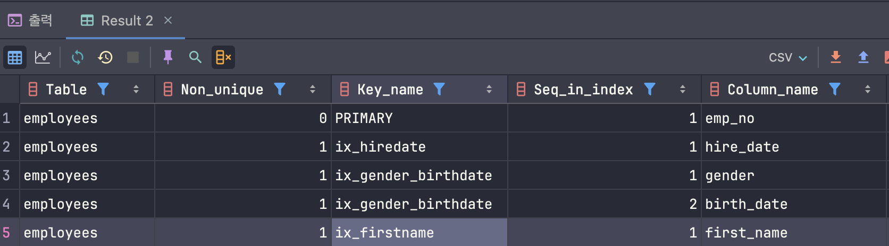

 

```sql
SELECT COUNT(*) FROM employees WHERE first_name='Georgi';
-> 253
```

```sql
SELECT COUNT(*) FROM employees
WHERE first_name='Georgi' AND last_name='Klassen';
-> 1
```

first_name=’Georgi’ 인 사원은 전체 253명이 존재하고 

first_name=’Georgi’, last_name=’Klassen’인 사원은 1명만 존재한다.

그럼 이제 first_name=’Georgi’, last_name=’Klassen’인 사원의 입사 일자를 오늘로 변경하는 쿼리를 실행해보자.

```sql
UPDATE employees SET hire_date=NOW()
WHERE first_name='Georgi' AND last_name='Klassen';
```

UPDATE 문장이 실행되면 1건의 레코드가 업데이트된다.

하지만 이 1건의 업데이트를 위해 몇 개의 레코드에 락을 걸어야 할까?

**해당 업데이트 조건에서 인덱스를 이용할 수 있는 조건은 first_name=’Georgi’이며, last_name 칼럼은 인덱스에 없기 때문에 first_name=’Georgi’인 레코드 253건의 레코드가 모두 잠긴다.**

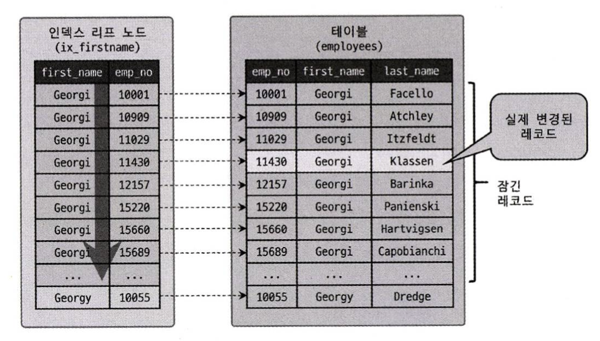

해당 그림은 UPDATE 문장이 어떻게 변경 대상 레코드를 검색하고, 실제 변경이 수행되는지를 보여준다.

이 예제에서는 몇 건 안 되는 레코드만 잠그지만 **UPDATE 문장을 위해 적절히 인덱스가 준비돼 있지 않다면** 

각 클라이언트 간의 동시성이 상당히 떨어져서 한 세션에서 UPDATE 작업을 하는 중에는 다른 클라이언트는 그 테이블을 업데이트하지 못하고 기다리는 상황이 발생할 것이다.

이 테이블에 인덱스가 하나도 없다면 어떻게 될까?

이러한 경우에는 테이블을 풀 스캔하면서 UPDATE 작업을 하는데, 이 과정에서 테이블에 있는 30여만 건의 모든 레코드를 잠그게 된다.

**이 방식이 MySQL 방식이며, InnoDB에서 인덱스 설계가 중요한 이유이다.**

```
[PK 기반 탐색]

PK 인덱스 (Clustered Index)
루트
 └── 브랜치
      └── 리프 → [실제 row 데이터]
      
---------------------------------------------------------------     
[인덱스 = 보조 인덱스 기반 탐색]    
   
Secondary Index
루트
 └── 브랜치
      └── 리프 → [인덱스 컬럼 값, PK]

→ 이 PK를 통해 Clustered Index(PK) B+Tree로 다시 접근

---------------------------------------------------------------
[FULL SCAN]

PK B+Tree
루트
 └── 브랜치
      └── 리프 → 리프 → 리프 → 리프 ... (순차적으로 모두 탐색)
```

예제에서 진행한 UPDATE는 Secondary Index 기반 잠금이니 Secondary Index 253개 리프 노드가 잠긴다.

---

# 5.3.3 레코드 수준의 잠금 확인 및 해제

MySQL 5.1부터 레코드 잠금과 잠금 대기에 대한 조회가 가능하다.

버전별로 레코드 잠금과 잠금을 대기하는 클라이언트의 정보를 확인하는 방법을 알아보자.

강제로 잠금을 해제하려면 KILL 명령을 이용해 MySQL 서버의 프로세스를 강제로 종료하면 된다.

다음과 같은 잠금 시나리오를 가정하자.

| **커넥션1** | **커넥션2** | **커넥션3** |
| --- | --- | --- |
| BEGIN; |  |  |
| UPDATE employees<br>SET birth_date=NOW()<br>WHERE emp_no=100001; |  |  |
|  | UPDATE employees<br>SET hire_date=NOW()<br>WHERE emp_no=100001; | <br> |
|  |  | UPDATE employees<br>SET hire_date=NOW(),<br>birth_date=NOW()<br>WHERE emp_no=100001; |

**MySQL 5.1 ~** 

information_schema 데이터베이스의 INNODB_TRX 테이블과 INNODB_LOCKS, INNODB_LOCK_WAITS 테이블을 통해 확인 가능하다.

**MySQL 8.0 ~** 

inofrmation_schema 정보들은 조금씩 Deprecated

peformace_schema 데이터베이스의 DATA_LOCKS, DATA_LOCK_WAITS 테이블 사용

**커넥션 1 ~ 3** → 터미널 Docker MySQL 컨테이너 접속 (트랜잭션 용도)

DataGrip → Docker MySQL 컨테이너 접속 (모니터링 용도)

```sql
SHOW PROCESSLIST;
```

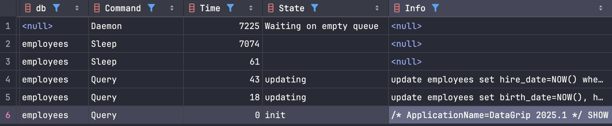

커넥션1 스레드(Time = 61)는 현재 아무것도 하지 않고 있지만 트랜잭션을 시작하고 UPDATE 명령이 실행 완료

커넥션1 스레드가 아직 COMMIT 명령을 실행하지 않았기 때문에 업데이트한 레코드의 잠금을 그대로 가지고 있는 상태이다.

커넥션2(Time = 43), 커넥션3(Time = 18) 스레드는 잠금 대기로 인해 아직 UPDATE 명령을 실행 중인 것으로 표시된다.

performance_schema  DATA_LOCKS, DATA_LOCK_WAITS 테이블 조인해서 잠금 대기 순서 살펴보기

```sql
SELECT 
   r.trx_id waiting_trx_id,
   r.trx_mysql_thread_id waiting_thread,
   r.trx_query waiting_query,
   b.trx_id blocking_trx_id,
   b.trx_mysql_thread_id blocking_thread,
   b.trx_query blocking_query
FROM performance_schema.data_lock_waits w
INNER JOIN information_schema.innodb_trx b
	ON b.trx_id = w.blocking_engine_transaction_id
INNER JOIN information_schema.innodb_trx r
  ON r.trx_id = w.requesting_engine_transaction_id;
```

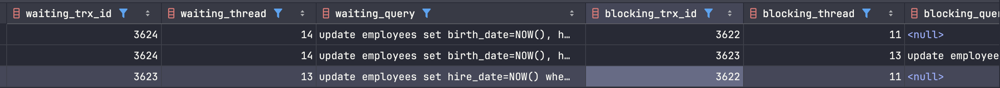

쿼리의 결과를 보면 현대 대기 중인 스레드는 14, 13이다. 

13번 스레드는 11번 스레드를 기다리고 14번 스레드는 11번, 13번 스레드를 기다린다.

이는 잠금 대기 큐의 내용을 그대로 보여주기 때문에 이렇게 표시되는 것이다.

11번 스레드의 잠금을 해제하고, 13번 스레드가 잠금 획득, 해제를 하면 14번 스레드가 잠금 획득이 가능하다.

11번 스레드가 어떤 잠금을 가지고 있는지 더 상세히 확인하고 싶으면 performance_schema DATA_LOCKS 테이블이 가진 컬럼을 모두 살펴보면 된다. 

---

트랜잭션의 격리 수준(isolation level)이란 여러 트랜잭션이 동시에 처리될 때 특정 트랜잭션이 다른 트랜잭션에서 변경하거나 조회하는 데이터를 볼 수 있게 허용할지 말지를 결정하는 것이다.

| **격리 수준** | **DIRTY READ** | **NON-REPEATABLE READ** | **PHANTOM READ** |
| --- | --- | --- | --- |
| **READ UNCOMMITTED** | 발생 | 발생 | 발생 |
| **READ COMMITTED** | 발생하지 않음 | 발생 | 발생 |
| **REPEATABLE READ** | 발생하지 않음 | 발생하지 않음 | 발생 (InnoDB는 X) |
| **SERIALIZABLE** | 발생하지 않음 | 발생하지 않음 | 발생하지 않음 |

4개의 격리 수준에서 순서대로 뒤로 갈수록 트랜잭션 간의 데이터 격리(고립) 정도가 높아지며, 동시 처리 성능도 떨어지는 것이 일반적이지만 SERIALIZABLE 격리 수준이 아니라면 크게 성능의 개선이나 저하는 발생하지 않는다.

---

# 5.4.1 READ UNCOMMITTED

READ UNCOMMITED 격리 수준에서는 트랜잭션에서의 변경 내용이 COMMIT, ROLLBACK 여부에 상관없이 디른 트랜잭션에서 보인다.

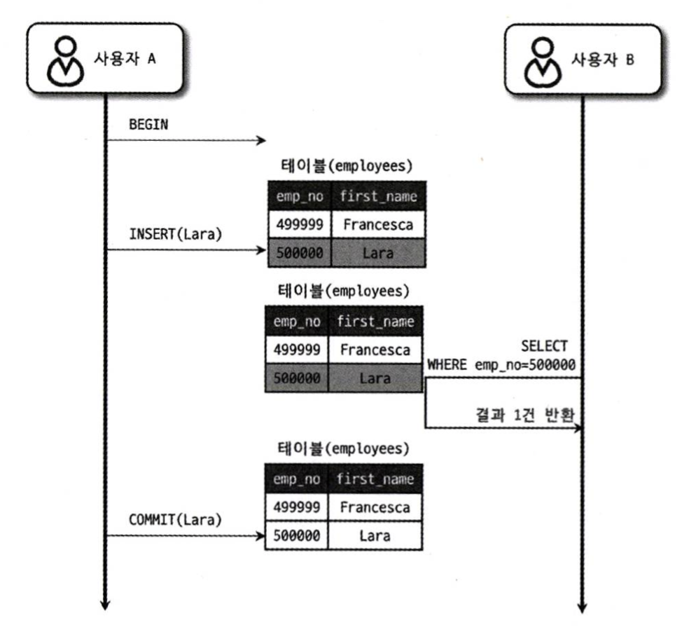

어떤 트랜잭션에서 처리한 작업이 완료되지 않았는데도 다른 트랜잭션에서 볼 수 있는 현상을 **더티 리드(Dirty Read)**라 하고, 더티 리드는 READ UNCOMMITED 격리 수준에서만 나타난다.

더티 리드 현상은 데이터가 나타났다가 사라졌다 하는 현상을 초래하여 애플리케이션 개발자와 사용자를 상당히 혼란스럽게 만든다.

이런 이유로 RDBMS 표준에서는 트랜잭션의 격리 수준으로 인정하지 않을 정도로 정합성에 문제가 많다.

---

# 5.4.2 READ COMMITED

READ COMMITED 레벨은 오라클 DBMS에서 기본으로 사용되는 격리 수준이며, 많은 온라인 서비스에서 가장 많이 선택되는 격리 수준이다.

READ COMMITED 레벨에서는 더티 리드 현상은 발생하지 않는다. 

어떤 트랜잭션에서 데이터를 변경했더라도 오직 COMMIT이 완료된 데이터만 조회가 가능하다.

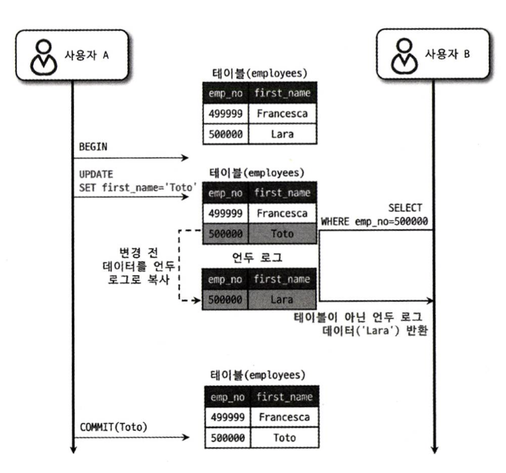

아직 사용자A가 커밋하지 않았기 때문에 사용자B는 언두 로그에 백업된 “Lara”를 조회한다.

즉, 언두 로그를 통해서 Dirty Read를 방지한다.

**InnoDB 아키텍처 복습**

```
1. 변경된 데이터는 버퍼 풀에 반영 (Dirty Page)
사용자 A가 데이터를 변경하면, 해당 페이지는 버퍼 풀(Buffer Pool) 내에서 
수정되고 더티 페이지(Dirty Page)가 된다.
즉시 디스크에 반영되지는 않으며, 플러시 대상이 되기 위해 플러시 리스트(Flush List)에 올라간다.

2. 이전 값은 Undo 로그에 기록
트랜잭션 롤백이나 Consistent Read를 위해 Undo 로그가 생성된다.
Undo는 로그 버퍼(Log Buffer)에 먼저 저장되고, 커밋과 상관없이 디스크로 플러시될 수 있다.
디스크에 있는 Undo는 모든 관련 트랜잭션이 끝나면 정리(Purge)된다.
만약 디스크 저장 전에 참조 중인 트랜잭션이 없다면, 디스크 저장 없이 버퍼에서 삭제될 수 있다.

3. 커밋 시점에 데이터 페이지는 디스크에 기록되지 않음
Redo 로그(Log Buffer)가 디스크로 fsync() 동기화되는 것이 커밋의 본질적 의미.
데이터 페이지는 이후 필요 시에 디스크로 플러시됨 (예: 체크포인트 발생, 버퍼 풀 압박 등).
이런 구조 덕분에 MySQL은 빠른 커밋이 가능하다.

4. Change Buffer (체인지 버퍼)
보조 인덱스 업데이트는 Change Buffer에 캐시 가능하다.
비유니크 보조 인덱스만 가능 (유니크 인덱스는 즉시 체크 필요 → Change Buffer 캐시 불가).
디스크 I/O를 줄이는 중요한 최적화 수단.
```

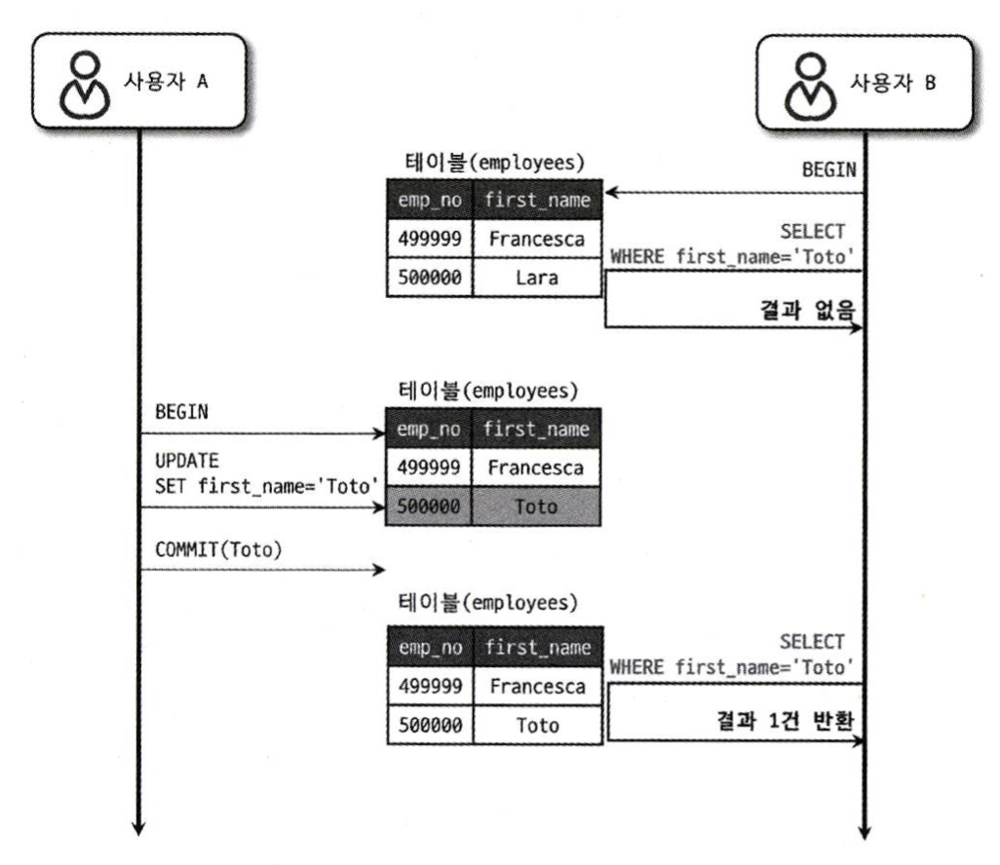

사용자B가 처음 조회 했을 때 일치하는 결과가 없었다.

사용자A가 이름을 “Toto”로 변경하고 커밋

사용자B가 같은 트랜잭션에서 똑같은 쿼리로 조회했더니 결과 반환

즉, 하나의 트랜잭션에서 **똑같은 SELECT 쿼리를 실행했을 때 항상 같은 결과를 가져와야 한다는 REPEATABLE READ 정합성에 어긋난다.**

## ✅ **Read Committed**

    - **원칙**: “커밋된 것만 읽는다.”
    - **동작 흐름**:
1. 레코드의 트랜잭션 ID(trx_id)를 보고 **커밋 여부 판단**
→ Redo 로그의 커밋 여부 + 트랜잭션 테이블에서 현재 트랜잭션 상태 확인
      1. **커밋된 트랜잭션이면** 레코드 값을 그대로 읽음
      1. **커밋되지 않았다면** → Undo 로그를 참조하여 **마지막으로 커밋된 버전**을 따라감
→ 즉, 읽기 시점의 최신 커밋된 값을 반환

## ✅ **Repeatable Read (InnoDB의 기본 격리 수준)**

    - **원칙**: “내 트랜잭션 동안 동일한 SELECT는 동일한 결과를 보장해야 한다.”
    - **동작 흐름**:
1. 트랜잭션 시작 시점에 **Consistent Read View (Read View)** 생성
→ 자신보다 **트랜잭션 ID가 이전**이고 **이미 커밋된 것만 보이도록** 설정
      1. 레코드의 트랜잭션 ID 확인
      1. **레코드의 trx_id가 나보다 이전이고**, 커밋된 트랜잭션이면 → 그대로 읽음
      1. 그렇지 않으면 → Undo 로그에서 **Read View에 부합하는 버전**을 찾을 때까지 따라감

---

## MVCC = Undo 로그 기반

InnoDB는 MVCC (Multi-Version Concurrency Control)를 지원하며, 이는 **Undo 로그를 통해 과거 버전의 데이터를 조회하는 방식**으로 동작한다. **언제 어떤 Undo 로그 버전을 보느냐**가 격리 수준에 따라 달라진다.

---

## **REPEATABLE READ (기본 InnoDB 레벨)**

### 원칙

    - 트랜잭션이 시작될 때 **Consistent Read View**를 생성
    - **본인보다 먼저 커밋된 트랜잭션**만 보인다. (트랜잭션 ID 기준)
    - 그 이후에 커밋된 트랜잭션은 **무시**.
    - 같은 SELECT는 같은 결과를 보장 (즉, repeatable)

### 내부 동작

    - InnoDB는 **현재 레코드가 본인보다 새로운 트랜잭션에 의해 커밋된 것인지 확인**하고,
    - 그렇다면 **Undo 로그를 따라가서 과거 버전**을 조회한다.

### 사용되는 것

    - **Undo 로그**: 과거 버전 보존
    - **Read View**: 트랜잭션 ID 범위 기반 필터링
    - **버퍼 풀**: 최신 데이터가 있을 수 있지만 무시됨 (Undo 기반 조회)

---

## **READ COMMITTED**

### 원칙

    - **쿼리 실행 시점에 커밋된 데이터만 조회**함 (트랜잭션 시작 시점 아님!)
    - 동일 트랜잭션 내에서 똑같은 SELECT를 반복해도 **결과가 달라질 수 있음**
    - 즉, repeatable read 정합성은 **보장되지 않음**

### 내부 동작

    - InnoDB는 쿼리 실행 시점에
- **현재 레코드가 “커밋된 상태”인지 확인**하고,
      - 커밋되었으면 **그 값을 반환**
      - 커밋되지 않았다면 Undo 로그를 따라가며 **직전 커밋된 버전**을 찾아냄

### 사용되는 것

    - **Undo 로그**: 여전히 사용됨! (이게 중요한 포인트)
    - 하지만 **트랜잭션 ID와 Read View는 고려하지 않음**
    - 버퍼 풀의 더티 페이지일지라도, **Undo 로그를 통해 커밋된 버전인지 판단**

---

## 헷갈리기 쉬운 포인트

| 구분 | REPEATABLE READ | READ COMMITTED |
| --- | --- | --- |
| **조회 기준** | 트랜잭션 시작 시점 | 쿼리 실행 시점 |
| **Read View 사용** | ✅ 사용 (트랜잭션 ID 필터링) | ❌ 사용하지 않음 |
| **Undo 로그 사용** | ✅ 사용 | ✅ 사용 |
| **버퍼 풀에서 직접 읽나?** | 아니오 (항상 Undo 체크) | 상황에 따라 가능 (변경된 값이 커밋되었으면 읽음) |
| **변경 커밋 후 재조회 결과** | 이전 값 유지 | 최신 커밋 값 반환 |

---

---

# 5.4.3 REPETABLE READ

REPEATABLE READ는 MySQL의 InnoDB 스토리지 엔진에서 기본으로 사용되는 격리 수준이다.

바이너리 로그를 가진 MySQL 서버에서는 최소 REPEATABLE READ 격리 수준 이상을 사용해야 한다.

이 격리 수준에서는 READ COMMITED 레벨에서 발생하는 NON-REPEATABLE READ 부정합이 발생하지 않는다. 

**두 격리 수준 모두 MVCC(언두 공간에 백업 & 실제 레코드 변경)을 하는데 왜 REPEATABLE READ 수준은 NON-REPEATABLE READ 부정합이 발생하지 않을까?**

모든 InnoDB 트랜잭션은 고유한 트랜잭션 번호(순차적으로 증가하는 값)을 가지며, 언두 영역에 백업된 모든 레코드에는 변경을 발생시킨 트랜잭션의 번호가 포함돼 있다.

언두 영역의 백업된 데이터는 InnoDB 스토리지 엔진이 불필요하다고 판단하는 시점(다른 트랜잭션에서 더이상 참조 X)에 주기적으로 삭제한다.

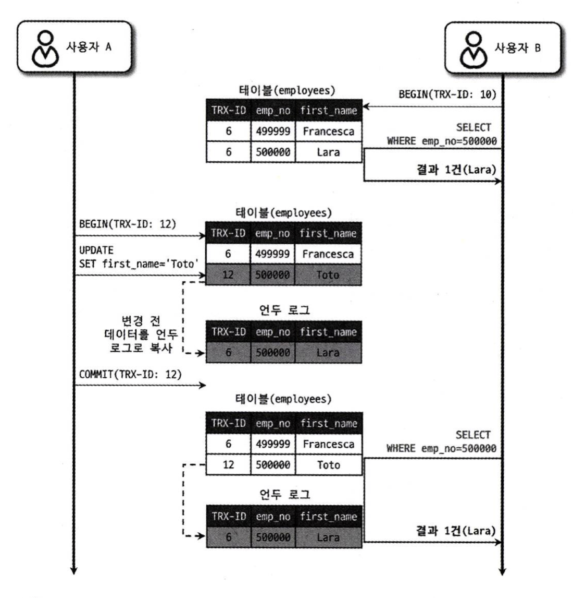

**해당 그림은 REPEATABLE READ 격리 수준의 동작 방식을 보여준다.**

초기 employees 테이블은 트랜잭션(TRX_ID 6)에 의해 INSERT

사용자B 트랜잭션(TRX-ID 10)을 시작하고 emp_no=500000 레코드를 읽는다. “Lara” 

사용자A 트랜잭션(TRX-ID 12)을 시작하고 emp_no=500000 레코드를 변경한다. “Toto”

이때 변경 전 데이터를 언두 로그로 복사한다.

복사한 데이터는 TRX-ID: 6 emp_no: 500000 first_name: “Lara”

사용자A 커밋

사용자B emo_no=500000 레코드 조회

이때 테이블의 커밋된 TRX_ID는 12 (참고로 커밋 여부도 판단도 가능하다)

**커밋된 TRX_ID 12 > 사용자B TRX_ID 10 ReadView 포함 X**

언두 로그중에 TRX_ID < 사용자B TRX_ID 10 레코드를 찾는다. “Lara”

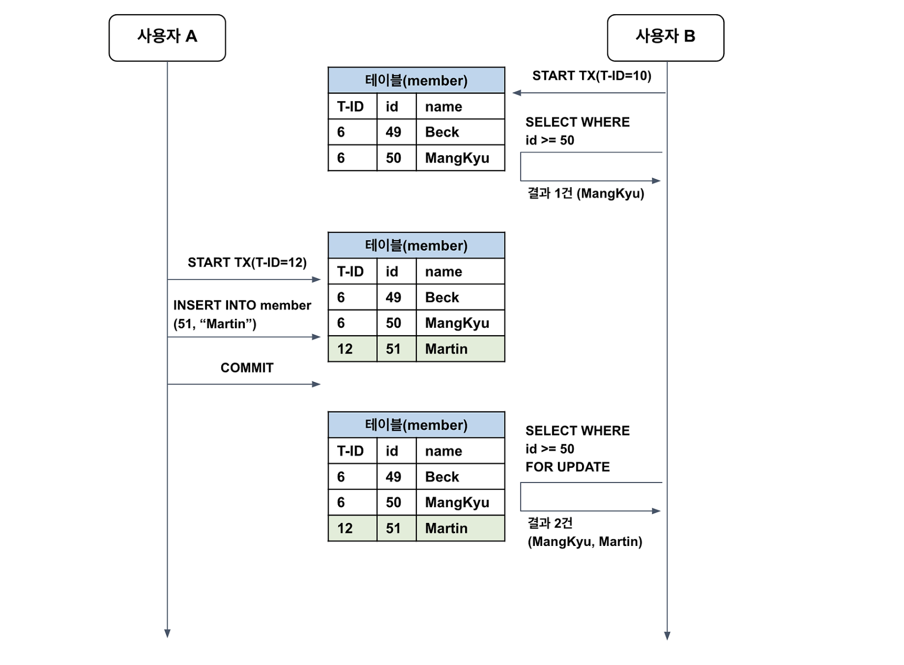

**해당 그림은 REPEATABLE READ 격리 수준에서의 부정합을 보여준다.**

사용자B는 SELECT로 잠금 없는 읽기를 하였다. 결과: MangKyu(1건)

사용자A는 트랜잭션을 시작(TRX_ID 12), INSERT Martin

사용자A 커밋

사용자B는 SLECT … FOR UPDATE를 통해 쓰기 잠금 & 조회를 하였다. (이때 넥스크 키 락 사용)

쓰기 잠금을 걸고 조회는 락을 걸고 조회하기 때문에 테이블에서 바로 읽는다.

즉, MVCC 기능을 사용하지 않는다. 

결과는 (MangKyu, Martin)으로 2건이다.

즉, PHANTOM READ가 발생하였다.

**즉, 읽기 잠금, 쓰기 잠금 모두 MVCC를 우회해서 동작하여 테이블을 바로 읽고 팬텀 리드가 발생할 수 있다.**

하지만 이런 트랜잭션은 개발자 잘못이다. 

---

# 5.4.4 SERIALIZABLE

가장 단순하고 동시에 가장 엄격한 격리 수준이다. 그만큼 동시 처리 성능도 다른 트랜잭션의 격리 수준보다 떨어진다. InnoDB 테이블에서 기본적으로 순수한 SELECT 작업은 아무런 레코드 잠금도 설정하지 않고 실행된다.

Non-locking consistent read(잠금이 필요 없는 일관된 읽기)라는 말이 이를 의미한다.

하지만 SERIAILIZABLE 레벨에서는 순수한 읽기 작업도 공유 잠금(읽기 잠금)을 획득하고, 동시에 다른 트랜잭션은 그러한 레코드를 변경하지 못한다.

즉, SERIAILIZABLE 레벨에서는 PHANTOM READ 문제가 발생하지 않는다.

하지만 InnoDB 스토리지 엔진에서는 갭 락과 넥스트 키락 덕분에 REPETABLE READ 수준에서도 PHANTOM READ가 발생하지 않기 때문에 굳이 SERIAILIZABLE을 사용할 필요성은 없어 보인다.

---

# 추천 자료 

[https://mangkyu.tistory.com/299](https://mangkyu.tistory.com/299)

---

[https://dev.mysql.com/doc/refman/8.4/en/innodb-locking.html#innodb-gap-locks](https://dev.mysql.com/doc/refman/8.4/en/innodb-locking.html#innodb-gap-locks)

[https://medium.com/daangn/mysql-gap-lock-%EB%91%90%EB%B2%88%EC%A7%B8-%EC%9D%B4%EC%95%BC%EA%B8%B0-49727c005084](https://medium.com/daangn/mysql-gap-lock-%EB%91%90%EB%B2%88%EC%A7%B8-%EC%9D%B4%EC%95%BC%EA%B8%B0-49727c005084)

