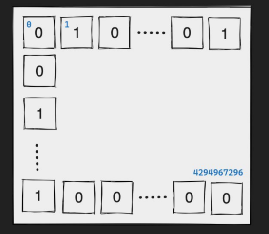
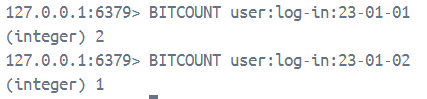

# ***Redis Bitmaps?*** 

- *실제 데이터 타입은 아니고, String에 binary operation을 적용한 것*
- *최대 42억개 binary 데이터 표현 = 2^32(4,294,967,296)*



# ***Redis Bitmaps 명령어***

***SETBIT***

```shell
 SETBIT key offset value
 
 SETBIT user:log-in:23-01-01 123 1
 SETBIT user:log-in:23-01-01 456 1
 SETBIT user:log-in:23-01-02 123 1
```

- *특정 키에 저장된 문자열 값을 비트 단위로 조작하는 명령어*
- *문자열의 특정 위치에 있는 비트를 설정(0 또는 1로)할 수 있다.*
- ***key****: 조작할 문자열이 저장된 키. 키가 없으면 Redis가 새 문자열을 생성*
- ***offset****: 문자열 내에서 조작할 비트의 위치(0부터 시작하는 인덱스)*
- ***value****: 설정할 비트 값(0 또는 1)*


***GETBIT***

```shell
GETBIT user:log-in:23-01-01 123
```

- *특정 위치의 비트 값을 확인*
- *return 1이면 23년 01월 01일에 123번 user가 로그인을 했다는 의미*
- *GETBIT user:log-in:23-01-01 → 23년 01월 01일에 로그인한 전체 사용자* 

***BITCOUNT***

```shell
BITCOUNT user:log-in:23-01-01
```

- *저장된 문자열 값에서 1로 설정된 비트의 개수를 계산하는 데 사용*



- *23년 01월 01일은 로그인 사용자 2명*
- *23년 01월 02일은 로그인 사용자 1명*

***BITOP AND***

```shell
BITOP AND result user:log-in:23-01-01 user:log-in:23-01-02
```

- *지정된 키들 간의 비트 AND 연산을 수행하고, 결과를 새로운 키에 저장*
- *결과를 result에 저장한다.*
- *23년 01월 01일 로그인 사용자와 23년 01월 02일 로그인 사용자의 교집합을 구한다.*

***BITOP AND - 동작 설명***

```shell
user:log-in:23-01-01: 사용자 123과 456이 로그인 (123=1, 456=1)
user:log-in:23-01-02: 사용자 123만 로그인 (123=1, 456=0)

AND 연산 
123: 1 AND 1 = 1
456: 1 AND 0 = 0

result:
123 = 1
456 = 0

GETBIT result 123  # 1
GETBIT result 456  # 0
```

- *여러 조건을 결합하여 특정 상태를 가진 사용자 필터링*

