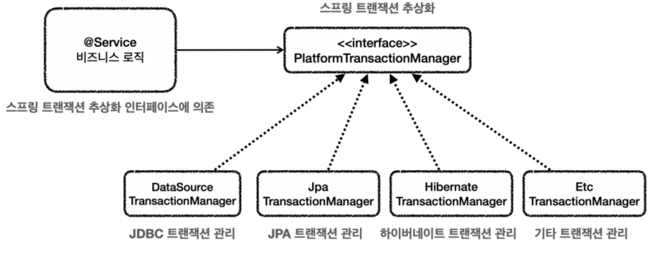
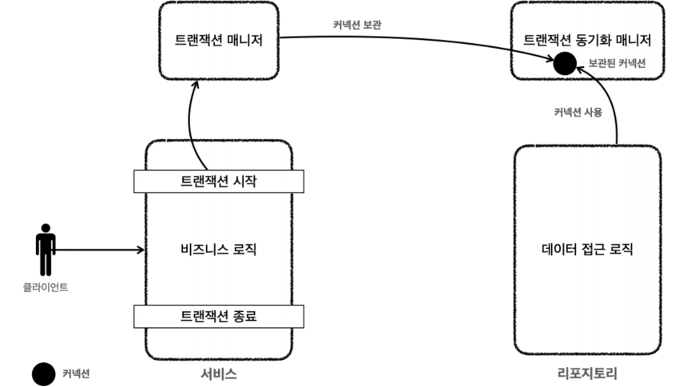
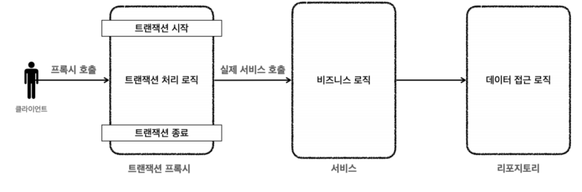
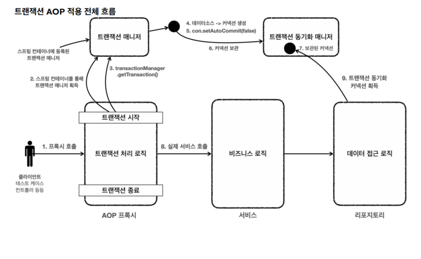

# ***문제점들***

*애플리케이션을 layer 관점으로 봤을 때 가장 중요한 계층은 어디일까?*

*바로 핵심 비즈니스 로직이 들어있는 서비스 계층이다.*

*UI(웹) 프레젠테이션 계층 관련된 부분이 변경되고 데이터 접근 계층이 다른 기술로 변경해도* 

*비즈니스 로직은 최대한 변경없이 다른 계층에 종속적이지 않게 유지되어야 한다.*

*서비스 계층이 특정 기술에 종속되지 않으면 비즈니스 로직을 유지보수 하기도 쉽고, 단위 테스트 하기도 쉽다.*

***MemberServiceV1, MemberServiceV2의 문제점 정리***

- *트랜잭션을 사용하기 위해서 SQLException, DataSource, Connection 같은 JDBC 기술에 의존*
- *비즈니스 로직보다 JDBC를 사용해서 트랜잭션을 처리하는 코드가 더 많다.*
- *향후 JDBC에서 JPA 같은 기술로 바꾸어 사용하게 되면 서비스 코드를 모두 변경해야 한다.*
- *정리하면 핵심 비즈니스 로직과 JDBC 기술이 섞여 있어서 유지보수 하기 어렵다.*

# ***트랜잭션 추상화***

***트랜잭션 구현 기술에 따른 트랜잭션 사용법이 다르다***

- *JDBC : con.setAutoCommit(false)*
- *JPA : transaction.begin()*

***트랜잭션 기능을 추상화*** 

```java
public interface TxManager {
		 begin();
		 commit();
		 rollback();
}
```

- *트랜잭션은 단순하다. 트랜잭션을 시작하고, 비즈니스 로직의 수행이 끝나면 커밋하거나 롤백하면 된다.*
- *TxManager 인터페이스를 기반으로 각각의 기술에 맞는 구현체를 만들면 된다.*
- *JdbcTxManager : JDBC 트랜잭션 기능을 제공하는 구현체*
  - *JpaTxManager : JPA 트랜잭션 기능을 제공하는 구현체*

# ***스프링의 트랜잭션 추상화***

*우리가 직접 트랜잭션 추상화를 위해 개발할 필요 없이 스프링은 이미 다 구현해두었다.* 

*우리는 스프링이 제공하는 트랜잭션 추상화 기술을 사용하면 된다.*

*각 데이터 접근 기술에 따른 트랜잭션 구현체도 대부분 만들어두었다.*



- *org.springframework.transaction.PlatformTransactionManager*

***PlatformTransactionManager 인터페이스***

```java
public interface PlatformTransactionManager extends TransactionManager {
		
		TransactionStatus getTransaction(@Nullable TransactionDefinition definition) throws TransactionException;
		
		void commit(TransactionStatus status) throws TransactionException;
		
		void rollback(TransactionStatus status) throws TransactionException;
}
```

- *getTransaction()*
- *트랜잭션 시작 또는 참여*
- *commit(), rollback()*
- *트랜잭션 커밋, 롤백*

# ***트랜잭션 동기화***

***스프링이 제공하는 트랜잭션 매니저의 역할*** 

- *트랜잭션 추상화*
- *리소스 동기화* 

***리소스 동기화***

- *트랜잭션을 유지하려면 트랜잭션의 시작부터 끝까지 같은 데이터베이스 커넥션을 유지해야한다.*
- *결국 같은 커넥션을 사용하기 위해서 이전에는 파라미터로 커넥션을 전달하는 방법을 사용했다.* 
- *파라미터로 커넥션을 전달하는 방법은 코드가 지저분해지고, 커넥션을 넘기는 메소드와 넘기지 않는 메소드를 중복해서 만들어야 하는 등 단점이 많았다.*

***트랜잭션 매니저와 트랜잭션 동기화 매니저***



- *스프링은 트랜잭션 동기화 매니저를 제공한다.*
- *쓰레드 로컬(Thread Local)을 사용해서 커넥션을 동기화해준다.*
- *트랜잭션 동기화 매니저는 쓰레드 로컬을 사용하기 때문에 멀티쓰레드 환경에서도 안전하게 커넥션을 동기화 할 수 있다.* 
  - *따라서 커넥션이 필요하면 트랜잭션 동기화 매니저를 통해서 커넥션을 획득하면 된다.*
- *트랜잭션 매니저는 내부에서 이 트랜잭션 동기화 매니저를 사용한다.*
- *org.springframework.transaction.support.TransactionSynchronizationManager*

***트랜잭션 메니저 동작 흐름 정리***

- *클라이언트 요청 → 서비스 계층 로직 실행* 
- *트랜잭션 매니저 getTransaction()을 통해서 트랜잭션 시작*
- *트랜잭션 매니저는 내부에서  DataSource를 활용해서 커넥션을 생성*
- *커넥션의 세션을 수동 커밋 모드로 변경해서 실제 데이터베이스 트랜잭션을 시작* 
- *획득한 커넥션을 트랜잭션 동기화 매니저(스레드 로컬)에 보관* 
- *서비스는 비즈니스 로직을 실행하면서 리포지토리의 메소드를 호출*
- *리포지토리에서 커넥션이 필요하면 스레드 로컬에서 꺼내서 사용 → 트랜잭션 유지*
- *예외가 터지면 트랜잭션 매니저는 롤백하고 예외가 없었다면 커밋* 
- *DataSource의 커넥션 획득 방식에 따라 커넥션을 커넥션 풀에 반납 또는 소멸* 

# ***트랜잭션 문제 해결 - 트랜잭션 템플릿***

*트랜잭션을 사용하는 로직을 살펴보면 다음과 같은 패턴이 반복되는 것을 확인할 수 있다.*

***트랜잭션 사용 반복 코드*** 

```java
TransactionStatus status = transactionManager.getTransaction(new DefaultTransactionDefinition());
try {
		 bizLogic(fromId, toId, money);
		 transactionManager.commit(status); 
} 
catch (Exception e) {
		 transactionManager.rollback(status);
     throw new IllegalStateException(e);
}
```

- *트랜잭션을 시작하고, 비즈니스 로직을 실행하고, 성공하면 커밋하고, 예외가 발생해서 실패하면 롤백*
- *이런 형태는 각각의 서비스에서 반복된다. 달라지는 부분은 비즈니스 로직 뿐*
- *이럴 때 템플릿 콜백 패턴을 활용하면 이런 반복 문제를 깔끔하게 해결할 수 있다*
- *템플릿 콜백 패턴: JdbcTemplate, RestTemplate,* ***TransactionTemplate****, Redis Template 등등..*

***TransactionTemplate***

```java
public class TransactionTemplate {
		 private PlatformTransactionManager transactionManager;
		 
		 public <T> T execute(TransactionCallback<T> action){..}
		 
		 void executeWithoutResult(Consumer<TransactionStatus> action){..}
}
```

***트랜잭션 템플릿 사용 로직***

```java
public void accountTransfer(String fromId, String toId, int money) throws SQLException{
    txTemplate.executeWithoutResult((status) -> {
        try {
            bizLogic(fromId, toId, money);
        }
        catch (SQLException e){
            throw new IllegalStateException(e);
        }
    });
}
```

- *executeWithoutResult(Consumer<TransactionStatus> action)*
- *TransactionCallback<TransactionStatus> action → Consumer 동작 정의* 
- *TransactionTemplate execute(TransactionCallback<TransactionStatus> action)을 매개변수로 준다.*
- *action → Consumer action 동작*

*템플릿 콜백 패턴은 GoF 디자인 패턴의 정식 패턴은 아니다.* 

*전략 패턴의 확장 버전이다.*

***정리***

- *트랜잭션 템플릿 덕분에, 트랜잭션을 사용할 때 반복하는 코드를 제거할 수 있었다*
- *하지만 이곳은 서비스 로직인데 비즈니스 로직 뿐만 아니라 트랜잭션을 처리하는 기술 로직이 함께 포함되어 있다.*
- *즉, 부가 기능인 트랜잭션 처리기능과 핵심 기능인 비즈니스 로직이 하나의 클래스에서 처리하게 된다.*

*→ Spring AOP (Dynamic Proxy) 통해서 해결하자*

# ***트랜잭션 문제 해결 - 트랜잭션 AOP*** 



- *프록시를 사용하면 트랜잭션을 처리하는 객체와 비즈니스 로직을 처리하는 서비스 객체를 명확하게 분리할 수 있다*

### ***스프링이 제공하는 트랜잭션 AOP***

- *스프링은 트랜잭션 AOP를 처리하기 위한 모든 기능을 제공한다.*
- *스프링 부트를 사용하면 트랜잭션 AOP를 처리하기 위해 필요한 스프링 빈들도 자동으로 등록해준다.*
- *Advisor: BeanFactoryTransactionAttributeSourceAdvisor*
  - *Pointcut: TransactionAttributeSourcePointcut*
  - *Advice: TransactionInterceptor*
- *개발자는 트랜잭션 처리가 필요한 곳에 @Transactional 애노테이션만 붙여주면 된다.*



# *스프링 부트의 자동 리소스 등록* 

*DataSource, TransactionManager를 자동 등록*

***데이터소스 - 자동 등록***

- *스프링 부트는 DataSource를 스프링 빈에 자동으로 등록*
- *개발자가 직접 데이터소스를 빈으로 등록하면 스프링 부트는 데이터소스를 자동으로 등록하지 않는다.*

```java
spring.datasource.url=jdbc:h2:tcp://localhost/~/test
spring.datasource.username=sa
spring.datasource.password=
[REDACTED]

- *스프링 부트가 기본으로 생성하는 데이터소스는 커넥션풀을 제공하는 HikariDataSource이다. 
커넥션풀과 관련된 설정도 application.properties를 통해서 지정할 수 있다*
- *spring.datasource.url 속성이 없으면 내장 데이터베이스(메모리 DB)를 생성하려고 시도한다.*

***트랜잭션 매니저 - 자동 등록***

- *개발자가 직접 트랜잭션 매니저를 빈으로 등록하면 스프링 부트는 트랜잭션 매니저를 자동으로 등록하지 않는다.*
- *어떤 트랜잭션 매니저를 선택할지는 현재 등록된 라이브러리를 보고 판단하는데, JDBC를 기술을 사용하면 DataSourceTransactionManager를 빈으로 등록하고, JPA를 사용하면 JpaTransactionManager를 빈으로 등록한다. 둘다 사용하는 경우 JpaTransactionManager 를 등록한다. 
JpaTransactionManager는 DataSourceTransactionManager가 제공하는 기능도 대부분 지원한다.*

