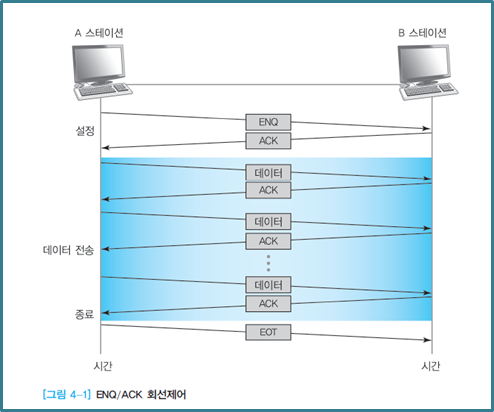
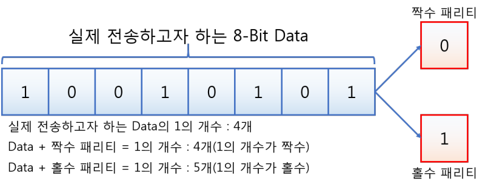
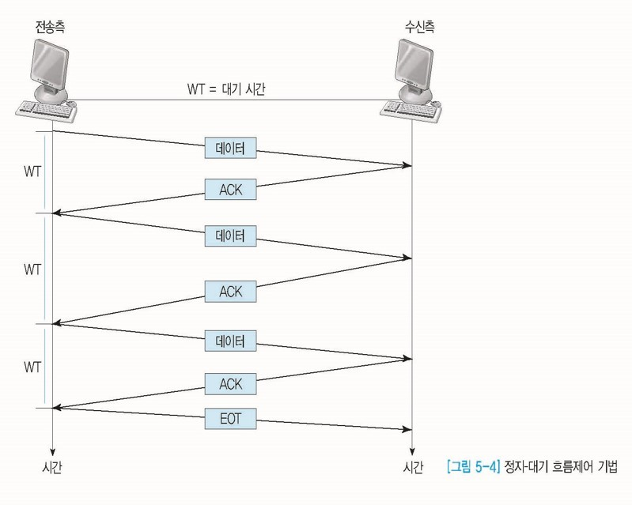
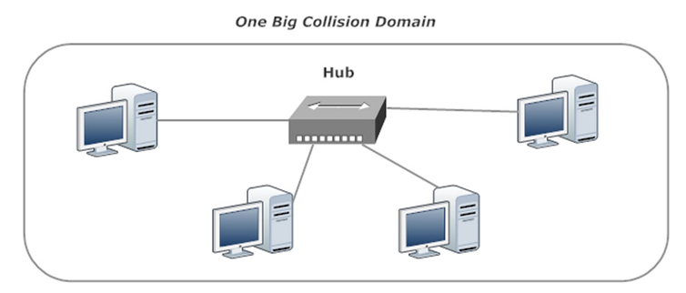
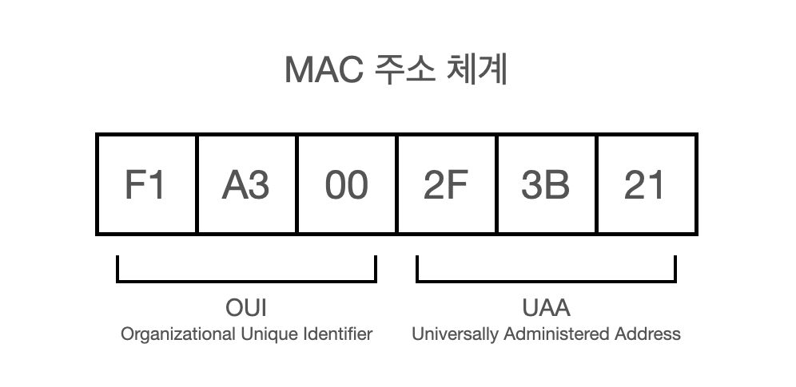
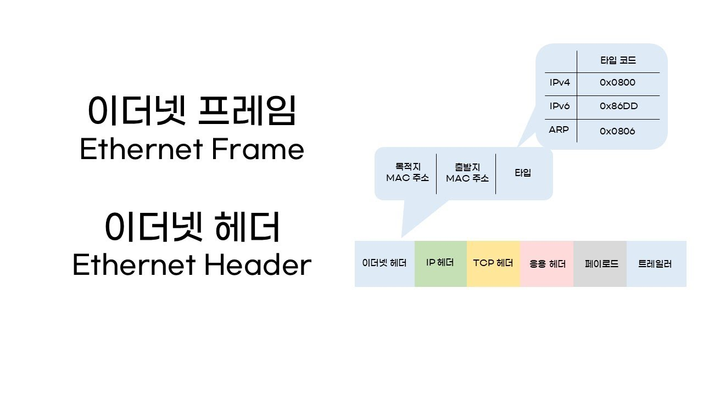
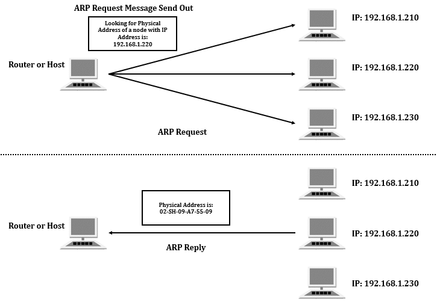
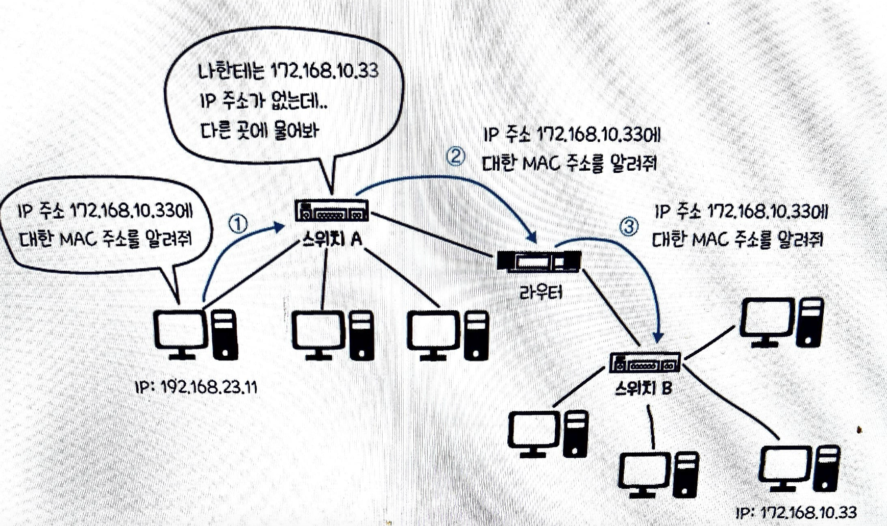
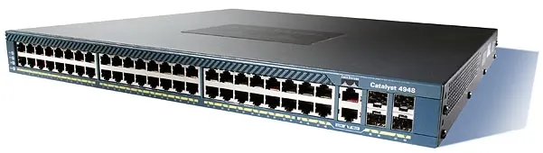
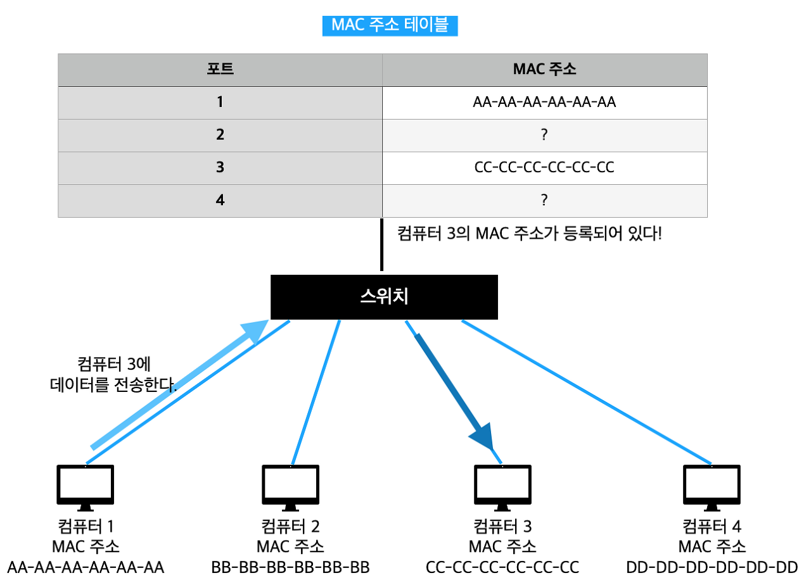

## 개요 

데이터 링크 계층은 데이터 전송의 신뢰성과 효율성을 담당한다.

MAC 주소가 통신에 어떻게 활용되는지에 대해 알아본다.

**키워드**

- 데이터 링크 계층
- 이더넷
- MAC 주소
- 스위치
- 통신 방식

**목표** 

- 데이터 링크 계층 역할 이해 
- 이더넷 특징 이해
- MAC 주소 이해
- 스위치 이해 
- 전송 방향에 따른 통신 방식 이해

---

## 내용 정리

### 개요 

데이터 링크 계층은 네트워크에서 데이터를 관리하고 전달하는 계층으로, 데이터 전송의 신뢰성과 효율성에 중요한 역할을 한다.

데이터 링크 계층은 데이터를 작은 프레임 단위로 분할하고, MAC 주소를 활용하여 장비를 식별한다.

네트워크에서 여러 기기가 동시에 데이터를 전송하려고 하면 신호 출동이 발생한다. 이 상황에서 데이터를 동시에 전송하면 여러 데이터가 충돌하게 되어 제대로 전달되지 않는다.

데이터 링크 계층은 이런 오류를 탐지하고 수정하는 역할을 하며, 데이터의 원활한 흐름과 네트워크 매체에서 충돌 관리도 수행한다.

**데이터 링크 계층에서 오류를 감지하거나 수정하는 방식으로는 회선 제어, 오류 제어, 흐름 제어가 있다.**

---

### 회선 제어(Line Control)

**회선 제어는 오류를 감지하기보다는 회피하는 방법으로 신호 간 충돌 현상이 발생하지 않도록 제어한다.**

**신호의 시작을 의미하는 ENQ(Enquiry)와 끝을 의미하는 EOT(End of Transmisson)를 명시적으로 지정**한다. **수신자는 송신자로부터 신호를 받으면 받았다는 의미의 ACK(Acknowledgment)를 송신자에게 보내서 신호를 정상적으로 수신하였음을 알린다.** 이러면 신호 간 충돌을 피할 수 있다.



---

### 오류 제어(Error Control)

**오류 제어는 송수신 데이터가 외부 간섭, 시간 지연 등에 의해 데이터가 변형되거나 순서가 어긋나는 듯의 통신 장애가 발생하지 않도록 오류를 검출하고 정정하여 통신에 대한 신뢰성을 확보하는 방법이다.**

오류 검사로 사용되는 것 중에 패리티 검사가 있다.

**패리티 검사(parity check)**는 수신자에게 보내는 최종 데이터의 1의 개수를 짝수 개로 보낼지(even parity), 홀수 개로 보낼지(odd parity) 송수신자가 미리 약속하고 여부의 비트(패리티 비트)를 채워 보내는 방법이다. 



전송 데이터: 10010101

  - 짝수 패리티: 100101010
  - 홀수 패리티: 100101011

**패리티 검사 장점, 단점** 

  - 구현이 매우 간단하고, 하드웨어/소프트웨어 모두 쉽게 적용 가능
  - 오버헤드가 적다(1개의 비트만 추가)
  - 다중 비트 오류(2개 이상 비트가 동시에 바뀌는 경우)는 검출이 불가능할 수 있음
  - 오류의 위치를 알 수 없고, 오류 정정은 불가능함

오류 제어에는 패리티 검사 외에도 **CRC(Cyclic Redundancy Check), 검사합(Checksum)** 방식도 있다.

**CRC 방식**은 데이터에 CRC 코드를 추가하여 오류를 감지하는 방법으로, 송신자가 CRC 코드를 생성하고 수신자 측에서도 동일한 계산을 수행하여 일치 여부를 확인한다. 

**체크섬 방식**은 데이터의 각 바이트 값을 더하거나 연산하여 생성되는 값이다.

송신자가 데이터와 관련된 검사합을 계산하고 순사자 측에서도 동일한 계산을 수행하여 체크섬 값이 일치하는지 확인한다. 또한 오류가 발생한 경우 이를 정정하는 방법으로 **해밍 코드(Hamming code)**를 사용한다.

해밍 코드는 데이터에 추가적인 패리티 비트를 포함시켜, 이 패리티 비트들을 데이터 비트와 조합하여 구성한다.

패리티 비트를 분석하여 오류가 발생한 비트를 식별하고, 해당 비트의 값을 수정함으로써 오류를 정정한다.

---

### 흐름 제어(Flow Control)

흐름 제어는 송신자와 수신자의 데이터 처리 속도 차이를 해결하기 위해 수신자 상황에 따라 송신자의 데이터 전송량을 조정하는 방법이다. 

흐름 제어로 사용되는 방법 중 하나가 정지-대기(Stop & Wait)이다. 

송신자가 하나의 데이터를 전송한 후 다음 데이터를 전달하기 전에 응답을 기다리는 방법이다.



---

### 참고 

오류 제어와 흐름제어는 전송 계층에서도 사용된다.

---

**이더넷(Ethernet)이란 다수의 컴퓨터, 허브, 스위치 등을 하나의 인터넷 케이블에 연결한 구조**이다.

이더넷은 **CSMA/CD(Carrier Sense Multiple Access/Collision Detection) 프로토콜**을 사용한다.



제일 왼쪽부터 제일 오른쪽까지의 컴퓨터의 이름을 각각 A, B, C, D라고 가정하자

각 컴퓨터들은 모두 허브에 묶여있다.

컴퓨터 A가 컴퓨터 B에게 network.dock 파일을 보내려고 한다.

동시에 컴퓨터 C는 컴퓨터 B에게 secutity.dock 파일을 보내려고 한다.

즉, 컴퓨터 B는 동시에 A와 B에게 데이터를 받아야 한다.

이처럼 **2대 이상의 컴퓨터가 동시에 데이터(프레임)를 보내는 상황을 충돌(collision)**이라고 한다.

이러한 **충돌을 방지하기 위해 이더넷에서는 전류의 강도를 확인해 케이블이 사용 중인지 확인하는 CSMA/CD 방식을 사용**한다. 송신 전에 케이블이 사용 가능한지 **확인하고(Carrier Sense)**, 사용 가능하면 데이터를 **전송(Multiple Access)**한다. 또한 전송 후에도 여전히 발생할 수 있는 **충돌을 확인(Collision Detection)**하는 것이 CSMA/CD 방식이다. 한마디로 각각의 컴퓨터는 데이터를 보내기 위해 눈치 게임을 하고 있는 것이다.

**CSMA/CD 케이블 사용 가능 확인 방식 3가지**

  - **1-persistent** 
- 케이블이 사용 중인지 상태를 계속 확인하다가 아무도 사용하지 않는 상태이면 바로 데이터 전송
    - 하지만 동시에 다른 컴퓨터에서도 보낼 가능성이 높기 때문에 충돌 위험성이 가장 높다.
  - **nonpersistent**
- 누구도 케이블을 사용하고 있지 않다면 데이터를 바로 보내고 그렇지 않다면 임의의 시간을 기다렸다가 상태를 다시 확인한다. 
    - 1-persistent 보다 충돌 위험이 낮다.
  - **p-persistent**
- 케이블이 사용 중이면 기다렸다가 다시 상태를 확인하고 아무도 사용하고 있지 않다면 일정 확률로 데이터를 전송

**현대의 CSMA/CD** 

현재는 잘 사용하지 않는 기술이다. 2계층에 해당하는 스위치 장비가 허브 역할을 대신하고 있기 때문이다.

**MAC(Media Access Control) 주소는 랜 카드에 할당된 값**이며, **전 세계에서 하나밖에 존재하지 않는 고유한 값이다. MAC 주소는 48비트로 표현**된다. **상위 24비트는 OUI(Organizational Unique Identifier), 랜 카드 제조사에 부여된 코드**이며 **나머지 24비트는 UAA(Universally Administered Address)라고 하여 제조사가 랜 카드에 부여한 고유 번호**이다.



MAC 주소는 8비트 단위로 콜론(:) 또는 하이픈(-)을 사용해 16진수로 표기한다.

→ F1:A3:00:2F:3B:21

**컴퓨터가 데이터를 보낼 때 OSI 7 계층의 2계층에서는 어떤 일들이 발생할까?**

MAC 주소를 헤더에 넣어서 프레임을 생성한다.

헤더에는 송신자의 MAC 주소, 수신자의 MAC 주소가 함께 프레임에 추가된다.

또한 유형이라는 정보도 추가되는데 이것은 프로토콜을 나타낸다. 

프로토콜 종류에는 IPv4, ARP, IPv6 등이 존재한다.

**IPv4**는 현재 우리가 사용하는 32비트의 일반적인 IP 주소를 의미하며, **IPv6**는 IPv4의 주소 부족 문제를 해결하기 위해 등장한 128비트의 IP 주소이다. **ARP**는 IP 주소와 MAC 주소를 매핑해주는 프로토콜이다.



**Q: 내(출발지) MAC 주소는 알고 있는 정보라 해도, 상대방(목적지)의 MAC 주소는 어떻게 알 수 있을까?**

**A: ARP**

ARP 프로토콜은 IP 주소에 해당하는 MAC 주소를 알고자 할 때 사용한다.

**즉, ARP(Address Resolution Protocol)는 IP 주소와 MAC 주소를 매핑하기 위한 프로토콜**이다.

**ARP 예제** 

컴퓨터 A(IP 주소: 192.168.0.2)가 컴퓨터 B(IP 주소: 192.168.0.3)에게 데이터를 전송하려고 한다.

  1. 컴퓨터 A는 같은 허브에 묶여 있는 모든 컴퓨터에게 192.168.0.3이라는 IP 주소의 MAC 주소를 묻는다.
이렇게 **모든 컴퓨터에게 질의하는 것을 브로드캐스트(Broadcast)**라고 하며, **MAC 주소를 묻는 것을 ARP 요청(ARP Request)**이라고 한다.
  1. 모든 컴퓨터는 자신의 IP를 192.168.0.3과 비교한다. IP 주소가 192.168.0.3인 컴퓨터 B가 컴퓨터 A의 요청을 응답한다.이때 컴퓨터 B는 **MAC 주소를 전달한다. 이것을 ARP 응답(ARP Reply)**라고 한다.
이후 컴퓨터 A는 컴퓨터 B의 **IP와 MAC 주소를 메모리에 저장하는데 이것을 ARP 테이블(ARP Table)**이라고 한다. 앞으로 컴퓨터 A가 컴퓨터 B와 통신하고자 할 때에는 일일이 물어보는 것이 아니라 자신의 ARP 테이블을 참조한다.
  1. 이제 컴퓨터 A는 컴퓨터 B의 MAC 주소를 알게 되었으므로 2대의 컴퓨터는 통신이 가능한 상태가 된다.

핵심 개념: ARP Request, ARP Reply, ARP Table



**ARP 테이블 확인하기**

```bash
arp -a 
```

이때 MAC 주소 확인은 LAN 내에서만 가능하다. WAN 환경에서의 MAC 주소 확인은 라우터 장비를 거쳐야만 확인할 수 있다. **WAN 환경에서의 상대 컴퓨터(즉, 다른 네트워크에 있는 컴퓨터) MAC 주소는 내 컴퓨터의 ARP 테이블에 저장되지 않는다.** 그 이유는 저장해도 의미가 없기 때문이다. 라우터 ↔ 라우터 통신에서의 주소 찾기는 IP 주소를 기반으로 하기 때문이다.



---

### 스위치의 구조

스위치의 기능은 허브와 크게 다르지 않다. 하지만 허브의 경우 컴퓨터에서 데이터를 보내면 허브에 물려 있던 모든 컴퓨터에 그 데이터가 전송된다. 이 방식은 비효율적인 방법이다. 데이터를 받아야 하는 컴퓨터에게만 데이터가 전달되면 충분하기 때문이다. 그래서 이런 단점을 개선한 스위치가 등장했다.



스위치는 소규모 네트워크 안에서 컴퓨터, 프린터 등 모든 장치를 서로 연결해서 데이터를 쉽게 공유할 수 있도록 하는 장비이다. 스위치는 그림과 같이 여러 개의 포트로 구성된다. 

---

### 스위치에서 MAC 테이블 관리하기

스위치는 허브와 같이 컴퓨터나 프린트 등을 연결하여 데이터를 공유하는 것 외에 또 다른 기능이 있다.

스위치 포트에 연결된 컴퓨터 MAC 주소를 관리한다. “1번 포트의 MAC 주소는 무엇이다” 형태의 테이블로 관리하는데, 이것을 MAC 테이블이라고 한다.

스위치는 처음부터 모든 컴퓨터의 MAC 주소를 가지고 있는 것은 아니다.

따라서 가장 먼저 해야 할 일은 MAC 테이블에 필요한 컴퓨터의 MAC 주소를 추가하는 것이다.

  1. 컴퓨터1이 컴퓨터4와 통신을 시도한다.
  1. 스위치는 자신의 MAC 테이블에 컴퓨터4의 MAC 주소가 없다는 것을 확인한다. 이후 컴퓨터1이 보낸 데이터를 컴퓨터2, 컴퓨터3, 컴퓨터4에게 보낸다. 이와 같이 **스위치에 몰려 있는 모든 컴퓨터에게 데이터를 보내는 것을 플러딩(Flooding)**이라고 한다.
  1. 컴퓨터2, 컴퓨터3, 컴퓨터4가 스위치에 응답하면서 자신의 MAC주소를 알려준다. 이제 스위치는 이렇게 받은 MAC 주소를 MAC 테이블에 업데이트한다.
  1. 이제 스위치는 컴퓨터3의 MAC 주소를 컴퓨터1에게 알려준다. 이후 2대의 컴퓨터가 서로 통신을 한다.



스위치에 업데이트된 MAC 테이블은 다음처럼 이용한다.

  1. 컴퓨터1은 컴퓨터3에게 데이터를 보내고자 한다. 이때 컴퓨터 1의 ARP 테이블에는 컴퓨터3의 MAC 주소가 없다(가정) 그래서 스위치에게 질의한다.
  1. 스위치는 자신의 MAC 테이블에서 컴퓨터 3의 MAC 주소를 확인한 후 컴퓨터1에게 전달한다.
  1. 이제 컴퓨터1, 컴퓨터3은 서로 통신하면 되므로 컴퓨터1의 질의는 더 이상 컴퓨터2, 4에게 전달되지 않는다. 이것을 **MAC 주소 필터링(Filtering)**이라고 한다.

---

네트워크에서 충돌(Collision)이란 두 대 이상의 장치가 동시에 데이터를 전송하려고 할 때, 전송 신호가 서로 겹쳐 데이터가 손상되는 현상을 말한다. 이러한 현상이 발생하는 이유는 컴퓨터 간에 단방향 통신을 하기 때문이다. **단방향 통신(Simplex Transmission)**은 선로가 하나만 있어서 일반 통행만 가능하다.

일반적으로 데이터를 전송하는 TV, 라디오에서 주로 사용하는 방식이다. 네트워크에서는 이 선로를 채널(Channel)이라고 한다.

그런데 단방향 통신은 상당히 비효율적이다. 그래서 **양방향 통신(Duplex Transmission)**이 등장했다.

양방향 통신은 하나의 통신 채널에서 송수신이 모두 가능한 방식으로, 반이중 방식과 전이중 방식 2가지 종류가 있다. 

**반이중(Half Duplex) 방식은 양쪽 방향으로 통신이 가능하지만 동시에 통신할 수는 없다.** 즉, 한쪽에서 데이터를 보내면 다른쪽에서는 수신만 가능하다. 송신과 수신을 번갈아가면서 통신하기 때문에 데이터 전송 속도가 빠르며, 주로 허브에서 사용하는 방식이다. 속도는 조금 빨라졌을지 몰라도 충돌 문제는 여전히 남아있다

**충돌이 발생할 때 그 영향이 미치는 범위를 충돌 도메인(Collision Domain)**이라고 한다.

예를 들어, 하나의 허브에 컴퓨터들이 연결되어 있다면 여기에 연결된 모든 컴퓨터가 충돌 도메인이 된다.

**전이중(Full Duplex) 방식은 채널을 2개 두어서 양쪽 방향에서 동시에 데이터를 주고받을 수 있는 방식이며 스위치에서 사용**된다. 전이중 방식의 경우 채널을 2개 사용하기 때문에 충돌 문제를 해결할 수 있다.

**정리** 

  - 단방향 통신(Simplex Transmission): 선로(Channel)에서 통신 방향이 단방향
  - 양방향 통신(Duplex Transmission): 선로(Channel)에서 통신 방향이 양방향
- 반이중 방식(Half Duplex): 여전히 충돌 발생, 충돌 도메인(Collision Domain)
    - 전이중 방식(Full Duplex): 채널 2개로 양방향 통신 + 충돌 X

---

---

## 복습하기

1. 회선 제어(Line Control), 오류 제어(Error Control), 흐름 제어(Flow Control)
1. 패리티 검사
1. 흐름 제어
1. 충돌
1. OUI(Organization Unique Identifier) 24 비트 / UAA (Universally Administered Address ) 24 비트
1. ARP(Address Resolution Protocol) 
1. MAC 테이블
1. 플러딩(Flooding)
1. 채널

**이더넷(Ethernet):** 이더넷이란 하나의 인터넷 회선에 허브, 스위치 등을 연결하고, 이후 여기에 다수의 컴퓨터를 또다시 연결한 네트워크 구조

**CSMA/CD(Carrier Sense Multiple Access/Collision Detection):** CSMA/CD는 전류의 강도를 통해 케이블이 사용 중인지 확인하여 충돌을 해결하는 방식(허브에서 사용)

**MAC(Media Address Control) 주소:** MAC 주소는 랜 카드에 할당된 전 세계에서 하나밖에 존재하지 않는 고유한 값이다.

**ARP(Address Resolution Protocol):** IP 주소와 MAC 주소를 매핑하기 위한 프로토콜

**반이중 방식(Half Duplex):** 반이중 방식은 양쪽 방향에서 통신이 가능하지만 동시에는 통신이 불가능한 구조

**전이중 방식(Full Duplex):** 전이중 방식은 채널을 2개 두어서 양쪽 방향에서 동시에 데이터를 주고받을 수 있는 방식으로 스위치에서 사용된다.

---

물리 계층: 비트 (랜 카드, 케이블: UTP, FTP, STP)

데이터 링크 계층: 프레임 (ARP, 이더넷, MAC, 스위치, 허브, Simplex Transmission, Duplex Transmissin, CSMA/CD)

네트워크 계층: 패킷 

전송 계층: 세그먼트 

세션 계층: 데이터

표현 계층: 데이터

애플리케이션 계층 응용 계층: 데이터

