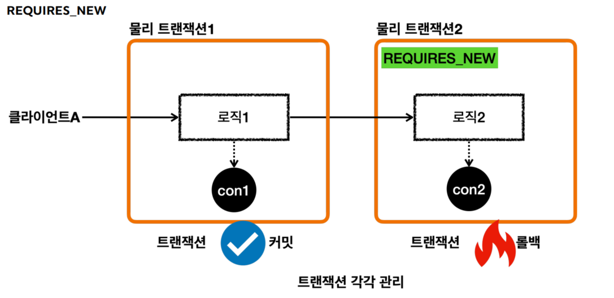

***application.properties***

```java
logging.level.org.springframework.transaction.interceptor=TRACE
logging.level.org.springframework.jdbc.datasource.DataSourceTransactionManager=DEBUG

#JPA log
logging.level.org.springframework.orm.jpa.JpaTransactionManager=DEBUG
logging.level.org.hibernate.resource.transaction=DEBUG

#JPA SQL
logging.level.org.hibernate.SQL=DEBUG
```

# ***스프링 트랜잭션 전파2 - 트랜잭션 두 번 사용***

***double_commit()***

```java
@Test
void double_commit(){
   log.info("트랜잭션1 시작");
   TransactionStatus tx1 = txManager.getTransaction(new DefaultTransactionDefinition());
   log.info("트랜잭션1 커밋 시작");
   txManager.commit(tx1);
   log.info("트랜잭션1 커밋 완료");

   log.info("트랜잭션2 시작");
   TransactionStatus tx2 = txManager.getTransaction(new DefaultTransactionDefinition());
   log.info("트랜잭션2 커밋 시작");
   txManager.commit(tx2);
   log.info("트랜잭션2 커밋 완료");  
}
```

***double_commit() - result***

```java
트랜잭션1 시작
Creating new transaction with name [null]: PROPAGATION_REQUIRED,ISOLATION_DEFAULT
Acquired Connection [HikariProxyConnection@1064414847 wrapping conn0] for JDBC transaction
Switching JDBC Connection [HikariProxyConnection@1064414847 wrapping conn0] to manual commit
트랜잭션1 커밋 시작
Initiating transaction commit
Committing JDBC transaction on Connection [HikariProxyConnection@1064414847 wrapping conn0]
Releasing JDBC Connection [HikariProxyConnection@1064414847 wrapping conn0] after transaction
트랜잭션1 커밋 완료

트랜잭션2 시작
Creating new transaction with name [null]: PROPAGATION_REQUIRED,ISOLATION_DEFAULT
Acquired Connection [HikariProxyConnection@778350106 wrapping conn0] for JDBC transaction
Switching JDBC Connection [HikariProxyConnection@778350106 wrapping conn0] to manual commit
트랜잭션2 커밋 시작
Initiating transaction commit
Committing JDBC transaction on Connection [HikariProxyConnection@778350106 wrapping conn0]
Releasing JDBC Connection [HikariProxyConnection@778350106 wrapping conn0] after transaction
트랜잭션2 커밋 완료
```

- *트랜잭션이 각각 수행되면서 사용되는 DB 커넥션도 각각 다르다.*

# ***스프링 트랜잭션 전파3 - 전파 기본***

*트랜잭션을 각각 사용하는 것이 아니라, 이미 트랜잭션이 진행중인데, 여기에 추가로 트랜잭션을 수행하면 어떻게 될까?*

*이런 경우 어떻게 동작할지 결정하는 것을* ***트랜잭션 전파(propagation)****라 한다.*

***외부 트랜잭션이 수행중인데, 내부 트랜잭션이 추가로 수행***


- *스프링은 이 경우 외부 트랜잭션과 내부 트랜잭션을 묶어서 하나의 트랜잭션을 만들어준다.*
- *즉, 내부 트랜잭션이 외부 트랜잭션에 참여하는 것이다.* 
- *이것이 기본 동작이다.*

***물리 트랜잭션, 논리 트랜잭션***


- *논리 트랜잭션들은 하나의 물리 트랜잭션으로 묶인다.*
- *물리 트랜잭션이 실제 데이터베이스에 적용되는 실제 트랜잭션을 뜻한다.*
- *논리 트랜잭션은 트랜잭션 매니저를 통해 트랜잭션을 사용하는 단위이다.*
- *논리 트랜잭션 개념은 트랜잭션이 진행되는 중에 내부에 추가로 트랜잭션을 사용하는 경우에 나타난다.* 

***원칙*** 

- *모든 논리 트랜잭션이 커밋되어야 물리 트랜잭션이 커밋된다.*
- *하나의 논리 트랜잭션이라도 롤백되면 물리 트랜잭션은 롤백된다.*

# ***스프링 트랜잭션 전파4 - 전파 예제***

```java
@Test
void inner_commit(){
    log.info("외부 트랜잭션 시작");
    TransactionStatus outer = txManager.getTransaction(new DefaultTransactionDefinition());
    log.info("outer.isNewTransaction()={}", outer.isNewTransaction());

    log.info("내부 트랜잭션 시작");
    TransactionStatus inner = txManager.getTransaction(new DefaultTransactionDefinition());
    log.info("inner.isNewTransaction()={}", inner.isNewTransaction());

    log.info("내부 트랜잭션 커밋");
    txManager.commit(inner);

    log.info("외부 트랜잭션 커밋");
    txManager.commit(outer);
}
```

- *외부 트랜잭션은 처음 수행된 트랜잭션이다. 이 경우 신규 트랜잭션(isNewTransaction=true)이 된다.* 
- *내부 트랜잭션을 시작하는 시점에는 이미 외부 트랜잭션이 진행중인 상태이다. 이 경우 내부 트랜잭션은 외부 트랜잭션에 참여한다(isNewTransaction= false).*
- *트랜잭션 참여: 외부 트랜잭션과 내부 트랜잭션이 하나의 물리 트랜잭션으로 묶이는 것*

***동작 흐름***


*트랜잭션 매니저에 커밋을 호출한다고해서 항상 실제 커넥션에 물리 커밋이 발생하지 않는다.*

*신규 트랜잭션인 경우에만 실제 커넥션을 사용해서 물리 커밋과 롤백을 수행한다.*

*즉, 신규 트랜잭션이 아니라면 물리 커넥션을 사용하지 않는다.*

*트랜잭션이 내부에서 추가로 사용되면, 트랜잭션 매니저를 통해 논리 트랜잭션을 관리하고, 
모든 논리 트랜잭션이 커밋되면 물리 트랜잭션이 커밋된다고 이해하면 된다.*

# ***스프링 트랜잭션 전파5 - 외부 롤백***

*내부 트랜잭션 커밋, 외부 트랜잭션 롤백되는 상황*


- *논리 트랜잭션이 하나라도 롤백되면 전체 물리 트랜잭션은 롤백된다.*
- *내부 트랜잭션이 커밋했어도, 내부 트랜잭션 안에서 저장한 데이터도 모두 함께 롤백된다.*

# ***스프링 트랜잭션 전파6 - 내부 롤백***

***외부 트랜잭션 커밋, 내부 트랜잭션 롤백 case*** 


```java
@Test
void inner_rollback(){
    log.info("외부 트랜잭션 시작");
    TransactionStatus outer = txManager.getTransaction(new DefaultTransactionDefinition());

    log.info("내부 트랜잭션 시작");
    TransactionStatus inner = txManager.getTransaction(new DefaultTransactionDefinition());

    log.info("내부 트랜잭션 롤백");
    txManager.rollback(inner); // rollback - only 표시

    log.info("외부 트랜잭션 커밋");
    assertThatThrownBy(()->txManager.commit(outer))
            .isInstanceOf(UnexpectedRollbackException.class);
}
```

***흐름***

*외부 트랜잭션 시작(물리 트랜잭션 시작) → 내부 트랜잭션 시작(논리 트랜잭션, 기존 트랜잭션 참여)*

*→ 내부 트랜잭션 롤백(marking rollback-only) → 외부 트랜잭션 커밋(Global Transaction rollback-only but transactional code commit) → UnexpectedRollbackException(물리 트랜잭션 RollBack)*


***내부 트랜잭션 응답***

- *트랜잭션 매니저를 통해 내부 트랜잭션을 롤백한다.*
- *트랜잭션 매니저는 롤백 시점에 신규 트랜잭션 여부(isNewTransaction)에 따라 다르게 동작한다.
내부 트랜잭션은 기존 트랜잭션에 참여한 트랜잭션 즉, isNewTransaction=false 이다.*
- *내부 트랜잭션은 물리 트랜잭션을 롤백하지 않는 대신에 트랜잭션 동기화 매니저에게 rollbackOnly=true 표시를 해둔다.*

***외부 트랜잭션 응답***

- *트랜잭션 매니저를 통해 외부 트랜잭션을 커밋한다.*
- *외부 트랜잭션은 물리 트랜잭션의 시작 즉, isNewTransaction= true이다.*
- *DB 커넥션에 실제 커밋을 호출해야 하는데 이때 먼저 트랜잭션 동기화 매니저에 rollbackOnly 표시가 있는지 확인한다.* 
- *내부 트랜잭션에서 rollbackOnly=true 표시를 했기 때문에 외부 트랜잭션 커밋을 요청했지만 물리 트랜잭션을 커밋하는것이 아니라 롤백한다.*
- *스프링은 커밋을 호출했지만 롤백이 발생했다는 것을 UnexpectedRollbackException 런타임 예외를 던져서 알려준다.*

***정리***

- *논리 트랜잭션이 하나라도 롤백되면 물리 트랜잭션은 롤백된다.*
- *내부 논리 트랜잭션이 롤백되면 롤백 전용 마크를 표시한다.*
- *외부 트랜잭션을 커밋할 때 롤백 전용 마크를 확인한다.
롤백 전용 마크가 표시되어 있으면 물리 트랜잭션을 롤백하고, UnexpectedRollbackException 예외를 던진다.*

# ***스프링 트랜잭션 전파7 - REQUIRES_NEW***

*외부 트랜잭션과 내부 트랜잭션을 분리해서 각각 별도의 물리 트랜잭션을 사용하는 방법에 대해서 알아보자*



- *물리 트랜잭션을 분리하려면 내부 트랜잭션을 시작할 때 REQUIRES_NEW 옵션을 사용하면 된다.*
- *외부 트랜잭션과 내부 트랜잭션이 각각 별도의 물리 트랜잭션을 가진다.*
- *별도의 물리 트랜잭션을 가진다는 뜻은 DB 커넥션을 따로 사용한다는 뜻이다.*

```java
@Test
void inner_rollback_requires_new(){
    log.info("외부 트랜잭션 시작");
    TransactionStatus outer = txManager.getTransaction(new DefaultTransactionDefinition());
    log.info("outer.isNewTransaction()={}", outer.isNewTransaction());

    log.info("내부 트랜잭션 시작");
    DefaultTransactionDefinition definition = new DefaultTransactionDefinition();
    definition.setPropagationBehavior(TransactionDefinition.PROPAGATION_REQUIRES_NEW);
    TransactionStatus inner = txManager.getTransaction(definition);
    log.info("inner.isNewTransaction()={}", inner.isNewTransaction()); // true

    log.info("내부 트랜잭션 롤백");
    txManager.rollback(inner); // 롤백

    log.info("외부 트랜잭션 커밋");
    txManager.commit(outer);  // 커밋
}
```

- ***definition.setPropagationBehavior(TransactionDefinition.******PROPAGATION_REQUIRES_NEW******)***
- *내부 트랜잭션의 전파 옵션을 REQUIRES_NEW로 설정* 
  - *내부 트랜잭션이 새로운 물리 트랜잭션으로 동작한다*
  - *즉, 하나의 요청 쓰레드가 2개의 서로 다른 커넥션을 가진다.*
  - *내부 트랜잭션을 TransactionStatus: isNewTransaction() 통해서 확인하면 true가 나온다.*
-  *DefaultTransactionDefinition*
- *생성자로 DefaultTransactionDefinition을 생성하면*  ***PROPAGATION_REQUIRED****이다.*


# ***스프링 트랜잭션 전파8 - 다양한 전파 옵션***

*스프링은 다양한 트랜잭션 전파 옵션을 제공, 별도의 설정을 하지 않으면 REQUIRED가 기본이다.*

*실무에서는 REQUIRED 옵션을 대부분 사용하고 아주 가끔 REQUIRES_NEW를 사용한다.*

***REQUIRED***

- *기존 트랜잭션이 없으면 생성하고, 있으면 참여한다.*
- *트랜잭션이 필수이다.*
- *없으면 생성*
  - *있으면 참여*

***REQUIRES_NEW***

- *항상 새로운 트랜잭션을 생성*

***SUPPORT***

- *트랜잭션을 지원*
- *기존 트랜잭션 없음: 트랜잭션 없이 진행*
  - *기존 트랜잭션 존재: 기존 트랜잭션에 참여*

***NOT_SUPPORT***

- 트랜잭션을 지원 X
- *기존 트랜잭션 없음: 트랜잭션 없이 진행*
  - *기존 트랜잭션 존재: 기존 트랜잭션 보류*

***MANDATORY***

- *의무사항, 기존 트랜잭션이 없으면 예외 발생*
- *기존 트랜잭션 없음: IllegalTransactionStateException 예외 발생*
  - *기존 트랜잭션 존재: 기존 트랜잭션 참여*

***NEVER***

- *트랜잭션을 사용하지 않는다는 의미*
- *기존 트랜잭션 없음: 트랜잭션 없이 진행*
  - *기존 트랜잭션 존재: IllegalTransactionStateException 예외 발생*

***NESTED***

- *기존 트랜잭션 없음: 새로운 트랜잭션 생성*
- *기존 트랜잭션 존재: 중첩 트랜잭션 생성*
- *중첩 트랜잭션은 외부 트랜잭션 영향을 받지만, 중첩 트랜잭션은 외부에 영향 X*
  - *중첩 트랜잭션이 롤백 되어도 외부 트랜잭션은 커밋*
  - *외부 트랜잭션이 롤백 되면 트랜잭션도 함께 롤백*
- *참고*
- *JDBC savepoint 기능을 사용. DB 드라이버에서 해당 기능을 지원하는지 확인이 필요하다.*
  - *JPA 사용 불가*

***트랜잭션 전파와 옵션***

- *isolation, timeout, readOnly는 트랜잭션 시작만 적용, 트랜잭션 참여에는 적용되지 않는다.*
- *REQUIRED 통한 물리 트랜잭션 시작, REQUIRES_NEW를 통한 트랜잭션 시작*

