# 31장 개요

병행 프로그램의 근본적인 문제를 락(lock)을 이용하여 해결하자.

프로그래머들은 소스 코드의 임계 영역(critical section)을 락으로 둘러서 그 임계 영역이 마치 하나의 원자 단위 명령어인 것처럼 실행되도록 한다.

---

# 31.1 락: 기본 개념

**임계 영역** 

```c
balance = balance + 1; 
```

**락을 적용**

```c
lock_t mutex; 

lock(&mutex);
balance = balance + 1; 
unlock(&mutex);
```

락도 하나의 변수이기 때문에 락을 사용하기 위해서는 락 변수(mutex)를 먼저 선언해야 한다.

이 락은 사용 가능(해제)상태이거나, 즉 어느 쓰레드도 락을 갖고 있지 않거, 사용 중(획득)상태, 즉 임계 영역에서 정확히 하나의 쓰레드가 락을 획득한 상태이다.

이 락 자료 구조에 락을 보유한 쓰레드에 대한 정보나 락을 대기하는 쓰레드들에 대한 정보를 저장할 수 있다.

**lock(), unlock() 루틴** 

lock() 루틴 호출을 통해 락 획득을 시도한다. 어떤 쓰레드도 락을 갖고 있지 않으면 그 쓰레드는 락을 획득하여 임계 영역 내로 진입한다. 이렇게 진입한 쓰레드를 락 소유자(owner)라고 부른다.

이미 락 소유자가 있는 상태에서 다른 쓰레드가 lock()을 호출하면 사용 중인 동안에는 lock() 함수가 리턴하지 않는다. 이와 같은 방식으로 다른 쓰레드들이 임계 영역 안으로 진입할 수가 없다.

락 소유자가 unlock()을 호출하면 락은 이제 다시 사용 가능한 상태가 된다.

즉, 프로그래머는 락으로 코드를 감싸서 그 코드 내에서 하나의 쓰레드만 동작하도록 보장할 수 있다.

---

# 31.2 Pthread 락

쓰레드 간에 **상호 배제(mutual exclusion)** 기능을 제공하기 때문에 POSIX 라이브러리는 락을 **mutex**라고 부른다.

```c
pthread_mutex_t lock = PTHREAD_MUTEX_INITIALIZER;

Pthread_mutex_lock(&lock); // pthread_mutex_lock()을 위한 래퍼
balance = balance + 1; 
Pthread_mutex_unlock(&lock);
```

해당 코드는 31.1 락 예제에서 추가로 POSIX 라이브러리의 락 호출 래퍼를 사용하여 락과 언락 시에 에러를 확인하도록 하였다. 

POSIX 방식에서는 변수 명을 지정하여 락과 언락 함수에 전달하고 있다.

이러한 방식을 통해 여러 쓰레드가 서로 다른 락으로 보호된 코드 내에 각자가 진입이 가능하다.

---

# 31.3 락 구현

사용 가능한 락을 만들기 위해서는 하드웨어와 운영체제의 도움을 모두 받아야 한다.

---

# 31.4 락의 평가

1. 상호 배제를 제대로 지원하는가?
1. **공정성(fairness)**
1. 쓰레드들이 락 획득에 대한 공정한 기회가 주어지는가?
  1. 락을 전혀 얻지 못해 굶주리는**(starve)**경우가 발생하는가?
1. **성능(performance)**
1. 경쟁이 전혀 없는 경우의 성능
  1. 하나의 쓰레드가 실행 중에 락을 획득하고 해제하는 과정에서 발생하는 부하
  1. 여러 쓰레드가 단일 CPU 상에서 경쟁할 때의 성능
  1. 여러 쓰레드가 멀티 CPU 상에서 경쟁할 때의 성능

---

# 31.5 인터럽트 제어

### **상호 배제 지원: 인터럽트를 비활성화하는 방법** 

초창기 단일 프로세서 시스템에서 상호 배제를 지원하는 방법이다. 

```c
void lock() { 
	DisableInterrupts(); 
}
 
void unlock() {
	EnableInterrupts(); 
}
```

임계 영역에 진입하기 전에 인터럽트를 막는다면 임계 영역 내에 코드에서 인터럽트가 발생할 수 없기 때문에 

원자적으로 실행이 가능하다. → 임계 영역에서 컨텍스트 스위칭이 발생하지 않는다(타이머 인터럽트 포함)

이 방법은 구현이 간단하지만 단점이 많다.

1. 쓰레드가 인터럽트를 활성/비활성화 하는 특권(priviledged)연산을 실행할 수 있도록 허가해야 함. 
즉, 임계 영역에서의 코드를 신뢰할 수 있어야함
1. 탐욕적(Greedy) 기법을 사용한 프로그램이 시작과 동시에 lock()을 호출하여 CPU를 독점할 수 있다.
  1. 악의적인 코드 무한 반복문 → 시스템의 제어권을 다시 얻지 못한다.
1. 멀티 프로로세서에서의 적용 불가능하다. 특정 프로세서의 인터럽트 비활성화는 다른 프로세서에서 실행 중인 프로그램에는 전혀 영향을 주지 않는다.
1. 장시간 동안 인터럽트를 중지시키는 것은 중요한 인터럽트의 시점을 놓칠 수 있다. → 시스템에 큰 문제
1. 임계 영역에 들어간 쓰레드가 CPU가 저장 장치에서 읽기 요청을 마친 사실(하드웨어 인터럽트)을 모르고 지나친다. 그럼 이 쓰레드를 어떻게 깨울 수 있을까? (인터럽트가 비활성화인데)
1. 최신 CPU에서는 인터럽트 비활성화 명령어는 느리게 실행되는 경향이 있다. → 비효율적 

---

# 여담: Dekker & Peterson 알고리즘

**Peterson 알고리즘이란?**

- 두 개의 쓰레드가 공유 자원(Critical Section)에 동시에 접근하지 않도록 막기 위한 **소프트웨어 기반 상호 배제(Mutual Exclusion) 알고리즘**이다. 
- 특별한 락 명령어 없이, 오직 `load`와 `store`만을 사용해서 구현된다. 
- Dekker 알고리즘에서 발전된 형태로, 더 간단하고 이해하기 쉬운 구조이다. 

```c
int flag[2]; 
int turn;

void init() { 
		flag[0] = flag[1] = 0; // 프로그램 시작 시, 두 쓰레드 모두 진입 의사가 없다.
		turn = 0; //  0번 쓰레드에게 우선권을 준다.
} 
 
void lock() { 
		flag[self] = 1;  // self: 호출한 쓰레드 ID / 나 임계영역 들어갈래
		turn = 1 − self; // 다른 쓰레드의 차례가 되도록 만듦   
		while ((flag[1−self] == 1) && (turn == 1 − self); // 상대가 진입 원하고, turn도 상대라면 대기
} 

void unlock() { 
		flag[self] = 0;  // 나 이제 임계영역 필요없어 
}
```

이 방식은 하드웨어 지원 없이 락을 구현하는 방법이다.

이러한 접근이 하드웨어로부터 약간의 지원을 받으면 훨씬 쉽게 해결할 수 있다는 것을 알게 된 후로 필요가 없게 되었다.

---

# 31.6 Test-And-Set (Atomic Exchange)

멀티프로세서에서는 인터럽트를 중지시키는 것이 의미가 없기 때문에 시스템 설계자들은 락 지원을 위한 하드웨어를 설계하기 시작했다.

하드웨어 기법 중 가장 기본은 **Test-And-Set** 명령어 또는 **원자적 교체(atomic exchange)**라고 불리는 기법이다.

**그림 31.1, 그림 31.2는 하드웨어 지원없이 락을 구현한 예시이다.**

**즉, Test-And-Set 명령어가 사용 X**

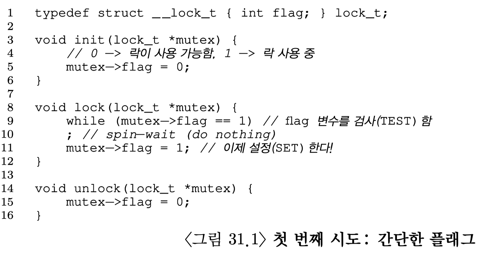

간단한 변수(flag)를 사용하여 쓰레드가 락을 획득하였는지를 판단한다.

**이상적인 동작 방식** 

```
init 
-> flag = 0

쓰레드1 lock() 호출 
-> flag test = 0, flag set = 1(락 보유 hold)
-> 임계 영역 진입

쓰레드2 lock() 호출
-> flag test = 1 
-> while 문에서 spint-wait 쓰레드1이 unlock() 호출까지 대기

쓰레드1 unlock() 호출
-> flag set = 0 (락 해제 release)

쓰레드2 
-> flag test = 0, flag set = 1(락 보유 hold)
-> 임계 영역 진입
```

그림 31.1 코드의 2가지 문제점(정확성, 성능)

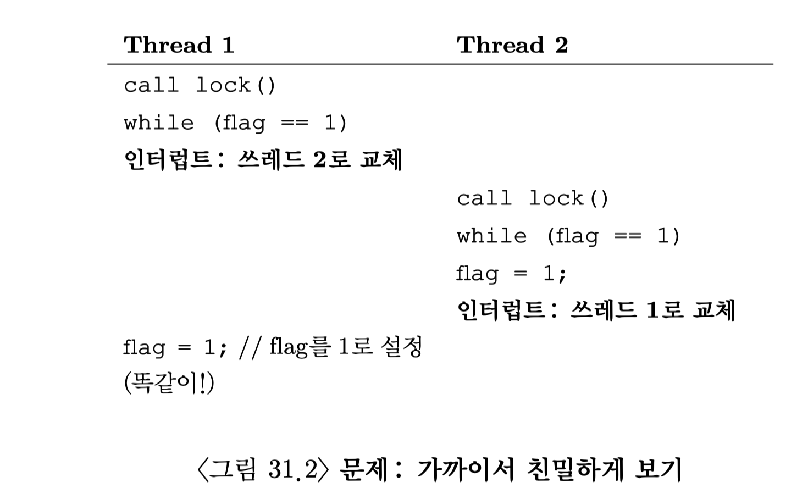

**정확성**

그림 31.2를 보면 thread1은 while(flag == 1)을 탈출하고 thread2로 컨텍스트 스위칭 된다.

아직, flag = 0 이기 때문에 while(flag == 1)을 통과하고 flag = 1로 set & 다시 thread1으로 컨텍스트 스위칭 된다. thread1은 이미 테스트를 통과했기 때문에 마찬가지로 flag = 1로 set

결과적으로 두 thread 모두 임계 영역에 들어간다.

즉, test & set is not atomic

**성능 (spin-wait)**

플래그의 값을 무한히 검사하는데, 이 방법은 다른 쓰레드가 락을 해제할 때까지 시간을 낭비한다.

즉, 쓰레드가 block(sleep) 상태가 아닌 계속 cpu를 점유하면서 플래그의 값을 계속 검사

이 방법은 단일 프로세서에서 특히 매우 손해가 크다. 락을 소유한 쓰레드마저 실행할 수 없기 때문이다.

---

# 31.7 진짜 돌아가는 스픽 락의 구현

Chapter 31.6에서 다룬 예제는 하드웨어 지원 없이는 동작이 불가능하다.

특정 시스템에서는 이 개념에 근간한 락 구현을 위한 명령어(어셈블리 명령어)를 제공한다.

기본적으로 동일한 일을 수행하며 일반적으로 **Test-And-Set**라고 불린다. 

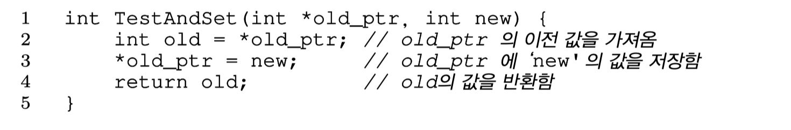

ptr이 가리키고 있던 예전의 값을 반환하고 동시에 ptr에 새로운 값(new)을 저장한다.

“test and set”라고 불리는 이유가 이전 값을 검사(test)동시에 메모리에 새로운 값을 설정(set)하기 때문이다.

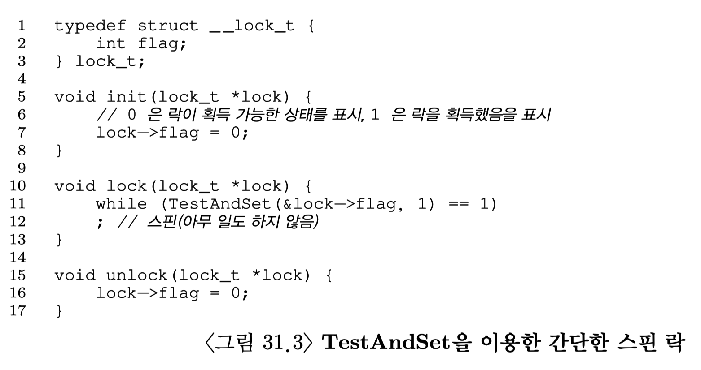

**스핀 락 동작 방식** 

```
init: flag = 0

쓰레드1 lock() 호출 
-> TestAndSet(0, 1) -> return 0 flag = 1
-> 임계 영역 진입

쓰레드2 lock() 호출
-> TestAndSet(1, 1) -> return 1 flag = 1
-> while 문에서 TestAndSet 반복

쓰레드1 unlock() 호출
-> flag set = 0 (락 해제 release)

쓰레드2 
-> TestAndSet(0, 1) -> return 0 flag = 1
-> 임계 영역 진입
```

락의 값을 검사(test)하고 새로운 값으로 설정(set)하는 동작을 원자적 연산으로 만듦으로써 오직 하나의 쓰레드만 락을 획득할 수 있도록 만들었다. 

지금 설명한 방법이 스핀 락으로 불리는 이유를 이제 이해할 수 있을 것이다. 

이것이 가장 기초적인 형태의 락으로서써 락을 획득할 때까지 CPU 사이클을 소모하면서 회전 한다. 

**단일 프로세서에서 이 방식을 제대로 사용하려면 선점형 스케줄러(preemptive scheduler)를 사용하여 한다.** 

선점형 스케줄러는 필요에 따라 다른 쓰레드가 실행될 수 있도록 타이머를 통해 쓰레드에 인터럽트를 발생시킬 수 있다. 선점형이 아니면 단일 CPU 에서 스핀 락의 사용은 불가능하다. 왜냐하면 while 문을 회전하며 대기하는 쓰레드가 CPU 를 영원히 독점하기 때문이다.

---

# 31.8 스핀 락 평가

**정확성**

스핀 락은 임의의 시간에 단 하나의 쓰레드만이 임계 영역에 진입할 수 있도록 한다.

**공정성**

스핀 락은 어떠한 공정성도 보장해 줄 수 없다. while 문을 회전 중인 쓰레드는 경쟁에 밀려서 계속 그 상태에 남아 있을 수 있다. 즉, 공정하지 않으며 쓰레드를 굶주리게 만들 수 있다.

**성능1 - 단일 프로세서**

스핀 락이 갖는 오버헤드는 상당히 클 수 있다.

락을 획득한 쓰레드가 CPU를 받아 임계 영역이 끝나고 락을 해제하기 전까지 다른 쓰레드가 락 획득을 대기하는 경우 CPU 싸이클을 계속 낭비한다. 

→ **Busy Waiting(바쁜 대기) 어떤 자원이 사용 가능해질 때까지 계속해서 루프를 돌며 기다리는 방식**

**성능2- 멀티 프로세서** 

쓰레드의 개수가 CPU의 개수와 비슷하다면 스핀락은 꽤 합리적으로 동작한다.

각각의 CPU를 할당받고 락 대기를 하다보면 곧 획득 가능한 상태가 된다.

**내 생각** 
하지만 이 방식은 폴링 방식이다. 아닌 무한 루프로 계속해서 CPU를 할당받고 검사하는 방식이기 때문에 

애초에 다른 이벤트성 방식(세마포어, 뮤텍스)보다 오버헤드가 크다고 생각한다. 

**즉, 스핀 락은 짧은 대기 시간에는 적절하지만, 긴 대기 시간이나 단일 CPU 환경에서는 낭비가 크다.** 

---

# 31.9 Compare-And-Swap

또 다른 하드웨어 기법은 Compare-And-Swap,  CompareAnd-Exchange가 있다.

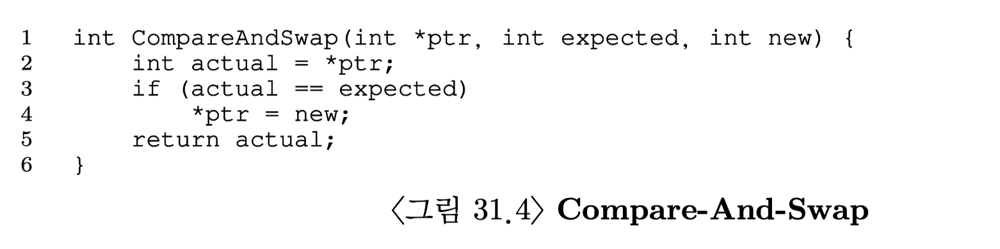

Compare-And-Swap 기법의 기본 개념은 ptr이 가리키고 있는 주소의 값이 expected 변수와 일치하는지 검사하는 것이다. 

만약 일치하면 ptr이 가리키는 주소의 값을 새로운 값으로 변경한다.

불일치한다면 아무 것도 하지 않는다.

원래의 메모리 값을 반환하여 락 획득의 성공 여부를 알 수 있도록 한다.

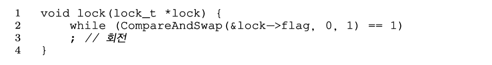

Compare-And-Swap 방법을 사용하면 Test-And-Set 방법과 같은 방식으로 락을 만들 수 있다.

CompareAndSwap 명령어는 TestAndSet 명령어보다 더 강력하다.

대기없는 동기화를 다룰 때 이 루틴이 갖는 능력을 알게 되다.

단순히 스핀 락과 같은 방식으로 만들어 사용하면 스핀 락과 다를 바 없이 동작한다.

---

# Compare-And-Swap VS Test-And-Set

**Compare-And-Swap** 

```
1. 현재 변수의 값을 읽음
2. 그 값이 기대한 값(expected)과 같다면, 변수의 값을 새로운 값으로 바꿈
3. 결과를 true/false로 반환
```

- Java Atomic*, Concurrent* 에서 사용

**Test-And-Swap**

```
1. 현재 변수의 값을 읽음
2. 변수의 값을 1로 설정 
3. 읽은 값이 0이면 lock 획득 성공, 1이면 실패
```

---

# 31.10 Load-Linked 그리고 Store-Conditional 

어떤 플랫폼은 임계 영역 진입 제어 함수를 제작하기 위한 명령어 쌍을 제공한다.

load-linked와 store-conditional 명령어를 앞뒤로 사용하여 락 이나 기타 병행 연산을 위한 자료 구조를 만들 수 있다.

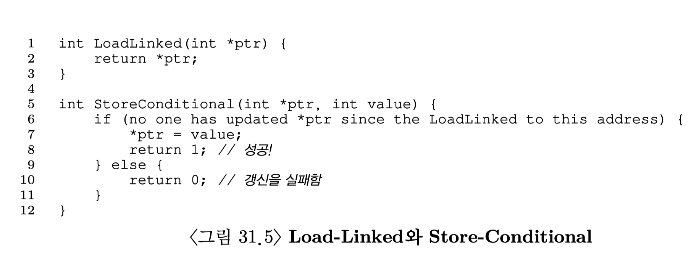

**load-linked** 명령어는 일반 로드 명령어와 같이 메모리 값을 레지스터에 저장한다.

**store-conditional** 명령어는 동일한 주소에 다른 스토어가 없었던 경우에만 저장을 성공한다. 

저장이 성공하면 **load-linked**가 탑재했던 값을 갱신한다.

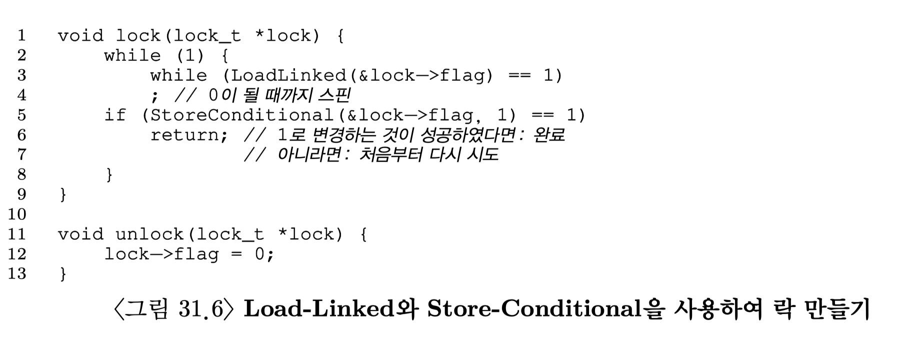

여러 쓰레드가 while 문을 돌면서 flag가 0이 되기를 기다린다(락이 해제된 상태)

락이 획득 가능한 상태가 되면 쓰레드는 store-conditional 명령어로 락 획득을 시도하고 만약 성공한다면 

쓰레드는 flag 값을 1로 변경한다.

store-conditional 명령어는 실패할 수 있다.

load-linked를 실행하고 쓰레드가 컨텍스트 스위칭되었을 때 다른 쓰레드가 store-conditional를 실행하여

이미 flag = 1로 변경하였다면 먼저 load-linked를 실행하고 스위칭된 쓰레드는 실패하고 다시 처음부터 시작한다.

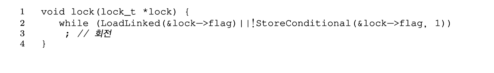

Load-Linked & Store-Conditional Boolean 조건물을 통해 lock 코드 간소화 

그림 31.6과 동일하게 동작한다.

---

# 31.11 Fetch-And-Add

마지막 하드웨어 기반의 기법은 **Fetch-And-Add** 명령어로 원자적으로 특정 주소의 예전 값을 반환하면서 값을 증가시킨다.

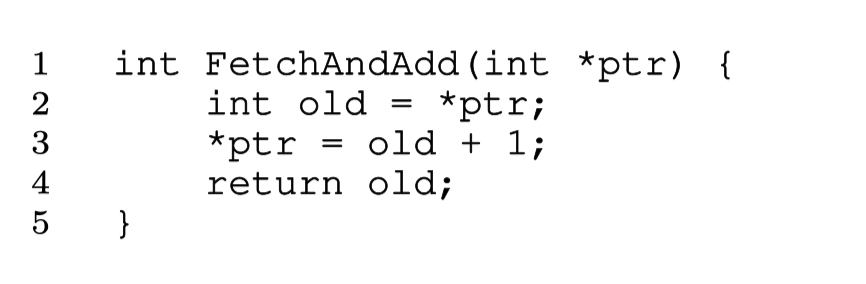

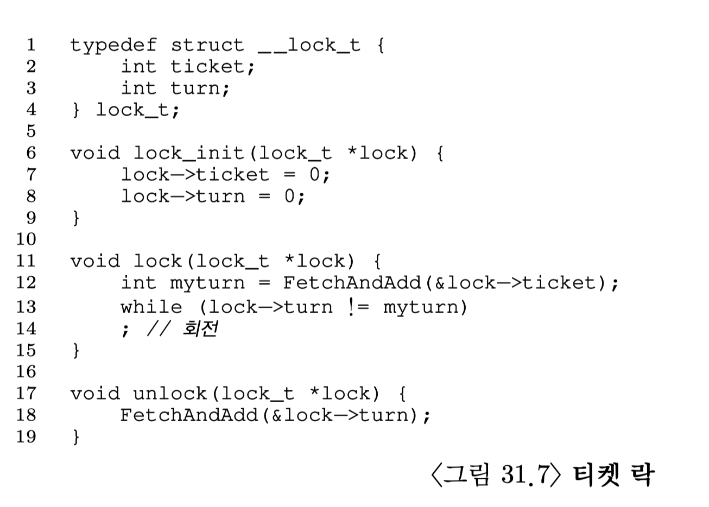

| 스레드 | 티켓 번호 (myturn) | turn 값 | 행동 |
| --- | --- | --- | --- |
| A | 0 | 0 | 진입 |
| B | 1 | 0 | 대기 |
| C | 2 | 0 | 대기 |
| A unlock 후 |  | 1 | B 진입 |
| B unlock 후 |  | 2 | C 진입 |

모든 쓰레드들이 각자의 순서에 따라 진행된다.

쓰레드가 티켓 값을 할당(myturn)받았다면 미래의 어느 때에 실행되기 위해 스케줄되어 있다는 뜻이다.

이전까지의 해법들에서는 이러한 보장이 없었다. 즉, 공정성이 보장된다. 

---

# 31.12 요약: 과도한 스핀

이제까지 학습한 하드웨어 기반의 락은 간단하고, 제대로 동작한다.

하지만 효율적이지 않은 경우도 있다. 

만약 단일 프로세서에서 N개의 쓰레드가 스핀 락을 획득하여 임계 구역에 진입한다는 가정을 해보자.

```
1번 쓰레드 락 획득 이후 컨텍스트 스위칭

2번 쓰레드 스핀 
3번 쓰레드 스핀
.
.
.
1번 쓰레드 락 해제
```

쓰레드 1개가 임계 구역에 진입하고 컨텍스트 스위칭되면 나머지 N-1개는 본인의 CPU 할당 시간을 모두 소비하면서 계속 락 획득 시도만 한다. 

**어떻게 하면 스핀에 CPU 시간을 낭비하지 않는 락을 만들 수 있을까?**

---

# 31.13 간단한 접근법: 무조건 양보!

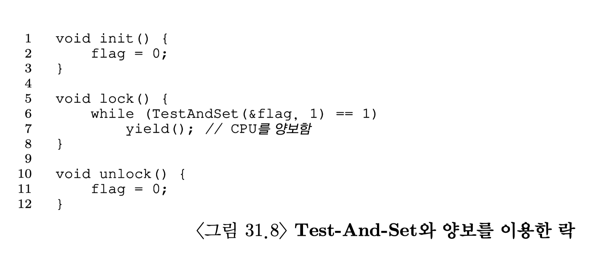

락이 해제되기를 기다리며 스핀해야 하는 경우 자신에게 할당된 CPU를 다른 쓰레드에게 양보한다.

이 방법에서는 운영체제에 자신이 할당받은 CPU 시간을 포기하고 다른 쓰레드가 실행될 수 있도록 하는 yield() 기법이 있다고 가정한다.

양보(yield)라는 시스템 콜은 호출 쓰레드 상태를 실행 중(running) 상태에서 준비(ready) 상태로 변환 하여 다른 쓰레드가 실행 중 상태로 전이하도록 한다. 결과적으로 양보 동작은 스케줄 대상에서 자신을 빼는(deschedule)이나 마찬가지이다.

단일 프로세서 시스템에서 두 개의 쓰레드를 실행하는 예를 생각해 보자.

쓰레드가 lock()을 호출했지만 다른 쓰레드가 락을 보유한 상황이라면 이 쓰레드는 CPU 시간을 양보하여

먼저의 쓰레드가 동작하여 임계 영역 밖으로 나올 수 있도록 한다.

간단한 예지만 양보 기법이 제대로 동작한다는 것을 알 수 있다. 

이번에는 100개 정도의 쓰레드들이 락을 획득하기 위해 경쟁하는 경우를 살펴보자.

이때는 나머지 99개의 쓰레드가 각자 lock()을 호출하고 다른 쓰레드가 락을 보유하고 있기에 CPU를 양보한다.

즉, 다시 실행되기까지 99개의 쓰레드가 run-and-yield 패턴으로 동작하게 된다.

99개의 시간 간격을 낭비하게 되는 회전 방식보다는 좀 더 좋기는 하지만 문맥 교환 비용이 상당하며 낭비가 많다.

또한 굶주림 문제는 해결 못하고 있다. 어떤 쓰레드는 무한히 양보만 하고 있는 경우가 발생할 수 있다.

---

# 31.14 큐의 사용: 스핀 대신 잠자기

이전 방법들의 문제는 너무 많은 부분을 운에 맡긴다.

- 회전을 하면서 대기(CPU 낭비: Busy Waiting)
- CPU를 즉시 양보(컨텍스트 스위칭 비용)

→ 어느 방식이든 낭비의 여지가 있고, 특정 쓰레드가 굶주리게 되는 상황을 막지 못한다.

즉, 어떤 쓰레드가 다음으로 락을 획득할지를 명시적으로 제어할 수 있어야 한다.

이를 위해서는 운영체제로부터 적절한 지원과 큐를 이용한 대기 쓰레드들의 관리가 필요하다.

### Solaris 방식

**park():** 호출하는 쓰레드를 잠재우는 함수

**unpark(threadID):** threadID로 명시된 특정 쓰레드를 깨우는 함수  

이 두 루틴은 이미 사용 중인 락을 요청하는 프로세스를 재우고 해당 락이 해제되면 깨우도록 하는 하는 락을 제작하는 데 앞뒤로 사용할 수 있다.

**목표**

1. Test-And-Set + 락 대기자 전용 큐: 더 효율적인(리소스 낭비가 적은) 락 구현
1. 큐를 사용하여 다음으로 락을 획득할 대상을 제어하여 기아 현상 피하기

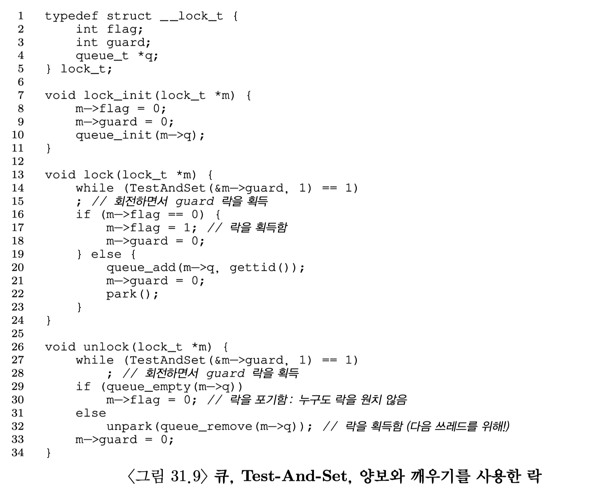

guard 변수를 사용하여 flag와 큐의 삽입, 삭제 동작을 스핀 락으로 보호한다.

즉, 회전 대기를 완전히 배제하지는 못했다.

하지만, 회전 대기 시간은 짧다. 사용자가 지정한 임계 영역에 진입하는 것이 아닌 락과 언락 코드 내의 몇개의 명령어만 수행하면 되기 때문이다.

lock()을 호출했을 때, 다른 쓰레드가 이미 락을 보유했기 때문에 자신이 락을 획득할 수 없다면, 현재 실행 중인 쓰레드 ID를 얻고, 락 소유자가 큐에 자기 자신을 추가하고 guard 변수를 0으로 변경한 후에 CPU를 앙보한다.

**만약 park() 호출 전이 아니라 호출 후에 guard 락을 해제하면 어떤 일이 생길까?**

park() 이후 스레드는 잠든다. 그 상태에서 guard 락을 들고 있으면 다른 스레드가 절대 lock/unlock 진행 불가

즉, 다른 스레드가 guard를 잡지 못해 전체 시스템이 멈출 수 있다. → 데드락 발생!

**깨우기/대기 경쟁(wakeup/waiting race)**

```
쓰레드1 
- flag 락 획득 flag: 1
- 임계 영역 (2/3) 진행
- 컨텍스트 스위칭 쓰레드1 -> 쓰레드2 

쓰레드2 
- guard 락 획득
- flag != 0    lock() 프로세스 
- queue.add(2)
- guard 락 해제 
- 컨텍스트 스위칭 쓰레드2 -> 쓰레드1 

쓰레드1
- 임계 영역 나머지 마무리
- guard 락 획득  unlock() 프로세스
- unpark(2)

**이때 문제 발생!!**
쓰레드1은 아직 park() 호출 전이라 unpark() 신호를 못 받는다. 
쓰레드1은 정확히 waiting queue가 아닌 ready queue에 존재
쓰레드1은 자기 차례에 park() 수행하면 깨어날 방법이 없다.
ready queue: cpu 할당 대기 큐 
waiting queue: 하드웨어 자원이나 락 자원 대기 큐 

-> **깨우기/대기 경쟁(wakeup/waiting race)**
```

이 문제를 피하기 위해서는 뭔가 더 필요하다.

Solaris는 이 문제를 세 번째 시스템 콜인 **setpark()**를 추가하여 해결하였다.

이 루틴은 park()를 호출하기 직전이라는 것을 표시한다.

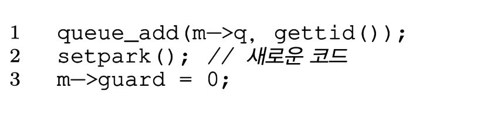

park()가 실제로 호출되기 전에 다른 쓰레드가 unpark()를 먼저 호출한다면, 추후 park() 문은 잠을 자는 대신 바로 리턴이 된다.

**깨우기/대기 경쟁(wakeup/waiting race) 해결** 

```
쓰레드1 
- flag 락 획득 flag: 1
- 임계 영역 (2/3) 진행
- 컨텍스트 스위칭 쓰레드1 -> 쓰레드2 

쓰레드2 
- guard 락 획득
- flag != 0    lock() 프로세스 
- setpark(2)
- queue.add(2)
- guard 락 해제 
- 컨텍스트 스위칭 쓰레드2 -> 쓰레드1 

쓰레드1
- 임계 영역 나머지 마무리
- guard 락 획득  unlock() 프로세스
- unpark(2)
- guard 락 해제 
- 컨텍스트 스위칭 쓰레드1 -> 쓰레드2

쓰레드2
- park() -> 잠을 자는 대신 즉시 리턴 
- 임계 영역 진입
- 생략 
```

**guard 변수의 역할을 커널에서 담당하는 것도 하나의 방법이다.**

그런 경우 커널은 락 해제와 실행 중인 쓰레드를 큐에서 제거하는 동작을 원자적으로 처리하기 위해 주의를 해야한다.

---

# SpinLock VS Mutex (Solaris / Futex)

| 항목 | 스핀 락 (Spinlock) | 뮤텍스 (Solaris / futex 기반) |
| --- | --- | --- |
| CPU 점유 | 계속 점유 | 못 잡으면 잠듦 (CPU 반납) |
| 구현 위치 | 유저 공간 | 유저 + 커널 공간 혼합 |
| 경쟁 적을 때 | 빠름 | 빠름 |
| 경쟁 많을 때 | CPU 낭비 심함 | 효율적 (대기 큐, 커널 sleep) |
| Race condition 대응 | 없음 | 있음 (`setpark` or `futex_wait`) |

Linux Futex 방식은 Mutex Solaris 스타일과 동일하지만 커널 호출을 적게해서 좀 더 효율적이다.

CS 공부에 대한 목적은 정확한 구현 방법을 깊게 파는 것도 중요하지만 대략적인 진행 방식 파악이 더 중요하니

현대 OS, 프로그래밍 언어에서 사용되는 Futex 방식은 나중에 더 깊게 공부하겠다.

기본적인 동작 메커니즘은 비슷하다.

---

