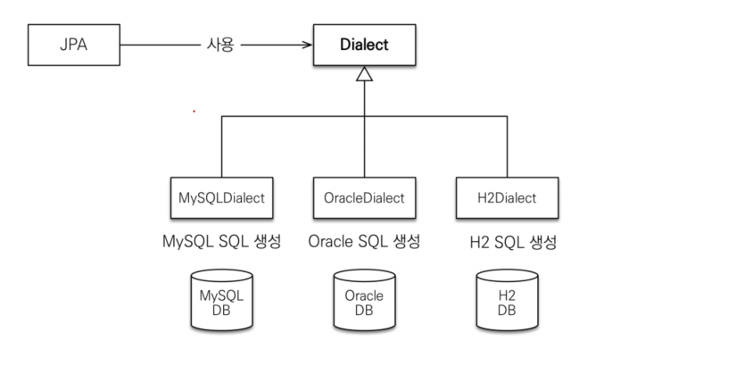
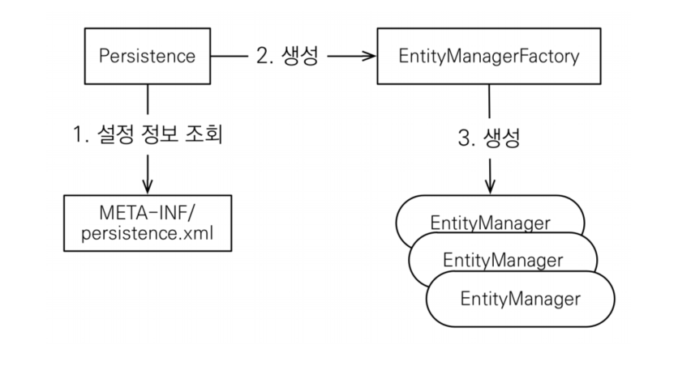

# ***persistence.xml***

***resources/META-INF/persistence.xml***

```xml
<?xml version="1.0" encoding="UTF-8"?>
<persistence version="2.2" xmlns="http://xmlns.jcp.org/xml/ns/persistence"
             xmlns:xsi="http://www.w3.org/2001/XMLSchema-instance"
             xsi:schemaLocation="http://xmlns.jcp.org/xml/ns/persistence http://xmlns.jcp.org/xml/ns/persistence/persistence_2_2.xsd">
    <persistence-unit name="hello">
        <properties>
            <!-- 필수 속성 -->
            <property name="jakarta.persistence.jdbc.driver" value="org.h2.Driver"/>
            <property name="jakarta.persistence.jdbc.user" value="sa"/>
            <property name="jakarta.persistence.jdbc.password" value=""/>
            <property name="jakarta.persistence.jdbc.url" value="jdbc:h2:tcp://localhost/~/practice"/>
            <property name="hibernate.dialect" value="org.hibernate.dialect.H2Dialect"/>

            <!-- 옵션 -->
            <property name="hibernate.show_sql" value="true"/>
            <property name="hibernate.format_sql" value="true"/>
            <property name="hibernate.use_sql_comments"  value="true"/>
            <property name="hibernate.hbm2ddl.auto" value="create" />
        </properties>
    </persistence-unit>

</persistence>
```

- *jakarata → JPA 자바 표준 ORM이고 여러 구현체가 존재하는데 다른 구현체로 바꾸어도 바뀌지 않는 설정*
- *hibernate → JPA 구현체 즉, 구현체 ex) 이클립스 링크로 바꾸면 바뀌는 설정*

# ***데이터베이스 방언***

*JPA는 특정 데이터베이스에 종속적이지 않다.*

*각각의 데이터베이스가 제공하는 SQL 문법과 함수는 조금씩 다르다.*

*즉, 방언은 SQL 표준을 지키지 않는 특정 데이터베이스만의 고유한 기능 혹은 문법이다.* 



***hibernate.dialect 속성에 지정***

- *H2 : org.hibernate.dialect.H2Dialect* 
- *MySQL : org.hibernate.dialect.MySQLDialect*
- *하이버네이트는 40가지 이상의 데이터베이스 방언 지원*

# ***JPA 구동 방식***



***Member 테이블 생성***

```sql
create table Member ( 
	 id bigint not null, 
	 name varchar(255), 
	 primary key (id) 
);
```

***Member - Entity***

```java
@Entity
public class Member {
    @Id
    private Long id;
    private String name;
    public Long getId() {
        return id;
    }
    public void setId(Long id) {
        this.id = id;
    }
    public String getName() {
        return name;
    }
    public void setName(String name) {
        this.name = name;
    }
}
```

- *@Entity: JPA가 관리할 객체*
- *@Id: 데이터베이스 PK와 매핑*

***주의***

- *엔티티 매니저 팩토리는 하나만 생성해서 애플리케이션 전체에서 공유*
- *싱글톤으로 관리*
- *엔티티 매니저는 쓰레드간에 공유X*
- *EntityManager em = emf.createEntityManager()→ 데이터베이스 커넥션 획득 작업*
- ***JPA의 모든 데이터 변경은 트랜잭션 안에서 실행***

***Member insert***

```java
public class JpaMain {
    public static void main(String[] args) {
        EntityManagerFactory emf = Persistence.createEntityManagerFactory("hello");
        EntityManager em = emf.createEntityManager();
        EntityTransaction tx = em.getTransaction();
        tx.begin();
        try {
            Member member = new Member();
            member.setId(1L);
            member.setName("배제우");
            em.persist(member);
            tx.commit();
        }
        catch (Exception e){
            tx.rollback();
        }
        finally {
            em.close();
        }
        emf.close();
    }
}
```

- *데이터 저장도 데이터 변경 작업이다. 트랜잭션 없이는 동작하지 않는다.*

***Member  select***

```java
Member member = em.find(Member.class, 1L);
```

***Member update***

```java
Member member = em.find(Member.class, 1L);
member.setName("배제우2");
tx.commit();
```

- *단순히 이름만 setter로 바꿨는데 update 쿼리가 나간다.*

# ***JPQL 소개***

*JPA를 사용하면 엔티티 객체를 중심으로 개발한다.*

*검색을 할 때도 테이블이 아닌 엔티티 객체를 대상으로 검색이 가능하다.*

```java
 List<Member> members = em.createQuery("select m from Member m", Member.class).getResultList();
  for (Member member : members) {
      System.out.println("member.name = " + member.getName());
  }
```

***실행 결과***

```java
Hibernate: 
    /* select
        m 
    from
        Member m */ select
            m1_0.id,
            m1_0.name 
        from
            Member m1_0
member.name = 배제우2
```

- *보면 JPQL과 실제 데이터베이스에 날라간 쿼리가 모두 보인다.*

*JPA는 SQL을 추상화한 JPQL이라는 객체 지향 쿼리 언어를 제공한다.*

*정리하면 JPQL은 엔티티 객체를 대상으로 쿼리 SQL은 데이터베이스 테이블을 대상으로 쿼리* 

***JPQL 장점***

*엔티티를 대상으로 쿼리를 날린다면 추후에 데이터베이스가 변경되어도 JPA(하이버네이트)가 알아서 방언에 맞게 쿼리를 바꿔서 날려준다.*

*개발자는 SQL을 추상화한 JPQL에만 의존하면 된다.*

