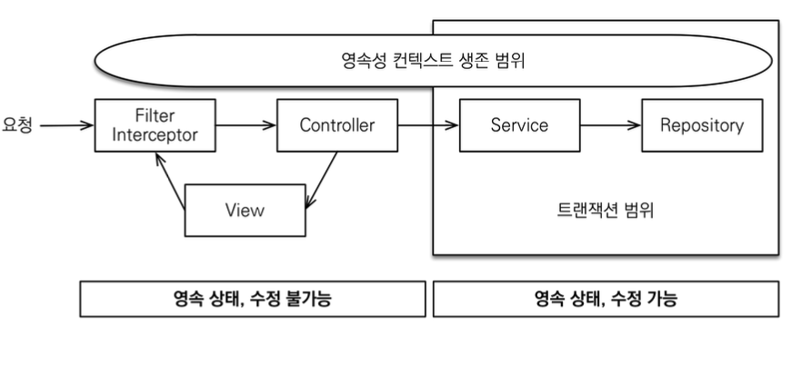
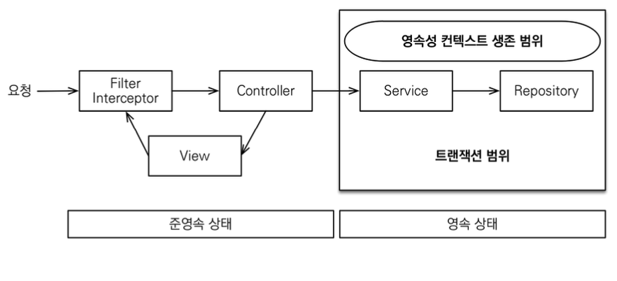

*Open Session In View: 하이버네이트*

*Open EntityManager In View: JPA*

# ***OSIV on***



- ***spring.jpa.open-in-view: true 기본값***

***스프링 부트 경고***

```java
spring.jpa.open-in-view is enabled by default. Therefore, database queries may be performed during view rendering. Explicitly configure spring.jpa.open-in-view to disable this warning
```

***OSIV ON?***

*OSIV on 전략은 데이터베이스 커넥션과 영속성 컨텍스트를 서비스 계층에서 획득하여 트랜잭션 시작부터 클라이언트에게 화면 또는 API 응답까지 유지하는 전략이다.*

*그래서 지금까지 View Template이나 API 컨트롤러에서 지연 로딩이 가능했던 것이다.* 

*지연 로딩은 영속성 컨텍스트가 살아있어야 가능하고, 영속성 컨텍스트는 기본적으로 데이터베이스 커넥션을 유지한다.*

*만약 OSIV off 상태에서 트랜잭션 이후에 지연 로딩된 객체를 초기화 시도하면 초기화 예외가 발생한다.*

*문제는 이 전략은 너무 오랫시간동안 데이터베이스 커넥션 리소스를 사용하기 때문에, 실시간 트래픽이 중요한 애플리케이션에서는 커넥션이 모자랄 수 있다. → 장애 발생* 

# *OSIV OFF*



- *spring.jpa.open-in-view: false OSIV 종료*

*OSIV를 끄면 트랜잭션을 종료할 때 영속성 컨텍스트를 닫고, 데이터베이스 커넥션도 반환한다.* 

*따라서 커넥션 리소스를 낭비하지 않는다.
문제는 OSIV를 끄면 모든 지연로딩을 트랜잭션 안에서 처리해야 한다.* 

*따라서 지금까지 작성한 많은 지연 로딩 코드를 트랜잭션 안으로 넣어야 하는 단점이 있다.* 

# ***커멘드와 쿼리 분리***

*실무에서* ***OSIV를 끈 상태****로 복잡성을 관리하는 좋은 방법이 있다. 
바로 Command와 Query를 분리하는 것이다.*

*보통 비즈니스 로직은 특정 엔티티를 몇 개 등록하거나 수정하는 것이므로 성능이 크게 문제가 되지 않는다.* 

*하지만 복잡한 화면을 출력하기 위한 쿼리는 화면에 맞추어 성능을 최적화 하는 것이 중요하다.*

*하지만 그 복잡성에 비해 핵심 비즈니스에 큰 영향을 주는 것은 아니다.* 

*그래서 둘의 관심사를 명확하게 분리하는 선택은 유지보수 관점에서 충분히 의미가 있다.* 

***OrderService***

- ***OrderService: 핵심 비즈니스 로직***
- ***OrderQueryService: 화면이나 API에 맞춘 서비스(주로 읽기 전용 트랜잭션)***

