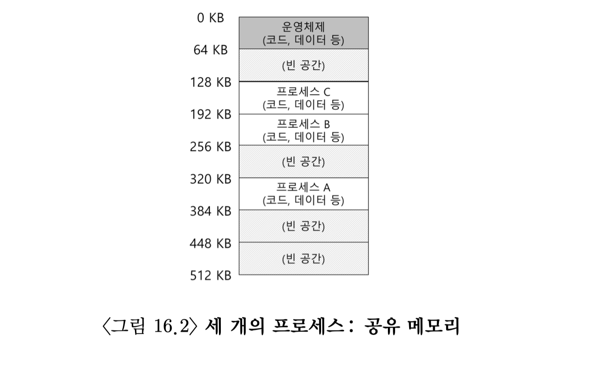

## 16.1 초기 시스템 

가상화 개념이 존재하지 않던 초기 메모리 

## 16.2 멀티프로그래밍과 시분할 

### 개념 

컴퓨터는 고가 장비 

사람들이 공유 시작 (멀티 프로그래밍) 시대 도래 

**시분할(time-sharing) 시대가 시작** 

많은 사람들이 일괄처리방식(batch computing) 한계를 인식

많은 사용자가 동시에 컴퓨터를 사용하고, 현재 실행 중인 작업으로부터 즉시 응답을 원하기 때문에 **대화식 이용(interactivity)** 개념의 중요성 부각 

### 시분할 초기 구현 

하나의 프로세스를 짧은 시간 동안 실행 & 프로세스에게 모든 메모리를 접근할 권한을 준다. 

그런 후에, 이 프로세스를 중단하고, 중단 시점(컨텍스트 스위칭 시점)모든 상태를 디스크 종류의 장치(모든 물리 메모리를 포함)에 저장하고 다른 프로세스의 상태를 탑재하여 또 다시 짧은 시간을 실행

→ 너무 엉성하다, 너무 느리다 특히 메모리가 커질수록 

레지스터 상태를 저장하고 복원하는 것은 빠르지만 메모리의 내용 전체를 디스크에 저장하는 것은 엄청나게 느리다. 어떻게 하면 프로세스 전환 시 프로세스를 메모리에 그대로 유지하면서, 운영체제가 시분할 시스템을 효율적으로 구현할 수 있을까?

### 보호 

그림에 세 개의 프로세스(A,B,C) 존재 

운영체제는 실행할 한 개의 프로세스를 선택하고 다른 프로세스들은 준비 큐에서 실행을 기다린다. 

여러 프로그램이 메모리에 동시에 존재하려면 **보호(protection)**가 중요한 문제가 된다. 

즉, 한 프로세스가 다른 프로세스의 메모리를 read/write 못하게 막아야 한다. 

## 16.3 주소 공간 

### 주소 공간(address space)

운영체제의 메모리 개념 이해 → 메모리를 어떻게 가상화할지를 이해하는 핵심 

사용하기 쉬운 메모리 개념 = 주소 공간 

프로세스 메모리 구조(영역) 

- 코드: 프로그램의 코드(code, 명령어) 
- 스택: 함수 호출 현재 위치, 지역 변수, 함수 인자(매개 변수), 반환 값 저장 
- 힙: 동적으로 할당되는 메모리: java new

프로그램 실행과 더불어 확장되거나 축소될 수 있는 두 종류의 주소 공간이 존재 

상단: 힙 / 하단: 스택 

두 메모리 영역은 확장할 수 있어야 하기 때문에 이런 방식으로 배치 

### 가상화 

운영체제는 물리 메모리를 공유하는 다수의 프로세스에게 어떻게 프로세스 전용의 커다란 주소 공간이라는 개념을 제공할 수 있는가?

운영체제가 이 일을 할 때, 우리는 운영체제가 **메모리를** **가상화(virtualizing memory)**한다고 말한다.

왜냐하면 실행중인 프로그램 즉, 프로세스는 자신이 특정 주소의 메모리에 탑재되고 매우 큰 주소 공간을 가지고 있다고 생각하기 때문이다. 현실은 다르다. 

그림 16.2의 프로세스A가 주소 0(가상 주소)로부터 load 연산을 수행할 때, 운영체제는 하드웨어의 지원을 통해 물리 주소 0이 아니라 물리 주소 320 KB를 읽도록 보장한다. 

즉, 운영체제는 하드웨어의 지원을 받아 가상 주소를 물리 주소로 바꿔 접근하도록 한다.

→ 메모리 가상화, 현대 모든 컴퓨터 시스템의 기저 

## 16.4 목표 

### 투명성(transparency)

운영체제는 실행 중인 프로그램이 가상 메모리의 존재를 인지하지 못하도록 가상 메모리 시스템을 구현해야 한다. 

### 효율성(eiciency)

운영체제는 가상화가 시간과 공간 측면에서 효율적이도록 해야 한다. 

시간적으로는 너무 느리게 실행X

공간적으로는 너무 많은 메모리를 사용X

### 보호(protection)

운영체제는 프로세스를 다른 프로세스로부터 보호해야 하고 운영체제 자신도 프로세스로부터 보호해야 한다.

### 여담 

당신이 보는 값은 (좀 큰 변수, 종종 16 진수로 출력되는) 가상 주소(virtual address)이다. 

프로그램 코드가 탑재된 주소가 어디인지 궁금한 적은 있는가? 그 주소를 출력할 수 있다.

그러나 주소를 출력했다면, 그 주소는 가상 주소이다. 

사용자 프로그램(user level program)이 볼 수 있는 주소는 모두 가상 주소이다. 

메모리 가상화의 기술 때문에, 명령어와 데이터가 탑재되어 있는 물리 메모리 주소를 알 수 있는 것은 오직 운영체제뿐이다.

