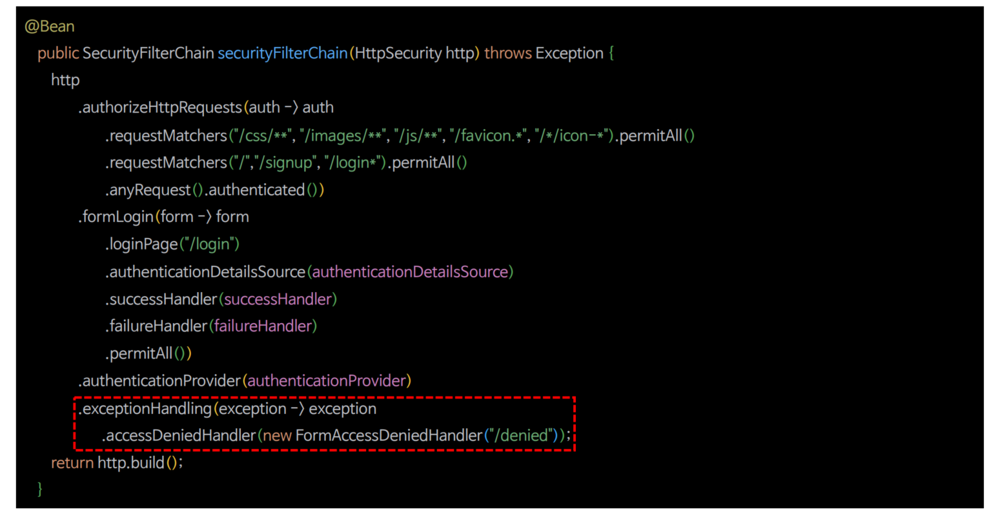
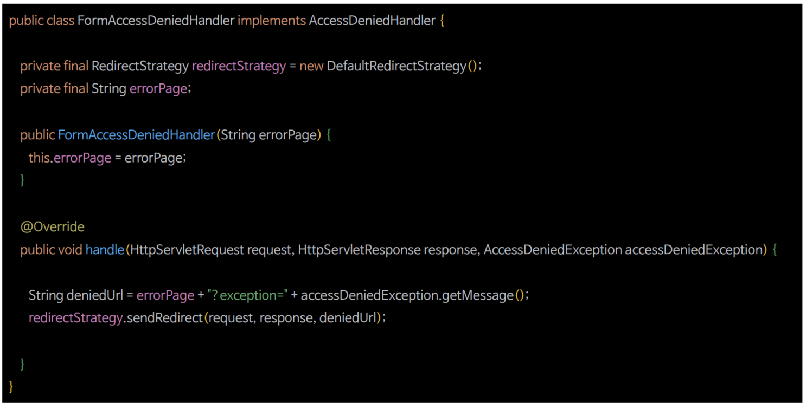

# ***AccessDeniedHandler 설정***



# ***FormAccessDeniedHandler***



# *구현*

***SecurityConfig***

```java
@EnableWebSecurity
@Configuration
@RequiredArgsConstructor
public class SecurityConfig {
    private final AuthenticationProvider authenticationProvider;
    private final AuthenticationDetailsSource authenticationDetailsSource;
    private final AuthenticationSuccessHandler successHandler;
    private final AuthenticationFailureHandler failureHandler;
    @Bean
    public SecurityFilterChain securityFilterChain(HttpSecurity http) throws Exception{
        http
                .authorizeHttpRequests(authorize -> authorize
                        .requestMatchers("/css/**", "/images/**",
                                "/js/**", "/favicon.*", "/*/icon/-*").permitAll()
                        .requestMatchers("/", "/signup", "/login*").permitAll()
                        .requestMatchers("/user").hasRole("USER")
                        .requestMatchers("/admin").hasRole("ADMIN")
                        .requestMatchers("/manager").hasRole("MANAGER")
                        .anyRequest().authenticated())
                .authenticationProvider(authenticationProvider)
                .formLogin(form -> form
                        .loginPage("/login")
                        .authenticationDetailsSource(authenticationDetailsSource)
                        .successHandler(successHandler)
                        .failureHandler(failureHandler)
                        .permitAll())
                .exceptionHandling(ex -> ex.accessDeniedHandler(
                        new FormAccessDeniedHandler("/denied")));
        return http.build();
    }
}
```

***FormAccessDeniedHandler***

```java
public class FormAccessDeniedHandler implements AccessDeniedHandler {
    private final RedirectStrategy redirectStrategy = new DefaultRedirectStrategy();
    private final String errorPage;
    public FormAccessDeniedHandler(String errorPage) {
        this.errorPage = errorPage;
    }
    @Override
    public void handle(HttpServletRequest request, HttpServletResponse response, AccessDeniedException accessDeniedException) throws IOException, ServletException {
        String deniedUrl = errorPage + "?exception=" + accessDeniedException.getMessage();
        redirectStrategy.sendRedirect(request, response, deniedUrl);
    }
}
```

***LoginController***

```java
@GetMapping(value="/denied")
public String accessDenied(@RequestParam(value = "exception", required = false) String exception,
                           @AuthenticationPrincipal AccountDto accountDto, Model model) {
    model.addAttribute("username", accountDto.getUsername());
    model.addAttribute("exception", exception);
    return "login/denied";
}
```

- `@AuthenticationPrincipal AccountDto accountDto` 
- *Authentication 내부의 Principal을 가져온다.*

***denied.html 일부***

```html
<div>
  <h3 th:text="${exception}"></h3>
  <br />
  <span th:text="${username} != null ? ${username} + ' 님은 접근 권한이 없습니다' : '비 정상적인 접근입니다'"></span>
</div>
```

