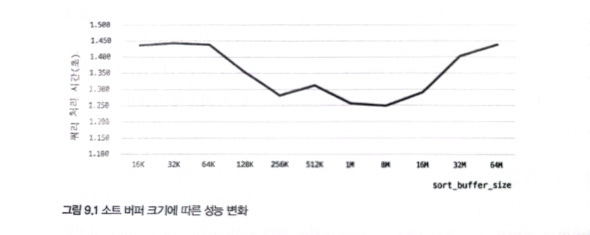
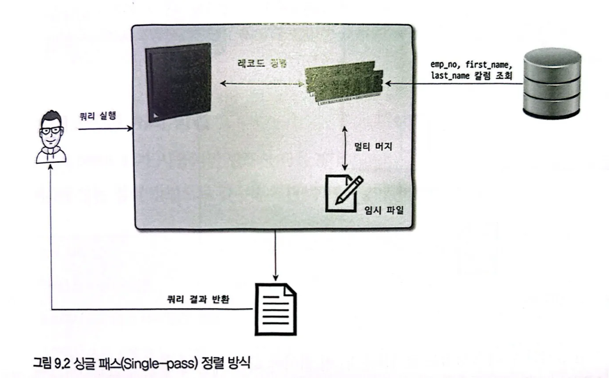
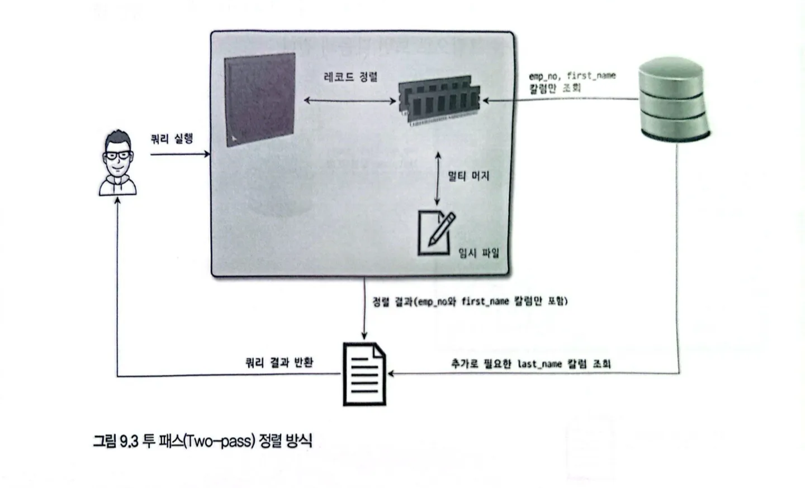
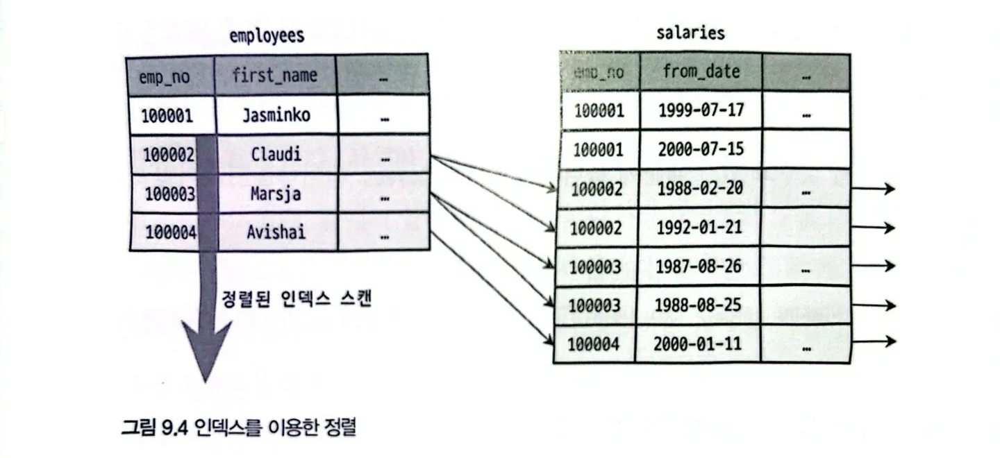
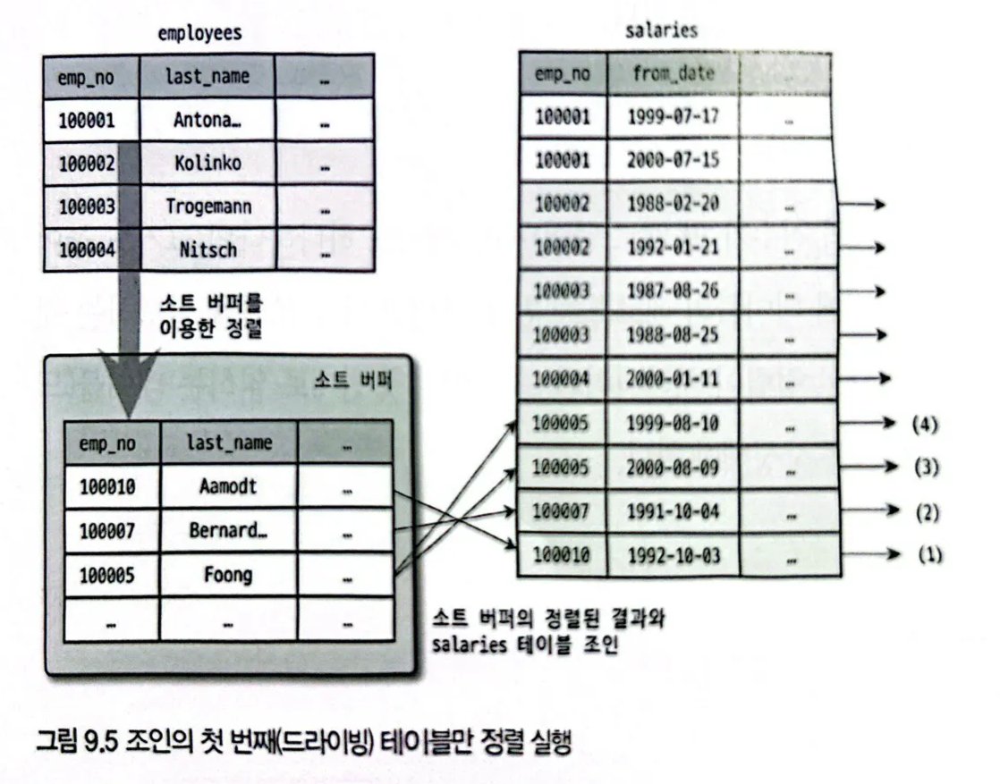
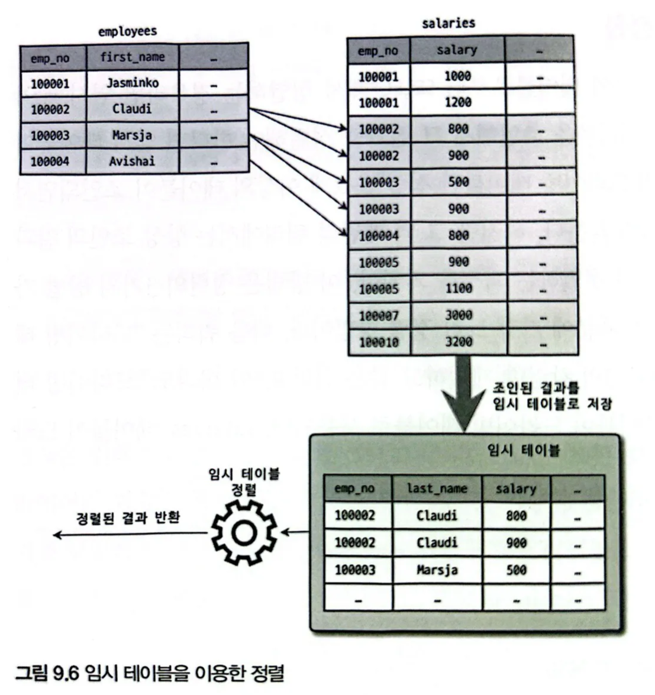
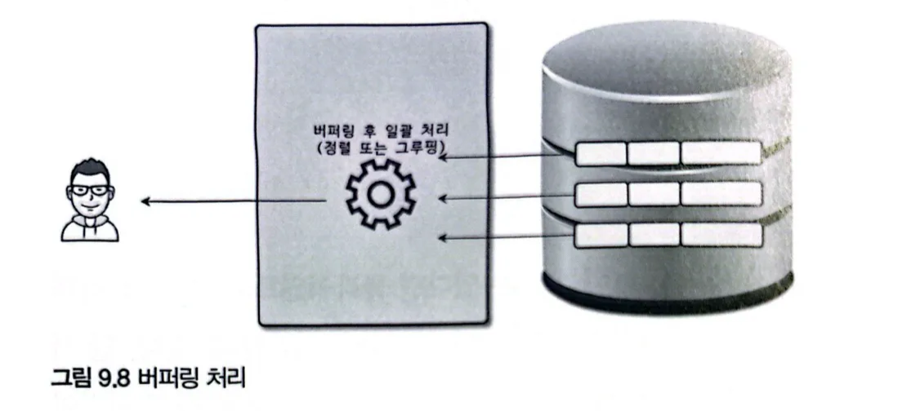
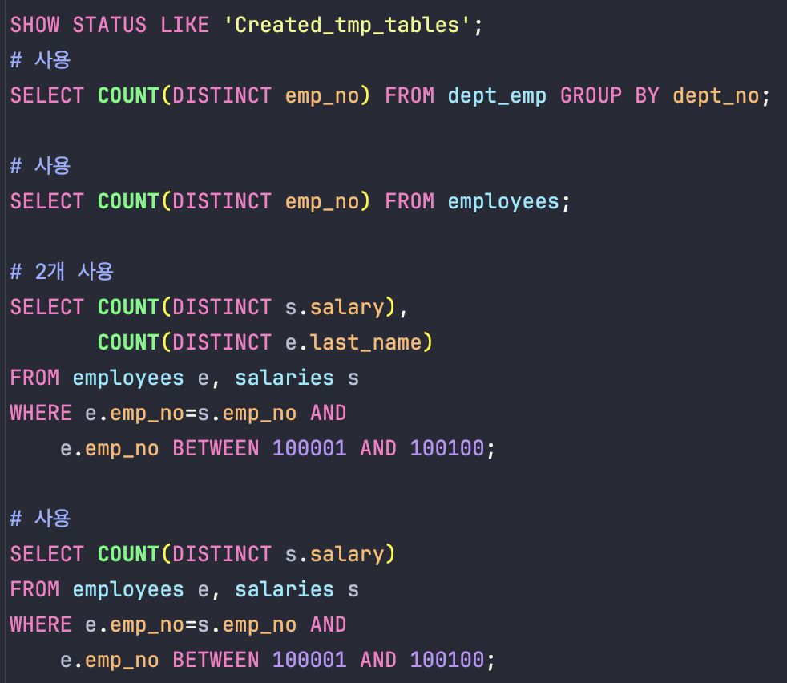

모든 RDBMS는 데이터를 정렬하거나 그루핑하는 등의 기본 데이터 가공 기능을 가지고 있다.

결과물은 동일하더라도 RDBMS 별로 그 결과를 만들어 내는 과정은 천차만별이다.

기본적인 가공을 위해 MySQL 서버가 어떤 알고리즘을 사용하는지 알아보자.

---

# 9.2.1 풀 테이블 스캔과 풀 인덱스 스캔

풀 테이블 스캔은 인덱스를 사용하지 않고 테이블의 데이터를 처음부터 끝까지 읽어서 요청된 작업을 처리하는 작업을 의미한다. 

MySQL 옵티마이저가 풀 테이블 스캔하는 경우

- 테이블의 레코드 건수가 너무 작아서 인덱스를 통해 읽는 것보다 풀 테이블 스캔을 하는 편이 더 빠른 경우(일반적으로 테이블이 페이지 1개로 구성된 경우)
- WHERE 절이나 ON 절에 인덱스를 이용할 수 있는 적절한 조건이 없는 경우
- 인덱스 레인지 스캔을 사용할 수 있는 쿼리라고 하더라도 옵티마이저가 판단한 조건 일치 레코드 건수가 너무 많은 경우(인덱스의 B-Tree 샘플링해서 조사한 통계 정보 기준)

일반적으로 테이블의 전체 크기는 인덱스보다 훨씬 크기 때문에 테이블을 처음부터 끝까지 읽는 작업은 상당히 많은 디스크 읽기가 필요하다. 그래서 대부분 DBMS는 **풀 테이블 스캔을 실행할 때 한꺼번에 여러 개의 페이지를 읽어오는 기능을 내장**하고 있다. 

MySQL에서는 풀 테이블 스캔을 실행할 때 한꺼번에 몇 개씩 페이지를 읽어올지 설정하는 시스템 변수가 없다. MyISAM 스토리지 엔진에서는 디스크에서 페이지를 가져올 때 1개의 페이지씩 가져오지만 InnoDB 스토리지 엔진은 특정 테이블의 **연속된 데이터 페이지가 읽히면 백그라운드 쓰레드에 의해 리드 어헤드(Read ahead) 작업이 자동으로 시작된다.**

**리드 어헤드란** 어떤 영역의 데이터가 앞으로 필요해지라는 것을 예측해서 요청이 오기 전에 미리 디스크에서 읽어 InnoDB 버퍼 풀에 가져다 두는 것을 의미한다. 즉, 공간 지역성의 원리를 따른다. 

풀 테이블 스캔이 실행되면 처음 몇 개의 데이터 페이지는 포그라운드 쓰레드가 페이지 읽기를 실행하지만 특정 시점부터는 읽기 작업을 백그라운드 스레드로 넘긴다.

백그라운드 쓰레드가 읽기를 넘겨받는 시점부터는 한 번에 4개 또는 8개씩 페이지를 읽으면서 계속 그 수를 증가시킨다. 이때 한 번에 최대 64개의 페이지를 읽어서 버퍼 풀에 저장해 둔다.

포그라운드 쓰레드는 미리 버퍼 풀에 준비된 데이터를 가져다 사용하기만 하면 되므로 처리가 상당히 빨리 처리되는 것이다.

MySQL 서버에서는 `innodb_read_ahead_threshold`  시스템 변수를 이용해 언제 리드 어헤드를 실행할 지 임계값을 설정할 수 있다.

리드 어헤드 작업은 풀 테이블 스캔에서만 사용되는 것이 아니라 풀 인덱스 스캔에서도 동일하게 사용된다.

```sql
SELECT COUNT(*) FROM employees;
```

이 쿼리는 아무런 조건 없이 레코드 건수를 조회하고 있다. 

이 쿼리의 실행 계획은 풀 테이블 스캔보다는 풀 인덱스 스캔을 하게 될 가능성이 높다.

단순히 레코드의 건수만 필요로 하는 쿼리라면 용량이 작은 (칼럼 개수 2~3)인덱스를 선택하는 것이 디스크 읽기 횟수를 줄일 수 있기 때문이다.

 

```sql
SELECT * FROM employees;
```

이 쿼리는 레코드에만 있는 칼럼이 필요하니 풀 테이블 스캔을 한다.

---

## 9.2.2 병렬 처리

MySQL8.0 버전부터 제한적으로 쿼리의 병렬 처리가 가능해졌다.

여기서 말하는 병렬 처리는 하나의 쿼리를 여러 스레드가 작업을 나누어서 동시에 처리한다는 것을 의미한다.

`innodb_parallel_read_threads` 시스템 변수를 이용해 하나의 쿼리를 최대 몇 개의 쓰레드를 이용해서 처리할지를 변경할 수 있다. 

아직 여러 개의 쓰레드를 이용해 병렬로 처리하게 하는 힌트나 옵션은 없다.

다음 예제와 같이 아무런 WHERE 조건 없이 단순 테이블의 전체 건수를 가져오는 쿼리만 병렬로 처리할 수 있다.

```sql
// default 4 
SHOW variables LIKE 'innodb_parallel_read_threads';

SET SESSION innodb_parallel_read_threads=1;
SELECT COUNT(*) FROM salaries;
+----------+
| COUNT(*) |
+----------+
|  2844047 |
+----------+
1 row in set (0.84 sec)

SET SESSION innodb_parallel_read_threads=2;
SELECT COUNT(*) FROM salaries;
+----------+
| COUNT(*) |
+----------+
|  2844047 |
+----------+
1 row in set (0.87 sec)


SET SESSION innodb_parallel_read_threads=4;
SELECT COUNT(*) FROM salaries;
+----------+
| COUNT(*) |
+----------+
|  2844047 |
+----------+
1 row in set (0.93 sec)

SET SESSION innodb_parallel_read_threads=8;
SELECT COUNT(*) FROM salaries;
+----------+
| COUNT(*) |
+----------+
|  2844047 |
+----------+
1 row in set (0.89 sec)
```

결과 상태가..? 

병렬 처리용 스레드 개수를 아무리 늘리더라도 서버에 장착된 CPU 코어 개수를 넘어서는 경우에는 오히려 성능이 떨어질 수도 있으니 주의하자.

---

# 9.2.3 ORDER BY 처리(Using filesort)

레코드 1~2건을 가져오는 쿼리를 제외하면 대부분의 SELECT 쿼리에서 정렬은 필수적으로 사용된다.

정렬을 처리하는 방법은 **인덱스를 이용하는 방법**과 쿼리가 실행될 때 **“Filesort”라는 별도의 처리**를 이용하는 방법으로 나눌 수 있다.

|  | 장점 | 단점 |
| --- | --- | --- |
| 인덱스 이용  | INSERT, UPDATE, DELETE 쿼리가 실행될 때 이미 인덱스가 정렬돼 있어서 순서대로 읽기만 하면 되므로 매우빠르다.<br><br> | INSERT, UPDATE, DELETE 작업 시 부가적인 인덱스 추가/삭제 작업이 필요하므로 느리다.<br>인덱스 때문에 디스크 공간이 더 많이 필요하다.<br>인덱스의 개수가 늘어날수록 InnoDB 버퍼 풀을 위한 메모리가 많이 필요하다. |
| Filesort 이용 | 인덱스를 생성하지 않아도 되므로 인덱스를 이용할 때의 단점이 장점으로 바뀐다.<br>정렬해야 할 레코드가 많지 않으면 메모리에서 Filesort가 처리되므로 충분히 빠르다. | 정렬 작업이 쿼리 샐행 시 처리되므로 레코드 대상 건수가 많아질수록 쿼리의 응답 속도가 느리다. |

이미 인덱스를 이용한 정렬은 8.6.3 B-Tree 인덱스의 정렬 및 스캔 방향에서 살펴봤다.

하지만 **모든 정렬을 인덱스를 이용하도록 튜닝하기란 거의 불가능하다.**

- 정렬 기준이 너무 많아서 요건별로 모두 인덱스를 생성하는 것이 불가능한 경우
- GROUP BY 결과 또는 DISTINCT 같은 처리의 결과를 정렬해야 하는 경우
- UNION의 결과와 같이 임시 테이블의 결과를 다시 정렬해야 하는 경우
- 랜덤하게 결과 레코드를 가져와야 하는 경우

MySQL 서버에서 인덱스를 사용하지 않고 별도의 정렬 처리를 수행했는지는 **실행 계획의 Extra 칼럼에 “Using filesort” 메시지가 표시되는지 여부로 판단할 수 있다.**

**MySQL 정렬 특성을 이해하면 어떻게 쿼리를 튜닝할 때 어떻게 하면 조금이라도 더 빠른 쿼리가 될지 쉽게 판단할 수 있을 것이다.**

---

## 9.2.3.1 소트 버퍼

### 소트 버퍼

MySQL은 정렬을 수행하기 위해서 별도의 메모리 공간을 할당받는다, 이 공간을 **소트 버퍼(Sort buffer)**라고 한다. 소트 버퍼는 정렬이 필요한 경우에만 할당받는다. 버퍼의 크기는 정렬해야 할 레코드의 크기에 따라 가변적으로 증가하지만 최대 사용 가능한 소트 버퍼의 공간은 `sort_buffer_size` 시스템 변수로 설정할 수 있다.

소트 버퍼를 위한 메모리 공간은 쿼리가 종료되면 즉시 시스템으로 반납된다.

```sql
SHOW variables LIKE 'sort_buffer_size'

-> 262144
```

### 멀터 머지

지금부터 정렬이 왜 문제가 되는지 살펴보자. 

정렬해야 할 레코드가 아주 소량이어서 메모리에 할당된 소트 버퍼만으로 정렬할 수 있다면 아주 빠르게 정렬이 처리될 것이다. **하지만 정렬해야 할 레코드의 건수가 소트 버퍼로 할당된 공간보다 크다면?**

이때 MySQL은 정렬해야 할 레코드를 여러 조각으로 나눠서 처리하는데, 이 과정에서 임시 저장을 위해 디스크를 사용한다.

메모리의 소트 버퍼에서 정렬을 수행하고, 그 결과를 임시로 디스크에 기록한다. 그리고 다음 레코드를 가져와서 다시 정렬해서 반복적으로 디스크에 임시 저장한다. 각 버퍼 크기만큼 정렬된 레코드를 다시 병합하면서 정렬을 수행해야 한다. 이 병합 작업을 **멀티 머지(Multi-merge)**라고 표현한다.

수행된 멀티 머지 횟수는 `Sort-merge_passes` 시스템 변수에 누적해서 집계된다.

```sql
SHOW STATUS LIKE 'Sort_merge_passes';
```

이 작업들이 모두 디스크의 쓰기와 읽기를 유발하며, 레코드 건수가 많을수록 이 반복 작업의 횟수가 많아진다.

### 소트 버퍼 크기를 키우면 빨라질까? 



그림 9.1은 소트 버퍼의 크기를 확장해가면서 아래 쿼리의 소요되는 시간을 측정한 것이다.

```sql
SELECT * FROM salaries
ORDER By to_date
LIMIT 2844046, 1;
```

해당 쿼리는 salaries 테이블의 2,844,047건 레코드를 모두 읽어서 정렬하는데, to_date 칼럼에 인덱스가 없기 때문에 쿼리 처리 시에 정렬 작업이 필요한 쿼리다.

`sort_buffer_size` 시스템 변수의 설정값이 무조건 크면 메모리에서 모두 처리되니 빨라질 것으로 예상하지만 실제 결과는 그렇지 않다.

그리고 리눅스 계열의 운영체제에서는 너무 큰 소트 버퍼 사이즈를 사용하는 경우, 큰 메모리 공간 할당 때문에 성능이 훨씬 떨어질 수도 있다.

**해당 예제에서 인덱스가 있는 칼럼으로 정렬해도 여전히 파일 소트로 진행된다.** 

```sql
mysql> SHOW indexes from salaries;
+----------+------------+-----------+--------------+-------------+-----------+-------------+----------+--------+------+------------+---------+---------------+---------+------------+
| Table    | Non_unique | Key_name  | Seq_in_index | Column_name | Collation | Cardinality | Sub_part | Packed | Null | Index_type | Comment | Index_comment | Visible | Expression |
+----------+------------+-----------+--------------+-------------+-----------+-------------+----------+--------+------+------------+---------+---------------+---------+------------+
| salaries |          0 | PRIMARY   |            1 | emp_no      | A         |      297214 |     NULL |   NULL |      | BTREE      |         |               | YES     | NULL       |
| salaries |          0 | PRIMARY   |            2 | from_date   | A         |     2838426 |     NULL |   NULL |      | BTREE      |         |               | YES     | NULL       |
| salaries |          1 | ix_salary |            1 | salary      | A         |       74151 |     NULL |   NULL |      | BTREE      |         |               | YES     | NULL       |
+----------+------------+-----------+--------------+-------------+-----------+-------------+----------+--------+------+------------+---------+---------------+---------+------------+

mysql> EXPLAIN
    -> SELECT * FROM salaries
    -> ORDER By salary
    -> LIMIT 2844046, 1;
+----+-------------+----------+------------+------+---------------+------+---------+------+---------+----------+----------------+
| id | select_type | table    | partitions | type | possible_keys | key  | key_len | ref  | rows    | filtered | Extra          |
+----+-------------+----------+------------+------+---------------+------+---------+------+---------+----------+----------------+
|  1 | SIMPLE      | salaries | NULL       | ALL  | NULL          | NULL | NULL    | NULL | 2838426 |   100.00 | Using filesort |
+----+-------------+----------+------------+------+---------------+------+---------+------+---------+----------+----------------+
```

그 이유는 옵티마이저가 정렬된 세컨더리 인덱스(인덱스 풀 스캔) → 클러스터링 인덱스 가져오는 비용보다 바로 풀 테이블 스캔을 하여 메모리로 데이터 페이지를 가져와서 정렬(파일 소트)하는 방식이 더 빠르다고 판단했기 때문이다.

정렬을 위해 할당되는 **소트 버퍼는 세션 메모라 영역 즉, 여러 클라이언트가 공유해서 사용할 수 있는 영역이 아닌 각 클라이언트 스레드가 사용하는 공간**이다. 결과적으로 커넥션이 많으면 많을수록, 정렬 작업이 많으면 많을수록 소트 버퍼로 소비되는 메모리 공간이 커짐을 의미한다. 

책에서는 소트 버퍼의 크기를 56KB ~ 1MB 사이로 추천한다.

만약 소트 버퍼의 크기를 10MB 이상으로 설정하면 운영체제는 메모리 부족 현상을 겪을 수도 있다.

더는 여유 메모리 공간이 없는 경우 운영체제의 OOM-Killer가 프로세스를 강제로 종료할 것이다.

이때 OOM-Killer는 가장 많이 메모리를 사용하는 프로세스를 강제 종료하기 떄문에 일반적으로 MySQL 서버가 1순위가 된다.

---

## 9.2.3.2 정렬 알고리즘

레코드를 정렬할 때 **레코드 전체를 소트 버퍼에 담을지** 또는 **정렬 기준 칼럼만 소트 버퍼에 담을지**에 따라

**“싱글 패스”와 “투 패스” 2가지 정렬 모드**로 나눌 수 있다.

정렬을 수행하는 쿼리가 어떤 정렬 모드를 사용하는지는 옵티마이저 트레이스 기능으로 확인할 수 있다.

옵티마이저 트레이스 기능 활성화는 책 291쪽을 참고하자.

### MySQL 서버의 정렬 방식 3가지 (sort_mode)

- **<sort_key, rowid>: 정렬 키와 레코드의 로우 아이디만 가져와서 정렬하는 방식**
- **<sort_key, additional_fields>: 정렬 키와 레코드 전체를 가져와서 정렬하는 방식, 레코드의 칼럼들은 고정 사이즈로 메모리 저장**
- **<sort_key, packed_additional_fields>: 정렬 키와 레코드 전체를 가져와서 정렬하는 방식, 레코드의 칼럼들은 가변 사이즈로 메모리 저장**

첫 번째 방식 = “투 패스”, 두 번째와 세 번째 방식 = “싱글 패스”

---

## 9.2.3.2.1 싱글 패스 정렬 방식

소트 버퍼에 정렬 기준 칼럼을 포함해 **SELECT 대상이 되는 칼럼 전부를 담아서 정렬**을 수행하는 방식

```sql
SELECT emp_no, first_name, last_name 
FROM employees
ORDER BY first_name;
```



처음 employees 테이블을 읽을 때 정렬에 필요하지 않은 last_name 칼럼까지 전부 읽어서 소트 버퍼에 담고 정렬을 수행한다.

---

## 9.2.3.2.2 투 패스 정렬 방식

**정렬 대상 칼럼과 프라이머리 키 값만 소트 버퍼에 담아서 정렬을 수행**하고, **정렬된 순서대로 다시 프라이머리 키로 테이블을 읽어서 SELECT할 칼럼을 가져오는 정렬 방식**

싱글 패스 적용 이전부터 사용되던 방식. 여전히 MySQL 8.0에서도 특정 조건에는 투 패스 정렬 방식을 사용



처음 정렬에 필요한 first_name 칼럼과 프라이머리 키인 emp_no만 읽어서 정렬을 수행한다. 

정렬이 완료되면 다시 테이블을 읽어서 last_name을 가져온다.

### 투 패스 VS 싱글 패스

투 패스 방식은 테이블을 두 번 읽어야 하고 싱글 패스는 테이블을 한 번 읽는다.

하지만 싱글 패스 방식은 더 많은 소트 버퍼 공간이 필요하다. 

최신 버전에서는 일반적으로 싱글 패스 정렬 방식을 주로 사용하지만 항상은 아니다.

다음의 경우, 서버는 싱글 정렬 방식을 사용하지 못하고 투 패스 정렬 방식을 사용한다.

- 레코드의 크기가 `max_length_for_sort_data` 시스템 변수에 설정된 값보다 클 때
- BLOB이나 TEXT 타입의 칼럼이 SELECT 대상에 포함될 때

싱글 패스 방식은 정렬 대상 레코드의 크기나 건수가 작은 경우에 빠른 성능을 보이며, 투 패스 방식은 정렬 대상 레코드의 크기나 건수가 상당히 많은 경우 효율적이라고 볼 수 있다.

**주의 (필요한 칼럼만 조회하라)**

```
SELECT 쿼리에서는 꼭 필요한 칼럼만 조회하도록 쿼리를 작성하는 것이 좋다고 권장한다.

특히 정렬이 필요한 SELECT는 불필요한 칼럼을 조회하지 않도록 하는 이유가 투 패스, 싱글 패스 차이다.
싱글 패스로 정렬되는 쿼리는 더욱 빠르다.

정렬 버퍼에만 영향을 미치는게 아니라 임시 테이블이 필요한 쿼리에서도 영향을 미친다.
```

---

## 9.2.3.3 정렬 처리 방법

### **드라이빙 테이블?**

```sql
SELECT e.name, d.name
FROM employees e
JOIN departments d ON e.dept_id = d.id
WHERE d.name = 'Engineering';
```

- 이 경우, `departments` 테이블이 조건을 가지고 있으므로, 보통 옵티마이저는 `departments`를 먼저 읽고(드라이빙 테이블), 해당 부서 ID만 추출한 후 `employees`와 조인하는 방식으로 실행한다.
- 반대로 `employees`가 드라이빙 테이블이면, 모든 직원 데이터를 읽은 다음 필터링해야 하므로 비효율적

**네스티드 루프 조인**은 드라이빙 테이블을 기준으로 **행마다 다른 테이블을 반복적으로 탐색**하는 방식

### **정렬 처리 방법**

쿼리에 ORDER BY가 적용되면 반드시 아래 3가지 처리 방법 중 하나로 정렬이 처리된다.

일반적으로 아래쪽에 있는 정렬 방법으로 갈수록 처리 속도는 떨어진다.

| **정렬 처리 방법**  | **실행 계획의 Extra 칼럼 내용**  |
| --- | --- |
| 인덱스를 사용한 방법  | 별도 표기 없음 |
| 조인에서 드라이빙 테이블만 정렬  | “Using filesort”  |
| 조인에서 조인 결과를 임시 테이블로 저장 후 정렬  | “Using temporary; Using filesort” |

먼저 옵티바이저는 정렬에 인덱스를 이용할 수 있다면 별도의 “Filesort” 과정 없이 순서대로 읽어서 반환한다.

하지만 인덱스를 사용할 수 없다면 WHERE 조건에 맞는 레코드를 검색해 정렬 버퍼에 저장하면서 정렬을 처리한다. 이때 옵티마이저는 정렬 대상을 최소화하기 위해 2가지 방법 중 하나를 선택한다.

- **조인의 드라이빙 테이블만 정렬한 다음 조인을 수행**
- **조인이 끝나고 일치하는 레코드를 모두 가져온 후 정렬을 수행**

일반적으로 조인이 수행되면서 레코드 건수와 레코드의 크기는 배수로 불어나기 때문에 가능하다면 드라이빙 테이블만 정렬한 다음 조인을 수행하는 방법이 효율적이다.

---

## 9.2.3.3.1 인덱스를 이용한 정렬

인덱스를 이용한 정렬을 위해서는 반드시 ORDER BY에 명시된 칼럼이 제일 먼저 읽는 테이블(조인 시 드라이빙 테이블)에 속하고, ORDER BY의 순서대로 생성된 인덱스가 있어야 한다.

또한 WHERE 절에 첫 번째로 읽는 테이블의 칼럼에 대한 조건이 있다면 그 조건과 ORDER BY는 같은 인덱스를 사용할 수 있어야 한다.

B-Tree 계열의 인덱스가 아니라면 사용할 수 없고, 여러 테이블이 조인되는 경우에 네스티드-루프 방식의 조인에서만 이 방식을 사용할 수 있다.

```sql
SELECT *
FROM employees e, salaries s
WHERE s.emp_no = e.emp_no
AND e.emp_no BETWEEN 100002 AND 100020
ORDER BY e.emp_no;
```



인덱스를 이용해 정렬이 처리되는 경우에는 실제 인덱스의 값이 정렬돼 있기 때문에 인덱스의 순서대로 읽기만 하면된다. 

또한 조인이 네스티드-루프 방식으로 실행되기 때문에 조인 때문에 드라이빙 테이블의 인덱스 읽기 순서가 흐트러지지 않는다.

---

## 9.2.3.3.2 조인의 드라이빙 테이블만 정렬

일반적으로 조인이 수행되면 결과 레코드 건수가 몇 배로 불어나고, 레코드 하나하나의 크기도 늘어난다.

**조인을 수행하기 전에 첫 번째(드라이빙 테이블)의 레코드를 먼저 정렬한 후 조인을 실행**하는 것이 정렬의 차선책이 될 것이다.

이 방법으로 처리되려면 **드라이빙 테이블의 칼럼만으로 ORDER BY 절을 작성**해야 한다.

```sql
SELECT * 
FROM employees e, salaries s
WHERE s.emp_no = e.emp_no
AND e.emp_no BETWEEN 100002 AND 100020
ORDER BY e.last_name;
```

WHERE 절이 다음 2가지 조건을 갖추고 있기 때문에 옵티마이저는 employees 테이블을 **드라이빙 테이블**로 선택할 것이다.

- “e.emp_no BETWEEN 100002 AND 100020” employees 테이블의 프라이머리 키를 이용해 검색하면 작업량을 줄일 수 있다. (인덱스 레인지 스캔)
- **드리븐 테이블**(salaries)의 조인 칼럼인 emp_no 칼럼에 인덱스가 있다.

검색은 인덱스 레인지 스캔으로 처리할 수 있지만 ORDER BY 절에 명시된 칼럼은 employees 테이블의 프라이머리 키와 관련이 없으므로 인덱스를 이용한 정렬이 불가능하다.

하지만 ORDER BY 절의 정렬 기준 칼럼이 employees 테이블 즉, 드라이빙 테이블이다.

옵티마이저는 드라이빙 테이블만 검색해서 정렬을 먼저 수행하고, 그 결과를 salaries 테이블을 조인한 것이다.



1. 인덱스(프라이머리 키)를 이용해 인덱스 레인지 스캔
1. 검색 결과를 last_name 칼럼으로 정렬(Filesort)을 수행
1. 정렬된 결과를 순서대로 읽으면서 salaries 테이블과 조인을 수행해 최종 결과를 가져온다.

---

## 9.2.3.3.3 임시 테이블을 이용한 정렬

쿼리가 여러 테이블을 조인하지 않고, 하나의 테이블로부터 SELECT해서 정렬하는 경우라면 임시 테이블이 필요하지 않다. 하지만 **2개 이상의 테이블을 조인해서 그 결과를 정렬해야 한다면 임시 테이블이 필요할 수 있다.**

조인의 드라이빙 테이블만 정렬은 2개 이상의 테이블이 조인되면서 정렬이 실행되지만 드라이빙 테이블에만 정렬 기준이 있기 때문에 임시 테이블을 사용하지 않는다.

하지만 그 외 패턴의 쿼리에서는 항상 **조인 결과를 임시 테이블에 저장하고, 그 결과를 다시 정렬하는 과정을 거친다.** 이 방법은 정렬해야 할 레코드 건수가 가장 많기 때문에 가장 느린 정렬 방법이다.

```sql
SELECT * 
FROM employees e, salaries s
WHERE s.emp_no = e.emp_no
AND e.emp_no BETWEEN 100002 AND 100020
ORDER BY s.salary;
```

이 쿼리도 employees 테이블이 드라이빙 테이블로 사용되며, salaries 테이블이 드리븐 테이블로 사용된다.

이 쿼리에서는 정렬 기준이 드라이빙 칼럼이 아니라 드리븐 테이블에 있는 칼럼이다.

즉, 정렬이 수행되기 전에 salaries 테이블을 읽어야 하므로 조인된 데이터를 가지고 정렬할 수 밖에 없다.

**실행 계획 분석하기** 

```sql
+----+-------------+-------+------------+-------+---------------+---------+---------+--------------------+------+----------+----------------------------------------------+
| id | select_type | table | partitions | type  | possible_keys | key     | key_len | ref                | rows | filtered | Extra                                        |
+----+-------------+-------+------------+-------+---------------+---------+---------+--------------------+------+----------+----------------------------------------------+
|  1 | SIMPLE      | e     | NULL       | range | PRIMARY       | PRIMARY | 4       | NULL               |   19 |   100.00 | Using where; Using temporary; Using filesort |
|  1 | SIMPLE      | s     | NULL       | ref   | PRIMARY       | PRIMARY | 4       | employees.e.emp_no |    9 |   100.00 | NULL                                         |
+----+-------------+-------+------------+-------+---------------+---------+---------+--------------------+------+----------+----------------------------------------------+
```

Extra 칼럼을 보면 “Using temporary; Using filesort”라는 코멘트가 표시된다.

이는 조인 결과를 임시 테이블에 저장하고, 그 결과를 다시 정렬 처리했음을 의미한다.



**정렬 처리 방법 3가지 정리** 

1. 인덱스를 사용해서 처리 가장 빠르다.
1. 인덱스가 없는 경우 정렬 조건이 드라이빙 테이블에만 있는 경우 드라이빙 테이블을 먼저 파일소트하고 이후에 조인을 진행한다.
1. 1, 2번 모두 불가능한 경우에는 조인을 먼저 진행하고 정렬 조건으로 정렬해서 반환한다. 가장 느리다.

---

## 9.2.3.3.4 정렬 처리 방법의 성능 비교 

주로 웹 서비스용 쿼리에서는 ORDER BY + LIMIT 조합이 거의 필수로 사용되는 경향이 있다. 

일반적으로 LIMIT은 테이블이나 처리 결과의 일부만 가져오기 때문에 서버가 처리해야 할 작업량을 줄이는 역할을 한다. 하지만 ORDER BY, GROUP BY 같은 작업은 LIMIT 건수만큼만 가져와서는 처리할 수 없다.

**우선 조건을 만족하는 모든 레코드를 가져와서 정렬을 수행하거나 그루핑 작업을 실행해야만 비로소 LIMIT 건수를 제한할 수 있다.**

즉, WHERE 조건이 아무리 인덱스를 잘 활용하도록 튜닝해도 잘못된 ORDER BY나 GROUP BY 때문에 쿼리가 느려지는 경우가 자주 발생한다.

쿼리에서 인덱스를 사용하지 못하는 정렬이나 그루핑 작업이 왜 느리게 작동할 수 밖에 없는지 살펴보자.

이를 위해 쿼리가 처리되는 방법을 **“스트리밍 처리”**, **“버퍼링 처리”** 2가지 방식으로 구분해 보자.

---

## 9.2.3.3.4.1 스트리밍 방식


서버 쪽에서 처리할 데이터가 얼마인지에 관계없이 조건에 일치하는 레코드가 검색될때마다 바로바로 클라이언트에게 전달해주는 방식을 스트리밍 방식이라고 한다.

이 방식으로 처리할 경우 클라이언트는 쿼리를 요청하고 곧바로 첫 번째 레코드를 전달받는다.

가장 마지막 레코드는 언제 받을지 알 수 없지만, 이는 중요하지 않다.

그림 9.7처럼 쿼리가 스트리밍 방식으로 처리될 수 있다면 클라이언트는 MySQL 서버가 일치하는 레코드를 찾는 즉시 전달받기 때문에 동시에 데이터의 가공 작업을 시작할 수 있다.

스트리밍 방식으로 처리되는 쿼리는 조회하는 레코드 수와 관계없이 빠른 응답 시간을 보장해준다. 

또한 스트리밍 처리 방식의 쿼리에서 LIMIT 처럼 결과 건수를 제한하는 조건들은 쿼리의 전체 실행 시간을 상당히 줄여 줄 수 있다.

매우 큰 테이블을 아무런 조건 없이 SELECT만 해보면 첫 번째 레코드는 아주 빨리 가져온다는 사실을 알 수 있다.

물론 서버에서 아직 쿼리가 실행되고 있는 도중이라도 말이다.

풀 테이블 스캔의 결과는 아무런 버퍼링 처리나 필터링 과정 없이 바로 클라이언트로 스트리밍되기 때문이다.

이때 LIMIT 조건을 추가하면 마지막 레코드를 가져오기까지의 시간을 상당히 줄일 수 있다.

---

## 9.2.3.3.4.2 버퍼링 방식

ORDER BY, GROUP BY 같은 처리는 쿼리의 결과가 스트리밍되는 것을 불가능하게 한다.

우선 WHERE 조건에 일치하는 모든 레코드를 가져온 후, 정렬하거나 그루핑해서 차례대로 보내야 하기 때문이다.

MySQL 서버에서 이런 작업을 하는 동안 클라이언트는 아무것도 하지 않고 기다려야 하기 때문에 응답 속도가 느려진다. 그렇기 때문에 이 방식을 스트리밍의 반대 표현인 버퍼링이라고 표현한다.



그림 9.8처럼 버퍼링 방식으로 처리되는 쿼리는 먼저 결과를 모아서 MySQL 엔진에서 일괄 가공해야 하므로 모든 결과를 스토리지 엔진으로부터 가져올 때까지 기다려야 한다.

그래서 버퍼링 방식으로 처리되는 쿼리는 LIMIT처럼 결과 건수를 제한하는 조건이 있어도 성능 향상에 별로 도움이 되지 않는다.

**참고** 

```sql
스트리밍 처리는 클라이언트 도구나 API에 따라 그 방식의 차이가 존재한다.
JDBC 라이브러리의 기본 동작 방식은 MySQL 서버가 스트리밍 처리를 한다고 해도
내부 버퍼에 모두 담아서 모든 결과를 전달받으면 그때서야 비로소 반환한다.
즉, MySQL 서버는 스트리밍 방식으로 처리하지만 클라이언트인 JDBC 라이브러리가 버퍼링하는 것이다.
```

지금까지 설명한 정렬 처리 방법에서 인덱스를 사용한 정렬 방식만 스트리밍 방식이고 나머지는 모두 버퍼링된 후에 응답된다. 즉, 인덱스를 사용한 방식만 LIMIT 적용에 큰 성능 변화가 있다.

### 조인과 함께 ORDER BY 절, LIMIT 절 자세히

```sql
SELECT * 
FROM tb_test1 t1, tb_test2 t2 
WHERE t1.col1 = t2.col1
ORDER BY 생략
LIMIT 10;
```

- tb_test1 테이블 레코드 100건
- tb_test2 테이블 레코드 1,000건(tb_test1 레코드 1건이 tb_test2 레코드가 10건씩 존재)
- 두 테이블의 조인 결과는 전체 1000건

**tb_test1 드라이빙 테이블**

| 정렬 방법 | 읽어야 할 건수 | 조인 횟수 | 정렬해야 할 대상 건수  |
| --- | --- | --- | --- |
| 인덱스 사용  | tb_test1: 1건<br>tb_test2: 10건  | 1번  | 0건  |
| 조인의 드라이빙 테이블만 정렬  | tb_test1: 100건<br>tb_test2: 10건  | 1번  | 100건 (tb_test1) |
| 임시 테이블 사용 후 정렬  | tb_test1: 100건<br>tb_test2: 1000건  | 100건  | 1,000건  |

**tb_test2 드라이빙 테이블**

| 정렬 방법 | 읽어야 할 건수 | 조인 횟수 | 정렬해야 할 대상 건수 |
| --- | --- | --- | --- |
| 인덱스 사용 | tb_test1: 10건<br>tb_test2: 10건  | 10번  | 0건  |
| 조인의 드라이빙 테이블만 정렬 | tb_test1: 10건<br>tb_test2: 1000건 | 10번 | 1000건 (tb_test2) |
| 임시 테이블 사용 후 정렬 | tb_test1: 100건<br>tb_test2: 1000건 | 1,000건 | 1,000건 |

어느 테이블이 먼저 드라이빙되어 조인하는지도 중요하지만 어떤 정렬 방식으로 처리되는지는 더 큰 성능차이를 만든다.

가능하다면 인덱스를 사용한 정렬로 유도하고, 그렇지 못하다면 최소한 드라이빙 테이블만 정렬해도 되는 수준으로 유도하는 것도 좋은 튜닝 방법이라고 할 수 있다.

**참고** 

```
인덱스를 사용하지 못하고 별도의 file sort 작업이 필요한 경우 쿼리에서 LIMIT 조건이 
아무런 도움이 되지 못하는 것은 아니다. 

정렬할 대상 레코드 1,000건에 LIMIT 10이라는 조건이 있으면 서버는 필요한 순서대로 정렬해서
상위 10건만 정렬이 채워지면 정렬을 멈추고 결과를 반환한다.

하지만 MySQL 서버는 퀵 소트 또는 힙 소트 알고리즘을 사용한다.
이는 상위 10건을 정렬하기 위해 더 많은 작업이 필요할 수도 있음을 의미한다.

결론적으로, 인덱스를 사용하지 못하는 쿼리를 페이징 처리에 사용하는 경우 LIMIT 5~10건만 조회한다고
하더라도 쿼리가 기대만큼 아주 빨라지지는 않는다.
```

---

## 9.2.3.4 정렬 관련 상태 변수 

책 페이지 304~305 참고하자 

---

# 9.2.4 GROUP BY 처리 

GROUP BY 또한 ORDER BY 같이 쿼리가 스트리밍된 처리를 할 수 없다. **즉, 버퍼링 방식이다.**

GROUP BY 절에는 HAVING 절을 GROUP BY 결과에 대한 필터링 조건으로 사용할 수 있다.

**하지만 HAVING 절은 인덱스를 사용해서 처리할 수 없다.**

GROUP BY 도 인덱스를 사용하는 경우와 못한 그렇지 못한 경우로 나눠 볼 수 있다.

인덱스를 이용할 때는 인덱스 레인지 스캔과 인덱스 루스 스캔을 사용한다.

인덱스를 사용하지 못하는 쿼리는 임시 테이블을 사용한다.

---

## 9.2.4.1 인덱스 스캔을 이용하는 GROUP BY (타이트 인덱스 스캔)

조인의 드라이빙 테이블에 속한 칼럼만 이용해 그루핑할 때 GROUP BY 칼럼으로 인덱스가 이미 있다면 그 인덱스를 차례대로 읽으면서 그루핑 작업을 수행하고 그 결과로 조인을 처리한다.

GROUP BY가 인덱스를 사용해서 처리된다고 하더라도 **그룹 함수(Aggregation function)** 등의 그룹값을 처리해야 해서 임시 테이블이 필요할 때도 있다.

GROUP BY가 인덱스를 통해서 처리되는 경우 실행 계획에서는 Extra 칼럼에 별도로 GROUP BY 관련 코멘트

(”Using index for group-by”)나 임시 테이블 사용 또는 정렬 관련 코멘트(”Using temporary, Using filesort”)가 표시되지 않는다.

---

## 9.2.4.2 루스 인덱스 스캔을 이용하는 GROUP BY

옵티마이저가 루스 인덱스 스캔을 사용할 때는 실행 계획의 Extra 칼럼에 (”Using index for group-by”) 코멘트가 표시된다.

```sql
SHOW INDEXES FROM salaries;
+----------+------------+-----------+--------------+-------------+-----------+-------------+----------+--------+------+------------+---------+---------------+---------+------------+
| Table    | Non_unique | Key_name  | Seq_in_index | Column_name | Collation | Cardinality | Sub_part | Packed | Null | Index_type | Comment | Index_comment | Visible | Expression |
+----------+------------+-----------+--------------+-------------+-----------+-------------+----------+--------+------+------------+---------+---------------+---------+------------+
| salaries |          0 | PRIMARY   |            1 | emp_no      | A         |      297214 |     NULL |   NULL |      | BTREE      |         |               | YES     | NULL       |
| salaries |          0 | PRIMARY   |            2 | from_date   | A         |     2838426 |     NULL |   NULL |      | BTREE      |         |               | YES     | NULL       |
| salaries |          1 | ix_salary |            1 | salary      | A         |       74151 |     NULL |   NULL |      | BTREE      |         |               | YES     | NULL       |
+----------+------------+-----------+--------------+-------------+-----------+-------------+----------+--------+------+------------+---------+---------------+---------+------------+

EXPLAIN
SELECT emp_no
FROM salaries
WHERE from_date='1985-03-01'
GROUP BY emp_no;
+----+-------------+----------+------------+-------+-------------------+---------+---------+------+--------+----------+---------------------------------------+
| id | select_type | table    | partitions | type  | possible_keys     | key     | key_len | ref  | rows   | filtered | Extra                                 |
+----+-------------+----------+------------+-------+-------------------+---------+---------+------+--------+----------+---------------------------------------+
|  1 | SIMPLE      | salaries | NULL       | range | PRIMARY,ix_salary | PRIMARY | 7       | NULL | 297215 |   100.00 | Using where; Using index for group-by |
+----+-------------+----------+------------+-------+-------------------+---------+---------+------+--------+----------+---------------------------------------+
```

인덱스가 (emp_no, from_date)로 생성돼 있으므로 해당 해당 쿼리에서는 WHERE 조건은 인덱스 레인지 스캔 접근 방식으로 불가능하다.

하지만 실행 계획을 보면 인덱스 레인지 스캔(range 타입)을 이용했으며, Extra 칼럼을 보면 GROUP BY 처리까지 인덱스를 사용했다는 것을 알 수 있다.

**MySQL 서버의 쿼리 처리 방식**

```
SELECT emp_no
FROM salaries
WHERE from_date='1985-03-01'
GROUP BY emp_no;

1. (emp_no, from_date)인덱스를 차례대로 스캔하면서 emp_no 첫번째 유일한 값(그룹 키)를 찾아낸다.
ex: emp_no = '10001'

2. (emp_no, from_date)인덱스에서 emp_no = '10001' 인 것 중에서 from_date 값이 
'1985-03-01'인 레코드만 가져온다.
마치 "emp_no=10001 AND from_date='1985-03-01'" 조건으로 인덱스를 검색하는 것과 흡사하다.

3. (emp_no, from_date)인덱스에서 emp_no 그 다음 유니크한(그룹 키)값을 가져온다.

4. 3번 단계에서 결과가 더 없으면 종료하고, 결과가 있으면 2번 과정으로 돌아가서 반복한다.
```

MySQL **루스 인덱스 스캔 방식은 단일 테이블 대상으로 수행되는 GROUP BY 처리에만 사용**할 수 있으며,

별도의 임시 테이블이 필요하지 않는다. 또한 프리픽스 인덱스는 루스 인덱스 스캔을 사용할 수 없다.

인덱스 레인지 스캔에서는 유니크 한 값의 개수가 많을수록 성능이 향상되는 반면 루스 인덱스 스캔에서는 유니크한 인덱스 값의 수가 적을수록 성능이 향샹된다. **즉, 분포도가 좋지 않은 인덱스일수록 더 빠른 결과를 만들어낸다.**

루스 인덱스 스캔 사용 여부 판단은 매우 어렵다.

책 페이지 307, 308에서 예제 쿼리를 보고 연습하자.

(col1, col2, col3) 아래 쿼리는 루스 인덱스 스캔을 사용할 수 없는 쿼리 패턴이다.

```sql
// MIN(), MAX() 이외의 집합 함수가 사용됐기 때문에 루스 인덱스 스캔은 사용 불가
SELECT col1, SUM(col2) FROM tb_test GROUP BY col1;

// GROUP BY에 사용된 칼럼이 인덱스 구성 칼럼의 왼쪽부터 일치하지 않기 때문에 사용 불가
SELECT col1, col2 FROM tb_test GROUP BY col2, col3;

// SELECT 절의 사용된 칼럼이 GROUP BY와 일치하지 않기 때문에 사용 불가
// SQL 에러 
SELECT col1, col3 FROM tb_test GROUP BY col1, col2;
```

---

## 9.2.4.3 임시 테이블을 사용하는 GROUP BY 

인덱스를 전혀 사용하지 못할 때 이 방식으로 처리된다.

```sql
EXPLAIN
SELECT e.last_name, AVG(s.salary)
FROM employees e, salaries s
WHERE s.emp_no=e.emp_no
GROUP BY e.last_name; 

+----+-------------+-------+------------+------+---------------+---------+---------+--------------------+--------+----------+-----------------+
| id | select_type | table | partitions | type | possible_keys | key     | key_len | ref                | rows   | filtered | Extra           |
+----+-------------+-------+------------+------+---------------+---------+---------+--------------------+--------+----------+-----------------+
|  1 | SIMPLE      | e     | NULL       | ALL  | PRIMARY       | NULL    | NULL    | NULL               | 300584 |   100.00 | Using temporary |
|  1 | SIMPLE      | s     | NULL       | ref  | PRIMARY       | PRIMARY | 4       | employees.e.emp_no |      9 |   100.00 | NULL            |
+----+-------------+-------+------------+------+---------------+---------+---------+--------------------+--------+----------+-----------------+
```

이 쿼리의 실행 계획에서 Extra 칼럼에 “Using temporary” 메시지가 표시됐다.

임시 테이블이 사용된 것은 인덱스를 전혀 사용할 수 없는 GROUP BY이기 때문이다.

MySQL 8.0 이전 버전까지는 GROUP BY가 사용된 쿼리는 그루핑되는 칼럼을 기준으로 묵시적인 정렬까지 함께 수행했다. 하지만 **MySQL 8.0 버전부터는 묵시적인 정렬은 더 이상 실행되지 않게 바뀌었다.**

즉, “Using filesort” 메시지는 표시되지 않는다.

```
그래서 MySQL 8.0 이전 버전에서 GROUP BY에 정렬이 필요하지 않다면 약간의 성능 향상을 위해서
ORDER BY NULL을 사용하였다.
```

하지만 **MySQL 8.0에서도 GROUP BY가 ORDER BY가 같이 사용되면 명시적으로 정렬 작업을 실행한다**.

```sql

EXPLAIN
SELECT e.last_name, AVG(s.salary)
FROM employees e, salaries s
WHERE s.emp_no=e.emp_no
GROUP BY e.last_name 
ORDER BY e.last_name;

+----+-------------+-------+------------+------+---------------+---------+---------+--------------------+--------+----------+---------------------------------+
| id | select_type | table | partitions | type | possible_keys | key     | key_len | ref                | rows   | filtered | Extra                           |
+----+-------------+-------+------------+------+---------------+---------+---------+--------------------+--------+----------+---------------------------------+
|  1 | SIMPLE      | e     | NULL       | ALL  | PRIMARY       | NULL    | NULL    | NULL               | 300584 |   100.00 | Using temporary; Using filesort |
|  1 | SIMPLE      | s     | NULL       | ref  | PRIMARY       | PRIMARY | 4       | employees.e.emp_no |      9 |   100.00 | NULL                            |
+----+-------------+-------+------------+------+---------------+---------+---------+--------------------+--------+----------+---------------------------------+
```

**“Using temporary” + “Using filesort”**

MySQL 8.0 에서는 GROUP BY가 필요한 경우 내부적으로 GROUP BY 칼럼들로 구성된 유니크 인덱스를 임시 테이블을 만들어 중복 제거와 집합 함수 연산을 수행한다.

즉, 다음과 같은 임시 테이블을 생성한다.

```sql
EXPLAIN
SELECT e.last_name, AVG(s.salary)
FROM employees e, salaries s
WHERE s.emp_no=e.emp_no
GROUP BY e.last_name; 

CREATE TEMPORARY TABLE ... (
	last_name VARCHAR(16),
	salary INT,
  UNIQUE INDEX ux_lastname (last_name)
);
```

그리고 조인의 결과를 한 건씩 가져와 임시 테이블에 중복 체크를 하면서 INSERT 또는 UPDATE를 실행한다.

---

# 9.2.5 DISTINCT 처리

특정 칼럼의 유니크한 값만 조회하려면 SELECT + DISTINCT를 사용한다.

DISTINCT는 MIN, MAX, COUNT 같은 집합 함수와 함께 사용되는 경우와 아닌 경우로 2가지로 구분한다.

미치는 영향 범위가 달라지기 때문이다.

**집합 함수와 같이 DISTINCT가 사용되는 쿼리에서 인덱스를 사용하지 못할 때는 항상 임시 테이블이 필요**하다.

하지만 실행 계획의 Extra 칼럼에는 “Using temporary” 메시지가 표시되지 않는다.

---

## 9.2.5.1 SELECT DISTINCT …

집함 함수 없이 단순히 유니크한 레코드만 가져오도록 DISTINCT를 사용하면 GROUP BY와 동일하게 동작한다.

```sql
SELECT DISTINCT emp_no FROM salaries;
SELECT emp_no FROM salaries GROUP BY emp_no;
```

2개의 쿼리는 내부적으로 같은 작업을 수행한다.

### **많은 사람들의 DISTINCT 실수 포인트**

DISTINCT는 SELECT 하는 레코드(튜플)을 유니크하게 조회하는 것이지, 특정 칼럼만 유니크하게 조회하는 기능이 아니다.

```sql
SELECT DISTINCT first_name, last_name FROM employees;
```

즉, 해당 쿼리에서는 (first_name, last_name) 조합 전체가 유니크한 레코드를 가져오는 것이다.

```sql
SELECT DISTINCT (first_name), last_name FROM employees;
```

해당 쿼리는 얼핏 보면 first_name만 유니크하게 조회하고 last_name은 DISTINCT가 없을 때와 동일하게 조회하는 쿼리처럼 보인다. 또한 아무런 에러 없이 실행된다.

하지만 서버는 DISTINCT 뒤의 괄호를 아무 의미 없이 사용된 괄호로 해석하고 제거해 버린다.

DISTINCT는 함수가 아니기 때문에 뒤의 괄호는 의미가 없는 것이다.

---

## 9.2.5.2 집합 합수와 함께 사용된 DISTINCT

COUNT(), MIN(), MAX() 같은 집합함수가 DISTINCT 키워드와 함께 사용될 수 있다.

집합 함수가 없는 조회에서 DISTINCT는 모든 칼럼의 조합이 유니크한 것들만 가져온다.

하지만 **집합 함수 내에서 사용된 DISTINCT는 그 집합 함수의 인자가 전달된 칼럼값이 유니크한 것들을 가져온다**.

```sql
EXPLAIN SELECT COUNT(DISTINCT s.salary)
FROM employees e, salaries s
WHERE e.emp_no=s.emp_no AND 
e.emp_no BETWEEN 100001 AND 100100;

+----+-------------+-------+------------+-------+---------------+---------+---------+--------------------+------+----------+--------------------------+
| id | select_type | table | partitions | type  | possible_keys | key     | key_len | ref                | rows | filtered | Extra                    |
+----+-------------+-------+------------+-------+---------------+---------+---------+--------------------+------+----------+--------------------------+
|  1 | SIMPLE      | e     | NULL       | range | PRIMARY       | PRIMARY | 4       | NULL               |  100 |   100.00 | Using where; Using index |
|  1 | SIMPLE      | s     | NULL       | ref   | PRIMARY       | PRIMARY | 4       | employees.e.emp_no |    9 |   100.00 | NULL                     |
+----+-------------+-------+------------+-------+---------------+---------+---------+--------------------+------+----------+--------------------------+
```

이 쿼리는 내부적으로는 “COUNT(DISTINCT s.salary)”를 처리하기 위해서 임시 테이블을 사용한다.

하지만 실행 계획에서는 임시 테이블을 사용한다는 메시지인 “Using temporary”를 표시하지 않고 있다.

```sql
CREATE TABLE 임시테이블 (
	 salary INT,
	 UNIQUE INDEX ux_salary (salary)
);
```

이 임시 테이블의 salary 칼럼에는 유니크 인덱스가 생성되기 때문에 레코드 건수가 많아지면 상당히 느려질 수 있는 형태의 쿼리이다.

```sql
EXPLAIN 
SELECT COUNT(DISTINCT s.salary),
			 COUNT(DISTINCT e.last_name)
FROM employees e, salaries s
WHERE e.emp_no=s.emp_no AND 
e.emp_no BETWEEN 100001 AND 100100;

+----+-------------+-------+------------+-------+---------------+---------+---------+--------------------+------+----------+-------------+
| id | select_type | table | partitions | type  | possible_keys | key     | key_len | ref                | rows | filtered | Extra       |
+----+-------------+-------+------------+-------+---------------+---------+---------+--------------------+------+----------+-------------+
|  1 | SIMPLE      | e     | NULL       | range | PRIMARY       | PRIMARY | 4       | NULL               |  100 |   100.00 | Using where |
|  1 | SIMPLE      | s     | NULL       | ref   | PRIMARY       | PRIMARY | 4       | employees.e.emp_no |    9 |   100.00 | NULL        |
+----+-------------+-------+------------+-------+---------------+---------+---------+--------------------+------+----------+-------------+
```

해당 쿼리는 s.salary 칼럼의 값과, e.last_name 칼럼의 값을 저장하는 임시 테이블 2개가 필요하다.

```sql
EXPLAIN SELECT COUNT(DISTINCT emp_no) FROM employees;
+----+-------------+-----------+------------+-------+------------------------------------------------------+-------------+---------+------+--------+----------+-------------+
| id | select_type | table     | partitions | type  | possible_keys                                        | key         | key_len | ref  | rows   | filtered | Extra       |
+----+-------------+-----------+------------+-------+------------------------------------------------------+-------------+---------+------+--------+----------+-------------+
|  1 | SIMPLE      | employees | NULL       | index | PRIMARY,ix_hiredate,ix_gender_birthdate,ix_firstname | ix_hiredate | 3       | NULL | 300584 |   100.00 | Using index |
+----+-------------+-----------+------------+-------+------------------------------------------------------+-------------+---------+------+--------+----------+-------------+

EXPLAIN SELECT COUNT(DISTINCT emp_no) FROM dept_emp GROUP BY dept_no;
+----+-------------+----------+------------+-------+---------------------------------------+---------+---------+------+--------+----------+-------------+
| id | select_type | table    | partitions | type  | possible_keys                         | key     | key_len | ref  | rows   | filtered | Extra       |
+----+-------------+----------+------------+-------+---------------------------------------+---------+---------+------+--------+----------+-------------+
|  1 | SIMPLE      | dept_emp | NULL       | index | PRIMARY,ix_fromdate,ix_empno_fromdate | PRIMARY | 20      | NULL | 331143 |   100.00 | Using index |
+----+-------------+----------+------------+-------+---------------------------------------+---------+---------+------+--------+----------+-------------+

```

해당 쿼리들은 인덱스된 칼럼에 대해 DISTINCT 처리를 수행하기 때문에 별도의 임시 테이블없이 수행할 수 있다.

❌❌❌ **나의 테스트** ❌❌❌

```sql
SHOW STATUS LIKE 'Created_tmp_tables';

COUNT(DISTINCT ...)
```

**모든 쿼리가 임시 테이블을 사용한다. 즉, 잘못된 설명이다.**

**인덱스를 탄다고해도 임시 테이블이 생성된다.**



---

# 9.2.6 내부 임시 테이블 활용

MySQL 엔진이 스토리지 엔진으로부터 받아온 레코드를 정렬하거나 그루핑할 때는 내부적인 임시 테이블을 사용한다. 일반적으로 임시 테이블은 처음에는 메모리에 생성됐다가 테이블의 크기가 커지면 디스크로 옮겨진다.

특정 예외 케이스의 경우 메모리를 거치지 않고 바로 디스크에 임시 테이블이 만들어지기도 한다.

MySQL 엔진이 내부적인 가공을 위해 생성하는 임시 테이블은 다른 세션이나 다른 쿼리에서는 볼 수 없으며 사용도 불가능하다.

사용자가 생성한 임시 테이블(CREATE TEMPORARY TABLE)과 다르게 내부적인 임시 테이블은 쿼리의 처리가 완료되면 자동으로 삭제된다.

---

## 9.2.6.1 메모리 임시 테이블과 디스크 임시 테이블

원본 스토리지 엔진과 상관없이 MySQL 8.0 버전부터는 **메모리는 TempTable 이라는 스토리지 엔진**을 사용하고, **디스크에 저장되는 임시 테이블은 InnoDB 스토리지 엔진**을 사용하도록 개선됐다.

기존 MEMORY 스토리지 엔진은 VARCHAR 같은 가변 길이 타입을 지원하지 못하기 때문에 임시 테이블이 메모리에 만들어지면 최대 길이만큼 메모리를 할당해서 사용했다. 이는 메모리 낭비가 심해지는 문제점이 있다.

또한 디스크에 임시 테이블이 만들어질 때 사용되는 MyISAM 스토리지 엔진은 트랜잭션을 지원하지 않는다. 

그래서 가변 길이 타입을 지원하는 TempTable 스토리지 엔진을 메모리에서 사용하고, InnoDB 스토리지 엔진이 디스크에서 사용되도록 개선된 것이다.

MySQL 8.0 버전부터는 `internal_tem_mem_storage_engine`  시스템 변수를 이용해 메모리용 임시 테이블을 MEMORY, TempTable 중에서 선택할 수 있게 하고 있는데, default 설정은 TempTable 이다.

또한 TempTable이 최대 사용 가능한 메모리는 `temptable_max_ram` 시스템 변수로 제어할 수 있고, default 1GB이다. 

그렇다면 임시 테이블이 `temptable_max_ram` 크기 보다 커지는 경우는 어떻게할까?

2가지 디스크 저장 방식이 존재한다.

- MMAP 파일로 디스크에 기록
- InnoDB 테이블로 기록

더 자세한 내용은 책 314 ~ 315 참고 

---

## 9.2.6.2 임시 테이블이 필요한 쿼리

1. ORDER BY와 GROUP BY 명시된 칼럼이 다른 쿼리
1. ORDER BY와 GROUP BY 명시된 칼럼이 조인의 순서상 드라이빙 테이블이 아닌 쿼리
1. DISTINCT, ORDER BY가 동시에 쿼리에 존재하는 경우 또는 DISTINCT가 인덱스로 처리되지 못하는 쿼리
- 집합 함수 + DISTINCT
1. UNION, UNION DISTINCT가 사용된 쿼리(select_type이 UNION RESULT인 경우)
- 8.0 버전에서 UNION ALL → 임시 테이블 사용하지 않는다.
  - UNION == UNION DISTINCT → UNION은 그냥 DISTINCT 생략한 것으로 판단
1. 쿼리의 실행 계획에서 select_type이 DERIVED인 쿼리

어떤 쿼리의 실행 계획에서 임시 테이블을 사용하는지는 `Extra` 칼럼에 `“Using temporary”` 메세지가 표시되는지 확인하면 된다. 하지만 `“Using temporary”` 가 표시되지 않을 때도 임시 테이블을 사용할 수 있다.

- 3, 4, 5

첫 번째 부터 네 번째까지의 쿼리 패턴은 유니크 인덱스를 가지는 내부 임시 테이블이 만들어지고, 마지막 쿼리 패턴은 유니크 인덱스가 없는 내부 임시 테이블이 생성된다.

일반적으로 **유니크 인덱스가 있는 내부 임시 테이블은 그렇지 않은 쿼리보다 처리 성능이 상당히 느리다.**

더 자세한 내용은 책 페이지 316 참고

---

## 9.2.6.3 임시 테이블이 디스크에 생성되는 경우 

내부 임시 테이블은 기본적으로는 메모리상에 만들어지지만 다음 조건을 만족하면 디스크 기반의 임시 테이블을 사용한다.

- UNION, UNION ALL에서 SELECT 칼럼 중에서 길이가 512바이트 이상인 크기의 칼럼이 있는 경우
- GROUP BY 또는 DISTINCT 칼럼에서 512바이트 이상인 크기의 칼럼이 있는 경우
- 메모리 임시 테이블 크기가 임시 테이블 최대 크기 시스템 변수 설정 값보다 큰 경우

---

## 9.2.6.4 임시 테이블 관련 상태 변수

임시 테이블 사용 여부를 확인하려면 `Extra` 칼럼을 `“Using temporary”` 확인하면 된다.

하지만 사용된 임시 테이블의 개수와 메모리에서 처리됐는지 디스크에서 처리됐는지 알 수 없으며, 내부 임시 테이블 같은 경우  `“Using temporary”` 메시지도 표시되지 않는다.

임시 테이블이 디스크에 생성됐는지 메모리에 생성됐는지 확인하려면 아래 쿼리를 사용하자.

```sql
# 현재 세션의 상태 값을 초기화 
FLUSH STATUS;

SELECT first_name, last_name
FROM employees
GROUP BY first_name, last_name;

# 상태 조회 
SHOW SESSION STATUS LIKE 'Created_tmp%';

+-------------------------+-------+
| Variable_name           | Value |
+-------------------------+-------+
| Created_tmp_disk_tables | 1     |
| Created_tmp_files       | 0     |
| Created_tmp_tables      | 1     |
+-------------------------+-------+
3 rows in set (0.00 sec)
```

`Created_tmp_tables` : 쿼리의 처리를 위해 만들어진 내부 임시 테이블의 개수를 누적하는 상태 값이다. 

이 값은 임시 테이블이 메모리에 만들어졌는지 디스크에 만들어졌는지 구분하지 않고 누적한다.

`Created_tmp_disk_tables` : 디스크에 내부 임시 테이블이 만들어진 개수만 누적해서 가지고 있는 상태 값

### 그런데 왜 해당 쿼리에서 임시 테이블이 필요할까?

```sql
EXPLAIN SELECT first_name, last_name
FROM employees
GROUP BY first_name, last_name;

+----+-------------+-----------+------------+------+---------------+------+---------+------+--------+----------+-----------------+
| id | select_type | table     | partitions | type | possible_keys | key  | key_len | ref  | rows   | filtered | Extra           |
+----+-------------+-----------+------------+------+---------------+------+---------+------+--------+----------+-----------------+
|  1 | SIMPLE      | employees | NULL       | ALL  | NULL          | NULL | NULL    | NULL | 300584 |   100.00 | Using temporary |
+----+-------------+-----------+------------+------+---------------+------+---------+------+--------+----------+-----------------+
1 row in set, 1 warning (0.00 sec)
```

ALL → 테이블 풀 스캔 

Extra → Using temporary

**테이블 풀 스캔 이유** 

first_name만 세컨더리 인덱스가 존재한다. last_name 칼럼은 클러스터 인덱스(레코드)에 존재

데이터가 많아서 세컨더리 인덱스 → 클러스터 인덱스 접근 비용보다 테이블 풀 스캔이 더 빠르다고 옵티마이저가 판단하였기 때문

**그렇다면 임시 테이블은 왜 필요할까?**

테이블 풀 스캔을 한다는 의미는 모든 데이터 페이지를 처음부터 끝까지 읽는다는 의미

즉, first_name 상관없이 전체를 읽는다.

읽어온 전체 테이블을 그루핑하기 위해서 임시 테이블을 디스크에 생성하고 그루핑한다.

**그럼 이때 생성되는 임시 테이블은 유니크 인덱스를 가지는가? (first_name, last_nam)으로?**

yes 

---

---

