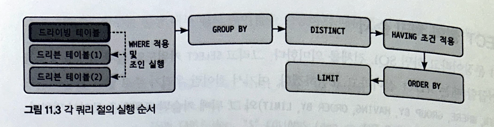
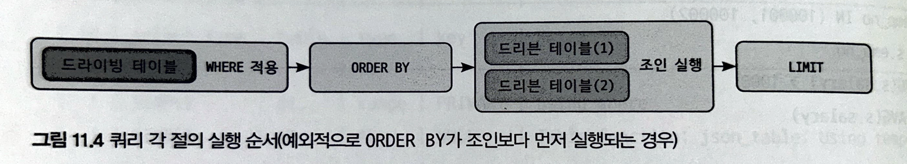
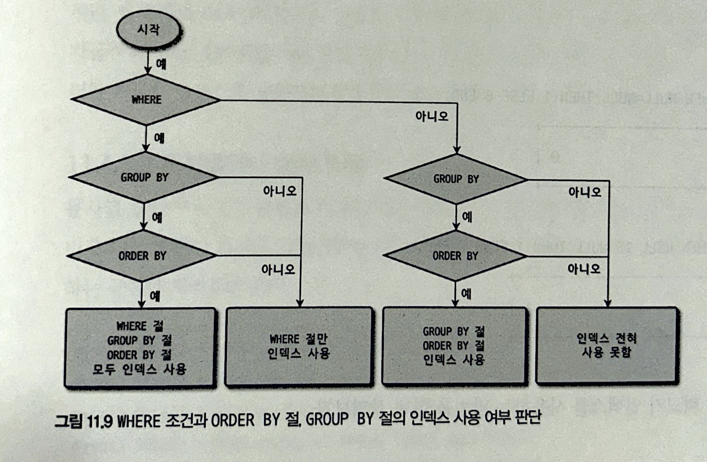
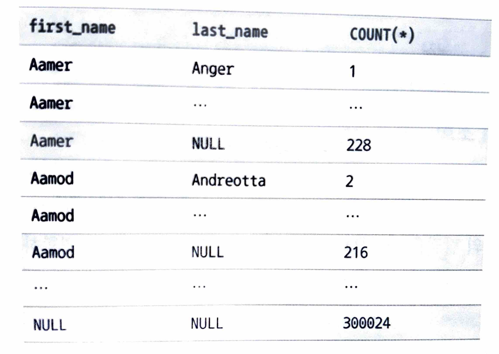
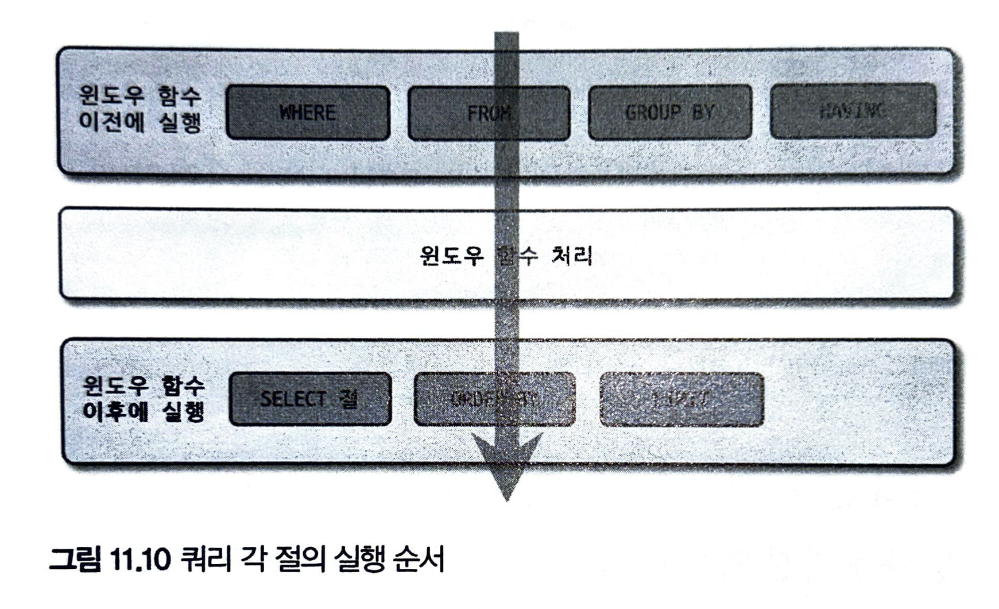

웹 서비스 같이 일반적인 온라인 트랜잭션 처리 환경의 데이터베이스에서 INSERT, UPDATE 같은 작업은 거의 레코드 단위로 발생하므로 성능상 문제가 되는 경우는 별로 없다.

하지만 SELECT는 여러 개의 테이블로부터 데이터를 조합해서 빠르게 가져와야 하기 때문에 여러 개의 테이블을 어떻게 읽을 것인가에 많은 주의가 필요하다.

---

# 11.4.1 SELECT 절의 처리 순서

SELECT 문장: SQL 전체 

SELECT 절: SELECT 키워드 + 실제 가져올 칼럼을 명시한 부분

```sql
SELECT s.emp_no, COUNT(DISTINCT e.first_name) AS cnt
FROM salaries s JOIN employees e ON e.emp_no=s.emp_no
WHERE s.emp_no IN (100001, 100002)
GROUP BY s.emp_no
HAVING AVG(s.emp_no) > 1000
ORDER BY AVG(s.salary)
LIMIT 10;
```

- SELECT 절: SELECT s.emp_no, COUNT(DISTINCT e.first_name) AS cnt
- FROM 절: FROM salaries s JOIN employees e ON e.emp_no=s.emp_no
- WHERE 절: WHERE s.emp_no IN (100001, 100002)
- GROUP BY 절: GROUP BY s.emp_no
- HAVING 절: HAVING AVG(s.emp_no) > 1000
- ORDER BY 절: ORDER BY AVG(s.salary)
- LIMIT 절: LIMIT 10



그림 11.3에서 각 요소가 없는 경우는 가능하지만, 이 순서가 바뀌어서 실행되는 형태의 쿼리는 거의 없다.

(그림 11.4, CTE, 윈도우 함수 제외), 또한 SQL에 ORDER BY, GROUP BY 절이 있더라도 인덱스를 이용해 처리할 때는 그 단계 자체가 불필요하므로 생략된다.



그림 11.4는 ORDER BY가 사용된 쿼리에서 예외적인 순서로 실행되는 경우를 보여준다.

이 경우는 첫 번째 테이블만 읽어서 정렬을 수행한 뒤에 나머지 테이블을 읽는데, 주로 GROUP BY 절이 없이 ORDER BY 만 사용된 쿼리이면서 드라이빙 테이블이 인덱스를 통한 정렬이 가능한 경우에 사용될 수 있는 순서다.

그림 11.3이나 그림 11.4에서 **소개한 실행 순서를 벗어나는 쿼리는 서브쿼리로 작성된 인라인 뷰(Inline Vliew)가 포함된 쿼리**이다.

```sql
SELECT emp_no, cnt
FROM (
    SELECT s.emp_no, COUNT(DISTINCT e.first_name) AS cnt, MAX(s.salary) AS max_salary
    FROM salaries s JOIN employees e ON s.emp_no=e.emp_no
    WHERE s.emp_no IN (10001, 10002)
    GROUP BY s.emp_no
    HAVING MAX(s.salary) > 1000
    LIMIT 10
) temp_view
ORDER BY max_salary;
```

해당 쿼리는 LIMIT → ORDER BY 순서로 진행된다. 그래서 이전 쿼리와 동일한 결과를 반환하지 않을 수 있다.

LIMIT을 GROUP BY 전에 실행하고자 할 때도 마찬가지로 서브쿼리로 인라인 뷰를 만들어서 그 뷰 안에서 LIMIT을 적용하고 바깥 쿼리에서 GROUP BY, ORDER BY를 적용해야 한다.

하지만 이렇게 인라인 뷰가 사용되면 임시 테이블이 사용되기 때문에 주의해야 한다. 

MySQL 8.0에 새로 도입된 WITH 절(CTE, Common Table Expression)은 항상 제일 먼저 실행되어 임시 테이블로 저장된다. 

---

# 11.4.2 WHERE 절과 GROUP BY 절, ORDER BY 절의 인덱스 사용

## 11.4.2.1 인덱스를 사용하기 위한 기본 규칙

WHERE 절이나 ORDER BY 또는 GROUP BY가 인덱스를 사용하려면 기본적으로 인덱스된 칼럼의 값 자체를 변환하지 않고 그대로 사용한다는 조건을 만족해야 한다.

인덱스는 칼럼의 값을 아무런 변환 없이 B-Tree에 정렬해서 저장한다.

**WHERE 조건이나 ORDER BY 또는 GROUP BY 에서도 원본값을 검색하거나 정렬할 때만 B-Tree에 정렬된 인덱스를 사용한다.**

```sql
EXPLAIN SELECT * FROM salaries WHERE salary*10 > 1500000;
+--+-----------+--------+----------+----+-------------+----+-------+----+-------+--------+-----------+
|id|select_type|table   |partitions|type|possible_keys|key |key_len|ref |rows   |filtered|Extra      |
+--+-----------+--------+----------+----+-------------+----+-------+----+-------+--------+-----------+
|1 |SIMPLE     |salaries|null      |ALL |null         |null|null   |null|2838426|100     |Using where|
+--+-----------+--------+----------+----+-------------+----+-------+----+-------+--------+-----------+
```

```sql
EXPLAIN SELECT * FROM salaries WHERE salary > 150000 / 10;
EXPLAIN SELECT * FROM salaries WHERE salary > 150000;
+--+-----------+--------+----------+-----+-------------+---------+-------+----+----+--------+---------------------+
|id|select_type|table   |partitions|type |possible_keys|key      |key_len|ref |rows|filtered|Extra                |
+--+-----------+--------+----------+-----+-------------+---------+-------+----+----+--------+---------------------+
|1 |SIMPLE     |salaries|null      |range|ix_salary    |ix_salary|4      |null|36  |100     |Using index condition|
+--+-----------+--------+----------+-----+-------------+---------+-------+----+----+--------+---------------------+
```

만약 매번 복잡한 연산을 수행하거나 해시 값을 만들어서 비교해야 하는 경우라면 미리 계산된 값을 저장하도록 MySQL의 가상 칼럼(Virtual Column)을 추가하고 그 칼럼에 인덱스를 생성하거나 함수 기반의 인덱스를 사용하면 된다. **결론적으로 인덱스의 칼럼을 변형해서 비교하는 경우 인덱스를 이용할 수 없게 된다는 점에 주의하자** 

**WHERE 절에 사용되는 비교 조건에서 연산자 양쪽의 두 비교 대상 값은 데이터 타입이 일치해야 한다.**

```sql
CREATE TABLE tb_test (age VARCHAR(10), INDEX ix_age(age));
INSERT INTO tb_test VALUES ('1'), ('2'), ('3'), ('4'), ('5');

EXPLAIN SELECT * FROM tb_test WHERE age=2;
+--+-----------+-------+----------+-----+-------------+------+-------+----+----+--------+------------------------+
|id|select_type|table  |partitions|type |possible_keys|key   |key_len|ref |rows|filtered|Extra                   |
+--+-----------+-------+----------+-----+-------------+------+-------+----+----+--------+------------------------+
|1 |SIMPLE     |tb_test|null      |index|ix_age       |ix_age|43     |null|5   |20      |Using where; Using index|
+--+-----------+-------+----------+-----+-------------+------+-------+----+----+--------+------------------------+
```

실행 계획을 보면 옵티마이저는 인덱스 풀 스캔을 수립한다.

현재 age는 VARCHAR 타입이고 SELECT 쿼리 WHERE 조건은 INTEGER 타입이기 때문이다.

옵티마이저는 비교를 위해서 age 칼럼의 값들을 문자열에서 숫자 타입으로 변환한 후 비교 작업을 처리한다.

결국 인덱스 칼럼의 값이 변환되기 때문에 인덱스 레인지 스캔이 불가능하다.

```sql
EXPLAIN SELECT * FROM tb_test WHERE age='2';
+--+-----------+-------+----------+----+-------------+------+-------+-----+----+--------+-----------+
|id|select_type|table  |partitions|type|possible_keys|key   |key_len|ref  |rows|filtered|Extra      |
+--+-----------+-------+----------+----+-------------+------+-------+-----+----+--------+-----------+
|1 |SIMPLE     |tb_test|null      |ref |ix_age       |ix_age|43     |const|1   |100     |Using index|
+--+-----------+-------+----------+----+-------------+------+-------+-----+----+--------+-----------+
```

---

## 11.4.2.2 WHERE 절의 인덱스 사용

WHERE 조건이 인덱스를 사용할 수 있는 방법은 크게 작업 범위 결정 조건, 체크 조건 두 가지 방식으로 구분할 수 있다.

**더 자세한 내용은 책 페이지 57 ~ 58 참고** 

---

## 11.4.2.3 GROUP BY 절의 인덱스 사용

**사용 조건 정리** 

- GROUP BY 절에 명시된 칼럼이 인덱스 칼럼의 순서와 위치가 같아야 한다.
- 인덱스를 구성하는 칼럼 중에서 뒤쪽에 있는 칼럼은 GROUP BY 절에 명시되지 않아도 인덱스를 사용할 수 있지만 인덱스의 앞쪽에 있는 칼럼이 GROUP BY 절에 명시되지 않으면 인덱스를 사용할 수 없다.
- WHERE 조건절과 달리 GROUP BY 절에 명시된 칼럼이 하나라도 인덱스에 없으면 GROUP BY 절은 전혀 인덱스를 이용하지 못한다.

**인덱스 칼럼의 순서** → COL1, COL2, COL3, COL4

**인덱스를 사용한 GROUP BY 절 칼럼 순서** → COL1, COL2, COL3 

**인덱스를 이용한 그루핑이 불가능한 예제** 

```sql
COL2, COL1
COL1, COL3, COL2
COL1, COL3
COL1, COL2, COL3, COL4, COL5
```

**인덱스를 이용한 그루핑이 가능한 예제** 

```sql
COL1
COL1, COL2
COL1, COL2, COL3
COL1, COL2, COL3, COL4
```

WHERE 조건절에 COL1, COL2 같이 인덱스 앞부분이 동증 비교 조건으로 사용된다면 GROUP BY 절에 COL1

COL2가 빠져도 인덱스를 이용한 GROUP BY가 가능할 때도 있다.

**인덱스를 이용한 그루핑이 가능한 예제 (WHERE 조건)**

```sql
WHERE COL1='상수' ... GROUP BY COL2, COL3
WHERE COL1='상수' AND COL2='상수'... GROUP BY COL3, COL4
```

---

## 11.4.2.4 ORDER BY 절의 인덱스 사용

ORDER BY 절의 인덱스 사용 여부는 GROUP BY 요건과 거의 흡사하다.

하지만 조건이 하나 더 존재한다. 정렬되는 칼럼의 ASC, DESC 옵션이 인덱스와 같거나 정반대인 경우에만 사용할 수 있다는 것이다.

**인덱스 → COL1, COL2, COL3, COL4**

**인덱스를 이용할 수 없는 정렬 순서**

```sql
COL2, COL3
COL1, COL3, COL2
COL1, COL2 DESC, COL3
COL1, COL3
COL1, COL2, COL3, COL4, COL5
```

**인덱스를 이용이 가능한 정렬 순서**

```sql
COL1
COL1, COL2
COL1, COL2, COL3
COL1, COL2, COL3, COL4

COL1 DESC
COL1 DESC, COL2 DESC 
```

---

## 11.4.2.5 WHERE 조건과 ORDER BY(또는 GROUP BY) 절의 인덱스 사용

쿼리에 WHERE 절 또는 ORDER BY, GROUP BY 절만 포함돼 있으면 사용된 절 하나에만 초점을 맞춰서 인덱스를 사용할 수 있게 튜닝하면 된다. 하지만 애플리케이션에서 사용되는 쿼리는 그렇게 단순하지 않다.

WHERE 절과 ORDER BY 절이 같이 사용된 하나의 쿼리 문장은 다음 3가지 중 한 가지 방법으로만 인덱스를 이용한다.

**WHERE 절과 ORDER BY 절이 동시에 같은 인덱스를 이용**

- WHERE 절의 비교 조건에서 사용하는 칼럼과 ORDER BY 절의 정렬 대상 칼럼이 모두 하나의 인덱스에 연속해서 포함돼 있을 때 이 방식을 사용할 수 있다.

**WHERE 절만 인덱스를 이용**

- ORDER BY 절은 인덱스를 이용한 정렬이 불가능하며, 인덱스를 통해 검색된 결과 레코드를 별도의 정렬 처리 과정(Using Filesort)을 거쳐 정렬을 수행한다. 주로 이 방법은 WHERE 절의 조건에 일치하는 레코드의 건수가 많지 않을 때 효율적인 방식이다.

**ORDER BY 절만 인덱스를 이용**

- ORDER BY 절은 인덱스를 이용해 처리하지만 WHERE 절은 인덱스를 이용하지 못한다. ORDER BY 절의 순서대로 인덱스를 읽으면서 레코드 한 건씩 WHERE 절의 조건에 일치하는지 비교하고, 일치하지 않을 때는 버리는 형태로 처리한다. 주로 아주 많은 레코드를 조회해서 정렬해야 할 때 사용한다.

중간에 빠지는 칼럼이 있으면 WHERE 절 ORDER BY 절 모두 인덱스를 사용할 수 없다.

WHERE 절에 동등 비교 조건으로 사용된 칼럼과 ORDER BY 절의 칼럼이 중첩되는 부분은 인덱스를 사용할 때 문제가 되지 않는다. 물론 선행 칼럼이라는 조건이 붙는다.

### 예제로 이해하기

**인덱스 기준: CO1 ASC, COL2 ASC, COL3 ASC, COL4 ASC**

**CASE1**

```sql
SELECT *
FROM tb_test
WHERE COL1=10
ORDER BY COL2, COL3;
```

해당 쿼리는 ORDER BY 절의 칼럼 순서가 인덱스의 칼럼 순서가 달라서 정렬할 때 인덱스를 이용하지 못할 것처럼 보인다.

**CASE2**

```sql
SELECT *
FROM tb_test
WHERE COL1=10
ORDER BY COL1, COL2, COL3;
```

이 쿼리에서는 WHERE 조건이 상수로 동등 비교를 하고 있기 때문에 ORDER BY 절에 COL1 칼럼을 추가해도 정렬 순서에 변화가 없다. 즉, 변경되기 이전 쿼리인 CASE1과 동일하다. 

하지만 이렇게 변경된 쿼리에서는 WHERE 절과 ORDER BY 절이 동시에 인덱스를 이용할 수 있는지를 더 쉽게 판단할 수 있다.

이번에는 WHERE 조건절에서 범위 조건의 비교가 사용되는 쿼리를 한번 살펴보자.

```sql
SELECT * FROM tb_test WHERE COL1 > 10 ORDER BY COL1, COL2, COL3;
SELECT * FROM tb_test WHERE COL1 > 10 ORDER BY COL2, COL3;
```

첫 번째 쿼리는 COL1 > 10을 만족하는 COL1 값은 여러 개일 수 있다.

하지만 ORDER BY 절에 COL1 ~ COL3 까지 순서대로 모두 명시됐기 때문에 인덱스를 사용해 WHERE 절과 ORDER BY 절 모두 처리할 수 있다.

두 번째 쿼리에서는 마찬가지로 WHERE 절은 동일하지만 ORDER BY 절에 COL1이 명시되지 않았기 떄문에 정렬할 때는 인덱스를 이용할 수 없다.

다음 쿼리들은 WHERE 절과 ORDER BY 절 모두 인덱스로 처리 불가능한 쿼리다.

```sql
WHERE COL1 = 10 ORDER BY COL3, COL4;
WHERE COL1 > 10 ORDER BY COL2, COL3;
WHERE COL1 IN (1,2,3,4) ORDER BY COL2;
```

WHERE 절과 ORDER BY 절 뿐만 아니라 WHERE 절과 GROUP BY 절의 조합도 모두 똑같은 기준으로 적용된다.

---

## 11.4.2.6 GROUP BY 절과 ORDER BY 절의 인덱스 사용

GROUP BY와 ORDER BY 절이 동시에 사용된 쿼리에서 두 절이 모두 하나의 인덱스를 사용해서 처리하려면

GROUP BY 절에 명시된 칼럼과 ORDER BY 절에 명시된 칼럼의 순서와 내용이 모두 같아야 한다.

**사용 불가능한 쿼리 예시**

```sql
GROUP BY COL1, COL2 ORDER BY COL2;
GROUP BY COL1, COL2 ORDER BY COL1, COL3;
```

---

## 11.4.2.7 WHERE 조건과 ORDER BY 절, GROUP BY 절의 인덱스 사용

WHERE 조건과 ORDER BY 절이 모두 포함된 쿼리가 인덱스를 사용하는지 판단하는 방법을 알아보자.

1. WHERE 절이 인덱스를 사용할 수 있는가?
1. GROUP BY 절이 인덱스를 사용할 수 있는가? 
1. GROUP BY 절과 ORDER BY 절이 동시에 인덱스를 사용할 수 있는가? 



---

# 11.4.3 WHERE 절의 비교 조건 사용 시 주의사항

쿼리가 최적으로 실행되려면 적합한 인덱스와 함께 WHERE 절에 사용되는 비교 조건의 표현식을 적절하게 사용해야 한다.

---

## 11.4.3.1 NULL 비교

MySQL은 다른 DMBS와 다르게 NULL 값이 포함된 레코드도 인덱스로 관리한다.

**SQL 표준에서 NULL의 정의는 비교할 수 없는 값 즉, UNKNOWN이다.** 연산이나 비교에서 한쪽이라도 NULL이면 결과도 NULL이 반환되는 이유이다.

쿼리에서 NULL인지 비교하려면 IS NULL 또는 `<=>`  연산자를 이용해야 한다.

```sql
SELECT NULL=NULL; -- NULL

SELECT NULL<=>NULL; -- 1

SELECT CASE WHEN NULL=NULL THEN 1 ELSE 0 END; -- 0

EXPLAIN SELECT * FROM titles WHERE to_date IS NULL;
+--+-----------+------+----------+----+-------------+---------+-------+-----+----+--------+------------------------+
|id|select_type|table |partitions|type|possible_keys|key      |key_len|ref  |rows|filtered|Extra                   |
+--+-----------+------+----------+----+-------------+---------+-------+-----+----+--------+------------------------+
|1 |SIMPLE     |titles|null      |ref |ix_todate    |ix_todate|4      |const|1   |100     |Using where; Using index|
+--+-----------+------+----------+----+-------------+---------+-------+-----+----+--------+------------------------+
```

**신기하게 “Using index” 즉, 커버링 인덱스가 나오는데 조건에 맞는 레코드가 없어서 데이터 파일로 접근하지 않아서 그런듯하다.**

또한 NULL 인 레코드를 조회하지만 to_date 칼럼에 생성된 ix_todate 인덱스를 ref 방식으로 적절히 이용하고 있음을 알 수 있다.

```sql
EXPLAIN SELECT * FROM titles WHERE to_date IS NULL; -- ref
EXPLAIN SELECT * FROM titles WHERE ISNULL(to_date); -- ref
EXPLAIN SELECT * FROM titles WHERE ISNULL(to_date)=1; -- index(인덱스 풀 스캔)
EXPLAIN SELECT * FROM titles WHERE ISNULL(to_date)=true; -- index(인덱스 풀 스캔)
```

**3,4번 쿼리는 인덱스를 활용하지 못한다 주의하자!**

3,4번 쿼리는 to_date 모든 칼럼을 ISNULL() 함수를 적용해서 값을 바꿔서 비교하기 때문에

인덱스 풀 스캔, 테이블 풀 스캔을 하는 것이다.

---

## 11.4.3.2 문자열이나 숫자 비교

문자열 칼럼이나 숫자 칼럼을 비교할 때는 반드시 그 타입에 맞는 상숫값을 사용하자.

```sql
EXPLAIN SELECT * FROM employees WHERE emp_no=10001;
EXPLAIN SELECT * FROM employees WHERE first_name='Smith';
EXPLAIN SELECT * FROM employees WHERE emp_no='10001';
EXPLAIN SELECT * FROM employees WHERE first_name=10001;
```

**규칙**

1. **서로 다른 타입인 경우 문자열과 숫자를 비교할 때 항상 문자열을 숫자로 바꿔서 비교한다.**
1. **만약 칼럼의 값이 바뀌는 경우 인덱스를 사용하지 못한다.**

emp_no 칼럼: 숫자 타입 /  first_name 칼럼: 문자열 타입 

첫 번째, 두 번째 쿼리는 적절히 타입을 맞춰서 비교를 수행했다. 그래서 인덱스를 사용한다.

세 번째 쿼리는 칼럼이 숫자 타입이기 때문에 문자열 상숫값을 숫자로 타입 변환해서 비교를 수행한다. 그래서 인덱스를 사용한다.

네 번째 쿼리는 first_name 칼럼이 문자열이기 때문에 모든 레코드의 first_name 칼럼값을 바꿔서 비교한다. 

그래서 인덱스를 사용하지 못한다.

---

## 11.4.3.3 날짜 비교

MySQL은 다양한 날짜와 시간 타입이 존재한다.

| **타입** | **저장 내용** | **예시** | **특징/비고** |
| --- | --- | --- | --- |
| DATE | 날짜 | 2025-06-19 | 연-월-일 |
| TIME | 시간 | 14:30:00 | 시:분:초 |
| DATETIME | 날짜+시간 | 2025-06-19 14:30:00 | 타임존 영향 없음 |
| TIMESTAMP | 날짜+시간 | 2025-06-19 14:30:00 | 타임존 변환, UTC로 저장 |
| YEAR | 연도 | 2025 | 연도만 저장 |

---

### 11.4.3.3.1 DATE 또는 DATETIME 문자열 비교

```sql
SELECT COUNT(*)
FROM employees
WHERE hire_date > '2011-07-23';

SELECT COUNT(*)
FROM employees
WHERE hire_date > STR_TO_DATE('2011-07-23', '%Y-%m-%d');
```

첫 번째 쿼리는 STR_TO_DATE 함수를 사용하지 않았고 두 번째 쿼리는 사용했다. 하지만 결과는 동일하다.

DATE 또는 DATETIME 타입의 값과 문자열을 비교할 때는 문자열 값을 DATETIME 또는 DATE 타입의 값으로 자동 변환해서 비교를 수행하기 때문이다.

```sql
EXPLAIN
SELECT COUNT(*)
FROM employees
WHERE DATE_FORMAT(hire_date, '%Y-%m-%d') > '2011-07-23';
+--+-----------+---------+----------+-----+-------------+-----------+-------+----+------+--------+------------------------+
|id|select_type|table    |partitions|type |possible_keys|key        |key_len|ref |rows  |filtered|Extra                   |
+--+-----------+---------+----------+-----+-------------+-----------+-------+----+------+--------+------------------------+
|1 |SIMPLE     |employees|null      |index|null         |ix_hiredate|3      |null|299468|100     |Using where; Using index|
+--+-----------+---------+----------+-----+-------------+-----------+-------+----+------+--------+------------------------+
```

해당 쿼리는 hire_date 타입을 강제적으로 문자열로 변경하기 때문에 인덱스를 활용하지 못한다.

그래서 인덱스 풀 스캔을 하고있다. **항상 칼럼의 값을 변경하지 않고 상수를 변경하는 형태로 조건을 사용하자.**

위의 예제와 같이 날짜 타입의 **포맷을 변환하는 형태를 포함해서 날짜 타입 칼럼의 값을 더하거나 뺴는 함수로 변형한 후 비교해도 마찬가지로 인덱스를 이용할 수 없다.**

```sql
# index 
EXPLAIN
SELECT COUNT(*)
FROM employees
WHERE DATE_ADD(hire_date, INTERVAL 1 YEAR) > '2011-07-23';

# range
EXPLAIN
SELECT COUNT(*)
FROM employees
WHERE hire_date > DATE_SUB('2011-07-23', INTERVAL 1 YEAR);
```

---

### 11.4.3.3.2 DATE와 DATETIME의 비교

DATETIME 값에서 시간 부분만 떼어 버리고 비교하려면 DATE() 함수를 사용하면 된다.

```sql
SELECT COUNT(*)
FROM employees
WHERE hire_date > DATE(NOW());
```

DATETIME 타입의 값을 DATE 타입으로 만들지 않고 그냥 비교하면 MySQL 서버가 DATE 타입의 값을 DATETIME으로 변환해서 같은 타입을 만든 다음 비교를 수행한다. 

```sql
SELECT
STR_TO_DATE('2011-06-30', '%Y-%m-%d') <
STR_TO_DATE('2011-06-30 00:00:01', '%Y-%m-%d %H:%i:%s') as result
+------+
|result|
+------+
|1     |
+------+
```

**DATETIME과 DATE 타입의 비교에서 타입 변환은 인덱스의 사용 여부에 영향을 미치지 않는다.**

---

### 11.4.3.3.3 DATETIME와 TIMESTAMP의 비교

```sql
EXPLAIN
SELECT COUNT(*)
FROM employees WHERE hire_date < '2011-07-23 11:10:12';
+--+-----------+---------+----------+-----+-------------+-----------+-------+----+------+--------+------------------------+
|id|select_type|table    |partitions|type |possible_keys|key        |key_len|ref |rows  |filtered|Extra                   |
+--+-----------+---------+----------+-----+-------------+-----------+-------+----+------+--------+------------------------+
|1 |SIMPLE     |employees|null      |range|ix_hiredate  |ix_hiredate|3      |null|149734|100     |Using where; Using index|
+--+-----------+---------+----------+-----+-------------+-----------+-------+----+------+--------+------------------------+

EXPLAIN
SELECT COUNT(*)
FROM employees WHERE hire_date > UNIX_TIMESTAMP('1986-01-01 00:00:00');
+----+-------------+-----------+------------+-------+---------------+-------------+---------+------+--------+----------+--------------------------+
| id | select_type | table     | partitions | type  | possible_keys | key         | key_len | ref  | rows   | filtered | Extra                    |
+----+-------------+-----------+------------+-------+---------------+-------------+---------+------+--------+----------+--------------------------+
|  1 | SIMPLE      | employees | NULL       | index | ix_hiredate   | ix_hiredate | 3       | NULL | 299468 |    33.33 | Using where; Using index |
+----+-------------+-----------+------------+-------+---------------+-------------+---------+------+--------+----------+--------------------------+
1 row in set, 3 warnings (0.00 sec)

SHOW WARNINGS;
+---------+------+------------------------------------------------------------------------------------------------------------------------------------------------------------------------+
| Level   | Code | Message                                                                                                                                                                |
+---------+------+------------------------------------------------------------------------------------------------------------------------------------------------------------------------+
| Warning | 1292 | Incorrect date value: '504921600' for column 'hire_date' at row 1                                                                                                      |
| Warning | 1292 | Incorrect date value: '504921600' for column 'hire_date' at row 1                                                                                                      |
| Note    | 1003 | /* select#1 */ select count(0) AS `COUNT(*)` from `employees`.`employees` where (`employees`.`employees`.`hire_date` > <cache>(unix_timestamp('1986-01-01 00:00:00'))) |
+---------+------+------------------------------------------------------------------------------------------------------------------------------------------------------------------------+
```

UNIX_TIMESTAMP() 함수의 결괏값은 MySQL내부적으로는 단순 숫자 값에 불가활 뿐이므로 두 번째 쿼리와 같이 비교해서는 원하는 값을 얻을 수 없다.

반드시 비교 값으로 사용되는 상수 리터럴을 비교 대상 칼럼의 타입에 맞게 변환해서 사용하는 것이 좋다.

```sql
SELECT COUNT(*) FROM employees WHERE hire_date < NOW();

SELECT COUNT(*) FROM employees WHERE hire_date < FROM_UNIXTIME(UNIX_TIMESTAMP());
```

---

## 11.4.3.4 Short-Circuit Evaluation

```java
boolean in_transacion;

if (in_transaction && has_modified() ){
	 commit();
} 
```

위의 예제 코드에서 in_transaction 불리언 변수의 값이 TRUE이면 has_modifed() 함수를 호출한다. has_modified() 함수도 값이 TRUE이면 commit() 함수를 호출한다.

그런데 만약 in_transaction 값이 FALSE라면 has_modified() 함수의 결괏값에 관계없이 commit() 함수는 호출되지 않는다. 

많은 프로그래밍 언어에서는 예시처럼 빠른 성능을 위해 in_transaction 불리언 변숫값이 FALSE라면 has_modified() 함수를 호출하지 않고 다음 코드를 진행한다. 

이처럼 **여러 개의 표현식이 AND 또는 OR 논리 연산자로 연결된 경우 선행 표현식에 따라 후행 표현식을 평가할지 말지 결정하는 최적화를 “Short-Circuit Evaluation”이라고 한다.**

```sql
# 전체 레코드 건수 -> 2844041
SELECT COUNT(*) FROM salaries; 

# 1번 조건을 만족하는 레코드 건수 -> 2442937
SELECT COUNT(*) FROM salaries
WHERE CONVERT_TZ(from_date, '+00:00', '+09:00') > '1991-01-01';

# 2번 조건을 만족하는 레코드 건수 -> 0 
SELECT COUNT(*) FROM salaries
WHERE to_date < '1985-01-01';

# 1번 조건과 2번 조건 결합
SELECT COUNT(*) FROM salaries
WHERE CONVERT_TZ(from_date, '+00:00', '+09:00') > '1991-01-01' AND -- 1번 조건 
to_date < '1985-01-01'; -- 2번 조건

# 1번 조건과 2번 조건 결합
SELECT COUNT(*) FROM salaries
WHERE to_date < '1985-01-01' AND  -- 2번 조건 
    CONVERT_TZ(from_date, '+00:00', '+09:00') > '1991-01-01'; -- 1번 조건 
```

1번 조건과 2번 조건을 AND로 연결한 3번 조건은 결과가 0건이 될 것이다.

또한 1번 조건과 2번 조건은 모두 인덱스를 사용하지 못하는 조건이기 때문에 풀 테이블 스캔을 진행한다.

**이런 형태의 쿼리에서 WHERE 절에 나열되는 조건의 순서가 쿼리의 성능에 영향을 미칠까? → yes**

- 1번 조건 + 2번 조건 순서는 762ms 걸렸다.
- 2번 조건 + 1번 조건 순서는 591ms 걸렸다.

이런 차이는 만약 1번 조건이 더 많은 CPU를 사용하거나 더 많은 자원을 소모하는 조건이었다면 두 쿼리의 시간 차이는 훨씬 더 커졌을 것이다.

1번 조건이 먼저 사용된 쿼리는 2844041번 CONVERT_TZ 함수를 실행하고 그 결과를 상숫값과 비교하고

다시 2442937번 to_date 칼럼을 비교한다.

2번 조건이 먼저 사용된 쿼리는 2844041번 to_date 칼럼을 비교하고 조건에 만족하는 레코드가 없어서 CONVERT_TZ 함수는 한 번도 호출되지 않는다.

이로 인해 두 번째 쿼리의 성능이 더 빠른것이다.

MySQL 서버는 쿼리의 WHERE 절에 나열된 조건을 순서대로 “Short-circuit Evaluation” 방식으로 평가해서 해당 레코드를 반환해야 할지 말지를 결정한다.

당연히 WHERE 절에 인덱스를 사용할 수 있는 조건이 있으면 “Short-circuit Evaludation”과는 무관하게 그 조건을 가장 최우선으로 사용한다.

즉, WHERE 조건절에 나열된 조건의 순서가 인덱스의 사용 여부를 결정하지는 않는다.

**MySQL 서버에서 쿼리를 작성할 때 가능하면 복잡한 연산 또는 다른 테이블의 레코드를 읽어야 하는 서브쿼리 조건 등은 WHERE 절 뒤쪽으로 배치하는 것이 성능상 도움이 될 것이다.**

물론 인덱스 같은 경우 어느 위치에 나열되든지 그 순서에 관계없이 가장 먼저 평가되기 때문에 고려하지 않아도 된다.

**더 자세한 내용은 책 페이지 74 ~ 77을 참고하자**

---

# 11.4.5 LIMIT n

```sql
SELECT * FROM employees
WHERE emp_no BETWEEN 10001 AND 10010
ORDER BY first_name
LIMIT 0, 5;
```

해당 쿼리의 실행 순서

1. employees 테이블에서 WHERE 절의 검색 조건에 일치하는 레코드를 전부 읽어 온다.
1. 1번에서 읽어온 레코드를 first_name 칼럼값에 따라 정렬한다.
1. 2번의 정렬된 결과에서 상위 5건만 사용자에게 반환한다.

MySQL LIMIT는 WHERE 조건이 아니기 때문에 항상 쿼리의 가장 마지막에 실행된다.

**LIMIT의 중요한 특성은 LIMIT에서 필요한 레코드 건수만 준비되면 즉시 쿼리를 종료한다는 것이다.**

**즉, 모든 레코드의 정렬이 완료되지 않았다고 하더라도 상위 5건까지만 정렬되면 작업을 멈춘다.**

```sql
SELECT * FROM employees LIMIT 0, 10;

SELECT first_name FROM employees GROUP BY first_name LIMIT 0, 10;

SELECT DISTINCT first_name FROM employees LIMIT 0, 10;

SELECT * FROM employees
WHERE emp_no BETWEEN 10001 AND 10010
ORDER BY first_name
LIMIT 0, 5;
```

첫 번째 쿼리는 풀 테이블 스캔을 실행하면서 LIMIT 조건이 있기 때문에 10개의 레코드를 읽어 들이는 순간 스토리지 엔진으로부터 읽기 작업을 멈춘다.

두 번째 쿼리는 **GROUP BY 처리가 완료되고 LIMIT 처리를 수행할 수 있다. 즉, LIMIT + GROUP BY 함께 사용되는 경우에는 LIMIT 절이 있더라도 실질적인 서버의 작업 내용을 크게 줄여주지는 못한다.**

세 번째 쿼리는 first_name 칼럼에 대한 인덱스가 존재하고 읽는 데이터도 first_name 뿐이기 때문에 커버링 인덱스로 동작한다. 또한 DISTINCT 키워드가 붙어서 first_name에 대한 유니크한 값만 가져오면 되기 때문에 first_name 칼럼 인덱스를 스킵 스캔하면서 10개를 가져오면 임시 테이블에 저장하고 employees 테이블 스캔을 종료한다. 그 이후로 임시 테이블에 저장된 10개의 데이터를 읽어서 사용자에게 반환한다.

즉, DISTINCT와 함께 적용된 LIMIT는 실질적인 중복 제거 작업의 범위를 줄이는 역할을 한다.

네 번째 쿼리는 WHERE 조건절에 일치하는 레코드를 프라이머리 키로 필터링하고 first_name 칼럼으로 정렬을 수행한다. WHERE 조건과 정렬 기준에 사용되는 칼럼이 다르기 때문에 인덱스를 통한 상위 5건만 가져오면 끝나는 최적화는 하지 못한다. 하지만, 정렬에서 WHERE 조건에 일치하는 레코드는 전부 읽어야 하지만 전부 정렬돼야 쿼리가 완료되는 것이 아닌 필요한 만큼만 정렬되면 된다. (Top-N)

**Top-N 정렬(Top-N Sort)이란?**

WHERE 조건에 해당하는 모든 레코드를 읽긴 해야 하지만, 전체를 완전히 정렬할 필요 없이,

상위 N개(여기서는 5개)만 빠르게 찾는 정렬 알고리즘을 사용할 수 있다.

정리하면 쿼리 문장에 GROUP BY, ORDER BY, DISTINCT 같은 작업이 있고 LIMIT 절이 있다면 크진 않지만 나름의 성능 향상은 있다고 볼 수 있다.

하지만 GROUP BY, ORDER BY, DISTINCT 이런 작업이 인덱스를 통해서 가능하면 꼭 필요한 레코드만 읽고 바로 스토리지 엔진의 읽기 작업이 끝나기 때문에 작업량을 상당히 줄여준다.

역시 인덱스를 통해 그루핑, 정렬 같은 처리가 최고다.

### 페이징 

많은 응용 프로그램들이 데이터를 SELECT 할 때 조금씩 잘라서(페이징) 가져가게 된다.

그런 경우 아래 쿼리와 같이 LIMIT를 사용하는 경우가 많다.

```sql
SELECT * FROM salaries ORDER BY salary LIMIT n, m;
```

일반적으로 처음 몇 개 페이지만 자주 조회되기 때문에 이런 쿼리들은 문제가 되지 않는다.

하지만 특별한 경우에는 n에 주어지는 수치 즉, 오프셋 값이 매우 커질 수 있는데, 이런 경우에는 쿼리 실행에 상당히 오랜 시간이 걸린다.

```sql
# 146 ms
SELECT * FROM salaries ORDER BY salary LIMIT 0, 10;

# 1s 348ms
SELECT * FROM salaries ORDER BY salary LIMIT 2000000, 10;
```

“LIMIT 2000000, 10”은 먼저 테이블 전체를 읽고 정렬을 한다. 그리고 정렬된 결과에서 2000000개를 건너뛰고 그 다음 10개만 반환한다.

LIMIT 조건의 페이징이 처음 몇 개 페이지 조회로 끝나지 않을 가능성이 높다면 

다음과 같이 WHERE 절로 읽어야 할 위치를 찾고 그 위치에서 10개만 읽는 형태의 쿼리를 사용하는 것이 좋다.

```sql
# 첫 페이지 조회용 쿼리 27049, 38864
SELECT * FROM salaries ORDER BY salary LIMIT 0, 10;

# 두 번째 페이지 조회용 쿼리
EXPLAIN ANALYZE SELECT * FROM salaries
WHERE salary >= 38864 AND NOT (salary=38864 AND emp_no<=274049)
LIMIT 0, 10;
```

위의 예제에서 NOT (salary=38864 AND emp_no≤274049) 조건은 이전 페이지에서 조회했던 건을 제외하기 위해 추가한 조건이다. 해당 쿼리는 salary 칼럼의 인덱스를 사용하는데 중복이 허용되는 인덱스이기 때문에 단순히 이전 페이지의 마지막 salary 값을 기준으로만 WHERE 조건절에 명시하면 중복이나 누락이 발생할 수 있다. 

---

# 11.4.6 COUNT(n)

COUNT()함수는 레코드의 건수를 반환하는 함수다. 

COUNT() 함수는 칼럼이나 표현식을 인자로 받으며, 특별한 형태로 “*”를 사용할 수 있다. 

“*”는 모든 칼럼이 아닌 레코드 자체를 의미하며, 굳이 COUNT(1), COUNT(PK) 같이 사용하지 않고 COUNT(*)라고 표현해도 동일한 처리 성능을 보인다.

테이블이 가진 대략적인 레코드 건수로 충분하다면 SELECT COUNT(*)보다는 SHOW TABLE STAUS 명령으로 통계 정보를 참조하는 것도 좋은 방법이다. 떄로는 통계 정보의 레코드 건수는 실제 테이블의 레코드 건수와 많은 차이가 있을 수 있는데, 이런 경우에는 ANALYZE TABLE 명령을 실행해 통계 정보를 갱신하면 된다.

```sql
SELECT COUNT(*)
FROM employees;
+--------+
|COUNT(*)|
+--------+
|300023  |
+--------+

ANALYZE TABLE employees;

SELECT TABLE_SCHEMA, TABLE_NAME, TABLE_ROWS
FROM information_schema.TABLES
WHERE TABLE_SCHEMA='employees' AND TABLE_NAME='employees';
+------------+----------+----------+
|TABLE_SCHEMA|TABLE_NAME|TABLE_ROWS|
+------------+----------+----------+
|employees   |employees |299335    |
+------------+----------+----------+
```

COUNT(*) 쿼리에서 가장 많이 하는 실수는 ORDER BY 구문이나 LEFT JOIN 같이 레코드 건수를 가져오는 것과는 무관한 작업을 포함하는 것이다.

즉, COUNT 쿼리와 상관없는 불필요한 조건을 전부 제거하자.

### COUNT(), ORDER BY 옵티마이저 최적화

MySQL 8.0 버전부터는 COUNT() 쿼리에 사용된 ORDER BY 절은 옵티마이저가 무시하도록 개선됐다.

하지만 가독성을 생각하면 꼭 필요한 부분만 간결하게 작성하는 게 좋다.

---

# 11.4.7 JOIN

## 11.4.7.1 JOIN 순서와 인덱스

인덱스 레인지 스캔은 **인덱스를 탐색(Index Seek)하는 단계**와 **인덱스를 스캔(Index Scan)**하는 과정으로 구분해 볼 수 있다. 인덱스를 이용해서 쿼리하는 작업에서는 레코드의 건수가 소량이기 때문에 스캔 작업은 부하가 작지만 **특정 인덱스 키를 찾는 인덱스 탐색 작업은 상대적으로 부하가 높은 편이다.**

조인 작업에서 드라이빙 테이블을 읽을 때는 인덱스 탐색 작업을 단 한 번만 수행하고, 그 이후로는 스캔만 실행하면 된다. 하지만 드리븐 테이블에서는 인덱스 탐색 + 인덱스 스캔이 드라이빙 테이블에서 읽은 레코드 건수만큼 반복한다. **즉, 드라이빙 테이블과 드리븐 테이블이 1:1로 조인되더라도 드리븐 테이블을 읽는 것이 훨씬 더 큰 부하를 차지한다.** 그래서 **옵티마이저는 항상 드리븐 테이블을 최적으로 읽을 수 있게 실행 계획을 수립한다.**

```sql
SELECT *
FROM employees e, dept_emp de
WHERE e.emp_no=de.emp_no;
```

employees 테이블 emp_no 칼럼과 dept_emp 테이블 emp_no 칼럼에 각각 인덱스가 있을 때 없을 때 조인 순서가 어떻게 달라지는지 알아보자.

**두 테이블 모두 인덱스가 있는 경우**

두 테이블 모두 인덱스가 있는 경우 어느 테이블을 드라이빙으로 선택하든 인덱스를 이용해 드리븐 테이블의 검색 작업을 빠르게 처리할 수 있다. 이런 경우 **옵티마이저가 통계 정보를 이용해 레코드 건수가 적은 테이블을 드라이빙 테이블로 선택하게 된다.**

**employees 테이블만 인덱스가 있는 경우**

dept_emp 테이블을 드라이빙 테이블로 잡고 employees 테이블을 드리븐 테이블로 잡는다. 만약 반대의 경우

employees 테이블을 풀 스캔하고 조인 조건에 맞는 레코드를 dept_emp 테이블에서 탐색하는데 인덱스가 없어 매번 풀 테이블 스캔이 발생된다. 즉, 풀 테이블 스캔 * 풀 테이블 스캔 부하가 발생된다. 그래서 **옵티마이저는 인덱스가 존재하는 테이블을 드리븐 테이블로 선택한다.** 

**dept_emp 테이블만 인덱스가 있는 경우**

옵티마이저는 인덱스가 있는 테이블을 드리븐 테이블로 선택한다. 그래서 employees 테이블을 드라이빙 테이블로 선택하고 dept_emp 테이블을 드리븐 테이블로 선택한다.

**두 테이블 모두 인덱스가 없는 경우**

어느 테이블을 드라이빙 테이블로 선택하더라도 드리븐 테이블의 테이블 풀 스캔이 발생한다. 

그래서 조인 조건의 레코드 건수가 적은 테이블을 드라이빙 테이블로 선택하게 된다.

이렇게 적절한 인덱스가 없는 경우 예전에는 블록 네스티드 루프 조인을 사용했지만, 요즘은 해시 조인을 사용한다.

빌드 단계에서 레코드 건수가 작은 테이블을 해시 테이블로 만들고 프로브 단게에서 레코드 건수가 많은 테이블을 풀 스캔하면서 해시 테이블과 비교한다. 

---

## 11.4.7.2 JOIN 칼럼의 데이터 타입

WHERE 절에서 사용되는 조건을 보면 비교 대상 칼럼과 표현식의 데이터 타입을 반드시 동일하게 사용해야 한다.

마찬가지로 **조인도 조인 칼럼 간의 비교에 데이터 타입이 일치하지 않으면 인덱스를 효율적으로 이용할 수 없다.**

```sql
CREATE TABLE tb_test1 (user_id INT, user_type INT, PRIMARY KEY(user_id));
CREATE TABLE tb_test2 (user_type CHAR(1), type_desc VARCHAR(10), PRIMARY KEY(user_type));

EXPLAIN
SELECT *
FROM tb_test1 tb1, tb_test1 tb2
WHERE tb1.user_type=tb2.user_type;
+--+-----------+-----+----------+----+-------------+----+-------+----+----+--------+------------------------------------------+
|id|select_type|table|partitions|type|possible_keys|key |key_len|ref |rows|filtered|Extra                                     |
+--+-----------+-----+----------+----+-------------+----+-------+----+----+--------+------------------------------------------+
|1 |SIMPLE     |tb1  |null      |ALL |null         |null|null   |null|1   |100     |null                                      |
|1 |SIMPLE     |tb2  |null      |ALL |null         |null|null   |null|1   |100     |Using where; Using join buffer (hash join)|
+--+-----------+-----+----------+----+-------------+----+-------+----+----+--------+------------------------------------------+
```

tb_test2 테이블의 user_type 칼럼은 프라이머리 키다.

조인 칼럼의 타입을 생각하지 않고 드리븐 테이블과 드라이빙 테이블을 예상하면 인덱스가 존재하는 tb_test2 테이블이 드리븐 테이블이 되겠구나라고 생각할 수 있다. (드리븐 테이블의 인덱스 레인지 스캔 유도를 위해)

하지만 실행 계획을 보면 두 테이블 모두 테이블 풀 스캔을 진행하고 Extra 칼럼을 보면 조인 버퍼를 이용해 해시 조인이 실행된 것을 알 수 있다.

해당 쿼리에서는 tb_test2 테이블의 user_type 칼럼을 CHAR(1) → INT로 변환하여 비교를 수행한다.

그로 인해 인덱스 변형이 필요하기 때문에 tb_test2 테이블의 인덱스를 제대로 사용할 수 없게 된 것이다.

즉, 옵티마이저는 드리븐 테이블의 인덱스 레인지 스캐을 사용하지 못하고, 드리븐 테이블의 풀 테이블 스캔이 필요한 것을 알고 조금이라도 빨리 실행되도록 조인 버퍼를 활용한 해시 조인을 사용한다.

인덱스 사용에 서로 영향을 미치지 않는 데이터 타입은 아래와 같다.

(CHAR, VARCHAR), (INT, BIGINT, SMALLINT), (DATE, DATETIME)

하지만 아래와 같은 비교 패턴은 문제가 될 가능성이 높다.

- **CHAR ↔ INT 타입의 비교 같이 데이터 타입의 종류가 완전히 다른 경우**
- **같은 CHAR 타입이지만 문자 집합이나 콜레이션이 다른 경우**
- **같은 INT 타입이지만 부호(Sign)의 존재 여부가 다른 경우**

**더 자세한 예제는 책 페이지 87~88을 참고하자**

---

## 11.4.7.3 OUTER JOIN의 성능과 주의사항

INNER 조인은 조인 대상 테이블에 모두 존재하는 레코드만 결과 집합으로 반환한다.

이런 특성 때문에 OUTER 조인으로만 조인을 실행하는 쿼리들도 자주 보인다.

```sql
EXPLAIN
SELECT *
FROM employees e
LEFT JOIN dept_emp de ON de.emp_no=e.emp_no
LEFT JOIN departments d ON d.dept_no=de.dept_no AND d.dept_name='Development';
+--+-----------+-----+----------+------+-------------------+-----------------+-------+--------------------+------+--------+-----------+
|id|select_type|table|partitions|type  |possible_keys      |key              |key_len|ref                 |rows  |filtered|Extra      |
+--+-----------+-----+----------+------+-------------------+-----------------+-------+--------------------+------+--------+-----------+
|1 |SIMPLE     |e    |null      |ALL   |null               |null             |null   |null                |299335|100     |null       |
|1 |SIMPLE     |de   |null      |ref   |ix_empno_fromdate  |ix_empno_fromdate|4      |employees.e.emp_no  |1     |100     |null       |
|1 |SIMPLE     |d    |null      |eq_ref|PRIMARY,ux_deptname|PRIMARY          |16     |employees.de.dept_no|1     |100     |Using where|
+--+-----------+-----+----------+------+-------------------+-----------------+-------+--------------------+------+--------+-----------+
```

실행 계획을 보면 제일 먼저 employees 테이블을 풀 스캔하면서 dept_emp 테이블과 departments 테이블을 드리븐 테이블로 사용한다는 것을 알 수 있다.

옵티마이저는 절대 아우터로 조인되는 테이블을 드라이빙 테이블로 선택하지 못하기 떄문에 풀 스캔이 필요한 employees 테이블을 드라이빙 테이블로 선택한다. 그 결과로 쿼리의 성능이 떨어지는 실행 계획을 수립한 것이다. 

만약 이너 조인을 사용했다면 다음과 같이 departments 테이블에서 부서명이 “Development”인 레코드 1건만 찾아서 조인을 실행하는 실행 계획을 선택했을 것이다.

```sql
EXPLAIN
SELECT *
FROM employees e
JOIN dept_emp de ON de.emp_no=e.emp_no
JOIN departments d ON d.dept_no=de.dept_no AND d.dept_name='Development';
+--+-----------+-----+----------+------+-------------------------+-----------+-------+-------------------+-----+--------+-----+
|id|select_type|table|partitions|type  |possible_keys            |key        |key_len|ref                |rows |filtered|Extra|
+--+-----------+-----+----------+------+-------------------------+-----------+-------+-------------------+-----+--------+-----+
|1 |SIMPLE     |d    |null      |ref   |PRIMARY,ux_deptname      |ux_deptname|162    |const              |1    |100     |null |
|1 |SIMPLE     |de   |null      |ref   |PRIMARY,ix_empno_fromdate|PRIMARY    |16     |employees.d.dept_no|41392|100     |null |
|1 |SIMPLE     |e    |null      |eq_ref|PRIMARY                  |PRIMARY    |4      |employees.de.emp_no|1    |100     |null |
+--+-----------+-----+----------+------+-------------------------+-----------+-------+-------------------+-----+--------+-----+
```

이너 조인으로 사용해도 되는 쿼리를 아우터 조인으로 작성하면 옵티마이저가 조인 순서를 변경하면서 수행할 수 있는 최적화의 기회를 빼앗어버리는 결과가 된다.

즉, **꼭 아우터 조인이 필요한 경우가 아니라면 이너 조인을 사용하는 것이 쿼리의 성능 향상시킬 수 있는 가능성이 많다.**

**아우터 조인 쿼리를 작성하면서 많이 하는 실수 아우터로 조인되는 테이블에 대한 조건을 WHERE 절에 명시**

```sql
SELECT *
FROM employees e
LEFT JOIN dept_manager mgr ON mgr.emp_no=e.emp_no
WHERE mgr.dept_no='d001';
```

해당 쿼리는 ON 절에 조인 조건은 명시했지만 아우터로 조인되는 테이블인 dept_manager의 dept_no=’d001’ 조건을 명시한 것은 잘못된 조인 방법이다.

그래서 옵티마이저는 해당 쿼리를 아래와 같이 INNER JOIN으로 변환해서 실행해버린다.

```sql
SELECT *
FROM employees e
INNER JOIN dept_manager mgr ON mgr.emp_no=e.emp_no
WHERE mgr.dept_no='d001';
```

**올바른 아우터 조인 조건 작성법**

```sql
SELECT *
FROM employees e
LEFT JOIN dept_manager mgr ON mgr.emp_no=e.emp_no AND mgr.dept_no='d001';
```

예외적으로 OUTER 조인으로 연결되는 칼럼에 대한 조건을 WHERE 절에 사용해야 하는 경우

즉, 안티 조인(ANTI-JOIN) 효과를 기대하는 경우

```sql
SELECT *
FROM employees e
LEFT JOIN dept_manager dm ON dm.emp_no = e.emp_no
WHERE dm.emp_no IS NULL;
```

이 쿼리는 employees 테이블에는 존재하지만 dept_manager 테이블에는 존재하지 않는 사용자들만 조회하는 쿼리다.이런 형태의 안티 조인의 경우 아우터 테이블의 칼럼이 WHERE 절에 사용될 수 있는 유일한 경우다.

그 외의 경우에는 MySQL 서버는 LEFT JOIN을 INNER JOIN으로 자동 변환한다.

---

## 11.4.7.4 JOIN & 외래키(FOREIGN KEY)

SQL로 테이블 간의 조인을 수행하는 것은 전혀 무관한 칼럼을 조인 조건으로 사용해도 문법적으로 문제가 되지 않는다. 

---

## 11.4.7.5 지연된 조인(Delayed Join)

조인을 사용해서 데이터를 조회하는 쿼리에 GROUP BY 또는 ORDER BY를 사용할 때 각 처리 방법에서 인덱스를 사용한다면 이미 최적으로 처리되고 있을 가능성이 높다.

하지만 그렇지 못한다면 모든 조인을 수행하고 난 다음 GROUP BY나 ORDER BY를 처리할 것이다. 그런 경우 조인을 실행하기 전의 레코드에 GROUP BY나 ORDER BY를 수행하는 것보다 많은 레코드를 처리해야 한다.

**지연된 조인이란 조인이 실행되기 이전에 GROUP BY나 ORDER BY를 처리하는 방식을 의미한다.**

인덱스를 사용하지 못하는 GROUP BY, ORDER BY 쿼리를 지연된 조인으로 처리하는 방법을 알아보자.

**쿼리 변경 BEFORE**

```sql
EXPLAIN
SELECT e.*
FROM salaries s, employees e
WHERE e.emp_no=s.emp_no
AND s.emp_no BETWEEN 10001 AND 13000
GROUP BY s.emp_no
ORDER BY SUM(s.salary) DESC
LIMIT 10;
+--+-----------+-----+----------+-----+-----------------+-------+-------+------------------+----+--------+--------------------------------------------+
|id|select_type|table|partitions|type |possible_keys    |key    |key_len|ref               |rows|filtered|Extra                                       |
+--+-----------+-----+----------+-----+-----------------+-------+-------+------------------+----+--------+--------------------------------------------+
|1 |SIMPLE     |e    |null      |range|PRIMARY          |PRIMARY|4      |null              |2999|100     |Using where; Using temporary; Using filesort|
|1 |SIMPLE     |s    |null      |ref  |PRIMARY,ix_salary|PRIMARY|4      |employees.e.emp_no|9   |100     |null                                        |
+--+-----------+-----+----------+-----+-----------------+-------+-------+------------------+----+--------+--------------------------------------------+

-> Limit: 10 row(s)  (actual time=54.3..54.3 rows=10 loops=1)
    -> Sort: `sum(s.salary)` DESC, limit input to 10 row(s) per chunk  (actual time=54.3..54.3 rows=10 loops=1)
        -> Table scan on <temporary>  (actual time=53.1..53.7 rows=2999 loops=1)
            -> Aggregate using temporary table  (actual time=53..53 rows=2999 loops=1)
                -> Nested loop inner join  (cost=4350 rows=28641) (actual time=0.541..23.2 rows=28600 loops=1)
                    -> Filter: (e.emp_no between 10001 and 13000)  (cost=604 rows=2999) (actual time=0.5..2.14 rows=2999 loops=1)
                        -> Index range scan on e using PRIMARY over (10001 <= emp_no <= 13000)  (cost=604 rows=2999) (actual time=0.498..1.8 rows=2999 loops=1)
                    -> Index lookup on s using PRIMARY (emp_no = e.emp_no)  (cost=0.294 rows=9.55) (actual time=0.00412..0.0061 rows=9.54 loops=2999)
```

1. employees에서 emp_no 10001~13000 범위의 직원 추출 (인덱스 스캔)
1. 각 직원에 대해 salaries에서 연봉 이력 모두 조회 (인덱스 루프 조인)
1. emp_no별로 salary 합계 계산 (GROUP BY, 임시 테이블)
1. salary 합계 내림차순 정렬 후 상위 10명 추출 (ORDER BY, LIMIT, filesort)

조인 횟수는 2999 * 9 대략 27000건이다. 또한 그루핑, 정렬을 위해 내부적으로 2번 임시 테이블을 생성했다.

이제 지연된 조인으로 변경한 쿼리를 살펴보자

**쿼리 변경 AFTER**

```sql
EXPLAIN
SELECT e.*
FROM
    (SELECT s.emp_no
    FROM salaries s
    WHERE s.emp_no BETWEEN 10001 AND 13000
    GROUP BY s.emp_no
    ORDER BY SUM(s.salary) DESC
    LIMIT 10) x, employees e
WHERE e.emp_no=x.emp_no;
+--+-----------+----------+----------+------+-----------------+-------+-------+--------+-----+--------+--------------------------------------------+
|id|select_type|table     |partitions|type  |possible_keys    |key    |key_len|ref     |rows |filtered|Extra                                       |
+--+-----------+----------+----------+------+-----------------+-------+-------+--------+-----+--------+--------------------------------------------+
|1 |PRIMARY    |<derived2>|null      |ALL   |null             |null   |null   |null    |10   |100     |null                                        |
|1 |PRIMARY    |e         |null      |eq_ref|PRIMARY          |PRIMARY|4      |x.emp_no|1    |100     |null                                        |
|2 |DERIVED    |s         |null      |range |PRIMARY,ix_salary|PRIMARY|4      |null    |56844|100     |Using where; Using temporary; Using filesort|
+--+-----------+----------+----------+------+-----------------+-------+-------+--------+-----+--------+--------------------------------------------+

-> Nested loop inner join  (cost=12 rows=0) (actual time=17.8..17.8 rows=10 loops=1)
    -> Table scan on x  (cost=2.5..2.5 rows=0) (actual time=17.7..17.7 rows=10 loops=1)
        -> Materialize  (cost=0..0 rows=0) (actual time=17.7..17.7 rows=10 loops=1)
            -> Limit: 10 row(s)  (actual time=17.7..17.7 rows=10 loops=1)
                -> Sort: `sum(s.salary)` DESC, limit input to 10 row(s) per chunk  (actual time=17.7..17.7 rows=10 loops=1)
                    -> Stream results  (cost=24483 rows=56844) (actual time=1.39..17 rows=2999 loops=1)
                        -> Group aggregate: sum(s.salary)  (cost=24483 rows=56844) (actual time=1.39..16.4 rows=2999 loops=1)
                            -> Filter: (s.emp_no between 10001 and 13000)  (cost=11385 rows=56844) (actual time=1.38..13 rows=28600 loops=1)
                                -> Index range scan on s using PRIMARY over (10001 <= emp_no <= 13000)  (cost=11385 rows=56844) (actual time=1.38..10.1 rows=28600 loops=1)
    -> Single-row index lookup on e using PRIMARY (emp_no = x.emp_no)  (cost=0.963 rows=1) (actual time=0.00521..0.00534 rows=1 loops=10)
```

FROM 절에 서브쿼리가 사용됐기 때문에 해당 서브쿼리의 결과는 DERIVED 처리됐다.

salaries 테이블에 대한 서브쿼리는 PK(emp_no, from_date)를 활용하여 WHERE, GROUP BY를 진행하고

정렬은 임시 테이블에서 진행한다. 하지만 LIMIT 10건 조건이 있으므로 모두 정렬하지 않고 상위 10건이 정렬되면 종료된다. 그리고 해당 정렬된 10건의 데이터를 임시 테이블 x에 저장한다.

최종적으로 임시 테이블 x와 employees 테이블은 조인을 10번만 수행해서 결과를 반환한다.

**지연된 쿼리의 원리를 정확히 이해하고 쿼리를 작성하면 원래의 쿼리보다 몇십 배, 몇백 배 더 나은 성능을 보일 수 있다. 하지만 잘 모르고 작성하면 오히려 역효과가 날 수도 있다.** 

---

## 11.4.7.6 래터럴 조인(Lateral Join)

```sql
SELECT *
FROM employees e
LEFT JOIN LATERAL ( SELECT *
                    FROM salaries s
                    WHERE s.emp_no=e.emp_no
                    ORDER BY s.from_date DESC LIMIT 2) s2 ON s2.emp_no=e.emp_no
WHERE e.first_name='Matt';
```

해당 쿼리는 employees 테이블에서 이름이 ‘Matt’인 사원에 대해 사원별로 가장 최근 급여 변경 내역을 최대 2건씩만 반환한다. **래터럴 조인에서 가장 중요한 부분은 FROM 절에 사용된 서브쿼리 테이블에서 외부 쿼리의 FROM 절에 정의된 테이블의 칼럼을 참조할 수 있다는 것이다.**

이렇게 FROM 절에 사용된 서브쿼리가 외부 쿼리의 칼럼을 참조하기 위해서는 “LATERAL” 키워드가 명시돼야 한다. “LATERAL” 키워드 없이 외부 쿼리의 칼럼을 참조하면 다음과 같은 에러가 발생한다.

```sql
SELECT *
FROM employees e
LEFT JOIN LATERAL ( SELECT *
                    FROM salaries s
                    WHERE s.emp_no=e.emp_no
                    ORDER BY s.from_date DESC LIMIT 2) s2 ON s2.emp_no=e.emp_no
WHERE e.first_name='Matt';


[42S22][1054] Unknown column 'e.emp_no' in 'where clause'
```

---

## 11.4.7.7 실행 계획으로 인한 정렬 흐트러짐

네스티드-루프 조인은 알고리즘의 특성상 드라이빙 테이블에서 읽은 레코드의 순서가 다른 테이블이 모두 조인돼도 그대로 유지된다.

하지만 네스티드-루프 조인 대신에 해시 조인이 사용되면 쿼리 결과의 레코드 정렬 순서가 달라진다.

해시 조인뿐만 아니라 8.0 이전 버전에서 사용되던 블록 네스티드 루프 조인이 사용되는 경우도 동일하게 쿼리 결과의 정렬 순서가 드라이빙 테이블을 읽는 순서와 다르게 출력됐다.

해시 조인을 사용하면 어떤 순서로 출력되는지 한번 살펴보자.

```sql
EXPLAIN
SELECT e.emp_no, e.first_name, e.last_name, de.from_date
FROM employees e, dept_emp de
WHERE de.from_date > '2001-10-01' AND e.emp_no < 10005;
+--+-----------+-----+----------+-----+-------------+-----------+-------+----+----+--------+-------------------------------------------------------+
|id|select_type|table|partitions|type |possible_keys|key        |key_len|ref |rows|filtered|Extra                                                  |
+--+-----------+-----+----------+-----+-------------+-----------+-------+----+----+--------+-------------------------------------------------------+
|1 |SIMPLE     |e    |null      |range|PRIMARY      |PRIMARY    |4      |null|4   |100     |Using where                                            |
|1 |SIMPLE     |de   |null      |range|ix_fromdate  |ix_fromdate|3      |null|2763|100     |Using where; Using index; Using join buffer (hash join)|
+--+-----------+-----+----------+-----+-------------+-----------+-------+----+----+--------+-------------------------------------------------------+
```

현재 실행 계획을 보면 해시 조인이 사용되고 드라이빙 테이블은 employees 테이블이다.

결과를 보면 employees 테이블의 프라이머리 키인 emp_no 정렬된 순서로 조회되지 않는다. 

실행 계획은 MySQL 옵티마이저에 의해 그때그때 상황에 따라 달라질 수 있다.

그러므로 **정렬된 결과가 필요하다면 드라이빙 테이블의 순서에 의존하지 말고 ORDER BY 절을 명시적으로 사용**하자.

---

# 11.4.8 GROUP BY 

GROUP BY는 특정 칼럼의 값으로 레코드를 그루핑하고, 그룹별로 집계된 결과를 하나의 레코드로 조회할 때 사용한다. 

---

## 11.4.8.1 WITH ROLLUP

```sql
SELECT dept_no, COUNT(*)
FROM dept_emp
GROUP BY dept_no WITH ROLLUP;
+-------+--------+
|dept_no|COUNT(*)|
+-------+--------+
|d001   |20211   |
|d002   |17346   |
|d003   |17786   |
|d004   |73485   |
|d005   |85707   |
|d006   |20117   |
|d007   |52245   |
|d008   |21126   |
|d009   |23580   |
|null   |331603  |
+-------+--------+
```

**WITH ROLLUP과 함께 사용된 GROUP BY 쿼리의 결과는 그룹별로 소계를 출력하는 레코드가 추가되어 표시된다. 소계 레코드의 칼럼값은 항상 NULL로 표시된다.**

해당 예제에서는 GROUP BY 절에 dept_no 칼럼 1개만 있기 때문에 소계가 1개만 존재한다.

```sql
SELECT first_name, last_name, COUNT(*) count
FROM employees
GROUP BY first_name, last_name WITH ROLLUP;
```

해당 예제는 GROUP BY 절에 칼럼이 2개로 늘어나면서 소계가 2단계로 표시된다.

first_name 그룹별로 소계 레코드가 출력되고, 맨 마지막에 전체 총계가 출력된다.



MySQL 8.0 버전부터는 **그룹 레코드에 표시되는 NULL을 사용자가 변경할 수 있게 GROUPING() 함수를 지원**한다. 

자세한 내용은 책 페이지 98을 참고하자.

---

## 11.4.8.2 레코드를 칼럼으로 변환해서 조회

GROUP BY나 집합 함수를 통해 레코드를 그루핑할 수 있지만 하나의 레코드를 여러 개의 칼럼으로 나누거나 변환하는 SQL 문법은 없다.

물론 SUM(), COUNT() 같은 집합 함수와 CASE WHEN … END 구문을 이용해 레코드를 칼럼으로 변환하거나 하나의 칼럼을 조건으로 구분해서 2개 이상의 칼럼으로 변환하는 것은 가능하다.

---

### 11.4.8.2.1 레코드를 칼럼으로 변환

dept_emp 테이블을 이용해 부서별로 사원의 수를 확인하는 쿼리를 생각해 보자.

```sql
SELECT dept_no, COUNT(*) emp_count
FROM dept_emp
GROUP BY dept_no;
+-------+---------+
|dept_no|emp_count|
+-------+---------+
|d001   |20211    |
|d002   |17346    |
|d003   |17786    |
|d004   |73485    |
|d005   |85707    |
|d006   |20117    |
|d007   |52245    |
|d008   |21126    |
|d009   |23580    |
+-------+---------+
```

현재 결과를 보면 dept_no를 기준으로 9개의 레코드에 사원 수가 그루핑한 결과가 보인다.

이를 레코드가 아닌 칼럼으로 변환해야 한다면 어떻게 해야할까?

```sql

SELECT
    SUM(CASE WHEN dept_no = 'd001' THEN 1 ELSE 0 END) AS d001,
    SUM(CASE WHEN dept_no = 'd002' THEN 1 ELSE 0 END) AS d002,
    SUM(CASE WHEN dept_no = 'd003' THEN 1 ELSE 0 END) AS d003,
    SUM(CASE WHEN dept_no = 'd004' THEN 1 ELSE 0 END) AS d004,
    SUM(CASE WHEN dept_no = 'd005' THEN 1 ELSE 0 END) AS d005,
    SUM(CASE WHEN dept_no = 'd006' THEN 1 ELSE 0 END) AS d006,
    SUM(CASE WHEN dept_no = 'd007' THEN 1 ELSE 0 END) AS d007,
    SUM(CASE WHEN dept_no = 'd008' THEN 1 ELSE 0 END) AS d008,
    SUM(CASE WHEN dept_no = 'd009' THEN 1 ELSE 0 END) AS d009,
    SUM(1) AS count_total
FROM dept_emp;


SELECT
    SUM(CASE WHEN dept_no = 'd001' THEN emp_count ELSE 0 END) AS d001,
    SUM(CASE WHEN dept_no = 'd002' THEN emp_count ELSE 0 END) AS d002,
    SUM(CASE WHEN dept_no = 'd003' THEN emp_count ELSE 0 END) AS d003,
    SUM(CASE WHEN dept_no = 'd004' THEN emp_count ELSE 0 END) AS d004,
    SUM(CASE WHEN dept_no = 'd005' THEN emp_count ELSE 0 END) AS d005,
    SUM(CASE WHEN dept_no = 'd006' THEN emp_count ELSE 0 END) AS d006,
    SUM(CASE WHEN dept_no = 'd007' THEN emp_count ELSE 0 END) AS d007,
    SUM(CASE WHEN dept_no = 'd008' THEN emp_count ELSE 0 END) AS d008,
    SUM(CASE WHEN dept_no = 'd009' THEN emp_count ELSE 0 END) AS d009,
    SUM(emp_count) AS count_total
FROM (
    SELECT dept_no, COUNT(*) AS emp_count FROM dept_emp GROUP BY dept_no
) tb_derived;
```

---

### 11.4.8.2.2 하나의 칼럼을 여러 칼럼으로 분리

```sql
SELECT dept_no, COUNT(*) emp_count
FROM dept_emp
GROUP BY dept_no;
```

해당 쿼리는 단순히 부서별로 전체 사원의 수만 조회하는 쿼리였다.

SUM(CASE WHEN ..)문장을 통해 소그룹을 특정 조건으로 나눠서 사원의 수를 구해보자.

```sql
SELECT de.dept_no,
   SUM(CASE WHEN e.hire_date BETWEEN '1980-01-01' AND '1989-12-31' THEN 1 ELSE 0 END) AS cnt_1980,
   SUM(CASE WHEN e.hire_date BETWEEN '1990-01-01' AND '1999-12-31' THEN 1 ELSE 0 END) AS cnt_1990,
   SUM(CASE WHEN e.hire_date BETWEEN '2000-01-01' AND '2009-12-31' THEN 1 ELSE 0 END) AS cnt_2000,
   COUNT(*) AS cnt_total
FROM dept_emp de, employees e
WHERE de.emp_no=e.emp_no
GROUP BY de.dept_no;

+-------+--------+--------+--------+---------+
|dept_no|cnt_1980|cnt_1990|cnt_2000|cnt_total|
+-------+--------+--------+--------+---------+
|d001   |11038   |9171    |2       |20211    |
|d002   |9580    |7765    |1       |17346    |
|d003   |9714    |8068    |4       |17786    |
|d004   |40418   |33065   |2       |73485    |
|d005   |47007   |38697   |3       |85707    |
|d006   |11057   |9059    |1       |20117    |
|d007   |28673   |23570   |1       |52244    |
|d008   |11602   |9524    |0       |21126    |
|d009   |12979   |10600   |1       |23580    |
+-------+--------+--------+--------+---------+
```

---

# 11.4.9 ORDER BY

ORDER BY는 검색된 레코드를 어떤 순서로 정렬할지 결정한다.

ORDER BY 절이 사용되지 않으면 결과는 어떤 순서로 정렬될까?

- SELECT에 인덱스를 사용하면 인덱스에 정렬된 순서대로 레코드를 가져온다.
- 풀 테이블 스캔의 경우 InnoDB는 항상 프라이머리 키로 클러스터링돼 있기 때문에 프라이머리 키 순서대로 레코드를 가져온다.
- SELECT 쿼리가 임시 테이블을 거쳐 처리되면 조회되는 레코드의 순서를 예측하기는 어렵다.

**어떤 DBMS도 ORDER BY 절이 명시되지 않은 쿼리에 대해서는 어떠한 정렬도 보장하지 않는다.**

ORDER BY 절에서 인덱스를 사용하지 못할 때는 추가 정렬 작업이 수행되며, Extra 칼럼에 “Using filesort” 코멘트가 표시된다. “filesort”에 포함된 단어는 디스크의 파일이 아니다. MySQL 서버가 명시적으로 알고리즘을 수행했다는 의미로 이해하면 된다.

정렬이 메모리만 이용했는지 디스크의 파일을 이용했는지 실행 공간을 통해서는 알 수 없지만 MySQL 서버의 상태 값을 확인해보면 알 수 있다.

```sql
SHOW STATUS LIKE 'Sort_%';
+-----------------+-----+
|Variable_name    |Value|
+-----------------+-----+
|Sort_merge_passes|0    |
|Sort_range       |0    |
|Sort_rows        |0    |
|Sort_scan        |0    |
+-----------------+-----+
```

**Sort_merge_passes:** 메모리 공간과 디스크에 저장된 레코드를 몇 번이나 병합했는지를 알려준다. 즉, 정렬해야 할 데이터가 정렬용 버퍼(sort_buffer_size)보다 커서 디스크를 이용했다는 것을 의미한다.

**Sort_range:** 인덱스 레인지 스캔을 통해서 읽은 레코드를 정렬한 횟수

**Sort_scan:** 풀 테이블 스캔을 통해서 읽은 레코드를 정렬한 횟수

**Sort_row:** 정렬을 수행했던 전체 레코드 건수의 누적된 값

---

## 11.4.9.1 ORDER BY 사용법 및 주의사항

일반적으로 정렬할 대상은 칼럼명이나 표현식으로 명시하지만 SELECT되는 칼럼의 순번을 명시할 수도 있다.

```sql
SELECT first_name, last_name
FROM employees
ORDER BY last_name;

SELECT first_name, last_name
FROM employees
ORDER BY 2;
```

ORDER BY 뒤에 숫자 값이 아닌 문자열 상수를 사용하는 경우에 옵티마이저는 ORDER BY 절 자체를 무시한다.

```sql
SELECT first_name, last_name
FROM employees
ORDER BY 'last_name';
```

---

## 11.4.9.2 여러 방향으로 동시 정렬

MySQL 8.0 버전부터는 오름차순과 내림차순을 혼용해서 인덱스를 생성할 수 있게 개선됐다.

```sql
ALTER TABLE salaries ADD INDEX ix_salary_fromdate(salary DESC, from_date ASC);
```

```sql
SELECT * FROM salaries
ORDER BY salary DESC LIMIT 10;
```

해당 쿼리처럼 내림차순으로 조회하는 경우 다음 2개의 인덱스 중 하나만 있어도 위 쿼리는 적절히 인덱스를 이용해 정렬할 수 있게 최적화할 수 있다.

```sql
ALTER TABLE salaries ADD INDEX ix_salary_asc  (salary ASC );
ALTER TABLE salaries ADD INDEX ix_salary_desc (salary DESC);
```

하지만 쿼리가 내림차순으로만 레코드를 정렬해서 가져간다면 당연히 ix_salary_desc를 생성하는 것이 좋다.

오름차순 인덱스와 내림차순 인덱스의 성능 차이는 페이지 ↔ 페이지 이동은 Doubley LinkedList로 양방향 모두 성능차이 없이 이동이 가능하지만 페이지 안에 존재하는 리프 노드 ↔ 리프 노드 이동은 Single LinkedList로 정방향에 대한 값(포인터)만 가진다. 즉, 오름차순 인덱스가 존재하고 해당 인덱스를 역방향으로 탐색하면 정방향으로 탐색보다 느리다.

---

## 11.4.9.3 함수나 표현식을 이용한 정렬

**가상 칼럼(Virtual Column) vs 함수 기반 인덱스**

| **구분** | **가상 칼럼 (Virtual/Stored)** | **함수 기반 인덱스 (Functional Index)** |
| --- | --- | --- |
| 구조 변화 | 실제 테이블에 칼럼 추가 (구조 변경 발생) | 테이블 구조는 그대로, 인덱스만 추가 |
| 데이터 저장 방식 | VIRTUAL: 저장 안 함, STORED: 실제 데이터 저장 | 인덱스에만 함수 결과 저장 |
| 인덱스 적용 | 가상 칼럼에 인덱스 생성 가능 | 함수 결과에 직접 인덱스 생성 |
| 클러스터링 PK 영향 | STORED는 실제 데이터 파일에 값 저장 (영향 있음) | 없음 (세컨더리 인덱스만 생성) |
| 활용 예시 | 테이블에 칼럼 추가 후 인덱스 생성 | 인덱스 생성 시 함수식 직접 지정 |

**자세한 내용은 책 페이지 104 참고**

---

# 11.4.10 서브쿼리 

서브쿼리는 쿼리의 여러 위치에서 사용될 수 있다. 대표적으로 SELECT, FROM, WHERE 절에서 사용될 수 있다.

사용되는 위치에 따라 쿼리의 성능 영향도와 최적화 방법은 달라진다. 

---

## 11.4.10.1 SELECT 절에 사용된 서브쿼리

SELECT 절에 사용된 서브쿼리는 내부적으로 임시 테이블을 만들거나 쿼리를 비효율적으로 실행하게 만들지는 않는다. 그래서 서브쿼리가 적절히 인덱스를 사용할 수 있다면 크게 주의할 사항은 없다.

일반적으로 SELECT 절에 서브쿼리를 사용하면 그 서브쿼리는 항상 칼럼과 레코드가 하나인 결과를 반환해야 한다. 

```sql
SELECT emp_no, (SELECT dept_name FROM departments WHERE dept_name='Sales1')
FROM dept_emp LIMIT 10;
+------+------------------------------------------------------------+
|emp_no|(SELECT dept_name FROM departments WHERE dept_name='Sales1')|
+------+------------------------------------------------------------+
|110022|null                                                        |
|110085|null                                                        |
|110183|null                                                        |
|110303|null                                                        |
|110511|null                                                        |
|110725|null                                                        |
|111035|null                                                        |
|111400|null                                                        |
|111692|null                                                        |
|110114|null                                                        |
+------+------------------------------------------------------------+
```

**해당 서브쿼리는 비상관 서브쿼리 → 서브쿼리 결과를 캐싱한다. 즉, 1번만 실행** 

**상관 서브쿼리는 → 매 행마다 서브쿼리를 실행**

```sql
SELECT emp_no, (SELECT dept_name FROM departments)
FROM dept_emp LIMIT 10;
[21000][1242] Subquery returns more than 1 row

SELECT emp_no, (SELECT dept_no, dept_name FROM departments WHERE dept_name='Sales1')
FROM dept_emp LIMIT 10;
[21000][1241] Operand should contain 1 column(s)
```

- 첫 번째 쿼리는 서브쿼리가 2건 이상의 레코드를 반환하여 에러가 나면서 쿼리가 종료된다.
- 두 번째 쿼리와 같이 SELECT 절에 사용된 서브쿼리가 2개 이상의 컬럼을 가져오려고 할 때도 에러가 발생한다.

**즉, SELECT 절의 서브쿼리는 로우 서브쿼리를 사용할 수 없고, 오로지 스칼라 서브쿼리만 사용할 수 있다.**

스칼라 서브쿼리는 레코드와 칼럼이 각각 하나인 결과를 만들어낸 서브쿼리며, 스칼라 서브쿼리보다 레코드 건수가 많거나 칼럼 수가 많은 결과를 만들어 내는 쿼리를 로우 서브쿼리 또는 레코드 서브쿼리라고 한다.

**가끔 조인으로 처리해도 되는 쿼리를 SELECT 절의 서브쿼리를 사용해서 작성할 때도 있다.**

**서브쿼리로 실행될 때보다 조인으로 처리할 때가 조금 더 빠르기 때문에 가능하다면 조인으로 쿼리를 작성하는 것이 좋다.**

```sql
# 613 ms
SELECT
COUNT(CONCAT(e1.first_name, (SELECT e2.first_name
                             FROM employees e2
                             WHERE e2.emp_no=e1.emp_no))) as count
FROM employees e1;

# 541 ms
SELECT COUNT(CONCAT(e1.first_name, e2.first_name)) as count
FROM employees e1, employees e2
WHERE e1.emp_no=e2.emp_no;

```

**가끔 다음 예제와 같이 SELECT 절에 서브쿼리가 사용되는 경우에 동일한 서브쿼리가 여러 번 사용되기도 한다.**

```sql
SELECT e.emp_no, e.first_name,
(SELECT s.salary FROM salaries s
 WHERE s.emp_no=e.emp_no
 ORDER BY s.from_date DESC LIMIT 1 )  AS salary,
(SELECT s.from_date FROM salaries s
 WHERE s.emp_no=e.emp_no
 ORDER BY s.from_date DESC LIMIT 1 )  AS salary_from_date,
(SELECT s.to_date FROM salaries s
 WHERE s.emp_no=e.emp_no
 ORDER BY s.from_date DESC LIMIT 1 )  AS salary_to_date
FROM employees e
WHERE e.emp_no=499999;
```

해당 쿼리의 경우, 서브쿼리에 LIMIT 1 조건 때문에 salaries 테이블을 조인으로 사용할 수가 없었다.

하지만 래터럴 조인을 사용하면 동일한 레코드의 각 칼럼을 가져오기 위해서 서브쿼리를 3번씩이나 남용하지 않아도 된다.

```sql
SELECT e.emp_no, e.first_name, x.salary, x.from_date, x.to_date
FROM employees e
INNER JOIN LATERAL (SELECT s.salary, s.from_date, s.to_date
                    FROM salaries s
                    WHERE e.emp_no = s.emp_no
                    ORDER BY s.from_date DESC
                    LIMIT 1 ) as x
WHERE e.emp_no=499999;
```

3번의 서브쿼리를 하나의 래터럴 조인으로 변경했기 때문에 이제 salaries 테이블을 한 번만 읽어서 쿼리를 처리할 수 있다.

### 래터럴 조인 주의점 

```sql
FLUSH STATUS;

# 서브쿼리 실행 이후 조회
SHOW STATUS LIKE 'Handler_%';
+--------------------------+-----+
|Variable_name             |Value|
+--------------------------+-----+
|Handler_commit            |1    |
|Handler_delete            |0    |
|Handler_discover          |0    |
|Handler_external_lock     |8    |
|Handler_mrr_init          |0    |
|Handler_prepare           |0    |
|Handler_read_first        |0    |
|Handler_read_key          |4    |
|Handler_read_last         |0    |
|Handler_read_next         |0    |
|Handler_read_prev         |0    |
|Handler_read_rnd          |0    |
|Handler_read_rnd_next     |0    |
|Handler_rollback          |0    |
|Handler_savepoint         |0    |
|Handler_savepoint_rollback|0    |
|Handler_update            |0    |
|Handler_write             |0    |
+--------------------------+-----+

FLUSH STATUS;

# 래터럴 조인 실행 이후 조회
SHOW STATUS LIKE 'Handler_%';
+--------------------------+-----+
|Variable_name             |Value|
+--------------------------+-----+
|Handler_commit            |1    |
|Handler_delete            |0    |
|Handler_discover          |0    |
|Handler_external_lock     |4    |
|Handler_mrr_init          |0    |
|Handler_prepare           |0    |
|Handler_read_first        |0    |
|Handler_read_key          |2    |
|Handler_read_last         |0    |
|Handler_read_next         |5    |
|Handler_read_prev         |0    |
|Handler_read_rnd          |0    |
|Handler_read_rnd_next     |2    |
|Handler_rollback          |0    |
|Handler_savepoint         |0    |
|Handler_savepoint_rollback|0    |
|Handler_update            |0    |
|Handler_write             |1    |
+--------------------------+-----+
```

래터럴 조인은 내부적으로 임시 테이블을 생성하기 때문에 Handler_write 값과 Handler_read_key 값이 증가할 수 있다. 

서브쿼리는 salaries 테이블을 여러 번 읽기 때문에 Handler_read_key 값이 증가할 수 있다.

하지만 래터럴 조인에서 Handler_read_next 값이 5가 된 것은 잘못된 것이다.

```sql
# 서브쿼리를 사용한 쿼리의 실행 계획 
+--+------------------+-----+----------+-----+-----------------+-------+-------+-----+----+--------+--------------------------------+
|id|select_type       |table|partitions|type |possible_keys    |key    |key_len|ref  |rows|filtered|Extra                           |
+--+------------------+-----+----------+-----+-----------------+-------+-------+-----+----+--------+--------------------------------+
|1 |PRIMARY           |e    |null      |const|PRIMARY          |PRIMARY|4      |const|1   |100     |null                            |
|4 |DEPENDENT SUBQUERY|s    |null      |ref  |PRIMARY          |PRIMARY|4      |const|5   |100     |Backward index scan             |
|3 |DEPENDENT SUBQUERY|s    |null      |ref  |PRIMARY,ix_salary|PRIMARY|4      |const|5   |100     |Backward index scan; Using index|
|2 |DEPENDENT SUBQUERY|s    |null      |ref  |PRIMARY,ix_salary|PRIMARY|4      |const|5   |100     |Backward index scan             |
+--+------------------+-----+----------+-----+-----------------+-------+-------+-----+----+--------+--------------------------------+

# 래터럴 조인을 사용한 쿼리의 실행 계획
+--+-----------------+----------+----------+-----+-------------+-------+-------+------------------+----+--------+--------------------------+
|id|select_type      |table     |partitions|type |possible_keys|key    |key_len|ref               |rows|filtered|Extra                     |
+--+-----------------+----------+----------+-----+-------------+-------+-------+------------------+----+--------+--------------------------+
|1 |PRIMARY          |e         |null      |const|PRIMARY      |PRIMARY|4      |const             |1   |100     |Rematerialize (<derived2>)|
|1 |PRIMARY          |<derived2>|null      |ALL  |null         |null   |null   |null              |2   |100     |null                      |
|2 |DEPENDENT DERIVED|s         |null      |ref  |PRIMARY      |PRIMARY|4      |employees.e.emp_no|9   |100     |Using filesort            |
+--+-----------------+----------+----------+-----+-------------+-------+-------+------------------+----+--------+--------------------------+
```

래터럴 조인을 사용한 경우 “Using filesort”가 표시된 것을 확인할 수 있다.

salaries 테이블은 PK(emp_no, from_date)를 가진다. 그래서 인덱스를 이용해 충분히 정렬된 결과를 가져올 수 있음에도 불구하고 정렬을 실행했으며, 이로 인해 Handler_read_next 값이 5으로 증가했다.

**정리하면 옵티마이저가 래터럴 조인에서 인덱스를 통한 정렬 최적화를 하지 못한다. 이는 심각한 버그다.**

---

## 11.4.10.2 FROM 절에 사용된 서브쿼리

MySQL 5.7 버전부터 옵티마이저가 FROM 절의 서브쿼리를 외부 쿼리로 병합이 가능한 경우 병합하는 최적화를 수행하도록 개선됐다.

```sql
EXPLAIN
SELECT * FROM (SELECT * FROM employees) y;
+--+-----------+---------+----------+----+-------------+----+-------+----+------+--------+-----+
|id|select_type|table    |partitions|type|possible_keys|key |key_len|ref |rows  |filtered|Extra|
+--+-----------+---------+----------+----+-------------+----+-------+----+------+--------+-----+
|1 |SIMPLE     |employees|null      |ALL |null         |null|null   |null|299335|100     |null |
+--+-----------+---------+----------+----+-------------+----+-------+----+------+--------+-----+

SHOW WARNINGS \G
*************************** 1. row ***************************
  Level: Note
   Code: 1003
Message: /* select#1 */ select 
`employees`.`employees`.`emp_no` AS `emp_no`,
`employees`.`employees`.`birth_date` AS `birth_date`,
`employees`.`employees`.`first_name` AS `first_name`,
`employees`.`employees`.`last_name` AS `last_name`,
`employees`.`employees`.`gender` AS `gender`,
`employees`.`employees`.`hire_date` AS `hire_date` 
from `employees`.`employees`
```

서브쿼리의 외부 쿼리 병합은 꼭 FROM 절의 서브쿼리에 대해서만 적용되는 최적화는 아니다.

FROM 절에 사용된 뷰(View)의 경우에도 옵티마이저는 뷰 쿼리와 외부 쿼리를 병합해서 최적화된 실행 계획을 사용한다.

FROM 절의 모든 서브쿼리를 외부 쿼리로 병합할 수 있는 것은 아니다. 다음과 같은 기능이 서브쿼리에 사용되면 FROM 절의 서브쿼리는 외부 쿼리로 병합되지 못한다.

- 집합 함수 사용 (SUM(), MIN(), MAX(), COUNT() 등)
- DISTINCT
- GROUP BY 또는 HAVING
- LIMIT
- UNION(UNION DISTINCT) 또는 UNION ALL
- SELECT 절에 서브쿼리(스칼라 서브쿼리가 사용된 경우)
- 사용자 변수 사용(사용자 변수에 값이 할당되는 경우)

---

## 11.4.10.3 WHERE 절에 사용된 서브쿼리

WHERE 절의 서브쿼리는 다양한 연산자로 사용될 수 있는데, 크게 다음 3가지로 구분해서 살펴보자.

- 동등 또는 크다 작다 비교 → = (subquery)
- IN 비교 → IN (subquery)
- NOT IN 비교 → NOT IN (subquery)

---

### 11.4.10.3.1 동등 또는 크다 작다 비교

```sql
SELECT * FROM dept_emp de
WHERE de.emp_no = (SELECT e.emp_no
                   FROM employees e
                   WHERE e.first_name='Georgi' AND e.last_name='Facello' LIMIT 1);
```

MySQL 5.5 이전 버전에는 위 쿼리의 경우 dept_emp 테이블을 풀 스캔하면서 서브쿼리의 조건에 일치하는지 여부를 체크했다.

MySQL 5.5 버전 부터는 이 쿼리의 실행 계획은 정반대로 실행되도록 개선됐다. 서브쿼리를 먼저 실행한 후 상수로 변환한다. 그리고 상숫값으로 서브쿼리를 대체해서 나머지 쿼리 부분을 처리한다.

```sql
+--+-----------+-----+----------+----+----------------------------------+---------------------+-------+-----------+----+--------+-----------+
|id|select_type|table|partitions|type|possible_keys                     |key                  |key_len|ref        |rows|filtered|Extra      |
+--+-----------+-----+----------+----+----------------------------------+---------------------+-------+-----------+----+--------+-----------+
|1 |PRIMARY    |de   |null      |ref |ix_empno_fromdate                 |ix_empno_fromdate    |4      |const      |1   |100     |null       |
|2 |SUBQUERY   |e    |null      |ref |ix_firstname,ix_lastname_firstname|ix_lastname_firstname|124    |const,const|2   |100     |Using index|
+--+-----------+-----+----------+----+----------------------------------+---------------------+-------+-----------+----+--------+-----------+
```

실행 계획을 보면 dept_emp 테이블을 풀 테이블 스캔하지 않고 (emp_no, from_date) 조합의 인덱스를 사용했다는 것을 알 수 있다. 또한 이를 위해서 서브쿼리 부분이 먼저 처리됐다는 것을 예측할 수 있다.

더 자세한 계획을 보기 위해 EXPLAIN ANALZE 또는 EXPLAIN FORMAT=TREE 명령어로 분석해 보자.

```sql
-> Index lookup on de using ix_empno_fromdate (emp_no = (select #2))  (cost=0.351 rows=1) (actual time=0.0381..0.0436 rows=1 loops=1)
```

책에서는 서브쿼리 부분도 실행 계획에 보이지만 나는 보이지가 않는다.

서브쿼리가 상수로 치환되어 실행되는 경우, EXPLAIN이나 실행 계획에서는 서브쿼리의 세부 실행 계획이 별도로 보이지 않고, 메인 쿼리의 인덱스 접근만 나타날 수 있다.

단일 값 비교가 아닌 튜플 비교 방식이 사용되면 서브쿼리가 먼저 처리되어 상수화되긴 하지만 외부 쿼리는 인덱스를 사용하지 못하고 풀 테이블 스캔을 실행하는 것을 확인할 수 있다. → **튜플 형태의 비교는 주의해서 사용하자.**

```sql
EXPLAIN
SELECT *
FROM dept_emp de WHERE (emp_no, from_date) = (
  SELECT emp_no, from_date
  FROM salaries
  WHERE emp_no=100001 limit 1);
+--+-----------+--------+----------+----+-----------------+-------+-------+-----+------+--------+-----------+
|id|select_type|table   |partitions|type|possible_keys    |key    |key_len|ref  |rows  |filtered|Extra      |
+--+-----------+--------+----------+----+-----------------+-------+-------+-----+------+--------+-----------+
|1 |PRIMARY    |de      |null      |ALL |null             |null   |null   |null |331143|100     |Using where|
|2 |SUBQUERY   |salaries|null      |ref |PRIMARY,ix_salary|PRIMARY|4      |const|4     |100     |Using index|
+--+-----------+--------+----------+----+-----------------+-------+-------+-----+------+--------+-----------+  
```

---

### 11.4.10.3.2 IN 비교

실제 조인은 아니지만 아래 예제와 같이 테이블의 레코드가 다른 테이블의 레코드를 이용한 표현식과 일치하는지를 체크하는 형태를 **세미 조인 (Semi-Join)** 이라고 한다.

즉, WHERE 절에 사용된 IN (subquery) 형태의 조건을 조인의 한 방식인 세미 조인이라고 보는 것이다.

```sql
EXPLAIN
SELECT *
FROM employees e
WHERE e.emp_no IN
    (SELECT de.emp_no FROM dept_emp de WHERE de.from_date='1995-01-01');
+--+-----------+-----+----------+------+-----------------------------+-----------+-------+-------------------+----+--------+----------------------------+
|id|select_type|table|partitions|type  |possible_keys                |key        |key_len|ref                |rows|filtered|Extra                       |
+--+-----------+-----+----------+------+-----------------------------+-----------+-------+-------------------+----+--------+----------------------------+
|1 |SIMPLE     |de   |null      |ref   |ix_fromdate,ix_empno_fromdate|ix_fromdate|3      |const              |57  |100     |Using index; Start temporary|
|1 |SIMPLE     |e    |null      |eq_ref|PRIMARY                      |PRIMARY    |4      |employees.de.emp_no|1   |100     |End temporary               |
+--+-----------+-----+----------+------+-----------------------------+-----------+-------+-------------------+----+--------+----------------------------+    
```

MySQL 서버의 세미 조인 최적화는 쿼리 특성이나 조인 관계에 맞게 다음과 같이 5개의 최적화 전략을 선택적으로 사용한다.

- **테이블 풀 - 아웃(Table Pull-out)**
- **퍼스트 매치(Firstmatch)**
- **루스 스캔(Loosescan)**
- **구체화(Materialization)**
- **중복 제거(Duplicated Weed-out)**

---

### 11.4.10.3.3 NOT IN 비교

IN (subquery)와 비슷한 형태지만 이 경우를 안티 세미 조인이라고 부른다.

일반적으로 Not-Equal 비교는 인덱스를 제대로 활용할 수 없듯이 안티 세미 조인 또한 최적화할 수 있는 방법이 많지 않다. 옵티마이저는 안티 세미 조인 쿼리가 실행되면 두 가지 방법으로 최적화를 수행한다.

- NOT EXISTS
- 구체화(Materialization)

두 가지 최적화 모두 성능 향상에 도움이 되지 않는 방법이므로 최대한 다른 조건을 활용해서 검색 범위를 좁힐 수 있게 하는 것이 좋다.

---

# 11.4.11 CTE(Common Table Expression)

CTE는 이름을 가지는 임시 테이블로서, SQL 문장 내에서 한 번 이상 사용될 수 있으며 **SQL 문장이 종료되면 자동으로 CTE 임시 테이블은 삭제된다.**

CTE는 재귀적 반복 실행 여부를 기준으로 Non-recursive, Recursive CTE로 구분된다.

---

## 11.4.11.1 비 재귀적 CTE(Non-Recursive CTE)

```sql
WITH cte1 AS (SELECT * FROM departments)
SELECT * FROM cte1;
```

CTE 쿼리는 WITH 절로 정의하고, CTE 쿼리로 생성되는 임시 테이블의 이름은 WITH 바로 뒤에 “cte1”로 정의했다. 

```sql
SELECT *
FROM (SELECT * FROM departments) cte1;
```

CTE를 사용한 쿼리는 FROM 절의 서브쿼리로 바꿔 사용할 수 있다. 두 쿼리는 실행 계획까지 동일하게 사용한다.

실행 계획에서는 모두 외부 쿼리와 병합하는 방식으로 최적화 한다.

**여러 개의 임시 테이블을 하나의 쿼리에서 사용 예제**

```sql
WITH cte1 AS (SELECT * FROM departments),
     cte2 AS (SELECT * FROM dept_emp)
SELECT *
FROM cte1 JOIN cte2 ON cte2.dept_no=cte1.dept_no;
```

**임시 테이블이 여러 번 사용되는 쿼리는 CTE 쿼리와 FROM 절 서브쿼리의 실행 계획이 달라진다.**

```sql
EXPLAIN
WITH cte1 AS (SELECT emp_no, MIN(from_date) FROM salaries GROUP BY emp_no)
SELECT * FROM employees e
JOIN cte1 t1 ON t1.emp_no=e.emp_no
JOIN cte1 t2 ON t2.emp_no=e.emp_no;
+--+-----------+----------+----------+------+-----------------+-----------+-------+---------+------+--------+------------------------+
|id|select_type|table     |partitions|type  |possible_keys    |key        |key_len|ref      |rows  |filtered|Extra                   |
+--+-----------+----------+----------+------+-----------------+-----------+-------+---------+------+--------+------------------------+
|1 |PRIMARY    |<derived2>|null      |ALL   |null             |null       |null   |null     |297215|100     |null                    |
|1 |PRIMARY    |e         |null      |eq_ref|PRIMARY          |PRIMARY    |4      |t1.emp_no|1     |100     |null                    |
|1 |PRIMARY    |<derived2>|null      |ref   |<auto_key0>      |<auto_key0>|4      |t1.emp_no|10    |100     |null                    |
|2 |DERIVED    |salaries  |null      |range |PRIMARY,ix_salary|PRIMARY    |4      |null     |297215|100     |Using index for group-by|
+--+-----------+----------+----------+------+-----------------+-----------+-------+---------+------+--------+------------------------+

EXPLAIN
SELECT * FROM  employees e
JOIN (SELECT emp_no, MIN(from_date) FROM salaries GROUP BY emp_no) t1
ON t1.emp_no=e.emp_no
JOIN (SELECT emp_no, MIN(from_date) FROM salaries GROUP BY emp_no) t2
ON t2.emp_no=e.emp_no;
+--+-----------+----------+----------+------+-----------------+-----------+-------+---------+------+--------+------------------------+
|id|select_type|table     |partitions|type  |possible_keys    |key        |key_len|ref      |rows  |filtered|Extra                   |
+--+-----------+----------+----------+------+-----------------+-----------+-------+---------+------+--------+------------------------+
|1 |PRIMARY    |<derived2>|null      |ALL   |null             |null       |null   |null     |297215|100     |null                    |
|1 |PRIMARY    |e         |null      |eq_ref|PRIMARY          |PRIMARY    |4      |t1.emp_no|1     |100     |null                    |
|1 |PRIMARY    |<derived3>|null      |ref   |<auto_key0>      |<auto_key0>|4      |t1.emp_no|10    |100     |null                    |
|3 |DERIVED    |salaries  |null      |range |PRIMARY,ix_salary|PRIMARY    |4      |null     |297215|100     |Using index for group-by|
|2 |DERIVED    |salaries  |null      |range |PRIMARY,ix_salary|PRIMARY    |4      |null     |297215|100     |Using index for group-by|
+--+-----------+----------+----------+------+-----------------+-----------+-------+---------+------+--------+------------------------+
```

CTE를 이용한 쿼리에서는 salaries 테이블을 이용한 cte1 임시 테이블을 한 번만 생성하지만 FROM 절의 서브쿼리를 이용한 쿼리에서는 2개의 임시 테이블을 생성하기 위해서 각 서브쿼리에서 salaries 테이블을 읽었다는 것을 알 수 있다.

**CTE로 생성된 임시 테이블은 다른 CTE 쿼리에서 참조할 수 있다는 장점이 있다.**

```sql
WITH
cte1 AS (SELECT emp_no, MIN(from_date) as salary_from_date
         FROM salaries
         WHERE salary BETWEEN 50000 AND 51000
         GROUP BY emp_no),
cte2 AS (SELECT de.emp_no, MIN(from_date) as dept_from_date
         FROM cte1
         JOIN dept_emp de ON de.emp_no=cte1.emp_no
         GROUP BY emp_no)
SELECT * FROM employees e
JOIN cte1 t1 ON t1.emp_no=e.emp_no
JOIN cte2 t2 ON t2.emp_no=e.emp_no;
```

해당 쿼리에서는 CTE 임시 테이블이 2개 정의됐다. 

WITH 절에 정의된 순서대로 CTE 임시 테이블은 재사용될 수 있는데, cte2 테이블을 먼저 선언된 cte1의 CTE 쿼리에서는 참조할 수 없다.

**CTE를 재귀적으로 사용하지 않더라도 기존 FROM 절에 사용되던 서브쿼리에 비해 다음 3가지 장점이 있다.**

- **CTE 임시 테이블은 재사용 가능하므로 FROM 절의 서브쿼리보다 효율적이다.**
- **CTE로 선언된 임시 테이블을 다른 CTE 쿼리에서 참조할 수 있다.**
- **CTE는 임시 테이블의 생성 부분과 사용 부분의 코드를 분리할 수 있으므로 가독성이 좋다.**

---

## 11.4.11.2 재귀적 CTE(Recursive CTE)

```sql
WITH RECURSIVE cte (no) AS (
    SELECT 1
    UNION ALL
    SELECT (no + 1) FROM cte WHERE no < 5
)
SELECT * FROM cte;
+--+
|no|
+--+
|1 |
|2 |
|3 |
|4 |
|5 |
+--+
```

비 재귀적 CTE는 단순히 쿼리를 한 번만 실행해 그 결과를 임시 테이블로 저장한다.

**재귀적 CTE는 비 재귀적 쿼리 파트와 재귀적 파트로 구분**되며, **이 둘을 UNION(UNION DISTINCT) 또는 UNION ALL로 연결하는 형태로 반드시 쿼리를 작성**해야 한다.

위의 예제에서 UNION ALL 위쪽의 “SELECT 1” → 비 재귀적 파트,

UNION ALL 아래쪽의 “SELECT (no + 1) FROM cte WHERE no < 5” → 재귀적 파트

비 재귀적 파트는 처음 한 번만 실행되지만 재귀적 파트는 쿼리 결과가 없을 때까지 반복 실행된다.

**동작 순서** 

```sql
WITH RECURSIVE cte (no) AS (
    SELECT 1
    UNION ALL
    SELECT (no + 1) FROM cte WHERE no < 5
)
SELECT * FROM cte;
```

1. CTE 쿼리의 비 재귀적 파트의 쿼리를 실행 
1. 1번의 결과를 이용해 cte 임시 테이블 생성
1. 1번의 결과를 cte 임시 테이블에 저장
1. 1번의 결과를 입력으로 사용해 CTE 쿼리의 재귀적 파트의 쿼리를 실행
1. 4번의 결과를 cte 임시 테이블에 저장(이때 UNION의 경우 중복 제거를 실행)
1. 전 단계의 결과를 입력으로 사용해 CTE 쿼리의 재귀적 파트 쿼리를 실행
1. 6번 단계에서 쿼리 결과가 없으면 CTE 쿼리를 종료
1. 6번 결과를 cte 임시 테이블에 저장
1. 6번으로 돌아가서 반복 수행

**1번 과정에서 CTE 임시 테이블의 구조(칼럼명, 칼럼의 데이터 타입)가 결정된다.** 

**재귀적 쿼리 파트를 실행할 대는 지금까지의 모든 단계에서 만들어진 결과 셋이 아니라 직전 단계의 결과만 재귀 쿼리의 입력으로 사용된다.** 즉, 재귀적 쿼리 파트는 “SELECT (no + 1) FROM cte WHERE no < 5”로 작성돼 있는데, 이 문장이 cte 모든 테이블이 아닌 직전 단계에서 만들어진 결과만을 참조해서 쿼리가 실행된다.

**재귀적 쿼리 파트의 반복을 멈추는 조건은 재귀 파트 쿼리의 결과가 0건일 때까지다.**

**CTE 임시 테이블 칼럼명, 칼럼의 데이터 타입**

```sql
# 칼럼명 그대로 사용 
WITH cte1 AS (SELECT * FROM departments)
SELECT * FROM cte1;
+-------+------------------+---------+
|dept_no|dept_name         |emp_count|
+-------+------------------+---------+
|d001   |Marketing         |null     |
|d002   |Finance           |null     |

# 칼럼명 변경
WITH cte1 (no, name, count) AS (SELECT * FROM departments)
SELECT * FROM cte1;
+----+------------------+-----+
|no  |name              |count|
+----+------------------+-----+
|d001|Marketing         |null |
|d002|Finance           |null |
```

데이터의 오류나 쿼리 작성자의 실수로 재귀적 CTE가 종료 조건을 만족하지 못해서 무한 반복하는 경우도 발생할 수 있다. 이런 오류를 막기 위해서 서버는 `cte_max_recursion_depth`  시스템 변수를 이용해 최대 반복 실행 횟수를 제한할 수 있다. 

하지만 해당 시스템 변수의 기본값은 1000인데, 이 기본값은 너무 큰 편이다. 시스템 변수의 값을 적절히 낮은 값으로 변경하고, 더 많은 반복이 필요한 쿼리에서 힌트를 통해 반복 호출 횟수를 늘리는 방법을 권장한다.

```sql
# 최대 재귀 호출 횟수를 10번으로 제한
SET cte_max_recursion_depth=10;

# 10번 이상 재귀 호출을 실행하는 쿼리 실행 시 에러 발생
WITH RECURSIVE cte (no) AS (
    SELECT 1
    UNION ALL
    SELECT (no + 1) FROM cte WHERE no < 1000
)
SELECT * FROM cte;


[HY000][3636] Recursive query aborted after 11 iterations. 
Try increasing @@cte_max_recursion_depth to a larger value.


# SET_VAR 힌트를 통해 일시적으로 제한 완화
WITH RECURSIVE cte (no) AS (
    SELECT 1
    UNION ALL
    SELECT (no + 1) FROM cte WHERE no < 1000
)
SELECT /*+ SET_VAR(cte_max_recursion_depth=2000) */ * FROM cte;
```

---

## 11.4.11.3 재귀적 CTE(Recursive CTE) 활용 

**Recursive CTE 연습용 테이블 생성**

```sql
CREATE DATABASE test;
use test;

CREATE TABLE test.employees (
    id INT PRIMARY KEY NOT NULL,
    name VARCHAR(100) NOT NULL,
    manager_id INT NULL,
    INDEX (manager_id),
    FOREIGN KEY (manager_id) REFERENCES employees (id)
);

INSERT INTO test.employees VALUES
(333, "Yasmina", NULL),
(198, "John", 333),
(692, "Tarek", 333),
(29, "Pedro", 198),
(4610, "Sarah", 29),
(72, "Pierre", 29),
(123, "Adil", 692);
```

**employees 테이블에서 직원 “Adil”(id=123)의 상위 조직장을 찾는 쿼리**

```sql
WITH RECURSIVE managers AS (
    SELECT *, 1 AS lv FROM employees WHERE id=123
    UNION ALL
    SELECT e.*, lv+1 FROM managers m
    JOIN employees e ON e.id=m.manager_id
)
SELECT * FROM managers
ORDER BY lv DESC;
+---+-------+----------+--+
|id |name   |manager_id|lv|
+---+-------+----------+--+
|333|Yasmina|null      |3 |
|692|Tarek  |333       |2 |
|123|Adil   |692       |1 |
+---+-------+----------+--+
```

**최상위 조직장들로부터 시작해서 상위 조직장들이 순서대로 나열된 칼럼을 만드는 예제**

```sql
WITH RECURSIVE managers AS (
    SELECT *, CAST(id AS CHAR(100)) as manager_path, 1 as lv
    FROM employees WHERE manager_id IS NULL
    UNION ALL
    SELECT e.*, CONCAT(e.id, ' -> ', m.manager_path), lv + 1
    FROM managers m
    JOIN employees e ON e.manager_id=m.id
)
SELECT * FROM managers;
+----+-------+----------+------------------------+--+
|id  |name   |manager_id|manager_path            |lv|
+----+-------+----------+------------------------+--+
|333 |Yasmina|null      |333                     |1 |
|198 |John   |333       |198 -> 333              |2 |
|692 |Tarek  |333       |692 -> 333              |2 |
|29  |Pedro  |198       |29 -> 198 -> 333        |3 |
|123 |Adil   |692       |123 -> 692 -> 333       |3 |
|72  |Pierre |29        |72 -> 29 -> 198 -> 333  |4 |
|4610|Sarah  |29        |4610 -> 29 -> 198 -> 333|4 |
+----+-------+----------+------------------------+--+
```

---

# 11.4.12 윈도우 함수(Window Function)

집계 함수는 주어진 그룹(GROUP BY 절에 나열된 칼럼의 값에 따른 그룹 또는 GROUP BY 절 없이 전체 그룹)별로 하나의 레코드를 묶어서 출력한다.

윈도우 함수는 조회하는 현재 레코드를 기준으로 연관된 레코드 집합의 연산을 수행한다. 그래서 윈도우 함수는 조건에 일치하는 레코드 건수는 변하지 않고 그대로 유지한다.

---

## 11.4.12.1 쿼리 각 절의 실행 순서



윈도우 함수를 사용하는 쿼리의 결과에 보여지는 **FROM 절**과 **WHERE 절**, **GROUP BY**와 **HAVING 절**에 의해 결정되고, 그 이후 **윈도우 함수**가 실행된다.

그리고 마지막으로 **SELECT 절**과 **ORDER BY 절**, **LIMIT 절**이 실행되어 최종 결과가 반환된다.

```sql
SELECT emp_no, from_date, salary, AVG(salary) OVER() AS avg_salary
FROM salaries
WHERE emp_no=10001
LIMIT 5;
+------+----------+------+----------+
|emp_no|from_date |salary|avg_salary|
+------+----------+------+----------+
|10001 |1986-06-26|60117 |75388.9412|
|10001 |1987-06-26|62102 |75388.9412|
|10001 |1988-06-25|66074 |75388.9412|
|10001 |1989-06-25|66596 |75388.9412|
|10001 |1990-06-25|66961 |75388.9412|
+------+----------+------+----------+

SELECT emp_no, from_date, salary, AVG(salary) OVER() AS avg_salary
FROM (SELECT * FROM salaries WHERE emp_no=10001 LIMIT 5) s2;
+------+----------+------+----------+
|emp_no|from_date |salary|avg_salary|
+------+----------+------+----------+
|10001 |1986-06-26|60117 |64370.0000|
|10001 |1987-06-26|62102 |64370.0000|
|10001 |1988-06-25|66074 |64370.0000|
|10001 |1989-06-25|66596 |64370.0000|
|10001 |1990-06-25|66961 |64370.0000|
+------+----------+------+----------+
```

첫 번째 쿼리는 emp_no=10001 조건에 일치하는 17건의 레코드를 모두 가져온 다음 

윈도우 함수 (AVG(salary) OVER())를 실행하고, 그 결과에서 5건만 반환한 것이다.

즉, avg_salary 칼럼의 값 75388.9412는 최종 5건의 평균이 아닌 emp_no=10001 조건에 일치하는 17건의 평균이다.

두 번째 쿼리의 avg_salary는 최종 5건의 평균이다.

**AVG(salary)는 집계 함수이고 OVER()는 윈도우 함수인데
AVG(salary) + OVER() 전체가 윈도우 함수이다.**

---

## 11.4.12.2 윈도우 함수 기본 사용법

```sql
AGGREGATE_FUNC() OVER (<partition> <order>) AS window_func_column
```

윈도우 함수는 용도별로 다양한 함수들을 사용할 수 있다.

또한 OVER 절을 이용해 연산 대상을 파티션하기 위한 옵션을 명시할 수 있다.

이렇게 OVER 절에 의해 만들어진 그룹을 파티션(Partition) 또는 윈도우(Window)라고 한다.

**직원들의 입사 순위를 조회하는 쿼리를 윈도우 함수를 사용해 작성해보자.**

```sql
SELECT e.first_name, e.last_name, e.hire_date, 
		RANK () OVER(ORDER BY e.hire_date) AS hire_date_rank
FROM employees e;

+-----------+------------+----------+--------------+
|first_name |last_name   |hire_date |hire_date_rank|
+-----------+------------+----------+--------------+
|Margareta  |Markovitch  |1985-01-01|1             |
|Ebru       |Alpin       |1985-01-01|1             |
|Shirish    |Ossenbruggen|1985-01-01|1             |
|Krassimir  |Wegerle     |1985-01-01|1             |
|DeForest   |Hagimont    |1985-01-01|1             |
|Peternela  |Onuegbe     |1985-01-01|1             |
|Przemyslawa|Kaelbling   |1985-01-01|1             |
|Arie       |Staelin     |1985-01-01|1             |
|Tonny      |Butterworth |1985-01-01|1             |
|Isamu      |Legleitner  |1985-01-14|10            |
+-----------+------------+----------+--------------+
```

**부서별로 직원들의 입사 순위를 조회하자**

```sql
SELECT de.dept_no, e.emp_no, e.first_name, e.last_name, e.hire_date,
       RANK () OVER(PARTITION BY de.dept_no ORDER BY e.hire_date) AS hire_date_rank
FROM employees e
JOIN dept_emp de ON e.emp_no=de.emp_no;

+-------+------+----------+----------+----------+--------------+
|dept_no|emp_no|first_name|last_name |hire_date |hire_date_rank|
+-------+------+----------+----------+----------+--------------+
|d001   |110022|Margareta |Markovitch|1985-01-01|1             |
|d001   |51773 |Eric      |Piazza    |1985-02-02|2             |
|d001   |95867 |Shakhar   |Meszaros  |1985-02-02|2             |
|d001   |98351 |Florina   |Setia     |1985-02-02|2             |
|d001   |288310|Mohammed  |Samarati  |1985-02-02|2             |
|d001   |430759|Fumiko    |Buchter   |1985-02-02|2             |
|d001   |491200|Ortrun    |Nitto     |1985-02-02|2             |
|d001   |65515 |Phillip   |Teitelbaum|1985-02-02|2             |
|d001   |288790|Cristinel |Puppo     |1985-02-02|2             |
|d001   |456487|Jouko     |Dechter   |1985-02-02|2             |
+-------+------+----------+----------+----------+--------------+
```

**salaries 테이블에서 emp_no가 10001인 사원의 급여 이력과 평균 급여를 조회**

```sql
SELECT s.emp_no, s.from_date, s.salary,
       AVG(salary) OVER() AS avg_salary
FROM salaries s
WHERE s.emp_no=10001
ORDER BY s.from_date;

+------+----------+------+----------+
|emp_no|from_date |salary|avg_salary|
+------+----------+------+----------+
|10001 |1986-06-26|60117 |75388.9412|
|10001 |1987-06-26|62102 |75388.9412|
|10001 |1988-06-25|66074 |75388.9412|
|10001 |1989-06-25|66596 |75388.9412|
|10001 |1990-06-25|66961 |75388.9412|
|10001 |1991-06-25|71046 |75388.9412|
```

**나머지 내용은 책 페이지 128 ~ 133을 참고하자**

---

## 11.4.12.3 윈도우 함수 

MySQL 서버의 윈도우 함수에는 집계 함수와 비 집계 함수를 모두 사용할 수 있다. 집계 함수는 GROUP BY 절과 함께 사용할 수 있는 함수들을 의미하는데, **집계 함수는 OVER() 절 없이 단독으로도 사용될 수 있고 OVER() 절을 가진 윈도우 함수로도 사용될 수 있다.**

**반면 비 집계 함수는 반드시 OVER() 절을 가지고 있어야 하먀 윈도우 함수로만 사용될 수 있다.**

**나머지 윈도우 함수 내용은 책 페이지 133 ~ 138을 참고하자**

---

# 11.4.13 잠금을 사용하는 SELECT

InnoDB 테이블에 대해서 레코드를 SELECT할 때 잠금 없는 읽기를 한다.

하지만 **SELECT 쿼리를 이용해 읽은 레코드의 칼럼값을 애플리케이션에서 가공해서 다시 업데이트하고자 할 때는 SELECT가 실행된 후 다른 트랜잭션이 그 칼럼의 값을 변경하지 못하게 해야 한다.**

이럴 때는 레코드를 읽으면서 강제로 잠금을 걸어 둘 필요가 있는데, 이때 사용하는 옵션이 **FOR SHARE, FOR UPDATE** 절이다.

```sql
SELECT * FROM employees WHERE emp_no=10001 FOR SHARE;
SELECT * FROM employees WHERE emp_no=10001 FOR UPDATE;
```

### 참고 

MySQL 8.0 이전 버전에서 SELECT로 읽은 레코드에 읽기 잠금을 위해 LOCK IN SHARE MODE 절을 사용했지만 8.0 버전부터는 FOR SHARE로 변경됐다. 물론 여전히 LOCK IN SHARE MODE 문법을 호환성 차원에서 지원한다. 예전 문법보다는 FOR SHARE 사용을 권장한다. 또한 8.0 버전부터는 SELECT 쿼리의 잠금을 위해 여러 가지 새로운 기능을 제공하는데, 이 기능을 제대로 활용하려면 FOR SHARE, FOR UPDATE 절을 사용해야 한다.

두 가지 잠금 옵션 모두 자동 커밋(AUTO-COMMIT)이 비활성화(OFF)된 상태 또는 BEGIN 명령이나 START TRNSACTION 명령으로 트랜잭션이 시작된 상태에서만 잠금이 유지된다.

- FOR SHARE 절은 SELECT된 레코드에 대해 **읽기 잠금(공유 잠금, Shared lock)**을 설정하고 다른 세션에서 해당 **레코드를 변경하지 못하게 한다.** 다른 세션에서 **잠금이 걸린 레코드를 읽는 것은 가능하다.**
- FOR UPDATE 절은 SELECT된 레코드에 대해 **쓰기 잠금(배타 잠금, Exclusive lock)**을 설정하고 다른 트랜잭션에서는 그 **레코드를 변경, 읽기 전부 수행할 수 없다.**

**FOR UPDATE, FOR SHARE 절을 가지지 않는 단순 SELECT 쿼리는 잠겨진 상태라 하더라도 아무런 대기 없이 실행된다.**

---

## 11.4.13.1 잠금 테이블 선택

아래 쿼리는 사원의 정보를 조회하는 SELECT 쿼리에 FOR UPDATE를 함께 사용하는 예제다.

```sql
SELECT *
FROM employees e
JOIN dept_emp de ON de.emp_no=e.emp_no
JOIN departments d ON d.dept_no=de.dept_no
FOR UPDATE;
```

이 쿼리는 employees 테이블, dept_emp 테이블, departments 테이블을 조인해서 읽으면서 FOR UPDATE 절을 사용했다. 그래서 3개 테이블에서 읽은 레코드에 대해 모두 쓰기 잠금을 걸게 된다.

그런데 dept_emp 테이블과 deparments 테이블은 그냥 참고용으로만 읽고, 실제 쓰기 잠금은 employees 테이블에만 걸고 싶다면 어떻게 해야 할까?

MySQL 8.0 이전 버전에서는 선택적으로 잠금을 걸 수 있는 옵션이 없었지만 **MySQL 8.0 버전부터는 잠금을 걸 테이블을 선택할 수 있도록 기능이 개선됐다.**

```sql
SELECT *
FROM employees e
JOIN dept_emp de ON de.emp_no=e.emp_no
JOIN departments d ON d.dept_no=de.dept_no
WHERE e.emp_no=10001
FOR UPDATE OF e;
```

---

## 11.4.13.2. NOWAIT & SKIP LOCKED 

MySQL 8.0 버전부터는 NOWAIT, SKIP LOCKED 옵션 기능이 추가됐다.

지금까지의 잠금은 누군가가 레코드를 잠그고 있다면 다른 트랜잭션은 그 잠금이 해제될 때까지 기다려야 했다.

때로는 일정 시간이 지나면 잠금 획득 실패 에러 메시지를 받을 수도 있었다.

예제를 통해 두 옵션의 필요성을 살펴보자.

```sql
BEGIN;
SELECT * FROM employees WHERE emp_no=10001 FOR UPDATE;

-- 애플리케이션 연산

UPDATE employees SET ... WHERE emp_no=10001;
COMMIT;
```

애플리케이션에서 트랜잭션을 시작하고 emp_no가 10001인 사원을 먼저 읽어서 그 값을 이용해 연산을 수행한 후 다시 employees 테이블에 업데이트한다.

응용 프로그램에서 연산을 수행하는 동안 다른 트랜잭션이 employees 테이블의 emp_no가 10001인 사원의 정보를 변경하지 못하도록 FOR UPDATE 절을 사용했다.

만약 먼저 실행된 트랜잭션이 장시간 수행하고 있다면 다른 트랜잭션에서의 SELECT … FOR UPDATE 구문은 완료될 때까지 가디려야 할 것이다.

또는 `innodb_lock_wait_timeout` 시스템 변수에 설정된 시간(기본 50초) 동안 기다렸다가 에러 메시지를 받게 될 것이다.

그런데 애플리케이션의 어떤 기능에서는 emp_no=10001 **레코드가 이미 잠겨진 상태라면 그냥 무시하고 즉시 에러를 반환하면 응용 프로그램에서 다른 처리를 수행하거나 다시 트랜잭션을 시작하도록 구현해야 할 때도 있다.**

**이럴 때 SELECT 쿼리의 마지막에 NOWAIT 옵션을 사용하면 된다**.

```sql
SELECT * FROM employees
WHERE emp_no=10001
FOR UPDATE NOWAIT;
```

**NOWAIT 옵션을 사용하면 SELECT 쿼리가 해당 레코드에 의해 즉시 잠금을 획득했다면 NOWAIT 옵션이 없을때와 동일하게 실행된다. 하지만 해당 레코드가 다른 트랜잭션에 의해서 잠겨진 상태라면 에러를 반환하면서 즉시 종료된다.**

```sql
mysql> select * from employees where emp_no=10001 for update nowait;
ERROR 3572 (HY000): Statement aborted 
because lock(s) could not be acquired immediately and NOWAIT is set.
```

**SKIP LOCKED 옵션은 SELECT 하려는 레코드가 다른 트랜잭션에 의해 이미 잠겨진 상태라면 에러를 반환하지 않고 잠긴 레코드는 무시하고 잠금이 걸리지 않은 레코드만 가져온다.**

```sql
# 세션1
mysql> begin;
Query OK, 0 rows affected (0.00 sec)

mysql> select * from salaries
    -> where emp_no=10001
    -> and from_date='1986-06-26'
    -> for update;
+--------+--------+------------+------------+
| emp_no | salary | from_date  | to_date    |
+--------+--------+------------+------------+
|  10001 |  60117 | 1986-06-26 | 1987-06-26 |
+--------+--------+------------+------------+
1 row in set (0.00 sec)

# 세션2
mysql> select * from salaries
    -> where emp_no=10001
    -> and from_date='1986-06-26'
    -> limit 1
    -> for update skip locked;
Empty set (0.00 sec)

# 세션1
mysql> commit;
Query OK, 0 rows affected (0.00 sec)

# 세션2
mysql> select * from salaries
    -> where emp_no=10001
    -> and from_date='1986-06-26'
    -> limit 1
    -> for update skip locked;
+--------+--------+------------+------------+
| emp_no | salary | from_date  | to_date    |
+--------+--------+------------+------------+
|  10001 |  60117 | 1986-06-26 | 1987-06-26 |
+--------+--------+------------+------------+
1 row in set (0.01 sec)
```

세션1이 커밋하기 이전에는 세션2에서 SKIP LOCKED으로 조회하면 빈 결과가 나온다.

세션1이 커밋하고 세션2에서 다시 SKIP LOCKED으로 조회하면 1개의 결과가 나온다.

**즉, SKIP LOCKED 절을 가진 SELECT 구문은 확정적이지 않은 쿼리가 된다.**

확정적이란 말의 의미는 입력이 동일하면 시점에 관계없이 동일한 결과를 반환하는 것을 의미한다.

하지만 SKIP LOCKED 절을 가진 쿼리는 실행하는 시점에 따라(아무런 데이터 변경이 없는 상태)에서도 각 트랜잭션의 간섭에 의해 다른 결과를 반환할 수도 있는데, 이를 비확정적이라고 한다.

**NOWAIT, SKIP LOCKED 기능은 큐(Queue)와 같은 기능을 MySQL 서버에서 구현하고자 할 때 매우 유용하다.** 쿠폰 발급 기능을 한번 생각해보자.

- 하나의 쿠폰은 한 사용자만 사용 가능하다.
- 쿠폰의 개수는 1000개 제한이며, 선착순으로 요청한 사용자에게 발급한다.

```sql
CREATE TABLE coupon (
    coupon_id BIGINT PRIMARY KEY NOT NULL,
    owned_user_id BIGINT NULL DEFAULT 0, /* 쿠폰이 발급되면 소유한 사용자의 id를 저장 */
    coupon_code VARCHAR(15) NOT NULL
    ...
    INDEX ix_owned_user_id (onwed_user_id)
);
```

응용 프로그램에서는 아래와 같은 절차를 거쳐 쿠폰을 발급하게 될 것이다.

아직 주인이 없는(owned_user_id=0) 쿠폰을 검색해서 하나를 가져온다.

이때 다른 트랜잭션에서 해당 쿠폰을 가져가지 못하게 FOR UPDATE 절을 사용한다.

```sql
BEGIN;
SELECT * FROM coupon
WHERE owned_user_id=0 ORDER BY coupon_id ASC LIMIT 1 FOR UPDATE;

... 응용 프로그램 연산

UPDATE coupon SET owned_user_id=? WHERE coupon_id=?;
COMMIT;
```

많은 사용자에게 인기 있는 쿠폰이라면 애플리케이션 서버는 단번에 응답 불능 상태가 될 것이다.

동시에 1000명이 사용자가 쿠폰을 요청하면 애플리케이션 서버는 그 요청만큼 프로세스를 생성해서 위의 트랜잭션을 동시에 실행할 것이다. 

하지만 각 트랜잭션에서 실행하는 SELECT … FOR UPDATE 쿼리는 coupon 테이블에서 하나의 레코드로 집중해서 잠금 획득을 하려고 할 것이다.

처음으로 잠금을 획득하는 트랜잭션은 있겠지만 나머지 999개의 트랜잭션은 첫 번째 트랜잭션이 작업을 끝내고 COMMIT할 때까지 대기해야 한다. 그리고 두 번째, 세 번째, 네 번째 순서로 트랜잭션이 하나씩 실행돼야 한다.

일정 시점 이후 트랜잭션은 대기 시간(innodb_lock_wait_timeout)동안 잠금을 획득하지 못해서 결국 에러를 반환한다.

MySQL 이전 버전에서는 이런 문제를 해결하기 위해 레디스(Redis)나 맴캐시(Memcached) 같은 캐시 솔루션을 별도로 구축해서 쿠폰 발급 기능을 구현했다.

하지만 MySQL 8.0 버전부터는 FOR UPDATE SKIP LOCKED 절을 사용하면 트랜잭션이 수행되는 데 걸리는 시간과 관계없이 다른 트랜잭션에서 이미 사용 중인(잠겨진) 레코드를 스킵하는 시간만 지나면 각자의 트랜잭션을 실행할 수 있다.

예제에서는 1000개의 쿠폰을 가정했는데, MySQL 서버에서 1000건의 레코드를 스캔하는 데 걸리는 시간은 매우 짧다.

그래서 FOR UPDATE SKIP LOCKED 절을 사용하면 실제 MySQL 서버에서는 1000개의 트랜잭션을 동시에 처리하게 되는 효과를 얻을 수 있다.

**더 자세한 내용은 책 페이지 145 ~ 148을 참고하자**

---

