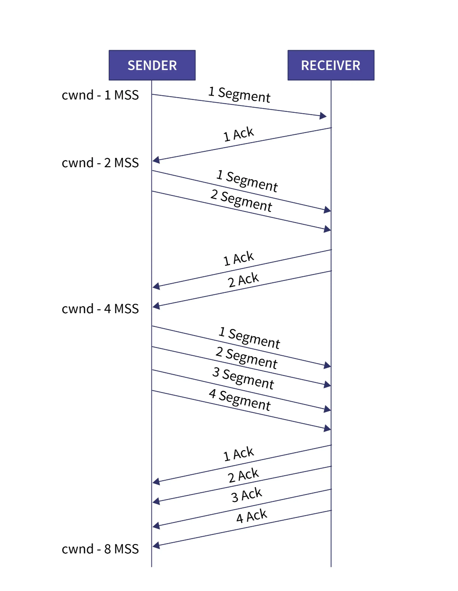
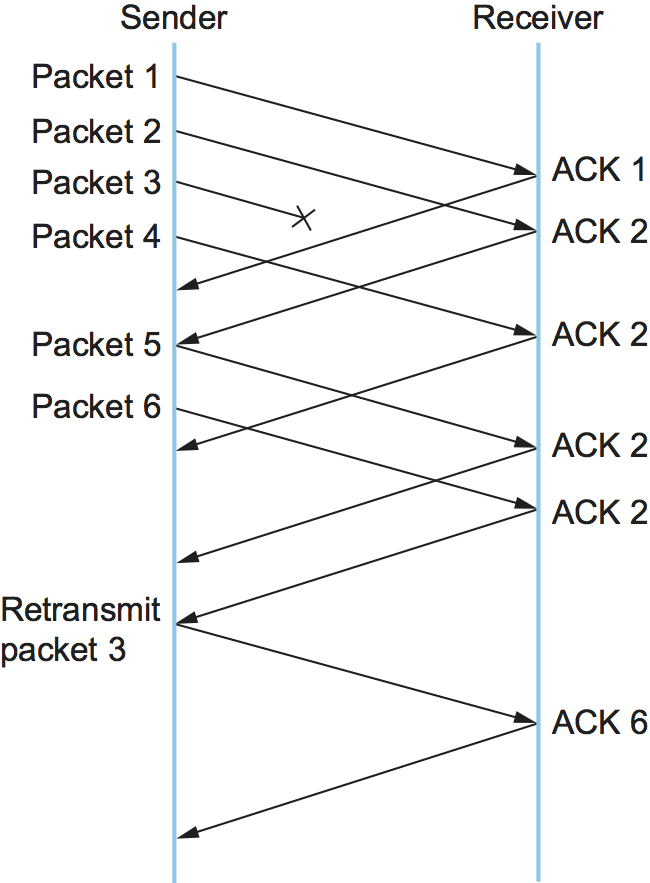
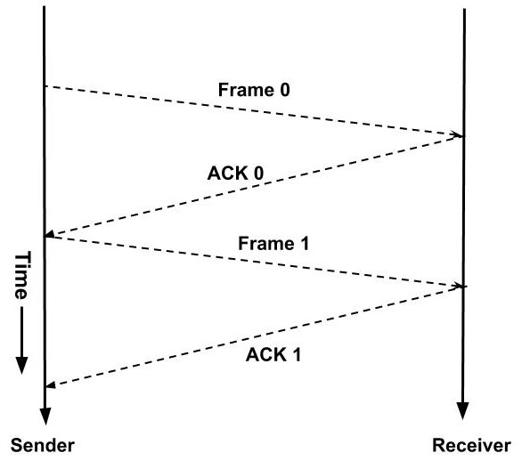

전송 계층은 기본적으로 오류를 점검하는 기능과 컴퓨터가 제대로 데이터를 받았을 경우 어떤 애플리키에션으로 전달해야 하는지를 식별하는 기능을 한다.

### 혼잡 제어(Congestion Control)

**혼잡 제어(Congestion Control)는 네트워크로 들어가는 정보량을 조절하여 네트워크가 혼잡해지지 않게 조절하는 방법이다.** 

혼잡 제어 방식은 송신자가 먼저 하나의 데이터만 보내고 수신자 측에서 ACK가 오면 전송량을 2배씩 증가시켜 나간다. 그러다가 타임아웃이 발생하면 여러 개 보냈던 데이터를 줄여서 보낸다. 혹은 동일한 ACK를 여러 번 받은 경우에도 데이터를 줄여서 보내는 방식을 취한다. 타임아웃과 마찬가지로 동일한 ACK를 여러 번 받았다는 것은 네트워크가 데이터를 실어 나르느라 바쁘다는 뜻이기 때문이다.

이후 정상적인 ACK를 받게 되면 또다시 데이터를 배수로 전송함으로써 데이터 전송량을 조절한다.

아래 그림은 정상적으로 전송량이 2배씩 늘어난다.

아래 그림 Packet 3이 타임아웃으로 도착하지 않아 동일한 ACK를 보낸다.

그래서 다시 Packet3를 전송한다.

---

### 흐름 제어(Flow Control)

흐름 제어 방법 중에 하나인 정지-대기(Stop & Wait) 방식은 송신자가 하나의 데이터를 전송한 후 다음 데이터를 전달하기 전에 확인 응답을 기다리는 방법이다.

예를 들어 수신자 측에서 ACK 메시지가 송신자 측에 전달되어야만 다음 데이터를 보내는 방법이다.

---

### 오류 제어(Error Control)

오류를 검출하기 위해서 확인 응답과 시간 초과 방법을 사용한다.

1. 확인 응답: 수신자 측으로부터 ACK라는 응답을 받아야 하지만 ACK가 없다면 오류로 판단한다.
1. 시간 초과: 특정 시간 내에 ACK가 없으면 세그먼트에 오류가 있다고 판단한다.

오류가 발견되면 데이터를 재전송해야 하는데, 재전송이 필요한 상황은 아래와 같다.

- 데이터가 중간에 손실될 때
- 데이터 순서가 바뀌었을 때
- 데이터가 훼손되었을 때

---

