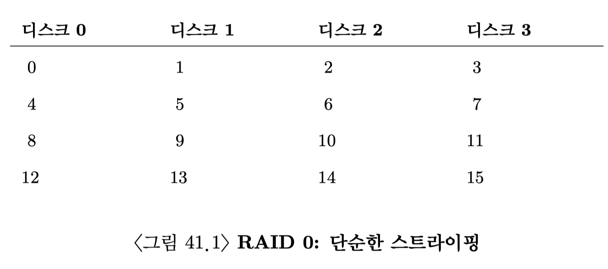
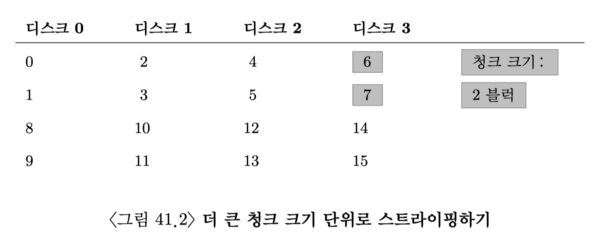
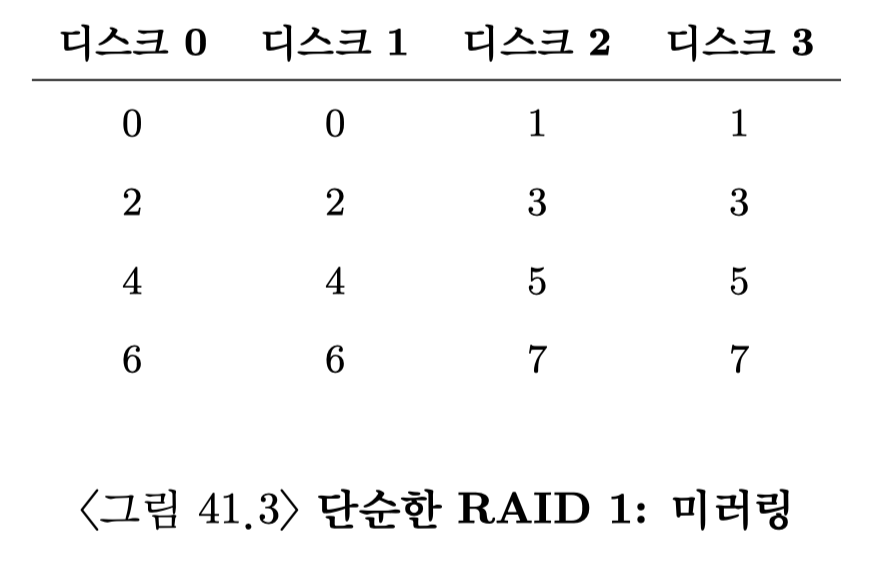
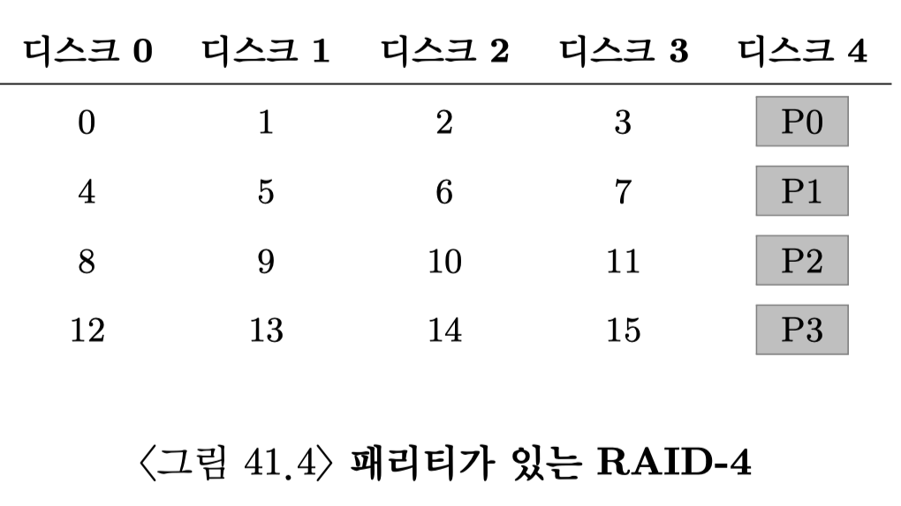

# 41장 개요

대용량이면서 빠르고 신뢰할 수 있는 디스크를 어떻게 만들까?

이번 장에서는 Redundant(중복된) Array of Inexpensive Disk 

→ RAID (저렴한 디스크들의 중복 배열) 기술을 공부한다.

이 기술은 여러 개의 디스크를 조화롭게 사용하여 고속이면서 대용량의 신뢰할 수 있는 디스크 시스템을 만든다.

외면적으로 RAID는 하나의 디스크처럼 보인다. 하지만 안을 들여다보면 RAID는 여러 개의 디스크와 메모리, 시스템을 관리하기 위한 하나 또는 그 이상의 프로세서로 이루어진 복잡한 기계이다.

RAID는 단일 디스크에 비해 여러 장점들을 제공한다. 먼저 성능이다. 디스크 여러 개를 병렬적으로 사용하면 I/O 시간이 크게 개선된다. 또 다른 장점은 용량이다. 마지막으로 RAID는 신뢰성을 높일 수 있다. 데이터를 여러 디스크에 분산하여 저장하면(RAID 기술을 사용 X) 디스크 중에 하나가 고장나도 데이터를 잃어버릴 수 있다.

데이터 **중복 기술(redeundancy)**을 사용함으로써 RAID는 디스크 한 개의 고장은 감내할 수 있으며, 마치 고장이 전혀 없던 것처럼 동작할 수 있다.

RAID는 자신을 활용하는 시스템에게 이러한 장점들을 **투명하게(transparently)**제공한다.

호스트 시스템은 RAID를 그저 거대한 디스크로 인식한다. 투명성이 소프트웨어 변경없이 디스크를 RAID로 바꿀 수 있다는 것이다.

---

# 41.1 인터페이스와 RAID의 내부

파일 시스템이 **RAID에 논리적 I/O를 요청**하면 RAID는 내부에서 어떤 디스크(또는 디스크들)를 접근해야 요청을 완료할 수 있는지 **계산한 후에 하나 또는 그 이상의 물리적 I/O를 발생**시킨다. 물리적 I/O에 대한 특성은 RAID 레벨에 따라 다르다.

간단한 예로 각 블럭에 대해서 서로 다른 디스크에 2개의 복사본을 유지하는 RAID를 생각해 보자.

이와 같은 미러링 기반의 RAID 시스템에서 블럭에 쓰는 경우 하나의 논리적 I/O에 대해서 두 개의 물리적 I/O를 실행해야 한다.

RAID 시스템은 보통 별도의 하드웨어 박스 형태로 되어 있으며 호스트와 표준 인터페이스(SCSI, SATA)로 연결된다. 내부적으로는 RAID를 지시하는 펌웨어를 실행하는 마이크로 컨트롤러 그리고 블럭을 읽고 쓸 때 버퍼로 사용할 DRAM 같은 휘발성 메모리가 있다. 또한 어떤 경우에는 패리티 계산을 위한 전용 논리 회로를 갖고 있기도 한다.

즉, RAID는 특수한 컴퓨터 시스템이다. 프로세서와 메모리, 디스크를 갖고 있다. 

일반 컴퓨터 시스템과의 차이는 응용 프로그램을 실행하는 대신 RAID를 동작시키기 위해 설계된 전용 소프트웨어를 실행한다는 것이다.

---

# 41.2 결함 모델

RAID를 이해하고 다른 접근법들과 비교하기 위해서는 결함 모델(fault model)이 있어야 한다.

고장 시 멈춤(fail-stop) 결함 모델, 해당 모델의 디스크의 상태는 “정상 작동” 또는 “멈춤”둘중 하나의 상태로 있다고 가정한다.

---

# 41.3 RAID 평가 방법

**용량에 대한 평가**

B개의 블럭을 가지는 N개의 디스크가 주어졌을 때 RAID의 클라이언트가 사용할 수 있는 유효 용량은 얼마나 되는가? 중복 저장이 없는 경우라면 N * B이다. 반대로 각 블럭에 두 개의 복사본을 갖는 경우라면 유효한 공간은 (N * B)/2가 될 것이다.

**신뢰성에 대한 평가**

몇 개의 디스크 결함을 감내할 수 있는가? 

**성능에 대한 평가**

성능은 워크로드에 따라 크게 달라지기 때문에 평가하기 힘들다. 그래서 먼저 워크로드를 먼저 고려한다.

**평가를 진행할 RAID 레벨** 

RAID 레벨 0(스트라이핑), RAID 레벨 1(미러링), RAID 레벨 4/5(패리티에 기반을 둔 중복 저장)

---

# 41.4 RAID 레벨 0: 스트라이핑

첫 번째 RAID 레벨은 중복 저장을 하지 않기 때문에 RAID 레벨이 아니다.

하지만, **RAID 레벨 0 또는 스트라이핑(striping)** 방식은 성능과 용량에 대한 상한 기준을 나타내기 때문에 이해하고 넘어갈 만하다.



그림 41.1을 보면 네 개의 디스크 배열을 RAID로 사용하고 있다.

스트라이핑이란 그림과 같이 블럭들을 여러 디스크에 거쳐서 줄을 긋는 것처럼 저장한다.

디스크 배열의 블록들을 라운드 로빈 방식으로 디스크를 가로질러 펼치는 것이다.

이 접근법은 **배열의 연속적인 청크(크기가 큰 순차 읽기)에 대해 요청을 받았을 때 병렬성을 가장 잘 활용할 수 있도록 설계**되었다. 같은 행에 있는 블럭들을 **스트라이프(stripe)**라고 부른다.

따라서 블럭 0, 1, 2, 3은 같은 스트라이프에 존재한다.

이 예에서는 단순하게 하나의 블럭(4KB 단위의 크기)만이 다음 디스크로 넘어가기 전에 현재 디스크에 배치된다고 가정한다. 



그림 41.2에서는 청크의 크기가 8KB(2블럭)이다.

각 디스크 마다 두 개의 4KB 블럭을 배치한 후에 다음 디스크로 넘어간다.

### 청크 크기

청크 크기는 RAID의 성능에 큰 영향을 준다.

작은 청크 크기가 의미하는 것은 많은 파일들이 여러 디스크에 걸쳐서 스트라이프된다는 말이며 하나의 파일을 읽고 쓰는 데 병렬성이 증가하게 된다.

하지만 블럭의 위치를 여러 디스크에서 찾아야 하므로 위치 찾기 시간이 늘어난다.

큰 청크 크기의 경우 파일 내의 병렬성은 줄어들고 위치 찾기 시간을 줄어든다. 예를 들어 파일이 작아서 단일 청크에 저장이 된다면, 파일을 읽는데 요구되는 위치 찾기 시간은 한 디스크에서 그 위치를 찾는 시간과 동일하게 된다.

즉, 최적의 청크 크기를 결정하는 것은 디스크 시스템이 처리할 워크로드에 대한 이해를 필요로한다.

### RAID-0 분석으로 돌아가서

**용량**

완벽하다. N개의 디스크에서 스트라이핑은 N * B(1개의 디스크가 가지는 블럭 개수)개의 디스크 용량만큼 유효 용량을 갖는다.

**신뢰성**

최악이다. 하나의 디스크라도 고장나면 전체 데이터가 손실된다.

**성능** 

훌륭하다. 병렬을 최대한 활용해서 사용자 I/O를 처리할 수 있기 때문에 모든 디스크가 활용된다.

### RAID의 성능 평가하기

**순차 워크로드 VS 랜덤 워크로드** 

순차 워크로드에서는 연속된 큰 청크의 형태로 RAID에 요청된다. 

예를 들어 1MB의 데이터를 접근하는 요청(또는 연속적인 요청)이 블럭 B에서 시작하여 블럭 B+1MB에서 끝난다면 순차적이라고 본다.

랜덤 워크로드는 크기가 작은 요청이며 또한 디스크의 여러 불특정 위치를 접근한다고 가정한다.

예를 들면, 논리 주소 10에서 첫 번째 4KB를 접근하고 다음으로 논리 주소 550,000 등의 위치로 이동하여 접근하는 경우다. 

순차와 랜덤 워크로드는 디스크로부터 큰 성능 차이를 만들어 낸다.

순차 접근의 경우 탐색과 회전 지연 시간이 짧아 대부분의 시간을 데이터 전송에 사용한다.

랜덤 접근의 경우는 대부분의 시간을 탐색과 회전을 기다리는 데 사용되고 상대적으로 적은 시간이 데이터 전송에 사용된다.

**예제로 이해하기**

```
분석을 위해 순차 워크로드의 경우 S MB/s, 랜덤 워크로드의 경우 R MB/s 속도로 전송한다고 가정하자.
일반적으로 S가 R보다 매우 크다.

S: 평균적으로 10MB의 크기를 순차적으로 전송하고 
R: 평균적으로 10KB의 크기를 임의의 방식으로 전송한다고 가정

디스크의 특성
평균 탐색 시간 7 ms
평균 회전 시간 3 ms
디스크 전송 속도 50 MB/s

순차 워크로드 계산

탐색 시간 + 회전 시간 = 10 ms
데이터 전송 시간: 10MB / 50 MB/s  = 0.2s = 200ms
총 소요 시간 = 210ms

S = 데이터 크기 / 총 소요 시간 = 10MB/ 0.210초 ≈ 47.62MB/s

랜덤 워크로드 계산 
탐색 시간 + 회전 시간 = 10ms
데이터 전송 시간: 10KB / 50 MB/s = 0.195ms
총 소요 시간 = 10.195ms

R = 데이터 크기 / 총 소요 시간 = 10KB / 0.195초 ≈ 0.981MB/s

S/R은 거의 50이다. 
```

---

# 41.5 RAID 레벨 1: 미러링

미러링을 사용하는 시스템에서는 각 블럭에 대해서 하나 이상의 사본을 둔다.

각 사본은 서로 다른 디스크에 저장되어야 한다. 이를 통해서 디스크 고장에 대처할 수 있게 된다. 

일반적으로 미러링 시스템에서 RAID는 각 논리 블럭에 대해 두 개의 물리적 사본을 둔다고 가정한다. 



그림 41.3을 보면 디스크 0과 디스크1이 동일한 값을 갖고 디스크2와 디스크3이 동일한 값을 갖고 있다.

해당 방식은 RAID-10 또는 RAID 1+0 이라고 불린다.

즉, 스트라이핑 X 미러링을 RAID-1 

RAID-0의 스트라이핑과 RAID-1의 미러링을 같이 사용하는 레벨이 RAID-10이다.

미러링된 배열에서 블럭을 읽을 때 RAID는 원본을 읽을 건지 사본을 읽을건지 선택할 수 있다.

반면에 쓰기는 선택할 수 없다. 신뢰성을 유지하기 위해서 두 벌의 데이터을 모두 갱신해야 한다.

하지만 이런 쓰기 요청은 서로 다른 디스크에 쓰기 작업을 하니까 병렬적으로 처리된다.

예를 들어 논리 블럭 5번에 쓰는 요청은 디스크 2와 3에 동시에 처리될 수 있다.

### RAID-1 분석 

**용량** 

미러링 레벨이 2라면 최대 사용 가능한 용량의 반만 사용할 수 있다.

즉, 용량 측면에서 비용이 많이 드는 RAID 레벨이다.

**신뢰성** 

신뢰성 측면에서 괜찮은 편이다. 디스크 중 어느것에서 고장이 발생하여도 감내할 수 있다.

또한 운이 좋다면 더 많은 고장을 감내할 수 있다.

예를 들어 RAID 미러링 구조가 디스크 0(원본) 디스크 1(사본) 디스크 2(원본) 디스크3 (사본) 이라고 가정하면 

디스크 0, 2 또는 디스크 1,3 모두 고장이 난다고 해도 데이터를 하나도 잃어버리지 않는다.

**성능** 

읽기 요청의 지연 시간은 단일 디스크에서 읽는 경우의 지연 시간과 동일하다. 

하지만 쓰기 요청의 경우 두 개의 디스크로 전달된 쓰기가 모두 종료되어야 한다.

이 두개의 쓰기는 병렬적으로 이루어지기 때문에 하나의 쓰기에 소요되는 시간과 거의 동일할 것이다.

하지만 쓰기는 물리적으로 두개의 쓰기연산이 종료될 때까지 대기해야 하므로, 그 지연시간은 두 개의 요청 중 최악의 탐색과 회전 지연 시간에 의해 결정된다. 

즉, 평균적으로 하나의 디스크에 쓰는 시간보다는 조금 더 길다.

---

# 41.6 RAID 레벨 4: 패리티를 이용한 공간 절약



