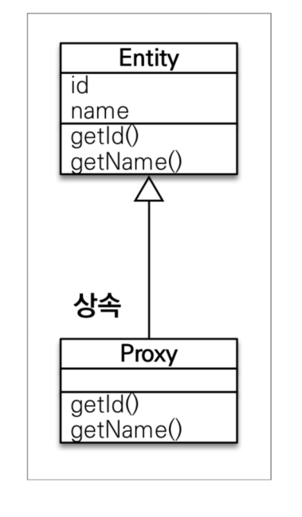
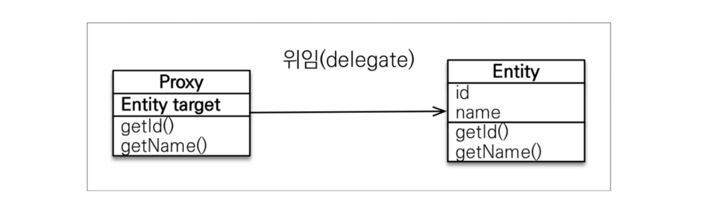
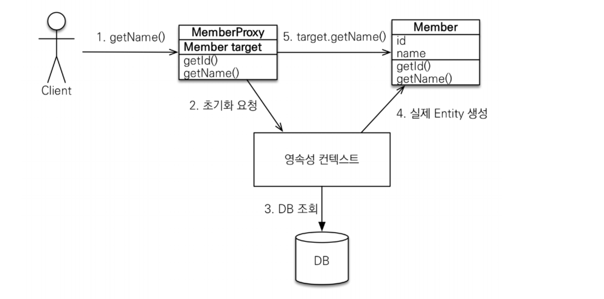

# ***프록시*** 

### ***[시나리오] Member를 조회할 때 Team도 함께 조회해야 할까?***

*Member : Team →  N: 1 관계* 

*어떤 비즈니스 로직에서는 Member, Team 정보가 모두 필요할 수 있고,*

*또 다른 비즈니스 로직에서는 Member 정보만 필요할 수 있다.*

*Member 정보만 필요한데 Member Team 테이블을 조회해서 가져오는 방식은 쓸데없는 낭비이다.*

*JPA에서는 이런 문제점을 어떻게 해결할까?*

### ***프록시 기초***

- ***em.find() VS em.getReference()***
- ***em.find():*** *데이터베이스를 통해서 실제 엔티티 객체를 조회*
- ***em.getReference():*** *데이터베이스 조회를 미루는 가짜(프록시) 엔티티 객체 조회*

***em.find()***

```java
Member member = new Member();
member.setName("hello");
em.persist(member);

em.flush();
em.clear();

Member findMember = em.find(Member.class, member.getId());

tx.commit();
---------------------------------------------------------------------------------------

Hibernate: 
    select
        m1_0.id,
        m1_0.CREATE_MEMBER,
        m1_0.createdDate,
        m1_0.UPDATE_MEMBER,
        m1_0.lastModifiedDate,
        m1_0.USERNAME,
        t1_0.id,
        t1_0.CREATE_MEMBER,
        t1_0.createdDate,
        t1_0.UPDATE_MEMBER,
        t1_0.lastModifiedDate,
        t1_0.name 
    from
        Member m1_0 
    left join
        Team t1_0 
            on t1_0.id=m1_0.TEAM_ID 
    where
        m1_0.id=?
```

***em.getReference() - 1***

```java
 Member member = new Member();
 member.setName("hello");
 em.persist(member);

 em.flush();
 em.clear();

 Member findMember = em.getReference(Member.class, member.getId());

 tx.commit();
```

- *SELECT 쿼리가 DB에 날아가지 않는다.*

***em.getReference() - 2***

```java
Member member = new Member();
member.setName("hello");
em.persist(member);

em.flush();
em.clear();

Member findMember = em.getReference(Member.class, member.getId());
System.out.println("findMember.id = " + findMember.getId());
System.out.println("findMember.name = " + findMember.getName());

tx.commit();
---------------------------------------------------------------------------------------

findMember.id = 1
Hibernate: 
    select
        m1_0.id,
        m1_0.CREATE_MEMBER,
        m1_0.createdDate,
        m1_0.UPDATE_MEMBER,
        m1_0.lastModifiedDate,
        m1_0.USERNAME,
        t1_0.id,
        t1_0.CREATE_MEMBER,
        t1_0.createdDate,
        t1_0.UPDATE_MEMBER,
        t1_0.lastModifiedDate,
        t1_0.name 
    from
        Member m1_0 
    left join
        Team t1_0 
            on t1_0.id=m1_0.TEAM_ID 
    where
        m1_0.id=?
findMember.name = hello
```

- *findMember.getName(): 호출하는 순간에 데이터베이스에 SELECT 쿼리가 날아간다.*
- *findMember.getId() → PK로 조회하기 때문에 해당 시점에는 쿼리가 날아가지 않는다.*

***Member Proxy*** 

```java
Member findMember = em.getReference(Member.class, member.getId());
System.out.println("findMember = " + findMember.getClass());

findMember = class hellojpa.domain.Member$HibernateProxy$B5nc3zTW
```


### ***프록시 특징*** 



- *실제 클래스를 상속 받아서 만들어진다. (인터페이스가 아니라서 상속을 통한 프록시 생성)*
- *사용하는 입장(클라이언트)에서는 진짜 객체인지 프록시 객체인지 구분하지 않고 사용하면 된다.*



- *프록시 객체는 실제 객체의 참조(target)를 보관한다*
- *프록시 객체를 호출하면 프록시 객체는 실제 객체의 메소드를 호출한다*

### ***프록시 객체의 초기화*** 

```java
Member member = em.getReference(Member.class, 1L);
member.getName();
```



- *getName(): 호출 시점에는 Member target = null*
- *초기화 요청 → DB 조회 → 실제 Entity 생성 → Member target = 생성한 Entity*
- *target.getName() 반환*

### ***프록시 정리***

- *프록시 객체는 처음 사용할 때 한 번만 초기화* 
- *프록시 객체를 초기화 할 때, 프록시 객체가 실제 엔티티로 바뀌는 것은 아님, 초기화되면 프록시 객체를 통해서 실제 엔티티에 접근 가능*
- *프록시 객체는 원본 엔티티를 상속받음, 따라서 타입 체크시 주의해야함*
- *instance of 사용*
- *영속성 컨텍스트에 찾는 엔티티가 이미 있으면 em.getReference()를 호출해도 프록시가 아닌 실제 엔티티를 반환*
- *반대로 em.getReference() 이후 em.find()를 호출해도 Proxy가 반환된다.*
  - *JPA는 같은 트랜잭션에서 동일성을 보장하기 때문이다.*
  - *그냥 간단하게 PK로 매핑된 1차 캐시의 인스턴스 반환한다고 이해하면 될듯하다.*
- *영속성 컨텍스트의 도움을 받을 수 없는 준영속 상태일 때, 프록시를 초기화 하면 문제 발생*
- *하이버네이트는* ***org.hibernate.LazyInitializationException*** *예외를 터트림*

```java
try {
      Member member = new Member();
      member.setName("hello");
      em.persist(member);

      em.flush();
      em.clear();

      Member refMember = em.getReference(Member.class, member.getId());
      System.out.println("findMember = " + refMember.getClass());

      em.detach(refMember);
      refMember.getName();

      tx.commit();
  }
  catch (Exception e){
      e.printStackTrace();
      tx.rollback();
  }
  --------------------------------------------------------------------------------------
  
findMember = class hellojpa.domain.Member$HibernateProxy$0WPAmUiO
org.hibernate.LazyInitializationException: could not initialize proxy - no Session

```

### ***프록시 확인***

- *프록시 인스턴스의 초기화 여부 확인*
- *Persistence.getPersistenceUtil().isLoaded(엔티티) → return boolean*
- *프록시 클래스 확인 방법*
- *엔티티.getClass().getName()*
- *프록시 강제 초기화* 
- *Hibernate.initialize(엔티티)*
- *JPA 표준은 강제 초기화가 존재하지 않는다.*
- *member.getName()*

# ***즉시 로딩과 지연 로딩***

### ***즉시 로딩과 지연 로딩 이해***

*프록시를 공부하면서 시나리오로 적어둔 예제를 생각해 보자*

*Member를 조회할 때 Team도 함께 조회해야 할까?*

*Member를 조회할 때 Team에 대해서 지연 로딩(프록시) 조회를 하고 Team 정보가 필요하면 프록시 초기화(DB에 조회)를 시키면 된다.*

***Member Entity***

```java
@Entity
@Getter @Setter
public class Member extends BaseEntity{
    @Id @GeneratedValue(strategy = GenerationType.IDENTITY)
    private Long id;
    @Column(name = "USERNAME")
    private String name;

    @ManyToOne(fetch = FetchType.LAZY)
    @JoinColumn(name = "TEAM_ID")
    private Team team;
}
```

- ***@ManyToOne(fetch = FetchType.LAZY)***
- *지연 로딩 전략(LAZY)*

```java
Team team = new Team();
team.setName("teamA");
em.persist(team);

Member member = new Member();
member.setName("hello");
member.setTeam(team);
em.persist(member);

em.flush();
em.clear();

Member findMember = em.find(Member.class, member.getId());
System.out.println("Team = " + findMember.getTeam().getClass());

tx.commit();

----------------------------------------------------------------------------------------
Hibernate: 
    select
        m1_0.id,
        m1_0.CREATE_MEMBER,
        m1_0.createdDate,
        m1_0.UPDATE_MEMBER,
        m1_0.lastModifiedDate,
        m1_0.USERNAME,
        m1_0.TEAM_ID 
    from
        Member m1_0 
    where
        m1_0.id=?
Team = class hellojpa.domain.Team$HibernateProxy$qeGDzCDe
```

- *em.find(Member.class, ID)를 했을 때 지연(Lazy) 로딩 전략이어서 Team 테이블에 대한 조인 쿼리가 날아가지 않는다.*
- *또한 Team.getClass()를 통해서 클래스 이름을 조회하면 프록시로 나온다.*
- *당연히 Team.getName() 같은 메소드 호출 시점에 DB에 Team 쿼리가 날아가면서 Team 프록시가 초기화된다.*

***Member와 Team을 자주 함께 사용한다면?***

*지연 로딩 전략을 사용할 이유가 없다.*

*지연 로딩 전략은 네트워크를 2번 탄다. Member 조회, Team 조회*

*→ fetch = FetchType.EAGER 즉시 로딩 전략*

***Member - Entity***

```java
@Entity
@Getter @Setter
public class Member extends BaseEntity{
    @Id @GeneratedValue(strategy = GenerationType.IDENTITY)
    private Long id;
    @Column(name = "USERNAME")
    private String name;

    @ManyToOne(fetch = FetchType.EAGER)
    @JoinColumn(name = "TEAM_ID")
    private Team team;
}
```

- ***@ManyToOne(fetch = FetchType.EAGER)***
- *즉시 로딩 전략*

```java
Team team = new Team();
team.setName("teamA");
em.persist(team);

Member member = new Member();
member.setName("hello");
member.setTeam(team);
em.persist(member);

em.flush();
em.clear();

Member findMember = em.find(Member.class, member.getId());
tx.commit();

-------------------------------------------------------------------------------------
Hibernate: 
    select
        m1_0.id,
        m1_0.CREATE_MEMBER,
        m1_0.createdDate,
        m1_0.UPDATE_MEMBER,
        m1_0.lastModifiedDate,
        m1_0.USERNAME,
        t1_0.id,
        t1_0.CREATE_MEMBER,
        t1_0.createdDate,
        t1_0.UPDATE_MEMBER,
        t1_0.lastModifiedDate,
        t1_0.name 
    from
        Member m1_0 
    left join
        Team t1_0 
            on t1_0.id=m1_0.TEAM_ID 
    where
        m1_0.id=?
```

- *바로 조인 쿼리가 날아간다.*

### ***프록시와 즉시로딩 주의*** ⭐⭐⭐

- *지연 로딩만 사용하자*
- ***JPQL fetch 조인, 엔티티 그래프 기능을 사용하자***
- *즉시 로딩을 적용하면 예상하지 못한 SQL이 발생한다*
- *즉시 로딩으로 연관관계가 매핑된 테이블 전부가 조인된다.*
- ***즉시 로딩은 JPQL에서 N+1 문제를 일으킨다.***
```java
Team team = new Team();
team.setName("teamA");
em.persist(team);

Member member = new Member();
member.setName("hello");
member.setTeam(team);
em.persist(member);

em.flush();
em.clear();

List<Member> members =
        em.createQuery("select m from Member m", Member.class).getResultList();

-------------------------------------------------------------------------------------
Hibernate: 
    /* select
        m 
    from
        Member m */ select
            m1_0.id,
            m1_0.CREATE_MEMBER,
            m1_0.createdDate,
            m1_0.UPDATE_MEMBER,
            m1_0.lastModifiedDate,
            m1_0.USERNAME,
            m1_0.TEAM_ID 
        from
            Member m1_0
Hibernate: 
    select
        t1_0.id,
        t1_0.CREATE_MEMBER,
        t1_0.createdDate,
        t1_0.UPDATE_MEMBER,
        t1_0.lastModifiedDate,
        t1_0.name 
    from
        Team t1_0 
    where
        t1_0.id=?
```

  - *Member만 조회했는데 쿼리가 2개 날아간다.*
  - *JPQL → SQL SELECT * FROM MEMBER; 날아간다.* 
  - *그런데 로딩 전략이 즉시 로딩이기 때문에 MEMBER와 연관관계가 맺어진 TEAM에 대해서 SELECT 쿼리가 추가로 날아간다.*
  - *현재 MEMBER와 연관된 팀이 하나여서 쿼리가 1번 날아가지만 연관된 팀이 N개라면 N개의 추가 쿼리가 날아간다. 그래서 N+1 문제라고 한다.*
- ***@ManyToOne, @OneToOne은 기본이 즉시 로딩 → LAZY로 사용하자***
- *@OneToMany, @ManyToMany는 기본이 지연 로딩*

# *영속성 전이(CASCADE)와 고아 객체*

### *영속성 전이(CASCADE)*

***영속성 전이(CASCADE) ?***

- *특정 엔티티를 영속 상태로 만들 때 연관된 엔티티도 함께 영속 상태로 만들고 싶을 때*
- *ex: 부모 엔티티를 저장할 때 자식 엔티티도 함께 저장*

***Child, Parent Entity***

```java
@Entity
@Getter @Setter
public class Child {
    @Id
    @GeneratedValue(strategy = GenerationType.IDENTITY)
    private Long id;
    private String name;
    @ManyToOne
    @JoinColumn(name = "PARENT_ID")
    private Parent parent;
}

@Entity
@Getter @Setter
public class Parent {
    @Id
    @GeneratedValue(strategy = GenerationType.IDENTITY)
    private Long id;
    private String name;

    @OneToMany(mappedBy = "parent")
    private List<Child> childList = new ArrayList<>();
    public void addChild(Child child){
        this.childList.add(child);
        child.setParent(this);
    }
}
```

***INSERT example***

```java
Child child1 = new Child();
Child child2 = new Child();

Parent parent = new Parent();
parent.addChild(child1);
parent.addChild(child2);

em.persist(child1);
em.persist(child2);
em.persist(parent);

tx.commit();
```

- *child1, child2, parent 모두 영속화하려면 persist를 3번 호출해야 한다.*

***Parent Entity 수정***

```java
@OneToMany(mappedBy = "parent", cascade = CascadeType.ALL)
private List<Child> childList = new ArrayList<>();
```

- *cascade 옵션 추가* 

```java
Child child1 = new Child();
Child child2 = new Child();

Parent parent = new Parent();
parent.addChild(child1);
parent.addChild(child2);

em.persist(parent);

tx.commit();
-------------------------------------------------------------------------------------
Hibernate: 
    /* insert for
        hellojpa.domain.Parent */insert 
    into
        Parent (name, id) 
    values
        (?, default)
Hibernate: 
    /* insert for
        hellojpa.domain.Child */insert 
    into
        Child (name, PARENT_ID, id) 
    values
        (?, ?, default)
Hibernate: 
    /* insert for
        hellojpa.domain.Child */insert 
    into
        Child (name, PARENT_ID, id) 
    values
        (?, ?, default)

```

- *부모 엔티티만 영속화 하였는데 자식 엔티티도 INSERT 쿼리가 날아간다.*


***영속성 전이: CASCADE 주의***

- *영속성 전이는 연관관계를 매핑하는 것과 아무 관련이 없음*
- *엔티티를 영속화 할 때 연관된 엔티티도 함께 영속화하는 편리함을 제공할 뿐*

***CASCADE의 종류***

- *ALL: 모두 적용*
- *PERSIST: 영속*
- *REMOVE: 삭제*
- *MERGE: 병합*
- *REFRESH: REFRESH*

### ***고아 객체***

- *고아 객체 제거: 부모 엔티티와 연관관계가 끊어진 자식 엔티티를 자동으로 삭제*
- ***orphanRemoval = true***

***Parent, Child Entity***

```java
@Entity
@Getter @Setter
public class Parent {
    @Id
    @GeneratedValue(strategy = GenerationType.IDENTITY)
    private Long id;
    private String name;

    @OneToMany(mappedBy = "parent", cascade = CascadeType.ALL, orphanRemoval = true)
    private List<Child> childList = new ArrayList<>();
    public void addChild(Child child){
        this.childList.add(child);
        child.setParent(this);
    }
}

@Entity
@Getter @Setter
public class Child {
    @Id
    @GeneratedValue(strategy = GenerationType.IDENTITY)
    private Long id;
    private String name;
    @ManyToOne
    @JoinColumn(name = "PARENT_ID")
    private Parent parent;
}
```

- ***@OneToMany(mappedBy = "parent", cascade = CascadeType.ALL, orphanRemoval = true)***

***example***

```java
Child child1 = new Child();
Child child2 = new Child();

Parent parent = new Parent();
parent.addChild(child1);
parent.addChild(child2);

em.persist(parent);
em.flush();
em.clear();

Parent findParent = em.find(Parent.class, parent.getId());
findParent.getChildList().remove(0);

----------------------------------------------------------------------------------------
Hibernate: 
    select
        p1_0.id,
        p1_0.name 
    from
        Parent p1_0 
    where
        p1_0.id=?
Hibernate: 
    select
        cl1_0.PARENT_ID,
        cl1_0.id,
        cl1_0.name 
    from
        Child cl1_0 
    where
        cl1_0.PARENT_ID=?
Hibernate: 
    /* delete for hellojpa.domain.Child */delete 
    from
        Child 
    where
        id=?
```

- ***orphanRemoval TRUE →****연관관계가 끊긴 Child 엔티티가 삭제된다.*
- ***CascadeType.REMOVE*** *→ Parent가 삭제될 때 연관된 Child 전부 같이 삭제* 

***고아 객체 주의***

- *참조가 제거된 엔티티는 다른 곳에서 참조하지 않는 고아 객체로보고 삭제하는 기능*
- ***참조하는 곳이 하나일 때 사용해야함 (특정 엔티티가 개인 소유할 때 사용)***
- *CascadeType 또한 마찬가지*
- *@OneToOne, @OneToMany만 가능*
- *참고: 개념적으로 부모를 제거하면 자식은 고아가 된다. 
따라서 고아 객체 제거 기능을 활성화 하면, 부모를 제거할 때 자식도 함께
제거된다.*
- *CascadeType.REMOVE 처럼 동작*

***영속성 전이 + 고아 객체, 생명주기***

- *CascadeType.ALL + orphanRemoval=true* 
- *스스로 생명주기를 관리하는 엔티티는 em.persist()로 영속화, em.remove()로 제거*
- *두 옵션을 모두 활성화 하면 부모 엔티티를 통해서 자식의 생명주기를 관리할 수 있다.*
- *도메인 주도 설계(DDD)의 Aggregate Root개념을 구현할 때 유용*

