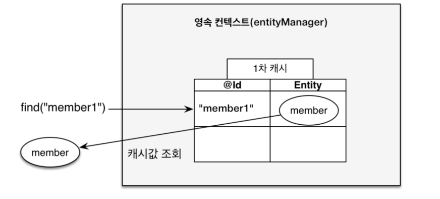

# ***객체와 테이블 매핑***

***엔티티 매핑 소개***

- *객체와 테이블 매핑: @Entity, @Table* 
- *필드와 컬럼 매핑: @Column*
- *기본 키 매핑: @Id*
- *연관관계 매핑: @ManyToOne, @JoinColumn*

## *@Entity, @Table*

***@Entity***

- *@Entity가 붙은 클래스는 JPA가 관리하는 클래스, 엔티티라 한다.*
- *JPA를 사용해서 테이블과 매핑할 클래스는 @Entity가 필수*
- ***주의***
- *기본 생성자(public, protected) 필수* 
  - *final 클래스, enum, interface, inner 클래스 사용 X*
  - *저장할 필드에 final 사용 X*

***@Entity - 속성(name)***

- *name*
- *JPA에서 사용할 엔티티 이름 지정*
- *기본값: 클래스 이름을 그대로 사용*
- *같은 클래스 이름이 없으면 기본값을 사용한다.*
- *그냥 기본값을 사용하자.*

```java
@Entity(name = "Member")
public class Member {
		// 생략 ..
}
```

***@Table***

- *엔티티와 매핑할 데이터베이스 테이블 지정*
- ***name***
- *매핑할 테이블 이름*
  - *default: 엔티티 이름을 사용*
- ***catalog***
- *데이터베이스 catalog 매핑*
- ***schema***
- *데이터베이스 schema 매핑*
- ***uniqueConstraints***
- *DDL 생성 시에 유니크 제약 조건 생성*

# ***데이터베이스 스키마 자동 생성***

### ***데이터베이스 스키마 자동 생성?***

- *DDL을 애플리케이션 실행 시점에 자동 생성*
- *데이터베이스 방언을 활용해서 데이터베이스에 맞는 적절한 DDL 생성*
- *운영서버에서는 사용하지 않는다.*

### ***데이터베이스 스키마 자동 생성 - 속성***

***persistence.xml***

```xml
<persistence-unit name="hello">
        <properties>
            <property name="hibernate.hbm2ddl.auto" value="create"/> 
        </properties>
</persistence-unit>
```

- ***hibernate.hbm2ddl.auto***

***속성***

*create: 기존 테이블 삭제 후 다시 생성(DROP + CREATE)*

*create-drop: create와 동일 drop 시점이 종료시점*

*update: 변경분만 반영*

*validate: 엔티티와 테이블이 정상 매핑되었는지만 확인*

*none: 사용하지 않음*

***데이터베이스 스키마 자동 생성 - 주의***

- *운영 서버에서는 create, create-drop, update 사용 X*

***DDL 생성 기능***

- *제약조건 추가: 회원 이름은 필수, 10자 초과X*
```java
@Column(unique = true, length = 10, nullable = false)
private String name;
```
- *DDL 생성 기능은 DDL 자동 생성할 때만 사용되고 JPA의 실행 로직에는 영향을 주지 않는다.*

# ***필드와 컬럼 매핑***

***Member - Entity***

```java
@Entity
public class Member {
    
    public Member() {
    }
    
    @Id
    private Long id;
    
    @Column(name = "name")
    private String username;
    
    @Enumerated(EnumType.STRING)
    private RoleType roleType;
    
    @Temporal(TemporalType.TIMESTAMP)
    private Date createdDate;
    
    @Temporal(TemporalType.TIMESTAMP)
    private Date lastModifiedDate;
    
    @Lob
    private String description;
}

---------------------------------------------------------------------------------------
Hibernate: 
    create table Member (
        createdDate timestamp(6),
        id bigint not null,
        lastModifiedDate timestamp(6),
        name varchar(255),
        roleType varchar(255) check (roleType in ('USER','ADMIN')),
        description clob,
        primary key (id)
    )
```

### ***매핑 애노테이션 정리***

- *@Column: 컬럼 매핑*
- *@Temporal: 날짜 타입 매핑*
- *DATE(날짜), TIME(시간), TIMESTAMP(날짜,시간)*
- *@Enumerated: enum 타입 매핑*
- *@Lob: BLOB, CLOB 매핑*
- *@Transient: 특정 필드를 컬럼에 매핑하지 않음(매핑 무시)*

### ***@Column***

- ***name***
- *필드와 매핑할 테이블의 컬럼 이름* 
  - *default: 객체의 필드 이름*
- ***insertable, updatable***
- *등록, 변경 가능 여부*
  - *defaut: TRUE*
  - *만약 updatable = false 이면 애플리케이션을 통한 수정은 불가능하다*
- ***nullable(DDL)***
- *null 값의 허용 여부 설정한다.*
  - *false로 설정하면 DDL 생성 시에 not null 제약조건이 붙는다.*
- ***unique(DDL)***
- *한 컬럼에 간단히 유니크 제약조건을 걸 때 사용한다.*
  - *unique 제약 조건 이름이 랜덤으로 생성된다, 복합 컬럼에서 사용 불가능 →* ***@Table(uniqueConstraints)*** *사용*
- ***length(DDL)***
- *문자 길이 제약조건, String 타입에만 사용한다.*
  - *default: 255*
- ***columnDefinition(DDL)***
- *데이터베이스 컬럼 정보를 직접 줄 수 있다.*
  - *ex) varchar(100) default ‘EMPTY’*
- ***precision, scale(DDL)***
- *BifDecimal, BigInteger 타입에서 사용*
  - *precision은 소수점을 포함한 전체 자릿수, scale은 소수의 자릿수* 
  - *double, float 타입에는 적용되지 않는다.*
  - *아주 큰 숫자나, 정밀한 소수를 다루어야 할 때만 사용한다.*
  - *default: precision=19, scale=2*

### ***@Enumerated***

- *자바 enum 타입을 매핑할 때 사용한다*
- ***EnumType.ORDINAL 사용 금지*** 

```java
@Enumerated(EnumType.STRING)
private RoleType roleType;

public enum RoleType {
    USER, ADMIN
}
```

- *EnumType.ORDINAL: enum 순서를 데이터베이스에 저장*
- *integet 타입 생성*
  - *default*
- *EnumType.STRING: enum 이름을 데이터베이스에 저장*
- *String(VARCHAR) 타입 생성*

***왜? EnumType.ORDINAL 사용을 금지?***

- *enum 순서를 저장하는데 만약, enum 추가가 되거나 순서가 바뀌면 데이터베이스에는 순서(숫자)가 저장되기 때문에 의미가 바뀌어버린다.* 
- *그러니 EnumType.STRING 사용하자*

### ***@Temporal***

- *날짜 타입(java.util.Date, java.util.Calendar)을 매핑할 때 사용*
- ***참고: LocalDate, LocalDateTime을 사용할 때는 생략 가능(최신 하이버네이트 지원)***

### ***@Lob***

- *데이터베이스 BLOB, CLOB 타입과 매핑*
- *필드 타입이 문자면 CLOB 매핑 나머지는 BLOB 매핑*
- *지정할 수 있는 속성이 없다.*

| 특징 | CLOB | BLOB |
| --- | --- | --- |
| **데이터 유형** | 문자 데이터 (텍스트) | 바이너리 데이터 (이미지, 동영상 등) |
| **저장 내용** | 텍스트 파일, XML, HTML | 이미지, 오디오, 동영상, 압축 파일 |
| **크기 제한** | 데이터베이스 설정에 따라 다름 | 데이터베이스 설정에 따라 다름 |
| **인코딩** | 문자 인코딩 (UTF-8, ASCII 등) 적용 | 인코딩 없음 |

### *@Transient*

- *필드 매핑 X*
- *데이터베이스에 저장, 조회 X*
- *메모리상에서만 임시로 어떤 값을 보관하고 싶을 때 사용*

# *기본 키 매핑*

### ***직접 할당***

- *@Id만 사용*

### ***자동 생성***

- *@Id, @GeneratedValue*
- ***@GeneratedValue strategy 속성***
- *IDENTITY: 데이터베이스에 위임, MYSQL*
  - *SEQUENCE: 데이터베이스 시퀀스 오브젝트 사용, ORACLE*
- *@SequenceGenerator 필요*
  - *TABLE: 키 생성용 테이블 사용, 모든 DB에서 사용*
- *@TableGenerator 필요*
  - *AUTO: 방언에 따라 자동 지정, 기본값*
- *DB 방언에 따라 IDENTITY, SEQUENCE, TABLE 3개중에 하나가 자동 지정*

### ***IDENTITY 전략 - 특징***

- *기본 키 생성을 데이터베이스에 위임한다.*
- *MySQL, PostgreSQL, SQL Server, DB2에서 사용*
- *MySQL: AUTO_INCREMENT*
- *JPA는 보통 트랜잭션 커밋 시점에 INSERT SQL 실행*
- *중간에 JPQL 실행 or 명시적으로 flush() 호출하지 않는 이상*
- *AUTO_INCREMENT는 데이터베이스 INSERT SQL 실행 이후에 ID 값을 알 수 있다.*
- *IDENTITY 전략은 em.persist() 시점에 즉시 INSERT SQL 실행하고 DB에서 식별자를 조회한다.*

```java
@Entity
public class Member {

    public Member() {}
  
    @Id
    @GeneratedValue(strategy = GenerationType.IDENTITY)
    private Long id;
   
    @Column(name = "name")
    private String username;
}    

--------------------------------------------------------------------------------------

Hibernate: 
    create table Member (
        id bigint generated by default as identity,
        name varchar(255),
        primary key (id)
    )
```

```java
Member member = new Member();
member.setUsername("배제우");
em.persist(member);
System.out.println("============================");
tx.commit();

------------------------------------------------------------------------------------

Hibernate: 
    /* insert for
        hellojpa.domain.Member */insert 
    into
        Member (name, id) 
    values
        (?, default)
============================
```



- *영속성 컨텍스트의 1차 캐시에는 기본 키를 기준으로 Entity가 관리, 저장된다.* 
- *IDENTITY 전략은 기본 키 값을* ***데이터베이스가 생성하므로, 키 값을 미리 알 수 없다.*** 
- 그래서 *영속성 컨텍스트의 쓰기 지연이 적용되지 않고 바로 데이터베이스에 INSERT 쿼리가 날아간다.*
- *IDENTITY 전략은 INSERT 하는 순간 데이터베이스에서 자체적으로 증가 시켜서 키 값을 반환한다.* 
- *즉, 기본 키 조회를 위한 별도의 SELECT 쿼리가 필요하지 않다.*

### ***SEQUENCE 전략 - 특징***

- *데이터베이스 시퀀스는 유일한 값을 순서대로 생성하는 특별한 데이터베이스 오브젝트*
- *오라클 시퀀스*
- *오라클, PostgreSQL, DB2, H2 DB에서 사용*

```java
@Entity
public class Member {
    public Member() {
    }
    
    @Id
    @GeneratedValue(strategy = GenerationType.SEQUENCE)
    private Long id;
    
    @Column(name = "name")
    private String username;
}

---------------------------------------------------------------------------------------
Hibernate: 
    create sequence Member_SEQ start with 1 increment by 50
Hibernate: 
    create table Member (
        id bigint not null,
        name varchar(255),
        primary key (id)
    )
```

***SEQUENCE - @SequenceGenerator***

```java
@Entity
@SequenceGenerator(
        name = "MEMBER_SEQ_GENERATOR",
        sequenceName = "MEMBER_SEQ",
        initialValue = 1, allocationSize = 1)
public class Member {
    
    public Member() {
    }
    
    @Id
    @GeneratedValue(strategy = GenerationType.SEQUENCE, 
									  generator = "MEMBER_SEQ_GENERATOR")
    private Long id;
    
    @Column(name = "name")
    private String username;
    
 }   
 
 ------------------------------------------------------------------------------
Hibernate: 
    create sequence MEMBER_SEQ start with 1 increment by 1
Hibernate: 
    create table Member (
        id bigint not null,
        name varchar(255),
        primary key (id)
    )
```

***SEQUENCE - @SequenceGenerator***

- *name: 식별자 생성기 이름*
- *default: 필수*
- *sequenceName: 데이터베이스에 등록되는 시퀀스 이름*
- *default: hibernate_sequence*
- *initialValue*
- *DDL 생성 시에만 사용*
  - *시퀀스 DDL을 생성할 때 처음 시작하는 수를 지정한다.*
  - *default: 1*
- *allocationSize* 
- *시퀀스 한 번 호출에 증가하는 수(성능 최적화에 사용)*
  - *데이터베이스 시퀀스 값이 하나씩 증가하도록 설정되어 있으면 이 값을 반드시 1로 설정해야 한다*
  - *default: 50*
- *catalog, schema: 데이터베이스 catalog, schema 이름*

```java
Member member = new Member();
member.setUsername("배제우");
em.persist(member);
System.out.println("============================");
tx.commit();

------------------------------------------------------------------------------------

Hibernate: 
    select
        next value for MEMBER_SEQ
============================
Hibernate: 
    /* insert for
        hellojpa.domain.Member */insert 
    into
        Member (name, id) 
    values
        (?, ?)

```

- *SEQUENCE OBJECT는 데이터베이스에서 관리하는 객체이다.*
- *영속성 컨텍스트 1차 캐시에 엔티티를 영속화(저장, 관리)하려면 기본 키가 필요하다.* 
- *그래서 데이터베이스에 MEMBER_SEQ(Sequence Object)를 조회하고 영속화한다.*
- *IDENTITY 전략과 다르게 commit() 이후에 INSERT 쿼리가 날아간다. 그 이유는 persist() 시점에는 INSERT 쿼리가 날아가는게 아닌 Sequence Object 만 조회하기 때문이다.* 
- *즉, 정리하면 SQL 쓰기 지연 저장소에 INSERT 쿼리가 저장되고 commit 시점에 날아간다.* 

***SEQUENCE 전략과 최적화 (feat: allocationSize)***

*allocationSize = 1*

```java
Member member1 = new Member();
member1.setUsername("배제우1");

Member member2 = new Member();
member2.setUsername("배제우2");

Member member3 = new Member();
member3.setUsername("배제우3");

em.persist(member1);
em.persist(member2);
em.persist(member3);

System.out.println("============================");

tx.commit();

------------------------------------------------------------------------------------

Hibernate: 
    select
        next value for MEMBER_SEQ
Hibernate: 
    select
        next value for MEMBER_SEQ
Hibernate: 
    select
        next value for MEMBER_SEQ

============================        
        
Hibernate: 
    /* insert for
        hellojpa.domain.Member */insert 
    into
        Member (name, id) 
    values
        (?, ?)
Hibernate: 
    /* insert for
        hellojpa.domain.Member */insert 
    into
        Member (name, id) 
    values
        (?, ?)
Hibernate: 
    /* insert for
        hellojpa.domain.Member */insert 
    into
        Member (name, id) 
    values
        (?, ?)
```

- *em.persist() 호출 마다 DB에 sequence object select 쿼리가 날아간다, INSERT 쿼리는 쓰기 지연 적용* 

*allocationSize = 50 동일하게 3개 저장*

```java
Hibernate: 
    select
        next value for MEMBER_SEQ
Hibernate: 
    select
        next value for MEMBER_SEQ
============================
Hibernate: 
    /* insert for
        hellojpa.domain.Member */insert 
    into
        Member (name, id) 
    values
        (?, ?)
Hibernate: 
    /* insert for
        hellojpa.domain.Member */insert 
    into
        Member (name, id) 
    values
        (?, ?)
Hibernate: 
    /* insert for
        hellojpa.domain.Member */insert 
    into
        Member (name, id) 
    values
        (?, ?)
```

- *DB에서는 allocationSize 만큼 미리 올려두고 애플리케이션에는 캐싱해두는 방식이다.*
- *즉, allocationSize 만큼 Sequence Object 조회를 하지 않는다. (성능 개선)*
- *2번 조회의 이유?*
- *처음 시작값이 1인데 조회값도 1이어서 1번 더 호출해서 메모리에 캐싱한다.*
- *분산 서버의 경우?*
- ***Server A****: 첫 번째 Sequence 요청 → 1~50 캐싱*
  - ***Server B****: 첫 번째 Sequence 요청 → 51~100 캐싱*
  - ***Server A****: 두 번째 요청 → 101~150 캐싱*

*서버가 번갈아 데이터를 저장하면, ID는 다음과 같은 순서로 생성될 수 있다.*

  - ***1, 51, 2, 52, 3, 53****, .….*
  - *정확하게 순서대로 저장하고 싶으면 allocationSize = 1로 지정하자*

### ***TABLE 전략 - 특징***

- *키 생성 전용 테이블을 하나 만들어서 데이터베이스 시퀀스를 흉내내는 전략*
- *장점: 모든 데이터베이스에 적용 가능*
- *단점: 성능*

```java
@Entity
@TableGenerator(
        name = "MEMBER_SEQ_GENERATOR",
        table = "MY_SEQUENCES",
        pkColumnValue = "MEMBER_SEQ", allocationSize = 1
)
public class Member {
    public Member() {
    }
    @Id
    @GeneratedValue(strategy = GenerationType.TABLE, generator = "MEMBER_SEQ_GENERATOR")
    private Long id;
    
    @Column(name = "name")
    private String username;
}    

----------------------------------------------------------------------------------------
Hibernate: 
    create table Member (
        id bigint not null,
        name varchar(255),
        primary key (id)
    )
    
Hibernate: 
    create table MY_SEQUENCES (
        next_val bigint,
        sequence_name varchar(255) not null,
        primary key (sequence_name)
    )    

```

***@TableGenerator - 속성***

| 속성명 | 설명 | 기본값 |
| --- | --- | --- |
| **name** | 식별자 생성기 이름 (필수) | - |
| **table** | 키 생성 테이블명 | hibernate_sequence |
| **pkColumnName** | 시퀀스 컬럼명 | sequence_name |
| **valueColumnName** | 시퀀스 값 컬럼명 | next_val |
| **pkColumnValue** | 키로 사용할 값 이름 | 엔티티 이름 |
| **initialValue** | 초기 값. 마지막으로 생성된 값 기준 | 0 |
| **allocationSize** | 시퀀스를 한 번 호출할 때 증가하는 수 (성능 최적화에 사용됨) | 50 |
| **catalog** | 데이터베이스 **catalog** 이름 | - |
| **schema** | 데이터베이스 **schema** 이름 | - |
| **uniqueConstraints** | 유니크 제약 조건을 지정할 수 있는 옵션 (DDL에 사용됨) | - |

