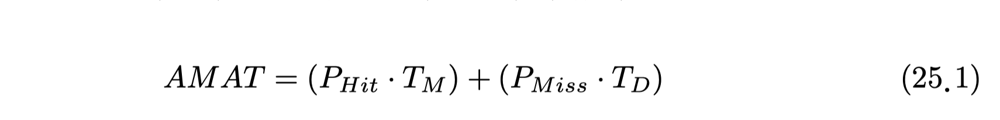
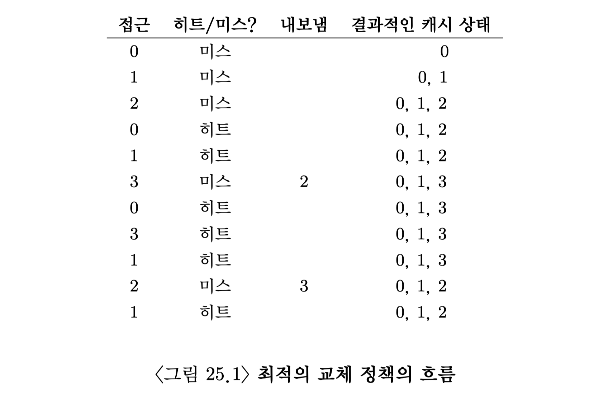
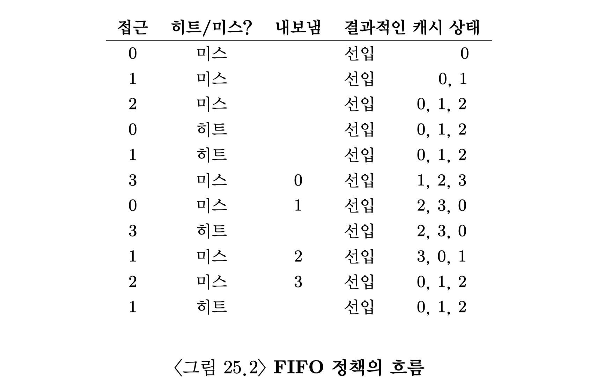
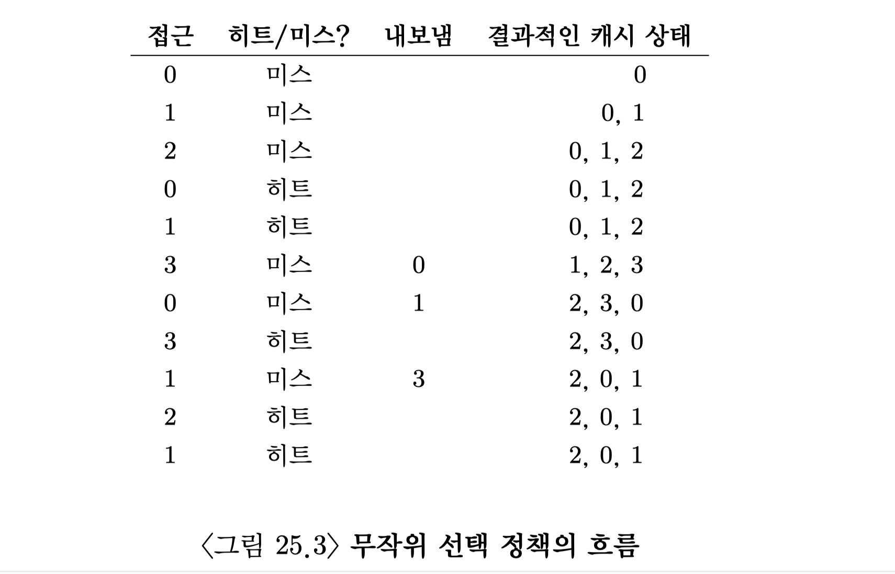
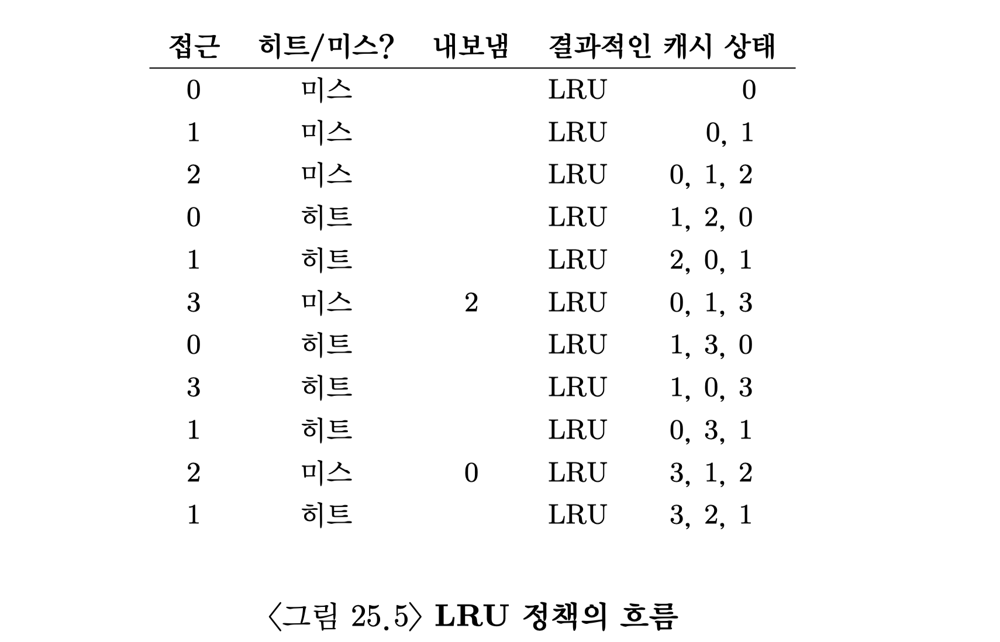
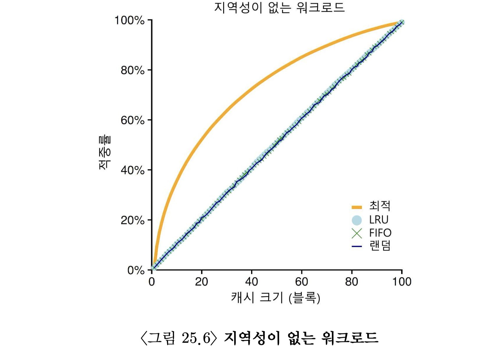
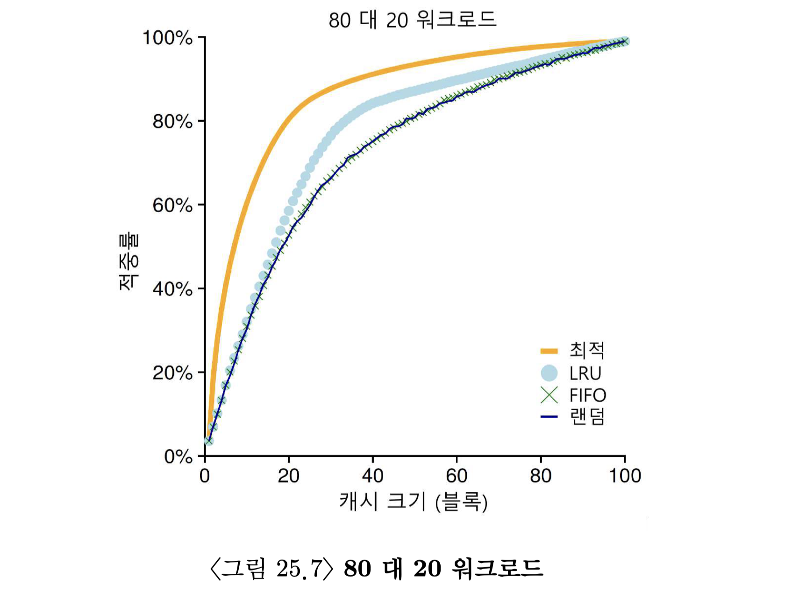
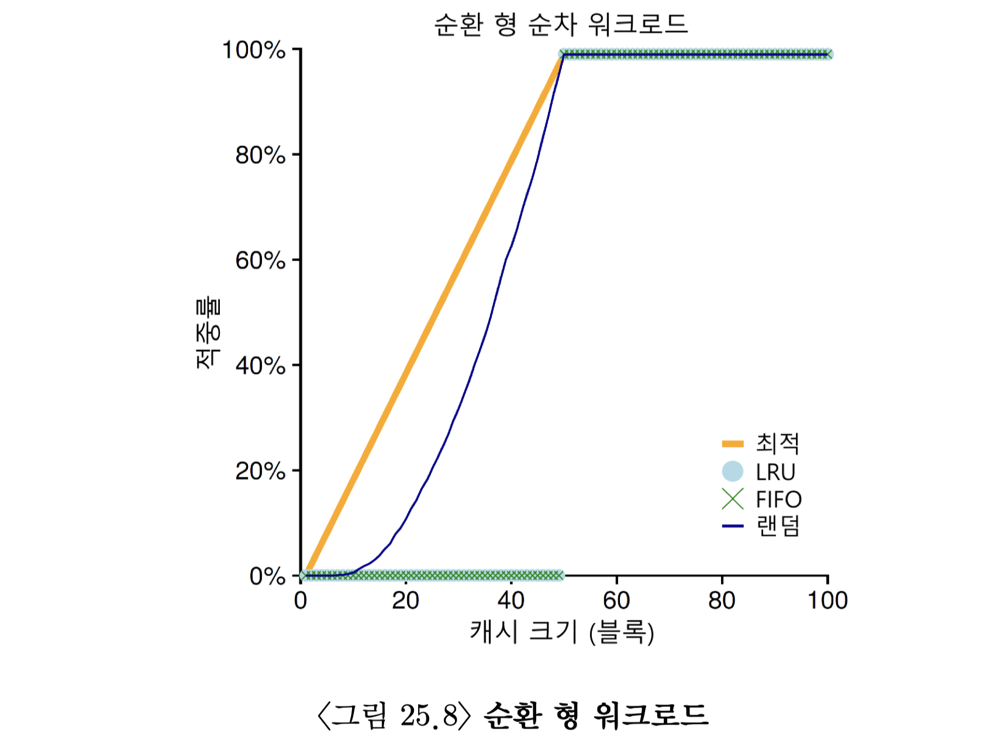
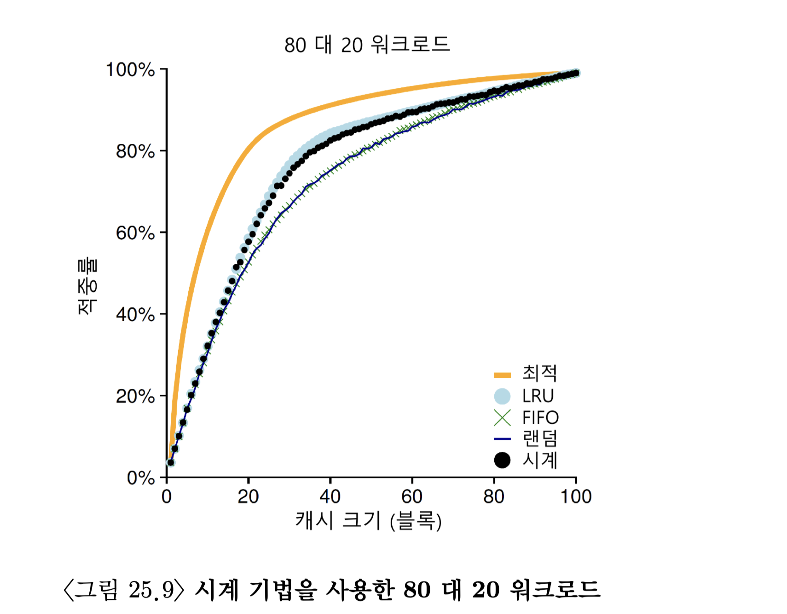

# 25장 개요

운영체제는 물리 메모리 공간이 부족할 때 어떻게 메모리에서 내보낼 페이지(들)를 결정할 수 있을까?

이 결정은 교체 정책에 의해서 내려진다. 

---

# 25.1 캐시 관리

시스템의 전체 페이지들 중 일부분만이 메인 메모리에 유지된다는 것을 가정하면, 메인 메모리는 시스템의 가상 메모리 페이지를 가져다 놓기 위한 **캐시**로 생각될 수 있다.

**이 캐시를 위한 교체 정책의 목표는 캐시 미스의 횟수를 최소화 하는것!**

캐시 히트와 미스의 횟수를 안다면 프로그램의 **평균 메모리 접근 시간(average memory access time, AMAT)**을 계산할 수 있다. 



Tm: 메모리 접근 비용 /  Td: 디스크 접근 비용

Phit: 캐시 히트 / Pmiss: 캐시 미스 / Phit + Pmiss = 1.0

현대 시스템에서는 디스크 접근 비용이 너무 크기 때문에 아주 작은 미스가 발생하더라도 전체적인 AMAT에 큰 영향을 주게 된다. 컴퓨터가 디스크 속도 수준으로 느리게 실행되는 것을 방지하기 위해서는 당연히 미스를 최대한 줄여야 한다. 이를 위해서는 좋은 정책을 잘 만드는 것이다. 

---

# 25.2 최적 교체 정책

**최적 교체 정책(The Optimal Replacement Policy)**은 미스를 최소화한다. 

가장 나중에 접근할 페이지를 교체하는 것이 최적이며, 가장 적은 횟수의 미스를 발생시킨다. 

이 정책은 간단하지만 구현하기는 어려운 정책이다.

```
실제 시스템에서는 앞으로 어떤 페이지가 언제 사용될지 알 수 없기 때문에,
이 정책은 실현 불가능하고 이론적인 기준으로만 사용된다.

즉, 실제 페이지 교체 정책의 성능을 판별하기 위한 척도로 사용 
```



프로그램 페이지 접근순서: 0, 1, 2, 0, 1, 3, 0, 3, 1, 2, 1

캐시(물리 메모리): 3개의 페이지 저장 가능

**동작 정리** 

```
처음 세 번의 접근(0,1,2) -> miss
0 -> hit
1 -> hit
3 -> miss -> 교체 정책 실행

어떤 페이지를 교체해야 할까?
페이지 2가 가장 먼 미래에 접근된다. 
그래서 페이지2를 내보내고 결과적으로 캐시에는 0,1,3이 남는다. 

나머지 접근 0,1,3 -> hit 
2 -> miss -> 교체 정책 실행

------------------------------------------------------------------------
캐시 히트율 계산 
Hits / (Hits + Misses) = 54.5%

강제 미스들(해당 페이지가 처음 미스된 경우)을 제외한 히트율 = 85.7%
```

---

# 25.3 간단한 정책: FIFO



**동작 정리** 

```
처음 세 번의 접근(0,1,2) -> miss
0 -> hit
1 -> hit 
3 -> miss -> FIFO 정책 실행 -> 0을 내보낸다. -> 1,2,3
0 -> miss -> FIFO 정책 실행 -> 1을 내보낸다. -> 2,3,0
3 -> hit
1 -> miss -> FIFO 정책 실행 -> 2를 내보낸다. -> 3,0,1
2 -> miss -> FIFO 정책 실행 -> 3을 내보낸다. -> 0,1,2
1 -> hit
------------------------------------------------------------------------
캐시 히트율 계산 
= 36.4%
= 57.1%(강제 미스 제외)
```

FIFO는 최적의 경우와 비교하면 눈에 띄게 성능이 안 좋다. 

FIFO는 블럭들의 중요도를 판단할 수 없다. 

---

# 25.4 또 다른 간단한 정책: 무작위 선택

무작위 선택 방식은 FIFO 와 유사한 성질을 가지고 있다. 

구현하기 쉽지만 내보낼 블럭을 제대로 선택하려는 노력을 하지 않는다. 



무작위 선택 정책은 선택할 때 얼마나 운이 좋은지(또는 운이 나쁜지)에 전적 으로 의존한다. 

위에서 사용한 참조 열에서는 무작위 선택 방식이 FIFO 보다는 약간 더 좋은 성능을 보이며 최적의 방법보다는 약간 나쁜 성능을 보인다.

---

# 25.5 과거 정보의 사용: LRU

FIFO 와 무작위 선택 방식 그리고 그와 유사한 정책들은 최적 기법의 성능을 따라갈 수가 없기 때문에 좀 더 정교한 방식이 필요하다.

**과거 정보를 활용하자** 

페이지 교체 정책이 활용할 수 있는 과거 정보 중 하나는 **빈도수(frequency)**이다. 만약 한 페이지가 여러 차례 접근되었다면, 분명히 어떤 가치가 있기 때문에 교체되면 안될 것이다. 좀 더 자주 사용되는 페이지의 특징은 접근의 **최근성(recency)**이다. 더 최근에 접근된 페이지일수록 가까운 미래에 접근될 확률이 높을 것이다.

이러한 류의 정책은 **지역성의 원칙(principle of locality)**이라고 부르는 특성에 기반을 둔다.

**과거 이력에 기반한 교체 알고리즘** 

**Least-Frequently-Used(LFU) 정책**은 가장 적은 빈도로 사용된 페이지를 교체한다. 

**Least-Recently-Used(LRU) 정책**은 가장 오래 전에 사용하였던 페이지를 교체한다.

**LRU 동작 방식** 



**LRU(Least-Recently-Used) 정책**은 **지역성의 원칙(principle of locality)** 중 **시간 지역성(Temporal locality)특성**에 기반을 둔다.

시간 지역성이란, "최근에 사용된 데이터는 가까운 미래에도 다시 사용될 가능성이 높다"는 특성을 의미한다.

따라서 LRU는 **가장 오래 전에 사용된 페이지를 교체 대상으로 선택**하여, 페이지 부재를 줄이려 한다.

```
처음 세 번의 접근(0,1,2) -> miss
0 -> hit
1 -> hit 
3 -> miss -> LRU 정책 동작 -> 2 swap-out -> (0,1,3)
0 -> hit 
3 -> hit
1 -> hit
2 -> miss -> LRU 정책 동작 -> 0 swap-out -> (3,1,2)
1 -> hit 
```

이 예제에서 LRU가 최적 기법과 같은 정도 수준의 성능을 얻을 수 있는 최고의 결과를 보여주고 있다.

**LFU(Least Frequently Used)**는 **물리 메모리에 남아 있는 가상 페이지들 중에서 사용 빈도수가 가장 낮은 페이지를 교체**하는 정책이다.

**LRU**가 시간 지역성(Temporal Locality)에 기반을 두는 것과 달리, **LFU는 지역성의 원칙에 직접 의존하지 않는다.** 대신, "자주 참조되지 않는 페이지는 앞으로도 참조될 가능성이 낮다"는 가정에 기반하여 동작

---

# 25.6 워크로드에 따른 성능 비교

### 지역성이 존재하지 않는 워크로드

첫 번째 살펴볼 워크로드에서는 지역성(시간 지역성)이 없다. 그 말은 접근되는 페이지들의 집 합에서 페이지가 무작위적으로 참조된다는 것을 의미한다. 



- x축: 캐시 크기
- y축: 캐시 히트율

**그림 25.6을 기반으로 얻은 결론** 

```
1. 워크로드에 지역성이 없다면 어느 정책을 사용하든 상관이 없다. 히트율은 캐시 크기와 비례한다.

2. 캐시가 충분히 커서 모든 워크로드를 다 포함할 수 있다면 어느 정책을 사용하든지 상관없다. 

3. 최적 기법이 구현 가능한 기타 정책들보다 눈에 띄게 더 좋은 성능을 보인다. 
```

### 지역성이 존재하는 워크로드

이번에 살펴볼 워크로드는 80대20 워크로드라고 부른다.

20%의 페이지들에서 80%참조가 일어나고 나머지 80%의 페이지들에서 20% 참조가 일어난다. 



FIFO, 랜덤 정책도 상당히 좋은 성능을 보이지만, 인기 있는 페이지들을 캐시에 더 오래두는 경향이 있는 LRU가 더 좋은 성능을 보인다. 인기 있는 페이지들이 과거에 빈번하게 참조되었기 때문에 그 페이지들은 가까운 미래에 다시 참조되는 경향이 있기 때문이다. 최적 기법은 여전히 더 좋은 성능을 보이고 있으며, 이는 LRU 의 과거 정보가 완벽하지는 않다는 것을 보여준다.

### 순차 반복 워크로드

이 워크로드는 50개의 페이지들을 순차적으로 반복해서 참조한다.



LRU와 FIFO 정책에서 가장 안좋은 성능을 보인다. 순차 반복 워크로드에서 이 알고리즘들은 오래된 페이지들을 내보낸다.

워크로드의 반복적인 특성으로 인해서 오래된 페이지들은 정책들이 캐시에 유지하려고 선택한 페이지들보다 먼저 접근된다. 실제로, 캐시의 크기가 49 라고 할지라도 50개의 페이지들을 순차 반복하는 워크로드에서는 캐시 히트율이 0%가 된다.

무작위 선택 정책의 경우 최소한 히트율이 0%는 아니다.

---

# 25.7 과거 이력 기반 알고리즘의 구현

과거 정보에 기반을 둔 정책을 어떻게 구현할 것인가?

LRU를 구현하기 위해서는 많은 작업을 해야 한다.

각 페이지 접근마다 해당 페이지가 리스트에 가장 앞으로 이동하도록 자료구조를 갱신해야 한다.

LRU에서는 어떤 페이지가 가장 최근에 또는 가장 오래 전에 사용되었는지를 관리하기 위해서 모든 메모리 참조 정보를 기록해야 한다. 세심한 주의 없이 정보를 기록하면 성능이 크게 떨어질 수 있다.

이 작업을 효율적으로 하는 방법은 하드웨어 지원을 받는 것이다.

예를 들어 페이지 접근이 있을 때마다 하드웨어가 메모리의 시간 필드를 갱신하도록 할 수 있다.

이렇게 하여 페이지가 접근되면 하드웨어가 시간 필드를 현재 시간으로 설정한다. 

페이지 교체 시에 운영체제는 가장 오래 전에 사용된 페이지를 찾기 위해 시간 필드를 검사한다.

시스템의 페이지 수가 증가하면 페이지들의 시간 정보 배열을 검색하여 오래 전에 사용된 페이지를 찾는 것은 매우 고비용의 연산이 된다.

4GB의 메모리를 가지는 현대의 기기에서 4KB 페이지들로 나눈 것을 상상해 보라.

그런 기계는 백만 개의 페이지들을 가지고 있다. 

**LRU 정책의 교체 대상 페이지를 찾는 데 현대의 CPU 속도라 할지라도 오랜 시간이 걸리게 된다.** 

다음과 같은 질문이 떠오른다. 

**가장 오래된 페이지를 꼭 찾아야만 할까? 대신 비슷하게 오래된 페이지를 찾아도 되지 않을까?**

---

# 25.8 LRU 정책 근사하기

연산량이라는 관점에서 볼 때, LRU를 “근사” 하는 식으로 만들면 구현이 훨씬 쉬워진다. 

실제로 현대의 많은 시스템이 이런 방식을 택하고 있다.

이 개념에는 **use bit(reference bit)**라고 하는 하드웨어 지원이 필요하다.

시스템의 각 페이지마다 하나의 use bit가 있으며, 이 use bit는 메모리 어딘가(페이지 테이블)에 존재한다.

**페이지가 참조될 때마다(즉, 읽히거나 기록되면) 하드웨어에서 use bit가 1로 설정**된다.

**하드웨어는 이 비트를 절대로 지우지 않는다.(즉, 0으로 설정하지 않는다). 0으로 바꾸는 것은 운영체제의 몫**이다

운영체제는 LRU에 가깝게 구현하기 위해서 use bit를 어떻게 활용할까?

**시계 알고리즘(clock algorithm)**을 사용한다.

**시계 바늘(clock hand**)이 특정 페이지를 가리킨다고 해 보자

페이지를 교체해야 할 때 운영체제는 현재 바늘이 가리키고 있는 페이지의 use bit가 1인지 0인지 검사한다.

만약 1이라면 페이지 P는 최근에 사용되었으며 바람직한 교체 대상이 아니라는 것을 뜻한다.

P의 use bit는 0으로 설정되고 시계 바늘은 다음 페이지 P+1로 이동한다.

알고리즘은 use bit 가 0으로 설정되어 있는, 즉 최근에 사용된 적이 없는, 페이지 찾을 때까지 반복된다

최악의 경우에는 모든 페이지들이 사용된 적이 있어서 모든 페이지들을 모두 탐색하면서 use bit 를 전부 0으로 설정해야 할 수도 있다

Cobato의 알고리즘은 주기적으로 use bit를 지우고, 교체 대상 페이지 선택을 위해 use bit가 1과 0인 페이지를 구분할 수 있으면 된다. 



변형된 시계 알고리즘의 동작이 그림 25.9에 나와 있다.

이 시계 알고리즘 변형 방식은 교체할 때 페이지들을 랜덤하게 검사한다. 

reference bit가 1로 설정되어 있는 페이지를 만나게 되면 비트를 지운다(즉, 0으로 설정한다). 

reference bit 가 0으로 설정되어 있는 페이지를 만나면 그 페이지를 교체 대상으로 선정한다. 

완벽한 LRU 만큼 좋은 성능을 보이지는 않지만 과거 정보를 고려하지 않는 다른 기법들에 비해서는 성능이 더 좋다.

---

# 25.9 갱신된 페이지(Dirty Page)의 고려

**더티 비트 (Modified Bit)**

- 페이지가 메모리에서 수정되었는지 아닌지를 나타내는 비트로, 페이지가 수정되면 이 비트는 1로 설정

**깨끗한 페이지 (Clean Page)**

- 더티 비트가 0인 페이지로, 수정되지 않은 페이지

**더티 페이지 (Dirty Page)**

- 더티 비트가 1인 페이지로, 수정된 페이지

어떤 페이지가 변경되어 더티 상태가 되었다면, 그 페이지를 내보내기 위해서는 디스크에 변경 내용을 기록해야 하기 때문에 비싼 I/O 비용을 지불해야 한다. 

만약 변경되지 않았다면, 내보낼 때 추가 비용이 없다.

때문에 더티 페이지 대신 깨끗한 페이지를 내보내는 것이 성능이 더 좋다.

따라서 교체 대상을 선택할 때 reference bit == 0 && modified bit == 0 을 먼저 찾도록 한다. 

이 조건을 만족시키는 페이지를 찾는 데 실패하면 reference bit == 0 && modified bit == 1 페이지를 찾는다.

---

# 25.11 쓰래싱(Thrashing)

메모리 사용 요구가 감당할 수 없을 만큼 많고 실행 중인 프로세스가 요구하는 메모리가 가용 물리 메모리 크기를 초과하는 경우에 운영체제는 어떻게 해야할까? 

이런 경우 시스템은 끈임없이 페이지 교체를 해야하고 이런 상황을 **쓰래싱(thrashing)**이라고 부른다.

**즉, 프로세스가 실행되는 시간보다 페이지 교체에 더 많은 시간을 소요하여 성능(CPU 이용률)이 저해되는 문제** 

원인은 2가지이다. 잘못된 페이지 교체 정책 또는 프로세스가 사용할 메모리 자체가 너무 적은 경우

프로세스가 정상적으로 동작하기에 필요한 **최소 메모리(working set)**를 확보하지 못할 경우.

즉, 프로세스는 항상 필요한 페이지를 메모리에 갖고 있지 못해서, 계속 페이지 폴트(page fault)가 발생

### 스레싱 완화 방법

1. **Working Set Model 적용**
- 프로세스가 최근 일정 시간 동안 실제로 참조한 페이지 집합(Working Set)만 메모리에 올려두는 전략
  - Working Set 크기를 기준으로 프로세스에 메모리를 할당해서, **진짜 필요한 페이지만 메모리에 유지**하고 불필요한 페이지 교체를 줄인다.
1. **Page Fault Frequency (PFF) 제어**
- 프로세스의 페이지 폴트 발생 빈도(Page Fault Frequency)를 모니터링한다.
  - 페이지 폴트가 너무 자주 일어나면 → **메모리를 더 할당**해준다.
페이지 폴트가 거의 없으면 → **메모리를 회수**해서 다른 프로세스에 쓴다.
  - 즉, **실시간으로 동적으로 조정**하는 방식.
1. **프로세스 스케줄링 조정**
- 물리 메모리에 올라갈 수 없을 정도로 메모리 요구량이 큰 프로세스는
일시적으로 중단(suspend)하거나 디스크로 스왑아웃해서 **메모리 압박을 줄이는 방법**.
  - 동시에 실행하는 프로세스 수를 줄여서, 각 프로세스에 충분한 메모리를 보장해주는 방법.
1. **더 많은 물리 메모리 추가** (가장 단순하지만 비용이 듦)
- 운영체제 레벨에서 아무리 최적화해도 물리 메모리가 부족하면 한계가 있으니, 하드웨어 업그레이드도 현실적인 대안.

---

# 25.12 요약 

- 다양한 페이지 교체 정책(랜덤, FIFO, LRU 등)을 학습하였다.
- 미래에 가장 늦게 사용될 페이지를 교체하는 최적 교체 정책은 실제 구현은 불가능하지만,
여러 정책들의 성능을 비교하는 **이론적 척도**로 사용된다.
- 여러 워크로드(프로세스 패턴)기반으로 실제 정책들의 성능을 비교하였다.
- LRU(Least Recently Used)는 최근 사용된 기록을 기준으로 교체 대상을 정하는 효과적인 정책이지만,
**모든 페이지를 탐색해야 하는 오버헤드**(특히 100만 개 페이지처럼 큰 경우)가 커서 실용적인 문제가 발생한다.
- 이를 해결하기 위해, **reference bit**를 이용해 LRU를 근사한 시계 알고리즘(Clock Algorithm)을 공부했다.
- 추가로, modified bit(더티 비트)를 활용하여, **깨끗한(clean) 페이지를 우선 교체하는 방식**으로 시계 알고리즘의 성능을 더욱 향상시키는 방법도 학습하였다.
- 또한, **잘못된 페이지 교체 정책**이나 **프로세스의 working set 자체가 물리 메모리보다 지나치게 커서**
지속적으로 page fault가 발생하는 경우, **운영체제가 CPU를 사용하는 시간보다 페이지 교체에 소모하는 시간이 많아져 CPU 이용률이 급격히 떨어지는 스레싱(Thrashing) 현상**이 발생할 수 있음을 이해하였다.

---

