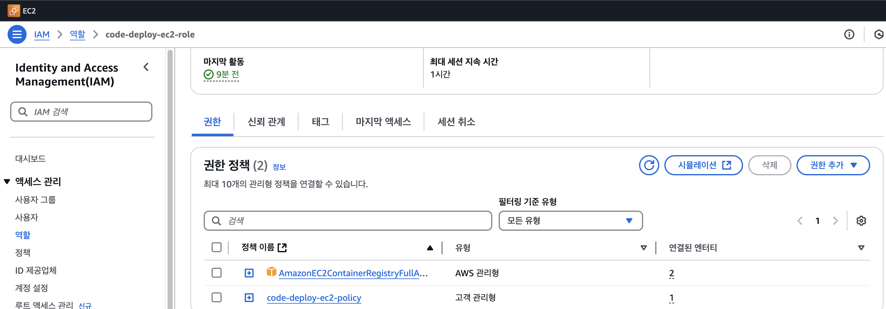

# Docker 파일 생성

**Dockerfile**

```docker
FROM eclipse-temurin:17-jdk-alpine
COPY ./build/libs/*SNAPSHOT.jar project.jar
ENTRYPOINT ["java", "-jar", "project.jar"]
```

#  EC2가 Private ECR에 접근할 수 있게 셋팅하기

### 업데이트 

```shell
sudo apt update
```

### **Amazon ECR Docker Credential Helper 설치하기**

[https://github.com/awslabs/amazon-ecr-credential-helper?tab=readme-ov-file](https://github.com/awslabs/amazon-ecr-credential-helper?tab=readme-ov-file)

```shell
sudo apt install amazon-ecr-credential-helper
```

### **Configuration 설정하기**

- **~/.docker/config.json**

```json
{
	"credsStore": "ecr-login"
}
```

- **vi config.json 명령어 사용, insert mode 변경 이후 붙여넣기** 

### **IAM Role을 활용해 EC2가 ECR에 접근할 수 있게 권한 부여하기**



# **Docker 기반 CI/CD 구축하기**

```yaml
name: Deploy to EC2

on:
  push:
    branches:
      - main

jobs:
  deploy:
    runs-on: ubuntu-latest
    steps:
      - name: Github Repository 파일 불러오기
        uses: actions/checkout@v4

      - name: JDK 17버전 설치
        uses: actions/setup-java@v4
        with:
          distribution: temurin
          java-version: 17

      - name: application.yml 파일 만들기
        run: echo "$APPLICATION_PROPERTIES" > ./src/main/resources/application.yml

      - name: 테스트 및 빌드하기
        run: ./gradlew clean build

      - name: AWS Resource에 접근할 수 있게 AWS credentials 설정
        uses: aws-actions/configure-aws-credentials@v4
        with:
          aws-region: ap-northeast-2
          aws-access-key-id: ${{ secrets.AWS_ACCESS_KEY_ID }}
          aws-secret-access-key: [REDACTED] secrets.AWS_SECRET_ACCESS_KEY }}

      - name: ECR 로그인하기
        id: login-ecr
        uses: aws-actions/amazon-ecr-login@v2

      - name: Docker 이미지 생성
        run: docker build -t study-server .

      - name: Docker 이미지에 Tag 붙이기
        run: docker tag study-server ${{ steps.login-ecr.outputs.registry }}/study-server:latest

      - name: ECR Docker 이미지 Push
        run: docker push ${{ steps.login-ecr.outputs.registry }}/study-server:latest

      - name: SSH EC2 접속하기
        uses: appleboy/ssh-action@v1.0.3
        with:
          host: ${{ secrets.EC2_HOST }}
          username: ${{ secrets.EC2_USERNAME }}
          key: ${{ secrets.EC2_PRIVATE_KEY }}
          script_stop: true
          script: |
            docker stop study-server || true
            docker rm study-server || true
            docker pull ${{ steps.login-ecr.outputs.registry }}/study-server:latest
            docker run -d --name study-server -p 8080:8080 ${{ steps.login-ecr.outputs.registry }}/study-server:latest
            


```

