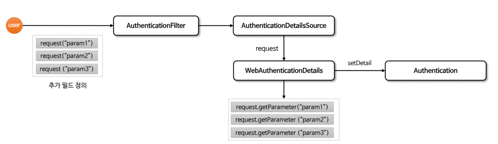
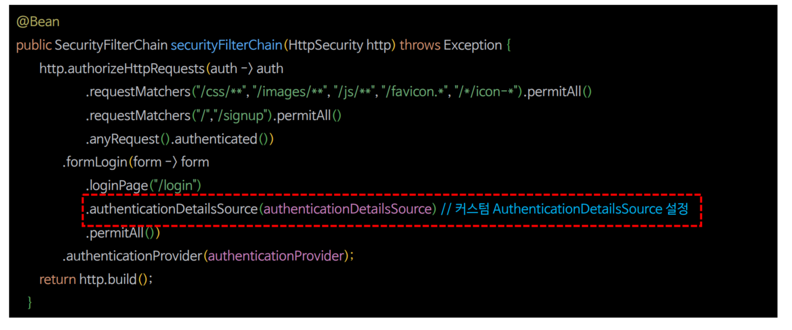
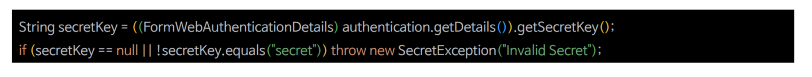

# *WebAuthenticationDetails*

- *HTTP 요청과 관련된 인증 세부 정보를 포함하는 클래스로서 기본적으로 사용자의* ***IP 주소와 세션 ID****와 같은 정보를 가지고 있다*
- *특정 인증 메커니즘에서 요청의 추가적인 정보를 인증 객체에 추가할 때 사용할 수 있으며 Authentication 객체와 함께 사용된다*

# ***AuthenticationDetailsSource***

- *인증 과정 중에 Authentication 객체에 세부 정보를 제공하는 소스 역할을 한다*
- *WebAuthenticationDetails 객체를 생성하는 데 사용되며 인증 필터에서 참조한다*



# ***AuthenticationDetailsSource 설정***



# *사용 예시*



# ***구현 하기***

***login.html 일부 <form> 태그*** 

```html
<form th:action="@{/login}" method="post">
    <input type="hidden" th:value="secret" th:name="secret_key"/>
    <div class="form-group">
        <label for="username">Username</label>
        <input type="text" class="form-control" id="username" name="username" required>
    </div>
    <div class="form-group">
        <label for="password">Password</label>
        <input type="password" class="form-control" id="password" name="password" required>
    </div>
    <button type="submit" class="btn btn-primary">Login</button>
</form>
```

- `<input type="hidden" th:value="secret" th:name="secret_key"/>`


***SecretException***

```java
import org.springframework.security.core.AuthenticationException;

public class SecretException extends AuthenticationException {
    public SecretException(String message) {
        super(message);
    }
}
```

- *extends AuthenticaionException(인증 예외) is RuntimeException*
- *동일한 클래스명(AuthenticationException)이 많이 존재한다. → 주의하자*  


***FormAuthenticationDetails***

```java
@Getter
public class FormAuthenticationDetails extends WebAuthenticationDetails{
    private String secretKey;
    public FormAuthenticationDetails(HttpServletRequest request) {
        super(request);
        this.secretKey = request.getParameter("secret_key");
    }
}
```

- *extends WebAuthenticationDetails*
- *Authentication getDetails() → FormAuthenticationDetails*
- *인증 객체 내부의 추가적인 정보 is WebAuthenticaionDetails*
  - *host information*
  - *JSESSIONID → 세션 ID*

***FormWebAuthenticationDetailsSource*** 

```java
@Component
public class FormWebAuthenticationDetailsSource implements AuthenticationDetailsSource<HttpServletRequest, FormAuthenticationDetails> {
    @Override
    public FormAuthenticationDetails buildDetails(HttpServletRequest request) {
        return new FormAuthenticationDetails(request);
    }
}
```

- *extends AuthenticationDetailsSource<HttpServletRequest, FormAuthenticationDetails>*
- *역할: 인증 Filter가 Authentication에 details 객체를 생성하고 set하기 위해 참조하는 클래스*
- *details 생성의 역할을 담당한다.*

***FormAuthenticationProvider***

```java
@Component("authenticationProvider")
@RequiredArgsConstructor
public class FormAuthenticationProvider implements AuthenticationProvider {
    private final PasswordEncoder passwordEncoder;
    private final UserDetailsService userDetailsService;
    @Override
    public Authentication authenticate(Authentication authentication) throws AuthenticationException {
        AccountContext accountContext = (AccountContext) userDetailsService.loadUserByUsername(authentication.getName());

        if(!passwordEncoder.matches((String) authentication.getCredentials(), accountContext.getPassword())){
            throw new BadCredentialsException("Invalid password");
        }

        FormAuthenticationDetails details = (FormAuthenticationDetails) authentication.getDetails();
        String secretKey = details.getSecretKey();
        if(secretKey == null || !secretKey.equals("secret")){
            throw new SecretException("Invalid secret");
        }

        return new UsernamePasswordAuthenticationToken(
                accountContext.getAccountDto(), null, accountContext.getAuthorities());
    }
    @Override
    public boolean supports(Class<?> authentication) {
        return authentication.isAssignableFrom(UsernamePasswordAuthenticationToken.class);
    }
}
```

- *extends AuthenticationProvider*
- *AuthenticationFilter(ex: UsernamePasswordAuthenticationFilter) → AuthenticationManager → AuthenticationProvider(실제 인증 처리)*
- *Authentication 객체에서 getDetails()를 통해서*  ***FormAuthenticationDetails*** *꺼내고 정상적인 Details에  “secret”이 있는지 확인하고 없으면 인증 예외인* ***SecretException****을 던진다.*
- *supports method의 결과가 true가 되는 조건은 UsernamePasswordAuthenticationFilter에서 생성하는 UsernamePasswordAuthenticationToken 뿐이다.*

***SecurityConfig***

```java
@EnableWebSecurity
@Configuration
@RequiredArgsConstructor
public class SecurityConfig {
    private final AuthenticationProvider authenticationProvider;
    private final AuthenticationDetailsSource authenticationDetailsSource;
    @Bean
    public SecurityFilterChain securityFilterChain(HttpSecurity http) throws Exception{
        http
                .authorizeHttpRequests(authorize -> authorize
                        .requestMatchers("/css/**", "/images/**",
                                "/js/**", "/favicon.*", "/*/icon/-*").permitAll()
                        .requestMatchers("/", "/signup").permitAll()
                        .anyRequest().authenticated())
                .authenticationProvider(authenticationProvider)
                .formLogin(form -> form
                        .loginPage("/login")
                        .authenticationDetailsSource(authenticationDetailsSource)
                        .permitAll());

        return http.build();
    }
}
```

- *formLogin → UsernamePasswordAuthenticationFilter 사용* 
- *UsernamePasswordAuthenticationFilter는 AuthenticationDetailsSource로 내가 만든 FromAuthenticationDetailsSource를 참조하게 된다.* 
- *또한 HttpSecurity.authenticationProvider 통해서 내가 custom한 AuthenticationProvider를 사용한다.*

