# 34장 개요

다양한 범주의 병행성 문제 해결을 위해서는 락과 컨디션 변수가 모두 필요하다.

다익스트라는 **세마포어(semaphore)** 동기화 기법을 개발했다.

세마포어는 락과 컨디션 변수를 모두 사용할 수 있다.

---

# 34.1 세마포어: 정의

세마포어는 정수 값을 갖는 객체로서 두 개의 루틴을 조작할 수 있다.

POSIX 표준에서는 이 두 개의 루틴은 **sem_wait(), sem_post()** 이다. 

세마포어는 초기값에 의해 동작이 결정되기 때문에, 사용하기 전 제일 먼저 값을 초기화 해야 한다.

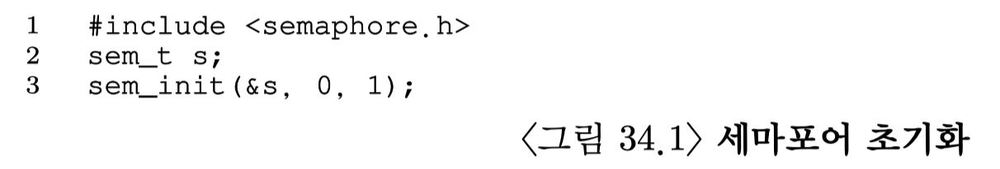

```c
int sem_init(sem_t *sem, int pshared, unsigned int value);
```

**sem_init()의 두 번째 인자(pshared)는 모든 예제에서 0이다.**

- 0: 스레드 간 공유 (즉, 같은 프로세스 내에서 공유)
- 1: 프로세스 간 공유 (즉, 다른 프로세스들과 공유, 이 경우 공유 메모리 필요)

**value: 세마포어의 초기값**

그림에서는 3번째 인자로 1을 전달하여 세마포어의 값을 1로 초기화한다.

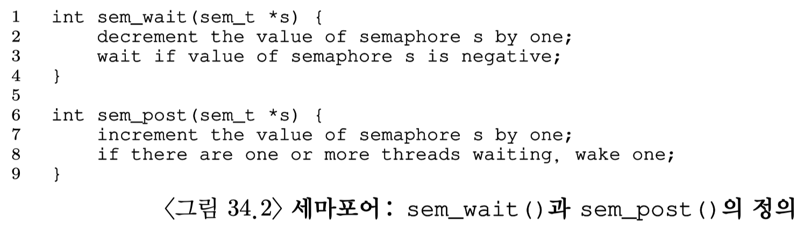

**sem_wait() 함수**

즉시 리턴(세마포어 ≥ 1) 또는 세마포어 값이 1이상이 될 때까지 호출자를 대기(세마포어 < 0)시킨다.

다수의 쓰레드들이 대기큐에서 존재할 수 있다.

**sem_post() 함수**

sem_post() 함수는 대기하지 않는다. 세마포어 값을 증가시키고 대기 중인 쓰레드 중 하나를 깨운다.

**세마포어 음수**

그 값은 현재 대기 중인 쓰레드 개수와 같다. 일반적으로 세마포어 사용자는 이 값을 알 수 없다.

이 두 개의 함수는 원자적으로 실행된다고 가정한다.

**실제로 sem_wait(), sem_post()는 OS 레벨 세마포어 → 커널 수준에서 원자성을 보장**

세마포어 루틴 내의 레이스 컨디션이 발생할 수 있다는 사실은 락과 컨디션 변수를 통해 나중에 해결한다.

---

# 34.2 이진 세마포어(락)

**세마포어를 락으로 사용하자**

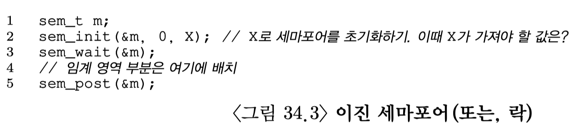

세마포어를 임계 영역 앞뒤로 배치하였다. → 락으로 사용

이때 X의 값은 무엇이 되어야 할까? → 1

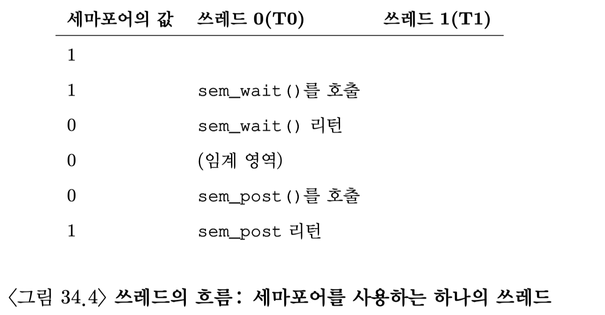

그림 34.4는 세마포어를 1로 초기화하여 락으로 사용하는 단일 쓰레드 그림이다.

처음 쓰레드가 sem_wait()를 호출하면 value는 1 → 0으로 바뀌고 sem_wait()에서는 value가 0이상이면 대기하지 않으니 그대로 임계 구역에 진입한다.

임계 구역이 끝나고 sem_post()를 호출하면 value 0 → 1로 바뀌고 대기 중인 쓰레드는 없기 때문에 아무도 깨우지 않는다.

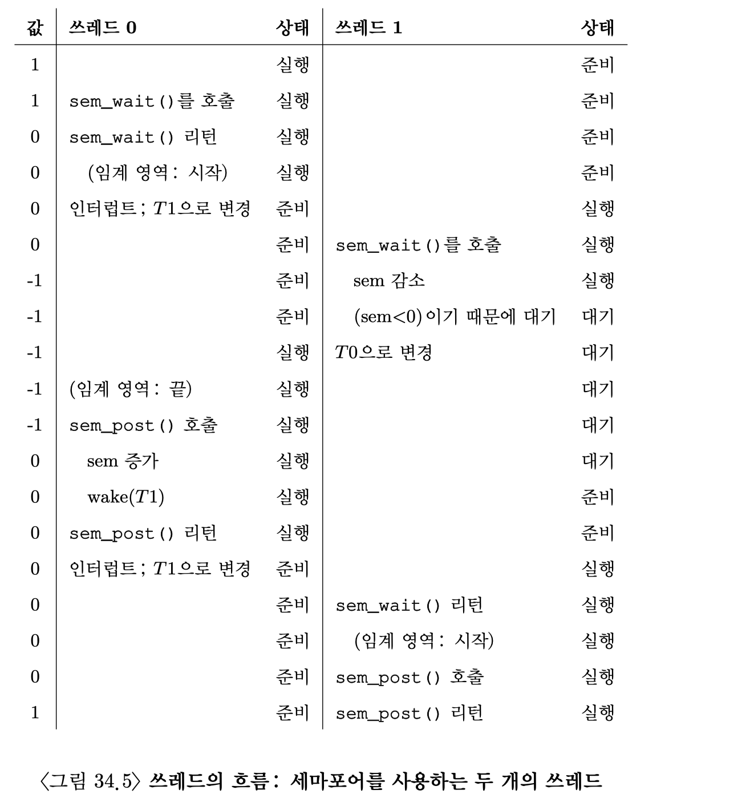

그림 34.5는 2개의 쓰레드가 동작한다.

락은 두 개의 상태(사용 가능, 사용 중)만 존재하므로 **이진 세마포어(binary semaphore)**라고도 불린다.

---

# 34.3 컨디션 변수로서의 세마포어

어떤 조건이 참이 되기를 기다리기 위해 현재 쓰레드를 멈출 때에도 세마포어는 유용하게 사용될 수 있다.

즉, 컨디션 변수처럼 사용할 수 있다.

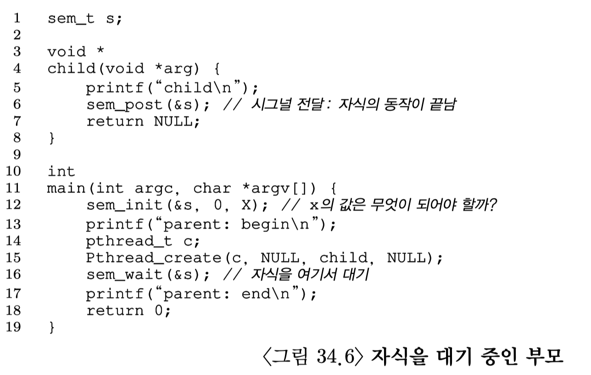

그림 34.6은 부모 쓰레드가 자식 쓰레드를 생성한 후, 자식 쓰레드의 종료(조건)를 대기하고자 한다.

원하는 결과는 아래와 같다.

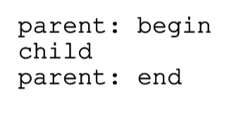

부모 프로세스는 자식 프로세스의 생성 후 sem_wait()를 호출하여 자식의 종료를 기다린다.

자식은 sem_post()를 호출하여 종료되었음을 알린다.

**Q: 세마포어 값을 무엇으로 초기화할까?** 

**A: 세마포어의 초기값은 0이다.**

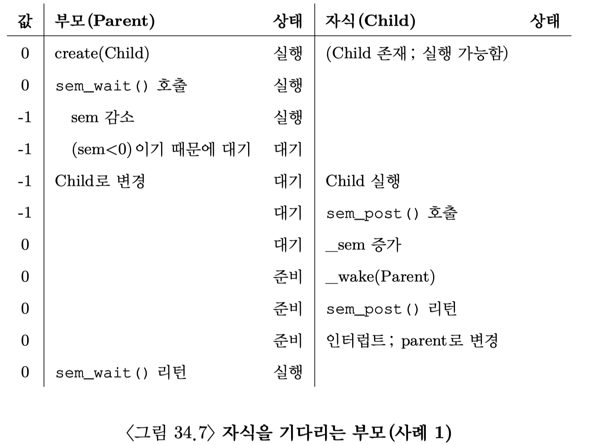

그림 34.7은 부모가 먼저 동작한다.

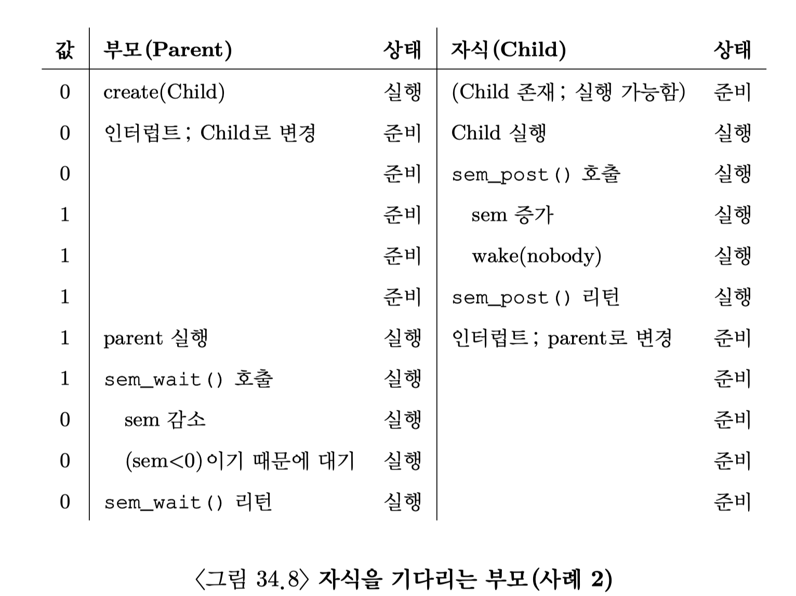

그림 34.8은 자식이 먼저 동작한다.

자식이 먼저 sem_post()를 실행하여 세마포어 값은 0 → 1로 증가된다.

부모가 실행이되면 sem_wait()을 호출하고 이때 세마포어 값은 1 → 0으로 바뀐다.

sem ≥ 0이기 때문에 대기하지 않고 리턴한다.

**결론은 세마포어를 통한 컨디션 변수(자식 쓰레드 종료후 부모 쓰레드 실행)는 2번의 실행 방식 모두 결정적 결과를 만들어 낸다.**

---

# 34.4 생산자/소비자 (유한 버퍼) 문제 

### 첫 번째 시도

**empty, full 두 개의 세마포어 사용해서 해결하기**

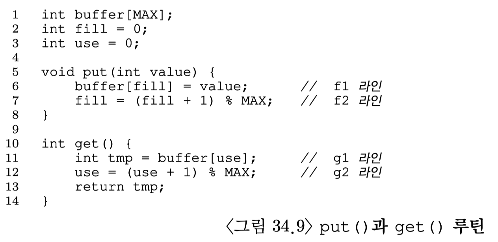

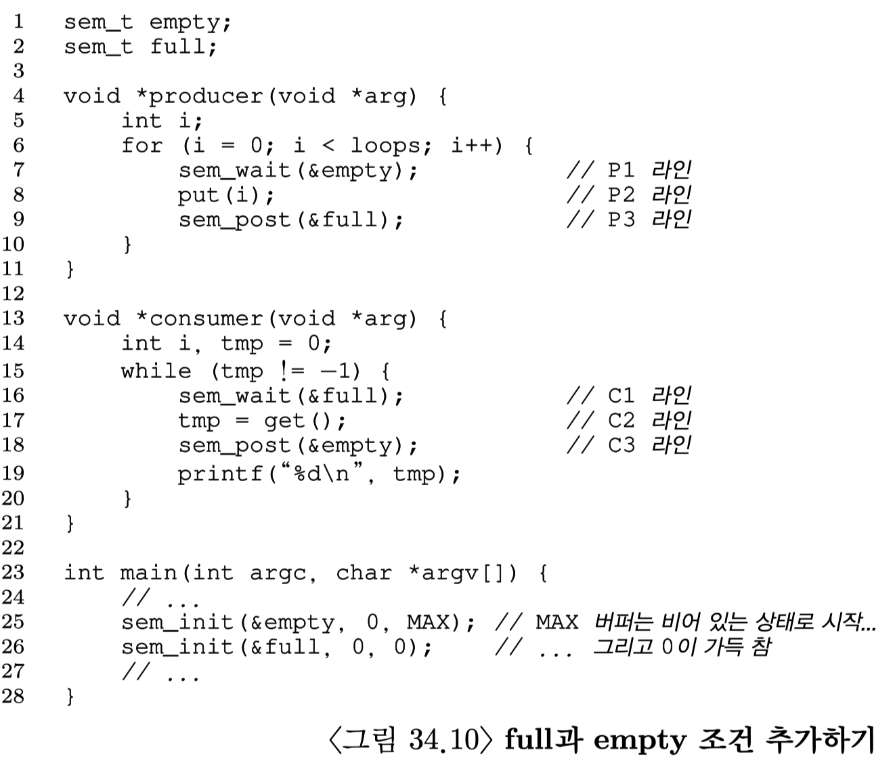

**시나리오** 

```
**가정** 
MAX = 1: 버퍼 크기가 1
생산자/소비자 쓰레드 1개, CPU 1개

**init** 
sem_init(&empty, 0, 1)
sem_init(&full, 0, 0)

소비자 쓰레드 먼저 실행
sem_wait(&full) 
full(0 - 1 = -1) -> 소비자 대기 

생산자 쓰레드 실행
sem_wait(&empty)
empty(1 - 1 = 0) -> 생산자 실행
put(0)
sem_post(&full)
full(-1 + 1 = 0), 소비자 깨우기 -> 소비자 ready queue

... 생략 

이는 다수의 쓰레드들(생산자 + 소비자)가 존재해도 정상 동작한다.
```

만약? MAX = 10, 생산자, 소비자 쓰레드들이 여러 개 있다고 하면 정상적으로 동작할까?

아니다. 경쟁 조건이 발생한다. 어디서 경쟁이 발생할까?

→ put(), get()에서 발생한다.

**경쟁 조건 발생 시나리오** 

```
**가정** 
MAX = 10: 버퍼 크기가 10
생산자 쓰레드 2개, CPU 1개
fill = 0

**init** 
sem_init(&empty, 0, 10)
sem_init(&full, 0, 0)

생산자1 시작
sem_wait(&empty)
empty(10 - 1 = 9) -> 생산자 실행
buffer[0] = 0;

이때 fill 갱신하기 전에 생산자2로 컨텍스트 스위칭

생산자2 시작 
sem_wait(&empty)
empty(9 - 1 = 8) -> 생산자 실행
buffer[0] = 1;

생산자1의 데이터가 lost update 발생
MAX = 1이면 컨디션 변수 크기 때문에 put() 접근 자체가 불가능했지만
MAX = 10은 컨디션 변수 크기가 널널해서 다수의 쓰레드가 put(), get()에 
동시에 접근하여 경쟁 조건이 발생한다.
```

### 해답: 상호 배제 추가

버퍼에 대한 인덱스 증가/감소 연산은 임계 영역이기 때문에 신중하게 처리해야 한다.

지금까지 배운 이진 세마포어와 몇 개의 락을 추가하여 해결해 보자.

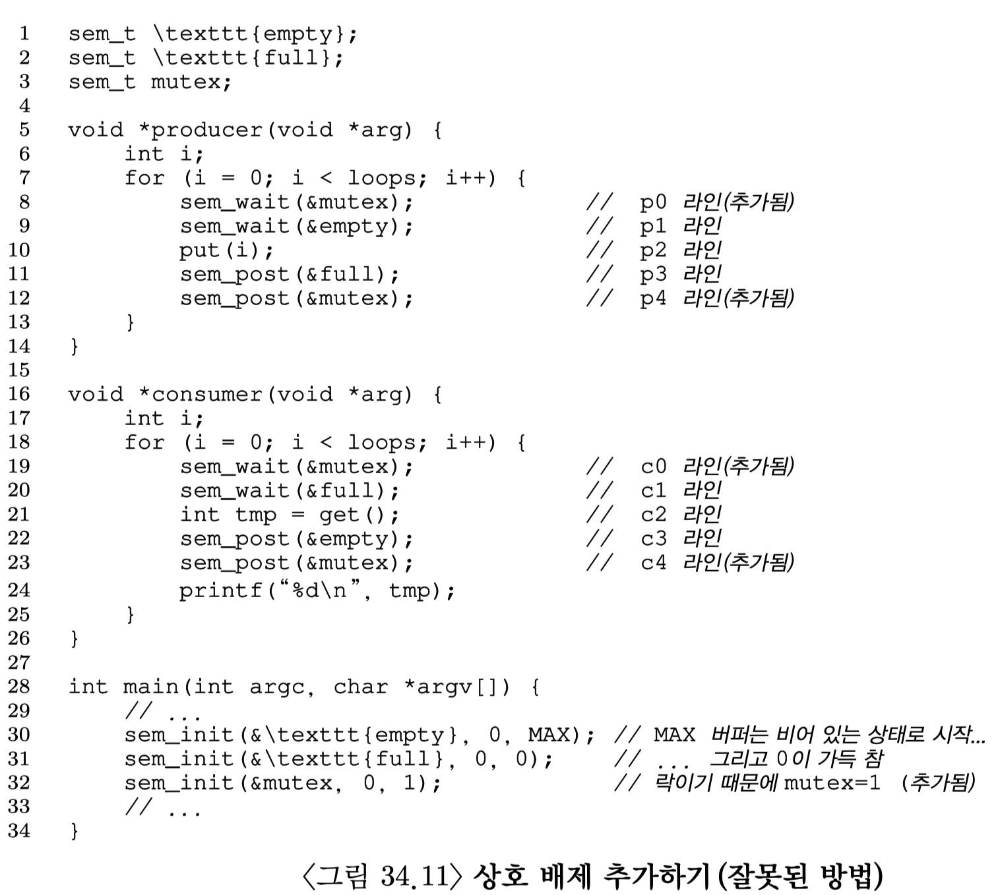

이제 put()/get() 코드에 락을 추가했으나 동작하지 않는다.

**교착 상태가 발생한다. 왜 교착 상태가 발생할까?**

### 교착 상태의 방지 

**교착 상태 시나리오** 

```
**가정** 
MAX = 1: 버퍼 크기가 1
생산자/소비자 쓰레드 1개, CPU 1개

**init** 
sem_init(&empty, 0, 1)
sem_init(&full, 0, 0)
sem_init(&mutex, 0, 1);

생산자 쓰레드 시작
sem_wait(&mutex)
mutex(1 - 1 = 0) 통과
sem_wait(&full)
full(0 - 1 = -1) 대기 -> sleep(waiting queue 이동)

이때 mutex(이진 세마포어)를 해제하지 않고 대기 큐로 이동하기 때문에 
모든 생산자 소비자가 멈춘다.
```

소비자는 mutex를 가지고 있으면서 다른 full 시그널을 기다리고 

full 시그널을 발생시켜야 하는 생산자는 mutex에서 대기중이다.

즉, 생산자와 소비자가 서로를 기다린다. 전형적인 교착 상태이다.

### 최종, 제대로 된 해법 

이 문제를 해결하기 위해서는 락의 범위(scope)를 줄여야 한다.

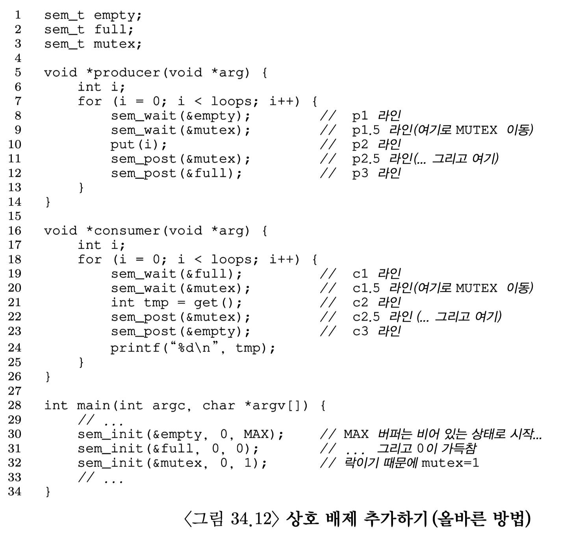

mutex를 획득하고 해제하는 코드는 임계 영역(get(), put())바로 이전과 이후로 이동하였다.

full, empty 같은 컨디션 변수용 코드는 mutex 밖으로 배치하였다.

그 결과 멀티 쓰레드 프로그램에서 사용 가능한 유한 버퍼를 만들었다.

---

# 34.5 Reader-Writer 락

다양한 자료 구조를 접근하는 데 여러 종류의 락 기법이 필요하다. 좀 더 융통성이 존재하는 락!

리스트에 삽입하고 검색을 하는 것과 같은 병행연산이 여러 개 있다고 해 보자.

삽입 연산은 리스트의 상태를 변경하고(임계 영역 보호 방식으로 해결), 검색은 단순히 자료 구조를 읽기만 한다.

삽입 연산이 없다는 보장이 된다면 다수의 검색 작업을 동시에 수행할 수 있다.

이와 같은 경우를 위해 만들어진 락이 **reader-writer 락**

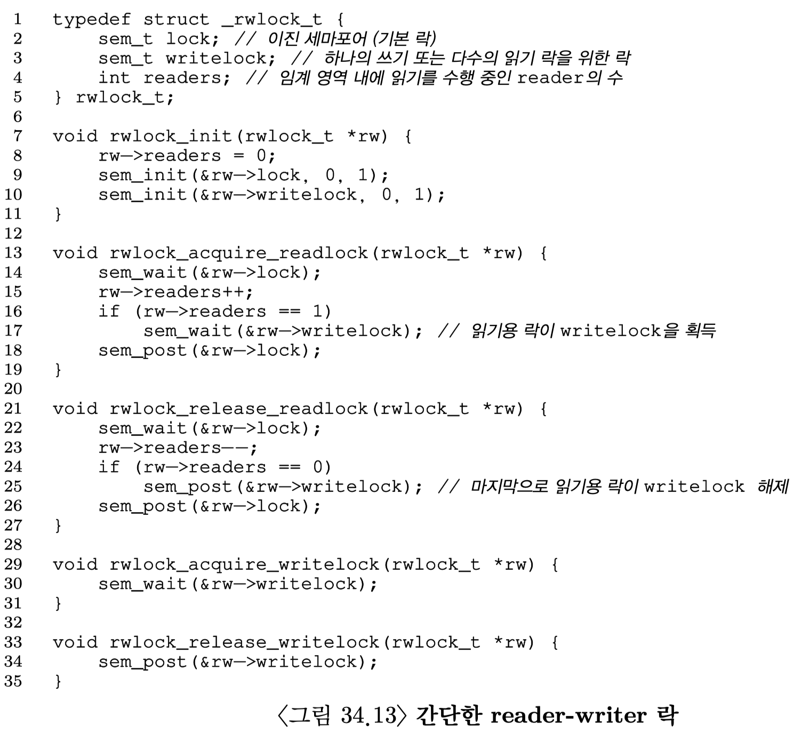

자료 구조를 “갱신”하려면 새로운 동기화 연산 쌍을 사용한다.

**락 획득: rwlock_acquire_writelock()**

**락 해제: rwlock_release_writelock()**

내부적으로는 세마포어를 사용하여 하나의 쓰기 쓰레드만이 락을 획득할 수 있도록 한다.

**읽기 락(reader lock)획득과 해제 분석하기**

```
rwlock_acquire_readlock() 호출
읽기 쓰레드는 먼저 락(lock)을 획득하고
읽기 중인 쓰레드의 개수를 표현하는 readers 변수를 증가시킨다.
읽기 락을 획득시 쓰기 락(writelock)을 획득한다.
획득한 쓰기 락은 읽기 락을 해제할 때 sem_post()로 다시 해제한다.
이런 과정을 통해 읽기 락을 획득하고 난 후,
다른 읽기 쓰레드들이 읽기 락을 획득할 수 있도록 한다. 

다만, 쓰기 락을 획득하려는 쓰기 쓰레드들은 모든 읽기 쓰레드가 끝날 때까지 기다려야 한다.
마지막 읽기 쓰레드가 writelock에 대한 sem_post()를 호출하여 대기중인 쓰기 쓰레드가 락을 획득할 수
있도록 한다.


이 방식은 상대적으로 쓰기 쓰레드가 너무 불리하다. 즉, 공정성에 문제가 있다.
쓰기 쓰레드에게 기아 현상이 쉽게 발생한다. 
읽기 쓰레드가 계속해서 읽기를 시도하면 쓰기 쓰레드는 영원히 쓰기 락을 획득하지 못한다.

```

---

# 34. 6 식사하는 철학자

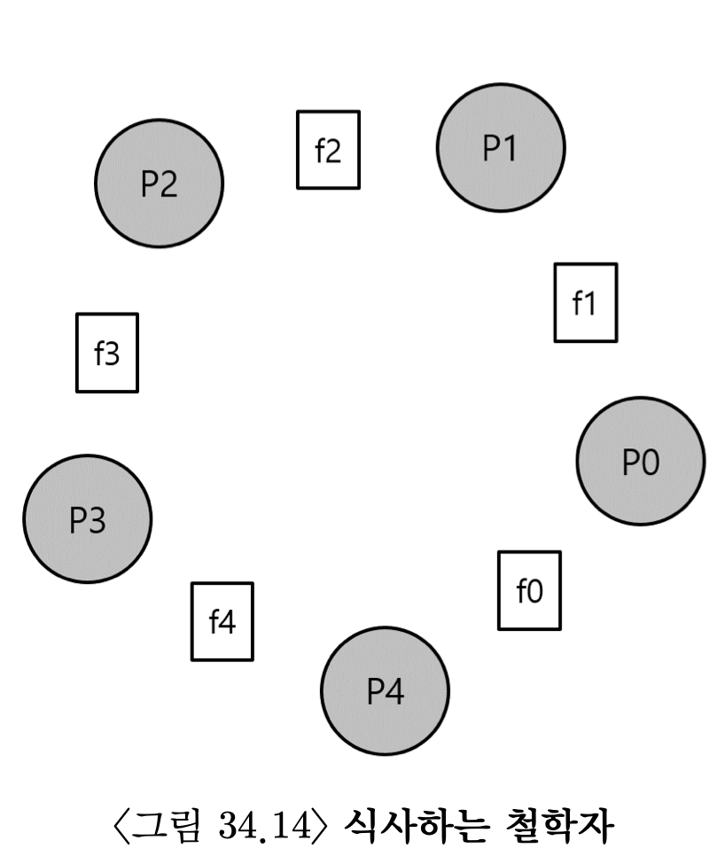

다섯 명의 “철학자”가 식탁 주위를 둘러앉았다. (P0 ~ P4)

총 5개의 포크가 철학자와 철학자 사이에 하나씩 놓여 있다.

철학자는 식사하는 상태, 생각하는 상태 2가지가 존재하고 생각하는 상태는 포크가 필요없다.

식사하는 상태에서는 자신의 왼쪽, 오른쪽  포크를 모두 들어야 식사를 할 수 있다.

**이 포크를 잡기 위한 경쟁, 그에 따른 동기화 문제가 병행 프로그래밍에서 다루는 철학자 문제이다.**

**철학자의 동작을 나타낸 기본 반복문** 

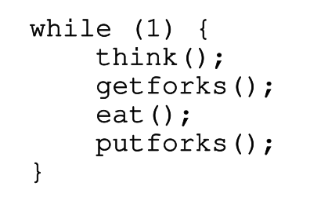

주요 쟁점은 getforks(), putforks()의 루틴을 작성하되 교착 상태의 발생을 방지해야 하고, 어떤 철학자도 기아상태에 빠지면 안되고 병행성이 높아야 한다.

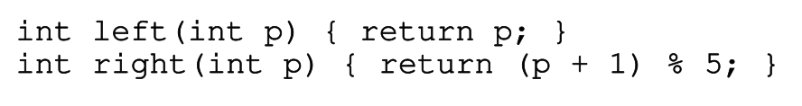

철학자 p가 자신의 왼쪽에 있는 포크를 잡기 위해서는 left(p)를 호출하고, 철학자 p가 오른쪽에 있는 포크를 잡기 위해서는 right(p)를 호출한다.

이 문제를 해결하기 위해서는 세마포어가 필요하다. semt_fork[5]

### 불완전한 해답

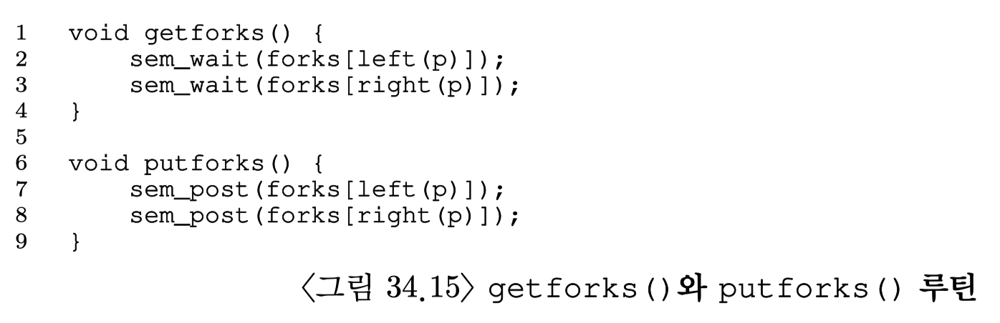

forks 배열에 있는 각 포크에 대한 세마포어를 1로 초기화한다.

이 불완전한 해답의 원리는 간단하다. 

단순히 왼쪽의 포크를 먼저 잡고 그 다음에 오른쪽 포크를 잡는다.

**교착 상태 시나리오** 

```
철학자0 포크0 
철학자1 포크1
철학자2 포크2
철학자3 포크3
철학자4 포크4

모든 철학자가 다른 철학자가 갖고 있는 포크를 기다리면서 대기한다.
-> 교착 상태
```

### 해답: 의존성 제거

이 문제를 해결하기 위한 가장 간단한 방법은 하나의 철학자가 다른 순서로 포크를 집도록 하면 된다.

가장 높은 순번인 철학자 4만 포크를 오른쪽 먼저 획득한다고 가정

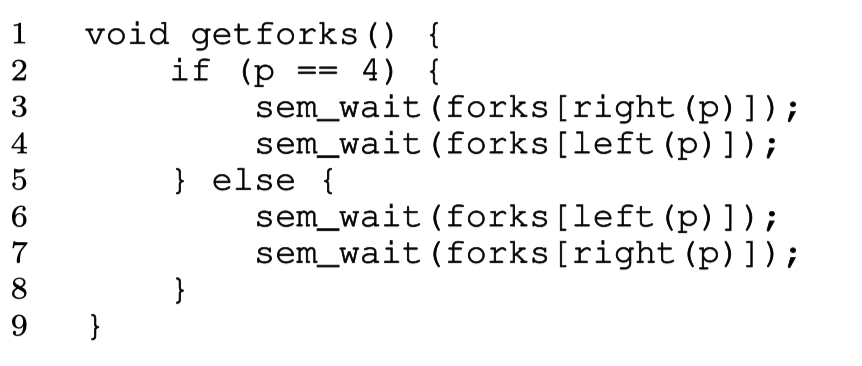

마지막 철학자가 오른쪽 포크를 먼저 잡기 때문에 각 철학자가 하나의 포크를 든 채로 다른 포크를 기다리는 대기 상황이 발생하지 않는다. → **환형 대기 상태가 끊어졌다.**

---

# 34.7 세마포어 구현

저수준 동기화 기법인 락과 컨디션 변수로 세마포어 만들기

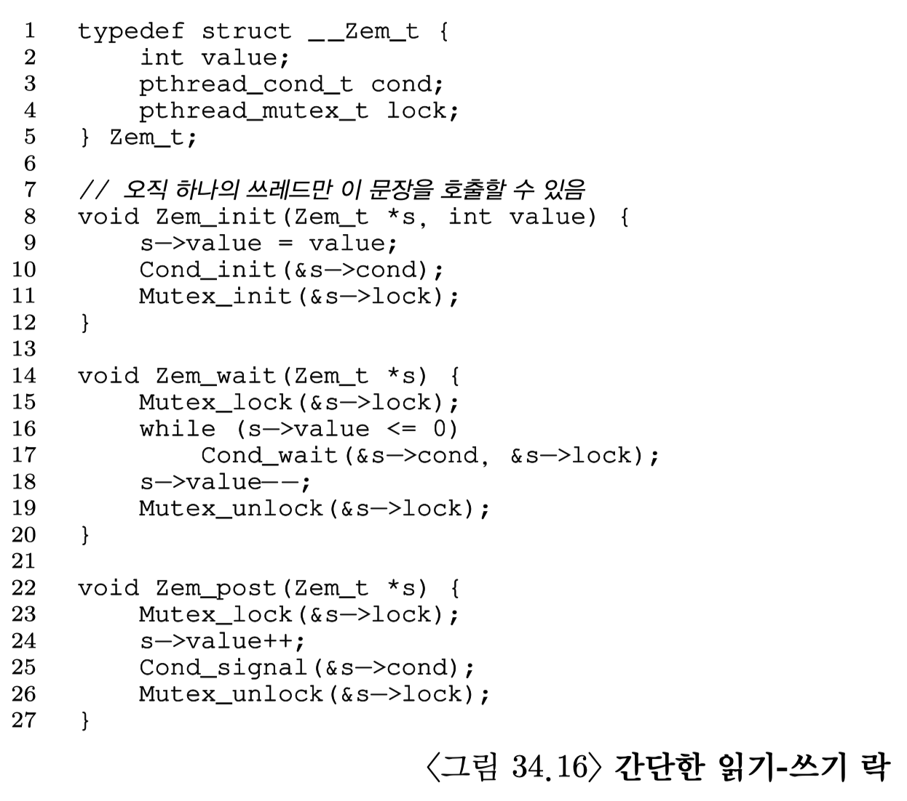

---

