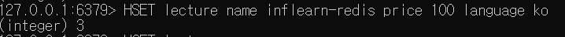
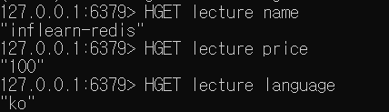
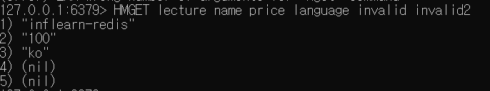
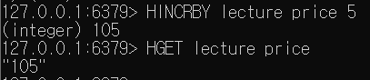
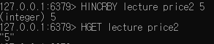

# ***Redis Hashes?*** 

 *field-value 구조를 갖는 데이터 타입*

*다양한 속성을 갖는 객체의 데이터를 저장할 때 유용*

# ***Redis Hashes 명령어***

 ***[HSET] Hash*** ***자료구조에 필드와 값을 설정하는 명령어***

```shell
 HSET lecture name inflearn-redis price 100 language ko
```

- *KEY: lecture*
- *Field1: name       Value1: inflearn-redis*
- *Field2: price        Value2: 100*
- *Field3: language Value3: ko*



 ***[HGET] Hash*** ***자료구조 조회 명령어***

```shell
HGET lecture name 
HGET lecture price
HGET lecture language
```



***[HMGET] Hash 자료구조에서 하나 이상의 필드의 값을 조회 명령어***

```shell
HGET lecture name price language
```



- *존재하지 않는 field인 invalid, invalid2는 결과로 nil이 나온다.*

***[HINCRBY] Hash 자료구조의 특정 필드에 대해 정수 값을 증가시키는 명령어***

```shell
HINCRBY lecture price 5
```



- *숫자 타입이 아니면 에러가 난다.*
- *존재하지 않는 필드면 0으로 초기화하고 5를 추가한다.*



