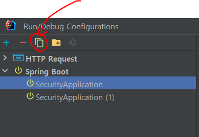
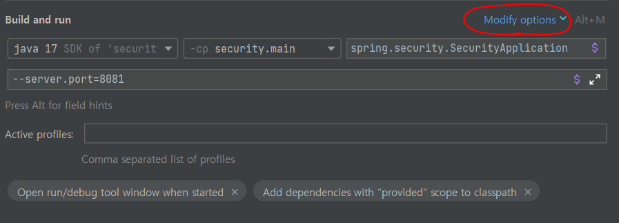

# ***개요***

- *이중화는 시스템의 부하를 분산하고,* ***단일 실패 지점(Single Point of Failure, SPOF)*** *없이 서비스를 지속적으로 제공하는 아키텍처를 구현하는 것을 목표로 하며 스프링 시큐리티는 이러한 이중화 환경에서 인증, 권한 부여, 세션 관리 등의 보안 기능을 제공한다*
- *스프링 시큐리티는 사용자 세션을 안전하게 관리하며 이중화된 환경에서 세션 정보를 공유할 수 있는 메커니즘을 제공하며 대표적으로 레디스 같은 분산 캐시를 사용하여 세션 정보를 여러 서버 간에 공유할 수 있다*

# *테스트* 

***개요(시나리오)***

*동일한 스프링 애플리케이션을 2개 띄우고 하나의 원격 세션 서버(레디스)를 사용하자* 

*클라이언트는 1번 서버에서 인증 처리를 하고 이후 1번 서버를 강제로 종료하고 똑같은 클라이언트로 2번 서버에 인증이 필요한 경로에 접속해서 인가되는지 테스트해보자*

***build.gradle 추가***

```java
implementation 'org.springframework.session:spring-session-data-redis'
implementation 'org.springframework.boot:spring-boot-starter-data-redis'
```

***application.yaml***

```java
spring:
  data:
    redis:
      host: localhost
      port: 6379
```

***SecurityConfig***

```java
@EnableWebSecurity
@Configuration
public class SecurityConfig {
    @Bean
    public WebSecurityCustomizer webSecurityCustomizer() {
        return (webSecurity) -> {
            webSecurity.ignoring().requestMatchers(PathRequest.toStaticResources().atCommonLocations());
        };
    }
    @Bean
    public SecurityFilterChain securityFilterChain(HttpSecurity http) throws Exception {

        http
                .authorizeHttpRequests(authorize -> authorize
                        .requestMatchers("/user").hasAuthority("ROLE_USER")
                        .requestMatchers("/db").hasAuthority("ROLE_DB")
                        .requestMatchers("/admin").hasAuthority("ROLE_ADMIN")
                        .anyRequest().authenticated())
                .formLogin(Customizer.withDefaults());
        return http.build();
    }
    @Bean
    public UserDetailsService userDetailsService(){
        UserDetails user = User.withUsername("user").password("{noop}1111").roles("USER").build();
        UserDetails db = User.withUsername("db").password("{noop}1111").roles("DB").build();
        UserDetails admin = User.withUsername("admin").password("{noop}1111").roles("ADMIN","SECURE").build();
        return  new InMemoryUserDetailsManager(user, db, admin);
    }
}
```

***RedisConfig***

```java
@Configuration
@EnableRedisHttpSession
public class RedisConfig {
    @Value("${spring.data.redis.host}")
    private String host;
    
    @Value("${spring.data.redis.port}")
    private int port;
    @Bean
    public RedisConnectionFactory redisConnectionFactory(){
        return new LettuceConnectionFactory(host, port);
    }
}
```

***Copy Configuration*** 



- *각각 port만 다르게 해서 2개 띄우자 (8080 / 8081)*

***port 변경***



- *modify options → program arguments →* *`--server.port=8081`* *추가* 

***테스트***

1. *8080 user 로그인*
1. *8080 서버 종료*
1. *8081 서버 인증이 필요한 페이지 접근 (이때 8080 서버에서 인증 받은 클라이언트 그대로)*
1. *8081 서버 접근 성공* 

 *즉, 1개의 서버가 죽어도 각 서버는 해당 원격 서버(레디스)를 통해서 관리하기 때문에* 

*사용자는 재인증 할 필요가 없다.*

