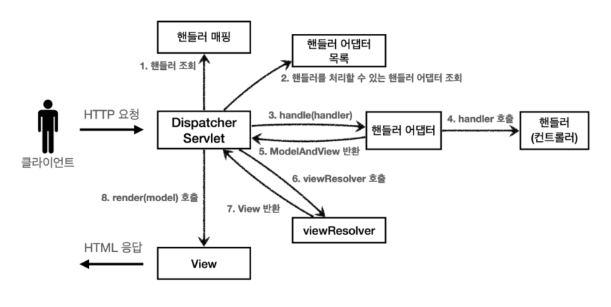

# ***스프링 MVC 구조 정리*** 

***Spring MVC***



***DistpatcherServlet 흐름***


*HttpServlet service() 호출*

*FrameworkServlet service() 오버라이드* 

*FrameworkServlet.service()를 시작으로 여러 메서드가 호출 → DispatcherServlet.doDispatch()*

***DispatcherServlet.doDispatch()  뷰 랜더링 흐름 분석***

```java
// 1. handler(controller) 조회 
mappedHandler = getHandler(processedRequest);
if (mappedHandler == null) {
		noHandlerFound(processedRequest, response);
		return;
}

// 2. adapter 조회 
HandlerAdapter ha = getHandlerAdapter(mappedHandler.getHandler());

// 3. 핸들러 어댑터 실행 -> 4. 핸들러 어댑터에서 핸들러 실행 -> 5. ModelAndView 반환
mv = ha.handle(processedRequest, response, mappedHandler.getHandler());

// ***DispatcherServlet.doDispatch() -> DispatcherServlet.processingDispatchResult()***

// 6. 뷰 렌더링 호출 
render(mv, request, response);

// ***DispatcherServlet.processingDispatchResult() -> DispatcherServlet.render()***

// 7. 뷰 리졸버 뷰 찾기, View 반환 
view = resolveViewName(viewName, mv.getModelInternal(), locale, request);

// 8. 뷰 랜더링
view.render(mv.getModelInternal(), request, response);
```


***동작 순서 정리*** 

1. *핸들러 조회: 핸들러 매핑을 통해 요청 URL에 매핑된 핸들러(컨트롤러)를 조회*
1. *핸들러 어댑터 조회: 핸들러를 실행할 수 있는 핸들러 어댑터를 조회*
1. *핸들러 어댑터 실행: 핸들러 어댑터를 실행*
1. *핸들러 실행: 핸들러 어댑터가 실제 핸들러를 실행*
1. *ModelAndView 반환: 핸들러 어댑터는 핸들러가 반환하는 정보를 ModelAndView로 변환해서 반환*
1. *viewResolver 호출: 뷰 리졸버를 찾고 실행*
1. *View 반환: 뷰 리졸버는 뷰의 논리 이름을 물리 이름으로 바꾸고, 렌더링 역할을 담당하는 뷰 객체를 반환*
1. *뷰 렌더링: 뷰를 통해서 뷰를 렌더링*

***DispatcherServlet 확장*** 

*DispatcherServlet이 사용하는 핸들러 매핑(HandlerMapping), 핸들러 어댑터(HandlerAdapter), 뷰 리졸버(ViewResolver), 뷰(View) 모두 인터페이스 기반이다.* 

*클라이언트(DispatcherServlet)의 코드 변경 없이 인터페이스를 구현해서 제공하여 기능을 추가할 수 있다.* 

*이는 Spring MVC 구조가 OCP가 잘 지켜지고 있다고 볼 수 있다. 또한 각 인터페이스들은 역할과 책임이 명확하고 잘 분리되어 있다. 이는 SRP 관점에서도 좋은 아키텍처이다.* 

# ***핸들러 매핑과 핸들러 어댑터***

***과거 버전의 스프링 컨트롤러*** 

```java
public interface Controller {
		ModelAndView handleRequest(HttpServletRequest request, HttpServletResponse response) throws Exception;
}

@Component("/springmvc/old-controller")
public class OldController implements Controller {
    @Override
    public ModelAndView handleRequest(HttpServletRequest request, HttpServletResponse response) throws Exception {
        System.out.println("OldController.handleRequest");
        return new ModelAndView("new-form");
    }
}
```

- `@Component("/springmvc/old-controller")` 
- *빈의 이름으로 URL 매핑*

*해당 인터페이스를 구현한 컨트롤러가 존재한다면?*

*스프링 DispatcherServlet은 어떻게 해당 컨트롤러를 실행할까?*

- *HandlerMapping*
- *핸들러 매핑에서 해당 컨트롤러가 존재*
- *HandlerAdapter*
- *핸들러 매핑을 통해서 찾은 컨트롤러를 실행할 수 있는 핸들러 어댑터가 존재*

## ***스프링 부트가 자동 등록하는 핸들러 매핑과 핸들러 어댑터***

***HandlerMapping***

```java
0 = RequestMappingHandlerMapping : 애노테이션 기반의 컨트롤러인 @RequestMapping
1 = BeanNameUrlHandlerMapping : 스프링 빈의 이름으로 핸들러
```

***HandlerAdapter***

```java
0 = RequestMappingHandlerAdapter : 애노테이션 기반의 컨트롤러인 @RequestMapping
1 = HttpRequestHandlerAdapter : HttpRequestHandler 처리
2 = SimpleControllerHandlerAdapter : Controller 인터페이스(애노테이션X, 과거에 사용) 처리
```

***OldController - Controller 인터페이스 구현체***

- *HandlerMapping = BeanNameUrlHandlerMapping*
- *HandlerAdapter = SimpleControllerHandlerAdapter*

***HttpRequestHandler***

```java
public interface HttpRequestHandler {
		void handleRequest(HttpServletRequest request, HttpServletResponse response) throws ServletException, IOException;
}

@Component("/springmvc/request-handler")
public class MyHttpRequestHandler implements HttpRequestHandler {
    @Override
    public void handleRequest(HttpServletRequest request, HttpServletResponse response) throws ServletException, IOException {
        System.out.println("MyHttpRequestHandler.handleRequest");
    }
}
```

- *HandlerMapping = BeanNameUrlHandlerMapping*
- *HandlerAdapter = HttpRequestHandlerAdapter*

***@RequestMapping - 가장 우선순위가 높다***

- *HandlerMapping = RequestMappingHandlerMapping*
- *HandlerAdapter = RequestMappingHandlerAdapter*

# ***뷰 리졸버***

 ***InternalResourceViewResolver - 뷰 리졸버 설정*** 

- *application.properties/yaml에 등록한 spring.mvc.view.prefix , spring.mvc.view.suffix 설정 정
보를 사용해서 등록*
```java
spring.mvc.view.prefix=/WEB-INF/views/
spring.mvc.view.suffix=.jsp
```
- *설정하지 않는다면 전체 경로를 주자*
- `return new ModelAndView("/WEB-INF/views/뷰 이름.jsp");`

***스프링 부트가 자동 등록하는 뷰 리졸버***

```java
1 = BeanNameViewResolver : 빈 이름으로 뷰를 찾아서 반환. (엑셀 파일 생성 기능에 사용)
2 = InternalResourceViewResolver : JSP를 처리할 수 있는 뷰를 반환 (forward)
```

- *타임리프: ThymeleafViewResolver*

# ***스프링 MVC - 시작하기***

***@RequestMapping***

- *RequestMappingHandlerMapping*
- *RequestMappingHandlerAdapter*
- *가장 우선순위가 높은 핸들러 매핑, 핸들러 어댑터 List에 첫 번째로 들어간다.*
```java
// DispatcherServlet

@Nullable
private List<HandlerMapping> handlerMappings;

@Nullable
private List<HandlerAdapter> handlerAdapters;
```

***스프링 부트 3.0 이상 vs 미만***

- *스프링 부트 3.0 이상에서는 @Controller 애노테이션이 있어야지 스프링 컨트롤러로 인식* 
- *스프링 부트 3.0 미만은 @RequestMapping 존재해도 컨트롤러로 인식* 

***요약*** 

- *@RequestParam - 요청 파라미터를 받을 수 있다.*
- *QueryString*
  - *application/x-www-form-urlencoded: POST HTML Form*
- *Model - 메소드 요청 매개변수로 받을 수 있다.* 
- *여러가지 HttpMethod 제공* 
- *@Controller + String → view 논리 이름 반환* 
- *메소드 단위로 @RequestMapping 적용 가능* 
- *공통 경로는 클래스 레벨에 @RequestMapping 적용*

*이런 여러가지 컨트롤러의 메소드 파라미터를 어떻게 처리?*

*→* ***HandlerMethodArgumentResolver - 인터페이스*** 

**흐름**

***DispatcherServlet*** → ***HandlerMapping → HandlerAdapter → HandlerMethodArgumentResolver***

***→ Controller(Handler)***

