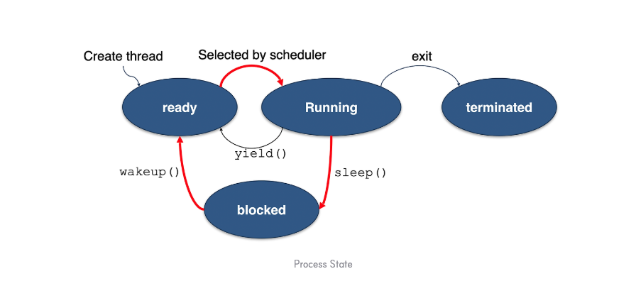
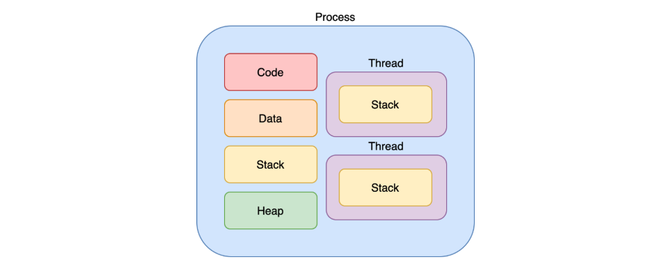
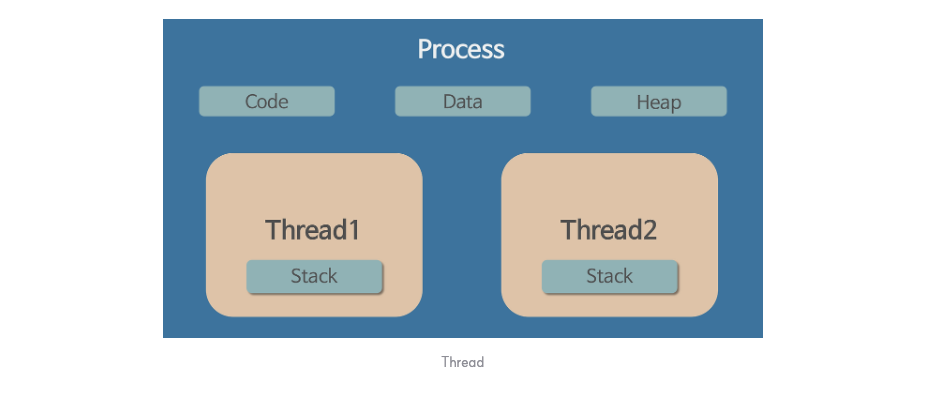

# 프로세스

## 참고 자료 

[https://yunchan97.tistory.com/60](https://yunchan97.tistory.com/60)

## 프로그램?

프로그램이란 메모리에 올라가 있지 않고, 저장 장치에 저장 되어 있는 상태의 코드 파일을 의미한다.

프로그램을 실행하기 위해서는 OS로부터 프로그램이 동작하는데 필요한 CPU, 메모리 등을 할당 받아야 한다. 

## 프로세스?

프로세스란 실행중인 프로그램이다. 

디스크에 파일로 존대하던 프로그램이 메모리에 올라가서 실행되면 프로세스가 된다. 

## **멀티 프로세스?**

하나의 프로그램에서 동시에 여러개의 프로세스를 실행하는 기술 

하나의 부모 프로세스가 여러 갱의 자식 프로세스를 생성하는 구조이며 서로 독립적인 메모리 공간을 가진다. 

예를들어 구글의 크롬 탭은 각각이 프로세스이며, 하나의 탭이 멈추더라도 다른 텝은 정상 작동한다.

## **프로세스 문맥?(Process Context)**

프로세스 컨텍스트는 실행 중인 프로세스에 대한 정보를 의미한다. 

운영체제는 멀티태스킹 환경에서 동시에 여러 프로세스를 동시에 관리해야 하므로, 각 프로세스의 상태와 필요한 정보를 저장해두어야 한다. 이 정보를 문맥(context)이라고 부른다. 

프로세스 문맥은 주로 프로세스가 실행되기 위해 필요한 상태 정보를 포함하며, 이를 통해 프로세스가 실행되던 상태로 복귀할 수 있다. 

이 정보는 주로 스케줄러가 프로세스를 교체 즉, **컨텍스트 스위칭(Context Switching)**을 할 때 사용된다.

**프로세스 문맥에 포함되는 주요 정보** 

1. **프로세스 카운터(PC, Program Counter)**
1. 프로세스가 실행 중인 명령어의 주소.
  1. 프로세스가 멈추고 다시 시작할 때, 어느 명령어에서 실행할지 결정에 필요하다.
1. **레지스터 값**
1. CPU 레지스터에 저장된 값들. 각 레지스터에는 연산에 필요한 데이터나 주소 등이 저장된다. 
  1. 프로세스가 중단되면, 그 때의 레지스터 값을 저장하여, 프로세스가 다시 시작될 때 복구한다.
1. **스택 포인터(SP, Stack Pointer)**
1. 현재 프로세스의 스택에 대한 포인터이다. 함수 호출 시 스택에 쌓이는 정보를 관리한다. 
  1. 이 값을 통해 프로세스가 재개될 때 이전 함수 호출 정보를 복구할 수 있다.
1. **메모리 관리 정보** 
1. 프로세스가 사용하는 메모리 공간에 대한 정보 
  1. 가상 주소 공간과 물리 주소 공간의 매핑, 페이지 테이블 등이 포함
1. **프로세스 상태** 
1. 프로세스가 실행 중인지, 대기 중인지, 종료되었는지 등의 상태 정보

## 컨텍스트 스위칭(Context Switching)

문맥 교환은 CPU가 하나의 프로세스에서 다른 프로세스로 전환될 때, 현재 실행 중인 프로세스의 상태(문맥)을 저장하고, 새롭게 실행할 프로세스의 이전 상태를 복구하는 작업을 의미한다. 

이 과정은 운영체제가 멀티태스킹 환경에서 여러 프로세스에게 CPU를 할당하기 위해 필수적인 과정이다. 

**컨텍스트 스위칭이 발생하는 경우** 

- **타임 슬라이스 종료:** **라운드 로빈 방식**과 같이 프로세스에게 일정 시간 동안 CPU를 할당한 후, 타임 슬라이스가 끝나면 컨텍스트 스위칭이 발생한다. 
- **타이머 인터럽트:** CPU 타이머에 의해 인터럽트가 발생하면, 현재 실행 중인 프로세스의 시간이 다 되었음을 알리고 문맥 교환을 트리거할 수 있다. 
- **타임 슬라이스가 종료 → 타이머 인터럽트 발생 → 컨텍스트 스위칭**
- **I/O 요청 또는 시스템 콜**: 프로세스가 I/O 요청이나 시스템 콜을 호출하여 커널 모드로 전환되면, 현재 실행 중인 작업을 중단하고 다른 프로세스로 교체하는 경우에도 문맥 교환이 발생할 수 있다.

## 라운드 로빈(Round Robin)

**선점형 스케줄링 알고리즘** 중 하나, 다중 작업을 공평하게 처리하기 위해 각 프로세스에 동일한 시간 할당량(타임 슬라이스)을 부여하는 방식 

라운드 로빈 알고리즘은 CPU 시간을 각 프로세스에 순차적으로 배분하고, 각 프로세스가 정해진 시간 동안 실행되다가, 시간이 다 되면 **타이머 인터럽트**를 통해 문맥 교환을 일으켜 다음 프로세스로 전환된다. 

**장점** 

- **공정성:** 모든 프로세스에 대해 공평하게 CPU 시간을 할당하므로 **기아(Starvation)** 현상이 발생하지 않는다. 
- **예측 가능성**: 각 프로세스는 일정 시간 안에 반드시 실행되므로 예측 가능한 처리가 가능하다.

**단점**

- **타임 슬라이스 설정에 따라 성능 차이**: 너무 작은 타임 슬라이스는 **문맥 교환 오버헤드**를 초래할 수 있고, 너무 큰 타임 슬라이스는 **응답 시간**이 길어질 수 있다.
- **긴 작업에 불리함**: CPU를 많이 사용하는 긴 프로세스는 자주 문맥 교환이 발생하게 되어 **효율성이 떨어질 수 있다.**

## 프로세스 상태

1. **new:** 최초 상태인 new는 프로세스가 생성중인 상태 
1. **ready:** 실행 가능한 상태, CPU를 할당받기 위해 대기 중인 상태 
1. **running:** 현재 CPU에서 실행중인 상태 
1. **blocked, waiting, sleep:** 특정 이벤트를 기다리는 상태로, 예를 들어 I/O 작업을 기다리거나 락(lock)을 획득하기 위해 대기하는 상태
1. **termiated:** 실행이 완료된 상태로, 운영체제에 의해 자원이 해제되고 종료되는 상태 

## 프로세스의 메모리 공간 

프로세스 내부에는 최소 하나의 스레드(thread)를 가지고 있는데, 실제로는 스레드(thread)단위로 스케줄링을 한다.  

프로세스의 메모리 공간은 프로세스가 실행되는 동안 필요한 메모리 영역을 나타낸다.

각 프로세스는 독립적인 공간을 가진다. 
이 메모리 공간은 프로세스가 정상적으로 실행되기 위한 **코드, 데이터, 스택, 힙** 등의 영역으로 나뉜다. 

**코드 영역 Code**

- 실행할 프로그램 코드가 저장되며, CPU에서 수행되는 명령어를 저장하는 공간 
- 읽기 전용으로 설정되어 있어, 실행 중인 코드가 수정되는 것을 방지

**데이터 영역 (Data Segment)**

- 전역 변수나 정적 변수가 저장되는 공간
- 프로그램 실행 중 변경 가능한 데이터들이 저장 
- 데이터 영역은 초기화된 데이터와 초기화되지 않은 데이터(BSS 영역)로 나뉜다. 
- 초기화 데이터: 프로그램에서 값을 할당한 변수들 
  - **BSS(Block Started by Symbol):** 초기화되지 않은 전역 변수나 정적 변수들이 저장되는 영역

**힙 영역 (Heap)**

- 동적 메모리 할당을 위해 사용되는 메모리 영역 
- malloc(), free()같은 함수 호출을 통해 메모리를 할당하고 해제한다. 
- 프로세스가 실행되는 동안 동적으로 변경 
- **메모리 누수(memory leak)**나 **가비지 컬렉션** 문제 등이 이 영역에서 발생할 수 있다.

**스택 영역(Stack)**

- 함수 호출 시 사용되는 지역 변수와 함수 호출 기록이 저장된다.
- 함수가 호출될 때마다 스택 프레임이 생성되고, 함수가 종료되면 해당 프레임이 사라진다. 
- **LIFO(Last In, First Out)** 방식으로 메모리 할당과 해제가 이루어진다.
- 스택 영역은 **재귀 호출**이나 **함수 호출** 시 메모리 용량이 빠르게 증가할 수 있으며, 이로 인해 **스택 오버플로우**가 발생할 수 있다.

## **프로세스 제어블록(PCB)**

**프로세스 제어 블록(Process Control Block)**은 운영체제가 각 프로세스를 관리하기 위해 사용되는 데이터 구조이다. PCB는 실행 중인 각 프로세스에 대한 중요한 정보를 저장하고 있으며, 프로세스가 실행되는 동안 필요한 상태를 추적하고 관리하는 데 사용된다. 

**즉, 프로세스 컨텍스트를 저장하는 자료구조** 

### PCB 정보 

**프로세스 상태 (Process State)**

- 프로세스가 현재 어떤 상태에 있는지를 나타낸다. 
- **new, ready, running, waiting/sleep/blocked, terminated**

**프로세스 식별자 (Process ID, PID)**

- 운영체제가 각 프로세스를 고유하게 식별하는 값 

**프로그램 카운터 (Program Counter, PC)**

- 현재 실행 중인 프로세스의 다음 명령어 주소를 저장하는 레지스터 
- 문맥 교환 시 이 값을 저장하고 복원하여 프로세스가 실행을 계속할 수 있게 한다. 

**CPU 레지스터 (CPU Registers)**

- 프로세스가 실행 중일 때 CPU에서 사용되는 레지스터 값들(예: 누산기, 인덱스 레지스터 등)을 저장
- 문맥 교환 시 현재 프로세스의 상태를 저장하고, 새로 실행될 프로세스의 레지스터를 복원

**우선순위 (Priority)**

- 프로세스의 실행 우선순위를 나타낸다. 
- 스케줄링 알고리즘에 따라 프로세스가 CPU를 할당받을 우선순위가 결정된다. 

**부모 프로세스와 자식 프로세스 (Parent and Child Process Information)**

- 부모 프로세스와 자식 프로세스의 정보가 포함되어, 부모-자식 관계를 추적할 수 있다.

**CPU 시간 (CPU Time)**

- 프로세스가 CPU를 사용한 시간이나, 프로세스가 실행된 시간을 추적하는 정보

**자원 할당 정보 (Resource Allocation Information)**

- 프로세스가 사용 중인 자원들(예: 메모리, 파일 등)의 정보를 포함한다.
-  또한 자원 할당에 대한 정보도 포함될 수 있다.

**메모리 관리 정보 (Memory Management Information)**

- 프로세스의 가상 메모리 주소 공간과 관련된 정보
- 페이지 테이블, 세그먼트 테이블, 시작 주소, 크기 등 메모리 관리에 필요한 정보가 포함

## 프로세스끼리 협력하는 방법

### **메시지 전달 방식(Message Passing)**

- **기본 원리** 
- 메시지 전달 방식은 두 프로세스가 서로 **직접** 데이터를 주고받는 방식
  - 한 프로세스가 데이터를 다른 프로세스에게 **메시지** 형태로 보내면, 그 메시지를 받은 프로세스가 데이터를 처리하는 방식
- **작동 방식**
- 프로세스는 운영체제에게 **시스템 콜**을 사용하여 메시지를 전달하려고 요청
  - 메시지는 운영체제를 통해 다른 프로세스에게 전달
  - 이 방식은 **명시적 통신**을 필요로 하며, 프로세스 간의 연결을 명확히 설정해야 한다.
- **장점** 
- 프로세스 간의 독립성이 유지됩니다. 즉, 서로 메모리를 공유하지 않기 때문에, 프로세스 간에 충돌이나 영향이 최소화
  - 메시지가 안전하게 전달될 수 있도록 운영체제가 보장할 수 있다.
- **단점** 
- 메시지 전달을 위해 운영체제를 통해 중간 단계가 필요하고, 이로 인해 속도나 효율성이 떨어질 수 있다.
  - 통신 비용이 크고, 대량의 데이터 전송에는 비효율적일 수 있다.
- **예시**
- **소켓 통신**: 네트워크를 통해 다른 컴퓨터와 데이터를 주고받을 때
  - **큐(queue)**: 하나의 프로세스가 메시지를 큐에 넣고, 다른 프로세스가 이를 받아서 처리하는 방식

### **공유 메모리 방식(Shared Memory)**

- **기본 원리** 
- 공유 메모리 방식은 여러 프로세스가 하나의 **공유된 메모리 공간**을 사용하여 데이터를 직접 읽고 쓸 수 있도록 하는 방식
- **작동 방식** 
- 운영체제는 프로세스들 간에 공유할 메모리 공간을 할당한다. 
각 프로세스는 이 공유 메모리에 접근하여 데이터를 읽고 쓸 수 있다.
  - 프로세스는 운영체제에게 시스템 콜을 사용하여 공유 메모리 공간을 요청하고, 이 공간을 이용해 다른 프로세스와 데이터를 교환한다.
- **장점** 
- 데이터 전송 속도가 빠르다. 메시지 전달 방식과 달리 운영체제를 통한 중간 단계가 없기 때문에, 직접 메모리 공간을 공유하기 때문에 효율적이다. 
  - 대량의 데이터 전송에 적합
- **단점** 
- 여러 프로세스가 같은 메모리 공간을 공유하기 때문에 **동기화**가 필요하다. 
즉, 하나의 프로세스가 데이터를 변경하는 동안 다른 프로세스가 접근하지 않도록 해야 한다. 
이를 위해 **세마포어**나 **뮤텍스**와 같은 동기화 메커니즘이 필요하다.
  - 메모리 보호가 필요하다. 한 프로세스가 잘못된 데이터를 쓰면 다른 프로세스에 영향을 미칠 수 있다.

## fork() 명령어?

fork()명령어는 유닉스 및 유닉스 계열 운영체제에서 프로세스를 생성하는 시스템 콜로, 부모 프로세스의 내용을 그대로 복제한 자식 프로세스를 생성하는 기능을 제공한다. 

fork()명령어는 프로세스를 생성하고, 부모 프로세스와 자식 프로세스가 동시에 실행될 수 있도록 한다. 

부모 프로세스와 자식 프로세스는 각각 독립적인 주소 공간을 가진다. 

즉, 부모와 자식이 동일한 메모리 공간을 갖더라도 **메모리 변경은 서로에게 영향을 미치지 않는다.** 

**Copy-On-Write(COW)**

- 메모리 복사가 지연될 수 있다. 부모와 자식이 동일한 메모리 페이지를 참조하고 있다가 어느 한쪽이 메모리 값을 수정하려 할 때 복사가 발생한다. 
- 이로 인해 실제 복사가 일어나기 전까지는 메모리 자원 낭비를 줄일 수 있다. 

# 쓰레드 

## 스레드란?

**스레드는 프로세스 내에서 실행되는 최소 단위**

스레드는 프로세스의 일부로서 독립적인 실행 경로를 가지며, 프로세스의 자원을 공유하여 병렬적 또는 동시에 실행될 수 있다.

스레드는 프로세스의 주소 공간, 파일 핸들, 열린 파일 등과 같은 자원을 공유하기 때문에, 스레드 간의 통신과 데이터 공유가 비교적 쉽다.

**스레드 간의 전환 (Context Switch) 시에는 프로세스 전환보다 비용이 적게든다.**

스레드는 프로세스 내에서 **각각 레지스터와, Stack만 따로 할당받고 Code, Data, Heap 영역은 공유**한다.

## 스레드 제어블록(TCB, Thread Control Blcok)

스레드 제어블록(TCB)은 운영체제가 각 스레드에 대해 **문맥 정보를 관리**하는 자료구조이다. 
프로세스는 하나 이상의 스레드를 가질 수 있으며, 각 스레드는 독립적인 실행 흐름을 가진다. 
TCB는 이러한 스레드의 상태와 관련된 정보를 저장하여 스레드 스케줄링 및 관리에 중요한 역할을 한다.

### TCB 주요 구성 요소 

- **스레드 ID(Thread ID)**
- 각 스레드를 구별할 수 있는 고유한 식별자
- **스레드 우선순위(Thread Priority)**
- 스레드가 실행되는 우선순위 정보, 운영체제는 우선순위에 따라 스레드를 스케줄링
  - 높은 우선순위를 가진 스레드가 더 자주 CPU를 할당받는다.
- **스레드 상태(Thread State)**
- 스레드의 현재 상태를 나타낸다.
  - **실행 중(Running), 대기 중(Waiting), 준비 중(Ready), 종료(Dead)** 상태 등이 포함
- **프로그램 카운터(Program Counter, PC)**
- 스레드가 마지막으로 실행된 위치를 나타내는 **메모리 주소**
  - 문맥 교환(Context Switch)이 발생할 때 이 정보는 스레드가 이전에 실행하던 위치로 다시 돌아갈 수 있도록 한다.
- **레지스터 상태(Register States)**
- 스레드가 마지막으로 실행된 시점에서 CPU의 레지스터 상태를 저장
  -  문맥 교환 시, 이 레지스터 정보는 이전 스레드의 상태로 복구되며, 새로 실행될 스레드의 레지스터 상태로 업데이트
- **스택 포인터(Stack Pointer)**
- 스레드가 사용하는 **스택 영역**의 위치를 나타내는 포인터
  - 스택은 함수 호출과 로컬 변수 저장 등에 사용

## 스레드의 컨텍스트 스위칭이 더 가벼운 이유 

**프로세스 간 컨텍스트 스위칭의 경우**

- 프로세스 간의 컨텍스트 스위칭은 각 프로세스가 독립적인 주소 공간을 가지고 있기 때문에, CPU의 상태뿐만 아니라 프로세스의 전체 메모리 (주소 공간, 파일 핸들, 열린 파일 등)까지 저장하고 복구
- 프로세스 전환 시에는 프로세스마다 별도의 메모리 공간을 할당하고 있기 때문에, 메모리 덤프와 복원을 해야 하는 비용이 크고, 캐시와 같은 시스템 자원의 변경이 많아져서 오버헤드가 발생

**스레드 간 컨텍스트 스위칭의 경우**

- 스레드는 같은 프로세스 내에서 실행되므로, 자원 (주소 공간, 파일 핸들 등)을 공유한다. 
그래서 스레드 전환 시 프로세스의 전체 메모리 상태를 저장하거나 복원할 필요가 없다.
- 스레드는 자신의 레지스터, 스택, 프로그램 카운터(PC)만 관리하면 되므로, 저장해야 할 상태가 프로세스에 비해 적다.
- 즉, 프로세스의 주소 공간, 파일 핸들, 메모리 등의 복구가 필요하지 않으므로 스레드 간의 컨텍스트 스위칭이 가볍고 빠르다.

## 사용자 수준 쓰레드와 커널 수준 쓰레드의 차이

### **사용자 수준 쓰레드 (User-level thread)**

- **정의**: 사용자 수준 쓰레드는 운영체제가 아닌 사용자 프로그램에서 관리하는 쓰레드이다.
 운영체제는 이 쓰레드를 별도로 인식하지 않으며, 커널은 해당 쓰레드가 존재하는지 알지 못한다.
- **스케줄링**: 커널은 하나의 프로세스만 관리하므로, 여러 사용자 수준 쓰레드는 하나의 프로세스에 속하는 것으로 보입니다. 스케줄링은 **사용자 라이브러리**에서 처리되고, 커널은 이를 구분하지 않는다.
- **장점** 
- **빠른 스레드 전환**: 커널의 개입 없이 사용자 수준에서 직접 스레드를 전환하므로 빠르다.
  - **커널 오버헤드 없음**: 커널의 개입이 없으므로 커널에서 발생하는 오버헤드가 없다.
  - **더 적은 시스템 자원 사용**: 커널의 관리를 받지 않기 때문에 메모리나 시스템 자원을 적게 사용한다.
- **단점** 
- **멀티프로세서 활용 불가**: 운영체제가 각 CPU 코어에 쓰레드를 분배하지 않기 때문에 멀티코어 시스템에서 병렬 처리를 할 수 없다.
  - **I/O 차단 문제**: 하나의 쓰레드가 블로킹(예: I/O 작업)될 경우, 전체 프로세스가 멈추게 되어 다른 쓰레드가 실행되지 않는다.

### **커널 수준 쓰레드 (Kernel-level thread)**

- **정의**: 커널 수준 쓰레드는 운영체제가 직접 관리하는 쓰레드로, 커널은 각 쓰레드를 독립적인 실행 단위로 인식하고 관리한다.
- **관리**: 운영체제의 커널이 쓰레드를 생성, 종료, 스케줄링을 담당한다.
- **스케줄링**: 커널은 각 쓰레드가 독립적으로 스케줄링되도록 관리하고, 여러 커널 수준 쓰레드는 다중 프로세서 환경에서도 독립적으로 실행될 수 있다.
- **장점**
- **멀티프로세서 지원**: 커널은 각 쓰레드를 독립적으로 관리하므로 멀티코어 시스템에서 효율적으로 실행
  - **블로킹 문제 해결**: 하나의 쓰레드가 블로킹되어도 다른 쓰레드가 실행될 수 있어, I/O 차단 문제를 해결할 수 있다.
  - **스케줄링 제어**: 커널이 각 쓰레드의 우선순위와 상태를 더 잘 관리할 수 있다.
- **단점** 
- **스레드 전환 비용**: 커널이 직접 관리하므로 스레드 전환 시 오버헤드가 발생
  - **더 많은 시스템 자원 사용**: 커널의 관리를 받기 때문에 더 많은 메모리와 자원을 사용
  - **복잡한 구현**: 사용자 수준 쓰레드보다 구현이 복잡하고, 커널의 변경이 필요할 수 있다.

| **특성** | **사용자 수준 쓰레드 (User-level thread)** | **커널 수준 쓰레드 (Kernel-level thread)** |
| --- | --- | --- |
| **스케줄링 관리** | 사용자 라이브러리에서 관리 | 커널에서 관리 |
| **커널 개입** | 커널 개입 없음, 사용자 공간에서 관리 | 커널이 직접 관리 |
| **다중 프로세서 활용** | 멀티코어 환경에서 비효율적 | 멀티코어 환경에서 효율적 |
| **I/O 차단 문제** | 하나의 쓰레드가 블로킹되면 전체 프로세스가 멈춤 | 하나의 쓰레드가 블로킹되어도 다른 쓰레드는 실행 가능 |
| **스레드 전환 속도** | 빠르다 | 느리다 (커널 개입 필요) |
| **시스템 자원 소모** | 적다 | 많다 |

### **자바 스레드** 

- **1:1 매핑:** 자바의 스레드는 운영체제의 커널 스레드와 직접적으로 매핑, 즉, 자바 스레드 하나는 운영체제의 커널 스레드 하나와 연결
- **멀티코어 환경에서 효율적:** 각 스레드가 독립적으로 운영체제의 스케줄러에 의해 관리되기 때문에, 멀티코어 시스템에서는 각 코어에서 동시에 자바 스레드가 실행될 수 있다. 이는 병렬 처리를 극대화하고 성능을 높이는 데 유리
- **커널의 관리**: 커널은 각 스레드의 상태를 추적하고, 프로세서 간의 컨텍스트 스위칭과 스케줄링을 담당하므로, 시스템 자원을 효율적으로 사용할 수 있다.

## 멀티 쓰레딩

멀티쓰레딩은 하나의 프로세스 내에서 여러 개의 쓰레드를 실행하여 동시에 작업을 수행하는 프로그래밍 기버
이는 주로 CPU 자원을 보다 효율적으로 활용하고, 병렬 처리로 응답성을 향상시키기 위해 사용된다. 
멀티쓰레딩을 통해 여러 작업을 동시에 처리할 수 있으므로, 프로그램의 처리 속도를 높이고 대기 시간을 줄이는 데 유리하다.

### **멀티쓰레딩의 장점**

- 프로세스 내에 있는 모든 스레드들이 프로세스의 자원을 공유하므로 자원 중복에 대한 낭비를 막을 수 있다. 
- 스택, PC 같은 일부 정보만 따로 할당
- 한 스레드가 입출력으로 인해 작업이 진행되지 않더라도, 다른 스레드가 작업을 이어서 할 수 있다. 
- 쓰레드는 동일한 프로세스 내에서 실행되기 때문에 **커널의 개입 없이** 빠르게 통신할 수 있다.
- **병렬 처리:** CPU 집약적인 작업을 여러 쓰레드로 나누어 동시에 처리함으로써, 멀티코어 시스템에서 성능을 크게 향상시킬 수 있다.
- **비동기 작업 처리:** 사용자 인터페이스(UI)와 같은 작업에서 **비동기 처리**를 위해 멀티쓰레딩을 활용할 수 있다. UI 쓰레드는 사용자의 입력을 받으며, 백그라운드 쓰레드는 데이터를 로드하거나 네트워크 요청을 처리할 수 있다.

### **멀티쓰레딩의 단점**

- 한 스레드에 문제가 생기면 전체 스레드에 영향을 미친다. 
- 공유 자원에 대한 동기화가 필요하다 **경쟁 조건 (RaceCondition)**. → **Thread Safe**하게 작성하여 동시성 이슈가 발생하지 않도록 해야함
- 불변 객체로 활용 
  - 락을 통해 공유 자원에 접근할 스레드를 제한

