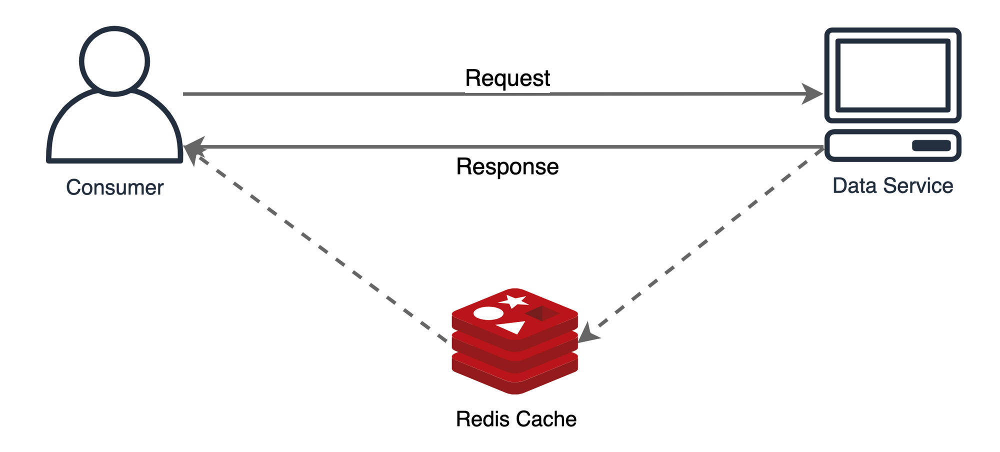
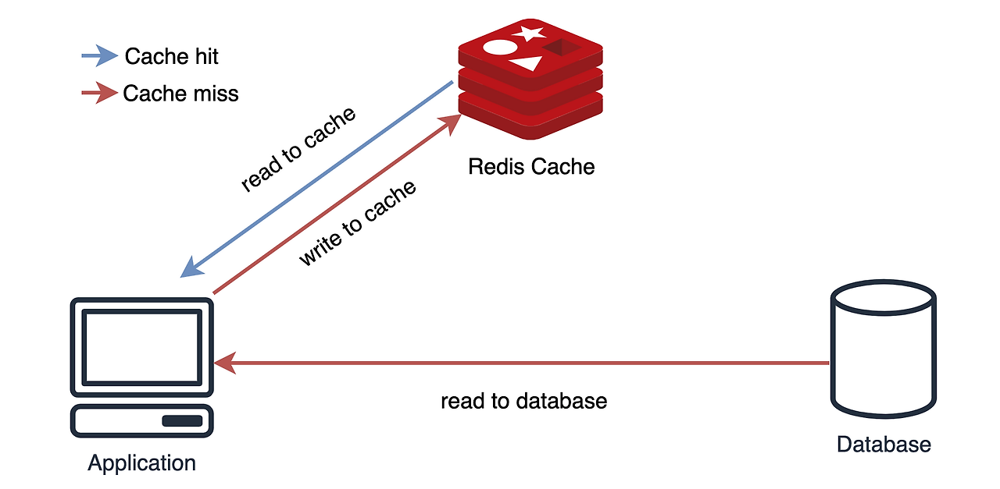
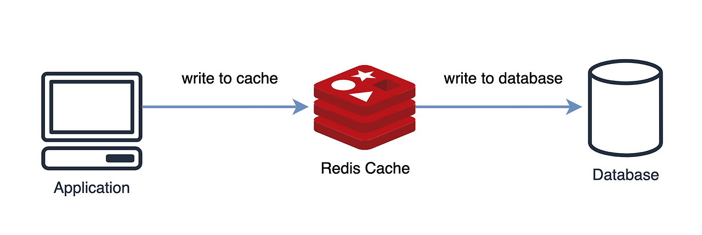
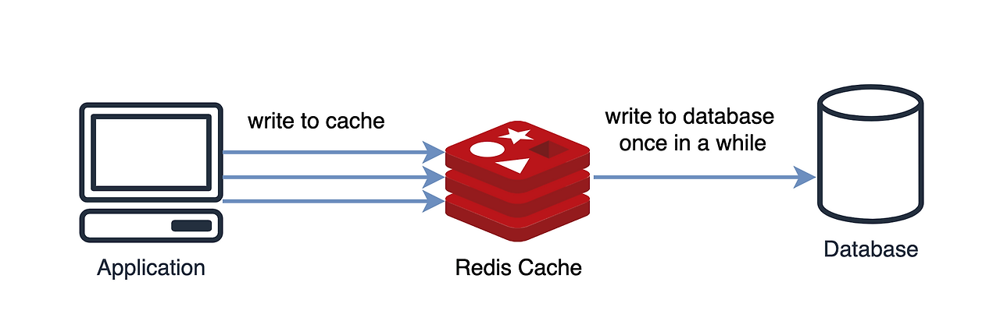

# 레디스와 캐시

### 캐시?

캐시란 데이터의 원본보다 더 빠르고 효율적으로 엑세스할 수 있는 임시 데이터 저장소를 의미한다.



사용자가 동일한 정보를 반복적으로 엑세스할 때 원본이 아니라 캐시에서 데이터를 가져옴으로써 리소스를 줄일 수 있다.

애플리케이션에서 조회되는 데이터 중에 아래 조건들을 만족한다면 캐시 도입을 고려해 보자

1. 원본 데이터 저장소에서 원하는 데이터를 찾기 위해 검색하는 시간이 오래 걸리거나, 매번 계산을 통해 데이터를 가져와야 하는 경우
1. 캐시에서 데이터를 가져오는 것이 원본 데이터 저장소 데이터를 요청하는 것보다 빨라야 한다.
1. 캐시에 저장된 데이터는 잘 변하지 않는 데이터
1. 캐시에 저장된 데이터는 자주 검색되는 데이터

원본 데이터 저장소 데이터를 가지고 오는 시간을 단축시키기 때문에 **애플리케이션의 응답 속도(laytency)**를 줄일 수 있다.

또한 원본 데이터 저장소에서 **데이터를 읽는 커넥션(부하)**를 줄일 수 있다.

### 캐시로서의 레디스

레디스는 다양한 자료 구조를 제공하기 때문에 애플리케이션에서 **사용하던 자료 구조를 변환하는 과정 없이** 레디스에 바로 저장할 수 있다.

레디스는 모든 데이터를 메모리에 저장하는 인메모리 데이터 저장소 → 검색, 반환이 매우 빠르다

관계형 데이터베이스에서는 디스크에 접근해 데이터를 검색해와야 한다.

레디스는 평균 읽기 및 쓰기 작업 속도가 1ms 미만이며, 초당 수백만 건의 작업이 가능하다

캐싱 전략마다 다르지만 캐시에 접근할 수 없게 되면 바로 서비스의 장애 즉, SPOF(Single Point Of Failure)로 작용할 수 있다. 하지만 **레디스는 자체적으로 고가용성(HA) 기능을 가지는 솔루션**이다.

레디스의 센티널, 클러스터 기능을 사용하면 마스터 노드의 장애를 자동으로 감지해 페일오버를 발생시키기 때문에 운영자의 개입 없이 캐시는 정상적으로 유지될 수 있어 가용성이 높아진다.

### 캐싱 전략

레디스를 캐시로 사용할 때 레디스를 어떻게 배치할 것인지에 대해 따라 서비스의 성능에 큰 영향을 끼칠 수 있다.

캐싱 전략은 **캐싱되는 데이터의 유형과 엑세스 패턴에 따라 다르기 때문에 서비스에 맞는 적절한 전략을 선택**하는 것이 중요하다.

### 읽기 전략 - look aside



데이터가 캐시에 있는지 먼저 확인, 캐시에 데이터가 있으면 캐시 히트

캐시 미스가 발생하면 원본 데이터베이스에 접근해 데이터를 가져오고 애플리케이션은 이를 다시 캐시에 저장

찾고자 하는 데이터가 없을 때에만 레디스에 저장되기 때문에 이런 구조를 lazy loading 이라고도 부른다.

**look aside 구조의 장점**은 레디스에 문제가 생겨 접근할 수 없는 상황이 발생하더라도 서비스 장애로 이어지지 않고 데이터베이스에서 데이터를 가지고 올 수 있다는 것이다.

하지만 기존에 애플리케이션에서 레디스를 통해 가져오는 연결이 매우 많았다면, 모든 커넥션이 한꺼번에 원본 데이터베이스로 몰려 많은 부하를 발생시키고, 이로 인해 원본 데이터베이스의 응답이 느려지거나 장애로 이어지는 상황이 발생할 수 있다.

이런 상황을 예방하기 위해서 미리 데이터베이스에서 캐시로 데이터를 밀어넣어주는 작업을 하기도 하는데, 이를 **캐시 워밍(cache warming)**이라고 한다.

### 쓰기 전략과 캐시의 일관성

데이터가 변경될 때 원본 데이터베이스에만 또는 캐시에만 업데데이트 된다면 데이터 간 불일치가 일어난다.이트 된다면 데이이트 된ㄷ

이를 **캐시 불일치(cache inconsistency)**라 한다.

### write through



write through 방식은 데이터베이스에 업데이트할 때마다 매번 캐시에도 데이터를 함께 업데이트시키는 방식

캐시는 항상 최신 데이터를 가지고 있을 수 있다는 장점이 있지만, 매번 2개의 저장소에 저장돼야 하기 때문에 데이터를 쓸 때마다 시간이 많이 소요될 수 있다는 단점이 있다.

### cache invalidation

cache invalidation 방식은 데이터베이스에 값을 업데이트할 때마다 캐시에서는 데이터를 삭제하는 전략이다.

저장소에서 특정 데이터를 삭제하는 것이 새로운 데이터를 저장하는 것보다 훨씬 적은 리소스를 사용하는 특징을 적용한 전략이다.

### write behind(write back)



만약 쓰기가 빈번하게 발생하는 서비스라면, write behind 방식을 고려해볼 수 있다.

데이터베이스에 대량의 쓰기 작업이 발생한다면 이는 많은 디스크 I/O를 유발해 성능 저하가 발생할 수 있다.

따라서 먼저 데이터를 빠르게 접근할 수 있는 캐시에 업데이트한 뒤, 이후에는 건수나 특정 시간 가격 등에 따라 비동기적으로 데이터베이스에 업데이트 하는 것이다.

저장되는 데이터가 실시간으로 정확한 데이터가 아니어도 되는 경우 이 방법이 유용할 수 있다.

예를 들어 유투브와 같은 스트리밍 사이트 동영상의 좋아요 수는 매번 실시간 집계가 필요하지 않다.

먼저 레디스에 저장해둔 다음 5분 간격으로 집계해 데이터베이스에 저장하는 과정을 거친다면 데이터베이스의 성능을 향상시킬 수 있다.

물론 이 방법에는 캐시에 문제가 생겨 데이터가 날아갈 경우 최대 5분 동안의 데이터가 날아갈 수 있다는 위험이 있다.

---

# 캐시에서의 데이터 흐름

캐시는 데이터 스토어가 갖고 있는 데이터 중 사용자가 자주 사용할 만한 데이터를 갖고 와서 임시로 저장하는 저장소다.

**레디스(캐시)는 데이터 스토어보다 적은 양을 보관하고 있는 데이터베이스의 서브넷**이라 볼 수 있다.

캐시로 레디스를 사용할 때에는 데이터를 저장함과 동시에 적절한 시간의 TTL 값을 지정하는 것이 좋다.

### 만료 시간(TTL, Time To Live)

만료 시간은 일반적으로 초 단위로 표현되며, 특정 키에 대한 만료 시간이 설정되면 해당 키와 관련된 데이터는 지정된 시간이 지난 후에 레디스에서 자동으로 삭제된다.

이를 통해 키에 만료 시간을 설정하면 데이터의 수명을 관리하고 메모리 공간을 효율적으로 사용하는 데 도움을 준다.

레디스에 저장된 키에 **EXPIRE 커맨드**를 사용하면 만료 시간을 설정할 수 있다.

SET 커맨드로 string 데이터를 저장할 때에는 **EX 옵션**을 함께 사용해 데이터의 저장과 동시에 만료 시간을 설정

**TTL 커맨드**를 사용하면 키에 대한 만료 시간을 확인할 수 있다.

- 키가 존재 X: -2
- 만료 시간이 없는 경우: -1
- 만료 시간이 있는 경우: 남은 시간

PTTL, PEXPIRE 커맨드는 → 밀리세컨드 단위로 동작한다.

```
> SET a 100
OK
> EXPIRE a 60
(integer) 1
> TTL a
(integer) 58
```

INCR, RENAME 같은 커맨드로 데이터를 조작하거나 키의 이름을 바꾸더라도 만료 시간은 변경되지 않는다.

```
> SET a 100 EX 70
OK
> TTL a
(integer) 64
> INCR a
(integer) 101
> TTL a
(integer) 60
> RENAME a apple
OK
> TTL apple
(integer) 49
```

기존 키에 새로운 값을 저장해 키를 덮어 쓸 때에는 이전에 설정한 만료 시간은 유지되지 않고 사라진다.

```
> SET b 100 EX 60
OK
> TTL b
(integer) 55
> SET b banana
OK
> TTL b
(integer) -1
```

### 레디스 키 만료 시 동작 방식

**레디스에서 키가 만료됐다고 해도 메모리에서 바로 삭제되는 것은 아니다.**

키는 passive 방식, active 방식 두 가지로 삭제된다.

**passive 방식**

```
클라이언트가 키에 접근하고자 할 때 키가 만료됐다면 메모리에서 수동적으로 삭제한다.
사용자가 접근할 때에만 수동적으로 삭제되기 때문에 이를 passive 방식의 만료라 한다.
그러나 사용자가 접근하지 않는 만료된 키도 있어 이 방식으로는 충분하지 않다.
```

**active 방식**

```
TTL 값이 있는 키 중 20개를 랜덤으로 뽑아낸 뒤, 만료된 키를 모두 메모리에서 삭제한다.
만약 25% 이상의 키가 삭제됐다면 다시 20개의 키를 랜덤하게 뽑은 뒤 확인하고, 
아니라면 뽑아놓은 20개의 키 집합에서 다시 확인한다.
이런 과정을 1초에 10번씩 수행한다.
```

만료된 키를 곧바로 삭제하지 않기 때문에 키를 삭제하는 데에 들어가는 리소스를 줄일 수 있지만, 그만큼 메모리를 더 사용할 가능성이 존재한다. 최악의 경우 전체 메모리의 1/4는 이미 만료된 키 값일 수 있다.

### 메모리 관리와 maxmemory-policy 설정

레디스의 메모리는 제한적이기 때문에 모든 키에 만료 시간을 설정하더라도 너무 많은 키가 저장되면 메모리가 가득 차는 상황이 발생할 수 있다.

**메모리의 용량을 초과하는 양의 데이터가 저장되면 레디스는 내부 정책을 사용해 어떤 키를 삭제할지 결정한다.**

레디스에서는 데이터의 최대 용량을 설정하는 **maxmemory** 설정과 이 용량을 초과할 때의 처리 방식을 결정하는 **maxmemory-policy** 설정값을 사용해 메모리를 관리한다.

### Noeviction

**기본값은 noeviction 이다.**

이 값은 레디스에 데이터가 가득 차더라도 임의로 **데이터를 삭제하지 않고 더 이상 레디스에 데이터를 저장할 수 없다는 에러를 반환하는 설정**값이다.

### LRU(Least Recent Used) eviction

레디스에 데이터가 가득 찼을 때 **가장 최근에 사용되지 않는 데이터부터 삭제하는 정책**이다.

캐시는 나중에 사용될 가능성이 있는 데이터를 유지하는 것을 목표로 하기 때문에 효율적인 메모리 관리 방법이다.

**volatile-lru**

```
만료 시간이 설정돼 있는 키에 한해서 LRU 방식으로 키를 삭제한다.
만약 레디스 내부에 저장된 키에 모두 만료 시간이 지정돼 있지 않다면 이는 noeviction 상황과 동일하다.
```

**allkeys-lru**

```
모든 키에 대해 LRU 알고리즘을 이용해 데이터를 삭제하기 때문에 메모리가 꽉 찼을 때 
장애가 발생할 상황은 방지할 수 있다.
```

### LFU(Least Frequently Used) eviction

레디스에 데이터가 가득 찼을 때 **가장 자주 사용되지 않는 데이터부터 삭제하는 정책**이다.

자주 사용되지 않는 데이터는 나중에도 엑세스될 가능성이 낮을 것이라는 가정을 전제하고 있다.

**volatile-lfu, allkeys-lfu**

### RANDOM eviction

레디스에 **저장된 키 중 하나를 임의로 골라내 삭제**한다.

알고리즘을 사용하지 않기 때문에 레디스의 부하를 줄여줄 수 있는 방법이다.

**volatile-random, allkeys-random**

### volatile-ttl

**만료 시간이 가장 작은 키를 삭제한다.** 즉, 삭제 예정 시간이 얼마 남지 않은 키를 추출해 해당 키를 미리 삭제하는 옵션이다.

### 캐시 스탬피드 현상(cache stampede, cascading failure)

여러 개의 애플리케이션에서 바라보던 키가 레디스에서 만료돼 삭제된다면 이 서버들은 한꺼번에 데이터베이스에 가서 데이터를 읽어오는 과정을 거친다. 이를 중복 읽기라 한다.

이후 각 애플리케이션은 읽어온 데이터를 레디스에 쓰게 되는데, 이 또한 여러 번 반복되기 떄문에 중복 쓰기가 발생한다.

보통 정렬이나 카운팅처럼 데이터베이스에서 쿼리하는 데 오래 걸리는 작업을 미리 계산해서 캐싱해두기 때문에 만약 중복 읽기(duplicate read)작업이 발생하면 데이터베이스에 큰 부하를 줄 수 있으며, 이는 곧 서비스 이슈로도 이어질 수 있다.

### 캐시 스탬피드 현상을 막을려면

선 계산 방식을 사용한다.

먼저 TTL을 적절하게 잡아두고 애플리케이션에서 주기적으로 캐시의 데이터 만료 시간을 확인하고, 데이터베이스에 접근해서 데이터를 읽어와 캐시의 값과 TTL을 갱신한다.

즉, 일종의 웜업 방식을 사용한다.

---

