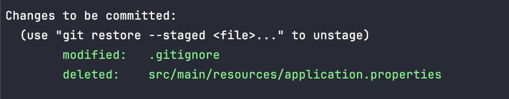

### **application.yml**

```yaml
aws:
  access-key: abcdef
  secret-key: abcref
```

### **git status**


- 현재 .gitignore 에 추가했지만 여전히 Git에서 추적되고 있다.

### **git 캐시 제거** 

```yaml
git rm -r --cached .
```

- .을 사용하면 모든 파일을 캐시에서 제거하지만, 로컬 파일은 유지 

### **git status** 



- deleted

### **Github에 resources 폴더가 push 되도록 임의의 파일 하나 만들어주기**

- **src/main/resources/empty.txt**

### **Gitbub Actions 코드 수정하기**

- **.github/workflows/deploy.yml**

```yaml
name: Deploy to EC2

on:
  push:
    branches:
      - main

jobs:
  deploy:
    runs-on: ubuntu-latest
    steps:
      - name: SSH 사용하여 EC2 접속 및 배포
        uses: appleboy/ssh-action@v1.0.3
        env:
          APPLICATION_PROPERTIES: ${{ secrets.APPLICATION_PROPERTIES }}
        with:
          host: ${{ secrets.EC2_HOST }} # EC2의 주소
          username: ${{ secrets.EC2_USERNAME }} # EC2 접속 username
          key: ${{ secrets.EC2_PRIVATE_KEY }} # EC2의 Key 파일
          envs: APPLICATION_PROPERTIES
          script_stop: true # 실패하면 전체 실패 처리
          script: |
            cd /home/ubuntu/CI-CD-study
            
            rm -rf src/main/resources/application.yml
            
            # 최신 코드 가져오기
            git pull origin main 
            
            echo "$APPLICATION_PROPERTIES" > src/main/resources/application.yml
            
            # 프로젝트 빌드
            ./gradlew clean build 
            
            # 실행 중인 애플리케이션 종료 (서버가 실행 중이 아니어도 에러 없이 통과)
            sudo fuser -k -n tcp 8080 || true
            
            # 종료 대기 (3초)
            sleep 3
            
             # *SNAPSHOT.jar 끝나는 빌드 파일로 애플리케이션 실행 output.log 로그 기록 
            nohup java -jar build/libs/*SNAPSHOT.jar > ./output.log 2>&1 &
            
            # 배포 완료

```

- GitHub Actions 환경 변수로 등록
```yaml
env:
  APPLICATION_PROPERTIES: ${{ secrets.APPLICATION_PROPERTIES }}
```
- SSH 액션(`appleboy/ssh-action`)에 환경 변수를 전달
```yaml
with:
  envs: APPLICATION_PROPERTIES
```

  - `envs` 키워드를 사용하여 `APPLICATION_PROPERTIES` 환경 변수를 SSH 세션에서도 사용할 수 있도록 설정
  - SSH 내부에서 `$APPLICATION_PROPERTIES`로 접근 가능하게 된다.
- script 활용 
```yaml
 echo "$APPLICATION_PROPERTIES" > src/main/resources/application.yml
```

  - `$APPLICATION_PROPERTIES` 값을 **`src/main/resources/application.yml`** **파일로 저장**하는 역할을 한다.
  - 즉, GitHub Actions의 `secrets`에 저장된 설정 값을 EC2 서버로 전달하여 `application.yml`을 생성하는 방식이다.

### **Github에 Secret 값 넣어주기**


### **실제 EC2에 application.yml 파일도 같이 배포 잘 됐는지 체크하기**


### 결론 

이 방식 덕분에 **민감한 설정 파일을 Git에 직접 올리지 않고**, GitHub Actions와 EC2에서 동적으로 설정 파일을 생성하여 배포할 수 있다.

**물론, 설정 파일이 수정되면 secrets 수정은 수동으로 해줘야 한다.**
