# *개요*

  - *스프링 시큐리티는 다양한 프레임워크 및 API 와의 통합을 제공하고 있으며 Servlet3과 Spring MVC와 통합을 통해 여러 편리한 기능들을 사용할 수 있다*
  - *인증 관련 기능들을 필터가 아닌 서블릿 영역에서 처리할 수 있다*

# ***Servlet 3+ 통합***

  - ***SecurityContextHolderAwareRequestFilter***
- *HTTP 요청이 처리될 때 HttpServletRequest에 보안 관련 메소드를 추가적으로 제공하는* ***래퍼(SecurityContextHolderAwareRequestWrapper)****클래스를 적용한다*
    - *이를 통해 개발자는 서블릿 API 의 보안 메소드를 사용하여 인증, 로그인, 로그아웃 등의 작업을 수행할 수 있다*
  - ***HttpServlet3RequestFactory***
- *Servlet 3 API 와의 통합을 제공하기 위해* ***Servlet3SecurityContextHolderAwareRequestWrapper****객체를 생성한다*
  - ***Servlet3SecurityContextHolderAwareRequestWrapper***
- *HttpServletRequest의 래퍼 클래스로서 Servlet 3.0의 기능을 지원하면서 동시에 SecurityContextHolder와의 통합을 제공한다*
    - *이 래퍼를 사용함으로써 SecurityContext에 쉽게 접근할 수 있고 Servlet 3.0의 비동기 처리와 같은 기능을 사용하는 동안 보안 컨텍스트를 올바르게 관리할 수 있다*

# ***구조 및 API***

*클라이언트 요청 → 서블릿 필터(DelegatingFilterChainProxy) → 서블릿(DispatcherServlet) → 스프링 MVC* 

*DelegatingFilterChainProxy는 단순히 FilterChainProxy에게 요청을 위임* 

*FilterChainProxy에서의 필터중 SeucirtyContextHolderFilter는 HttpServletRequest/Response를 포함한 시큐리티의 중요 객체들을 HttpServlet3RequestFactory에 넘겨준다.  HttpServlet3RequestFactory에서는 해당 정보를 바탕으로 Servlet3SecurityContextHolderAwareRequestWrapper를 생성해서 다음 필터에게 넘겨주어 최종적으로 래핑된 ServletRequest/ServletResponse가 서블릿까지 가게된다.* 

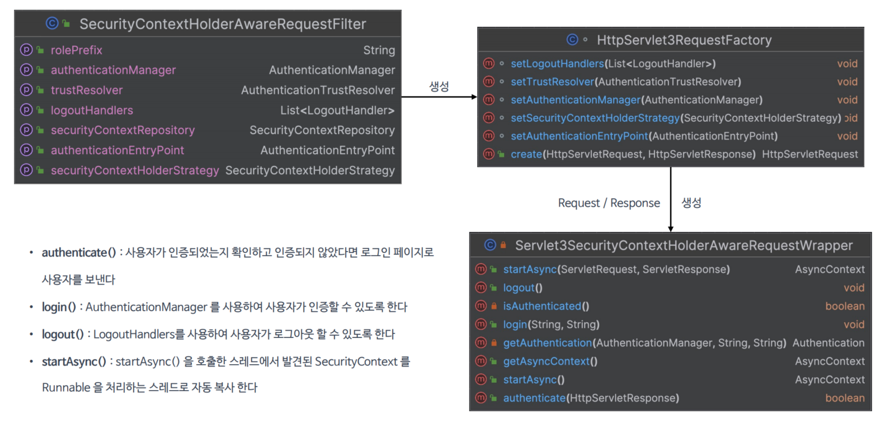

# *코드 구현* 

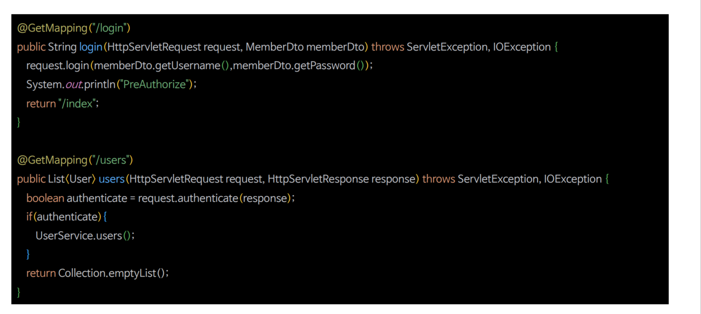

  - *해당 request 객체는 Servlet3SecurityContextHolderAwareRequestWrapper이다.* 
  - *시큐리티 관련 API를 사용이 가능하고 간단한 메소드 호출을 통해 실행된다.* 

# *테스트*

***SecurityConfig***

```java
@EnableWebSecurity
@Configuration
public class SecurityConfig {
    @Bean
    public WebSecurityCustomizer webSecurityCustomizer() {
        return webSecurity -> webSecurity.ignoring().requestMatchers(PathRequest.toStaticResources().atCommonLocations());
    }
    @Bean
    public SecurityFilterChain securityFilterChain(HttpSecurity http) throws Exception {
        http
                .authorizeHttpRequests(authorize -> authorize
                        .requestMatchers("/user").hasAuthority("ROLE_USER")
                        .requestMatchers("/db").hasAuthority("ROLE_DB")
                        .requestMatchers("/admin").hasAuthority("ROLE_ADMIN")
                        .anyRequest().permitAll())
                //.formLogin(Customizer.withDefaults())
                .csrf(AbstractHttpConfigurer::disable);

        return http.build();
    }
    @Bean
    public UserDetailsService userDetailsService(){
        UserDetails user = User.withUsername("user").password("{noop}1111").roles("USER").build();
        UserDetails db = User.withUsername("db").password("{noop}1111").authorities("ROLE_DB").build();
        UserDetails admin = User.withUsername("admin").password("{noop}1111").roles("ADMIN","SECURE").build();
        return  new InMemoryUserDetailsManager(user, db, admin);
    }
}
```

***MemberDto***

```java
@Data
@AllArgsConstructor
public class MemberDto {
    private String username;
    private String password;
}
```

***IndexController***

```java
@RestController
public class IndexController {
    @GetMapping("/")
    public String index(HttpServletRequest request){
        return "index";
    }
    @GetMapping("/user")
    public String user(){
        return "user";
    }
    @GetMapping("/db")
    public String db(){
        return "db";
    }
    @GetMapping("/admin")
    public String admin(){
        return "admin";
    }

    @GetMapping("/login")
    public String login(HttpServletRequest request, MemberDto memberDto) throws ServletException, IOException {
        request.login(memberDto.getUsername(), memberDto.getPassword());
        System.out.println("login is successful");
        return "login";
    }
    @GetMapping("/users")
    public List<MemberDto> users(HttpServletRequest request, HttpServletResponse response) throws ServletException, IOException {
        boolean authenticate = request.authenticate(response);
        if (authenticate) {
            return List.of(new MemberDto("user","1111"));
        }
        return Collections.emptyList();
    }
}
```

*단순하게 시큐리티 필터에서 하던 인증 인가 프로세스가 ServletRequest Wrapper 클래스의API로 진행된다.*

# ***개요***

  - *Spring Security는 Spring MVC 인수에 대한 현재 Authentication.getPrincipal()을 자동으로 해결 할 수 있는* ***AuthenticationPrincipalArgumentResolver*** *를 제공한다*
  - *Spring MVC 에서 @AuthenticationPrincipal 을 메서드 인수에 선언하게 되면 Spring Security 와 독립적으로 사용할 수 있다*

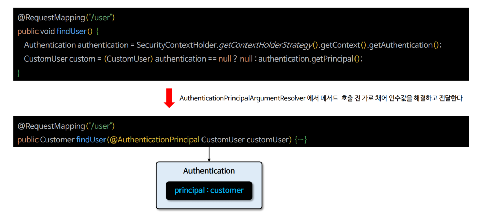

  - *Authentication.getPrincipal()*

# ***@AuthenticationPrincipal(expression="표현식")***

  - Principal 객체 내부에서 특정 필드나 메서드에 접근하고자 할 때 사용할 수 있으며 사용자 세부 정보가 Principal 내부의 중첩된 객체에 있는 경우 유용하다
- Principal == UserDetails

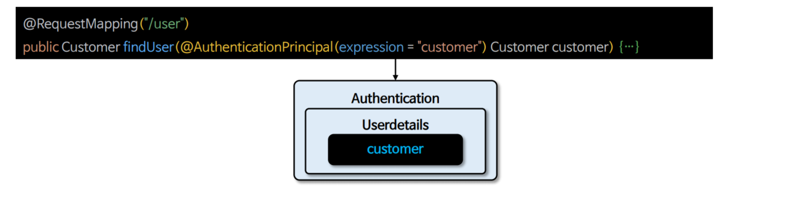

# ***@AuthenticationPrincipal 메타 주석***

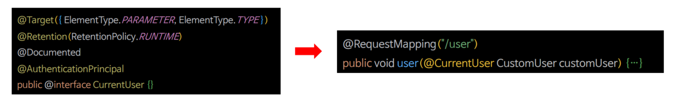

  - *@AuthenticationPrincipal을 자체 주석으로 메타 주석화 하여 Spring Security에 대한 종속성을 제거할 수도 있다*

***나의 의문점***

```java
*@AuthenticationPrincipal을 자체 주석으로 메타 주석화 하여 
Spring Security에 대한 종속성을 제거할 수도 있다

이게 종속성을 제거하는걸까?

종속성 제거보단 의존성을 감추는 캡슐화 효과가 아닐까 싶다*
```

# *테스트*

```java
AuthenticationTrustResolverImpl trustResolver = new AuthenticationTrustResolverImpl();
@GetMapping("/")
public String index(){
    Authentication authentication = SecurityContextHolder.getContextHolderStrategy().getContext().getAuthentication();
    return trustResolver.isAnonymous(authentication) ? "anonymous":"authenticated";
}
```

  - *`AuthenticationTrustResolverImpl`* 
- *Authentication 객체가 어떤 객체인지 알 수 있는 API를 제공한다.* 
    - *isAnonymous → 익명 사용자인지 boolean return*

```java
@GetMapping("/user2")
public User user2(@AuthenticationPrincipal User user){
    return user;
}
```

  - *스프링 시큐리티가 제공하는 UserDetails 구현체인 User를*  *`@AuthenticationPrincipal`* *통해서 가져왔다.*
  - *이는 Authentication.getPrincipal()과 동일하다.*
  - ***AuthenticationPrincipalArgumentResolver:*** *매개변수에* *`@AuthenticationPrincipal`* *있는지 판별해서 있으면  Authentication.getPrincipal() 통해 가져온다.* 

```java
@GetMapping("/username")
public String username(@AuthenticationPrincipal(expression = "username") String username){
    return username;
}
```

  - *expression을 통해서 UserDetails(User) 객체에 있는 필드를 가져올 수 있다.*

```java
@Target({ ElementType.PARAMETER, ElementType.TYPE })
@Retention(RetentionPolicy.RUNTIME)
@Documented
@AuthenticationPrincipal
public @interface CurrentUser {
}

@GetMapping("/user3")
public User user3(@CurrentUser User user){
    return user;
}
```

  - *메타 주석을 활용*  
  - *결과는 @AuthenticationPrincipal 단독 사용과 동일*

```java
@Target({ ElementType.PARAMETER, ElementType.TYPE })
@Retention(RetentionPolicy.RUNTIME)
@Documented
@AuthenticationPrincipal(expression = "#this == 'anonymousUser' ? null : username")
public @interface CurrentUserName {
}

@GetMapping("/username2")
public String username2(@CurrentUserName String username){
    return username;
}
```

  - *@AuthenticationPrincipal(expression = "#this == 'anonymousUser' ? null : username")*
- *여기서 this는 UserDetails를 말한다.* 
    - *만약 익명 사용자면 null 반환*
    - *인증된 사용자면 username 반환한다.*

# ***개요***

  - *Spring Security는 Spring MVC Controller에서 Callable을 실행하는 비동기 스레드에 SecurityContext를 자동으로 설정하도록 지원한다*
  - *Spring Security는 WebAsyncManager와 통합하여 SecurityContextHolder에서 사용 가능한 SecurityContext를 Callable 에서 접근 가능하도록 해 준다*

***What is Collable & 비동기 스레드 ?***

[https://20240228.tistory.com/307](https://20240228.tistory.com/307)

***SpringSecurty - SecurityContextHolder 기본전략***  


  - *기본은* *`MODE_THREADLOCAL`**이다.*
  - *따라서 부모 스레드가 비동기 스레드를 생성하면 해당 비동기 스레드 즉, 자식 스레드에는 SecurityContext가 저장되지 않는다.* 
  - *하지만 스프링 시큐리티는 Callable을 반환하면 자식 스레드의 스레드 로컬에 SecurityContext를 저장한다.*  

# ***WebAsyncManagerIntegrationFilter***

  - *SecurityContext와 WebAsyncManager사이의 통합을 제공하며 WebAsyncManager를 생성하고 SecurityContextCallableProcessingInterceptor를 WebAsyncManager에 등록한다*

# ***WebAsyncManager***

  - *스레드 풀의 비동기 스레드를 생성하고 Callable 를 받아 실행시키는 주체로서 등록된 SecurityContextCallableProcessingInterceptor를 통해 현재 스레드가 보유하고 있는 SecurityContext 객체를 비동기 스레드의 ThreadLocal에 저장시킨다*

# ***코드 구현***

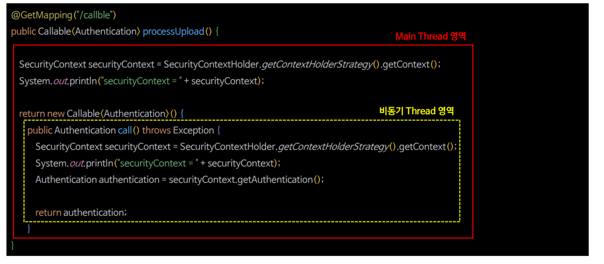

  - *비동기 스레드가 수행하는 Callable 영역 내에서 자신의 ThreadLocal에 저장된 SecurityContext 를 참조할 수 있으며 이는 부모 스레드가 가지고 있는 SecurityContext와 동일한 객체이다*
  - ***@Async***나 다른 비동기 기술은 스프링 시큐리티와 통합되어 있지 않기 때문에 비동기 스레드에 SecurityContext 가 적용되지 않는다
- *@Async에 SecurityContext를 적용하려면* ***SecurityContextHolder*** *전략을 MODE_INHERITABLETHREADLOCAL 사용해야 한다.*

***What is @Async?***

[https://velog.io/@gillog/Spring-Async-Annotation%EB%B9%84%EB%8F%99%EA%B8%B0-%EB%A9%94%EC%86%8C%EB%93%9C-%EC%82%AC%EC%9A%A9%ED%95%98%EA%B8%B0](https://velog.io/@gillog/Spring-Async-Annotation%EB%B9%84%EB%8F%99%EA%B8%B0-%EB%A9%94%EC%86%8C%EB%93%9C-%EC%82%AC%EC%9A%A9%ED%95%98%EA%B8%B0)

# ***흐름도***

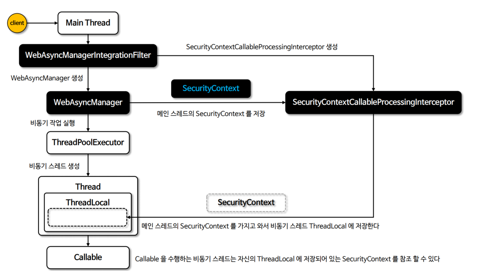

# ***테스트 개요*** 

***1. Callable + MODE_THREADLOCAL***

***2. @Async + MODE_THREADLOCAL***

***3. @Async + MODE_INHERITABLETHREADLOCAL*** 

# ***테스트1***

***SecurityConfig***

```java
@EnableWebSecurity
@Configuration
public class SecurityConfig {
    @Bean
    public WebSecurityCustomizer webSecurityCustomizer() {
        return webSecurity -> webSecurity.ignoring().requestMatchers(PathRequest.toStaticResources().atCommonLocations());
    }
    @Bean
    public SecurityFilterChain securityFilterChain(HttpSecurity http) throws Exception {
        http
                .authorizeHttpRequests(authorize -> authorize
                        .requestMatchers("/user").hasAuthority("ROLE_USER")
                        .requestMatchers("/db").hasAuthority("ROLE_DB")
                        .requestMatchers("/admin").hasAuthority("ROLE_ADMIN")
                        .anyRequest().permitAll())
                .formLogin(Customizer.withDefaults())
                .csrf(AbstractHttpConfigurer::disable);

        SecurityContextHolder.setStrategyName(SecurityContextHolder.MODE_THREADLOCAL);

        return http.build();
    }
    @Bean
    public UserDetailsService userDetailsService(){
        UserDetails user = User.withUsername("user").password("{noop}1111").roles("USER").build();
        UserDetails db = User.withUsername("db").password("{noop}1111").authorities("ROLE_DB").build();
        UserDetails admin = User.withUsername("admin").password("{noop}1111").roles("ADMIN","SECURE").build();
        return  new InMemoryUserDetailsManager(user, db, admin);
    }
}
```

  - `SecurityContextHolder.setStrategyName(SecurityContextHolder.MODE_THREADLOCAL)` 
- default

***IndexController***

```java
@Slf4j
@RestController
public class IndexController {
    @GetMapping("/")
    public Callable<Authentication> index(){
        Authentication authentication = SecurityContextHolder.getContextHolderStrategy().getContext().getAuthentication();
        log.info("currentThread={}", Thread.currentThread().getName());
        log.info("authentication={}", authentication);
        return () -> {
            Authentication auth = SecurityContextHolder.getContextHolderStrategy().getContext().getAuthentication();
            log.info("currentThread={}", Thread.currentThread().getName());
            log.info("authentication={}", auth);
            return auth;
        };
    }
    @GetMapping("/user")
    public String user(){
        return "user";
    }
}
```

  1. *Anoymous 즉, 로그인을 하지 않고 루트 경로 접근*

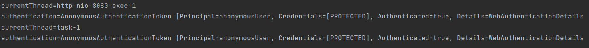

*2. ROLE_USER 권한으로 접근*

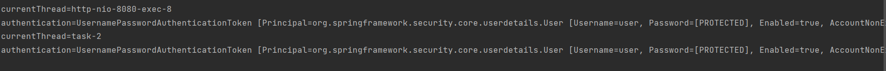

*비동기 스레드인 task - xx에도 Authentication이 정상적으로 들어간다.*

# ***테스트2***

***SecurityApplication***

```java
@SpringBootApplication
@EnableAsync
public class SecurityApplication {
	public static void main(String[] args) {
		SpringApplication.run(SecurityApplication.class, args);
	}
}
```

  - *@EnableAsync 추가* 

***SecurityConfig*** *설정 그대로 → SecurityContextHolder strategy* ***THREAD_LOCAL***

***IndexController, AyncService***

```java
@Slf4j
@RestController
@RequiredArgsConstructor
public class IndexController {
    private final AsyncService asyncService;
    @GetMapping("/")
    public String index(){
        Authentication authentication = SecurityContextHolder.getContextHolderStrategy().getContext().getAuthentication();
        log.info("currentThread={}", Thread.currentThread().getName());
        log.info("authentication={}", authentication);
        asyncService.async();
        return "index";
    }
    @GetMapping("/user")
    public String user(){
        return "user";
    }
}

@Service
@Slf4j
public class AsyncService {
    @Async
    public void async(){
        Authentication authentication = SecurityContextHolder.getContextHolderStrategy().getContext().getAuthentication();
        log.info("currentThread={}", Thread.currentThread().getName());
        log.info("authentication={}", authentication);
    }
}
```

  1. *Anoymous 즉, 로그인을 하지 않고 루트 경로 접근*

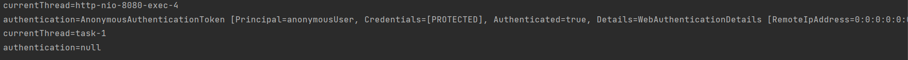

  1. *ROLE_USER 권한으로 접근*

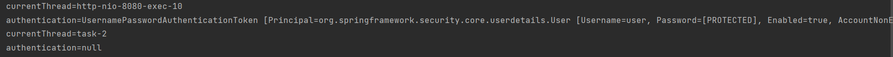

*비동기 스레드인 task - xx에 Authentication이 null로 나온다.*

# ***테스트3***

*테스트2에서 SecurityConfig만 수정* 

```java
@Bean
public SecurityFilterChain securityFilterChain(HttpSecurity http) throws Exception {
    http
            .authorizeHttpRequests(authorize -> authorize
                    .requestMatchers("/user").hasAuthority("ROLE_USER")
                    .requestMatchers("/db").hasAuthority("ROLE_DB")
                    .requestMatchers("/admin").hasAuthority("ROLE_ADMIN")
                    .anyRequest().permitAll())
            .formLogin(Customizer.withDefaults())
            .csrf(AbstractHttpConfigurer::disable);

    SecurityContextHolder.setStrategyName(SecurityContextHolder.MODE_INHERITABLETHREADLOCAL);

    return http.build();
}
```

  - *SecurityContextHolder.setStrategyName(SecurityContextHolder.MODE_INHERITABLETHREADLOCAL);*
  - *MODE_THREADLOCAL → MODE_INHERITABLETHREADLOCAL*
  1. *Anoymous 즉, 로그인을 하지 않고 루트 경로 접근*

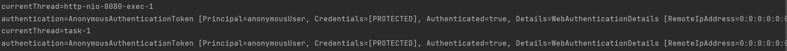

  1. *ROLE_USER 권한으로 접근*

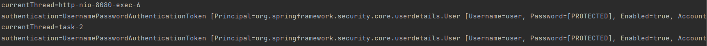

*비동기 스레드인 task - xx에도 Authentication이 정상적으로 들어간다.*

# **정리**

*SpringSecurity + SpringMVC 프레임워크를 사용하고 비동기 프로그래밍을 한다고 하면* 

*@Aysnc 애노테이션을 사용할 때 자식 스레드(비동기 스레드)에 인증 객체(Authentication)이 필요하면 MODE_INHERITABLETHREADLOCAL을 사용하자 또는 Callable 반환을 하자*

