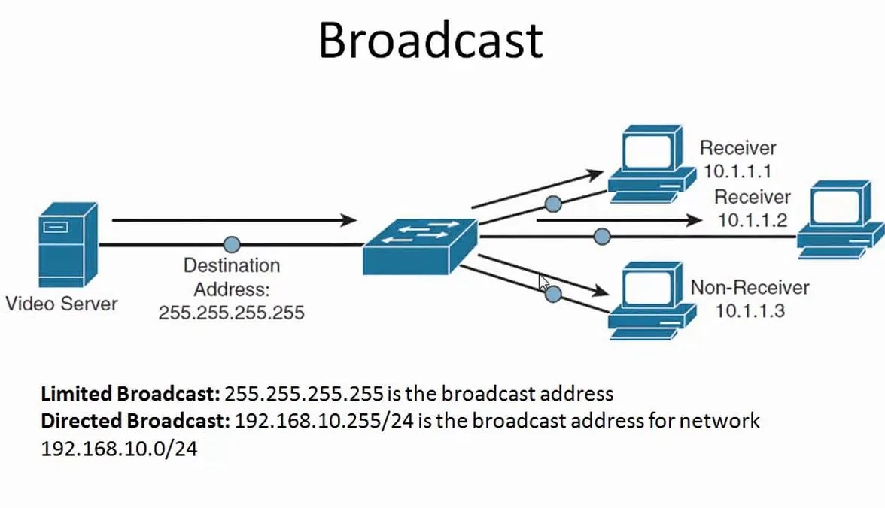

### 브로드캐스트

라디오나 TV는 일방적으로 신호를 보내기 때문에 시청자와 상호작용하지 않는다.

일방적으로 신호를 보낸다고 해서 브로드캐스트라고 하는데, 이러한 개념이 컴퓨터에도 있다.

**브로드캐스트(Broadcast)는 같은 네트워크에 속한 모든 컴퓨터에게 데이터를 전달한다.**

수신자 입장에서는 내가 원하지 않더라도 일방적으로 보내는 정보를 받아야 한다.

그래서 데이터를 수신하는 컴퓨터는 그 정보가 필요한지 판단해야 하는 번거로움이 있다.

---

### 유니캐스트 

**유니캐스트(Unicast)는 1:1 통신이다.**

같은 네트워크에 여러 대의 컴퓨터가 있을 때 특정한 1대의 컴퓨터에만 데이터를 보내고자 한다면 상대방의 MAC 주소를 통해 보내면된다. 그래서 상대방의 MAC 주소를 알아야 유니캐스트로 통신이 가능하다.

---

### 멀티캐스트

**멀티캐스트는 브로드캐스트 + 유니캐스트 방식이다.**

같은 네트워크에서 데이터를 보내고 싶은 컴퓨터가 1대라면 상대방의 MAC 주소를 확인하는 것은 어렵지 않을 것이다. 하지만 그 대상이 2대 이상이면 상당히 번거롭다. 이때 사용하는 방식이 멀티캐스트이다.

**멀티캐스트(Multicast)는 특정 그룹을 지정해서 그 그룹에 해당하는 컴퓨터에게만 데이터를 보내는 방식이다.**

---

