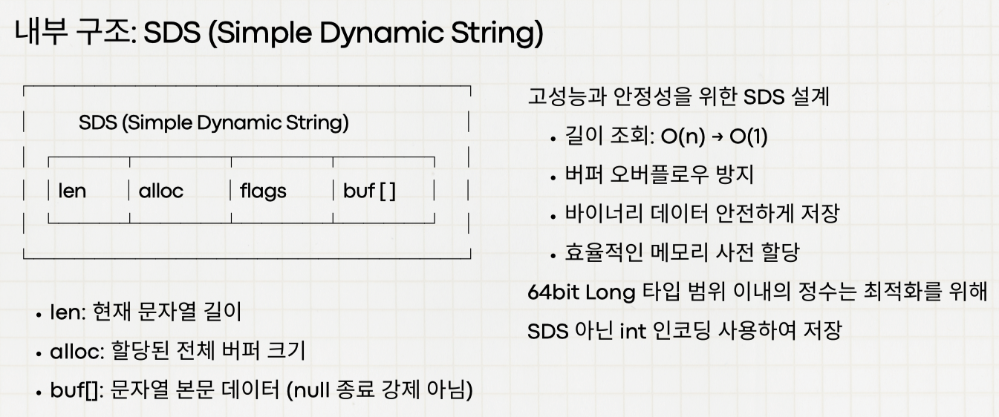
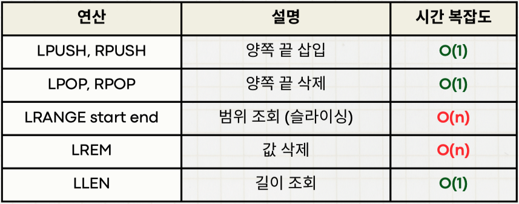

# 레디스의 자료 구조

## String

**SET, GET, NX 옵션** 

```bash
127.0.0.1:6379> SET hello world
OK
127.0.0.1:6379> GET hello
"world"
127.0.0.1:6379> SETNX hello world2
(integer) 0
127.0.0.1:6379> GET hello
"world"
```

SET + NX: 지정한 키가 없을 때에만 새로운 키를 저장

**INCR, INCRBY** 

```bash
127.0.0.1:6379> SET counter 100
OK
127.0.0.1:6379> INCR counter
(integer) 101
127.0.0.1:6379> INCRBY counter 50
(integer) 151
127.0.0.1:6379> INCRBY counter -50
(integer) 101
```

- **DECR, DECRBY:** 감소

**MSET, MGET**

```bash
127.0.0.1:6379> MSET a 10 b 20 c 30
OK
127.0.0.1:6379> MGET a b c
1) "10"
2) "20"
3) "30"
```

- MSET, MGET 같은 커맨드를 적절하게 사용해 RTT 시간을 줄인다면 응답 속도를 향상시킬 수 있다.



---

## List

LPUSH, RPUSH, LRANGE

```bash
127.0.0.1:6379> LPUSH list E
(integer) 1
127.0.0.1:6379> RPUSH list B
(integer) 2
127.0.0.1:6379> LRANGE list 0 -1
1) "E"
2) "B"
127.0.0.1:6379> LPUSH list A B C D E
(integer) 7
127.0.0.1:6379> LRANGE list 0 -1
1) "E"
2) "D"
3) "C"
4) "B"
5) "A"
6) "E"
7) "B"
```

LPOP

```bash
127.0.0.1:6379> LRANGE list 0 -1
1) "E"
2) "D"
3) "C"
4) "B"
5) "A"
6) "E"
7) "B"

127.0.0.1:6379> LPOP list
"E"
127.0.0.1:6379> LPOP list 2
1) "D"
2) "C"
```

- 저장된 아이템 반환과 동시에 삭제

LTRIM

```bash
127.0.0.1:6379> LRANGE list 0 -1
1) "B"
2) "A"
3) "E"
4) "B"
127.0.0.1:6379> LTRIM list 0 1
OK
127.0.0.1:6379> LRANGE list 0 -1
1) "B"
2) "A"
```

- LPOP과 다르게 삭제된 아이템을 반환하지 않는다.
- begin, end 인덱스 모두 포함
- 고정된 길이의 큐를 유지하는 경우에 자주 사용



LINSERT(AFTER, BEFORE 옵션)

```bash
127.0.0.1:6379> LPUSH list A B C
(integer) 3
127.0.0.1:6379> LRANGE list 0 -1
1) "C"
2) "B"
3) "A"
127.0.0.1:6379> LINSERT list AFTER A Z
(integer) 4
127.0.0.1:6379> LRANGE list 0 -1
1) "C"
2) "B"
3) "A"
4) "Z"
127.0.0.1:6379> LINSERT list BEFORE C D
(integer) 5
127.0.0.1:6379> LRANGE list 0 -1
1) "D"
2) "C"
3) "B"
4) "A"
5) "Z"
```

- 특정 아이템 앞이나 뒤에 아이템 추가

LINDEX

```bash
127.0.0.1:6379> LRANGE list 0 -1
1) "D"
2) "C"
3) "B"
4) "A"
5) "Z"
127.0.0.1:6379> LINDEX list 1
"C"
```

- 인덱스에 해당하는 아이템 조회

LSET

```bash
127.0.0.1:6379> LRANGE list 0 -1
1) "D"
2) "C"
3) "B"
4) "A"
5) "Z"
127.0.0.1:6379> LSET list 2 W
OK
127.0.0.1:6379> LRANGE list 0 -1
1) "D"
2) "C"
3) "W"
4) "A"
5) "Z"
```

- 지정한 인덱스에 신규 데이터를 입력
- 만약 범위를 벗어난 인덱스를 입력하면 에러를 반환한다.

---

## Hash

필드-값 쌍을 가지는 아이템 집합

HSET, HGET, HGETALL

```bash
127.0.0.1:6379> HSET user name baejeu age 28 email baejeu@naver.com
(integer) 3
127.0.0.1:6379> HGET user name
"baejeu"
127.0.0.1:6379> HGETALL user
1) "name"
2) "baejeu"
3) "age"
4) "28"
5) "email"
6) "baejeu@naver.com"
```

---

## Set

SADD, SMEMBERS

```bash
127.0.0.1:6379> SADD set A
(integer) 1
127.0.0.1:6379> SADD set A A A B B B C C C
(integer) 2
127.0.0.1:6379> SMEMBERS set
1) "A"
2) "B"
3) "C"
```

SPOP, SREM

```bash
127.0.0.1:6379> SPOP set
"A"
127.0.0.1:6379> SREM set A
(integer) 0
127.0.0.1:6379> SREM set B
(integer) 1
```

- SPOP: 랜덤으로 하나의 아이템 반환 및 삭제 

SUNION, SINTER, SDIFF

```bash
127.0.0.1:6379> SADD set1 A B C
(integer) 3
127.0.0.1:6379> SADD set2 B C D
(integer) 3

127.0.0.1:6379> SUNION set1 set2
1) "A"
2) "B"
3) "D"
4) "C"
127.0.0.1:6379> SINTER set1 set2
1) "B"
2) "C"
127.0.0.1:6379> SDIFF set1 set2
1) "A"
127.0.0.1:6379> SDIFF set2 set1
1) "D"
```

- SUNION: 합집합
- SINTER: 교집합
- SDIFF: 차집합

---

## Sorted Set

스코어 값에 따라 정렬되는 고유한 문자열의 집합

같은 스코어를 가진 아이템은 데이터의 사전 순으로 정렬돼 저장된다.

ZADD

```bash
127.0.0.1:6379> ZADD rank 100 user:A
(integer) 1
127.0.0.1:6379> ZADD rank 200 user:B
(integer) 1
```

- KEY, SCORE, VALUE 순서대로 입력
- 만약 이미 sorted set에 있다면 스코어만 업데이트된다.

ZADD 옵션 

- **XX:** 아이템이 이미 존재할 때에만 스코어를 업데이트한다.
- **NX:** 아이템이 존재하지 않을 때에만 신규 삽입하며, 기존 아이템의 스코어를 업데이트하지 않는다.
- **LT:** 업데이트하고자 하는 스코어가 기존 아이템의 스코어보다 작을 때에만 업데이트한다.
- **GT:** 업데이트하고자 하는 스코어가 기존 아에팀의 스코어보다 클 때에만 업데이트한다.

ZRANGE, ZREVRANGE

```bash
127.0.0.1:6379> ZRANGE rank 0 -1
1) "user:A"
2) "user:B"

127.0.0.1:6379> ZRANGE rank 0 -1 WITHSCORES
1) "user:A"
2) "100"
3) "user:B"
4) "200"

127.0.0.1:6379> ZREVRANGE rank 0 -1 WITHSCORES
1) "user:B"
2) "200"
3) "user:A"
4) "100"
```

- start, stop 범위로 조회
- ZREVRANGE 또는 REV 옵션 추가 내림차순 조회

**스코어를 통한 조회**

```bash
127.0.0.1:6379> ZRANGE rank 0 -1 WITHSCORES
 1) "user:A"
 2) "100"
 3) "user:B"
 4) "200"
 5) "user:C"
 6) "300"
 7) "user:D"
 8) "400"
 9) "user:E"
10) "500"

# 100 ~ 250 사이 조회
127.0.0.1:6379> ZRANGE rank 100 250 BYSCORE WITHSCORES
1) "user:A"
2) "100"
3) "user:B"
4) "200"

# 100 초과 250 이하 조회
127.0.0.1:6379> ZRANGE rank (100 250 BYSCORE WITHSCORES
1) "user:B"
2) "200"

# 100 초과 200 미만 조회
127.0.0.1:6379> ZRANGE rank (100 (200 BYSCORE WITHSCORES
(empty array)

# 200 이상 조회
127.0.0.1:6379> ZRANGE rank 200 +inf  BYSCORE WITHSCORES
1) "user:B"
2) "200"
3) "user:C"
4) "300"
5) "user:D"
6) "400"
7) "user:E"
8) "500"

# 200 초과 조회
127.0.0.1:6379> ZRANGE rank (200 +inf BYSCORE WITHSCORES
1) "user:C"
2) "300"
3) "user:D"
4) "400"
5) "user:E"
6) "500"

# 200이하 100이상 역순 조회
127.0.0.1:6379> ZRANGE rank 200 100 BYSCORE WITHSCORES REV
1) "user:B"
2) "200"
3) "user:A"
4) "100"
```

- **BYSCORE:** 스코어로 점수 조회
- “(” 문자를 추가하면 해당 스코어를 포함하지 않는 값만 조회 가능
- **BYSCORE 옵션을 사용하면 ZREVRANGE 커맨더는 사용 불가능하다. 단 REV 옵션은 가능하다.**
- REV 옵션을 사용하면 인자는 최대, 최소 순서이다.

---

## 비트맵, Hyperloglog, Geospatial 

나중에 정리

---

## stream

stream은 **레디스를 메시지 브로커로서 사용**할 수 있게 하는 자료 구조다.

전체적인 구조는 카프카에서 영향을 받아 만들어졌으며, 카프카에서처럼 소비자 그룹 개념을 도입해 데이터를 분산 처리할 수 있는 시스템이다.

stream 자료 구조는 데이터를 계속해서 추가하는 방식(append-only)으로 저장하므로, 실시간 이벤트 혹은 로그성 데이터의 저장을 위해 사용할 수 있다.

자세한 내용은 7장에서 알아보자.

---

# 레디스에서 키를 관리하는 방법

## 키의 자동 생성과 삭제

키의 생성과 삭제는 세 가지 공통적인 규칙을 따른다.

1. **키가 존재하지 않을 때 아이템을 넣으면 아이템을 삽입하기 전에 빈 자료 구조를 생성한다.**
```bash
127.0.0.1:6379> LPUSH list 1 2 3
(integer) 3
127.0.0.1:6379> TYPE list
list
# 이미 존재하는 key list -> string 성공
127.0.0.1:6379> SET list new
OK
127.0.0.1:6379> TYPE list
string
# 이미 존재하는 key string -> list 실패
127.0.0.1:6379> LPUSH list 1 2 3
(error) WRONGTYPE Operation against a key holding the wrong kind of value
```
1. **모든 아이템을 삭제하면 키도 자동으로 삭제된다.(stream 제외)**
```bash
# 아이템 3개 추가
127.0.0.1:6379> LPUSH list 1 2 3
(integer) 3
# 리스트 존재 확인
127.0.0.1:6379> EXISTS list
(integer) 1
# 리스트에서 1개 제거
127.0.0.1:6379> LPOP list
"3"
# 리스트에서 2개 제거
127.0.0.1:6379> LPOP list 2
1) "2"
2) "1"
# 아이템이 없으면 키도 존재하지 않는다.
127.0.0.1:6379> EXISTS list
(integer) 0
```
1. **키가 없는 상태에서 키 삭제, 아이템 삭제, 자료 구조 크기 조회 같은 읽기 전용 커맨드를 수행하면 에러를 반환하는 대신 키가 있으나 아이템이 없는 것처럼 동작한다.**
```bash
# 키 제거
127.0.0.1:6379> DEL list
(integer) 0
# 존재하지 않는 키 길이 확인 -> 에러 x
127.0.0.1:6379> LLEN list
(integer) 0
# 존재하지 않는 리스트 아이템 꺼내기 -> 에러 x
127.0.0.1:6379> LPOP list
(nil)
```

---

# 키와 관련된 커맨드

## 키의 조회

### EXISTS

```bash
127.0.0.1:6379> SET hello world
OK

# 존재하면 1
127.0.0.1:6379> EXISTS hello
(integer) 1

# 존재하지 않으면 0
127.0.0.1:6379> EXISTS hello2
(integer) 0
```

### KEYS 

```bash
KEYS pattern
```

- KEYS 커맨드는 레디스에 저장된 모든 키를 조회하는 커맨드다.
- 매칭되는 패턴에 해당하는 모든 키의 list를 반환한다.
- 패턴은 **글롭 패턴(Glob pattern)스타일로 동작**한다.

# 글롭 패턴(Glob Pattern) 

글롭 패턴은 파일명이나 경로를 매칭하기 위한 와일드카드 패턴으로, 쉘, 검색, 파일 필터링 등에서 사용

## 기본 와일드카드

### `*` (애스터리스크)

**0개 이상의 모든 문자와 매칭**

```bash
*.txt          # 모든 .txt 파일
file*          # file로 시작하는 모든 파일
*config*       # config가 포함된 모든 파일
*              # 모든 파일
```

### `?` (물음표)

**정확히 1개의 문자와 매칭**

```bash
file?.txt      # file1.txt, fileA.txt, file_.txt
test??         # test01, testAB, testXY
?.log          # a.log, 1.log, _.log
```

### `[]` (대괄호)

**지정된 문자 중 1개와 매칭**

```bash
file[123].txt     # file1.txt, file2.txt, file3.txt
[abc]*            # a, b, c로 시작하는 파일
[a-z]*            # 소문자로 시작하는 파일
[A-Z]*            # 대문자로 시작하는 파일
[0-9]*            # 숫자로 시작하는 파일
[!0-9]*           # 숫자로 시작하지 않는 파일 (! = NOT)
[^abc]*           # a, b, c로 시작하지 않는 파일 (^ = NOT)

```

## 확장 글롭 패턴

### `*` (더블 애스터리스크)

**재귀적 디렉토리 매칭** (모든 하위 디렉토리 포함)

```bash
**/*.js           # 모든 하위 디렉토리의 .js 파일
src/**/*.css      # src 하위의 모든 .css 파일
**/test/*         # 모든 test 디렉토리 내의 파일
```

### `{}` (중괄호)

**여러 패턴 중 하나와 매칭** (OR 조건)

```bash
*.{js,ts}                    # .js 또는 .ts 파일
file.{txt,md,json}          # file.txt, file.md, file.json
{src,test}/**/*.js          # src 또는 test 디렉토리의 모든 .js 파일
```

---

KEYS 위험성

```
KEYS는 위험한 커맨드다.
레디스에 100만 개의 키가 저장돼 있다면 모든 키의 정보를 반환한다.
레디스는 싱글 스레드로 동작하기 때문에 실행 시간이 오래 걸리는 커맨드를 수행하는 동안 다른 클라이언트에서
들어오는 다른 모든 커맨드는 차단된다.

만약 모니터링 도구가 마스터 노드로 보낸 health check에 응답할 수 없어 의도하지 않은 페일오버가
발생할 수 있다.
```

### SCAN

```
SCAN cursor [MATCH pattern] [COUNT count] [TYPE type]
```

SCAN은 KEY를 대체해 키를 조회할 때 사용할 수 있는 커맨드다.

KEYS는 한 번에 모든 키를 반환하는 커맨드로, 잘못 사용하면 문제가 발생할 수 있지만, 

**SCAN 커맨드는 커서를 기반으로 특정 범위의 키만 조회할 수 있기 때문에 비교적 안전하게 사용할 수 있다.**

```bash
# 커서 0 사용
127.0.0.1:6379> SCAN 0
1) "17"
2) 1) "key:12"
   2) "key:8"
   3) "key:4"
   4) "key:14"
   5) "key:16"
   6) "key:17"
   7) "key:15"
   8) "key:10"
   9) "key:3"
  10) "key:7"
  11) "key:1"
  
# 커서 17 사용  
127.0.0.1:6379> SCAN 17
1) "0"
2) 1) "key:5"
   2) "key:18"
   3) "key:0"
   4) "key:2"
   5) "key:19"
   6) "key:13"
   7) "key:6"
   8) "key:9"
   9) "key:11"  
```

**첫 번째로 반환되는 값은 다음 SCAN 커맨드를 사용할 때 인수로 사용해야 하는 커서 위치**

**다음 커서 값이 0이면 더 이상 검색할 키 값이 없다는 것을 의미**한다.

클라이언트는 반환되는 첫 번째 인자가 0이 될 때까지 SCAN을 반복적으로 사용해 레디스의 모든 키를 확인할 수 있다.

**기본적으로 한 번에 반환되는 키의 개수는 10개 정도지만 COUNT 옵션을 사용하면 조정할 수 있다.**

하지만 **데이터는 정확하게 지정한 개수만큼 출력되지는 않는데**, 레디스가 메모리를 스캔하며 데이터가 저장된 형상에 따라 몇 개의 키를 더 읽는 것이 효율적이라고 판단되면 1~2개의 키를 더 읽은 뒤 함께 반환한다.

### MATCH , TYPE 옵션

현재 레디스에는 key:0 ~ key:200까지의 키가 저장돼 있고, “11”문자열이 포한된 키를 조회하고 싶다.

```bash
127.0.0.1:6379> KEYS *11*
 1) "key:117"
 2) "key:118"
 3) "key:113"
 4) "key:11"
 5) "key:111"
 6) "key:115"
 7) "key:114"
 8) "key:116"
 9) "key:112"
10) "key:119"
11) "key:110"
```

KEYS 커맨드로 키를 조회하면 다음과 같이 한 번에 원하는 키가 조회된다.

**SCAN + MATCH 옵션을 이용해 키 값을 조회할 때 한 번에 패턴에 매칭된 여러 개의 키 값이 반환되지 않는다.**

적은 수의 결과가 반환되거나 혹은 빈 값이 반환될 수 있다.

```bash
127.0.0.1:6379> SCAN 0 MATCH *11*
1) "208"
2) 1) "key:115"
127.0.0.1:6379> SCAN 208 MATCH *11*
1) "200"
2) (empty array)
127.0.0.1:6379> SCAN 200 MATCH *11*
1) "56"
2) 1) "key:110"
127.0.0.1:6379> SCAN 56 MATCH *11*
1) "228"
2) (empty array)
127.0.0.1:6379> SCAN 228 MATCH *11*
1) "76"
2) (empty array)
127.0.0.1:6379> SCAN 76 MATCH *11*
1) "226"
2) (empty array)
```

**SCAN 커맨드에서 MATCH 옵션을 사용할 때에는 우선 데이터를 필터링 없이 스캔한 다음 데이터를 반환하기 직전에 필터링하는 방식**으로 동작하기 때문이다.

**TYPE 옵션을 사용하면 지정한 타입의 키만 조회할 수 있는데 마찬가지로 반환하기 직전에 필터링**한다.

### SCAN과 비슷한 커맨드

SSCAN, HSCAN, ZSCAN

각각 set, hash, sorted set에서 아이템을 조회하기 위해 사용되는 SMEMBERS, HGETALL, ZRANGE WITHSCORE 를 대체해서 서버에 최대한 영향을 끼치지 않고 반복해서 호출할 수 있도록 사용할 수 있는 커맨드다.

### SORT

```bash
SORT key [BY pattern] [LIMIT offset count] [GET pattern ...[GET pattern]]
[ASC | DESC ] [ALPHA] [STORE destination]
```

list, set, sorted set에서만 사용할 수 있는 커맨드로, 키 내부의 아이템을 정렬해 반환

LIMIT 옵션을 사용하면 일부 데이터만 조회 가능

정렬 대상이 문자열인 경우 ALPHA 옵션을 사용하면 데이터를 사전 순으로 정렬해 조회

```bash
127.0.0.1:6379> LPUSH list a b c hello
(integer) 4

127.0.0.1:6379> SORT list
(error) ERR One or more scores can't be converted into double

127.0.0.1:6379> SORT list ALPHA
1) "a"
2) "b"
3) "c"
4) "hello"

127.0.0.1:6379> SORT list ALPHA DESC
1) "hello"
2) "c"
3) "b"
4) "a"
```

### RENAME / RENAMENX

```bash
RENAME key newkey
RENMAE key newkey
```

RENAME, RENAMENX: 모두 키의 이름을 변경하는 커맨드

**RENAMENX 커맨드는 오직 변경할 키가 존재하지 않을 때에만 동작**

RENAME

```bash
127.0.0.1:6379> SET a apple
OK
127.0.0.1:6379> SET b banana
OK
127.0.0.1:6379> RENAME a b
OK
127.0.0.1:6379> GET a
(nil)
127.0.0.1:6379> GET b
"apple"
```

RENAMENX

```bash
127.0.0.1:6379> SET a apple
OK
127.0.0.1:6379> SET b banana
OK
127.0.0.1:6379> RENAMENX a b
(integer) 0
127.0.0.1:6379> GET a
"apple"
127.0.0.1:6379> GET b
"banana"
```

### COPY

```bash
COPY source destination [DB destination-db] [REPLACE]
```

source에 지정된 키를 destination 키에 복사

destination에 지정한 키가 이미 있는 경우 에러를 반환하는데, REPLACE 옵션을 사용하면 발생하지 않는다.

```bash
127.0.0.1:6379> SET b banana
OK
127.0.0.1:6379> COPY b bb
(integer) 1
127.0.0.1:6379> GET bb
"banana"
127.0.0.1:6379> GET b
"banana"
```

### TYPE

```bash
TYPE key
```

지정한 키의 자료 구조 타입을 반환

```bash
127.0.0.1:6379> SET string value
OK
127.0.0.1:6379> TYPE string
string
127.0.0.1:6379> LPUSH queue 1 2 3
(integer) 3
127.0.0.1:6379> TYPE queue
list
127.0.0.1:6379> ZADD rank 10 user:A 20 user:B
(integer) 2
127.0.0.1:6379> TYPE rank
zset
```

### OBJECT

```bash
OBJECT <subcommand> [<arg> [value] [opt] ...]
```

키에 대한 상세 정보를 반환

subcommand 옵션으로는 ENCODING, IDLETIME 등이 있다.

내부적으로 어떻게 저장됐는지, 혹은 키가 호출되지 않은 시간이 얼마나 됐는지 확인이 가능

---

## 키의 삭제

### FLUSHALL

```bash
FLUSHALL [ASYNC | SYNC]
```

레디스에 저장된 모든 키를 삭제

기본적으로 SYNC한 방식으로 동작 → 커맨드가 실행되는 도중 다른 응답 처리 불가능

ASYNC 옵션을 사용하면 백그라운드로 실행되고, 커맨드가 수행됐을 때 존재했던 키만 삭제

**lazyfree-lazy-user-flush 옵션**이 yes인 경우 ASYNC 옵션 없이도 백그라운드로 키 삭제 작업이 동작

버전 7 기준으로 해당 옵션의 기본값: no

### DEL

```bash
DEL key [key, ...]
```

키와 키에 저장된 모든 아이템을 삭제하는 커맨드, 기본적으로 동기적 동작

### UNLINK

DEL와 비슷하게 키와 데이터를 삭제하는 커맨드

하지만 이 커맨드는 **백그라운드에서 다른 스레드에 의해 처리**되며, **우선 키와 연결된 데이터의 연결을 끊는다**.

set, sorted set 같이 하나의 키에 여러 개의 아이템이 저장된 자료 구조의 경우 1개의 키를 삭제하는 DEL 커맨드를 수행하는 것은 레디스 인스턴스에 영향을 끼칠 가능성이 존재한다.

**100만개의 아이템이 저장돼 있는 sorted set 키를 DEL 커맨드로 삭제하는 것은 마치 전체 키가 100만개 있는 레디스에서 동기적으로 FLUSHALL을 수행하는 것과 동일하다.**

따라서 키에 저장된 아이템이 많은 경우 DEL이 아니라 UNLINK를 사용해 데이터를 삭제하는 것이 좋다.

**lazyfree-lazy-user-del 옵션**이 yes일 경우 모든 DEL 커맨드는 UNLINK로 동작해 백그라운드로 키를 삭제

버전 7 기준으로 해당 옵션의 기본값: no

---

## 키의 만료 시간

### EXPIRE

```bash
EXPIRE key seconds [NX | XX | GT | LT]
```

키가 만료될 시간을 초 단위로 정의할 수 있으며, 아래와 같은 옵션을 함께 사용할 수 있다.

- **NX:** 해당 키 만료 시간이 정의돼 있지 않을 경우에만 커맨드 수행
- **XX:** 해당 키 만료 시간이 정의돼 있을 때에만 커맨드 수행
- **GT:** 현재 키가 가지고 있는 만료 시간보다 새로 입력한 초가 더 클 때에만 수행
- **LT:** 현재 키가 가지고 있는 만료 시간보다 새로 입력한 초가 더 작을 때에만 수행

### EXPIREAT

```bash
EXPIREAT key unix-time-seconds [NX | XX | GT | LT]
```

키가 특정 유닉스 타임스탬프에 만료될 수 있도록 키의 만료 시간을 직접 지정

옵션은 EXPIRE와 동일

### EXPIRETIME

```bash
EXPIRETIME key
```

키가 삭제되는 유닉스 타임스탬프를 초 단위로 반환

키가 존재하지만 만료 시간이 설정돼 있지 않은 경우에는 -1, 키가 없을 때에는 -2 반환

### TTL

```bash
TTL key
```

키가 몇 초 뒤에 만료되는지 반환

키가 존재하지만 만료 시간이 설정돼 있지 않은 경우에는 -1, 키가 없을 때에는 -2 반환

### ETC

PEXPIRE, PEXPIREAT, PEXPIRETIME, PTTL은 밀리초 단위로 계산된다는 점만 다르며 동일하게 동작

---

