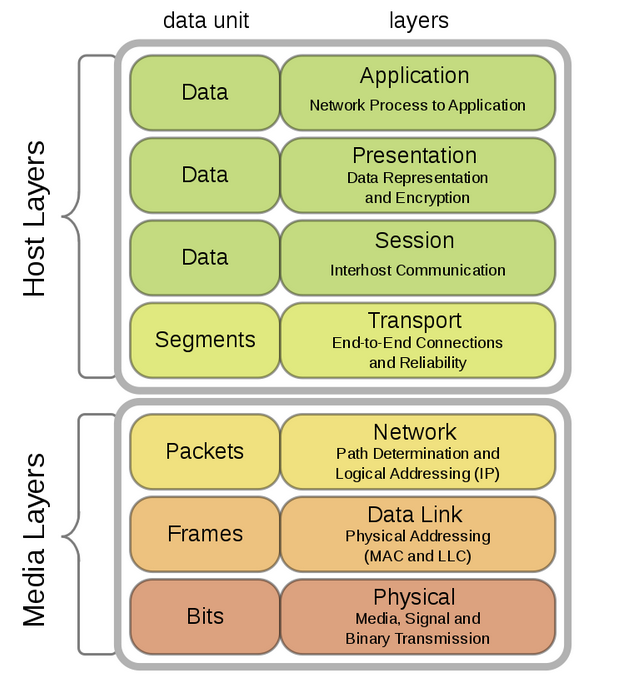

OSI 7 계층을 종합적으로 이해하기 위해 송신자가 수신자에게 이메일을 보내는 상황에 대해 알아본다.

**키워드**

- 송신자가 이메일을 보내는 과정
- 스위치와 라우터 관점에서 이메일을 보내는 과정
- 수신자가 이메일을 받는 과정

**목표** 

- OSI 7 계층 모델을 기반으로 네트워크 전반적인 흐름을 이해한다

---

## 내용정리

OSI 7 계층은 총 7개 계층으로 구성되어 있으며 각 계층을 통과할 때마다 헤더가 덧붙여진다.

LAN에서의 통신은 스위치 장비가, WAN 통신에는 라우터가 필요하다.

또한 LAN에서는 MAC 주소만 있어도 통신이 가능했지만 WAN에서는 IP 주소를 이용했다.

컴퓨터 A → 스위치 A → 라우터 A → 라우터 B → 스위치 B → 컴퓨터 B

**가정: 내 PC → 스위치 → 라우터1 → 라우터2 → 스위치 → 구글 서버**

**1. 브라우저에서 URL 입력 (Application Layer, 7계층)**

  - 사용자가 브라우저에 google.com 입력
  - 브라우저는 HTTP GET 요청을 준비(시작 라인 HTTP 메서드 / HTTP 버전 1.1)
  - HTTP 헤더 생성 (예: Host, User-Agent 등)

**2. DNS 질의 (생략 가능, 이미 IP를 알고 있다고 가정)**

  - 실제로는 먼저 DNS 질의를 통해 google.com의 IP를 얻음
  - 이 과정도 동일한 OSI 7계층을 거침
  - DNS(Domain Name System) Server 계층형 질의
- 1단계 루트
    - 2단계 .net / .com 질의
    - 3단계 [www.google.com](http://www.google.com/) 질의

**먼저 클라이언트 ↔ 서버 3-way hand shake** 

  - 5~7계층 관여 handshake 과정에 X

**3. HTTP 요청 데이터 포장 (Presentation/Session/Transport Layer, 6~4계층)**

  - **Presentation Layer(6계층):** 데이터 인코딩/압축/암호화(HTTPS라면 TLS 암호화)
  - **Session Layer(5계층):** 통신 세션 관리, 동기화
  - **Transport Layer(4계층)**
- **TCP 헤더** 추가:
- 출발지 포트(예: 49152), 목적지 포트(80 또는 443)
      - 시퀀스 번호, 확인 응답 번호 등
      - 플래그
    - **세그먼트 단위로 분할**

**4. 네트워크 계층 (Network Layer, 3계층)**

  - **IP 헤더** 추가:
- 출발지 IP(내 PC의 공인/사설 IP), 목적지 IP(google.com 서버의 공인 IP)
  - **패킷 단위로 포장**

**5. 데이터 링크 계층 (Data Link Layer, 2계층)**

  - **이더넷 프레임 헤더** 추가:
- 출발지 MAC 주소(내 PC의 MAC)
    - 목적지 MAC 주소(내 PC가 속한 LAN의 게이트웨이, 즉 라우터1의 LAN 포트 MAC)
  - **프레임 단위로 포장**

**만약 라우터1의 MAC 주소를 모른다면**

  - 내 PC에서 LAN에 속해있는 모든 장치에 브로드 캐스트
  - 이걸 ARP(Address Request Protocol)이라고 함
  - ARP 테이블에 저장(IP ↔ MAC 주소 매핑)

**스위치는 MAC ↔ 포트 매핑**

  - MAC Address table을 가진다.
  - 스위치의 구멍(포트)와 MAC 주소를 매핑한다.

**6. 물리 계층 (Physical Layer, 1계층)**

  - 프레임을 비트 스트림(0과 1)으로 변환
  - 랜카드에서 전기 신호로 변환 
  - 유선(Ethernet 케이블) 또는 무선(Wi-Fi)로 신호 전송
- 유선 케이블 종류: UTP(Unshielded Twisted Pair), STP(Shield Twisted Pair)

**7. 네트워크 장비를 통한 전달**

  - **내 PC → 스위치1 (LAN)**
- 스위치는 프레임의 목적지 MAC 주소를 보고, 해당 포트로 데이터 전달
    - 스위치는 MAC 주소만 보고 동작 (IP는 신경 쓰지 않음) → 1~2계층
  - **스위치 → 라우터1 (LAN)**
- 라우터1의 LAN 포트 MAC 주소가 목적지 MAC이므로 라우터1이 수신
  - **라우터1 (LAN → WAN)**
- 라우터1은 프레임을 해제하고, IP 패킷을 꺼냄
    - 목적지 IP가 자신의 네트워크 외부(google.com)이므로 **라우팅 테이블**을 참조
    - 출발지 MAC을 자신의 WAN 포트 MAC으로, 목적지 MAC을 라우터2의 WAN 포트 MAC으로 바꿔 새 프레임 생성
    - 출발지 IP/목적지 IP는 그대로 유지
- 만약 사설 IP를 사용한다면 이때 출발지 IP를 라우터가 DHCP 서버로 부터 할당받은 퍼블릭 IP를 출발지 IP로 바꾼다. (NAT)
  - **라우터1 → 라우터2 (WAN)**
- 라우터2의 WAN 포트 MAC 주소가 목적지 MAC이므로 라우터2가 수신
  - **라우터2 (WAN → LAN)**
- 라우터2도 프레임을 해제, IP 패킷을 꺼냄
    - 목적지 IP가 google.com 서버이므로, 라우터2의 LAN 쪽으로 전송
    - 출발지 MAC을 라우터2의 LAN 포트 MAC으로, 목적지 MAC을 구글 서버의 MAC으로 바꿔 새 프레임 생성
  - **라우터2 → 스위치 (LAN)**
- 스위치는 목적지 MAC이 구글 서버 MAC이므로 해당 포트로 전달
  - **스위치 → 구글 서버**
- 구글 서버가 프레임 수신
  - **구글 서버에서 계층별 헤더 제거 및 응답**
- 구글 서버는 물리→데이터링크→네트워크→전송→세션→표현→응용 계층 순서로 헤더를 하나씩 제거하며 원래의 HTTP 요청을 복원
    - HTTP 요청을 처리, index 페이지를 응답으로 준비
  - **응답 과정**
- 위의 **역순**으로 구글 서버에서 내 PC까지 데이터가 전달됨
    - 각 구간마다 MAC 주소는 구간별로 갱신, IP 주소는 처음부터 끝까지 동일
- 마찬가지로 LAN에서 사설 IP를 사용한다면 라우터2에서 출발지 IP를 퍼블릭 IP로 변경 (NAT)
    - 응답 데이터도 OSI 7계층을 따라 포장 및 해제

***"라우터는 ISP의 DHCP 서버로부터 공인 IP를 할당받고, 내부 네트워크의 각 기기에는 자체 DHCP 서버 기능을 통해 사설 IP를 할당한다" (가정, 회사)***

***또한 라우터는 ISP의 DHCP 서버로부터 받은 서브넷 마스크를 통해 사설 IP / 퍼블릭 IP를 구분한다.***

---

## 복습하기

1. 80
1. 포트 번호
1. IP 주소 
1. MAC 주소
1. 전기 신호
1. 이더넷 헤더
1. 송신자의 IP 주소, 송신자의 MAC 주소

**OSI 7 계층:** OSI 7 계층은 컴퓨터와 컴퓨터가 통신하는 구조를 7개의 계층으로 정의해둔 약속, 즉 프로콜이다.

**스위치(Switch):** 스위치는 허브와 같이 컴퓨터나 프린터 등을 연결하여 공유하는 것 외에도 스위치 포트에 연결된 컴퓨터의 MAC 주소를 관리한다.

**라우터(Router):** 라우터는 네트워크와 네트워크 간의 경로(Route)를 설정하고 가장 빠른 길로 트래픽을 이끌어주는 네트워크 장비이다.

**헤더(Header):** 헤더는 네트워크에서 데이터 송/수신에 필요한 부가적인 정보를 담고 있는 부분

**패킷(Packet):** 패킷은 네트워크 계층에서 사용되는 데이터 단위

**프레임(Frame):** 데이터 링크 계층에서 사용되는 데이터 단위

**세그먼트(Segment):** 전송 계층에서 사용되는 데이터 단위

