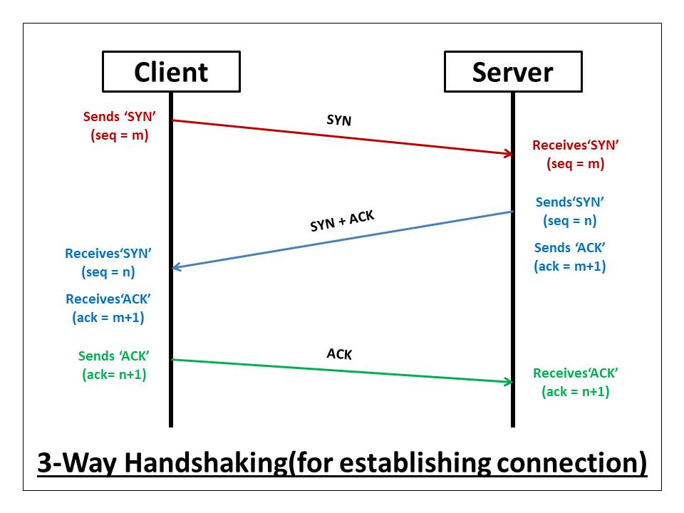

전송 계층은 데이터를 목적지에 문제없이 전달하는 것을 목표로 한다.

이때 데이터를 전달하는 목적에 따라 연결형과 비연결형 통신으로 나눈다.

- **연결형 통신: 데이터를 정확하게 전달하는 것을 목표로 하는 통신으로, TCP 프로토콜을 사용한다.**
- **비연결형 통신: 효율적으로 데이터를 보내는 통신으로, UDP 프로토콜을 사용한다.**

TCP 프로토콜은 3 Way Handshake 방법으로 통신을 시작한다. TCP 프로토콜이 데이터를 정확하게 전달하는 것을 목표로 하기 때문에 상대방이 내 신호를 받을 수 있는 상태인지 확인하고 전송하는 방식이다.

**즉, 3 Way Handshake는 TCP 통신을 하는 장치(컴퓨터)간에 서로 통신할 준비가 되었는지를 확인하는 과정이다.**

**3 Way Handshake**

1. **먼저 송신자는 수신자에게 SYN(Synchronize Sequence Number)이라는 임의의 숫자를 보낸다.** 
1. **수신자는 1번의 대답으로 ACK와 SYN를 보낸다. ACK는 앞에서 받았던 SYN에 1이 더해진 숫자이며, SYN은 임의의 숫자가 된다.**
1. **송신자는 다시 ACK를 보낸다. 이때 ACK는 앞에서 받은 SYN에 1이 더해진 숫자이다.**

이렇게 3-Way HandShaking을 하면 송신자와 수신자 양쪽 모두 데이터를 전송할 준비가 되었다는 것을 보장한다.

