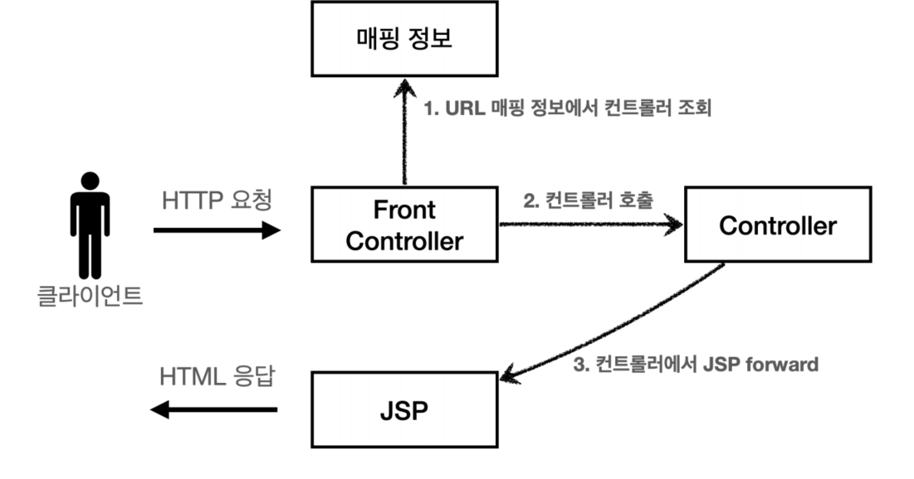
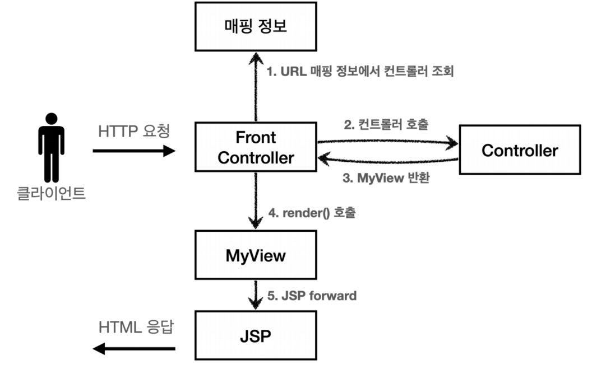
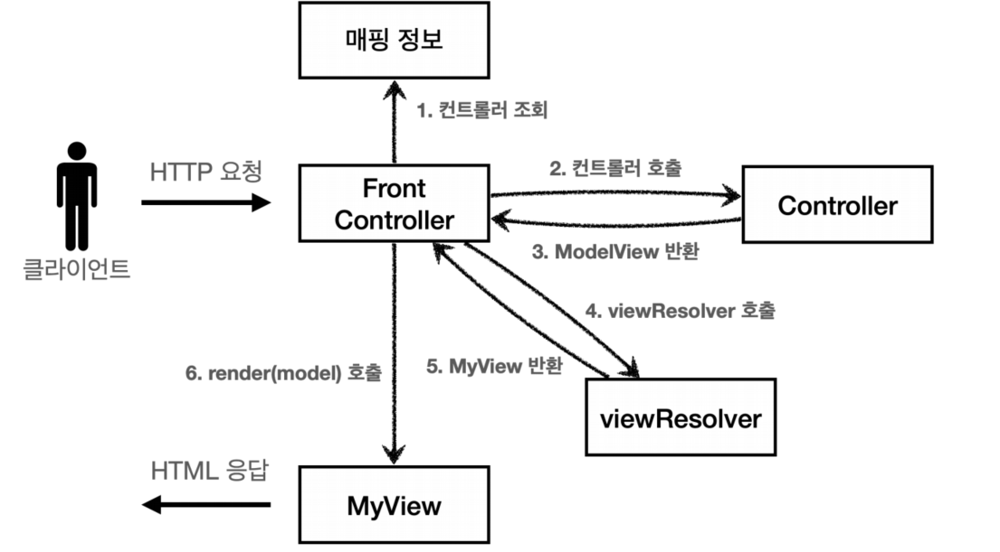
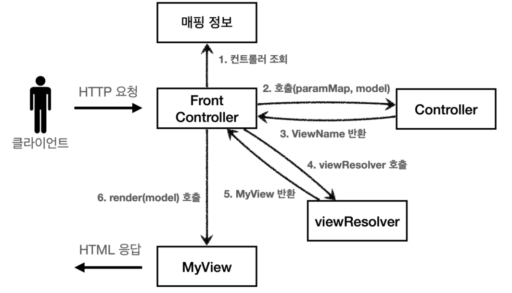
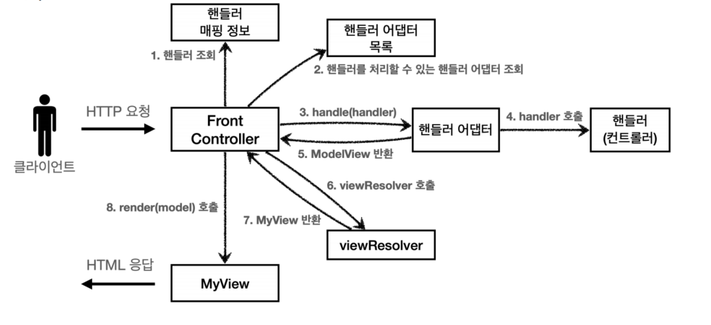

# ***FrontController 패턴***

***GoF(Gang of Four) 디자인 패턴****에는 포함되지 않는다.* 

*웹 애플리케이션에서 사용되는 아키텍처 패턴* 

***특징***

- *프론트 컨트롤러 서블릿 하나로 클라이언트의 요청을 받음*
- *프론트 컨트롤러가 요청에 맞는 컨트롤러를 찾아서 호출*
- *공통 처리 가능*
- *프론트 컨트롤러를 제외한 나머지 컨트롤러는 서블릿을 사용하지 않아도 됨*

***스프링 웹 MVC와 프론트 컨트롤러***

- ***Spring Web MVC DispatcherServlet - FrontController***
- *모든 경로에 mapping → 입구가 하나* 
  - *DispatcherServlet 또한 하나의 Servlet 이다. → HttpServlet 상속*

# *Front Controller 도입 - V1*



***ControllerV1 - <인터페이스>***

```java
public interface ControllerV1 {
    void process(HttpServletRequest request, HttpServletResponse response) throws ServletException, IOException;
}
```

- *JSP 파트(섹션3) 서블릿들을 ControllerV1 인터페이스를 구현하도록 변경* 
- *컨트롤러 로직(forward) 그대로* 

***MemberFormControllerV1 - ControllerV1 구현체*** 

```java
public class MemberFormControllerV1 implements ControllerV1 {
    @Override
    public void process(HttpServletRequest request, HttpServletResponse response) throws ServletException, IOException {
          String viewPath = "/WEB-INF/views/new-form.jsp";
          RequestDispatcher dispatcher = request.getRequestDispatcher(viewPath);
          dispatcher.forward(request, response); // 서블릿 -> JSP
    }
}
```

***FrontControllerServletV1 - <서블릿, FrontController>***

```java
@WebServlet(name = "frontControllerServletV1" , urlPatterns = "/front-controller/v1/*")
public class FrontControllerServletV1 extends HttpServlet {
    private Map<String, ControllerV1> controllerMap = new HashMap<>();
    public FrontControllerServletV1(){
        controllerMap.put("/front-controller/v1/members/new-form", new MemberFormControllerV1());
        controllerMap.put("/front-controller/v1/members/save" , new MemberSaveControllerV1());
        controllerMap.put("/front-controller/v1/members", new MemberListControllerV1());
    }
    @Override
    protected void service(HttpServletRequest request, HttpServletResponse response) throws ServletException, IOException {
        String requestURI = request.getRequestURI();
        ControllerV1 controller = controllerMap.get(requestURI);
        if(controller == null){
            response.setStatus(HttpServletResponse.SC_NOT_FOUND);
            return;
        }
        controller.process(request, response);
    }
}
```

- ***controllerMap***
- *key: 매핑 URL*
  - *value: 호출될 컨트롤러*
- ***service()***
- *requestURI를 조회해서 실제 호출할 컨트롤러를 controllerMap에서 찾는다.* 
  - *없으면 → 404 상태 코드 반환* 
  - *있으면 → 컨트롤러 호출 → forward*

# ***View 분리 - v2***

*모든 컨트롤러에서 뷰로 이동하는 부분에 중복이 있고, 깔끔하지 않다*

```java
String viewPath = "/WEB-INF/views/new-form.jsp";
RequestDispatcher dispatcher = request.getRequestDispatcher(viewPath);
dispatcher.forward(request, response);
```



***MyView - Controller 반환 타입***

```java
public class MyView {
    private String viewPath;
    public MyView(String viewPath) {
        this.viewPath = viewPath;
    }
    public void render(HttpServletRequest request, HttpServletResponse response) throws ServletException, IOException {
        RequestDispatcher dispatcher = request.getRequestDispatcher(viewPath);
        dispatcher.forward(request, response);
    }
}    
```

***ControllerV2 - <인터페이스>***

```java
public interface ControllerV2 {
    MyView process(HttpServletRequest request, HttpServletResponse response) throws ServletException, IOException;
}
```

***MemberFormControllerV2 - ControllerV2 구현체*** 

```java
public class MemberFormControllerV2 implements ControllerV2 {
    @Override
    public MyView process(HttpServletRequest request, HttpServletResponse response) throws ServletException, IOException {
        return new MyView("/WEB-INF/views/new-form.jsp");
    }
}
```

- *각 컨트롤러는 이제 dispatcher.forward()를 직접 생성해서 호출하지 않아도 된다*
- *단순히 MyView 객체를 뷰이름만 넣어서 생성하고 반환하면 된다.* 

***FrontControllerServletV2 - <서블릿, FrontController>***

```java
@WebServlet(name = "frontControllerServletV2" , urlPatterns = "/front-controller/v2/*")
public class FrontControllerServletV2 extends HttpServlet {
    private Map<String, ControllerV2> controllerMap = new HashMap<>();
    public FrontControllerServletV2(){
        controllerMap.put("/front-controller/v2/members/new-form", new MemberFormControllerV2());
        controllerMap.put("/front-controller/v2/members/save" , new MemberSaveControllerV2());
        controllerMap.put("/front-controller/v2/members", new MemberListControllerV2());
    }
    @Override
    protected void service(HttpServletRequest request, HttpServletResponse response) throws ServletException, IOException {
        String requestURI = request.getRequestURI();

        ControllerV2 controller = controllerMap.get(requestURI);
        if(controller == null){
            response.setStatus(HttpServletResponse.SC_FOUND);
            return;
        }

        MyView view = controller.process(request, response);

        // JSP forward
        view.render(request, response);
    }
}
```

- *FrontControllerV1과 다르게 controller에서 MyView를 받는다.*
- *view.render()를 통해 forward 로직을 수행하고 JSP가 실행*

***정리***

- *프론트 컨트롤러 도입으로 각각의 컨트롤러는 forward 로직 중복이 사라지고 단순히 MyView만 반환한다.*

# ***Model 추가 - v3***

***서블릿 종속성을 제거하자*** 

- *요청 파라미터 정보는 자바의 Map으로 대신 넘기도록 하면 현재 구조에서 컨트롤러가 서블릿 기술에 의존하지 않을 수 있다.*
- *request 객체를 Model로 사용하는 대신 Model 객체를 만들어서 반환하면 된다.* 

***뷰 이름 중복 제거***

- *컨트롤러에서 지정하는 뷰 이름에 중복이 있다.* 
- *prefix: /WEB-INF/view/*
  - *suffix: .jsp*
- *컨트롤러는 뷰 논리 이름을 반환하고 실제 물리 위치의 이름을 프론트 컨트롤러에서 처리하도록 단순화 하자* 
- */WEB-INF/views/new-form.jsp →  new-form*



***ModelView***

```java
@Setter @Getter
public class ModelView {
    private String viewName;
    private Map<String, Object> model = new HashMap<>();
    public ModelView(String viewName) {
        this.viewName = viewName;
    }
}
```

- *model은 단순하게 map이다.* 
- *뷰에서 필요한 데이터를 key, value로 넣어주면 된다.* 

***ControllerV3 - <인터페이스>***

```java
public interface ControllerV3 {
    ModelView process(Map<String, String> paramMap);
}
```

- *해당 컨트롤러는 서블릿 기술(HttpServletRequest)을 전혀 사용하지 않는다.*
- *→ 테스트 코드 작성시 테스트 하기 쉽다.* 
  - *서블릿 기술을 사용한다면 mock 객체가 필요하다.*

***MemberListControllerV3- ControllerV3 구현체*** 

```java
public class MemberListControllerV3 implements ControllerV3 {
    MemberRepository memberRepository = MemberRepository.getInstance();
    @Override
    public ModelView process(Map<String, String> paramMap) {
        List<Member> members = memberRepository.findAll();
        ModelView mv = new ModelView("members");
        mv.getModel().put("members", members);
        return mv;
    }
}
```

- *ModelView 생성자로 뷰 논리 이름을 전달한다.* 
- *ModelView.getModel() → map → map.put(String, Object) 데이터 추가* 
- *key: “members” value: List<Member>*

***MyView***

```java
public class MyView {
    private String viewPath;

    public MyView(String viewPath) {
        this.viewPath = viewPath;
    }
    public void render(HttpServletRequest request, HttpServletResponse response) throws ServletException, IOException {
        RequestDispatcher dispatcher = request.getRequestDispatcher(viewPath);
        dispatcher.forward(request, response);
    }
    public void render(Map<String, Object> model, HttpServletRequest request, HttpServletResponse response) throws IOException, ServletException{
        modelToRequestAttribute(model, request);

        RequestDispatcher dispatcher = request.getRequestDispatcher(viewPath);
          dispatcher.forward(request, response);
    }

    private static void modelToRequestAttribute(Map<String, Object> model, HttpServletRequest request) {
        model.entrySet().iterator()
                .forEachRemaining(o -> request.setAttribute(o.getKey(), o.getValue()));
    }
}
```

***FrontControllerServletV3 - <서블릿, FrontController>***

```java
@WebServlet(name = "frontControllerServletV3" , urlPatterns = "/front-controller/v3/*")
public class FrontControllerServletV3 extends HttpServlet {
    private Map<String, ControllerV3> controllerMap = new HashMap<>();
    public FrontControllerServletV3(){
        controllerMap.put("/front-controller/v3/members/new-form", new MemberFormControllerV3());
        controllerMap.put("/front-controller/v3/members/save" , new MemberSaveControllerV3());
        controllerMap.put("/front-controller/v3/members", new MemberListControllerV3());
    }
    @Override
    protected void service(HttpServletRequest request, HttpServletResponse response) throws ServletException, IOException {
        String requestURI = request.getRequestURI();

        ControllerV3 controller = controllerMap.get(requestURI);
        if(controller == null){
            response.setStatus(HttpServletResponse.SC_FOUND);
            return;
        }
        HashMap<String, String> paramMap = creteParamMap(request);

        ModelView mv = controller.process(paramMap);

        MyView view = viewResolver(mv);

        // JSP forward
        view.render(mv.getModel(), request, response);
    }

    private static MyView viewResolver(ModelView mv) {
        return new MyView("/WEB-INF/views/" + mv.getViewName() + ".jsp");
    }

    private static HashMap<String, String> creteParamMap(HttpServletRequest request) {
        HashMap<String, String> paramMap = new HashMap<>();
        request.getParameterNames().asIterator().
                forEachRemaining(paramName -> paramMap.put(paramName, request.getParameter(paramName)));
        return paramMap;
    }
}
```

- **createParamMap()**
- *컨트롤러에 매개변수로 넘겨줄 map을 생성하고 해당 map에 파라미터를 넣는다.*
- **뷰 리졸버(ViewResovler)**
-  *prefix(WEB-INF/views/) + 컨트롤러가 넣어준 뷰 논리 이름 + suffix(.jsp)*

# ***단순하고 실용적인 컨트롤러 - v4***



- *V3 버전에서는 매번 ModelView를 개발자가 생성해서 넘겨야 했지만 V4에서는 ViewName만 반환한다.*

***ControllerV4 - <인터페이스>***

```java
public interface ControllerV4 {
    String process(Map<String , String> paramMap, Map<String, Object> model );
}
```

- *ModelView를 반환하지 않는다.* 
- *model 객체를 프론트 컨트롤러에서 생성해서 전달한다. 그냥 사용하고 결과로 뷰의 이름만 반환해주면 된다.* 

***MemberListControllerV4- ControllerV4 구현체*** 

```java
public class MemberListControllerV4 implements ControllerV4 {
    MemberRepository memberRepository = MemberRepository.getInstance();
    @Override
    public String process(Map<String, String> paramMap, Map<String, Object> model) {
        List<Member> members = memberRepository.findAll();
        model.put("members", members);
        return "members";
    }
}
```

- *모델이 파라미터로 전달되기 때문에, 모델을 직접 생성하지 않아도 된다.*

***FrontControllerServletV4 - <서블릿, FrontController>***

```java
@WebServlet(name = "frontControllerServletV4" , urlPatterns = "/front-controller/v4/*")
public class FrontControllerServletV4 extends HttpServlet {
    private Map<String, ControllerV4> controllerMap = new HashMap<>();
    public FrontControllerServletV4(){
        controllerMap.put("/front-controller/v4/members/new-form", new MemberFormControllerV4());
        controllerMap.put("/front-controller/v4/members/save" , new MemberSaveControllerV4());
        controllerMap.put("/front-controller/v4/members", new MemberListControllerV4());
    }
    @Override
    protected void service(HttpServletRequest request, HttpServletResponse response) throws ServletException, IOException {
        String requestURI = request.getRequestURI();

        ControllerV4 controller = controllerMap.get(requestURI);
        if(controller == null){
            response.setStatus(HttpServletResponse.SC_FOUND);
            return;
        }
        HashMap<String, String> paramMap = creteParamMap(request);
        HashMap<String, Object> model = new HashMap<>();

        String viewName = controller.process(paramMap, model);

        MyView view = viewResolver(viewName);

        // JSP forward
        view.render(model, request, response);
    }
     private static MyView viewResolver(String viewName) {
        return new MyView("/WEB-INF/views/" + viewName + ".jsp");
     }

    private static HashMap<String, String> creteParamMap(HttpServletRequest request) {
        HashMap<String, String> paramMap = new HashMap<>();
        request.getParameterNames().asIterator().
                forEachRemaining(paramName -> paramMap.put(paramName, request.getParameter(paramName)));
        return paramMap;
    }
}
```

- *단순히 모델을 프론트 컨트롤러에서 생성해서 파라미터로 넘겨주는 아이디어만 적용했는데 깔끔하다.*

# ***유연한 컨트롤러1,2 - v5***

*만약 어떤 개발자는 ControllerV3 방식으로 개발하고 싶고, 어떤 개발자는 ControllerV4 방식으로 개발하고 싶다면 어떻게 해야할까?*

*→ 어댑터 패턴을 적용한다.* 

[*https://20240228.tistory.com/354*](https://20240228.tistory.com/354)



- *핸들러 어댑터: 중간에 어댑터 역할을 하는 핸들러 어댑터를 추가 핸들러 어댑터 덕분에 다양한 종류의 컨트롤러를 호출할 수 있다.* 

***MyHandlerAdapter - <인터페이스>***

```java
public interface MyHandlerAdapter {
    boolean supports(Object handler);
    ModelView handle(HttpServletRequest request, HttpServletResponse response, Object handler) throws ServletException, IOException;
}
```

- *boolean supports(Object handler)*
- *어댑터가 해당 컨트롤러를 처리할 수 있는지 판단하는 메소드*
-  *ModelView handle(HttpServletRequest request, HttpServletResponse response, Object handler)*
- *어댑터는 실제 컨트롤러를 호출하고 그 결과로 ModeView 반환* 
  - *프론트 컨트롤러 → 어댑터 → 컨트롤러*

***ControllerV3HandlerAdapter - ControllerV3 지원하는 어댑터***

```java
public class ControllerV3HandlerAdapter implements MyHandlerAdapter {
    @Override
    public boolean supports(Object handler) {
        return (handler instanceof ControllerV3);
    }
    @Override
    public ModelView handle(HttpServletRequest request, HttpServletResponse response, Object handler) throws ServletException, IOException {
        ControllerV3 controller = (ControllerV3) handler;
        HashMap<String ,String> paramMap = new HashMap<>();
        createParamMap(request, paramMap);

        return controller.process(paramMap);
    }
    private static void createParamMap(HttpServletRequest request, HashMap<String, String> paramMap) {
        request.getParameterNames().asIterator()
                .forEachRemaining(paramName -> paramMap.put(paramName, request.getParameter(paramName)));
    }
}
```

- *V3 형식에 맞게 컨트롤러를 호출한다.* 
- *V3는 ModelView 반환* 

***ControllerV4HandlerAdapter - ControllerV4 지원하는 어댑터***

```java
public class ControllerV4HandlerAdapter implements MyHandlerAdapter {
    @Override
    public boolean supports(Object handler) {
        return (handler instanceof ControllerV4);
    }

    @Override
    public ModelView handle(HttpServletRequest request, HttpServletResponse response, Object handler) throws ServletException, IOException {
        ControllerV4 controller = (ControllerV4) handler;
        HashMap<String, String> paramMap = new HashMap<>();
        createParamMap(request, paramMap);

        HashMap<String, Object> model = new HashMap<>();
        String viewName = controller.process(paramMap, model);

        ModelView mv = new ModelView(viewName);
        mv.setModel(model);
        return mv;
    }
    private static void createParamMap(HttpServletRequest request, HashMap<String, String> paramMap) {
        request.getParameterNames().asIterator()
                .forEachRemaining(paramName -> paramMap.put(paramName, request.getParameter(paramName)));
    }
}
```

- *V4 형식에 맞게 컨트롤러를 호출한다.* 
- *V4 뷰 논리 이름만 반환, 파라미터로 model을 넘긴다.* 
- *ModeView 생성해서 생성자 파라미터에 뷰 논리 이름을 넣고 모델 또한 set 한다.* 

***FrontControllerServletV5 - <서블릿, FrontController>***

```java
@WebServlet(name = "frontControllerServletV5", urlPatterns = "/front-controller/v5/*")
public class FrontControllerServletV5 extends HttpServlet {
    private final Map<String , Object> handlerMappingMap = new HashMap<>();
    private final List<MyHandlerAdapter> handlerAdapters = new ArrayList<>();

    public FrontControllerServletV5() {
        initHandlerMappingMap();
        initHandlerAdapters();
    }
    @Override
    protected void service(HttpServletRequest request, HttpServletResponse response) throws ServletException, IOException {

        Object handler = getHandler(request);
        if(handler == null){
            response.setStatus(HttpServletResponse.SC_NOT_FOUND);
            return;
        }

        MyHandlerAdapter adapter =  getHandlerAdapter(handler);

        ModelView mv = adapter.handle(request, response, handler);
        MyView myView = new MyView(viewResolver(mv));
        myView.render(mv.getModel(), request, response);
    }

    private static String viewResolver(ModelView mv) {
        return "/WEB-INF/views/" + mv.getViewName() + ".jsp";
    }

    private MyHandlerAdapter getHandlerAdapter(Object handler) {
        for (MyHandlerAdapter handlerAdapter : handlerAdapters) {
              if(handlerAdapter.supports(handler)){
                  return handlerAdapter;
              }
        }
        throw new IllegalArgumentException("handler adapter not found. handler=" + handler);
    }

    private Object getHandler(HttpServletRequest request) {
        String requestURI = request.getRequestURI();
        return handlerMappingMap.get(requestURI);
    }

    private void initHandlerAdapters() {
        handlerAdapters.add(new ControllerV3HandlerAdapter());
        handlerAdapters.add(new ControllerV4HandlerAdapter());
    }

    private void initHandlerMappingMap() {
        handlerMappingMap.put("/front-controller/v5/v3/members/new-form", new MemberFormControllerV3());
        handlerMappingMap.put("/front-controller/v5/v3/members/save" , new MemberSaveControllerV3());
        handlerMappingMap.put("/front-controller/v5/v3/members", new MemberListControllerV3());

        handlerMappingMap.put("/front-controller/v5/v4/members/new-form", new MemberFormControllerV4());
        handlerMappingMap.put("/front-controller/v5/v4/members/save" , new MemberSaveControllerV4());
        handlerMappingMap.put("/front-controller/v5/v4/members", new MemberListControllerV4());
    }
}
```

- ***핸들러 매핑 정보***

```java
private final Map<String, Object> handlerMappingMap = new HashMap<>();
```

- ***핸들러 매핑*** 

```java
Object handler = getHandler(request)

private Object getHandler(HttpServletRequest request) {
	 String requestURI = request.getRequestURI();
	 return handlerMappingMap.get(requestURI);
}
```

- ***핸들러를 처리할 수 있는 어댑터 조회***

```java
MyHandlerAdapter adapter = getHandlerAdapter(handler)

for (MyHandlerAdapter adapter : handlerAdapters) {
		 if (adapter.supports(handler)) {
				 return adapter;
		 }
}
```

- **어댑터 호출**

```java
ModelView mv = adapter.handle(request, response, handler);
```

# **정리**

*지금까지 v1 ~ v5로 점진적으로 프레임워크를 발전*

- *v1: 프론트 컨트롤러를 도입*
- *v2: View 분류*
- *v3: Model 추가*
- *서블릿 종속성 제거*
  - *뷰 이름 중복 제거*
- *prefix, suffix*
- *v4: 단순하고 실용적인 컨트롤러*
- *구현 입장에서 ModelView를 직접 생성해서 반환하지 않도록 편리한 인터페이스 제공*
- *v5: 유연한 컨트롤러*
- *어댑터 도입*
  - *어댑터를 추가해서 프레임워크를 유연하고 확장성 있게 설계*
- *OCP, SRP*

*스프링 MVC는 거의 같은 구조를 가지고 있다.*

