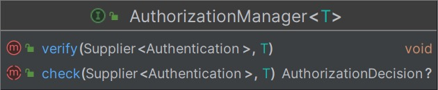
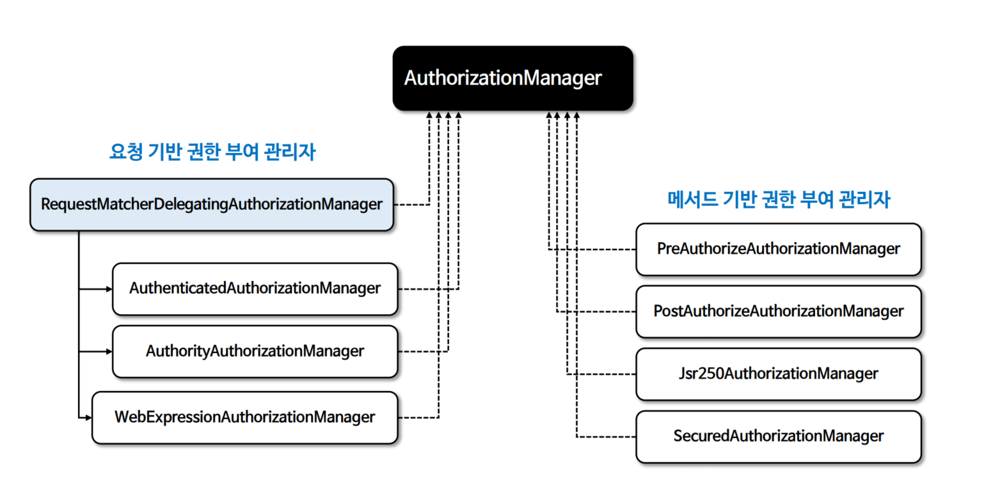

# **개요**

- `AuthorizationManager`는 인증된 사용자가 요청 자원에 접근할 수 있는지 여부를 결정하는 인터페이스로서 인증된 사용자의 권한 정보와 요청 자원의 보안 요구 사항을 기반으로 권한 부여 결정을 내린다
- `AuthorizationManager`는 Spring Security 의 요청 기반, 메소드 기반의 인가 구성 요소에서 호출되며 최종 액세스 제어 결정을 수행한다
- `AuthorizationManager`는 Spring Security의 필수 구성 요소로서 권한 부여 처리는 `AuthorizationFilter`를 통해 이루어지며 `AuthorizationFilter`는 `AuthorizationManager`를 호출하여 권한 부여 결정을 내린다

# **구조**

- **check()**
- 권한 부여 결정을 내릴 때 필요한 모든 관련 정보(인증객체, 체크 대상(권한정보, 요청정보, 호출정보 등..)가 전달된다
  - 액세스가 허용되면 `true`를 포함하는 `AuthorizationDecision`, 거부되면 `false`를 포함하는 `AuthorizationDecision`, 결정을 내릴 수 없는 경우 `null`을 반환한다
- **verify()**
- **check()**를 호출해서 반환된 값이 `false` 가진 `AuthorizationDecision`인 경우 `AccessDeniedException`을 throw 한다

# **AuthorizationManager 클래스 계층 구조**

- `RequestMatcherDelegatingAuthorizationManager` 
- 3가지의 인가 매니저를 참조한다 
  - 인가 심사를 하는 매니저가 아닌 클라이언트의 요청을 확인하고 가장 적합한 인가 매니저를 호출(위임)하는 역할을 한다

# **AuthorizationManager 구현체 종류 및 특징**

**요청 기반 권한 부여 관리자** 

- `AuthorityAuthorizationManager` 
- 특정 권한을 가진 사용자에게만 접근을 허용한다.
  - 주로 사용자의 권한(예: ROLE_USER, ROLE_ADMIN)을 기반으로 접근을 제어한다
- `AuthenticatedAuthorizationManager` 
- 인증된 사용자에게 접근을 허용한다. 이 클래스는 사용자가 시스템에 로그인했는지 여부를 기준으로 결정한다
  - ex: `anyRequest().authenticated()`
- `WebExpressionAuthorizationManager` 
- 웹 보안 표현식을 사용하여 권한을 관리한다.
  -  `"hasRole('ADMIN')` 또는 `hasAuthority('WRITE_PERMISSIONS')`과 같은 표현식을 사용할 수 있다
- `RequestMatcherDelegatingAuthorizationManager` 
- 인가설정에서 지정한 모든 요청패턴과 권한 규칙을 매핑한 정보를 가지고 있으며 권한 검사 시 가장 적합한 `AuthorizationManager`구현체를 선택해 위임한다

**메소드 기반 권한 부여 관리자** 

- `PreAuthorizeAuthorizationManager` 
- 메소드 실행 전에 권한을 검사한다. 
  - `@PreAuthorize`어노테이션과 함께 사용되며, 메소드 실행 전에 사용자의 권한을 확인한다
- `PostAuthorizeAuthorizationManager` 
- 메소드 실행 후에 권한을 검사한다. 
  - `@PostAuthorize` 어노테이션과 함께 사용되며, 메소드 실행 후 결과에 따라 접근을 허용하거나 거부한다
- `Jsr250AuthorizationManager` 
- JSR-250 어노테이션(`@RolesAllowed`, `@DenyAll`, `@PermitAll`)을 사용하여 권한을 관리한다
- `SecuredAuthorizationManager` 
- `@Secured` 어노테이션을 사용하여 메소드 수준의 보안을 제공한다.
  - 이 어노테이션은 특정 권한을 가진 사용자만 메소드에 접근할 수 있게 한다

