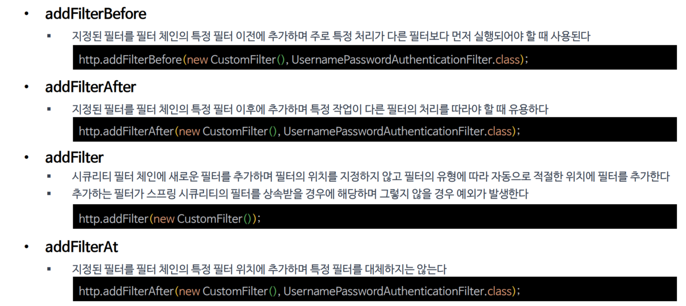
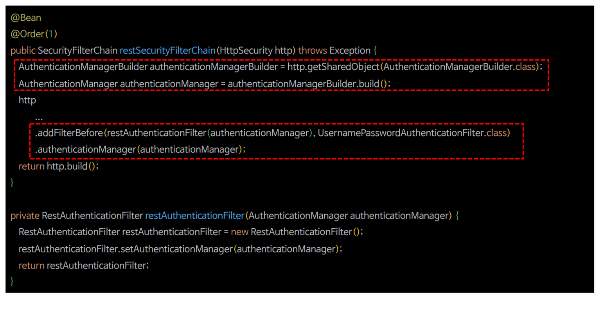
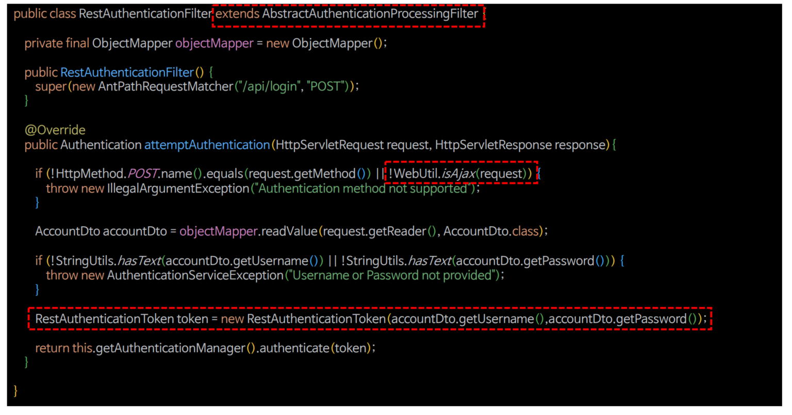

# ***스프링 시큐리티 필터 설정***

- *스프링 시큐리티는 HttpSecurity 설정을 통해 애플리케이션의 보안 요구사항에 맞게 필터 체인을 추가 할 수 있도록 제공한다.* 
- *필터 추가는 addFilterBefore, addFilterAfter, addFilter, addFilterAt 메소드를 사용하여 필터의 순서와 위치를 제어할 수 있다.* 

# ***스프링 시큐리티 필터 추가***



# ***필터 설정***



# ***필터 구현***



- *UsernamePasswordAuthenticationFilter 또한 AbstractAuthenticationProcessingFilter를 상속해서 구현한다.*
- *인증 처리에 필요한 공통 기능이 이미 많이 있다.* 
- *생성자를 보면 부모 생성자에 new AntPathRequestMatcher(”/api/login”, POST) 넘기고 있는데*
*해당 경로와 해당 HTTP 메소드에만 RestAuthenticationFilter를 동작시키겠다는 의미이다.*

```java
if (!HttpMethod.POST.name().equals(request.getMethod()) || !WebUtil.isAjax(request)) {
		throw new IllegalArgumentException("Authentication method not supported");
}
```

- *HTTP 메소드가 POST가 아니거나 Ajax 비동기 통신이 아니면 해당 필터를 사용하지 않겠다는 뜻이다. (예외를 던진다.)*
- *WebUtil.isAjax(request)에서는 요청 헤더에* *`'X-Requested-With': 'XMLHttpRequest'`* *존재하는지 파악한다.* 

# ***구현*** 

***WebUtil***

```java
public class WebUtil {
    private static final String XML_HTTP_REQUEST = "XMLHttpRequest";
    private static final String X_REQUESTED_WITH = "X-Requested-With";
    private static final String CONTENT_TYPE = "Content-type";
    private static final String CONTENT_TYPE_JSON = "application/json";
    public static boolean isAjax(HttpServletRequest request) {
        return XML_HTTP_REQUEST.equals(request.getHeader(X_REQUESTED_WITH));
    }
    public static boolean isContentTypeJson(HttpServletRequest request) {
        return request.getHeader(CONTENT_TYPE).contains(CONTENT_TYPE_JSON);
    }
}
```

- *Header: X_REQUESTED_WITH Value: XML_HTTP_REQUEST* 
- *isAjax → request* *`"XMLHttpRequest"`* *헤더 존재 여부와 있으면* *`"X-Requested-With"`*  *value 체크를 한다.*

***RestAuthenticationToken***

```java
public class RestAuthenticationToken extends AbstractAuthenticationToken {
    private final Object principal;
    private final Object credentials;
    public RestAuthenticationToken(Collection<? extends GrantedAuthority> authorities, Object principal, Object credentials) {
        super(authorities);
        this.principal = principal;
        this.credentials = credentials;
        setAuthenticated(true);
    }
    public RestAuthenticationToken(Object principal, Object credentials){
        super(null);
        this.principal = principal;
        this.credentials = credentials;
        setAuthenticated(false);
    }
    @Override
    public Object getCredentials() {
        return this.credentials;
    }
    @Override
    public Object getPrincipal() {
        return this.principal;
    }
}
```

- *UsernamePasswordAuthenticationToken과 같은 역할이다.* 

***RestAuthenticationFilter*** 

```java
public class RestAuthenticationFilter extends AbstractAuthenticationProcessingFilter {
    private final ObjectMapper objectMapper = new ObjectMapper();
    public RestAuthenticationFilter() {
        super(new AntPathRequestMatcher("/api/login", "POST"));
    }
    @Override
    public Authentication attemptAuthentication(HttpServletRequest request, HttpServletResponse response) throws AuthenticationException, IOException, ServletException {

        if(!HttpMethod.POST.matches(request.getMethod()) || !WebUtil.isAjax(request)){
            throw new IllegalArgumentException("Authentication method not supported");
        }

        AccountDto accountDto = objectMapper.readValue(request.getReader(), AccountDto.class);
        if(!StringUtils.hasText(accountDto.getUsername()) || !StringUtils.hasText(accountDto.getPassword())){
            throw new AuthenticationServiceException("Username or Password is not provided");
        }

        RestAuthenticationToken authenticationToken = [REDACTED] RestAuthenticationToken(accountDto.getUsername(), accountDto.getPassword());
        return getAuthenticationManager().authenticate(authenticationToken);
    }
}
```

***SecurityFilterChain***

```java
@EnableWebSecurity
@Configuration
@RequiredArgsConstructor
public class SecurityConfig {
    private final AuthenticationProvider authenticationProvider;
    private final AuthenticationDetailsSource authenticationDetailsSource;
    private final AuthenticationSuccessHandler successHandler;
    private final AuthenticationFailureHandler failureHandler;
    @Bean
    @Order(1)
    public SecurityFilterChain restSecurityFilterChain(HttpSecurity http) throws Exception {

        AuthenticationManagerBuilder authenticationManagerBuilder =
                http.getSharedObject(AuthenticationManagerBuilder.class);

        AuthenticationManager authenticationManager = authenticationManagerBuilder.build();
        http
                .securityMatcher("/api/**")
                .authorizeHttpRequests(auth -> auth
                        .requestMatchers("/css/**", "/images/**",
                                "/js/**", "/favicon.*", "/*/icon/-*").permitAll()
                        .anyRequest().permitAll())
                .csrf(AbstractHttpConfigurer::disable)
                .addFilterBefore(
                        restAuthenticationFilter(authenticationManager),
                        UsernamePasswordAuthenticationFilter.class)
                .authenticationManager(authenticationManager);

        return http.build();
    }
    private RestAuthenticationFilter restAuthenticationFilter(AuthenticationManager authenticationManager) {
        RestAuthenticationFilter restAuthenticationFilter = new RestAuthenticationFilter();
        restAuthenticationFilter.setAuthenticationManager(authenticationManager);
        return restAuthenticationFilter;
    }
    @Bean
    @Order(2)
    public SecurityFilterChain securityFilterChain(HttpSecurity http) throws Exception{
        http
                .authorizeHttpRequests(authorize -> authorize
                        .requestMatchers("/css/**", "/images/**",
                                "/js/**", "/favicon.*", "/*/icon/-*").permitAll()
                        .requestMatchers("/", "/signup", "/login*").permitAll()
                        .requestMatchers("/user").hasRole("USER")
                        .requestMatchers("/admin").hasRole("ADMIN")
                        .requestMatchers("/manager").hasRole("MANAGER")
                        .anyRequest().authenticated())
                .authenticationProvider(authenticationProvider)
                .formLogin(form -> form
                        .loginPage("/login")
                        .authenticationDetailsSource(authenticationDetailsSource)
                        .successHandler(successHandler)
                        .failureHandler(failureHandler)
                        .permitAll())
                .exceptionHandling(ex -> ex.accessDeniedHandler(
                        new FormAccessDeniedHandler("/denied")));
        return http.build();
    }
}

```

- *현재 설정에서는 AuthenticationManager가 수행할 수 있는 AuthenticationProvider가 존재하지 않는다.* 
- *Form 방식 Provider는 UsernamePasswordAuthenticationToken만 지원하고 익명 사용자를 위한 Provider는 AnonymousAuthenticaionToken만 지원한다.* 
- *즉, RestAuthenticationToken 처리가 가능한 Provider가 존재하지 않는다.*
- *이번 파트에서는 Filter 구현과 설정에 집중하고 다음 파트에서 Provider를 직접 구현하여 인증 처리를 할 수 있도록 하겠다.*

***중요!***

*`.authenticationManager(authenticationManager);`* *restSecurityFilterChain 메소드를 보면 HttpSecurity에 AuthenticationManger 설정을 해주고 있다.*

*만약 하지 않으면 AuthenticationManager를 중복으로 생성하기 때문에 에러가 발생한다.*

