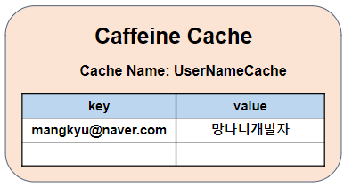
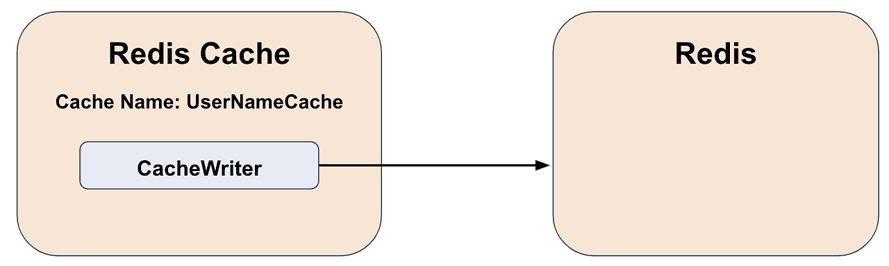
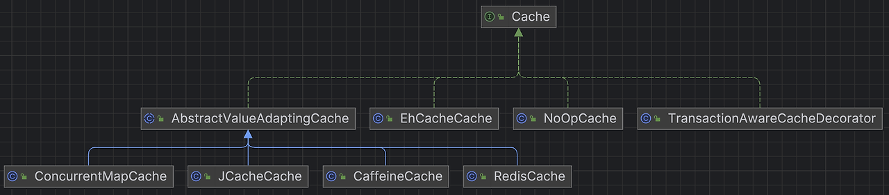
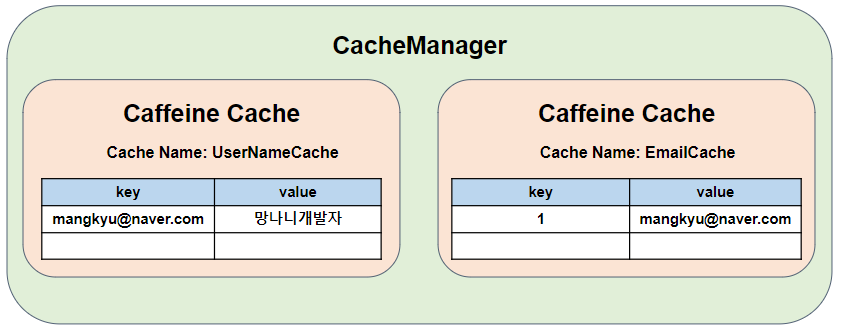
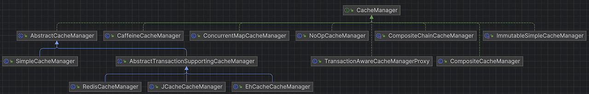
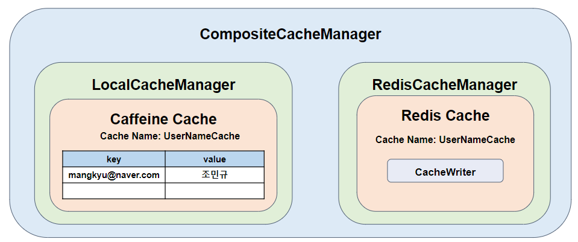

# 스프링이 제공하는 Cache 기능 정리

### Cache Abstraction(캐시 추상화)

로컬 메모리에서 동작하는 caffeine 캐시, 분산 저장소를 활용하는 Redis 캐시 등 다양한 구현체 존재

해당 기술을 직접 의존하면 캐시 구현체가 변경될 때 코드에 영향을 받는다.

스프링은 이러한 문제를 방지하기 위해 캐시를 추상화하여 제공한다.

### Cache 인터페이스

Cache 인터페이스는 공통된 캐시 기능을 스프링이 추상화 한 것으로, 이를 통해 모든 캐시를 하나의 일관된 인터페이스로 접근할 수 있다.

```java
public interface Cache {
	
		String getName();
	
		Object getNativeCache();
	
		@Nullable
		ValueWrapper get(Object key);
	
		@Nullable
		<T> T get(Object key, @Nullable Class<T> type);
	
		@Nullable
		<T> T get(Object key, Callable<T> valueLoader);
	
		
		@Nullable
		default CompletableFuture<?> retrieve(Object key) {
			throw new UnsupportedOperationException(
					getClass().getName() + " does not support CompletableFuture-based retrieval");
		}
	
		default <T> CompletableFuture<T> retrieve(Object key, Supplier<CompletableFuture<T>> valueLoader) {
			throw new UnsupportedOperationException(
					getClass().getName() + " does not support CompletableFuture-based retrieval");
		}
	
		void put(Object key, @Nullable Object value);
	
	
		@Nullable
		default ValueWrapper putIfAbsent(Object key, @Nullable Object value) {
				ValueWrapper existingValue = get(key);
				if (existingValue == null) {
						put(key, value);
				}
				return existingValue;
		}
	
		void evict(Object key);
	
		default boolean evictIfPresent(Object key) {
				evict(key);
				return false;
		}
	
		void clear();
	
		default boolean invalidate() {
				clear();
				return false;
		}
	
	
		@FunctionalInterface
		interface ValueWrapper {
		
				@Nullable
				Object get();
		}
	
	
		@SuppressWarnings("serial")
		class ValueRetrievalException extends RuntimeException {
	
				@Nullable
				private final Object key;
		
				public ValueRetrievalException(@Nullable Object key, Callable<?> loader, @Nullable Throwable ex) {
						super(String.format("Value for key '%s' could not be loaded using '%s'", key, loader), ex);
						this.key = key;
				}
		
				@Nullable
				public Object getKey() {
						return this.key;
				}
		}
	
}	
```

기본적으로 캐시 구현체는 1개의 캐시 이름을 가지며, 캐시의 종류에 따라서 구현이 달라진다.

대표적으로 Caffein Cache와 Redis Cache가 존재한다.

**Caffeine Cache는 로컬 메모리에 값을 저장하는 인메모리 캐시로, ConcurrentHashMap을 사용하여 구현**되어 있다. 예를 들어 사용자의 이메일을 바탕으로 닉네임 정보를 캐싱하면 아래와 같다.



외부 저장소에 값을 저장하는 Redis Cache 같은 캐시들은 내부 구현이 다르다.

Redis Cache도 동일하게 Cache Name을 갖지만, 실제 데이터는 외부 저장소에 존재하므로, 레디스 설정 시에 등록해주는 CacheWriter를 통해 캐시 관련 연산을 수행한다.



스프링의 경우 일반적인 캐시 사용을 위해 Cache 인터페이스는 null 값 캐싱을 허용한다.

따라서 null일 경우에는 캐싱에서 제외하도록 표현식을 적용할 수도 있다.




스프링이 제공하는 구현체를 보면 CaffeineCache, RedisCache 외에도 다양한 구현체가 존재한다.

캐싱된 값을 래핑하는 공통 기능을 담당하는 추상 클래스를 일부 부모로 구현하고 있음을 확인할 수 있다.

### CacheManager

애플리케이션을 개발하다보면 다양한 캐시가 필요할 수 있다.

스프링은 이러한 캐시 객체들을 관리하는 CacheManager 인터페이스를 제공한다.



Cache 인터페이스와 마찬가지로, CacheManager 역시 캐시 목록을 관리하는 기능을 추상화한 인터페이스이다.

```java
public interface CacheManager {
		/**
		 * Get the cache associated with the given name.
		 * <p>Note that the cache may be lazily created at runtime if the
		 * native provider supports it.
		 * @param name the cache identifier (must not be {@code null})
		 * @return the associated cache, or {@code null} if such a cache
		 * does not exist or could be not created
		 */
		@Nullable
		Cache getCache(String name);
	
		Collection<String> getCacheNames();
}
```

CacheManager는 여러 개의 캐시를 관리하므로, 캐시 이름(Cache Name)으로 캐시를 조회하는 기능이 존재한다. 따라서 캐시 매니저에게 특정한 캐시를 가져오도록 @Cacheable를 사용할 때 cacheNames를 지정한다.

```java
@Cacheable(cacheNames = [CacheKey.HOLIDAYS], cacheManager = "localCacheManager",
key = "#year", )
public List<LocalDate> getHolidays(int year) {
	 return repository.getHolidays(year);
}

```

또한 전체 캐시 이름 목록을 조회하는 메서드도 갖고있다. 

주의할 부분은 getCache 메서드 부분인데, 구현체에 따라 캐시 매니저의 캐시가 lazy하게 생성될 수 있다는 부분이다. 이를 자세하게 이해하기 위해서 CacheManager 구현을 살펴보도록 하자.



CacheManager 계층 구조를 보면 다양한 구현체들이 존재함을 알 수 있다.

그중에서 SimpleCacheManager를 살펴보도록 하자.

CacheManager → AbstractCacheManager → SimpleCacheManager

SimpleCacheManager는 내부적으로 ConcurrentHashMap을 사용하여 단일 인스턴스 내부에 캐싱하기 위한 용도로 활용하는 CacheManager이다. SimpleCacheManager의 계층 구조를 보면, 실질적인 기능들은 AbstractCacheManager에 존재함을 확인할 수 있다.

AbstractCacheManager 클래스의 getCache 메서드를 보면 CacheManager에서 캐시를 꺼내고 존재하지 않을 경우에는 put 하는 것을 확인할 수 있다.

흔히 사용하는 SimpleCacheManager, RedisCacheManager 모두 해당 클래스를 상속받으므로, 캐시가 없다면 예외가 발생하지 않고 새로운 캐시가 등록된다.

```java
@Override
public @Nullable Cache getCache(String name) {
		Cache cache = this.cacheMap.get(name);
		if (cache != null) {
				return cache;
		}
		Cache missingCache = getMissingCache(name);
		if (missingCache != null) {
				synchronized (this.cacheMap) {
						cache = this.cacheMap.get(name);
						if (cache == null) {
								cache = decorateCache(missingCache);
								this.cacheMap.put(name, cache);
								updateCacheNames(name);
						}
				}
		}
		return cache;
} 
```

실제 서비스를 운영할 때는 로컬 캐시 외에도 레디스와 같은 분산 저장소의 캐시 모두 필요하다.

따라서 스프링은 로컬 캐시를 위해서 SimpleCacheManager, 레디스 캐시를 위한 RedisCacheManager를 제공하며, 복수의 CacheManager 들을 관리하기 위한 CompositeCacheManager 역시 제공한다.



CompositeCacheManager는 디자인 패턴 중 컴포지트 패턴을 적용한 것으로, 다양한 CacheManager들을 순차적으로 접근하여 처리하는 방식으로 동작한다.

CompositeCacheManager를 기반으로 @Cacheable을 사용할 때 cacheNames 말고도 cacheManager를 지정해주어야 하는 이유가 바로 어떤 캐시 매니저에서 어떠한 캐시 이름에 접근할 것인지 정보가 필요하기 때문이다.

---

# 참고 자료

[https://mangkyu.tistory.com/370](https://mangkyu.tistory.com/370)

