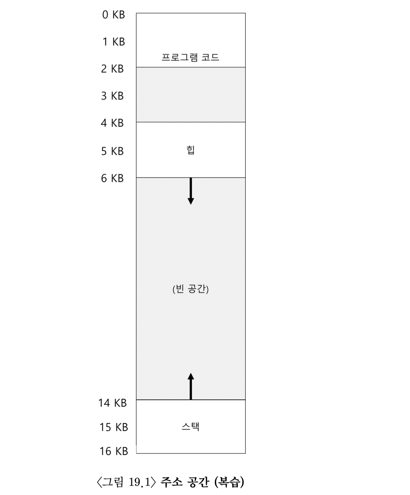
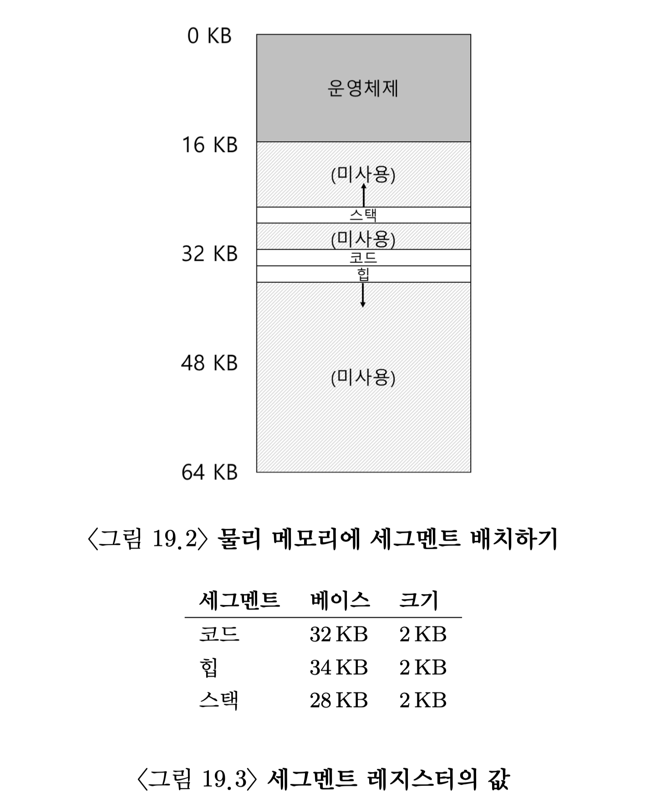
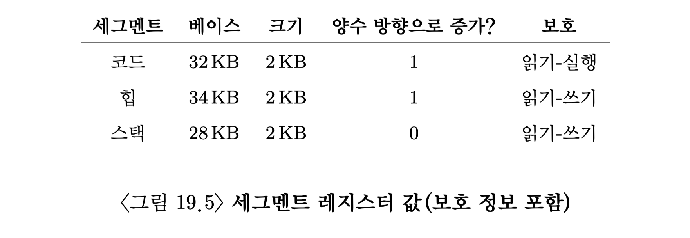

## 19 세그멘테이션 개요

지금까지 프로세스 주소 공간 전체를 메모리에 탑재하는 것을 가정

베이스와 바운드(한계) 레지스터를 사용하면 운영체제는 물리 메모리에 쉽게 재배치가 가능

하지만 그림 19.1에서 볼 수 있듯이 스택과 힙 사이의 공간은 사용되지 않더라도 물리 메모리를 차지하고 

프로세스의 주소 공간이 물리 메모리보다 큰 경우 실행이 어렵다.

즉, 베이스와 바운드 방식은 유연성이 떨어진다.



## 19.1 세그멘테이션: 베이스 / 바운드 (base / bound)의 일반화



베이스 & 바운드 방식을 해결하기 위한 아이디어 등장 

**→ 세그멘테이션(segmentation)**

### 세그멘트 핵심 원리

MMU 안에 오직 하나의 베이스 & 바운드 쌍이 존재하는것이 아니라 주소 공간의 논리적인 **세그멘트(segment)**마다 베이스와 바운드 쌍이 존재한다.

세그멘트는 특정 길이를 가지는 연속적인 주소 공간이다. 

책에서 기준으로 삼은 주소 공간에는 코드, 스택, 힙 세 종류의 세그멘트가 있다.

즉, 3개의 베이스 & 바운드 쌍이 존재한다.

세그멘테이션을 사용하면 운영체제는 각 세그멘트를 물리 메모리의 각기 다른 위치에 배치할 수 있고, 사용되지 않는 가상 주소 공간이 물리 메모리를 차지하는 것을 방지할 수 있다.

그림 19.2를 보면 그림 19.1의 주소 공간을 각 세그멘트들을 독립적으로 물리 메모리에 배치할 수 있다.

그림에서 볼 수 있듯이, 사용 중인 메모리에만 물리 공간이 할당된다. 

사용되지 않은 영역이 많은 대형 주소 공간을 **sparse address space** 라고 부른다.

세그멘트 지원을 위한 MMU 하드웨어 구조는 그림 19.3을 보면 알 수 있다.

3개의 세그멘트가 있으니 3개의 베이스 & 바운드 레지스터가 존재한다.

---

### 오프셋 계산 공식

offset = 가상 주소 - 세그먼트 시작 가상 주소

- 코드 세그먼트 offset = 100 - 0 = 100
- 힙 세그먼트 offset = 4200 - 4096 = 104

---

### 물리 주소 계산 공식

물리 주소 = 베이스 레지스터 + offset

- 코드: 32768 + 100 = **32868**
- 힙: 34816 + 104 = **34920**

---

### 코드 세그먼트 가상 주소 변환 예제

1. 가상 주소 100은 코드 세그먼트에 속함
1. 세그먼트의 **베이스 주소** = 32KB (32768)
1. 오프셋 = 100 - 0 = 100
1. 물리 주소 = 32768 + 100 = **32868**
1. **범위 검사**: 100 < 2048 (세그먼트 크기: 2KB) → 유효
1. 최종: 물리 주소 32868에서 메모리 접근 수행

### 힙 세그먼트 가상 주소 변환 예제

1. 가상 주소 4200은 힙 세그먼트에 속함
1. 힙 세그먼트의 **가상 시작 주소** = 4096 (4KB)
1. 오프셋 = 4200 - 4096 = 104
1. 베이스 주소 = 34KB (34816)
1. 물리 주소 = 34816 + 104 = **34920**
1. **범위 검사**: 104 < 4096 (4KB) → 유효
1. 최종: 물리 주소 34920에서 메모리 접근 수행

---

### 정리

| 세그먼트 | 가상 시작 주소 | 오프셋 계산 방식 | 베이스 레지스터 | 최종 물리 주소 계산 |
| --- | --- | --- | --- | --- |
| 코드 | 0 | offset = 가상 - 0(가상 시작 주소)  | 32768 (32KB) | 32768 + offset = 32868 |
| 힙 | 4096 | offset = 가상 - 4096(가상 시작 주소) | 34816 (34KB) | 34816 + offset = 34920 |

---

### 세그멘트 폴트(segment fault)

만약 힙의 마지막을 벗어난 7KB와 같은 잘못된 주소 공간을 접근하려고 한다면?

하드웨어가 범위를 벗어났다는 것을 감지하고 운영체제에게 트랩을 발생시킨다.

운영체제는 프로세스를 종료시킬 가능성이 크다.

이를 **세그멘트 폴트(segment fault / segment violation)** 이라고 부른다.

---

## 19.2 세그멘트 종류의 파악

책에서 나온 세그멘트의 종류는 3개이다. 즉 주소 공간을 세그멘트로 나누기 위해서는 2비트가 필요하다.


가상 주소 14비트 중에서 최상위 2비트를 사용한다.

최상위 2비트가 00이면 가상 주소가 코드 세그멘트를 가리킨다는 것을 알고, 베이스와 바운드 레지스터를 이용하여 가상 주소를 물리 메모리 주소로 변환한다.

**힙에 해당하는 가상 주소(4200) 변환 example**


1. 세그멘트(01) → 힙 세그멘트
1. 오프셋(1101000) → 64 + 32 + 8 = 104 
1. 물리 메모리 주소로 변환 → 34KB + 104 
1. 바운드 검사 → 104 < 4KB(4096) 유효  


```
SEG_MASK    -> 11000000000000
OFFSET_MASK -> 00111111111111

서브넷 마스크와 같은 개념
```

### 세그먼트 방식에서 MMU의 동작 정리 

1. **세그먼트 레지스터와 오프셋**
프로그램이 메모리에 접근하려고 할 때, **세그먼트 레지스터**는 현재 참조하고 있는 세그먼트의 **베이스 주소**를 제공, 이 베이스 주소와 메모리 접근 시 제공되는 **오프셋(offset)** 값을 이용하여 물리적 주소를 계산한다.
1. **베이스 바운드 레지스터**
MMU는 각 세그먼트에 대해 **베이스(Base) 레지스터**와 **바운드(Bound) 레지스터**를 관리

  - **베이스 레지스터**는 세그먼트의 시작 주소를 저장
  - **바운드 레지스터**는 세그먼트의 크기를 제한하는 값으로, 해당 세그먼트가 허용하는 주소 범위를 지정
1. **가상 주소 변환**
MMU는 **세그먼트 레지스터**에서 세그먼트의 베이스 주소를 얻고, 그 베이스 주소에 오프셋을 더하여 **가상 주소**를 **물리적 주소**로 변환
1. **세그먼트 폴트(Segmentation Fault)**
만약 오프셋이 **세그먼트의 바운드 레지스터** 값보다 크거나, 가상 주소가 세그먼트 크기를 벗어나면, MMU는 **세그먼트 폴트**를 발생시킨다. 이는 **잘못된 메모리 접근**을 시도했을 때 발생하며, 보통 **오류 처리**를 위해 운영체제가 개입한다.

---

## 19.3  스택


**스택은 힙과 코드와 다르게 반대 방향으로 확장된다.**

그래서 다른 방삭의 변환이 필요하다. 

먼저 간단한 하드웨어 추가가 필요하다. 베이스, 바운드 값뿐 아니라 하드웨어는 세그멘트가 어느 방향으로 확장되는지도 알아야 한다. 

하나의 비트를 사용하여 주소가 커지는 방향으로 확장하면 1, 작아지는 쪽으로 확장하면 0으로 설정할 수 있다.

그림 19.4는 이 사실을 반영하여 하드웨어가 관리해야 하는 정보를 표현하고 있다. 

**MMU가 주소 변환 및 유호성 검사에 사용하는 3가지 레지스터(정보)**

| 레지스터 | 역할 |
| --- | --- |
| Base | 세그먼트 시작 주소 |
| Bound | 세그먼트 크기 |
| Direction (1비트) | 확장 방향 (1: 위, 0: 아래) |

### 스택 세그멘트 가상 주소 물리 주소 매핑 예제

목표: 가상 주소 15KB → 물리 주소 27KB

베이스(28KB) 바운드(4KB)

### **1. 가상 주소 분해** 

가상 주소 15KB → 11 / 1100 0000 0000(14비트 이진수 표현)

상위 2비트 (11) → 세그먼트 번호 3 → 스택 세그멘트

나머지 비트(1100 0000 0000) → 3072 / 1024 → 3KB

### 2. 스택 세그멘트 음수 오프셋 구하기

오프셋 = 현재 위치 (3 KB) - 세그먼트 최대 크기 (4 KB) → -1KB 

### 3. 물리 주소 계산 

물리 주소 = 베이스 + 오프셋(offset) = 28KB + (-1KB) = 27KB

### 4. 바운드 검사

오프셋(-1KB) → 오프셋 절댓값(1KB)

1KB < 4KB → 유효

---

## 19.4 공유 지원 



 

메모리를 절약하기 위해 때로는 주소 공간들 간에 특정 메모리 세그멘트를 공유하는 것이 유용하다.

특히, 코드 공유가 일반적이며, 현재 시스템에서도 광범위하게 사용 중이다.

공유를 지원하기 위해, 하드웨어에 protection bit의 추가가 필요하다. 

세그멘트를 읽거나 쓸 수 있는지 혹은 코드를 실행시킬 수 있는지를 나타낸다. 그림 19.5 참고

코드 세그멘트를 읽기 전용으로 설정하면 주소 공간의 독립성을 유지하면서도, 여러 프로세스가 주소 공간의 일부를 공유할 수 있다. 각 프로세스는 여전히 자신의 전용 메모리를 사용하고 있다고 생각하지만 운영체제는 변경이 불가능하도록 설정된 메모리 영역을 비밀리에 공유시켜 그런 환상을 유지한다. 

protection bit를 추가 했으니 하드웨어 알고리즘 또한 수정되어야 한다.

가상 주소가 범위 내에 있는지, 가상 주소를 물리 주소로 변환하는것 이외에 특정 엑세스가 허용되는지를 protection bit를 확인하고 프로세스가 protection bit와 다른 동작을 시도할 때 예외를 발생시켜 운영체제가 프로세스를 처리할 수 있도록 해야한다. 

---

## 19.5 소단위 대 대단위 세그멘테이션

지금까지 소수의 세그멘트(코드, 스택, 힙)만을 지원하는 시스템에 주로 초점을 맞추었다.

이런 세그멘테이션을 **대단위(coarse-grained) 세그멘테이션** 이라고 부른다 주소 공간을 큰 단위의 공간으로 분할하기 때문

주소 공간을 더 작은 단위로 세분화하는 세그멘테이션을 **소단위(fine-grained) 세그멘테이션**이라고 부른다.

많은 세그멘트를 지원하기 위해서는 여러 세그멘트의 정보를 메모리에 저장할 수 있는 세그멘트 테이블 같은 하드웨어가 필요하다. **세그멘트 테이블**을 이용하면 매우 많은 세그멘트를 손쉽게 생성하고 사용할 수 있다.

**대단위 세그멘테이션 vs 소단위 세그멘테이션** 

대단위 세그멘테이션은 단순하지만 융통성이 부족하고, 소단위 세그멘테이션은 복잡하지만 메모리를 더 효율적으로 활용할 수 있다.

---

## 프로세스 전환과 MMU 레지스터 설정 흐름

1. **각 프로세스는 자신의 세그멘트 테이블을 가짐**
- 이 테이블은 PCB(Process Control Block) 안에 **포인터로 보관**되어 있음
  - 테이블에는 **세그먼트 번호, Base, Limit, 권한, 방향** 등의 정보가 있음
1. **문맥 전환(Context Switch) 시**
- 운영체제는 새로 실행할 프로세스의 PCB를 참조
  - PCB에 있는 **세그멘트 테이블 포인터**를 이용해 해당 테이블을 가져옴
1. **CPU는 MMU 레지스터를 세팅함**
- 각 세그먼트(Base, Limit 등)의 정보를 MMU의 **Base Register**, **Limit Register** 등에 로드
  - 이후부터 MMU는 논리 주소 → 물리 주소 변환 시 이 레지스터 값을 사용

 **MMU 레지스터를 매번 메모리에서 읽지는 않음**

- 성능 문제 때문에, MMU는 보통 **레지스터에 자주 쓰는 세그먼트 정보**만 올려두고 사용
- 프로세스 전환 시, 운영체제가 이 레지스터들을 새로 세팅해줌 (context switching의 일부)

---

## 19.6 운영체제의 지원

운영체제는 문맥 교환 시 어떤 일을 해야할까?

세그멘트 레지스터의 저장과 복원이다. 운영체제는 프로세스가 다시 실행하기 전에 레지스터들을 올바르게 설정해야 한다. 

미사용 중인 물리 메모리 공간의 관리는 어떻게할까?

프로세스는 많은 세그멘트를 가질 수 있고, 각 세그멘트의 크기가 다를 수 있다.


그림 19.6 왼쪽을 보면 세그멘트와 세그멘트 사이에 작은 빈 공간들로 채워진다. 이 작은 빈 공간들은 새로이 생겨나는 세그멘트에 할당하기도 힘들고 기존 세그멘트를 확장하는 데에도 도움이 되지 않는다.

이 문제를 **외부 단편화(external fragmentation)**라고 부른다. 

이 문제의 해결책 중 하나는 기존의 세그멘트를 정리하여 물리 메모리를 압축(compact)하는 것이다.

현재 실행 중인 프로세스를 중단하고 그들의 데이터를 하나의 연속된 공간에 복사하고, 세그멘트 레지스터가 새로운 물리 메모리 위치를 가리키게 하여, 자신의 작업할 큰 빈 공간을 확보할 수 있다. 

하지만 세그멘트 복사는 메모리에 부하가 큰 연산이고 압축은 비용이 많이 든다. → 오버헤드

또는 빈 공간 리스트를 관리하는 알고리즘을 사용한다. 

할당 가능한 메모리 영역을 리스트 형태로 유지하고 최적 적합(best-fit), 최악 적합(worst-fit), 최초 적합(first-fit)같은 알고리즘이 있다.

하지만 이런 알고리즘이 아무리 정교하게 동작한다고 해도 외부 단편화는 여전히 존재한다.

### 빈 공간 리스트 알고리즘

- **빈 공간 리스트**는 메모리 내에 존재하는 사용되지 않은 연속적인 공간들을 추적하기 위한 자료구조.
- 각 빈 공간은 시작 주소와 크기를 가지고 있고, 이들을 리스트(연결 리스트 또는 배열 등)로 관리한다.
- 프로세스가 메모리를 요청하면, 이 리스트를 검색해서 적절한 빈 공간을 찾아주는 게 핵심이다.

### **최초 적합(First-Fit)**

- 가장 먼저 발견된, 요청한 크기보다 크거나 같은 빈 공간에 할당.
- 검색은 항상 리스트의 처음부터 시작.
- 남은 빈 공간이 있다면 분할하여 빈 공간 리스트에 다시 추가.
- 장단점
- 장점: 빠름 (처음 찾는 게 목표이므로 중간에 멈출 수 있다)
  - 단점: 앞부분에 작은 조각들이 많이 생겨 **외부 단편화**가 심해질 수 있음

### **최적 적합(Best-Fit)**

- 요청한 크기와 **가장 근접한(작은 차이의)** 빈 공간에 할당.
- 리스트 전체를 검색해서 가장 **딱 맞는** 빈 공간을 찾음.
- 장단점
- 장점: 큰 빈 공간의 낭비를 줄일 수 있음
  - 단점
- 리스트 전체를 다 검색해야 하므로 느림
    - 할당하고 남은 빈 공간이 매우 작아서 쓸 수 없는 미세 조각들이 많이 생길 수 있음 
→ 오히려 외부 단편화를 악화

### **최악 적합(Worst-Fit)**

- 가장 **큰** 빈 공간에 할당.
- 큰 빈 공간을 쪼개어 사용하면, 남는 공간도 쓸 만한 크기일 가능성이 있음.
- 장점: 미세 조각이 줄어들 수 있음
- 단점
- 리스트 전체를 다 검색해야 하므로 느림
  - 큰 공간이 계속 나눠지면 결국 최악의 상황이 되기도 함

---

## 19.7 요약

세그멘테이션은 메모리에 순서대로 할당보다 많은 문제를 해결하며, 메모리 가상화를 효과적으로 실현할 수 있다.

특히 논리 세그멘트 사이의 큰 공간에 대한 낭비를 피함(내부 단편화 해결), 코드 공유의 장점도 부가적으로 발생

하지만 세그멘트의 크기가 일정하지 않기 때문에 외부 단편화가 발생하고 추가적인 메모리 할당 요청을 충족시키는 것이 어렵다. 알고리즘을 사용해 주기적으로 메모리를 압축할 수 있지만 이건 오버헤드가 큰 작업이다.

또한 프로세스의 전체 메모리 크기가 물리 메모리 크기보다 크다면 실행이 불가능하다. 즉, 여전히 모든 메모리가 물리 메모리에 존재해야 한다.

---

