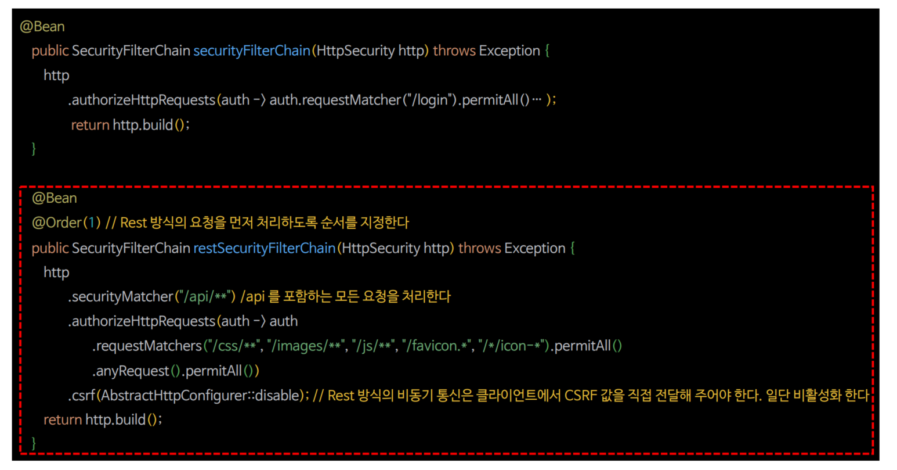
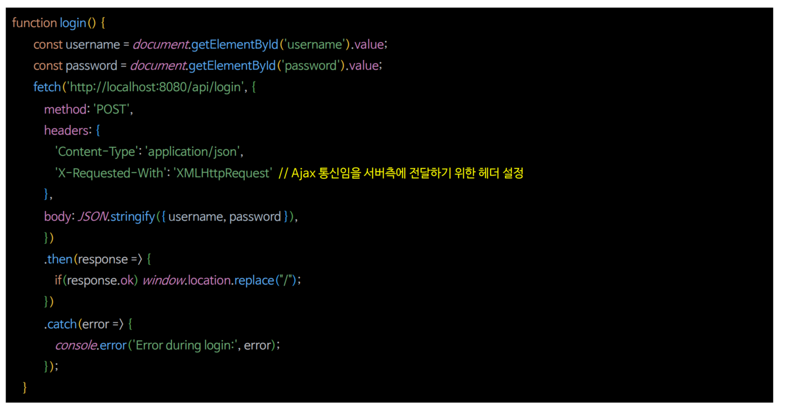

# ***Rest 인증 사용자 정의 보안 설정***



- *@Order가 안 붙어있는 SecurityFilterChain은 FilterChainProxy 에서의 제일 후순위가 된다.*
- *Rest 방식의 비동기 통신에서는 클라이언트에서 CSRF 토큰 값을 직접 전달해 주어야 한다. 일단 여기서는 비활성화*

# ***클라이언트 구현***



- *'X-Requested-With': 'XMLHttpRequest'  → Ajax 통신임을 서버측에 전달하기 위한 헤더 설정* 

# ***구현***

***SecurityConfig***

```java
@EnableWebSecurity
@Configuration
@RequiredArgsConstructor
public class SecurityConfig {
    private final AuthenticationProvider authenticationProvider;
    private final AuthenticationDetailsSource authenticationDetailsSource;
    private final AuthenticationSuccessHandler successHandler;
    private final AuthenticationFailureHandler failureHandler;
    @Bean
    @Order(1)
    public SecurityFilterChain restSecurityFilterChain(HttpSecurity http) throws Exception {
        http
                .securityMatcher("/api/**")
                .authorizeHttpRequests(auth -> auth
                        .requestMatchers("/css/**", "/images/**",
                                "/js/**", "/favicon.*", "/*/icon/-*").permitAll()
                        .anyRequest().permitAll())
                .csrf(AbstractHttpConfigurer::disable);

        return http.build();
    }

    @Bean
    @Order(2)
    public SecurityFilterChain securityFilterChain(HttpSecurity http) throws Exception{
        http
                .authorizeHttpRequests(authorize -> authorize
                        .requestMatchers("/css/**", "/images/**",
                                "/js/**", "/favicon.*", "/*/icon/-*").permitAll()
                        .requestMatchers("/", "/signup", "/login*").permitAll()
                        .requestMatchers("/user").hasRole("USER")
                        .requestMatchers("/admin").hasRole("ADMIN")
                        .requestMatchers("/manager").hasRole("MANAGER")
                        .anyRequest().authenticated())
                .authenticationProvider(authenticationProvider)
                .formLogin(form -> form
                        .loginPage("/login")
                        .authenticationDetailsSource(authenticationDetailsSource)
                        .successHandler(successHandler)
                        .failureHandler(failureHandler)
                        .permitAll())
                .exceptionHandling(ex -> ex.accessDeniedHandler(
                        new FormAccessDeniedHandler("/denied")));
        return http.build();
    }
}
```

- *`/api/...`* *경로는 @Order(1)에 해당하는 SecurityFilterChain이 처리한다.* 
- *해당 SecurityFilterChain은 이제 비동기 통신을 위한 SecurityFilterChain*

***LoginController***

```java
@Controller
public class LoginController {
    @GetMapping(value="/login")
    public String login(@RequestParam(value = "error", required = false) String error,
                        @RequestParam(value = "exception", required = false) String exception, Model model){
        System.out.println("error = " + error);
        System.out.println("exception = " + exception);
        model.addAttribute("error", error);
        model.addAttribute("exception", exception);
        return "/login/login";
    }
    @GetMapping(value="/api/login")
    public String apiLogin(){
        return "/rest/login";
    }
    // 생략 ...
```

- *`/api/login`* *에 매핑된 메소드는 비동기 통신으로 로그인을 처리하기 위한 view를 반환한다.*

***RestLoginController***

```java
@RestController
public class RestLoginController {
    @PostMapping("/api/login")
    public String restLogin(){
        return "restLogin";
    }
}
```

- *비동기 통신으로 로그인을 처리하기 위한 api 이다.* 
- *아직 비동기 통신을 구현하지 않았다.* 

***/api/login.html 일부***

```java
<script>
    function login() {
        const username = document.getElementById('username').value;
        const password = [REDACTED];

        fetch('http://localhost:8080/api/login', {
            method: 'POST',
            headers: {
                'Content-Type': 'application/json',
                'X-Requested-With': 'XMLHttpRequest'
            },
            body: JSON.stringify({ username, password }),
        })
            .then(response => {
                if(response.ok){
                    window.location.replace("/");
                    console.log(data);
                }
            })
            .catch(error => {
                console.error('Error during login:', error);
            });
    }
</script>


<div class="login-form">
    <h2>Login</h2>
    <div th:if="${param.error}" class="form-group">
        <span th:text="${exception} ?: '잘못된 아이디나 암호입니다'" class="alert alert-danger"></span>
    </div>
    <div class="form-group">
        <label for="username">Username</label>
        <input type="text" class="form-control" id="username" required>
    </div>
    <div class="form-group">
        <label for="password">Password</label>
        <input type="password" class="form-control" id="password" required>
    </div>
    <button onclick="login()" class="btn btn-primary">Login</button>
</div>
```

