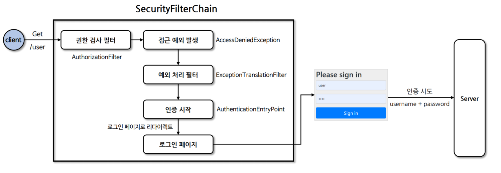
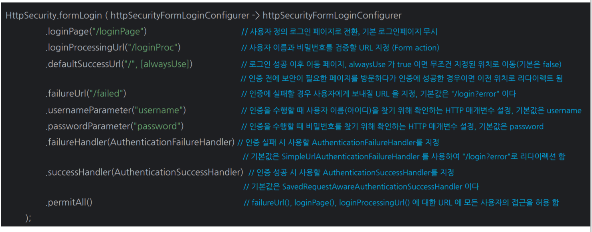
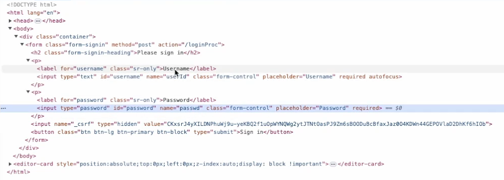

# **폼 인증** 

- HTTP 기반의 폼 로그인 인증 메커니즘을 활성화하는 API
- 사용자 인증을 위한 사용자 정의 로그인 페이지를 쉽게 구현할 수 있다 
- 기본적으로 스프링 시큐리티가 제공하는 기본 로그인 페이지를 사용하며 사용자 이름과 비밀번호 필드가 포함된 간단한 로그인 양식을 제공한다 
- 사용자는 웹 폼을 통해 자격 증명(사용자 이름과 비밀번호)를 제공하고 Spring Security는 HttpServletRequest에서 이 값을 읽어 온다 



# **formLogin() API**

**FormLoginConfigurer** 설정 클래스를 통해 여러 API를 설정할 수 있다 

내부적으로 **UsernamePasswordAuthenticationFilter**가 생성되어 폼 방식의 인증 처리를 담당하게 된다 



```java
@EnableWebSecurity(debug = false) // default: false
@Configuration
public class SecurityConfig {
    @Bean
    public SecurityFilterChain securityFilterChain(HttpSecurity http) throws Exception{
        http
                .authorizeHttpRequests(auth -> auth.anyRequest().authenticated())
                .formLogin(form -> form
                        .loginPage("/loginPage")
                        .loginProcessingUrl("/loginProc")
                        .defaultSuccessUrl("/", true)
                        .failureUrl("/failed")
                        .usernameParameter("userId")
                        .passwordParameter("passwd")
                        .successHandler((request, response, authentication) -> {
                            System.out.println("authentication = " + authentication);
                            response.sendRedirect("/home");
                        })
                        .failureHandler((request, response, exception) -> {
                            System.out.println("exception = " + exception.getMessage());
                            response.sendRedirect("/login");
                        })
                        .permitAll()
                );

        return  http.build();
    }
    @Bean
    public UserDetailsService userDetailsService(){
        UserDetails user = User.withUsername("user12")
                .password("{noop}1111")
                .roles("USER").build();
        return new InMemoryUserDetailsManager(user);
    }
}
```

**defaultSuccessUrl("/", true) vs successHandler**

`defaultSuccessUrl` 도 내부에서 `SavedRequestAwareAuthenticationSuccessHandler`를 사용한다.

내가 `successHanlder`를 커스텀하게 구현하면 해당 동작이 우선이다.



<form> 태그의 action을 보면 `processingUrl`인 `/loginProc` 이고

<input> 태그의 `name=userId, name=passwd` 이다. 

이는 `.usernameParameter("userId") .passwordParameter("passwd")` 2개의 설정 결과

