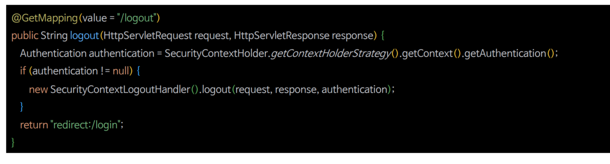
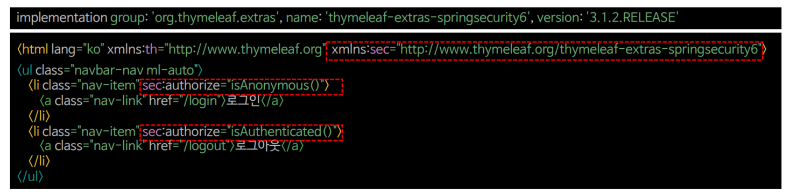
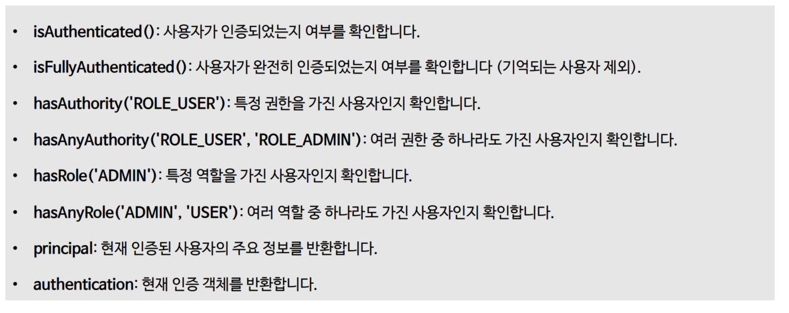
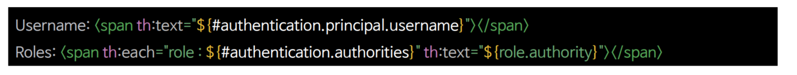

# ***LoginController***



# ***build.gradle & header.html***



***build.gradle dependency 추가*** 

```java
implementation group: 'org.thymeleaf.extras', name: 'thymeleaf-extras-springsecurity6', version: '3.1.2.RELEASE'
```

- *`thymeleaf-extras-springsecurity6`* *: Thymeleaf와 Spring Security 통합하기 위해 사용되는 추가 기능 모듈* 
- *Spring Security 태그 지원* 
```html
<sec:authorize access="hasRole('ROLE_ADMIN')">
<p>관리자만 볼 수 있는 콘텐츠입니다.</p>
</sec:authorize>
```
- *표현식 지원* 
```html
<p>현재 사용자: <span th:text="${#authentication.name}">사용자 이름</span></p>
```
- *로그인 로그아웃 상태 확인* 
```html
<sec:authorize access="isAuthenticated()">
    <p>로그인 상태입니다.</p>
</sec:authorize>
<sec:authorize access="isAnonymous()">
    <p>비로그인 상태입니다.</p>
</sec:authorize>
```

# ***Thymeleaf 보안 표현식 종류***



***example***



# *구현하기*

***header.html***

```html
<!DOCTYPE html>
<html lang="ko" xmlns:th="http://www.thymeleaf.org"
      xmlns:sec="http://www.thymeleaf.org/thymeleaf-extras-springsecurity6">
<header th:fragment="header">
    <nav class="navbar navbar-expand-lg navbar-custom">
         <a class="navbar-brand" href="#">Spring Security Master</a>
        <div class="collapse navbar-collapse" id="navbarSupportedContent">
            <ul class="navbar-nav ml-auto">
                <li class="nav-item" sec:authorize="isAnonymous()">
                    <a class="nav-link" href="/login">로그인</a>
                </li>
                <li class="nav-item" sec:authorize="isAuthenticated()">
                    <a class="nav-link" href="/logout">로그아웃</a>
                </li>
                <li class="nav-item" sec:authorize="isAnonymous()">
                    <a class="nav-link" href="/signup">회원가입</a>
                </li>
            </ul>
        </div>
    </nav>
</header>
```

- *`<li class="nav-item" sec:authorize="isAuthenticated()">`* 
- *인증 상태이면 나타난다.*
- *`<li class="nav-item" sec:authorize="isAnonymous()">`* 
- *익명 사용자면 나타난다.*

***LoginController***

```java
@GetMapping("/logout")
public String logout(HttpServletRequest request, HttpServletResponse response){
    Authentication authentication = SecurityContextHolder.getContextHolderStrategy().getContext().getAuthentication();
    if(authentication != null){
        new SecurityContextLogoutHandler().logout(request, response, authentication);
    }
    return "redirect:/login";
}
```

# *나만의 Custom*

*Spring Security가 제공하는 기본* *`POST /logout`* *활용하기*

*굳이 LoginController 에서 로그아웃 API를 만들 필요 없이 SpringSecurity가 제공하는 default 로그아웃 동작을 사용한다.*

```html
<ul class="navbar-nav ml-auto">
    <li class="nav-item" sec:authorize="isAnonymous()">
        <a class="nav-link" href="/login">로그인</a>
    </li>
    <li class="nav-item" sec:authorize="isAuthenticated()">
        <form th:action="@{/logout}" method="post">
            <button type="submit" class="btn btn-primary">로그아웃</button>
        </form>
    </li>
    <li class="nav-item" sec:authorize="isAnonymous()">
        <a class="nav-link" href="/signup">회원가입</a>
    </li>
</ul>
```

- *`<form th:action="@{/logout}" method="post">`*  *→ Spring Security 로그아웃 경로, HTTP method*

