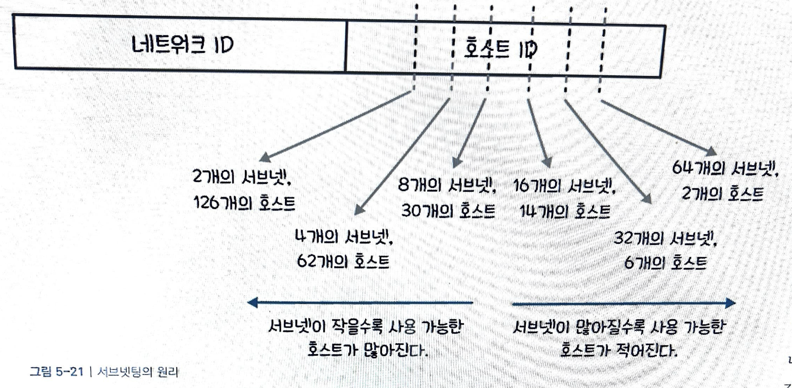
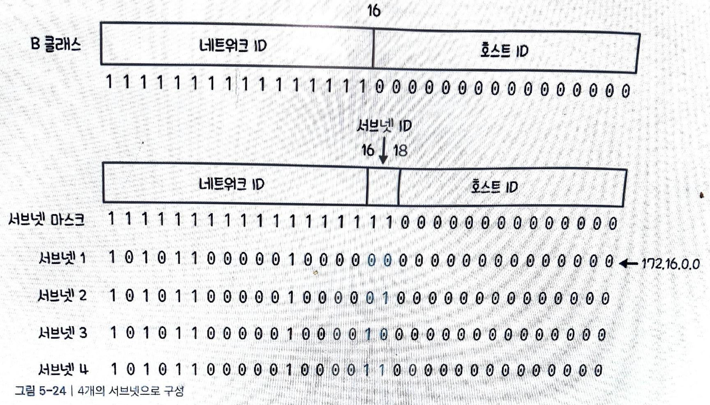

### 서브넷의 개념

서브넷과 서브넷 마스크는 네트워크 ID와 호스트 ID를 이용한다.

네트워크를 A 클래스, B 클래스, C 클래스 처럼 클래스 단위로 하나의 네트워크를 사용하는 것은 비효율적인 방법이다. 하나의 네트워크에 속한 모든 컴퓨터는 브로드캐스트 주소로 오는 데이터를 모두 수신해야 하고, 그것이 내가 필요한 정보인지 필터링해야 한다. 

그래서 하나의 네트워크를 좀 더 효율적으로 즉, 더 작은 단위로 사용해보고자 등장한 개념이 서브넷이다.

**서브넷(subnet)은 하나의 네트워크가 분할된 작은 네트워크이다. 이때 작은 네트워크로 나누는 작업을 서브넷팅(subnetting)이라고 한다.**

---

### 서브넷팅의 원리

**서브넷팅이란 IP 주소에는 네트워크 ID와 호스트 ID가 있는데, 네트워크 ID는 그대로 두고 호스트 ID를 쪼개는 방식이다.** 

이때 쪼개는 개수가 적을수록 사용 가능한 호스트 수가 많아진다.

**정리하면 서브넷팅은 호스트 ID를 서브넷 ID와 호스트 ID로 나누는 작업이다.**

---

### 서브넷 마스크

IP 주소를 서브넷팅하면 네트워크 ID와 호스트 ID의 경계를 판별하기가 어려울 때가 많은데 이때 서브넷 마스크를 사용한다. 즉, **서브넷 마스크(Subnet Mask)란 IP 주소에서 네트워크 ID와 호스트 ID를 구분하기 위한 구분자다.**

서브넷 마스크를 구하기 위해서는 네트워크 ID를 모두 1로 채우고 호스트 ID를 0으로 채운다.

**서브넷 마스크 표기법**

- **CIDR 표기법: 192.168.1.1/24**
- /24는 네트워크 ID의 비트 수이다.
- **255.255.255.0**

---

### 서브넷팅 해보기 

네트워크 주소: 172.16.0.0

서브넷 마스크: 255.255.0.0

이를 4개의 서브넷으로 나눠보자.

4개의 조합이 나오기 위해서는 호스트 ID의 2개의 값만 이용하면 된다.

| **서브넷 번호** | **네트워크 주소** | **첫 번째 호스트** | **마지막 호스트** | **브로드캐스트 주소** |
| --- | --- | --- | --- | --- |
| 서브넷1 | 172.16.0.0 | 172.16.0.1 | 172.16.63.254 | 172.16.63.255 |
| 서브넷2 | 172.16.64.0 | 172.16.64.1 | 172.16.127.254 | 172.16.127.255 |
| 서브넷3 | 172.16.128.0 | 172.16.128.1 | 172.16.191.254 | 172.16.191.255 |
| 서브넷4 | 172.16.192.0 | 172.16.192.1 | 172.16.255.254 | 172.16.255.255 |

---

