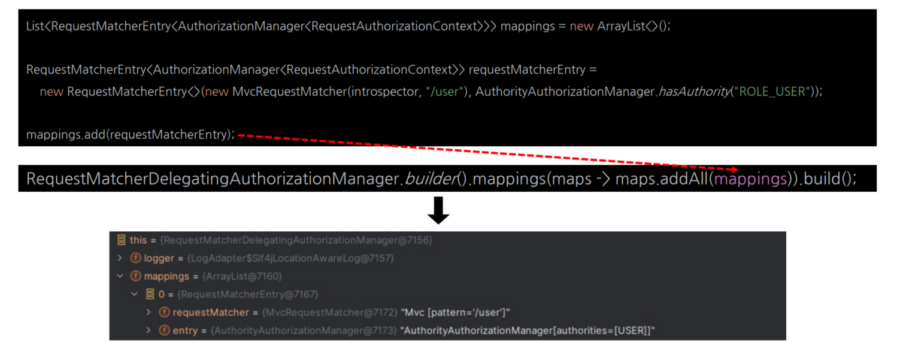
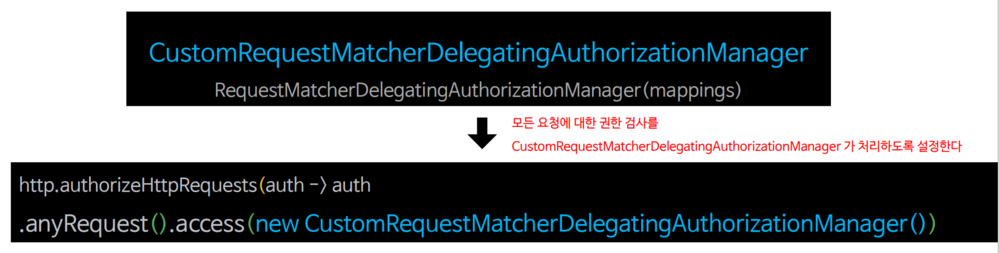
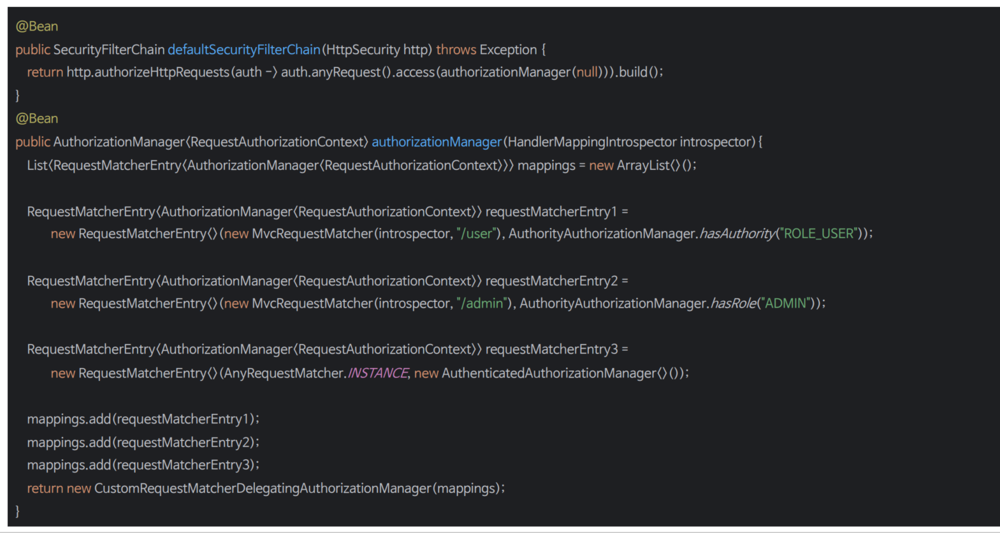
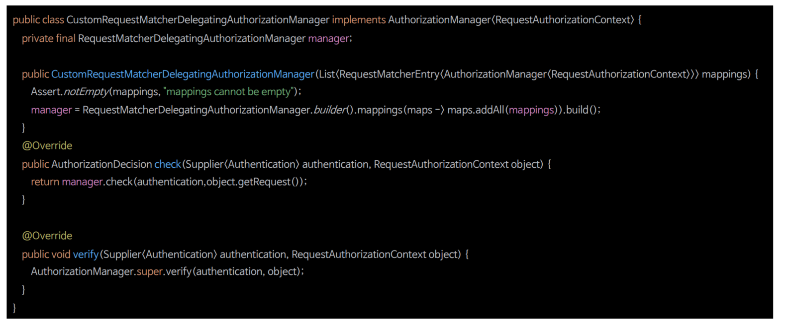
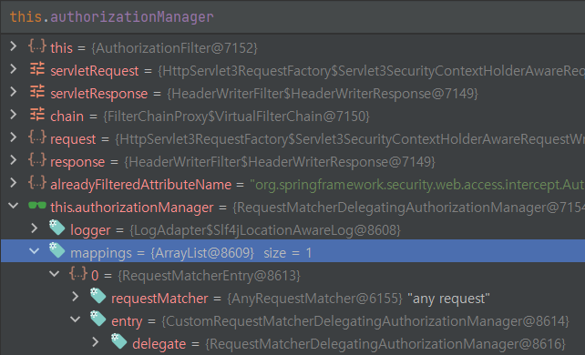
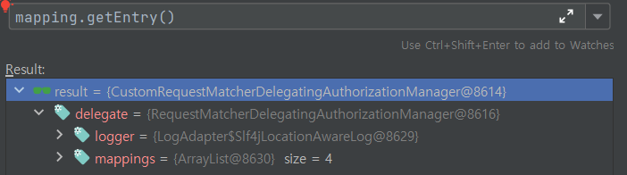

# **개요** 

- `RequestMatcherDelegatingAuthorizationManager`의 mappings 속성에 직접 `RequestMatcherEntry` 객체를 생성하고 추가한다 

**RequestMatcherEntry**




- **RequestMatcherEntry 생성자** 
```java
public RequestMatcherEntry(RequestMatcher requestMatcher, T entry) {
		this.requestMatcher = requestMatcher;
		this.entry = entry;
	}
```

  - 매개변수: RequestMatcher, AuthorizationManager<T> 
  - 매개변수: MvcRequestMatcher(introspector, “/user”), AuthorityAuthorizationManager
- AuthorityAuthorizationManager.hasAuthority(”ROLE_USER”)
- hasAuthority: static 메소드를 통해 간편하게 생성 가능

**RequestMatcherDelegatingAuthorizationManager**

- RequestMatcherDelegatingAuthorizationManager.builder().mappings(consumer) 통해 생성  

# **적용**

- `RequestMatcherDelegatingAuthorizationManager`를 감싸는 `CustomRequestMatcherDelegatingAuthorizationManager`를 구현한다 



# **적용 후 구조**


# **SecurityConfig.java**



# **CustomRequestMatcherDelegatingAuthorizationManager**



- 요청에 대한 권한 검사를 `RequestMatcherDelegatingAuthorizationManager` 객체가 수행하도록 한다
- `RequestMatcherDelegatingAuthorizationManager` → `CustomRequestMatcherDelegatingAuthorizationManager` →
`RequestMatcherDelegatingAuthorizationManager` 
- 구조는 조금 더 개선이 필요하다

# 테스트

**SecurityConfig**

```java
@EnableWebSecurity
@Configuration
public class SecurityConfig {
    @Bean
    public SecurityFilterChain securityFilterChain(HttpSecurity http) throws Exception{
        http.authorizeHttpRequests(authorize -> authorize
                .anyRequest().access(authorizationManager(null)))
                .formLogin(Customizer.withDefaults())
                .csrf(AbstractHttpConfigurer::disable);
        return http.build();
    }
    @Bean
    public AuthorizationManager<RequestAuthorizationContext> authorizationManager(HandlerMappingIntrospector introspector){
        List<RequestMatcherEntry<AuthorizationManager<RequestAuthorizationContext>>> mappings = new ArrayList<>();

        RequestMatcherEntry<AuthorizationManager<RequestAuthorizationContext>> requestMatcherEntry1
                = new RequestMatcherEntry<>(
                        new MvcRequestMatcher(introspector, "/user"),
                        AuthorityAuthorizationManager.hasAuthority("ROLE_USER"));

        RequestMatcherEntry<AuthorizationManager<RequestAuthorizationContext>> requestMatcherEntry2
                = new RequestMatcherEntry<>(
                        new MvcRequestMatcher(introspector, "/db"),
                        AuthorityAuthorizationManager.hasAuthority("ROLE_DB"));

        RequestMatcherEntry<AuthorizationManager<RequestAuthorizationContext>> requestMatcherEntry3
                = new RequestMatcherEntry<>(
                        new MvcRequestMatcher(introspector, "/admin"),
                        AuthorityAuthorizationManager.hasAuthority("ROLE_ADMIN"));

        RequestMatcherEntry<AuthorizationManager<RequestAuthorizationContext>> requestMatcherEntry4
                        = new RequestMatcherEntry<>(
                                AnyRequestMatcher.INSTANCE,
                                // default strategy = AuthenticatedAuthorizationStrategy
                                new AuthenticatedAuthorizationManager<>());

        mappings.add(requestMatcherEntry1);
        mappings.add(requestMatcherEntry2);
        mappings.add(requestMatcherEntry3);
        mappings.add(requestMatcherEntry4);

        return new CustomRequestMatcherDelegatingAuthorizationManager(mappings);
    }

    @Bean
    public UserDetailsService userDetailsService(){
        UserDetails user = User.withUsername("user").password("{noop}1111").roles("USER").build();
        UserDetails db = User.withUsername("db").password("{noop}1111").authorities("ROLE_DB").build();
        UserDetails admin = User.withUsername("admin").password("{noop}1111").roles("ADMIN","SECURE").build();
        return  new InMemoryUserDetailsManager(user, db, admin);
    }
}
```

**SecurityConfig: @Configuration - 빈 자동 주입** 

```java
// SecurityFilterChain 빈을 만드는 코드 일부 
.anyRequest().access(authorizationManager(null)))

@Bean
public AuthorizationManager<RequestAuthorizationContext> authorizationManager(
HandlerMappingIntrospector introspector)
{
	// 생략 ...
}
```

- 코드에서는 `null`을 넘기지만 `HandlerMappingIntrospector` 타입의 빈을 자동주입 하는걸 디버깅으로 확인했다. 왜 이렇게 동작할까?

### Spring의 빈 주입 방식

Spring은 `@Bean` 메서드에서 파라미터가 있는 경우, 해당 파라미터의 타입에 맞는 빈을 애플리케이션 컨텍스트에서 찾아 자동으로 주입한다

# **CustomRequestMatcherDelegatingAuthorizationManager**

```java
public class CustomRequestMatcherDelegatingAuthorizationManager implements AuthorizationManager<RequestAuthorizationContext> {
    private final RequestMatcherDelegatingAuthorizationManager delegate;
    public CustomRequestMatcherDelegatingAuthorizationManager(
            List<RequestMatcherEntry<AuthorizationManager<RequestAuthorizationContext>>> mappings) {
        this.delegate = RequestMatcherDelegatingAuthorizationManager.builder().mappings(maps -> maps.addAll(mappings)).build();
    }
    @Override
    public void verify(Supplier<Authentication> authentication, RequestAuthorizationContext object) {
        AuthorizationManager.super.verify(authentication, object);
    }
    @Override
    public AuthorizationDecision check(Supplier<Authentication> authentication, RequestAuthorizationContext object) {
        return delegate.check(authentication, object.getRequest());
    }
}
```

# **“/” 경로 요청 디버깅 (흐름 파악하기)**

**AuthorizationFilter**

```java
try {
		AuthorizationDecision decision = this.authorizationManager.check(this::getAuthentication, request);
		this.eventPublisher.publishAuthorizationEvent(this::getAuthentication, request, decision);
		if (decision != null && !decision.isGranted()) {
			throw new AccessDeniedException("Access Denied");
		}
		chain.doFilter(request, response);
	}
	finally {
		request.removeAttribute(alreadyFilteredAttributeName);
	}
```

- 해당 코드는 doFilter 메소드의 일부이다. 
- 내부에 가지고 있는 **authorizationManager.check()**를 통해 **AuthorizationDecision** 객체를 받는다.



- `this.authorizationManager = RequestMatcherDelegatingAuthorizationManager@7154`
- mappings.size = 1
- requestMatcher = anyRequest
    - entry = CustomRequestMatcherDelegatingAuthorizationManager

**RequestMatcherDelegatingAuthorizationManager**

```java
for (RequestMatcherEntry<AuthorizationManager<RequestAuthorizationContext>> mapping : this.mappings) {
		RequestMatcher matcher = mapping.getRequestMatcher();
		MatchResult matchResult = matcher.matcher(request);
		if (matchResult.isMatch()) {
			AuthorizationManager<RequestAuthorizationContext> manager = mapping.getEntry();
			if (this.logger.isTraceEnabled()) {
				this.logger.trace(
						LogMessage.format("Checking authorization on %s using %s", requestLine(request), manager));
			}
			return manager.check(authentication,
					new RequestAuthorizationContext(request, matchResult.getVariables()));
		}
	}
```

- 해당 코드는 check() 메소드의 일부분 
- mappings for문을 돌면서 matchResult(요청 경로와 RequestMatcherEntry가 가지는 RequestMatcher가 일치하면  RequestMatcherEntry가 가지는 AuthorizationManager를 호출해서 
요청을 위임한다.
- 현재 AuthorizationManager는 CustomRequestMatcherDelegatingAuthorizationManager



**CustomRequestMatcherDelegatingAuthorizationManager**

```java
private final RequestMatcherDelegatingAuthorizationManager delegate;

@Override
public AuthorizationDecision check(Supplier<Authentication> authentication, RequestAuthorizationContext object) {
    return delegate.check(authentication, object.getRequest());
}
```

**RequestMatcherDelegatingAuthorizationManager - CustomRequestMatcherDelegatingAuthorizationManager (delegate)**

- mappings에는 4개의 RequestMatcherEntry가 존재한다. 
- `/` 경로는 AnyRequestMatcher에 해당하는 경로여서 최종적으로 AuthenticatedAuthorizationManager가 처리하는데 이때 전략을 기본 전략인 AuthenticatedAuthorizationStrategy를 사용하기 때문에 최종적으로 AuthorizationDecision 내부는 false가 된다.
- `AccessDeniedException`이 throw
- 익명 사용자이기 때문에 `AuthenticatedException`으로 다시 throw


# **직접 구조 바꿔보기 (인프런 링크)**

[https://www.inflearn.com/course/lecture?courseSlug=%EC%8A%A4%ED%94%84%EB%A7%81-%EC%8B%9C%ED%81%90%EB%A6%AC%ED%8B%B0-%EC%99%84%EC%A0%84%EC%A0%95%EB%B3%B5&unitId=208608&tab=community&category=questionDetail&q=1457201](https://www.inflearn.com/course/lecture?courseSlug=%EC%8A%A4%ED%94%84%EB%A7%81-%EC%8B%9C%ED%81%90%EB%A6%AC%ED%8B%B0-%EC%99%84%EC%A0%84%EC%A0%95%EB%B3%B5&unitId=208608&tab=community&category=questionDetail&q=1457201)

```java
@EnableWebSecurity
@Configuration
public class SecurityConfig {
    @Bean
    public SecurityFilterChain securityFilterChain(HttpSecurity http, HandlerMappingIntrospector introspector) throws Exception{
        http
                .addFilterAt(authorizationFilter(introspector), AuthorizationFilter.class)
                .formLogin(Customizer.withDefaults())
                .csrf(AbstractHttpConfigurer::disable);
        return http.build();
    }
    @Bean
    public AuthorizationFilter authorizationFilter(HandlerMappingIntrospector introspector){
        List<RequestMatcherEntry<AuthorizationManager<RequestAuthorizationContext>>> mappings = new ArrayList<>();

        RequestMatcherEntry<AuthorizationManager<RequestAuthorizationContext>> requestMatcherEntry1
                = new RequestMatcherEntry<>(
                        new MvcRequestMatcher(introspector, "/user"),
                        AuthorityAuthorizationManager.hasAuthority("ROLE_USER"));

        RequestMatcherEntry<AuthorizationManager<RequestAuthorizationContext>> requestMatcherEntry2
                = new RequestMatcherEntry<>(
                        new MvcRequestMatcher(introspector, "/db"),
                        AuthorityAuthorizationManager.hasAuthority("ROLE_DB"));

        RequestMatcherEntry<AuthorizationManager<RequestAuthorizationContext>> requestMatcherEntry3
                = new RequestMatcherEntry<>(
                        new MvcRequestMatcher(introspector, "/admin"),
                        AuthorityAuthorizationManager.hasAuthority("ROLE_ADMIN"));

        RequestMatcherEntry<AuthorizationManager<RequestAuthorizationContext>> requestMatcherEntry4
                        = new RequestMatcherEntry<>(
                                AnyRequestMatcher.INSTANCE,
                                // default strategy = AuthenticatedAuthorizationStrategy
                                new AuthenticatedAuthorizationManager<>());

        mappings.add(requestMatcherEntry1);
        mappings.add(requestMatcherEntry2);
        mappings.add(requestMatcherEntry3);
        mappings.add(requestMatcherEntry4);

        RequestMatcherDelegatingAuthorizationManager manager = RequestMatcherDelegatingAuthorizationManager.builder()
                .mappings(maps -> maps.addAll(mappings)).build();
        return new AuthorizationFilter(manager);
    }

    @Bean
    public UserDetailsService userDetailsService(){
        UserDetails user = User.withUsername("user").password("{noop}1111").roles("USER").build();
        UserDetails db = User.withUsername("db").password("{noop}1111").authorities("ROLE_DB").build();
        UserDetails admin = User.withUsername("admin").password("{noop}1111").roles("ADMIN","SECURE").build();
        return  new InMemoryUserDetailsManager(user, db, admin);
    }
}
```

