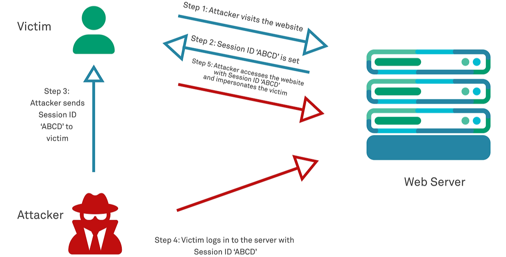

# **세션 고정 보호 전략** 

- 세션 고정 공격은 악의적인 사용자가 사이트에 접근하여 세션을 생성한 다음 다른 사용자가 같은 세션으로 로그인하도록 유도하는 위험을 말한다 
- 스프링 시큐리티는 사용자가 로그인할 때 새로운 세션을 생성하거나 세션 ID를 변경함으로써 이러한 공격에 자동으로 대응한다 

# **세션 고정 공격 (Session Fixation Attack)**



1. 공격자가 웹사이트 방문 세션 ID를 얻는다. 
1. 공격자는 일반 사용자의 쿠키에 세션 ID를 설정한다
1. 사용자는 쿠키에 공격자의 세션 ID를 가진 상태로 웹사이트에 로그인을 한다 
1. 서버는 해당 세션 ID를 가지고 사용자의 세션을 생성해서 서버에 저장한다 
1. 공격자는 이제 세션 ID를 통해서 사용자의 권한을 가지고 활동이 가능하다 

# **sessionManagement() API ­ 세션 고정 보호**

```java
@Bean
public SecurityFilterChain securityFilterChain(HttpSecurity http) throws Exception {
	 http.sessionManagement((session) -> session
		          .sessionFixation(sessionFixation -> sessionFixation.newSession()));
	 return http.build();
}
```

# **세션 고정 보호 전략**

- **changeSessionId()**
- 기존 세션을 유지하면서 세션 ID만 변경해서 인증 과정에서 세션 고정 공격을 방지하는 방식이다 
  - 기본 값으로 설정되어 있다
- **newSession()**
- 새로운 세션을 생성하고 기존 세션 데이터를 복사하지 않는 방식이다
- **migrateSession()**
- 새로운 세션을 생성하고 모든 기존 세션 속성을 새로운 세션으로 복사한다
- **none()**
- 기존 세션을 그대로 사용한다 
  - 세션 고정 공격에 무방비하다

