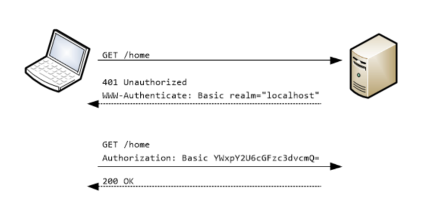
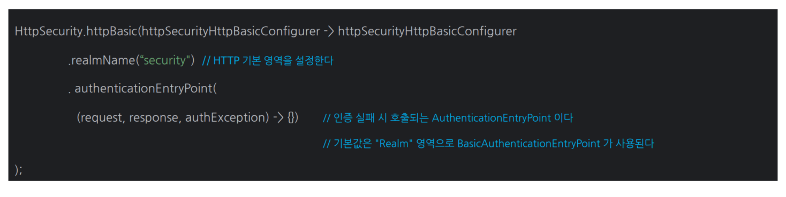

- HTTP는 액세스 제어와 인증을 위한 프레임워크를 제공하며 가장 일반적인 인증 방식은 `Basic` 인증 방식이다 
- `RFC 7235 표준`이며 인증 프로토콜은 HTTP 인증 헤더에 기술되어 있다



**HTTP basic 인증 프로세스** 

1. 클라이언트는 인증 정보 없이 서버로 접속을 시도
1. 서버가 클라이언트에게 인증 요구를 보낼 때 `401 Unauthorized` 응답과 함께 `WWW-Authenticate` 헤더를 기술해서 realm(보안 영역)과 Basic 인증 방법을 보낸다 
1. 클라이언트가 서버로 접속할 때 Base64로 username과 password를 인코딩하고 `Authorization`헤더에 담아서 요청한다 
1. 성공적으로 완료되면 정상적인 상태 코드를 반환한다 

**주의 사항** 

- base-64 인코딩된 값은 디코딩이 가능하기 때문에 인증정보가 노출된다 
- HTTP basic 인증은 반드시 `HTTPS` 같이 `TLS`기술과 함께 사용해야 한다 

# **httpBasic() API**

- `HttpBasicConfigurer` 설정 클래스를 통해 여러 API들을 설정할 수 있다 
- 내부적으로 `BasicAuthenticationFilter`가 생성되어 기본 인증 방식의 인증 처리를 담당하게 된다 



**CustomAuthenticationEntryPoint** 

```java
public class CustomAuthenticationEntryPoint implements AuthenticationEntryPoint {
    @Override
    public void commence(HttpServletRequest request, HttpServletResponse response, AuthenticationException authException) throws IOException, ServletException {
        response.setHeader("WWW-Authenticate", "Basic realm=security");
        response.sendError(HttpStatus.UNAUTHORIZED.value(), HttpStatus.UNAUTHORIZED.getReasonPhrase());
    }
}
```

`AuthenticationEntryPoint` 인터페이스를 구현하는 `CustomAuthenticationEntryPoint`  클래스 

응답 헤더에 `WWW-Authenticate` 를 설정한다 

만약 해당 응답 헤더가 잘못 설정되면 로그인 창이 뜨지 않는다. 

**CustomAuthenticationEntryPoint 등록** 

```java
@Bean
public SecurityFilterChain securityFilterChain(HttpSecurity http) throws Exception{
    http
            .authorizeHttpRequests(auth -> auth.anyRequest().authenticated())
            .httpBasic(basic -> basic.authenticationEntryPoint(new CustomAuthenticationEntryPoint()));

    return  http.build();
}
```

